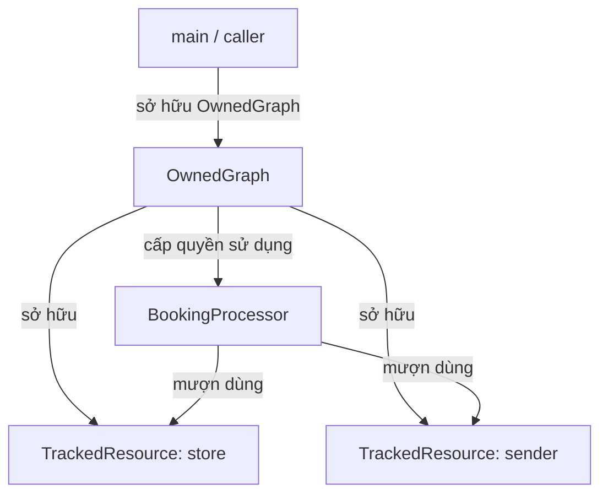
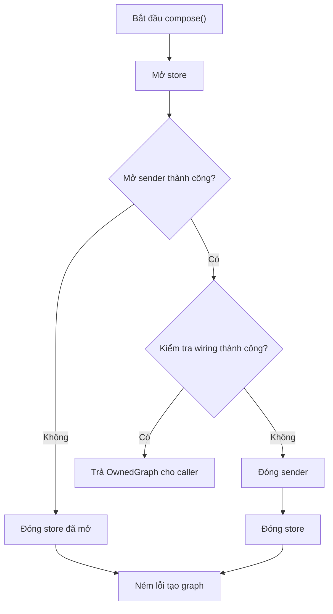
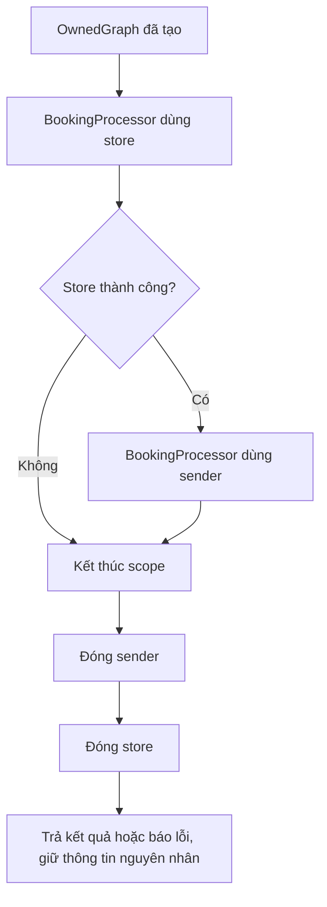

# Kiểm thử đóng tài nguyên khi khởi tạo hoặc xử lý thất bại

Một chương trình sử dụng **Dependency Injection (DI)** có thể tạo đủ service và hoạt động bình thường trong nhánh thành công, nhưng vẫn rò rỉ connection, socket, stream hoặc thread pool khi **một bước khởi tạo thất bại**. Một rủi ro khác xảy ra khi nghiệp vụ ném exception: code xử lý lỗi thoát sớm, khiến tài nguyên đã mở không được đóng. Thậm chí chính phương thức `close()` cũng có thể thất bại và che mất nguyên nhân ban đầu.

Bài thực hành này thuộc chương **Thực hành** của module **DEPENDENCY_INJECTION**. Mục tiêu là kiểm tra **resource ownership** từ lúc composition root tạo/lắp ghép đồ thị đối tượng đến lúc công việc kết thúc, thực hành **constructor injection**, **Inversion of Control (IoC)**, scope và vòng đời bằng **Java thuần**, chưa cần DI container.

Ta sẽ viết một chương trình mô phỏng hai tài nguyên, chủ động gây lỗi ở nhiều giai đoạn, rồi tạo **10 phép kiểm tra không cần framework**. Các phép kiểm xác nhận thứ tự đóng, số lần đóng và quan hệ giữa **exception chính** với **suppressed exception**.

## 1. Bài toán: tài nguyên nào đã mở thì phải có chủ sở hữu

Giả sử hệ thống xử lý xác nhận đặt chỗ sử dụng hai adapter có tài nguyên:

- `StoreChannel`: đại diện cho connection hoặc session ghi dữ liệu.
- `SenderChannel`: đại diện cho kết nối dùng để gửi thông báo.

Trong bài này, cả hai được mô phỏng bằng một lớp `TrackedResource` để quan sát các sự kiện `open`, `use` và `close`. Điều quan trọng không phải tên adapter mà là **thời điểm tài nguyên chuyển sang trạng thái đã mở** và **ai chịu trách nhiệm đóng nó**.



Khi graph đã được tạo thành công, **caller có trách nhiệm đóng graph**, và graph đóng các tài nguyên mà nó sở hữu. `BookingProcessor` chỉ được cấp quyền sử dụng store/sender qua constructor; service không nên gọi `close()` sau từng tác vụ.

Nhưng trong giai đoạn lắp ghép còn một tình huống khó hơn: **graph chưa tồn tại để được đóng**. Nếu tạo store thành công rồi việc mở sender thất bại, chính **composition root** phải thu hồi store. Không thể mong caller đóng một graph mà factory chưa kịp trả về.

### 1.1. Hai đường đi khác nhau phải được kiểm tra

**Đường đi khởi tạo thất bại:**



**Đường đi xử lý thất bại:**



Đây là **hai trách nhiệm ownership riêng**: trước khi chuyển giao graph, composition root cleanup khi khởi tạo lỗi; sau khi chuyển giao, caller đóng graph trong `try-with-resources` dù nghiệp vụ thành công hay thất bại.

## 2. Hợp đồng tối thiểu về vòng đời

Trong Java, một tài nguyên hỗ trợ `AutoCloseable` có thể được dùng trong `try-with-resources`. Với `Closeable` hoặc những implementation `AutoCloseable` cụ thể, cần xem hợp đồng về exception, việc đóng lặp và hành vi khi đã đóng.

| Thành phần | Quyền sử dụng | Trách nhiệm đóng |
| --- | --- | --- |
| `BookingProcessor` | Gọi thao tác trên store/sender | **Không đóng** tài nguyên được tiêm |
| `RecordingFactory` / composition root | Tạo tài nguyên và lắp graph | Cleanup **những tài nguyên đã mở** nếu lắp ghép thất bại |
| `OwnedGraph` | Giữ hai handle tài nguyên | Đóng tài nguyên do graph sở hữu, theo thứ tự an toàn |
| `main()` hoặc caller | Thực hiện nghiệp vụ qua graph | Kết thúc scope bằng `try-with-resources` |
| DI container, nếu được dùng | Tạo/cấp bean theo cấu hình | Chỉ cleanup những resource mà nó quản lý theo hợp đồng lifecycle của runtime |

**Lưu ý:** `AutoCloseable` không bắt buộc mọi implementation có `close()` idempotent. Bài này *chủ động* thiết kế `TrackedResource.close()` gọi lặp không gây thêm sự kiện, để minh họa dễ kiểm tra. Với tài nguyên thực, không nên tự đóng lặp chỉ vì interface có tên `AutoCloseable`.

### 2.1. Giữ exception gốc khi cleanup cũng lỗi

Một phương thức `close()` có thể ném `IOException`. Nếu code làm:

```java
try {
    performBusinessWork();
} finally {
    resource.close();
}
```

thì lỗi từ `close()` trong `finally` có thể **che mất exception nghiệp vụ** đã xảy ra. Đoạn trên chỉ minh họa cấu trúc và giả định `resource`, `performBusinessWork()` đã được khai báo.

Với `try-with-resources`, Java giữ **exception từ thân `try` làm lỗi chính** và gắn lỗi từ `close()` vào danh sách `getSuppressed()` của lỗi chính. Khi có nhiều tài nguyên khai báo trong cùng `try`, Java đóng chúng theo **thứ tự ngược với thứ tự khai báo**.

Ở giai đoạn lắp ghép thủ công, nếu cần đóng một tài nguyên sau khi factory thứ hai thất bại, hãy áp dụng cùng nguyên tắc: **không ghi đè lỗi tạo graph bằng lỗi dọn dẹp**. Phần thực hành sẽ dùng `Throwable.addSuppressed(...)` trong đúng nhánh cleanup.

## 3. Xây dựng tình huống lỗi có thể quan sát

Trong kiểm thử tài nguyên thật, lỗi xảy ra do mạng, driver, timeout hoặc hệ điều hành thường khó tái lập chính xác. Ta thay bằng **test double có điều khiển lỗi**:

| Cờ lỗi | Giai đoạn mô phỏng | Kỳ vọng |
| --- | --- | --- |
| `failOpeningSender` | Sau khi store đã mở, trước khi sender được cấp thành công | Store được đóng; báo lỗi mở sender |
| `failWiring` | Cả store và sender đã mở, nhưng xác nhận cấu hình/lắp ghép thất bại | Đóng sender rồi store |
| `failStoreWork` | Xử lý nghiệp vụ trên store | Không gọi sender; vẫn đóng cả hai khi thoát scope |
| `failSenderWork` | Store thành công, sender lỗi | Lỗi xử lý được quan sát; vẫn đóng cả hai |
| `failSenderClose` | Cleanup sender | Store vẫn được đóng; lỗi đóng sender không bị nuốt |
| `failStoreClose` | Cleanup store | Lỗi đóng store được báo hoặc suppressed đúng cách |

Mỗi sự kiện được ghi thành chuỗi `open:store`, `use:store`, `close:sender`... Các test có thể so sánh **toàn bộ thứ tự** chứ không chỉ kiểm tra cờ `isClosed()` ở cuối.

### 3.1. Vì sao phải kiểm tra thứ tự?

Giả sử sender cần store còn mở khi cleanup. Khi đó phải đóng sender **trước** store, tức theo thứ tự ngược với quá trình tạo. Trong ví dụ này hai resource không thực sự phụ thuộc nhau, nhưng ta cố ý chọn quy tắc **store mở trước, sender mở sau; sender đóng trước, store đóng sau**.

Thứ tự đúng phải xuất phát từ **đồ thị sở hữu và yêu cầu của adapter thật**, không phải một quy tắc “đóng ngược” được áp dụng mù quáng cho mọi hệ thống. Nếu hai resource không có quan hệ, việc quy định một thứ tự cố định vẫn giúp kiểm thử và gỡ lỗi nhất quán.

## 4. Ví dụ Java 11 hoàn chỉnh: composition root cleanup khi khởi tạo lỗi

Lưu toàn bộ mã sau vào tệp **`FailureCleanupExample.java`**. Mã chạy bằng JDK 11 trở lên và không cần Spring, Guice, CDI hoặc thư viện ngoài.

```java
import java.io.IOException;
import java.util.ArrayList;
import java.util.List;
import java.util.Objects;

public final class FailureCleanupExample {
    private FailureCleanupExample() {}

    // Mỗi cờ chỉ mô phỏng một điểm có thể thất bại.
    public static final class FailurePlan {
        public boolean failOpeningSender;
        public boolean failWiring;
        public boolean failStoreWork;
        public boolean failSenderWork;
        public boolean failStoreClose;
        public boolean failSenderClose;
    }

    // Resource mô phỏng có tên, trạng thái đóng và nhật ký sự kiện.
    public static final class TrackedResource implements AutoCloseable {
        private final String name;
        private final List<String> events;
        private final boolean failWork;
        private final boolean failClose;
        private boolean closed;
        private int closeCount;

        private TrackedResource(
                String name, List<String> events,
                boolean failWork, boolean failClose) {
            this.name = name;
            this.events = events;
            this.failWork = failWork;
            this.failClose = failClose;
        }

        public void use() throws IOException {
            if (closed) {
                throw new IllegalStateException(name + " is closed");
            }
            events.add("use:" + name);
            if (failWork) {
                throw new IOException("use " + name + " failed");
            }
        }

        @Override
        public void close() throws IOException {
            // Quy ước riêng của resource demo: close() idempotent.
            if (closed) {
                return;
            }
            closed = true;
            closeCount++;
            events.add("close:" + name);
            if (failClose) {
                throw new IOException("close " + name + " failed");
            }
        }

        public boolean isClosed() {
            return closed;
        }

        public int closeCount() {
            return closeCount;
        }
    }

    // Factory có thể tạo resource hoặc cố ý phát sinh lỗi.
    public static final class RecordingFactory {
        private final FailurePlan plan;
        private final List<String> events = new ArrayList<>();
        private final List<TrackedResource> opened = new ArrayList<>();

        public RecordingFactory(FailurePlan plan) {
            this.plan = Objects.requireNonNull(plan, "plan");
        }

        private TrackedResource open(
                String name, boolean failWork, boolean failClose) {
            events.add("open:" + name);
            TrackedResource resource =
                new TrackedResource(name, events, failWork, failClose);
            opened.add(resource);
            return resource;
        }

        public TrackedResource openStore() {
            return open(
                "store", plan.failStoreWork, plan.failStoreClose);
        }

        public TrackedResource openSender() throws IOException {
            if (plan.failOpeningSender) {
                events.add("open-failed:sender");
                throw new IOException("open sender failed");
            }
            return open(
                "sender", plan.failSenderWork, plan.failSenderClose);
        }

        public void validateWiring() {
            if (plan.failWiring) {
                events.add("wire-failed");
                throw new IllegalStateException("wiring failed");
            }
            events.add("wire-ok");
        }

        public List<String> events() {
            return List.copyOf(events);
        }

        // Chỉ dùng để quan sát lifecycle trong bài kiểm thử.
        public List<TrackedResource> opened() {
            return List.copyOf(opened);
        }
    }

    // Consumer KHÔNG sở hữu hai resource được tiêm.
    public static final class BookingProcessor {
        private final TrackedResource store;
        private final TrackedResource sender;

        public BookingProcessor(
                TrackedResource store, TrackedResource sender) {
            this.store = Objects.requireNonNull(store, "store");
            this.sender = Objects.requireNonNull(sender, "sender");
        }

        public void process() throws IOException {
            store.use();
            sender.use();
            // Không gọi close() tại đây.
        }
    }

    // Sau khi compose thành công, graph sở hữu cả hai resource.
    public static final class OwnedGraph implements AutoCloseable {
        public final BookingProcessor processor;
        private final TrackedResource store;
        private final TrackedResource sender;
        private boolean closed;

        private OwnedGraph(
                TrackedResource store, TrackedResource sender) {
            this.store = Objects.requireNonNull(store, "store");
            this.sender = Objects.requireNonNull(sender, "sender");
            this.processor = new BookingProcessor(store, sender);
        }

        @Override
        public void close() throws IOException {
            if (closed) {
                return;
            }
            closed = true;

            IOException firstFailure = null;
            // Đóng theo thứ tự NGƯỢC với lúc mở.
            try {
                sender.close();
            } catch (IOException failure) {
                firstFailure = failure;
            }

            // Một lỗi từ sender.close() không được bỏ qua store.close().
            try {
                store.close();
            } catch (IOException failure) {
                if (firstFailure == null) {
                    firstFailure = failure;
                } else {
                    firstFailure.addSuppressed(failure);
                }
            }

            if (firstFailure != null) {
                throw firstFailure;
            }
        }
    }

    // Cleanup sau khi đang có lỗi: giữ lỗi ban đầu làm nguyên nhân chính.
    private static void closeOnFailure(
            TrackedResource resource, Throwable primary) {
        try {
            resource.close();
        } catch (IOException cleanupFailure) {
            primary.addSuppressed(cleanupFailure);
        }
    }

    // Composition root: trong lúc compose, nó còn sở hữu resource đã mở.
    public static OwnedGraph compose(RecordingFactory factory)
            throws IOException {
        Objects.requireNonNull(factory, "factory");

        TrackedResource store = factory.openStore();
        try {
            TrackedResource sender = factory.openSender();
            try {
                factory.validateWiring();
                // Chỉ chuyển quyền sở hữu khi graph được tạo thành công.
                return new OwnedGraph(store, sender);
            } catch (RuntimeException | Error creationFailure) {
                closeOnFailure(sender, creationFailure);
                throw creationFailure;
            }
        } catch (IOException | RuntimeException | Error creationFailure) {
            closeOnFailure(store, creationFailure);
            throw creationFailure;
        }
    }

    public static void main(String[] args) throws Exception {
        RecordingFactory factory = new RecordingFactory(new FailurePlan());

        // main() sở hữu graph trả về từ composition root.
        try (OwnedGraph graph = compose(factory)) {
            graph.processor.process();
        }

        System.out.println(factory.events());
    }
}
```

Biên dịch và chạy:

```bash
javac FailureCleanupExample.java
java FailureCleanupExample
```

Kết quả dự kiến:

```text
[open:store, open:sender, wire-ok, use:store, use:sender, close:sender, close:store]
```

### 4.1. Hai thời điểm chuyển giao ownership

Trong `compose(...)`:

- Sau `factory.openStore()`, **composition root** chịu trách nhiệm đóng store nếu phần còn lại thất bại.
- Sau `factory.openSender()`, composition root tạm thời chịu trách nhiệm **cả hai resource**.
- Nếu `validateWiring()` hoặc constructor của graph thất bại, composition root đóng **sender rồi store**.
- Chỉ sau khi `return new OwnedGraph(store, sender)` thành công, caller mới nhận **handle `OwnedGraph`** và chịu trách nhiệm đóng graph; graph đóng hai resource nội bộ.

Khi `process()` ném lỗi, các `catch` của `compose(...)` **không còn tham gia**, vì giai đoạn lắp ghép đã kết thúc. `try-with-resources` bên caller mới là cơ chế cleanup của đường xử lý.

### 4.2. Vì sao cần bắt cả `RuntimeException` và `Error` khi đang lắp ghép?

Một constructor hoặc logic cấu hình có thể ném exception unchecked trong lúc graph chưa hoàn tất. `compose(...)` dùng `catch (RuntimeException | Error)` cho nhánh sau khi mở sender, và `catch (IOException | RuntimeException | Error)` ở nhánh ngoài để cleanup tài nguyên đã có. Điều này minh họa rằng **không nên bỏ rơi resource đã mở** khi giai đoạn lắp ghép ném lỗi bất thường.

Việc catch `Error` ở đây chỉ để **dọn dẹp rồi ném lại**, không phải để coi các lỗi nghiêm trọng của JVM là có thể phục hồi hoặc tiếp tục phục vụ request. Với lỗi làm tiến trình mất khả năng hoạt động, cleanup cũng có thể không chạy hoàn chỉnh. Không có bảo đảm `close()` sẽ được thực thi khi JVM bị kill đột ngột hoặc mất điện.

### 4.3. Lưu ý về factory tự mở một nửa resource

`failOpeningSender` trong ví dụ mô phỏng lỗi **trước khi trả sender** và trước khi tạo resource sender thành công. Nếu một factory thật mở socket rồi gặp lỗi khi thực hiện handshake **bên trong chính `openSender()`**, composition root không có tham chiếu tới socket chưa được trả về. **Factory phải tự dọn phần tài nguyên mà nó đã cấp phát trước khi ném lỗi**, hoặc sử dụng API có quy tắc quản lý acquisition rõ ràng.

Do đó, “composition root sẽ cleanup mọi thứ” chỉ đúng với **những resource nó đã nhận quyền sở hữu**. Mỗi tầng phải bảo đảm cleanup cho resource do mình tạo nhưng chưa chuyển giao.

## 5. Viết 10 phép kiểm tra vòng đời bằng Java thuần

Thay vì dùng `Thread.sleep(...)` hoặc tạo kết nối thật để “chờ lỗi”, ta cho `FailurePlan` kích hoạt lỗi đúng thời điểm. Các test chỉ quan sát **hợp đồng sở hữu và thứ tự cleanup**, không kiểm tra tài nguyên hệ điều hành.

Lưu mã sau thành **`FailureCleanupCheck.java`** trong cùng thư mục:

```java
import java.io.IOException;
import java.util.Arrays;
import java.util.List;

public final class FailureCleanupCheck {
    @FunctionalInterface
    private interface ThrowingAction {
        void run() throws Exception;
    }

    private static void check(boolean condition, String message) {
        if (!condition) {
            throw new AssertionError(message);
        }
    }

    private static <T extends Throwable> T expectFailure(
            ThrowingAction action, Class<T> type, String fragment) {
        try {
            action.run();
        } catch (Exception | Error failure) {
            if (type.isInstance(failure)
                    && failure.getMessage() != null
                    && failure.getMessage().contains(fragment)) {
                return type.cast(failure);
            }
            throw new AssertionError(
                "Unexpected failure: " + failure, failure);
        }
        throw new AssertionError("Expected failure containing: " + fragment);
    }

    private static FailureCleanupExample.RecordingFactory factory(
            FailureCleanupExample.FailurePlan plan) {
        return new FailureCleanupExample.RecordingFactory(plan);
    }

    private static void checkEvents(
            FailureCleanupExample.RecordingFactory factory,
            String... expected) {
        List<String> actual = factory.events();
        check(actual.equals(Arrays.asList(expected)),
            "Wrong event order. Expected " + Arrays.toString(expected)
                + ", actual " + actual);
    }

    private static void checkAllClosed(
            FailureCleanupExample.RecordingFactory factory, int count) {
        check(factory.opened().size() == count,
            "Wrong number of successfully acquired resources");
        for (FailureCleanupExample.TrackedResource resource : factory.opened()) {
            check(resource.isClosed(), "An acquired resource remains open");
            check(resource.closeCount() == 1,
                "An acquired resource must be closed once");
        }
    }

    private static void successClosesInReverseOrder() throws Exception {
        FailureCleanupExample.RecordingFactory f =
            factory(new FailureCleanupExample.FailurePlan());
        try (FailureCleanupExample.OwnedGraph graph =
                FailureCleanupExample.compose(f)) {
            graph.processor.process();
        }
        checkEvents(f,
            "open:store", "open:sender", "wire-ok",
            "use:store", "use:sender",
            "close:sender", "close:store");
        checkAllClosed(f, 2);
    }

    private static void failedOpenClosesAlreadyAcquiredStore() {
        FailureCleanupExample.FailurePlan plan =
            new FailureCleanupExample.FailurePlan();
        plan.failOpeningSender = true;
        FailureCleanupExample.RecordingFactory f = factory(plan);

        expectFailure(
            () -> FailureCleanupExample.compose(f),
            IOException.class, "open sender failed");
        checkEvents(f,
            "open:store", "open-failed:sender", "close:store");
        checkAllClosed(f, 1);
    }

    private static void failedWiringClosesBothInReverseOrder() {
        FailureCleanupExample.FailurePlan plan =
            new FailureCleanupExample.FailurePlan();
        plan.failWiring = true;
        FailureCleanupExample.RecordingFactory f = factory(plan);

        expectFailure(
            () -> FailureCleanupExample.compose(f),
            IllegalStateException.class, "wiring failed");
        checkEvents(f,
            "open:store", "open:sender", "wire-failed",
            "close:sender", "close:store");
        checkAllClosed(f, 2);
    }

    private static void storeWorkFailureStillClosesBoth() {
        FailureCleanupExample.FailurePlan plan =
            new FailureCleanupExample.FailurePlan();
        plan.failStoreWork = true;
        FailureCleanupExample.RecordingFactory f = factory(plan);

        expectFailure(() -> {
            try (FailureCleanupExample.OwnedGraph graph =
                    FailureCleanupExample.compose(f)) {
                graph.processor.process();
            }
        }, IOException.class, "use store failed");
        checkEvents(f,
            "open:store", "open:sender", "wire-ok",
            "use:store", "close:sender", "close:store");
        checkAllClosed(f, 2);
    }

    private static void senderWorkFailureStillClosesBoth() {
        FailureCleanupExample.FailurePlan plan =
            new FailureCleanupExample.FailurePlan();
        plan.failSenderWork = true;
        FailureCleanupExample.RecordingFactory f = factory(plan);

        expectFailure(() -> {
            try (FailureCleanupExample.OwnedGraph graph =
                    FailureCleanupExample.compose(f)) {
                graph.processor.process();
            }
        }, IOException.class, "use sender failed");
        checkEvents(f,
            "open:store", "open:sender", "wire-ok",
            "use:store", "use:sender",
            "close:sender", "close:store");
        checkAllClosed(f, 2);
    }

    private static void oneCloseFailureStillClosesOtherResource() {
        FailureCleanupExample.FailurePlan plan =
            new FailureCleanupExample.FailurePlan();
        plan.failSenderClose = true;
        FailureCleanupExample.RecordingFactory f = factory(plan);

        expectFailure(() -> {
            try (FailureCleanupExample.OwnedGraph graph =
                    FailureCleanupExample.compose(f)) {
                graph.processor.process();
            }
        }, IOException.class, "close sender failed");
        checkEvents(f,
            "open:store", "open:sender", "wire-ok",
            "use:store", "use:sender",
            "close:sender", "close:store");
        checkAllClosed(f, 2);
    }

    private static void twoCloseFailuresPreserveBothExceptions() {
        FailureCleanupExample.FailurePlan plan =
            new FailureCleanupExample.FailurePlan();
        plan.failSenderClose = true;
        plan.failStoreClose = true;
        FailureCleanupExample.RecordingFactory f = factory(plan);

        IOException primary = expectFailure(() -> {
            try (FailureCleanupExample.OwnedGraph graph =
                    FailureCleanupExample.compose(f)) {
                graph.processor.process();
            }
        }, IOException.class, "close sender failed");

        Throwable[] suppressed = primary.getSuppressed();
        check(suppressed.length == 1
                && "close store failed".equals(suppressed[0].getMessage()),
            "Store close failure must be suppressed onto sender close failure");
        checkAllClosed(f, 2);
    }

    private static void workErrorRemainsPrimaryWhenCloseAlsoFails() {
        FailureCleanupExample.FailurePlan plan =
            new FailureCleanupExample.FailurePlan();
        plan.failStoreWork = true;
        plan.failSenderClose = true;
        plan.failStoreClose = true;
        FailureCleanupExample.RecordingFactory f = factory(plan);

        IOException primary = expectFailure(() -> {
            try (FailureCleanupExample.OwnedGraph graph =
                    FailureCleanupExample.compose(f)) {
                graph.processor.process();
            }
        }, IOException.class, "use store failed");

        Throwable[] fromBody = primary.getSuppressed();
        check(fromBody.length == 1
                && "close sender failed".equals(fromBody[0].getMessage()),
            "Business failure must stay primary, close failure suppressed");
        Throwable[] nested = fromBody[0].getSuppressed();
        check(nested.length == 1
                && "close store failed".equals(nested[0].getMessage()),
            "Second close error must not be lost");
        checkAllClosed(f, 2);
    }

    private static void initializationErrorKeepsItsCauseWhenCloseFails() {
        FailureCleanupExample.FailurePlan plan =
            new FailureCleanupExample.FailurePlan();
        plan.failOpeningSender = true;
        plan.failStoreClose = true;
        FailureCleanupExample.RecordingFactory f = factory(plan);

        IOException primary = expectFailure(
            () -> FailureCleanupExample.compose(f),
            IOException.class, "open sender failed");
        Throwable[] suppressed = primary.getSuppressed();
        check(suppressed.length == 1
                && "close store failed".equals(suppressed[0].getMessage()),
            "Failed composition must retain original error and cleanup error");
        checkEvents(f,
            "open:store", "open-failed:sender", "close:store");
        checkAllClosed(f, 1);
    }

    private static void closingOwnerTwiceDoesNotCloseTwice()
            throws Exception {
        FailureCleanupExample.RecordingFactory f =
            factory(new FailureCleanupExample.FailurePlan());
        FailureCleanupExample.OwnedGraph graph =
            FailureCleanupExample.compose(f);

        graph.close();
        graph.close();
        checkAllClosed(f, 2);
        checkEvents(f,
            "open:store", "open:sender", "wire-ok",
            "close:sender", "close:store");
        expectFailure(
            () -> graph.processor.process(),
            IllegalStateException.class, "store is closed");
    }

    public static void main(String[] args) throws Exception {
        successClosesInReverseOrder();
        failedOpenClosesAlreadyAcquiredStore();
        failedWiringClosesBothInReverseOrder();
        storeWorkFailureStillClosesBoth();
        senderWorkFailureStillClosesBoth();
        oneCloseFailureStillClosesOtherResource();
        twoCloseFailuresPreserveBothExceptions();
        workErrorRemainsPrimaryWhenCloseAlsoFails();
        initializationErrorKeepsItsCauseWhenCloseFails();
        closingOwnerTwiceDoesNotCloseTwice();
        System.out.println("PASS: 10 resource cleanup checks");
    }
}
```

Biên dịch và chạy hai tệp:

```bash
javac FailureCleanupExample.java FailureCleanupCheck.java
java FailureCleanupCheck
```

Kết quả mong đợi nếu các điều kiện đạt:

```text
PASS: 10 resource cleanup checks
```

Các phép kiểm được viết bằng `check(...)` và ném `AssertionError` nếu sai, không cần bật cờ `-ea`. Mỗi test tạo một `FailurePlan` và một `RecordingFactory` mới để **không rò trạng thái giữa các ca thử**.

## 6. Đọc kết quả kiểm thử theo từng loại lỗi

### 6.1. Khởi tạo thất bại sau khi mở một resource

Khi `failOpeningSender=true`, factory đã cấp store nhưng chưa cấp sender. Chuỗi sự kiện cần là:

```text
open:store
open-failed:sender
close:store
```

Kết quả quan trọng:

- Lỗi `open sender failed` được truyền cho caller.
- Store được đóng **một lần** dù graph chưa từng được trả về.
- Không có sự kiện `close:sender` vì ví dụ chưa tạo thành công sender. Không được giả vờ “đã đóng một resource” nếu chưa có resource nào được cấp cho composition root.

Nếu store đã mở thành công nhưng trong lúc `openSender()` có nhiều bước cấp phát nội bộ, **factory mở sender** cần dọn các phần nó đã mở trước khi ném lỗi. Composition root không thể đóng handle mà nó chưa nhận.

### 6.2. Wiring thất bại sau khi mở cả hai

Khi `failWiring=true`, expected events:

```text
open:store
open:sender
wire-failed
close:sender
close:store
```

Trong tình huống này, composition root đang sở hữu cả hai resource. Vì vậy nó dọn **sender trước, store sau**, rồi ném lại `IllegalStateException("wiring failed")`.

Phép kiểm phân biệt lỗi này với **thiếu binding được phát hiện trước khi mở bất kỳ resource nào**. Nếu có thể kiểm tra cấu hình trước khi mở connection, nên làm vậy để tránh cấp phát không cần thiết. Nhưng vẫn phải có cleanup vì một số lỗi chỉ phát hiện được khi khởi tạo đã đi được một phần.

### 6.3. Xử lý thất bại sau khi graph đã được trả về

Với `failStoreWork=true`, sự kiện `use:store` xảy ra rồi ném lỗi; `use:sender` không được thực hiện. Sau đó `try-with-resources` kết thúc scope và gọi `OwnedGraph.close()`, làm cả hai resource được đóng.

Nếu `failSenderWork=true`, `use:store` đã thành công, `use:sender` ném lỗi, và cả hai vẫn phải được đóng. **Đóng tài nguyên không đồng nghĩa rollback mọi tác dụng phụ đã xảy ra**: nếu store đã commit dữ liệu thật trước khi sender thất bại, cần transaction/outbox hoặc quy tắc phục hồi riêng. DI không tự bảo đảm tính nguyên tử giữa lưu và gửi.

### 6.4. Chính `close()` cũng thất bại

Khi chỉ `failSenderClose=true`:

- `sender.close()` ném `IOException("close sender failed")`.
- `OwnedGraph.close()` **vẫn gọi `store.close()`**.
- Vì không có lỗi nghiệp vụ trong thân `try`, lỗi đóng sender trở thành exception chính được gửi tới caller.

Khi cả sender và store đều ném lỗi ở `close()`, code của `OwnedGraph` chọn lỗi đóng sender làm **lỗi chính của thao tác đóng graph** và gắn lỗi đóng store vào `getSuppressed()` của nó.

### 6.5. Lỗi nghiệp vụ và lỗi đóng xảy ra cùng lúc

Đây là trường hợp cần đọc đúng cấu trúc exception:

```text
IOException: use store failed
  suppressed:
    IOException: close sender failed
      suppressed:
        IOException: close store failed
```

Tầng thứ nhất xuất hiện vì **`try-with-resources` giữ lỗi nghiệp vụ làm primary** và gắn lỗi từ `OwnedGraph.close()` vào nó. Tầng thứ hai xuất hiện vì **`OwnedGraph.close()` gom hai lỗi đóng** theo thứ tự. Nếu chỉ in `getMessage()` của exception chính, ta sẽ bỏ lỡ thông tin về resource nào đã không đóng được.

Tương tự, nếu mở sender thất bại nhưng đóng store cũng lỗi, `compose(...)` giữ `open sender failed` làm nguyên nhân chính và thêm `close store failed` vào `getSuppressed()`. Đây là điều `initializationErrorKeepsItsCauseWhenCloseFails` xác nhận.

### 6.6. Vì sao test kiểm tra `closeCount()==1`?

Chỉ kiểm tra `isClosed()==true` không đủ. Một adapter có thể bị đóng hai lần: ở nhánh lỗi trong composition root rồi lại bị caller đóng sau khi hoàn thành không đúng hợp đồng. Với một resource đóng lặp không an toàn, lỗi đó có thể gây tác dụng phụ.

Trong ví dụ, `TrackedResource` chủ động chọn `close()` idempotent và `OwnedGraph` có cờ `closed`. Phép kiểm `closingOwnerTwiceDoesNotCloseTwice` bảo đảm một graph **không dọn cùng resource nhiều lần** theo chính sách bài học. Cờ `closed` này không phải thiết kế an toàn để nhiều thread cùng gọi `close()`: vấn đề đồng thời cần xử lý riêng nếu graph thực tế được chia sẻ giữa nhiều luồng.

## 7. Những điều unit test này chưa chứng minh

Một bộ kiểm tra có thể chủ động ném exception là công cụ tốt để xác nhận **luồng điều khiển và ownership**, nhưng chưa chứng minh resource thật đã được thu hồi khỏi hệ điều hành.

| Bằng chứng từ Java thuần | Điều vẫn cần integration test |
| --- | --- |
| `close()` được gọi theo thứ tự đã quy định | Socket/connection thực sự được đóng hoặc trả pool |
| Lỗi xử lý vẫn kích hoạt cleanup | Transaction thật rollback/commit như thiết kế |
| Hai lỗi đóng không làm mất exception | Driver/client thật có cleanup toàn diện khi `close()` ném lỗi |
| Resource được đóng đúng một lần theo mô phỏng | Framework có gọi callback shutdown ngoài ý muốn hay không |
| Graph mới có resource riêng | Scope của CDI/Guice/Spring có cấp đúng instance không |
| Một luồng kiểm thử hoàn tất ổn định | Race condition khi nhiều request cùng chạy hoặc shutdown song song |

Ví dụ không mở database, file hoặc network. Do đó `PASS` chỉ xác nhận những **điều kiện mà test kiểm tra**, không đồng nghĩa đã đạt SLA tài nguyên, thread safety hoặc giao thức xử lý lỗi của adapter production.

### 7.1. Nếu dùng DI container

Với Spring, Jakarta CDI, Guice hoặc runtime khác, hãy xác định rõ **container sở hữu resource nào**. Một bean có lifecycle callback có thể được container dọn lúc context đóng, nhưng một connection được tạo bên trong method rồi không trả lại cho pool vẫn có thể rò rỉ. Với object được tạo ngoài container rồi cấp vào, quyền sở hữu và trách nhiệm cleanup còn phụ thuộc API và cấu hình.

Nên giữ **unit test service bằng Java thuần** như trên và bổ sung **container smoke/lifecycle test** khi cần xác minh:

- Producer/factory lắp ghép đúng instance và scope.
- Khi tạo bean giữa chừng bị lỗi, tài nguyên đã được cấp được dọn theo quy tắc.
- Tài nguyên dùng chung không bị đóng khi một consumer hoàn thành.
- Context/container shutdown gọi callback phù hợp, không đóng resource quá sớm.

Container **không thay thế** bản hợp đồng owner giữa các thành phần. Khi thêm một adapter mới cần `AutoCloseable`, phải xác định ai tạo, ai đóng và cách khôi phục khi factory hoặc consumer thất bại.

## 8. Các lỗi thiết kế thường gặp

**Chỉ dọn tài nguyên ở đường thành công.** Một lời gọi `close()` đặt sau `process()` sẽ bị bỏ qua nếu `process()` ném lỗi. Dùng `try-with-resources` tại đúng scope sở hữu.

**Coi việc trả về factory là không thể thất bại.** Một graph có thể khởi tạo một phần. Composition root phải cleanup những gì đã được cấp khi constructor hoặc factory tiếp theo ném lỗi.

**Bắt lỗi cleanup rồi im lặng.** `catch (IOException ignored) {}` có thể làm mất thông tin connection đóng không thành công. Với lỗi đã có, dùng suppressed; với lỗi đóng đơn lẻ, báo lỗi theo hợp đồng.

**Dùng `finally` để đóng nhưng che lỗi gốc.** Nếu `finally` tự ném exception khi đã có lỗi nghiệp vụ, thông tin nguyên nhân có thể bị mất. `try-with-resources` giúp quản lý primary/suppressed cho tài nguyên được khai báo.

**Dừng đóng ngay khi resource đầu tiên lỗi.** Với nhiều resource sở hữu độc lập, một lỗi ở `sender.close()` không nên ngăn nỗ lực `store.close()`. Hãy gom lỗi nhưng vẫn thử đóng các resource còn lại.

**Cho consumer tự ý đóng dependency được tiêm.** Nếu nhiều service dùng chung HTTP client hoặc pool, service đầu tiên đóng có thể làm những service khác thất bại. Chỉ owner có quyền kết thúc vòng đời theo hợp đồng.

**Chỉ kiểm tra trạng thái đóng, không kiểm tra thứ tự/số lần.** Một bài test quan sát sự kiện giúp bắt lỗi đóng ngược sai phụ thuộc hoặc đóng lặp; không thay thế test resource thật.

**Mở resource bên trong constructor rồi ném lỗi mà không cleanup.** Khi constructor không trả object, caller không có tham chiếu để đóng. Constructor/factory phải xử lý phần tài nguyên đã mở trước khi phát sinh lỗi.

**Nhầm đóng resource với đảm bảo nghiệp vụ nguyên tử.** Đóng store/sender sau khi xử lý lỗi không tự hoàn tác dữ liệu đã ghi hoặc email đã gửi. Transaction, outbox, retry và idempotency cần được thiết kế và kiểm thử theo yêu cầu riêng.

**Cho rằng ví dụ thread-safe.** `RecordingFactory` và `OwnedGraph` trong bài phục vụ luồng đơn của unit test. Với server đa luồng, việc shutdown đồng thời với `process()` cần đồng bộ, chính sách ngừng nhận công việc, chờ hoàn tất và quản lý tài nguyên phù hợp.

## 9. Quy trình thực hành khi review một composition root

1. **Liệt kê mọi resource có cleanup.** File, socket, stream, DB connection, transaction, executor, subscription hoặc client có `close()/shutdown()`.
2. **Vẽ thứ tự tạo và quan hệ phụ thuộc.** Resource nào phải tồn tại trước resource khác, ai dùng ai?
3. **Đánh dấu thời điểm chuyển giao quyền sở hữu.** Factory có trả handle thành công chưa? Caller có nhận graph chưa?
4. **Dọn phần đã tạo nếu khởi tạo lỗi.** Không để việc tạo resource thứ hai thất bại làm rò resource thứ nhất.
5. **Sử dụng `try-with-resources` tại scope owner.** Không đặt việc đóng ở method nghiệp vụ chỉ mượn dependency.
6. **Định nghĩa thứ tự đóng.** Đóng theo phụ thuộc; với nhiều resource, nỗ lực cleanup tất cả dù một lần đóng lỗi.
7. **Giữ lỗi chính và lỗi cleanup.** Dùng suppressed exception hoặc cấu trúc lỗi tương đương; tránh xóa mất nguyên nhân.
8. **Viết test cho từng điểm hỏng.** Mở resource, validate wiring, dùng resource, đóng resource, lỗi kép.
9. **Kiểm tra số lần và thứ tự cleanup.** Một cờ `closed` đơn lẻ không đủ để xác nhận ownership.
10. **Chạy integration test phù hợp với adapter thật.** Kiểm tra transaction, pool, kết nối, callback và shutdown trong môi trường thử nghiệm.

### Bài tập mở rộng

Giả sử composition root có thêm resource thứ ba `MetricsChannel`, được tạo sau sender và dùng bởi `BookingProcessor`. Yêu cầu đóng theo thứ tự **metrics → sender → store**.

Hãy tự thực hiện:

1. Thêm cờ `failOpeningMetrics`. Nếu tạo metrics thất bại, những resource nào đã mở và phải đóng theo thứ tự nào?
2. Thêm `failMetricsClose`. Nếu cả ba `close()` đều lỗi, exception nào là lỗi chính của `OwnedGraph.close()`, và những lỗi nào nên được suppressed?
3. Nếu `process()` đã ném `IOException("use store failed")`, lỗi đóng metrics/sender/store sẽ được gắn như thế nào để không che nguyên nhân?
4. Nếu metrics resource chỉ hợp lệ trong một job, có nên lưu nó trong singleton graph không? Ai chịu trách nhiệm đóng theo mỗi job?
5. Nếu factory mở socket cho metrics rồi mới thất bại khi handshake, bên nào có khả năng dọn socket chưa trả về?
6. Những kiểm tra nào vẫn có thể chạy bằng fake Java thuần, và điều gì cần kiểm tra bằng integration test với tài nguyên thật?

Hướng giải: mỗi bước acquire phải có **chủ sở hữu tạm thời** và cleanup phần đã mở nếu bước sau lỗi. Khi graph hoàn chỉnh, owner đóng các resource theo thứ tự được xác định bởi quan hệ sử dụng; lỗi đóng được gom mà không che lỗi xử lý chính. Resource có scope job không nên bị giữ tùy tiện trong application singleton; việc đóng phải nằm tại ranh giới job. Factory chịu trách nhiệm cleanup phần cấp phát bên trong nó trước khi bàn giao.

**Ghi nhớ:** **Kiểm thử đóng tài nguyên không chỉ là kiểm tra `close()` có được gọi ở nhánh thành công.** Cần kiểm tra cả **khởi tạo thất bại một phần**, **xử lý thất bại**, **cleanup tự ném lỗi**, **thứ tự và số lần đóng**, cùng **quyền sở hữu trước/sau khi chuyển giao graph**. Constructor injection giữ service tập trung vào nghiệp vụ, composition root chịu trách nhiệm tạo và cleanup trong giai đoạn wiring, còn caller hoặc container quản lý vòng đời sau khi graph đã được cấp. Các phép kiểm Java thuần giúp phát hiện lỗi ownership trước khi tích hợp resource thật và DI container.
