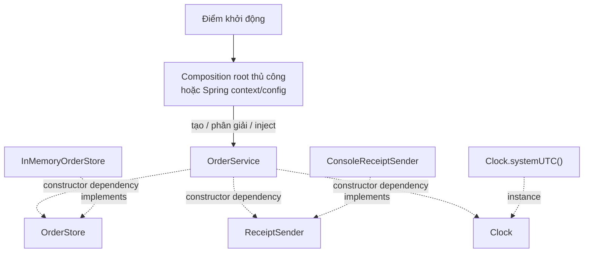
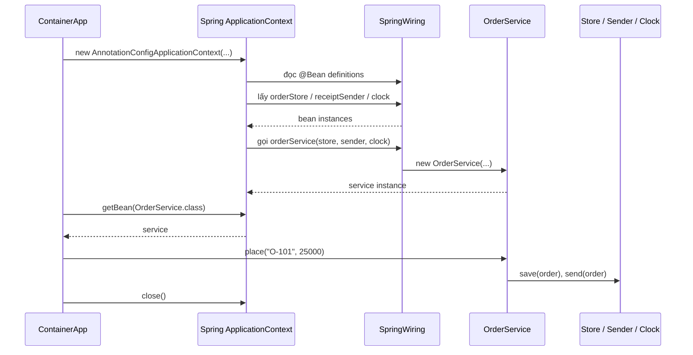

# So sánh cùng một thiết kế khi dùng DI thủ công và container

## 1. Mục tiêu thực hành: thay cách lắp ghép, giữ nguyên nghiệp vụ

Trong **Dependency Injection (DI)**, ý tưởng cốt lõi là một đối tượng **nhận** dependency từ bên ngoài thay vì tự quyết định tạo dependency. **Inversion of Control (IoC)** chuyển quyền lựa chọn và lắp ghép các cộng tác viên sang một nơi khác. Nơi ấy có thể là đoạn Java thuần trong **composition root**, hoặc một **DI container** như Spring.

Điều quan trọng là: **đổi từ DI thủ công sang container không có nghĩa phải viết lại service nghiệp vụ**. Nếu một `OrderService` đã nhận `OrderStore`, `ReceiptSender` và `Clock` qua constructor, ta có thể dùng chính lớp đó cho cả hai cách chạy.

Đây là bài **Thực hành** của module **Dependency Injection**. Ta so sánh hai đường lắp ghép trên **cùng một mô hình, cùng một constructor và cùng một bộ kiểm thử nghiệp vụ**, đồng thời quan sát ảnh hưởng tới cấu hình, vòng đời, scope, phát hiện lỗi và độ phức tạp. Trước hết sẽ chạy bằng **Java thuần**, sau đó dùng một Spring IoC container nhỏ **không cần Spring Boot** để làm rõ phần việc của container.

Sau bài này, bạn cần có khả năng:

1. Viết một service không biết mình được tạo thủ công hay bởi container.
2. Lắp ghép object graph bằng `new` và constructor injection tại composition root.
3. Đăng ký cùng object graph bằng Spring `@Configuration` và `@Bean`, rồi lấy service đã lắp ghép ở ranh giới ứng dụng.
4. Viết unit test bằng fake mà **không khởi động container** và kiểm tra wiring của container riêng.
5. So sánh chi phí thay đổi, cách phát hiện lỗi, scope, ownership và thời điểm nên cân nhắc container.

**Tiêu chí thành công:** Hai ứng dụng tạo một đơn hàng có cùng giá trị, gọi cùng các hợp đồng và cho kết quả nghiệp vụ tương đương. Chỉ **cách tạo/nối đối tượng** khác nhau.

## 2. Xác định bài toán và ranh giới thiết kế

Ứng dụng đặt hàng mẫu cần:

- Nhận mã đơn hàng và số tiền tính bằng **cent**.
- Lấy thời điểm tạo đơn từ `java.time.Clock`.
- Lưu đơn qua cổng `OrderStore`.
- Gửi biên nhận qua cổng `ReceiptSender`.
- Trả về đơn hàng vừa xử lý.

Để dễ tập trung vào DI, ví dụ không tính thuế, không có database, HTTP server hoặc gửi email thật. Adapter mặc định lưu trong bộ nhớ và ghi biên nhận ra console. Việc lưu và gửi vẫn là **hai tác dụng bên ngoài** tách khỏi service nghiệp vụ.

### 2.1. Sơ đồ object graph chung



Đồ thị phụ thuộc **không thay đổi** khi chuyển sang Spring. Ở DI thủ công, `ManualApp` tự gọi `new` và truyền tham chiếu. Ở Spring, cấu hình bean mô tả graph, container tạo hoặc lấy bean rồi gọi constructor. Cả hai cách đều áp dụng DI và IoC ở ranh giới lắp ghép.

### 2.2. Không trộn dependency với dữ liệu của một lời gọi

| Loại | Trong ví dụ | Cấp ở đâu? |
| --- | --- | --- |
| Dependency ổn định | `OrderStore`, `ReceiptSender`, `Clock` | Constructor `OrderService(...)` |
| Dữ liệu nghiệp vụ mỗi lần gọi | `orderId`, `amountCents` | Phương thức `place(orderId, amountCents)` |
| Cấu hình lựa chọn triển khai | Dùng console hay adapter khác | Composition root hoặc cấu hình container |
| Vòng đời resource | Đóng client/file writer nếu adapter sở hữu chúng | Chủ sở hữu tại root/container theo hợp đồng |

Service không được đọc `System.getenv()` để chọn adapter hoặc tự `new` một HTTP client. Đồng thời, cũng không nên đưa `orderId` vào constructor của một service có thể xử lý nhiều đơn hàng.

## 3. Chuẩn bị một cấu trúc mã dùng chung

Ta chọn Java **17 trở lên**. Các lớp nghiệp vụ bên dưới **không có import Spring**, nên có thể dùng nguyên vẹn trong hai ứng dụng.

Cấu trúc dự án minh họa:

```text
di-comparison/
├── pom.xml
└── src/
    └── main/
        └── java/
            └── example/
                └── di/
                    ├── Order.java
                    ├── OrderStore.java
                    ├── ReceiptSender.java
                    ├── OrderService.java
                    ├── InMemoryOrderStore.java
                    ├── ConsoleReceiptSender.java
                    ├── ManualApp.java
                    ├── SpringWiring.java
                    ├── ContainerApp.java
                    ├── OrderServicePlainTest.java
                    └── ContainerWiringSmoke.java
```

Các file test có tên `*Test`/`*Smoke` được đặt dưới `src/main/java` **chỉ để có thể chạy như chương trình Java bình thường mà không cần JUnit**. Trong dự án thực, hãy chuyển test sang `src/test/java`, dùng framework kiểm thử và tách chúng khỏi bản đóng gói production.

### 3.1. Mẫu Maven tối thiểu

Spring IoC container trong bài đến từ `spring-context`. Không cần web server, Spring Boot hay `spring-boot-starter`. Dùng một project Maven với file **`pom.xml`**:

```xml
<project xmlns="http://maven.apache.org/POM/4.0.0"
         xmlns:xsi="http://www.w3.org/2001/XMLSchema-instance"
         xsi:schemaLocation="http://maven.apache.org/POM/4.0.0
             https://maven.apache.org/xsd/maven-4.0.0.xsd">
    <modelVersion>4.0.0</modelVersion>
    <groupId>example</groupId>
    <artifactId>di-comparison</artifactId>
    <version>1.0-SNAPSHOT</version>

    <properties>
        <maven.compiler.release>17</maven.compiler.release>
        <project.build.sourceEncoding>UTF-8</project.build.sourceEncoding>
    </properties>

    <dependencies>
        <dependency>
            <groupId>org.springframework</groupId>
            <artifactId>spring-context</artifactId>
            <version>6.2.0</version>
        </dependency>
    </dependencies>

    <build>
        <plugins>
            <plugin>
                <groupId>org.apache.maven.plugins</groupId>
                <artifactId>maven-compiler-plugin</artifactId>
                <version>3.13.0</version>
            </plugin>
            <plugin>
                <groupId>org.codehaus.mojo</groupId>
                <artifactId>exec-maven-plugin</artifactId>
                <version>3.5.0</version>
            </plugin>
        </plugins>
    </build>
</project>
```

Phiên bản ở `pom.xml` là **mốc minh họa** để bài thực hành có cấu hình cụ thể, không phải khuyến nghị dùng mãi một phiên bản cũ. Khi đưa vào dự án thật, chọn bản Spring/Maven plugin được tổ chức hỗ trợ và cập nhật theo chính sách bảo trì. Phần dưới chỉ dùng những API ổn định của Spring Framework 6.x.

## 4. Bước A: viết phần nghiệp vụ bằng Java thuần

### 4.1. `Order.java` — dữ liệu kết quả bất biến

```java
package example.di;

import java.time.Instant;
import java.util.Objects;

public record Order(String id, long amountCents, Instant createdAt) {
    public Order {
        Objects.requireNonNull(id, "id");
        Objects.requireNonNull(createdAt, "createdAt");
        if (id.isBlank()) {
            throw new IllegalArgumentException("order id must not be blank");
        }
        if (amountCents < 0) {
            throw new IllegalArgumentException("amount must be non-negative");
        }
    }
}
```

`record` phù hợp với dữ liệu kết quả có các thành phần bất biến. Ở đây `String` và `Instant` cũng là các kiểu bất biến; không có danh sách mutable được lưu trực tiếp.

### 4.2. Hai cổng hạ tầng

**`OrderStore.java`**

```java
package example.di;

public interface OrderStore {
    void save(Order order);
}
```

**`ReceiptSender.java`**

```java
package example.di;

import java.io.IOException;

public interface ReceiptSender {
    void send(Order order) throws IOException;
}
```

Hai interface là **port**: service nói nó cần lưu và gửi, không nói database, SMTP hoặc console cụ thể. `IOException` nhắc rằng một adapter gửi biên nhận có thể thực hiện I/O và thất bại.

### 4.3. `OrderService.java` — constructor injection

```java
package example.di;

import java.io.IOException;
import java.time.Clock;
import java.time.Instant;
import java.util.Objects;

public final class OrderService {
    private final OrderStore store;
    private final ReceiptSender receipts;
    private final Clock clock;

    public OrderService(
            OrderStore store,
            ReceiptSender receipts,
            Clock clock) {
        this.store = Objects.requireNonNull(store, "store");
        this.receipts = Objects.requireNonNull(receipts, "receipts");
        this.clock = Objects.requireNonNull(clock, "clock");
    }

    public Order place(String orderId, long amountCents) throws IOException {
        // Xác thực trước khi tạo bất kỳ tác dụng bên ngoài nào.
        if (orderId == null || orderId.isBlank()) {
            throw new IllegalArgumentException("orderId must not be blank");
        }
        if (amountCents < 0) {
            throw new IllegalArgumentException("amount must be non-negative");
        }

        Order order = new Order(
            orderId, amountCents, Instant.now(clock));
        store.save(order);
        receipts.send(order);
        return order;
    }
}
```

Đây là **lớp duy nhất ta cần kiểm thử về hành vi nghiệp vụ**. Nó không biết Spring, registry, bean name hay nơi khởi động chương trình. Nếu thay cơ chế lắp ghép, ta **không sửa** file này.

### 4.4. Hai adapter đơn giản

**`InMemoryOrderStore.java`**

```java
package example.di;

import java.util.Map;
import java.util.concurrent.ConcurrentHashMap;

public final class InMemoryOrderStore implements OrderStore {
    private final Map<String, Order> orders = new ConcurrentHashMap<>();

    @Override
    public void save(Order order) {
        orders.put(order.id(), order);
    }

    public Order find(String orderId) {
        return orders.get(orderId);
    }
}
```

**`ConsoleReceiptSender.java`**

```java
package example.di;

public final class ConsoleReceiptSender implements ReceiptSender {
    @Override
    public void send(Order order) {
        System.out.println(
            "RECEIPT " + order.id() + ": " + order.amountCents() + " cents");
    }
}
```

`ConcurrentHashMap` giúp thao tác map cơ bản an toàn khi truy cập đồng thời, nhưng **không biến quy trình lưu đơn và gửi biên nhận thành giao dịch nguyên tử**. `ConsoleReceiptSender` chỉ mô phỏng gửi; không thực hiện gửi email thật. Hai adapter này không yêu cầu đóng tài nguyên riêng nên ví dụ khởi động chưa cần `try-with-resources` cho chúng.

## 5. Bước B: DI thủ công bằng composition root

**`ManualApp.java`**

```java
package example.di;

import java.io.IOException;
import java.time.Clock;

public final class ManualApp {
    public static void main(String[] args) throws IOException {
        // Composition root: quyết định hiện thực và thời gian sống.
        OrderStore store = new InMemoryOrderStore();
        ReceiptSender sender = new ConsoleReceiptSender();
        Clock clock = Clock.systemUTC();

        OrderService orders = new OrderService(store, sender, clock);
        Order result = orders.place("O-101", 25_000);

        System.out.println("Created: " + result.createdAt());
    }
}
```

**Ở đâu diễn ra DI?** Chính lời gọi `new OrderService(store, sender, clock)` là điểm constructor injection. `ManualApp` chọn và tạo các adapter, rồi truyền chúng cho đối tượng nghiệp vụ. `OrderService` không quản lý việc tạo dependency.

Chạy bằng Maven (ở thư mục có `pom.xml`):

```bash
mvn -q compile exec:java -Dexec.mainClass=example.di.ManualApp
```

Hoặc, vì các file từ `Order.java` đến `ManualApp.java` không cần Spring, có thể biên dịch **chỉ các file Java thuần** bằng `javac`:

```bash
javac -d out \
  src/main/java/example/di/Order.java \
  src/main/java/example/di/OrderStore.java \
  src/main/java/example/di/ReceiptSender.java \
  src/main/java/example/di/OrderService.java \
  src/main/java/example/di/InMemoryOrderStore.java \
  src/main/java/example/di/ConsoleReceiptSender.java \
  src/main/java/example/di/ManualApp.java
java -cp out example.di.ManualApp
```

Dòng lệnh nhiều dòng phía trên dùng ký tự nối dòng `\` theo shell Bash. Với PowerShell, dùng một dòng `javac -d out ...` hoặc cú pháp nối dòng tương ứng của PowerShell. Không nên biên dịch `SpringWiring.java`/`ContainerApp.java` bằng `javac` đơn lẻ nếu không cung cấp Spring trên classpath.

Kết quả có dạng:

```text
RECEIPT O-101: 25000 cents
Created: 2026-01-01T12:34:56Z
```

Mốc thời gian trên là ví dụ định dạng; khi chạy thật nó thay đổi theo `Clock.systemUTC()`.

### 5.1. Ưu điểm của cách lắp ghép thủ công

- **Tường minh:** đọc `ManualApp` là thấy toàn bộ quyết định chọn implementation.
- **Không cần framework:** code nghiệp vụ và composition root đều có thể chạy với JDK.
- **Lỗi constructor được trình biên dịch phát hiện sớm:** thiếu một tham số trong `new OrderService(...)` thường là lỗi biên dịch.
- **Dễ debug:** không phải giải thích bean scan, qualifier, profile hay cơ chế scope của framework.
- **Dễ unit test:** test chỉ tạo fake và gọi cùng constructor.

Nhưng khi object graph có nhiều tầng, root có thể phải tạo rất nhiều đối tượng, sắp thứ tự lắp ghép và quản lý các resource có vòng đời riêng. Đây là lúc container hoặc các module composition có thể giảm việc lặp lại.

## 6. Bước C: cùng thiết kế, nhưng để Spring container lắp ghép

Giờ **giữ nguyên toàn bộ sáu file** `Order`, `OrderStore`, `ReceiptSender`, `OrderService`, `InMemoryOrderStore`, `ConsoleReceiptSender`. Chỉ bổ sung cấu hình và điểm vào container.

### 6.1. `SpringWiring.java` — đăng ký bean

```java
package example.di;

import java.time.Clock;
import org.springframework.context.annotation.Bean;
import org.springframework.context.annotation.Configuration;

@Configuration(proxyBeanMethods = false)
public class SpringWiring {
    @Bean
    public OrderStore orderStore() {
        return new InMemoryOrderStore();
    }

    @Bean
    public ReceiptSender receiptSender() {
        return new ConsoleReceiptSender();
    }

    @Bean
    public Clock clock() {
        return Clock.systemUTC();
    }

    @Bean
    public OrderService orderService(
            OrderStore store,
            ReceiptSender sender,
            Clock clock) {
        return new OrderService(store, sender, clock);
    }
}
```

`@Bean` đăng ký kết quả của phương thức vào Spring context. Với các tham số phương thức `orderService(...)`, Spring phân giải những bean `OrderStore`, `ReceiptSender` và `Clock` tương thích, rồi truyền vào hàm tạo bean. Cách đăng ký này **không cần annotation Spring trên các class nghiệp vụ hoặc adapter**.

`@Configuration(proxyBeanMethods = false)` cho biết ở ví dụ này ta không cần Spring tạo proxy cho việc gọi trực tiếp qua lại giữa các phương thức `@Bean`. Ta không gọi `orderStore()` từ `orderService()`; thay vào đó, để Spring inject dependency qua **tham số phương thức bean**. Đây là cách thể hiện wiring rõ ràng, tránh hiểu nhầm rằng `@Bean` chỉ là một phương thức factory bình thường.

### 6.2. `ContainerApp.java` — khởi tạo context

```java
package example.di;

import java.io.IOException;
import org.springframework.context.annotation.AnnotationConfigApplicationContext;

public final class ContainerApp {
    public static void main(String[] args) throws IOException {
        // Root tương ứng trong cách chạy Spring:
        try (AnnotationConfigApplicationContext context =
                new AnnotationConfigApplicationContext(SpringWiring.class)) {

            // Lấy entrypoint đã được container lắp ghép.
            OrderService orders = context.getBean(OrderService.class);
            Order result = orders.place("O-101", 25_000);

            System.out.println("Created: " + result.createdAt());
        } // Đóng ApplicationContext theo vòng đời ví dụ.
    }
}
```

Chạy:

```bash
mvn -q compile exec:java -Dexec.mainClass=example.di.ContainerApp
```

Kết quả có cùng ý nghĩa:

```text
RECEIPT O-101: 25000 cents
Created: 2026-01-01T12:34:56Z
```

**Không yêu cầu hai lần chạy có cùng `createdAt`** vì mỗi lần dùng đồng hồ hệ thống ở thời điểm khác nhau. Chúng tương đương về hợp đồng, thứ tự lưu/gửi và số tiền; kiểm thử thời gian chính xác được thực hiện riêng với `Clock.fixed`.

### 6.3. Việc nào chuyển từ `ManualApp` sang Spring?



Sơ đồ là trình tự **khái niệm** để đọc graph, không cam kết container gọi chính xác mọi bean theo thứ tự quan sát được ở mọi cấu hình. Spring có cơ chế khởi tạo singleton/lazy phụ thuộc metadata và điểm yêu cầu. Kết quả cần bảo đảm ở bài này là **`OrderService` nhận đúng dependency đã đăng ký**.

Lời gọi `context.getBean(OrderService.class)` ở **điểm khởi động** là hợp lý để lấy entrypoint. **Không** truyền `ApplicationContext` vào `OrderService` rồi gọi `getBean` bên trong mỗi phương thức; điều đó biến DI thành service locator và che giấu dependency.

## 7. Đối chiếu hai composition root

| Khía cạnh | DI thủ công | Spring container |
| --- | --- | --- |
| Khai báo dependency của `OrderService` | Constructor có ba tham số | **Cùng constructor ba tham số** |
| Chọn implementation | Các câu lệnh `new` ở `ManualApp` | `@Bean` trong `SpringWiring` |
| Nơi tạo service | `new OrderService(...)` tại root | Phương thức `@Bean orderService(...)` do container gọi |
| Phân giải dependency | Người viết truyền đúng tham chiếu | Spring tìm bean theo kiểu và metadata |
| Phát hiện wiring sai | Nhiều lỗi là lỗi biên dịch, một số lỗi là runtime | Thiếu/nhiều bean thường lộ khi context tạo/phân giải |
| Scope mặc định | Theo cách code root tạo và giữ tham chiếu | Bean mặc định singleton trong một context |
| Quản lý shutdown | Root đóng resource được tạo/sở hữu | Context hỗ trợ callback đóng cho bean do container quản lý |
| Kiểm thử logic | Fake + constructor trực tiếp | **Vẫn fake + constructor trực tiếp** |
| Kiểm thử wiring | Kiểm tra root/module composition nếu cần | Thêm context/configuration test |
| Chi phí hạ tầng | Ít cơ chế, nhiều dòng wiring khi graph lớn | Thêm thư viện, metadata, quy tắc bean/lifecycle |

**Điều không đổi:** nghiệp vụ phụ thuộc vào `OrderStore`, `ReceiptSender` và `Clock`, không vào `ManualApp` hay `AnnotationConfigApplicationContext`. Đây là bằng chứng cụ thể rằng **DI là một nguyên tắc thiết kế; DI container là một công cụ hỗ trợ thực hiện nguyên tắc đó**.

### 7.1. Spring không tự thay thế tư duy thiết kế

Nếu `OrderService` có quá nhiều trách nhiệm, đổi từ `new` sang `@Bean` không chữa được điều đó. Nếu resource theo request bị inject trực tiếp vào singleton và dùng sau khi request kết thúc, container cũng không mặc nhiên làm thiết kế đúng. Container giúp **đăng ký, tìm, tạo, cấu hình và quản lý một phần vòng đời**, nhưng vẫn cần quyết định ranh giới business, scope và ownership.

### 7.2. Constructor có annotation hay không?

Ví dụ dùng `@Bean` để core hoàn toàn độc lập framework. Trong Spring, ta cũng có thể đánh dấu `OrderService` bằng `@Service` rồi để component scanning phát hiện nó. Với một constructor duy nhất, Spring hiện đại thường không yêu cầu `@Autowired` trên constructor. Đó là **phương án thay thế**, không cần bổ sung đồng thời hai bean `OrderService` vào ví dụ đang chạy, vì dễ tạo trùng bean.

Việc chọn `@Bean` hay `@Service` không làm thay đổi hợp đồng constructor injection. `@Bean` thích hợp khi muốn tập trung wiring ở ranh giới cấu hình hoặc class không thuộc quyền sửa của mình; component scanning tiện với các thành phần do ứng dụng sở hữu và đặt đúng phạm vi scan.

## 8. Bước D: một unit test cho cả hai kiểu lắp ghép

Một bài thực hành DI hoàn chỉnh không thể chỉ dừng ở câu “ứng dụng chạy được”. Cần chứng minh **service có thể được tạo trong test bằng fake**, bất kể runtime dùng manual hay container.

Tạo **`OrderServicePlainTest.java`**:

```java
package example.di;

import java.io.IOException;
import java.time.Clock;
import java.time.Instant;
import java.time.ZoneOffset;
import java.util.ArrayList;
import java.util.List;

public final class OrderServicePlainTest {
    public static void main(String[] args) throws IOException {
        testPlaceUsesInjectedDependencies();
        testInvalidInputDoesNotCallPorts();
        testSendFailureIsVisible();
        System.out.println("PASS");
    }

    static void testPlaceUsesInjectedDependencies() throws IOException {
        List<String> calls = new ArrayList<>();
        List<Order> saved = new ArrayList<>();
        List<Order> sent = new ArrayList<>();

        OrderStore fakeStore = order -> {
            calls.add("save:" + order.id());
            saved.add(order);
        };
        ReceiptSender fakeSender = order -> {
            calls.add("send:" + order.id());
            sent.add(order);
        };
        Instant fixed = Instant.parse("2025-05-01T00:00:00Z");
        Clock clock = Clock.fixed(fixed, ZoneOffset.UTC);

        // Không có Spring context; dùng cùng constructor với runtime.
        OrderService service =
            new OrderService(fakeStore, fakeSender, clock);
        Order result = service.place("O-test", 1000);

        check(result.amountCents() == 1000, "incorrect amount");
        check(result.createdAt().equals(fixed), "incorrect timestamp");
        check(saved.size() == 1 && saved.get(0) == result,
              "order was not saved");
        check(sent.size() == 1 && sent.get(0) == result,
              "receipt was not sent");
        check(calls.equals(List.of("save:O-test", "send:O-test")),
              "incorrect call order: " + calls);
    }

    static void testInvalidInputDoesNotCallPorts() throws IOException {
        List<String> calls = new ArrayList<>();
        OrderService service = new OrderService(
            order -> calls.add("save"),
            order -> calls.add("send"),
            Clock.systemUTC());

        try {
            service.place(" ", 100);
            throw new AssertionError("expected invalid orderId");
        } catch (IllegalArgumentException expected) {
            // ID rỗng bị chặn trước mọi tác dụng bên ngoài.
        }
        try {
            service.place("O-2", -1);
            throw new AssertionError("expected invalid amount");
        } catch (IllegalArgumentException expected) {
            // Số tiền âm bị chặn.
        }
        check(calls.isEmpty(), "invalid input caused a side effect");
    }

    static void testSendFailureIsVisible() {
        List<String> calls = new ArrayList<>();
        OrderStore fakeStore = order -> calls.add("save");
        ReceiptSender failingSender = order -> {
            calls.add("send");
            throw new IOException("simulated delivery failure");
        };
        OrderService service = new OrderService(
            fakeStore, failingSender, Clock.systemUTC());

        try {
            service.place("O-error", 500);
            throw new AssertionError("expected IOException");
        } catch (IOException expected) {
            check("simulated delivery failure".equals(expected.getMessage()),
                  "incorrect exception");
        }
        check(calls.equals(List.of("save", "send")),
              "unexpected failure path: " + calls);
    }

    private static void check(boolean condition, String message) {
        if (!condition) {
            throw new AssertionError(message);
        }
    }
}
```

Chạy:

```bash
mvn -q compile exec:java -Dexec.mainClass=example.di.OrderServicePlainTest
```

Kết quả mong đợi:

```text
PASS
```

Không có annotation mock, không cần Spring test context, không cần DB và không phụ thuộc đồng hồ thật cho assertion thời gian. Chính **constructor của `OrderService`** tạo ra đường thay thế dependency tự nhiên.

**Giới hạn quan trọng:** test này chứng minh hành vi của service và cách fake được inject. Nó **không chứng minh rằng `SpringWiring` đã đăng ký đủ bean**. Để xác nhận cấu hình container, cần thêm một kiểm thử riêng.

### 8.1. Test cho thấy một vấn đề nghiệp vụ chưa được giải quyết

Ở `testSendFailureIsVisible`, `save` xảy ra trước rồi `send` thất bại. Exception được truyền lên; **không có rollback** trong ví dụ. Nếu caller retry toàn bộ use case, có thể lưu lại hoặc gửi lại tùy implementation. Đây là bài toán **consistency, idempotency và outbox**, không phải khác biệt giữa manual DI và container.

Đừng đánh giá kiến trúc DI qua một lỗi nghiệp vụ mà cả hai cách lắp ghép đều có. Khi so sánh công bằng, hãy giữ nguyên hành vi và xác định riêng các giới hạn cần giải quyết.

## 9. Bước E: smoke test riêng cho Spring wiring

Tạo **`ContainerWiringSmoke.java`**:

```java
package example.di;

import org.springframework.context.annotation.AnnotationConfigApplicationContext;

public final class ContainerWiringSmoke {
    public static void main(String[] args) {
        try (AnnotationConfigApplicationContext context =
                new AnnotationConfigApplicationContext(SpringWiring.class)) {

            OrderService first = context.getBean(OrderService.class);
            OrderService second = context.getBean(OrderService.class);
            OrderStore store = context.getBean(OrderStore.class);
            ReceiptSender sender = context.getBean(ReceiptSender.class);

            check(first == second, "expected singleton OrderService");
            check(store instanceof InMemoryOrderStore,
                  "unexpected OrderStore binding");
            check(sender instanceof ConsoleReceiptSender,
                  "unexpected ReceiptSender binding");
        }
        System.out.println("PASS");
    }

    private static void check(boolean condition, String message) {
        if (!condition) {
            throw new AssertionError(message);
        }
    }
}
```

Chạy:

```bash
mvn -q compile exec:java -Dexec.mainClass=example.di.ContainerWiringSmoke
```

Smoke test này có mục tiêu rất hẹp:

- Tạo được `ApplicationContext` với cấu hình đã khai báo.
- Phân giải đúng `OrderService`, `OrderStore` và `ReceiptSender`.
- Xác minh hành vi **singleton mặc định** của cùng một bean trong context.

Nó **không** thay thế test logic, không phải load test, và không kiểm tra database/network. Trong ứng dụng thật, có thể dùng JUnit và kiểm thử cấu hình Spring chuyên dụng; tránh khởi động cả context chỉ để test một nhánh tính toán nhỏ.

### 9.1. Tại sao cần cả hai loại test?

| Test | Hỏng khi nào? | Cần container? |
| --- | --- | --- |
| `OrderServicePlainTest` | Luật validation, thứ tự save/send, truyền thời gian hoặc exception sai | Không |
| `ContainerWiringSmoke` | Thiếu bean, nhiều bean mơ hồ, scope/binding không như mong đợi | Có |
| Adapter/integration test | Lưu DB, gửi email, đóng file hoặc truy vấn thực không đúng | Tùy adapter |

Việc có container tạo thêm **một loại rủi ro cấu hình**; test wiring nhắm đúng rủi ro đó. Nhưng nó không buộc mọi unit test phải phụ thuộc framework.

## 10. Thay đổi yêu cầu: thêm một triển khai `ReceiptSender`

Giả sử hệ thống cần gửi biên nhận bằng file trong một môi trường. Ta thêm `FileReceiptSender` có cùng contract và quản lý `BufferedWriter`. Cả `ManualApp` lẫn `SpringWiring` có thể chọn implementation mới. **`OrderService` không thay đổi.**

### 10.1. Một adapter mới

```java
package example.di;

import java.io.BufferedWriter;
import java.io.IOException;
import java.nio.charset.StandardCharsets;
import java.nio.file.Files;
import java.nio.file.Path;
import java.nio.file.StandardOpenOption;

public final class FileReceiptSender implements ReceiptSender, AutoCloseable {
    private final BufferedWriter writer;

    public FileReceiptSender(Path path) throws IOException {
        writer = Files.newBufferedWriter(
            path,
            StandardCharsets.UTF_8,
            StandardOpenOption.CREATE,
            StandardOpenOption.APPEND);
    }

    @Override
    public void send(Order order) throws IOException {
        writer.write("RECEIPT " + order.id()
            + ": " + order.amountCents() + " cents");
        writer.newLine();
    }

    @Override
    public void close() throws IOException {
        writer.close();
    }
}
```

Đây là file mở rộng **`FileReceiptSender.java`** chỉ thêm khi thực hiện bài tập mở rộng, không phải file bắt buộc của demo cơ bản. Adapter ghi thêm dữ liệu vào file mỗi lần chạy; nó có resource cần đóng. Không coi `BufferedWriter` là an toàn cho các lời gọi `send`/`close` đồng thời.

### 10.2. DI thủ công: root sở hữu file sender

Một nhánh lắp ghép thay thế trong `ManualApp`:

```java
// Phác thảo thay thế, nằm trong main khi dùng mode "file".
try (FileReceiptSender owned = new FileReceiptSender(Path.of("receipts.log"))) {
    OrderService service = new OrderService(
        new InMemoryOrderStore(), owned, Clock.systemUTC());
    service.place("O-file", 25000);
}
```

Đoạn trên cần import `Path` và `Clock` khi ghép vào `ManualApp`. **Root** mở và đóng tài nguyên; `OrderService` chỉ nhận `ReceiptSender` để dùng, không tự đóng nó.

### 10.3. Spring: đăng ký bean và đóng khi context shutdown

Trong `SpringWiring`, **thay** phương thức `receiptSender()` cũ bằng:

```java
@Bean(destroyMethod = "close")
public ReceiptSender receiptSender() throws IOException {
    return new FileReceiptSender(Path.of("receipts.log"));
}
```

Đoạn này dùng `@Bean` từ Spring và cần import `IOException`, `Path`; không phải một lớp độc lập. Vì bean được context tạo/sở hữu trong ví dụ và có `close()`, Spring có thể gọi destroy method khi đóng context theo cấu hình này. `@Bean(destroyMethod = "close")` giúp ý định ownership rõ ràng.

**Lưu ý giới hạn:** Không đăng ký *đồng thời* cả bean console và file với cùng type `ReceiptSender` nếu cấu hình chưa có quy tắc chọn (qualifier, primary, profile hoặc conditional binding). Đừng sửa `OrderService` để nó tự quyết định mode, vì sẽ phá vỡ nguyên lý DI đang thực hành.

### 10.4. Nếu có hai sender cùng một lúc

DI thủ công:

```java
ReceiptSender console = new ConsoleReceiptSender();
ReceiptSender file = new FileReceiptSender(Path.of("receipts.log"));
// Root phải chọn đúng một sender cho OrderService
// và chịu trách nhiệm đóng file nếu đã tạo.
```

Trong Spring, hai bean `ReceiptSender` tương thích sẽ khiến injection theo type **có thể mơ hồ**. Một phương án là định danh và dùng qualifier tại phương thức cấu hình:

```java
// Chỉ là ví dụ lựa chọn khi cả hai bean tồn tại.
@Bean
public OrderService orderService(
        OrderStore store,
        @Qualifier("consoleSender") ReceiptSender receipts,
        Clock clock) {
    return new OrderService(store, receipts, clock);
}
```

Muốn đoạn này hoạt động phải **đăng ký bean tên `consoleSender`** và import `org.springframework.beans.factory.annotation.Qualifier`. Đây là **phương án thay thế** phương thức `orderService(...)` ban đầu, không thêm song song hai bean `OrderService`. Một hệ thống thật có thể chọn theo profile hoặc thuộc tính cấu hình, với rule rõ ràng và test tương ứng.

**Điểm so sánh:** manual DI bộc lộ sự lựa chọn bằng biến/tham chiếu tại root; container cần **metadata phân giải** khi nhiều bean cùng type. Không bên nào tự thay thế yêu cầu nghiệp vụ “chọn kênh nào”.

## 11. Scope, ownership và vòng đời: cùng câu hỏi, hai cơ chế

### 11.1. Trong DI thủ công

Root tạo object, biết instance nào chia sẻ và khi nào đóng. Nếu hai service dùng chung một client, root có thể truyền cùng reference. Nếu cần resource riêng cho một thao tác, root hoặc factory cấp resource trong phạm vi đúng.

Với `AutoCloseable`, hãy dùng `try-with-resources` **ở nơi thực sự sở hữu** tài nguyên. Constructor injection không tự chuyển quyền đóng: `OrderService` chỉ mượn sender.

### 11.2. Trong Spring

Bean mặc định là **singleton theo từng `ApplicationContext`**. Khi container quản lý một bean có destroy callback, nó có thể đóng bean lúc context shutdown. Prototype hoặc bean được tự tạo bên ngoài context có hợp đồng khác; **không nên giả định mọi resource tự động được đóng** chỉ vì project dùng Spring.

| Vấn đề | DI thủ công | Spring container |
| --- | --- | --- |
| Chia sẻ một instance | Root truyền cùng tham chiếu | Singleton scope mặc định theo context |
| Tạo instance mới mỗi lần dùng | Root gọi `new` hoặc factory | Có thể dùng scope/prototype/provider phù hợp |
| Đóng singleton có resource | `try-with-resources` hoặc shutdown tại root | Destroy callback, `@Bean(destroyMethod=...)` hoặc quản lý tương đương |
| Resource mở theo từng thao tác | Caller/factory định nghĩa ownership | Vẫn cần hợp đồng ownership ngoài container |
| Điều phối worker khi shutdown | Root dừng task rồi đóng resource | Container hỗ trợ lifecycle, nhưng ứng dụng vẫn phải phối hợp tác vụ |

### 11.3. Lỗi sống ngắn trong service sống dài

Không nên inject một `InputStream` đã mở vào singleton `OrderService` nếu stream chỉ hợp lệ cho một request. Cách phù hợp có thể là truyền dữ liệu theo phương thức hoặc inject factory:

```java
interface InputFactory {
    // Mỗi lần mở trả về stream mới; bên gọi chịu trách nhiệm đóng.
    java.io.InputStream open() throws java.io.IOException;
}

final class ImportService {
    private final InputFactory factory;

    ImportService(InputFactory factory) {
        this.factory = java.util.Objects.requireNonNull(factory);
    }

    long countBytes() throws java.io.IOException {
        try (java.io.InputStream stream = factory.open()) {
            long count = 0;
            while (stream.read() != -1) {
                count++;
            }
            return count;
        }
    }
}
```

Ví dụ này đúng cho **cả manual DI lẫn Spring**. Container không giải quyết một thiết kế giữ reference đến stream đã đóng. Scope và ownership là vấn đề **của mô hình ứng dụng**, không phải chỉ của cấu hình framework.

### 11.4. Singleton không tự thread-safe

`OrderService` lưu các reference `final`, nhưng nếu `OrderStore`, `ReceiptSender` hoặc adapter có mutable state không thread-safe, việc dùng cùng bean singleton từ nhiều request có thể gây race. `InMemoryOrderStore` của demo dùng `ConcurrentHashMap` cho thao tác map cơ bản, không thay thế các bảo đảm nghiệp vụ đa bước. `FileReceiptSender` cũng phải được thiết kế đồng bộ hoặc cấp scope phù hợp nếu nhiều thread cùng gửi.

## 12. Khi graph lớn: container giúp gì và làm phức tạp gì?

Hãy tưởng tượng từ một `OrderService` phát triển thành đồ thị có nhiều tầng: controller → application service → repository → data source; handler → sender → HTTP client; worker → audit → exporter.

### Lợi ích có thể thấy

- Cấu hình tập trung/khai báo có thể giảm việc viết lại thứ tự `new` và truyền tham số.
- Có cơ chế phân giải theo kiểu, qualifier, tên hoặc metadata khác.
- Hỗ trợ quản lý scope, callback khởi tạo/hủy và tích hợp với framework.
- Có thể tổ chức nhiều module cấu hình và các biến thể đã tồn tại thật.

### Chi phí cần dự trù

- Thêm dependency framework và quy tắc đăng ký bean.
- Lỗi **missing bean**, **ambiguous bean** hoặc **circular dependency** có thể xuất hiện khi dựng context.
- Phải hiểu scope thực tế: singleton, prototype, request và sự khác nhau giữa tài nguyên do container tạo với tài nguyên tự tạo.
- Context test có thể chậm hơn unit test Java thuần.
- Việc debug một binding theo profile/qualifier có thể khó hơn theo dõi một lời gọi `new` tường minh.

**Không có điểm hòa vốn cố định** như “trên 20 service phải dùng container”. Quyết định dựa trên quy mô object graph, nhu cầu tích hợp, sự đa dạng của binding, khả năng bảo trì và kinh nghiệm đội ngũ.

### 12.1. Không biến Spring thành service locator

Ví dụ xấu:

```java
// Pseudocode: tránh đưa ApplicationContext vào logic đơn hàng.
final class BadOrderService {
    private final ApplicationContext context;

    BadOrderService(ApplicationContext context) {
        this.context = context;
    }

    void place(String id) {
        OrderStore store = context.getBean(OrderStore.class);
        // ...
    }
}
```

Đoạn này cố ý lược các import và phương thức để minh họa anti-pattern. Service đã biết một cơ chế tìm dependency thay vì khai báo dependency thật trong constructor. **DI container nên nằm ở ranh giới composition**, không phải nơi mọi phương thức nghiệp vụ phải truy vấn để tiếp tục công việc.

## 13. Bảng so sánh qua các thay đổi thực tế

| Yêu cầu thay đổi | DI thủ công | Container |
| --- | --- | --- |
| Đổi console sang file tại startup | Chọn/tạo adapter khác ở root | Thay binding hoặc điều kiện đăng ký bean |
| Thêm dependency mới cho service | Cập nhật constructor và những chỗ `new` | Cập nhật constructor, thêm/điều chỉnh bean |
| Một interface có hai implementation | Root chọn instance tường minh | Cần quy tắc phân giải nếu có nhiều bean phù hợp |
| Unit test một luật nghiệp vụ | Fake + `new OrderService(...)` | **Vẫn fake + `new OrderService(...)`** |
| Kiểm tra wiring | Test code root/module composition | Test dựng context và kiểm tra binding |
| Tài nguyên cần đóng | Root theo dõi owner và gọi `close` | Container có thể dùng destroy callbacks cho bean nó sở hữu |
| Tạo resource riêng theo request | Factory/phương thức có lifetime rõ | Scope hoặc provider phù hợp; vẫn cần ownership |
| Graph nhiều module, nhiều cấu hình | Chia root thành các module factory/wiring | Container có lợi thế tự động hóa nhưng tăng cấu hình |

Một nguyên tắc quan trọng khi chọn giải pháp: **đừng so sánh bằng số dòng của hai hàm main**. Hãy so sánh **tổng chi phí** của việc tạo, cấu hình, test, xử lý lỗi, vận hành và thay đổi về sau.

## 14. Bài tập thực hành có tiêu chí chấm

### Bài 1 — Chứng minh giữ nguyên nghiệp vụ

Chạy `ManualApp` và `ContainerApp`. Sau đó mở `OrderService.java` và giải thích vì sao nó không biết chương trình đang dùng composition root nào.

**Yêu cầu đạt:** chỉ ra ba dependency trong constructor, hai dữ liệu của phương thức `place` và vị trí cụ thể quyết định adapter ở mỗi cách. Không thay đổi `OrderService.java` khi chuyển đường khởi động.

### Bài 2 — Thay adapter ở cả hai cấu hình

Thêm `FileReceiptSender` theo gợi ý mục 10. Thiết kế cách bật chế độ file bằng tham số startup ở manual root và một binding có điều kiện/qualifier rõ ràng ở Spring.

**Yêu cầu đạt:** có thể chạy hai lựa chọn mà không sửa business service; file được đóng bởi owner và không bị đóng sớm khi service còn sử dụng.

### Bài 3 — Kiểm thử một lỗi cấu hình container

Cố ý xóa phương thức `@Bean receiptSender()` khỏi `SpringWiring`, rồi thực hiện smoke test. Dự đoán vì sao context không xây dựng được `OrderService`.

**Yêu cầu đạt:** nêu được dependency `ReceiptSender` bị thiếu, tìm và khôi phục đúng binding. Không “chữa” bằng cách viết `new ConsoleReceiptSender()` bên trong `OrderService`.

### Bài 4 — Tạo ambiguity có chủ đích

Đăng ký đồng thời `ConsoleReceiptSender` và `FileReceiptSender` như hai bean `ReceiptSender`, không định nghĩa cách chọn. Quan sát lỗi phân giải và sửa bằng bean name/qualifier hoặc chỉ kích hoạt một bean ở startup.

**Yêu cầu đạt:** giải thích được vì sao phân giải theo type không đủ; lựa chọn là quyết định cấu hình, không phải thuật toán nghiệp vụ.

### Bài 5 — Đổi scope và quan sát instance

Với cấu hình hiện tại, gọi `context.getBean(OrderService.class)` hai lần rồi so sánh tham chiếu. Nếu thay bean bằng scope prototype, dự đoán điều gì xảy ra khi lấy hai lần.

**Yêu cầu đạt:** phân biệt singleton theo **một context** với prototype tạo instance mới khi lookup. Giải thích vì sao scope còn ảnh hưởng đến ownership và cleanup nếu bean có resource.

### Bài 6 — Thử một fake sender ném exception

Viết test tạo `OrderService` bằng fake store, fake sender ném `IOException` và `Clock.fixed`. Kiểm tra đúng thứ tự gọi và lỗi đi lên caller.

**Yêu cầu đạt:** test chạy không cần Spring và phản ánh rằng lưu đơn đã xảy ra trước lỗi gửi; không tuyên bố có rollback.

### Bài 7 — Quyết định có cần container chưa

Giả sử team có năm use case, một database adapter, một sender và gần như không có binding theo môi trường. Bạn chọn manual DI hay container? Nếu số module tăng nhiều và hệ thống đã dùng Spring Web/transactions, lựa chọn có thay đổi không?

**Yêu cầu đạt:** lập luận theo chi phí lắp ghép, tích hợp framework, khả năng kiểm thử, cấu hình và lifecycle; không dùng một ngưỡng số lượng class cứng nhắc.

## 15. Quy trình tự đối chiếu kết quả

Một bảng kiểm ngắn cho buổi thực hành:

| Kiểm tra | Kỳ vọng |
| --- | --- |
| `ManualApp` khởi động | Gửi dòng `RECEIPT O-101: 25000 cents` |
| `ContainerApp` khởi động | Gửi dòng **cùng giá trị đơn hàng**, thời gian có thể khác |
| `OrderService.java` | Không import Spring, không tự `new` adapter |
| `OrderServicePlainTest` | In `PASS`, không cần context |
| `ContainerWiringSmoke` | In `PASS`, phân giải đúng graph |
| Xóa bean `ReceiptSender` | Spring báo thiếu dependency khi tạo context |
| Đăng ký hai sender cùng type không phân biệt | Có thể báo ambiguity khi phân giải |
| Chuyển sang adapter có file | Owner đóng đúng lúc, service không tự đóng |

Nếu một trong các tiêu chí không đạt, hãy kiểm tra **đúng ranh giới** trước. Lỗi logic trong `OrderService` không được chữa bằng annotation; lỗi thiếu bean không được chữa bằng `new` bên trong nghiệp vụ; lỗi stream đã đóng không được chữa chỉ bằng đổi scope mà không xét ownership.

### 15.1. Checklist khi code review

1. **Cùng business class có được dùng ở cả hai cách chạy không?**
2. **Dependency bắt buộc hiện rõ trong constructor?** Có static singleton/service locator ẩn không?
3. **Adapter được chọn ở root/config?** Hay logic nghiệp vụ đang tự đọc biến môi trường?
4. **Test nghiệp vụ không phụ thuộc container?** Có fake và `Clock.fixed` không?
5. **Test wiring tập trung vào binding?** Không dùng context test cho mọi trường hợp tính toán?
6. **Scope và ownership được ghi rõ?** Bean/file/client nào có `close()`, ai đóng?
7. **Nhiều implementation có quy tắc chọn tường minh?**
8. **Có tránh được cấu hình framework quá mức khi graph còn nhỏ?**
9. **Việc đổi từ manual sang container có bảo toàn hành vi lỗi và thứ tự side effect?**
10. **Có phân biệt DI với DI container trong cách giải thích kiến trúc?**

## 16. Kết luận

**DI thủ công và DI container không phải hai kiểu thiết kế nghiệp vụ đối lập.** Cả hai đều có thể tạo **cùng một object graph** và cấp dependency qua **cùng constructor**. Khác biệt nằm ở việc ai đăng ký, phân giải, khởi tạo và theo dõi vòng đời của các đối tượng.

Với ứng dụng nhỏ, **composition root Java thuần** thường đơn giản, dễ quan sát và đủ mạnh. Khi graph lớn, nhiều biến thể cấu hình hoặc cần tích hợp sâu với framework, **Spring container** có thể giảm việc lắp ghép lặp lại và hỗ trợ scope/lifecycle. Cả hai đều yêu cầu người thiết kế hiểu **hợp đồng, ownership, dependency lifetime, lỗi cấu hình và tác dụng bên ngoài**.

Điều nên giữ khi hệ thống phát triển không phải một thư viện cụ thể, mà là ranh giới thiết kế: **service sử dụng dependency đã được cấp; composition root hoặc container chịu trách nhiệm tạo và lắp ghép**. Khi đó, việc chuyển từ Java thuần sang DI container chủ yếu là thay lớp lắp ghép, không phải viết lại nghiệp vụ và toàn bộ unit test.
