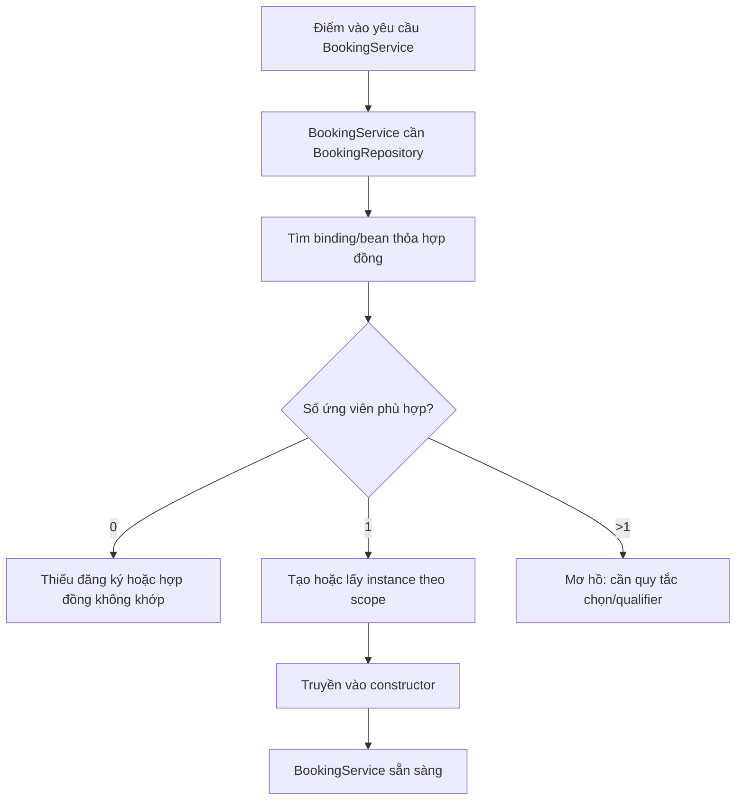
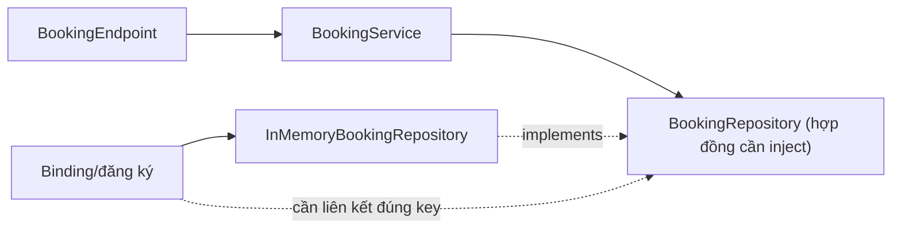
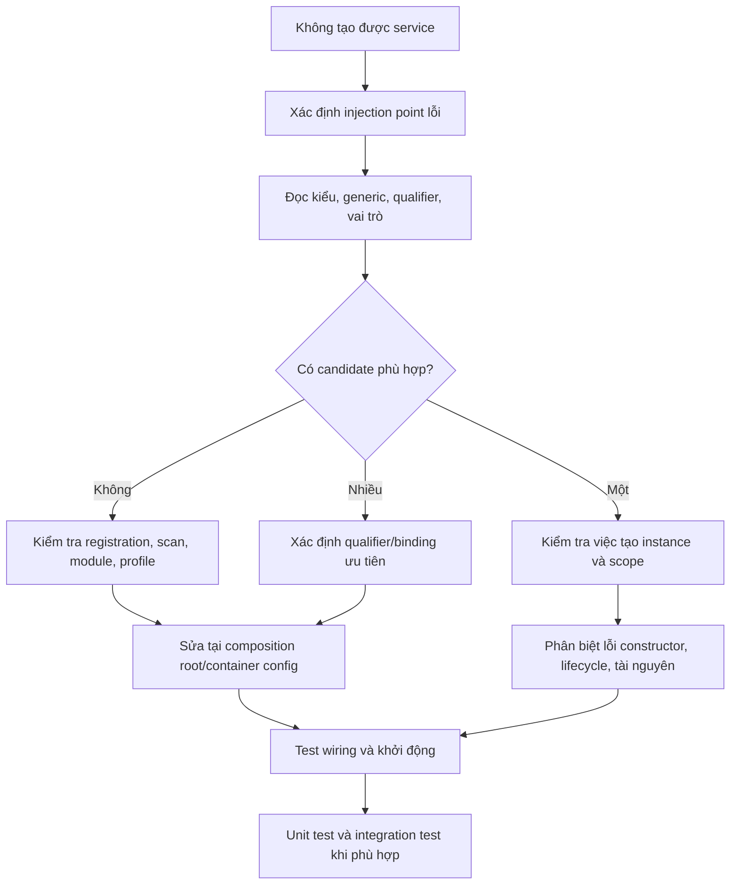

# Không phân giải được phụ thuộc do chưa đăng ký hoặc sai hợp đồng

Một lỗi thường gặp khi áp dụng **Dependency Injection (DI)** là ứng dụng không thể tạo một service vì không tìm được đối tượng phù hợp để truyền vào constructor. Chẳng hạn, `BookingService` khai báo cần `BookingRepository`, nhưng composition root hoặc DI container chỉ biết cách tạo `InMemoryBookingRepository` mà **chưa đăng ký nó cho vai trò `BookingRepository`** theo cơ chế lựa chọn đang dùng. Một nguyên nhân khác là ứng dụng đăng ký đối tượng theo **hợp đồng khác** với hợp đồng mà service thực sự yêu cầu.

Thông báo lỗi có thể xuất hiện lúc khởi động, lúc lấy bean đầu tiên hoặc khi một provider/lazy dependency được gọi. Cách phân tích hiệu quả là lần theo đường **điểm cần inject → kiểu và vai trò được yêu cầu → các ứng viên đã đăng ký → quy tắc lựa chọn → instance được cấp**. Không nên chữa lỗi bằng cách đưa `new` hoặc tra cứu container trực tiếp vào logic nghiệp vụ chỉ để ứng dụng chạy qua bước khởi tạo.

Bài thuộc chương **Chẩn đoán DI** trong nội dung **Dependency Injection và Inversion of Control (IoC)**. Ta bắt đầu bằng Java thuần để hiểu chính xác việc lắp ghép, kiểm thử lỗi thiếu binding và đăng ký sai key, sau đó liên hệ đến component scanning, qualifier, generic type, điều kiện cấu hình và vòng đời của các DI container.

## 1. “Không phân giải được phụ thuộc” thực sự nghĩa là gì?

Xét constructor:

```java
final class BookingService {
    private final BookingRepository repository;

    BookingService(BookingRepository repository) {
        this.repository =
            java.util.Objects.requireNonNull(repository, "repository");
    }
}
```

Với **DI thủ công**, caller phải có một `BookingRepository` hợp lệ và truyền vào:

```java
BookingRepository repository = new InMemoryBookingRepository();
BookingService service = new BookingService(repository);
```

Với **DI container**, caller có thể chỉ yêu cầu container cung cấp `BookingService`. Container phải tìm ra cách cấp một instance thỏa mãn hợp đồng `BookingRepository`. Nếu không có ứng viên phù hợp, thao tác **resolution** thất bại.



Ở đây, **không có ứng viên** và **có nhiều ứng viên mơ hồ** là hai lỗi khác nhau. Bài này tập trung vào trường hợp không có ứng viên vì thiếu đăng ký hoặc sai hợp đồng; ta vẫn cần nhận biết lỗi mơ hồ để tránh sửa sai hướng.

| Triệu chứng | Nguyên nhân có thể | Câu hỏi đầu tiên |
| --- | --- | --- |
| Không có binding cho `BookingRepository` | Chưa đăng ký implementation hoặc binding không được nạp | “Ai đã khai báo cách cấp `BookingRepository`?” |
| Có `InMemoryBookingRepository` nhưng vẫn không inject được `BookingRepository` | Đăng ký chỉ theo concrete class hoặc bean không được nhận diện theo interface | “Điểm đăng ký có expose đúng hợp đồng không?” |
| Có một lớp tương tự `BookingStore` nhưng service cần `BookingRepository` | Hai contract không tương thích | “Implementation có thực sự thỏa hợp đồng được yêu cầu?” |
| Đúng class nhưng bean chỉ có ở profile khác | Cấu hình môi trường loại bỏ ứng viên | “Điều kiện đăng ký nào đang được bật?” |
| Hai implementation cùng hợp đồng | Không xác định được ứng viên duy nhất | “Có qualifier, tên binding hoặc quy tắc ưu tiên rõ chưa?” |
| Lỗi chỉ xảy ra khi gọi provider | Việc phân giải được trì hoãn | “Dependency được resolve tại khởi động hay khi sử dụng?” |

## 2. Phân biệt ba ranh giới lỗi

**Lỗi kiểu lúc biên dịch** và **lỗi resolution lúc chạy** không phải một:

```java
// PHÁC THẢO KHÔNG BIÊN DỊCH: BookingService cần BookingRepository.
BookingService service = new BookingService(new ConsoleAuditSink());
// Trình biên dịch phát hiện ConsoleAuditSink không phải BookingRepository.
```

Java có thể ngăn lỗi này ngay khi mã dùng constructor có kiểu rõ ràng. Nhưng nếu service được tạo gián tiếp qua container hoặc một registry cấu hình, người viết cấu hình có thể đăng ký thiếu, dùng key sai hoặc bật nhầm profile. Khi đó mã service vẫn biên dịch, nhưng **đồ thị đối tượng không dựng được ở runtime**.

Đồng thời, phân giải thành công **không bảo đảm service chạy đúng**:

1. **Compile-time:** constructor có được gọi với kiểu tương thích không?
2. **Resolution/wiring:** có binding đúng để tạo và inject instance không?
3. **Runtime behavior:** instance đã inject có đúng chính sách, scope và khả năng làm việc với tài nguyên thật không?

Ví dụ, một `JdbcBookingRepository` được cấp thành công vẫn có thể lỗi khi kết nối database; đó là lỗi hạ tầng khi sử dụng hoặc khởi tạo, không phải bằng chứng rằng binding `BookingRepository` đã bị thiếu. Cần xác định **bước đầu tiên thực sự thất bại** trước khi sửa.

## 3. Bắt đầu chẩn đoán từ injection point, không từ annotation bất kỳ

Giả sử chương trình báo không tạo được `BookingEndpoint` vì không tạo được `BookingService`, do thiếu `BookingRepository`.

```text
BookingEndpoint
  requires BookingService
    requires BookingRepository
      ERROR: no binding/bean matching BookingRepository
```

Điểm vào lỗi có thể là `BookingEndpoint`, nhưng **dependency cần được sửa là `BookingRepository`**. Mở trực tiếp constructor của service và ghi lại:

- **Kiểu yêu cầu đầy đủ:** `BookingRepository`, không phải một class có tên gần giống.
- **Vai trò:** repository chính, repository lưu lịch sử hay một biến thể có qualifier?
- **Generic type:** ví dụ `Store<Booking>` thay vì raw `Store`.
- **Điều kiện có mặt:** bean/binding được đăng ký ở môi trường hoặc module nào?
- **Nguồn tạo instance:** constructor, factory/producer, cấu hình container hay composition root thủ công?



Một class có thể implement một interface mà vẫn không được container phát hiện hoặc đăng ký theo cách container cần. **Quan hệ `implements` và việc đăng ký binding là hai điều cần kiểm tra riêng**.

## 4. Ví dụ Java thuần: mô phỏng cơ chế đăng ký và phân giải

Để nhìn rõ lỗi, ta xây dựng một **bảng binding nhỏ chỉ dùng trong composition root**. Đây là công cụ học tập mô phỏng cơ chế lookup của container, **không phải lời khuyên đưa service locator vào nghiệp vụ**. `BookingService` vẫn chỉ nhận cộng tác viên qua constructor và không biết đến bảng binding.

Ví dụ minh họa ba trạng thái:

1. Có repository nhưng **thiếu** `AuditSink`.
2. Đăng ký `InMemoryBookingRepository` **theo concrete class**, nhưng nơi cần lại tìm `BookingRepository`.
3. Đăng ký **đúng hai hợp đồng**, đồ thị được tạo và booking được xử lý.

Tạo file `DiResolutionDemo.java`:

```java
import java.util.HashMap;
import java.util.Map;
import java.util.Objects;

final class Booking {
    private final String id;

    Booking(String id) {
        if (id == null || !id.matches("[A-Za-z0-9-]+")) {
            throw new IllegalArgumentException("bookingId khong hop le");
        }
        this.id = id;
    }

    String id() {
        return id;
    }
}

interface BookingRepository {
    void save(Booking booking);
    Booking findById(String id);
}

interface AuditSink {
    void created(String bookingId);
}

final class InMemoryBookingRepository implements BookingRepository {
    private final Map<String, Booking> bookings = new HashMap<>();

    @Override
    public void save(Booking booking) {
        Objects.requireNonNull(booking, "booking");
        if (bookings.putIfAbsent(booking.id(), booking) != null) {
            throw new IllegalStateException("bookingId da ton tai");
        }
    }

    @Override
    public Booking findById(String id) {
        return bookings.get(id);
    }
}

final class ConsoleAuditSink implements AuditSink {
    @Override
    public void created(String bookingId) {
        System.out.println("AUDIT " + bookingId + " CREATED");
    }
}

final class BookingService {
    private final BookingRepository repository;
    private final AuditSink audit;

    BookingService(BookingRepository repository, AuditSink audit) {
        this.repository =
            Objects.requireNonNull(repository, "repository");
        this.audit = Objects.requireNonNull(audit, "audit");
    }

    Booking create(String id) {
        Booking booking = new Booking(id);
        repository.save(booking);
        audit.created(booking.id());
        return booking;
    }
}

final class BookingEndpoint {
    private final BookingService service;

    BookingEndpoint(BookingService service) {
        this.service = Objects.requireNonNull(service, "service");
    }

    Booking handleCreate(String id) {
        return service.create(id);
    }
}

final class MissingBindingException extends IllegalStateException {
    MissingBindingException(String message) {
        super(message);
    }
}

final class RootBindings {
    // Chi su dung tai composition root; KHONG inject registry vao service.
    private final Map<Class<?>, Object> bindings = new HashMap<>();

    <T> RootBindings register(Class<T> contract, T implementation) {
        Objects.requireNonNull(contract, "contract");
        Objects.requireNonNull(implementation, "implementation");

        if (bindings.containsKey(contract)) {
            throw new IllegalStateException(
                "Duplicate binding for " + contract.getSimpleName());
        }
        bindings.put(contract, implementation);
        return this;
    }

    <T> T require(Class<T> contract, String requiredBy) {
        Objects.requireNonNull(contract, "contract");
        Object instance = bindings.get(contract);
        if (instance == null) {
            throw new MissingBindingException(
                "No binding for " + contract.getSimpleName()
                + " required by " + requiredBy);
        }
        return contract.cast(instance);
    }
}

final class CompositionRoot {
    private CompositionRoot() {
    }

    static BookingEndpoint assemble(RootBindings bindings) {
        BookingRepository repository =
            bindings.require(BookingRepository.class, "BookingService");
        AuditSink audit =
            bindings.require(AuditSink.class, "BookingService");
        BookingService service = new BookingService(repository, audit);
        return new BookingEndpoint(service);
    }
}

public class DiResolutionDemo {
    public static void main(String[] args) {
        // 1. Co BookingRepository nhung chua dang ky AuditSink.
        RootBindings missing = new RootBindings()
            .register(BookingRepository.class,
                new InMemoryBookingRepository());
        try {
            CompositionRoot.assemble(missing);
        } catch (MissingBindingException expected) {
            System.out.println("DIAG missing: " + expected.getMessage());
        }

        // 2. Dang ky theo concrete class khong phai theo interface.
        RootBindings wrongKey = new RootBindings()
            .register(InMemoryBookingRepository.class,
                new InMemoryBookingRepository())
            .register(AuditSink.class, new ConsoleAuditSink());
        try {
            CompositionRoot.assemble(wrongKey);
        } catch (MissingBindingException expected) {
            System.out.println("DIAG wrong-key: " + expected.getMessage());
        }

        // 3. Dang ky dung nhung hop dong ma service yeu cau.
        InMemoryBookingRepository storage =
            new InMemoryBookingRepository();
        RootBindings correct = new RootBindings()
            .register(BookingRepository.class, storage)
            .register(AuditSink.class, new ConsoleAuditSink());

        BookingEndpoint endpoint = CompositionRoot.assemble(correct);
        Booking booking = endpoint.handleCreate("BK-001");
        System.out.println("DONE " + booking.id()
            + " stored=" + (storage.findById("BK-001") == booking));
    }
}
```

Biên dịch và chạy bằng **JDK 8 trở lên**:

```bash
javac DiResolutionDemo.java
java DiResolutionDemo
```

Kết quả:

```text
DIAG missing: No binding for AuditSink required by BookingService
DIAG wrong-key: No binding for BookingRepository required by BookingService
AUDIT BK-001 CREATED
DONE BK-001 stored=true
```

### Đọc đúng ý nghĩa của từng lỗi

**Trường hợp 1:** `BookingRepository` đã có binding phù hợp. `CompositionRoot.assemble(...)` lấy nó thành công, nhưng đến `AuditSink` thì không tìm thấy. Cần đăng ký một `AuditSink`, không phải sửa `BookingService` để bỏ qua audit hoặc cho service tự `new ConsoleAuditSink()`.

**Trường hợp 2:** object repository tồn tại và class có implement `BookingRepository`. Tuy nhiên, registry minh họa lưu nó với key `InMemoryBookingRepository.class`, còn composition root yêu cầu key `BookingRepository.class`. Hai key khác nhau nên lookup thất bại. Sửa bằng cách đăng ký **theo hợp đồng mà consumer cần**:

```java
RootBindings root = new RootBindings()
    .register(BookingRepository.class, new InMemoryBookingRepository())
    .register(AuditSink.class, new ConsoleAuditSink());
```

Một DI framework thật có thể tự nhận biết các interface được implement, hoặc đòi đăng ký binding rõ ràng. **Không được khái quát quy tắc exact-key của registry học tập này cho mọi container**. Nó chỉ phơi bày nguyên tắc: việc *có class triển khai* khác với việc *được cấu hình như một ứng viên phù hợp tại điểm inject*.

**Trường hợp 3:** registry chứa đủ binding để assembly tạo `BookingService` và `BookingEndpoint`. `BookingService` hoàn toàn không biết `RootBindings` tồn tại; nó vẫn sử dụng constructor injection thuần Java. Đây là ranh giới cần bảo vệ khi chuyển từ manual DI sang container.

### Vì sao bảng binding không nên lan vào nghiệp vụ?

Nếu đổi constructor thành `BookingService(RootBindings bindings)` rồi service tự gọi `bindings.require(...)`, phụ thuộc thật bị giấu sau một registry tổng quát. Khi đó muốn đọc service cần lần theo lookup động, và test phải dựng registry thay vì inject fake trực tiếp. Đó là biến **composition root thành service locator**. Bảng binding của bài chỉ nằm ở điểm lắp ghép để minh họa lỗi resolution; dự án Java thuần thông thường có thể chỉ gọi constructor trực tiếp mà không cần bảng này.

## 5. Kiểm thử các tình huống lỗi mà không khởi động framework

Ta kiểm tra cả **đường lỗi** lẫn **đường thành công**:

- Thiếu đăng ký `AuditSink` phải báo đúng dependency.
- Đăng ký repository chỉ theo concrete key không thỏa `BookingRepository` trong registry minh họa.
- Đăng ký lặp một key bị từ chối để tránh âm thầm ghi đè binding.
- Lắp đúng bằng fake phải gọi đúng repository và audit, không cần database hoặc console.
- Hai composition root khác nhau không tự động chia sẻ state repository.

Tạo file `DiResolutionDemoTest.java` cùng thư mục với file chính:

```java
public class DiResolutionDemoTest {
    static final class RecordingRepository implements BookingRepository {
        Booking saved;
        int saveCount;

        @Override
        public void save(Booking booking) {
            saved = booking;
            saveCount++;
        }

        @Override
        public Booking findById(String id) {
            return saved != null && saved.id().equals(id) ? saved : null;
        }
    }

    static final class RecordingAudit implements AuditSink {
        String lastId;
        int calls;

        @Override
        public void created(String bookingId) {
            lastId = bookingId;
            calls++;
        }
    }

    public static void main(String[] args) {
        testMissingAuditBinding();
        testWrongRegistrationKey();
        testDuplicateBindingRejected();
        testCorrectGraphWithFakes();
        testIndependentCompositionRoots();
        System.out.println("DiResolutionDemoTest PASSED");
    }

    static void testMissingAuditBinding() {
        RootBindings bindings = new RootBindings()
            .register(BookingRepository.class, new RecordingRepository());
        expectMissing(() -> {
            CompositionRoot.assemble(bindings);
        }, "AuditSink");
    }

    static void testWrongRegistrationKey() {
        RootBindings bindings = new RootBindings()
            .register(InMemoryBookingRepository.class,
                new InMemoryBookingRepository())
            .register(AuditSink.class, new RecordingAudit());
        expectMissing(() -> {
            CompositionRoot.assemble(bindings);
        }, "BookingRepository");
    }

    static void testDuplicateBindingRejected() {
        RootBindings bindings = new RootBindings()
            .register(AuditSink.class, new RecordingAudit());
        boolean rejected = false;
        try {
            bindings.register(AuditSink.class, new RecordingAudit());
        } catch (IllegalStateException expected) {
            rejected = true;
        }
        check(rejected, "Phai tu choi binding trung key");
    }

    static void testCorrectGraphWithFakes() {
        RecordingRepository repository = new RecordingRepository();
        RecordingAudit audit = new RecordingAudit();
        RootBindings bindings = new RootBindings()
            .register(BookingRepository.class, repository)
            .register(AuditSink.class, audit);

        BookingEndpoint endpoint = CompositionRoot.assemble(bindings);
        Booking result = endpoint.handleCreate("BK-TEST");

        check(repository.saved == result, "Sai booking duoc luu");
        check(repository.saveCount == 1, "Phai save dung mot lan");
        check("BK-TEST".equals(audit.lastId), "Sai booking audit");
        check(audit.calls == 1, "Phai audit dung mot lan");
    }

    static void testIndependentCompositionRoots() {
        InMemoryBookingRepository first = new InMemoryBookingRepository();
        InMemoryBookingRepository second = new InMemoryBookingRepository();

        BookingEndpoint firstEndpoint = CompositionRoot.assemble(
            new RootBindings()
                .register(BookingRepository.class, first)
                .register(AuditSink.class, new RecordingAudit()));
        BookingEndpoint secondEndpoint = CompositionRoot.assemble(
            new RootBindings()
                .register(BookingRepository.class, second)
                .register(AuditSink.class, new RecordingAudit()));

        firstEndpoint.handleCreate("BK-SAME");
        check(second.findById("BK-SAME") == null,
            "Hai composition root khong duoc chia se Map");
        secondEndpoint.handleCreate("BK-SAME");
        check(first.findById("BK-SAME") != second.findById("BK-SAME"),
            "Moi root phai co Booking rieng");
    }

    static void expectMissing(Runnable action, String contractName) {
        boolean correctError = false;
        try {
            action.run();
        } catch (MissingBindingException expected) {
            correctError = expected.getMessage().contains(contractName);
        }
        check(correctError,
            "Can MissingBindingException cho " + contractName);
    }

    static void check(boolean condition, String message) {
        if (!condition) {
            throw new AssertionError(message);
        }
    }
}
```

Biên dịch và chạy:

```bash
javac DiResolutionDemo.java DiResolutionDemoTest.java
java DiResolutionDemoTest
```

Kết quả mong đợi:

```text
DiResolutionDemoTest PASSED
```

Trong mỗi test, `RootBindings` và các fake có trạng thái được **tạo mới**, tránh ảnh hưởng lẫn nhau. Các phép thử này xác nhận cơ chế của registry minh họa và đường lắp ghép trong Java thuần. Chúng không chứng minh Spring, Jakarta CDI hay Guice sẽ resolve một binding tương tự thế nào; cần **wiring test dùng đúng container** nếu ứng dụng phụ thuộc vào cơ chế của framework.

## 6. “Sai hợp đồng” có ít nhất bốn dạng

### 6.1. Đăng ký một kiểu khác kiểu được yêu cầu

`BookingService` yêu cầu `AuditSink`. Một `ConsoleLogger` có thể có phương thức `log(...)` nhìn rất giống `AuditSink.created(...)`, nhưng **không implement `AuditSink`**. Java không có cơ chế tự coi hai interface khác nhau là tương thích chỉ vì chúng có thao tác gần giống.

```java
// Minh họa lỗi biên dịch:
// bindings.register(AuditSink.class, new InMemoryBookingRepository());
// InMemoryBookingRepository không phải AuditSink.
```

Nếu một API cũ thực hiện được hành vi cần thiết nhưng không implement hợp đồng của ứng dụng, có thể tạo **adapter có kiểu rõ ràng**:

```java
// Mẫu độc lập minh họa adapter; không thuộc DiResolutionDemo.java.
interface LegacyLogger {
    void write(String line);
}

final class LegacyAuditAdapter implements AuditSink {
    private final LegacyLogger logger;

    LegacyAuditAdapter(LegacyLogger logger) {
        this.logger = java.util.Objects.requireNonNull(logger, "logger");
    }

    @Override
    public void created(String bookingId) {
        logger.write("Booking created: " + bookingId);
    }
}
```

Composition root sẽ tạo `LegacyLogger`, bọc nó bằng `LegacyAuditAdapter` rồi đăng ký `AuditSink`. Không cần sửa `BookingService` để biết một API logging cũ.

### 6.2. Đăng ký concrete class, yêu cầu interface

Trong registry chỉ tra cứu exact key, `register(InMemoryBookingRepository.class, ...)` **không** tạo binding ngầm cho `BookingRepository.class`. Trong framework thực tế, cần xem component có được đăng ký dưới interface hay không, bean type được expose là gì, và luật resolve có hỗ trợ tìm theo supertype không.

Đừng sửa bằng cách đổi constructor của service thành `BookingService(InMemoryBookingRepository repo)` chỉ để khớp đăng ký. Điều đó có thể làm nghiệp vụ phụ thuộc hạ tầng; sửa cấu hình binding thường đúng ranh giới hơn.

### 6.3. Cùng interface nhưng khác qualifier hoặc vai trò

Giả sử có hai repository đều implement `BookingRepository`: một dùng cho dữ liệu chính, một dùng cho lịch sử. Nếu service yêu cầu repository được gắn vai trò **primary**, binding chỉ có vai trò **archive** sẽ không thỏa yêu cầu đó, dù Java type giống nhau.

```text
Injection point: BookingRepository + qualifier "primary"
Registered:      BookingRepository + qualifier "archive"
Result:          không có ứng viên phù hợp với yêu cầu "primary"
```

Nếu hai ứng viên đều không được phân biệt vai trò, lỗi có thể chuyển sang **mơ hồ** thay vì thiếu binding. Dùng qualifier/binding name hoặc một hợp đồng chuyên biệt theo nghiệp vụ, và xác nhận lựa chọn bằng test wiring. Không giả định tên biến Java tự động trở thành qualifier trong mọi container.

### 6.4. Sai generic type

`Store<Booking>` và `Store<Customer>` khác nhau tại điểm khai báo generic ở Java:

```java
interface Store<T> {
    void save(T value);
}

// Một consumer cần Store<Booking>, không phải Store<Customer>.
final class BookingWriter {
    BookingWriter(Store<Booking> store) {
        // ...
    }
}
```

Một số container có thể dùng generic signature của injection point để lọc bean/binding, còn một số cơ chế đăng ký chỉ làm việc ở mức raw type hoặc cần metadata bổ sung. **Type erasure** khiến `Store<Booking>` và `Store<Customer>` không tự trở thành hai runtime class riêng. Ngoài ra, `Class<T>` đơn giản không biểu diễn đầy đủ nested generic. Với hai `Store<Booking>` cùng kiểu nhưng khác vai trò, generic metadata vẫn chưa đủ; cần qualifier hoặc hợp đồng vai trò.

Các ví dụ trong mục này là **các đoạn minh họa thiết kế**, không phải cùng một file Java để biên dịch chung với chương trình phần 4.

## 7. Thiếu đăng ký có thể do điều kiện cấu hình, không phải thiếu class

Một source file có tồn tại trong repository không bảo đảm bean tương ứng đã được tạo hoặc được nạp vào container đang chạy.

| Điểm cần kiểm tra | Cơ chế có thể gây thiếu ứng viên | Bằng chứng cần tìm |
| --- | --- | --- |
| **Component scanning/discovery** | Package chứa implementation nằm ngoài vùng quét; bean archive không được nhận diện | Cấu hình scanning, module được bootstrap, danh sách bean thực sự |
| **Điều kiện môi trường** | Binding chỉ có ở profile `LOCAL` nhưng app chạy `PRODUCTION` | Profile/condition đang kích hoạt, cấu hình cuối cùng |
| **Binding module** | Module khai báo repository chưa được cài đặt vào injector | Danh sách module/binding được tải lúc khởi động |
| **Factory/producer method** | Phương thức tạo không được đăng ký, điều kiện không thỏa, trả kiểu khác | Chữ ký phương thức, khai báo đăng ký, thông báo init |
| **Qualifier** | Consumer yêu cầu qualifier không tồn tại | Tên/annotation qualifier ở cả hai đầu |
| **Generic type** | Bean được khai báo raw hoặc tham số generic không phù hợp | Kiểu đầy đủ tại injection point và binding |
| **Điều kiện thứ tự khởi tạo** | Một dependency bị hỏi quá sớm hoặc chỉ được cung cấp sau bootstrap khác | Đường khởi động và thời điểm resolve thực tế |

Một cách chẩn đoán có ích là so sánh **cấu hình dự kiến** với **cấu hình thực sự hoạt động**. Ví dụ, triển khai `PRODUCTION` sử dụng secret/config khác `LOCAL`; nếu condition loại bỏ binding JDBC nhưng vẫn tạo service, kết quả có thể là missing dependency.

Nếu một bean tồn tại trong context **khác** hoặc injector **khác**, việc “thấy class đã đăng ký ở đâu đó” chưa chứng minh điểm inject đang được xử lý bởi đúng container đó. Cần kiểm tra ranh giới context/module và visibility theo framework.

## 8. Khác biệt giữa DI thủ công và container

| Tiêu chí | Java thuần/manual DI | DI container |
| --- | --- | --- |
| **Nơi cấp dependency** | Composition root gọi constructor hoặc factory | Container dựa vào đăng ký, binding và metadata |
| **Thiếu phụ thuộc** | Lỗi được thấy khi lập trình viên không truyền đối số, hoặc null được truyền | Có thể gặp lỗi resolution ở startup hoặc khi resolve |
| **Sai kiểu** | Compiler bắt nhiều lỗi khi dùng API có kiểu | Tùy cách đăng ký/binding và runtime metadata; nhiều lỗi vẫn được phát hiện khi dựng container |
| **Phát hiện implementation** | Thường là lệnh `new`/factory rõ ràng | Có thể dùng scanning, module, producer, điều kiện |
| **Nhiều implementation** | Caller chọn biến cụ thể | Qualifier, binding name, profile, priority theo framework |
| **Scope/lifecycle** | Caller quyết định chia sẻ và đóng tài nguyên | Container có thể quản lý theo scope/callback cấu hình |
| **Kiểm thử wiring** | Tạo object rồi kiểm tra trực tiếp | Dựng test context/injector để kiểm tra các binding thực |

**Tên các cơ chế theo framework không đồng nghĩa nhau hoàn toàn.** Spring Framework có những kiểu cấu hình như `@Component` và `@Bean`; Jakarta CDI có bean discovery, `@Inject`, qualifiers và producer; Guice thường dùng module/binding. Quy tắc chọn constructor, registration, scope và phát hiện lỗi phụ thuộc còn tùy phiên bản và cấu hình. Khi chẩn đoán ứng dụng thật, cần kiểm tra cơ chế của **chính container đang chạy** thay vì suy từ một ví dụ của framework khác.

Trong một số framework, lỗi thiếu dependency có thể được bao bởi các exception khác ở lớp cao hơn. Ví dụ một lỗi tạo `BookingEndpoint` có thể bao lỗi tạo `BookingService`, phía dưới mới là lỗi tìm `BookingRepository`. Nên đọc **chuỗi nguyên nhân** thay vì chỉ nhìn exception đầu tiên.

## 9. Cách đọc thông báo lỗi: truy ngược đến dependency thiếu đầu tiên

Giả sử console hiển thị một thông báo chẩn đoán mang tính minh họa:

```text
Cannot create BookingEndpoint
  caused by: Cannot create BookingService
    caused by: No bean/binding for BookingRepository
      required at BookingService(BookingRepository, AuditSink)
```

Đây là **dạng thông báo ví dụ**, không phải thông báo nguyên văn từ một framework cụ thể. Khi gặp một exception thực tế:

1. Ghi lại **injection point** đầu tiên gặp lỗi: constructor, field, phương thức tạo bean hoặc provider.
2. Lần theo các dòng **caused by** để tìm **hợp đồng không được thỏa**, gồm generic và qualifier nếu có.
3. Kiểm tra **candidate thực sự được đăng ký**, không chỉ class tồn tại trên classpath.
4. Đối chiếu điều kiện **environment/profile/module/scan** để biết tại sao candidate không có.
5. Chạy lại test khởi tạo sau khi sửa **ở lớp cấu hình**, không sửa nghiệp vụ chỉ để tránh exception.

Nếu thông báo cho biết **hai hoặc nhiều ứng viên** phù hợp, đừng đăng ký thêm một implementation vì vấn đề không phải thiếu ứng viên. Hãy xác định vai trò bằng qualifier hoặc ranh giới abstraction rõ hơn.

Nếu thông báo cho biết **constructor ném exception** do cấu hình null hoặc URL không hợp lệ, kiểm tra khâu tạo instance và validate config. Không mọi lỗi ở thời điểm startup đều là lỗi resolution.

## 10. Ưu tiên phát hiện sớm bằng validation ở composition root

Lỗi binding thường nên được phát hiện **trước khi ứng dụng bắt đầu phục vụ yêu cầu**. Trong ví dụ Java thuần, `CompositionRoot.assemble(...)` gọi `require(...)` với tất cả dependency cần thiết trước khi trả về endpoint; thiếu binding bị phát hiện ngay trong quá trình lắp ghép.

Nếu một số dependency được tạo trễ thông qua supplier/provider, lỗi có thể chỉ xuất hiện khi lần đầu gọi:

```java
// Phác thảo: provider chỉ biết cách lấy dependency lúc dùng.
java.util.function.Supplier<BookingRepository> repositoryProvider = ...;

// Nếu provider chưa được cấu hình đúng, lỗi có thể xuất hiện khi get().
BookingRepository repository = repositoryProvider.get();
```

Provider hay lazy injection **không tự sửa binding bị thiếu**. Chúng thay đổi thời điểm resolution và đôi khi scope/identity. Khi chọn lazy vì chi phí khởi tạo, cần có một đường kiểm tra startup hoặc test phù hợp để tránh lỗi cấu hình chỉ lộ ra dưới lưu lượng thật.

Chính sách fail-fast phải cân bằng yêu cầu vận hành: một dependency thật sự tùy chọn có thể được mô hình hóa là optional với hành vi rõ ràng; một dependency bắt buộc như repository lưu dữ liệu **không nên bị thay bằng null/no-op một cách âm thầm** chỉ để khởi động thành công.

## 11. Phân biệt missing dependency với vấn đề scope và tài nguyên

Một container có thể tìm ra đúng bean nhưng vẫn không sử dụng được nó vì scope không hoạt động hoặc resource đã đóng.

Ví dụ:

```text
Binding: BookingRepository -> JdbcBookingRepository        [đã resolve]
Runtime: kết nối DB thất bại khi repository.save(...)     [lỗi hạ tầng]

Binding: RequestContext -> request-scoped instance        [có binding]
Runtime: lấy context ngoài request đang hoạt động         [lỗi scope]
```

Đây không còn đơn thuần là “chưa đăng ký `BookingRepository`”. Khi kiểm tra, phân biệt:

- **Sự tồn tại của binding:** container có biết cách cấp vai trò đó không?
- **Phạm vi của instance:** request-scoped component có được lấy trong request hợp lệ không?
- **Quyền sở hữu tài nguyên:** repository dùng connection pool do ai tạo và đóng?
- **Sức khỏe tài nguyên:** DB, mạng, file có sẵn sàng không?
- **Đúng ngữ nghĩa nghiệp vụ:** chọn đúng repository chính hay nhầm repository lịch sử?

Hai implementation cùng interface có thể khiến wiring thành công nhưng **đúng kiểu, sai vai trò**. Trường hợp này không luôn tạo exception; cần test lựa chọn và kiểm tra state/side effect thực tế.

## 12. Quy trình xử lý lỗi theo thứ tự hiệu quả



### Checklist chẩn đoán nhanh

1. **Đọc trọn chuỗi lỗi:** thông báo gốc là missing, ambiguous, sai constructor hay tài nguyên không sẵn sàng?
2. **Xác định đúng injection point:** lớp nào đang yêu cầu phụ thuộc, constructor nào?
3. **Ghi đủ contract:** interface/class, generic, qualifier, tên hoặc vai trò nghiệp vụ.
4. **Tìm nơi đăng ký:** composition root, binding module, configuration/producer hoặc component scanning.
5. **Kiểm tra điều kiện đăng ký:** profile, environment, module/context được nạp, điều kiện thành phần có mặt.
6. **So sánh kiểu khai báo và kiểu expose:** class implement interface chưa chắc đã được container đăng ký theo cách cần thiết.
7. **Không bỏ qua tính mơ hồ:** nếu có nhiều ứng viên, cần chọn đúng chứ không tạo thêm bean ngẫu nhiên.
8. **Sửa cấu hình theo đúng ranh giới:** không gài `new` hay `container.get(...)` vào nghiệp vụ để né lỗi.
9. **Xác minh bằng wiring test:** dựng đồ thị/context thực tế và xác nhận đúng instance, qualifier và scope.
10. **Tách integration test:** repository có resolve được không khác với việc database thật có ghi thành công không.

## 13. Những cách “chữa cháy” thường làm tình hình tệ hơn

| Cách chữa cháy | Vì sao nguy hiểm | Thay thế phù hợp |
| --- | --- | --- |
| Đổi `BookingService` sang tự `new InMemoryBookingRepository()` | Che thiếu binding, gắn nghiệp vụ với adapter cụ thể | Đăng ký `BookingRepository` ở composition root |
| Inject toàn bộ container/registry vào service | Biến DI thành service locator, che các phụ thuộc trực tiếp | Constructor injection từng cộng tác viên cần thiết |
| Truyền `null` rồi bỏ qua repository | Có thể báo thành công mà không lưu dữ liệu | Fail-fast nếu repository bắt buộc |
| Thêm bean trùng chỉ để hết lỗi thiếu | Có thể tạo lỗi mơ hồ hoặc chọn sai implementation | Xác định đúng bean/binding và điều kiện |
| Đánh dấu tất cả dependency là optional | Che cấu hình hỏng cho những chức năng bắt buộc | Optional phải là quyết định nghiệp vụ rõ ràng |
| Sửa interface của service chỉ để khớp concrete class hiện có | Ràng buộc nghiệp vụ vào hạ tầng | Tạo adapter hoặc sửa binding đúng hợp đồng |
| Bật lazy cho mọi dependency | Hoãn lỗi đến request đầu tiên | Test startup/validation và chỉ dùng lazy có chủ đích |
| Bỏ qua lỗi qualifier vì “cùng interface là được” | Có thể dùng nhầm repository, tenant hoặc gateway | Test vai trò và lựa chọn thực tế |

## 14. Bài tập thực hành

**Bài 1 — Thiếu binding.** Trong `DiResolutionDemo`, chỉ đăng ký `BookingRepository` rồi dựng `BookingEndpoint`. Hãy dự đoán exception, giải thích tại sao `BookingService` không nên tự tạo `ConsoleAuditSink`, và bổ sung đúng một binding ở composition root.

**Bài 2 — Đăng ký sai key.** Đăng ký `InMemoryBookingRepository.class` như ví dụ, rồi yêu cầu `BookingRepository.class`. Viết lại phần lắp ghép đúng. Vì sao trong một container có component scanning hành vi có thể khác registry exact-key này?

**Bài 3 — Sai hợp đồng.** Một `LegacyBookingStorage` có `write(Booking)` nhưng không implement `BookingRepository`. Hãy tạo adapter implement `BookingRepository`, chuyển tiếp `save(...)` cho legacy storage và nêu cách xử lý `findById(...)` nếu API cũ không cung cấp thao tác đọc. Đừng giả định có thể implement hợp đồng đầy đủ nếu không có khả năng đáp ứng ngữ nghĩa.

**Bài 4 — Qualifier.** Hai `BookingRepository` được đăng ký cho `primary` và `archive`. Service yêu cầu `primary` nhưng cấu hình chỉ cung cấp `archive`. Hãy mô tả nguyên nhân resolution thất bại và cách sửa ở nơi cấu hình, không đổi repository chính thành archive.

**Bài 5 — Generic.** Một service cần `Store<Booking>`, nhưng chỉ có binding `Store<Customer>`. Giải thích vì sao compiler/container có thể cần phân biệt hai hợp đồng này. Nếu có hai `Store<Booking>`, generic đã đủ chưa?

**Bài 6 — Thời điểm phát hiện.** Thay `BookingRepository` trực tiếp bằng một provider lấy repository lúc gọi. Hãy xác định khi nào lỗi thiếu đăng ký có thể được phát hiện và cách viết test để lỗi không chỉ xuất hiện khi request sản xuất đầu tiên chạy.

**Bài 7 — Phân tầng test.** Test với `RecordingRepository` xác nhận service gọi `save` đúng một lần. Test này có chứng minh `JdbcBookingRepository` kết nối DB thành công không? *Đáp án:* không; cần integration test của adapter với DB/schema thử nghiệm.

**Bài 8 — Đọc nguyên nhân sâu nhất.** Một log mô tả `BookingEndpoint → BookingService → BookingRepository` rồi báo không có binding cho repository. Hãy xác định injection point gốc, nơi cần kiểm tra binding, và vì sao chỉ sửa controller không giải quyết nguyên nhân.

**Kết luận:** khi DI không phân giải được dependency, hãy kiểm tra **đúng hợp đồng được yêu cầu**, **ứng viên được đăng ký thật**, **quy tắc lựa chọn** và **điều kiện cấu hình đang hoạt động**. Constructor injection làm nhu cầu rõ; composition root hoặc DI container quyết định cách cấp instance. Việc chẩn đoán đúng ranh giới giúp sửa lỗi tại nơi lắp ghép, phát hiện cấu hình hỏng sớm và giữ logic nghiệp vụ độc lập với hạ tầng.
