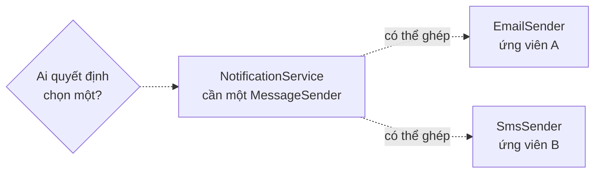
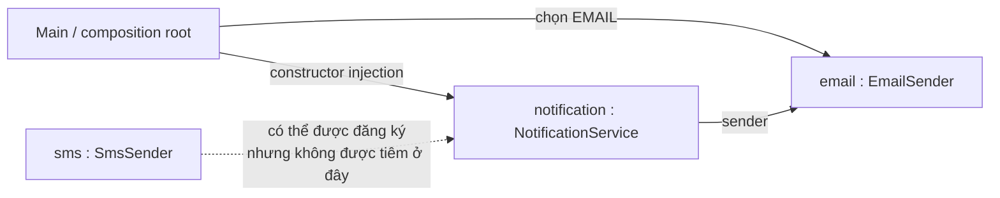

# Nhiều triển khai cùng khớp và cấu hình lựa chọn không rõ ràng

## Mục tiêu học tập

Sau bài này, bạn có thể:

- Nhận diện lỗi **nhiều implementation cùng đáp ứng một dependency** nhưng cơ chế lắp ghép chưa biết phải chọn instance nào.
- Phân biệt trường hợp **thiếu implementation**, **trùng ứng viên**, **chọn được nhưng sai ý định** và **cố tình dùng nhiều implementation**.
- Đọc đồ thị đối tượng và dấu vết cấu hình để xác định **điểm injection**, **tập ứng viên**, **tiêu chí phân giải** và **scope** của instance được cấp.
- Chọn giải pháp tương ứng: **lựa chọn tường minh tại composition root**, qualifier/bean name, primary/default có chủ đích, đăng ký theo môi trường, hoặc catalog/factory có hợp đồng hẹp.
- Tránh giải pháp nguy hiểm như lấy phần tử đầu tiên, dựa vào thứ tự quét class, thêm một default ngầm hoặc chuyển container vào lớp nghiệp vụ.
- Viết ví dụ Java thuần và kiểm thử bằng fake để phát hiện **trùng mapping**, **thiếu mapping**, **cấu hình sai** và **gửi nhầm provider** trước khi sử dụng DI container.

Bài thuộc chương **Chẩn đoán DI** trong mô-đun **Dependency Injection (DI) và Inversion of Control (IoC)**. Khi dùng constructor injection, một consumer thường tuyên bố rằng nó cần một **hợp đồng** (interface), không tuyên bố lớp concrete. Điều đó giúp tách việc sử dụng dependency khỏi việc tạo/lắp ghép. Nhưng khi nhiều đối tượng đều triển khai hợp đồng ấy, **composition root hoặc DI container phải có một quy tắc lựa chọn đủ rõ**. Nếu thiếu quy tắc, lỗi có thể xuất hiện ngay lúc khởi động; nếu có quy tắc mơ hồ, ứng dụng đôi khi vẫn chạy nhưng sử dụng sai provider.

## 1. Một interface, nhiều implementation: điều gì bị mơ hồ?

Giả sử ứng dụng gửi thông báo với hợp đồng:

```java
interface MessageSender {
    void send(String recipient, String content);
}
```

Có hai implementation:

```java
final class EmailSender implements MessageSender {
    @Override
    public void send(String recipient, String content) {
        // Gửi email qua adapter phù hợp.
    }
}

final class SmsSender implements MessageSender {
    @Override
    public void send(String recipient, String content) {
        // Gửi SMS qua adapter phù hợp.
    }
}
```

Consumer chỉ khai báo:

```java
final class NotificationService {
    private final MessageSender sender;

    NotificationService(MessageSender sender) {
        this.sender = sender;
    }
}
```

Các khối mã mở đầu ở mục này là **những đoạn minh họa độc lập**, không ghép chung với chương trình hoàn chỉnh ở mục 5. Chương trình đó định nghĩa lại hợp đồng `MessageSender` theo `send(DeliveryRequest)` và trả về trạng thái demo để quan sát kết quả kiểm thử.

Về **kiểu Java**, cả `EmailSender` và `SmsSender` đều truyền được vào constructor. Trong Java thuần, code gọi constructor phải đưa ra quyết định:

```java
NotificationService emailService =
        new NotificationService(new EmailSender());

NotificationService smsService =
        new NotificationService(new SmsSender());
```

Ở đây **không có lỗi mơ hồ**: hai lời gọi `new NotificationService(...)` đã chọn concrete instance rõ ràng. Sự mơ hồ thường xuất hiện khi chuyển việc chọn dependency cho **cơ chế tự động**, ví dụ container được yêu cầu phân giải một `MessageSender` duy nhất nhưng registry có **hai bean/registration đều phù hợp**.

### Đồ thị các ứng viên chưa phải đồ thị đã lắp ghép



Các nét đứt biểu diễn **khả năng lựa chọn**, không phải service đang giữ đồng thời cả hai tham chiếu. Một container không nên đoán quy tắc nghiệp vụ “ưu tiên email” chỉ vì tên class đứng trước trong một danh sách.

Sau khi lựa chọn tường minh, đồ thị instance mới thực sự rõ:



Trong sơ đồ này, `NotificationService` giữ **một** `sender`, chính là email instance đã được chọn. `SmsSender` có thể tồn tại cho consumer khác, hoặc không cần được tạo nếu cấu hình chỉ sử dụng email.

## 2. Phân biệt bốn tình huống khi chẩn đoán

Một thông báo lỗi “không tìm được bean” và một lỗi “có nhiều bean” cần cách xử lý khác nhau. Một ứng dụng không báo lỗi nhưng sử dụng nhầm provider lại cần cách kiểm tra khác nữa.

| Tình huống | Dấu hiệu | Câu hỏi nên đặt | Hướng xử lý |
| --- | --- | --- | --- |
| **Không có ứng viên** | Container không tìm được dependency theo kiểu/qualifier | Đã đăng ký chưa? Điều kiện/profile nào loại bỏ nó? | Đăng ký đúng, sửa điều kiện hoặc khai báo dependency thực sự tùy chọn nếu hợp đồng cho phép. |
| **Một ứng viên** | Phân giải được thành một object | Có đúng implementation/scope theo ý định không? | Kiểm tra hành vi và cấu hình; không dừng ở việc khởi động thành công. |
| **Nhiều ứng viên** | Container báo không xác định được bean duy nhất hoặc cần qualifier | Injection point này cần **một** hay **nhiều**? Chọn theo môi trường hay request? | Đặt quy tắc lựa chọn tường minh, phù hợp thời điểm quyết định. |
| **Chọn sai nhưng không báo lỗi** | Thông báo gửi sai kênh, cấu hình test dùng nhầm adapter thật | Có default/primary/key/ordering nào đang che lựa chọn? | Xác minh provider thực được tiêm và thêm test theo cấu hình. |

Một hệ thống cũng có thể có **trùng khóa nghiệp vụ**: hai implementation đều tuyên bố xử lý kênh `EMAIL`. Đây là mơ hồ **ở catalog lựa chọn**, dù DI container có thể hoàn toàn hợp lệ khi tạo cả hai bean.

Ví dụ: `SmtpEmailSender` và `QueueEmailSender` đều triển khai `MessageSender`. Nếu muốn chọn **một provider email theo môi trường**, cần một quy tắc ở composition root; nếu muốn **cả hai cùng xử lý** (ví dụ một chính và một dự phòng), cần định nghĩa rõ policy fallback, lỗi và tránh gửi trùng. Không nên tự lấy sender xuất hiện đầu tiên.

## 3. Quy trình chẩn đoán: từ injection point đến cấu hình

Khi thấy lỗi phân giải dependency, đừng bắt đầu bằng cách thêm annotation ngẫu nhiên. Hãy điều tra theo thứ tự sau:

1. **Xác định injection point:** constructor/method/field nào đòi `MessageSender`? Có qualifier, tên bean hoặc tham số generic đi kèm không?
2. **Xác định điều mà consumer thật sự cần:** một sender cố định cho môi trường hay một bộ nhiều sender để chọn theo dữ liệu runtime?
3. **Liệt kê các registration/bean có thể khớp:** tên, loại object, qualifier, điều kiện kích hoạt, profile và scope. Đừng suy từ tên class trong source mà bỏ qua cấu hình runtime.
4. **Đối chiếu quy tắc phân giải của framework:** loại phù hợp, qualifier, primary/default, priority và tính khả dụng theo ngữ cảnh; từng framework có thứ tự ưu tiên riêng.
5. **Kiểm tra cấu hình đang thực sự hoạt động:** những profile nào đang bật, file cấu hình nào được nạp, bean definition nào được kích hoạt? Tránh giả định môi trường test giống production.
6. **Phân loại lỗi:** thiếu hoàn toàn, thừa nhiều ứng viên, trùng key, hoặc vẫn chọn được nhưng sai provider.
7. **Sửa tại ranh giới lắp ghép khi thích hợp:** consumer chỉ cần hợp đồng; composition root quyết định instance theo tiêu chí có nghĩa.
8. **Kiểm tra lại cả hai mặt:** context có dựng được **và** provider được chọn đúng không? Có thể kiểm tra bằng fake/spy hoặc kiểm thử tích hợp.

### Bảng triệu chứng và nguyên nhân có thể

| Triệu chứng | Giả thuyết đáng kiểm tra | Không nên kết luận vội |
| --- | --- | --- |
| “Expected single bean but found 2” hoặc thông báo tương đương | Có hai bean cùng match một injection point đơn; thiếu discriminator | “Framework bị lỗi” hoặc “xóa bừa một implementation”. |
| “No qualifying bean” hoặc thông báo tương đương | Bean chưa đăng ký, scope/profile/condition không active, qualifier không match | “Phải biến dependency thành nullable”. |
| Chạy test đúng, production gửi sai kênh | Default/primary/profile/config runtime khác test; hai môi trường resolve khác nhau | “Constructor injection không hoạt động”. |
| Một sender được chọn tùy lúc | Đang dựa vào thứ tự collection, thứ tự registration không được cam kết hoặc state runtime | “Thứ tự quét file luôn ổn định”. |
| Mọi request đều dùng email dù request chọn SMS | Đã chọn sender tại startup nhưng yêu cầu cần quyết định **mỗi request** | “Thêm qualifier trên field sẽ tự đọc request”. |
| Lỗi chỉ xuất hiện khi gọi nhánh hiếm | Phân giải lazy/provider hoặc mapping thiếu được kiểm tra quá muộn | “Khởi động thành công tức là đủ mọi dependency”. |

**Thông điệp:** lỗi nhiều ứng viên không chỉ là vấn đề annotation. Nó có thể bộc lộ việc thiết kế **chưa định nghĩa rõ tiêu chí lựa chọn** và **thời điểm lựa chọn**.

## 4. Chọn một implementation cố định hay chọn theo từng request?

Hai bài toán có vẻ giống nhau nhưng cần hai cách tổ chức khác nhau.

### Trường hợp A — Chọn một lần lúc lắp ghép

Ví dụ một bản triển khai thử nghiệm luôn dùng email console, còn một bản khác luôn dùng SMS console. Cấu hình `--channel=email` hoặc `--channel=sms` được biết **trước khi tạo service**.

```text
AppConfig (--channel=email)
    -> composition root chọn EmailSender
    -> new NotificationService(emailSender)
    -> mọi lời gọi của service này dùng EmailSender
```

Consumer không cần tham chiếu tới `AppConfig` hoặc DI container. Đổi cấu hình và **lắp ghép một service khác** là hành vi có chủ đích. Thay biến cấu hình sau khi service đã tạo **không tự thay field đã inject**.

### Trường hợp B — Chọn theo dữ liệu runtime

Ví dụ mỗi yêu cầu có một `NotificationChannel`, hoặc một `ChannelPolicy` chọn kênh theo loại thông báo. Nếu cùng service cần xử lý cả email lẫn SMS **trong lúc chạy**, không nên cố chọn một `MessageSender` cố định ở startup rồi kỳ vọng nó tự đổi mỗi request.

Có thể tiêm một **catalog/factory có kiểu hẹp**, ví dụ:

```java
MessageSender selected = catalog.require(request.channel);
selected.send(request.delivery);
```

Đây là lookup theo **enum nghiệp vụ**, không phải một API tìm bean bất kỳ. Chính sách chọn `request.channel` (hoặc `ChannelPolicy.select(request)`) thuộc về nghiệp vụ; **mapping enum → implementation** thuộc về composition root/adapter. Nếu thiết kế một catalog chung, nó nên từ chối thiếu hoặc trùng kênh rõ ràng, không fallback ngầm.

### Bảng quyết định

| Đầu vào quyết định | Thời điểm | Cách thiết kế thường phù hợp |
| --- | --- | --- |
| Môi trường triển khai luôn dùng một sender | Lúc bootstrap | Chọn một bean/instance tại composition root, inject trực tiếp vào consumer. |
| Một consumer phải dùng email, một consumer khác dùng SMS | Lúc lắp ghép từng consumer | Qualifier/registration cụ thể hoặc constructor injection tường minh cho từng consumer. |
| Mỗi request chọn EMAIL/SMS | Khi request đến | Tiêm catalog/factory hẹp; truyền kênh runtime vào method. |
| Quy tắc chọn dựa trên nghiệp vụ | Mỗi request hoặc mỗi quyết định | Tách `ChannelPolicy`; nó trả kênh có nghĩa, không trả bean name. |
| Thử một sender khác nếu lỗi | Sau thất bại của sender chính | Định nghĩa fallback rõ về phí, consent, idempotency và cách báo kết quả; không tự lấy phần tử kế. |
| Cần gửi qua **nhiều** sender | Một thao tác có chủ đích | Tiêm collection hoặc composite với hợp đồng về thứ tự, lỗi và kết quả; không coi đó là “chọn một”. |

## 5. Java thuần: catalog có kiểu và lựa chọn fail-fast

Ví dụ này làm rõ điều mà một container phải quyết định, nhưng không cần DI framework. Ta có hai sender `EMAIL` và `SMS`, một cấu hình khởi động chọn kênh, và một catalog phát hiện **hai sender tuyên bố cùng kênh**.

Lưu toàn bộ đoạn sau vào **`Main.java`** (JDK 8 trở lên):

```java
import java.util.Arrays;
import java.util.Collection;
import java.util.EnumMap;
import java.util.Map;
import java.util.Objects;

// Kênh mang ý nghĩa nghiệp vụ, không phải tên bean hoặc class Java.
enum NotificationChannel {
    EMAIL, SMS
}

final class DeliveryRequest {
    final String recipient;
    final String content;

    DeliveryRequest(String recipient, String content) {
        this.recipient = requiredText(recipient, "recipient");
        this.content = requiredText(content, "content");
    }

    private static String requiredText(String value, String field) {
        Objects.requireNonNull(value, field);
        if (value.trim().isEmpty()) {
            throw new IllegalArgumentException(field + " phải có giá trị");
        }
        return value;
    }
}

// Mỗi adapter có một vai trò kênh rõ ràng trong demo.
interface MessageSender {
    NotificationChannel channel();
    String send(DeliveryRequest request);
}

final class ConsoleEmailSender implements MessageSender {
    @Override
    public NotificationChannel channel() {
        return NotificationChannel.EMAIL;
    }

    @Override
    public String send(DeliveryRequest request) {
        System.out.println("[DEMO EMAIL] " + request.recipient
                + " <- " + request.content);
        return "EMAIL-SENT";
    }
}

final class ConsoleSmsSender implements MessageSender {
    @Override
    public NotificationChannel channel() {
        return NotificationChannel.SMS;
    }

    @Override
    public String send(DeliveryRequest request) {
        System.out.println("[DEMO SMS] " + request.recipient
                + " <- " + request.content);
        return "SMS-SENT";
    }
}

// Chỉ biết cách cấp sender theo kênh đã khai báo.
final class SenderCatalog {
    private final Map<NotificationChannel, MessageSender> byChannel =
            new EnumMap<>(NotificationChannel.class);

    SenderCatalog(Collection<? extends MessageSender> candidates) {
        Objects.requireNonNull(candidates, "candidates");
        for (MessageSender candidate : candidates) {
            MessageSender sender =
                    Objects.requireNonNull(candidate, "candidate");
            NotificationChannel channel =
                    Objects.requireNonNull(sender.channel(), "sender.channel()");
            MessageSender previous = byChannel.putIfAbsent(channel, sender);
            if (previous != null) {
                throw new IllegalStateException(
                        "Trùng sender cho kênh " + channel
                        + ": " + previous.getClass().getSimpleName()
                        + " và " + sender.getClass().getSimpleName());
            }
        }
    }

    MessageSender require(NotificationChannel channel) {
        Objects.requireNonNull(channel, "channel");
        MessageSender sender = byChannel.get(channel);
        if (sender == null) {
            throw new IllegalStateException(
                    "Chưa cấu hình sender cho kênh " + channel);
        }
        return sender;
    }
}

// Cấu hình startup: từ chối thiếu hoặc không nhận diện kênh.
final class AppConfig {
    final NotificationChannel selectedChannel;

    private AppConfig(NotificationChannel selectedChannel) {
        this.selectedChannel =
                Objects.requireNonNull(selectedChannel, "selectedChannel");
    }

    static AppConfig parse(String[] args) {
        Objects.requireNonNull(args, "args");
        if (args.length != 1) {
            throw new IllegalArgumentException(
                    "Dùng --channel=email hoặc --channel=sms");
        }
        if ("--channel=email".equals(args[0])) {
            return new AppConfig(NotificationChannel.EMAIL);
        }
        if ("--channel=sms".equals(args[0])) {
            return new AppConfig(NotificationChannel.SMS);
        }
        throw new IllegalArgumentException(
                "Kênh không được hỗ trợ: " + args[0]);
    }
}

// Consumer chỉ cần MỘT sender đã được chọn tường minh.
final class NotificationService {
    private final MessageSender sender;

    NotificationService(MessageSender sender) {
        this.sender = Objects.requireNonNull(sender, "sender");
    }

    String notify(DeliveryRequest request) {
        return sender.send(Objects.requireNonNull(request, "request"));
    }
}

// Composition root: tạo ứng viên, giải quyết lựa chọn, inject.
public class Main {
    public static void main(String[] args) {
        AppConfig config = AppConfig.parse(args);

        SenderCatalog catalog = new SenderCatalog(Arrays.asList(
                new ConsoleEmailSender(),
                new ConsoleSmsSender()));

        // Chọn tại composition root, không tra cứu trong NotificationService.
        MessageSender selected = catalog.require(config.selectedChannel);
        NotificationService service = new NotificationService(selected);

        String recipient = config.selectedChannel == NotificationChannel.EMAIL
                ? "khach@example.com" : "0900000000";
        String outcome = service.notify(
                new DeliveryRequest(recipient, "Xác nhận đơn DH-02"));
        System.out.println("Kết quả: " + outcome);
    }
}
```

Biên dịch:

```bash
javac -encoding UTF-8 Main.java
```

Chạy thử kênh email:

```bash
java Main --channel=email
```

Kết quả dự kiến:

```text
[DEMO EMAIL] khach@example.com <- Xác nhận đơn DH-02
Kết quả: EMAIL-SENT
```

Chạy thử kênh SMS:

```bash
java Main --channel=sms
```

Kết quả dự kiến:

```text
[DEMO SMS] 0900000000 <- Xác nhận đơn DH-02
Kết quả: SMS-SENT
```

Ví dụ **không thực sự gửi email hoặc SMS**. Các adapter chỉ ghi console để tập trung vào việc chọn và lắp ghép.

### Vì sao catalog này chẩn đoán tốt hơn “lấy cái đầu tiên”?

Giả sử đăng ký:

```java
new SenderCatalog(Arrays.asList(
        new ConsoleEmailSender(),
        new ConsoleEmailSender()));
```

Cả hai candidate đều công bố `channel() == EMAIL`. Constructor catalog **ném `IllegalStateException` ngay**, thay vì tùy ý dùng sender đầu tiên hoặc sender đăng ký sau cùng. Nếu chỉ có email nhưng `config.selectedChannel == SMS`, `require(SMS)` cũng **báo thiếu mapping**; không tự chuyển sang email.

Điều quan trọng:

- **Trùng một kênh:** lỗi về **tập ứng viên cho một lựa chọn**, không phải lỗi Java không biên dịch.
- **Thiếu một kênh:** chỉ là lỗi với một kênh **thực sự cần dùng**. Ứng dụng cố định EMAIL có thể chủ động không tạo SMS; ứng dụng cho phép chọn cả hai theo request cần kiểm tra đủ các kênh được hỗ trợ.
- **Catalog chỉ biết hai kênh:** không cho service tùy ý `resolve(OrderRepository.class)` hay lấy bean bằng tên. Nó là một **lookup có kiểu và phạm vi năng lực hẹp**.
- **Lựa chọn tại startup:** `NotificationService` nhận instance đã chọn, không giữ `AppConfig` hay catalog để đọc lại mỗi lần `notify(...)`.

Trong hệ thống thực, một provider có thể hỗ trợ **nhiều kênh** hoặc một kênh có **nhiều nhà cung cấp** cho primary/fallback. Khi đó có thể đặt mapping ở composition root dưới dạng `Map<NotificationChannel, MessageSender>` hoặc một policy lựa chọn provider riêng, thay vì buộc mọi adapter chỉ có một phương thức `channel()`. Điều phải giữ là **hợp đồng và cách phát hiện mơ hồ rõ ràng**.

## 6. Khi cùng consumer phải chọn theo từng request

Đoạn `NotificationService` ở trên được dùng khi **cấu hình startup chọn một sender cố định**. Nếu mỗi request có kênh riêng, hãy làm tường minh dữ liệu runtime:

```java
// Đoạn mở rộng độc lập với Main.main, dùng các class của mục 5.
final class PerRequestNotifier {
    private final SenderCatalog senders;

    PerRequestNotifier(SenderCatalog senders) {
        this.senders = java.util.Objects.requireNonNull(senders, "senders");
    }

    String notify(NotificationChannel channel, DeliveryRequest request) {
        MessageSender sender = senders.require(channel);
        return sender.send(request);
    }
}
```

Ở đây `PerRequestNotifier` không biết `ConsoleEmailSender`, `ConsoleSmsSender`, bean name hay container. Nó chỉ biết `NotificationChannel` và một catalog **có giới hạn chức năng**. Nếu kênh phải được xác định bằng quy tắc (ví dụ khách đã đồng ý nhận SMS hay chưa), nên tách logic đó vào `ChannelPolicy` có hợp đồng:

```java
// Minh họa API policy; không kèm implementation nghiệp vụ cụ thể.
interface ChannelPolicy {
    NotificationChannel choose(NotificationIntent intent);
}
```

Trong đoạn phác thảo, `NotificationIntent` đại diện dữ liệu nghiệp vụ và chưa được định nghĩa. **Policy quyết định kênh**, còn catalog **trả implementation cho kênh**; không được biến tên bean thành quyết định nghiệp vụ. Nếu runtime không cho phép SMS ở một thị trường, đó có thể là điều kiện policy hoặc tính khả dụng đã công bố; không nên để việc thiếu bean trở thành cách âm thầm chọn lại phương thức.

## 7. Các công cụ trong DI container: khi nào chọn loại nào?

Các framework DI có những tên gọi khác nhau, nhưng các nhóm giải pháp phổ biến gồm:

| Cơ chế | Khi hợp lý | Rủi ro nếu lạm dụng |
| --- | --- | --- |
| **Chọn bean tại composition root** | Một instance cố định cho consumer, cấu hình rõ ràng | Lắp ghép nhiều nhánh cần kiểm tra tổ hợp cấu hình. |
| **Qualifier / named binding** | Cùng interface có nhiều implementation, injection point cần chỉ rõ một loại | Consumer hoặc cấu hình có thể phụ thuộc tên/key kỹ thuật; phải đồng bộ đăng ký. |
| **Primary/default** | Có một implementation mặc định thực sự đúng cho hầu hết consumer | Che sự mơ hồ nếu thêm implementation mới mà không rà soát các điểm cần ngoại lệ. |
| **Profile/conditional registration** | Chỉ đăng ký một adapter phù hợp môi trường | Hai condition cùng active hoặc không cái nào active vẫn có thể gây lỗi. |
| **Danh sách nhiều bean** | Cần dùng **tất cả** implementation như pipeline/aggregator | Không có nghĩa “container sẽ tự biết cái nào tốt nhất”; thứ tự và lỗi phải định nghĩa. |
| **Catalog/typed factory** | Chọn theo dữ liệu runtime, có domain key rõ | Cần phát hiện key trùng/thiếu; tránh phát triển thành locator tổng quát. |
| **Provider/lazy access** | Resolve theo thời điểm hoặc scope khác | Không tự giải quyết mơ hồ về *lựa chọn implementation*. |

### Ví dụ ý tưởng Spring: qualifier tường minh

Trong Spring, một cách đăng ký có chủ đích là tạo hai bean có tên và chỉ rõ bean muốn tiêm. Đoạn dưới **minh họa việc đăng ký**, cần Spring Context trên classpath và được đặt trong một dự án Spring phù hợp; không chạy bằng `javac Main.java` đơn thuần.

```java
import org.springframework.beans.factory.annotation.Qualifier;
import org.springframework.context.annotation.Bean;
import org.springframework.context.annotation.Configuration;

@Configuration
class SenderConfiguration {
    @Bean("emailSender")
    MessageSender emailSender() {
        return new ConsoleEmailSender();
    }

    @Bean("smsSender")
    MessageSender smsSender() {
        return new ConsoleSmsSender();
    }

    @Bean
    NotificationService notificationService(
            @Qualifier("emailSender") MessageSender selected) {
        return new NotificationService(selected);
    }
}
```

Trong ví dụ:

- `@Bean` cho container hai `MessageSender`.
- `@Qualifier("emailSender")` làm rõ **injection point này cần email bean**, thay vì bắt container đoán.
- `NotificationService` vẫn chỉ biết interface; qualifier nằm ở lớp cấu hình.
- Lệnh `new ConsoleEmailSender()` trong method `@Bean` **không trái DI**, vì chính method đăng ký object trả về với container.

Nếu viết một injection point `MessageSender` **không có cơ chế phân biệt** trong bối cảnh hai bean đều phù hợp, Spring thường báo lỗi kiểu **`NoUniqueBeanDefinitionException`** hoặc một nguyên nhân tương đương trong lỗi tạo bean. Thông điệp và quy tắc phân giải cụ thể phụ thuộc phiên bản/cấu hình, vì vậy cần đọc **tên bean được liệt kê và injection point** trong stack trace, không chỉ xem dòng lỗi cuối.

### `@Primary` không phải là luật nghiệp vụ

Spring có cơ chế chọn một bean **ưu tiên mặc định** trong nhiều trường hợp phân giải theo kiểu. Nó tiện khi một implementation thật sự là default cho phần lớn consumer. Nhưng nếu một consumer cần SMS còn consumer khác cần email, đánh dấu email là primary **không giải thích được** vì sao consumer SMS cần ngoại lệ. Ở injection point đặc biệt, qualifier tường minh hoặc cấu hình root cụ thể thường dễ kiểm tra hơn.

Với **profile hoặc conditional bean**, hãy kiểm tra **cấu hình thực sự được kích hoạt**. Chỉ vì hai class được đánh dấu bằng điều kiện khác nhau không bảo đảm chúng loại trừ nhau: có thể cả hai điều kiện cùng đúng, hoặc cả hai cùng sai. Khi không chắc, một phép kiểm tra khởi động theo từng profile quan trọng có giá trị hơn việc đoán từ annotation.

### `List<MessageSender>` không phải một lời giải tự động cho injection một bean

Container có thể cung cấp **collection của nhiều implementation** nếu đó là điều consumer muốn. Nhưng nếu service chỉ cần **một** sender, đổi field từ `MessageSender` sang `List<MessageSender>` rồi gọi `get(0)` chỉ di chuyển sự mơ hồ sang runtime. Nếu dùng collection để xây catalog, cần một **key có nghĩa**, quy tắc xử lý key trùng và kiểm tra các kênh cần hỗ trợ.

## 8. Kiểm thử lựa chọn và cấu hình bằng fake trong Java thuần

Không cần DI container để kiểm tra những quy tắc cốt lõi của bài:

1. Cấu hình EMAIL phải inject **đúng fake sender EMAIL**, không gọi SMS.
2. Cấu hình SMS phải inject đúng fake SMS.
3. Hai sender cùng công bố EMAIL phải được phát hiện **trước lúc gửi**.
4. Cấu hình yêu cầu SMS nhưng catalog thiếu SMS phải báo lỗi **không fallback ngầm**.
5. Tên kênh sai hoặc thiếu tham số phải bị từ chối ngay khi đọc cấu hình.
6. Chọn kênh ở startup không làm consumer tự tra cứu/chuyển sang implementation khác lúc gửi.

Lưu đoạn dưới vào **`SelectionDiagnosticsCheck.java`** cạnh `Main.java`:

```java
import java.util.Arrays;
import java.util.Collections;

public class SelectionDiagnosticsCheck {
    static final class FakeSender implements MessageSender {
        private final NotificationChannel supportedChannel;
        int sends;
        DeliveryRequest lastRequest;

        FakeSender(NotificationChannel supportedChannel) {
            this.supportedChannel = supportedChannel;
        }

        @Override
        public NotificationChannel channel() {
            return supportedChannel;
        }

        @Override
        public String send(DeliveryRequest request) {
            sends++;
            lastRequest = request;
            return supportedChannel.name() + "-FAKE";
        }
    }

    static void assertThrows(Runnable action, String expectedFragment) {
        try {
            action.run();
            throw new AssertionError("Lẽ ra phải từ chối cấu hình");
        } catch (IllegalArgumentException | IllegalStateException expected) {
            if (expected.getMessage() == null
                    || !expected.getMessage().contains(expectedFragment)) {
                throw new AssertionError("Sai nguyên nhân lỗi: " + expected);
            }
        }
    }

    public static void main(String[] args) {
        FakeSender email = new FakeSender(NotificationChannel.EMAIL);
        FakeSender sms = new FakeSender(NotificationChannel.SMS);
        SenderCatalog catalog = new SenderCatalog(Arrays.asList(email, sms));

        // 1. Inject EMAIL rõ ràng và quan sát đúng fake.
        AppConfig configEmail = AppConfig.parse(
                new String[] { "--channel=email" });
        NotificationService emailService =
                new NotificationService(catalog.require(configEmail.selectedChannel));
        String emailResult = emailService.notify(
                new DeliveryRequest("a@example.com", "test email"));
        if (!"EMAIL-FAKE".equals(emailResult)
                || email.sends != 1 || sms.sends != 0
                || !"a@example.com".equals(email.lastRequest.recipient)) {
            throw new AssertionError("Inject nhầm sender EMAIL");
        }

        // 2. Inject SMS rõ ràng mà không thay mã NotificationService.
        AppConfig configSms = AppConfig.parse(
                new String[] { "--channel=sms" });
        NotificationService smsService =
                new NotificationService(catalog.require(configSms.selectedChannel));
        String smsResult = smsService.notify(
                new DeliveryRequest("0900000000", "test sms"));
        if (!"SMS-FAKE".equals(smsResult)
                || sms.sends != 1 || email.sends != 1) {
            throw new AssertionError("Inject nhầm sender SMS");
        }

        // 3. Hai candidate cùng công bố EMAIL -> lỗi trùng mapping.
        assertThrows(() -> new SenderCatalog(Arrays.asList(
                new FakeSender(NotificationChannel.EMAIL),
                new FakeSender(NotificationChannel.EMAIL))), "Trùng sender");

        // 4. Catalog chỉ có EMAIL, yêu cầu SMS -> lỗi thiếu mapping.
        SenderCatalog emailOnly = new SenderCatalog(
                Collections.singletonList(
                        new FakeSender(NotificationChannel.EMAIL)));
        assertThrows(() -> emailOnly.require(NotificationChannel.SMS),
                "Chưa cấu hình sender");

        // 5. Config không có default ngầm khi đầu vào sai.
        assertThrows(() -> AppConfig.parse(new String[] {}),
                "Dùng --channel");
        assertThrows(() -> AppConfig.parse(
                new String[] { "--channel=push" }), "không được hỗ trợ");

        // 6. Service đã inject EMAIL tiếp tục dùng EMAIL.
        // Đổi biến config của caller không làm field sender tự thay.
        emailService.notify(new DeliveryRequest("b@example.com", "again"));
        if (email.sends != 2 || sms.sends != 1) {
            throw new AssertionError("Dependency đã inject bị đổi ngoài ý muốn");
        }

        System.out.println("PASS: phân giải rõ, bắt trùng/thiếu và config sai");
    }
}
```

Biên dịch và chạy:

```bash
javac -encoding UTF-8 Main.java SelectionDiagnosticsCheck.java
java SelectionDiagnosticsCheck
```

Kiểm thử này xác nhận **hành vi chọn provider và kiểm tra cấu hình** bằng Java thuần. Nó **không chứng minh** bean registration/qualifier thật trong Spring hay một framework khác đã chính xác. Khi dùng framework, cần thêm **integration test khởi động context theo profile/cấu hình liên quan** và xác nhận bean nào thực sự được inject.

## 9. Scope và vòng đời khi có nhiều implementation

Sửa lỗi “nhiều bean” bằng cách chọn đúng tên chỉ giải quyết **đúng loại dependency**, chưa đủ để bảo đảm **đúng vòng đời**.

| Trường hợp | Cần kiểm tra |
| --- | --- |
| Email adapter có client SMTP dùng chung | Client có an toàn khi nhiều thread sử dụng không? Ai đóng khi ứng dụng dừng? |
| SMS adapter tạo connection/session từng lần gửi | Có factory cấp session theo thao tác và đóng đúng mốc sử dụng cuối không? |
| Singleton `NotificationService` giữ `MessageSender` được tiêm một lần | Dù implementation có scope prototype ở container, service có thể giữ **chính instance đã nhận**. |
| Collection của nhiều bean | Từng bean có scope gì? List có được dựng tại startup hay resolve động? |
| Provider/lazy reference | Được phân giải khi nào, trên request scope nào và có thực sự giúp chọn đúng implementation không? |
| Adapter bất đồng bộ | `send(...)` trả về “accepted” hay “delivered”? Resource cần giữ đến mốc nào? |

Một lỗi phổ biến là thêm `@Primary` để context khởi động được rồi bỏ qua việc client được chia sẻ giữa nhiều thread. **Chọn đúng bean và quản lý đúng instance là hai bước khác nhau**. Constructor injection không tự đảm bảo thread safety, còn container không tự hiểu thời điểm resource cuối cùng được sử dụng trong công việc async.

Nếu một request cần sender khác với request trước, hãy phân biệt **chọn lại implementation** và **tạo lại instance**: cùng một `EmailSender` có thể phục vụ nhiều request email; việc kênh thay đổi giữa EMAIL/SMS không mặc định đòi tạo mới toàn bộ client.

## 10. Những cách sửa lỗi chỉ che mơ hồ

### 10.1. Lấy phần tử đầu tiên

```java
// Phản ví dụ nếu nhiều sender nhưng cần chọn đúng một theo nghiệp vụ:
MessageSender selected = senders.get(0);
```

Nếu thứ tự collection không có hợp đồng nghiệp vụ rõ, việc lấy phần tử đầu tiên là **quy tắc ngầm**. Dù framework có hỗ trợ ordering, số thứ tự chỉ nên được dùng khi **ưu tiên đã được định nghĩa**, ví dụ pipeline xử lý theo thứ tự; không nên dùng để giả vờ giải quyết lựa chọn email hay SMS.

### 10.2. Đánh dấu primary tùy tiện

Một bean default có thể giúp giải quyết một injection point theo kiểu nhưng đồng thời khiến những consumer cần lựa chọn khác **nhận nhầm** mà không báo lỗi. Chỉ dùng primary khi có một **mặc định đúng được tài liệu hóa** và test cho các điểm ngoại lệ.

### 10.3. Chuyển DI container vào consumer

```java
// Anti-pattern Service Locator, Container là API giả định.
class WrongNotificationService {
    private final Container container;

    WrongNotificationService(Container container) {
        this.container = container;
    }

    void notify(DeliveryRequest request) {
        MessageSender sender =
                container.resolve(MessageSender.class, "email");
        sender.send(request);
    }
}
```

Đoạn này không phải mã Java độc lập vì `Container` chưa được định nghĩa. Service không còn công khai dependency `MessageSender` hoặc catalog có kiểu theo domain; nó phụ thuộc vào cơ chế resolve và khóa cứng key `"email"` trong nghiệp vụ. Hãy giải quyết một lần ở composition root, hoặc tiêm một factory/catalog có hợp đồng hẹp khi cần chọn theo request.

### 10.4. Dùng `null` hoặc no-op để né lỗi bean thiếu

Một tính năng **thực sự tùy chọn** có thể có no-op implementation hợp lệ, nhưng không nên tạo `NoOpPaymentGateway` chỉ để context không báo lỗi thiếu cổng thanh toán. Tính năng bắt buộc thiếu dependency phải **fail fast** hoặc được xử lý bằng một trạng thái từ chối theo hợp đồng, không âm thầm giả vờ thành công.

### 10.5. Bật nhiều profile mà không kiểm tra tổ hợp

Một cấu hình có thể chạy trong môi trường đơn lẻ nhưng lỗi khi nhiều profile được bật cùng lúc. Hãy liệt kê các cấu hình được phép, xác nhận registration nào active, và có test cho các tổ hợp quan trọng. Đừng cho rằng hai profile name khác nhau mặc nhiên **loại trừ nhau**.

### 10.6. Tạo catalog tổng quát để giải quyết mọi interface

```java
// Anti-pattern nếu business service dùng để tìm mọi loại bean:
// <T> T resolve(Class<T> type, String name)
```

Một catalog `NotificationChannel → MessageSender` có phạm vi chức năng rõ; một registry giải quyết **mọi** dependency có nguy cơ trở thành Service Locator với dependency ẩn, thông báo lỗi chậm và scope khó hiểu.

## 11. Checklist chẩn đoán và kiểm thử ở composition root

Khi sửa lỗi mơ hồ trong DI, kiểm tra lần lượt:

1. **Điểm inject có cần một object hay một tập object?** Nếu cần một, không đổi thành list rồi lấy phần tử đầu chỉ để tránh lỗi.
2. **Ứng viên nào cùng khớp?** Ghi tên bean/registration, interface, qualifier, điều kiện và scope của từng ứng viên.
3. **Tiêu chí lựa chọn có ý nghĩa gì?** Môi trường, consumer cụ thể, kênh nghiệp vụ, policy runtime hay fallback?
4. **Quyết định được thực hiện khi nào?** Lúc khởi động, lúc request tới hay khi xảy ra lỗi?
5. **Thiếu mapping sẽ ra sao?** Fail-fast hay feature tùy chọn? Nếu fallback, có sự đồng ý/contract nghiệp vụ chưa?
6. **Trùng mapping được phát hiện chưa?** Ví dụ hai sender đăng ký cùng kênh không được âm thầm ghi đè.
7. **Đã kiểm tra đúng implementation chưa?** Đừng chỉ dừng ở việc context khởi động thành công.
8. **Có tách policy khỏi cơ chế chọn bean không?** Policy trả giá trị nghiệp vụ, composition root/catalog ánh xạ sang implementation.
9. **Scope và ownership đã rõ chưa?** Ai tạo, chia sẻ, đóng client/session, nhất là khi nhiều request chạy đồng thời?
10. **Có kiểm thử Java thuần và kiểm thử framework riêng không?** Unit test quan sát logic/catalog, integration test xác nhận registration/qualifier/profile thực tế.

### Bài tập vận dụng

Ứng dụng thanh toán có interface `PaymentProcessor` với ba implementation:

- `CardProcessor` xử lý thẻ.
- `BankTransferProcessor` xử lý chuyển khoản.
- `FakeCardProcessor` phục vụ môi trường thử nghiệm.

Một `CheckoutService` cần xử lý giao dịch dựa trên **phương thức mà khách đã chọn**, còn môi trường production/test quyết định **implementation cụ thể cho CARD**.

Hãy trả lời:

1. Nếu container thấy ba bean `PaymentProcessor` và constructor chỉ nhận `PaymentProcessor`, câu hỏi nào đang thiếu trong thiết kế?
2. Nếu khách có thể chọn CARD hoặc BANK_TRANSFER theo từng request, vì sao một qualifier cố định trên `CheckoutService` là chưa đủ?
3. Nếu production chọn `CardProcessor` còn test chọn `FakeCardProcessor`, điểm nào nên quyết định mapping này?
4. Nếu cả `CardProcessor` và `FakeCardProcessor` đều đăng ký cho key CARD trong cùng một cấu hình, điều gì nên xảy ra?
5. Nếu CARD lỗi, hệ thống có được tự chuyển khoản thay khách không?
6. Nên kiểm tra các tình huống nào để bảo đảm đúng cả **quy tắc chọn** và **bean thực được cấp**?

**Gợi ý:** (1) Thiếu tiêu chí chọn processor cụ thể tại điểm injection, hoặc thiết kế đúng phải nhận catalog khi chọn theo request. (2) Quyết định thay đổi theo dữ liệu runtime; qualifier startup không tự đổi theo request. (3) Composition root/cấu hình DI theo môi trường, không phải code xử lý giao dịch. (4) Báo lỗi cấu hình trùng hoặc áp dụng một chính sách ưu tiên **được xác định trước và kiểm thử rõ ràng**, không lấy ngẫu nhiên. (5) Không mặc định; phương thức thanh toán là cam kết/đồng ý của khách, fallback cần chính sách và xử lý lỗi riêng. (6) Unit test policy/catalog bằng fake, integration test theo profile để xác nhận đúng processor, cùng kiểm tra scope và lỗi thiếu/trùng mapping.

**Kết luận:** Khi nhiều implementation cùng phù hợp, câu hỏi trọng tâm không phải “làm sao để container ngừng báo lỗi” mà là **“ứng viên nào phải được chọn, theo tiêu chí nào, ở thời điểm nào và ai chịu trách nhiệm?”**. Constructor injection giúp consumer thể hiện hợp đồng cần dùng; composition root và cấu hình DI chọn đúng instance, còn catalog/factory hẹp hỗ trợ lựa chọn theo ngữ cảnh runtime nếu cần. **Lựa chọn tường minh, phát hiện thiếu/trùng sớm và kiểm thử đúng provider** sẽ giúp đồ thị đối tượng dễ hiểu và an toàn hơn việc dựa vào mặc định ngầm.
