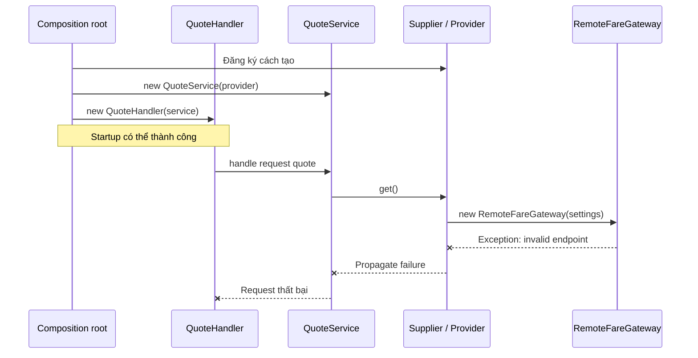

# Lỗi khởi tạo muộn chỉ xuất hiện khi xử lý yêu cầu đầu tiên

Trong chương **Chẩn đoán DI** của module **Dependency Injection**, có một sự cố rất dễ gây bất ngờ: **ứng dụng báo khởi động thành công, nhưng yêu cầu đầu tiên tới một chức năng lại thất bại**. Log có thể chứa lỗi thiếu dependency, cấu hình sai, exception từ constructor, connection timeout hoặc thông báo rằng không có scope đang hoạt động. Vì sao lỗi không xuất hiện ngay ở startup?

Câu trả lời thường nằm ở **thời điểm thành phần được tạo hoặc tài nguyên thực sự được sử dụng**. Khi dùng **Dependency Injection (DI)** và **Inversion of Control (IoC)**, phần cấu hình lắp ghép có thể đăng ký cách tạo dependency trước; object thực tế có thể chỉ được phân giải tại một lần gọi `Provider.get()`, một request scope hoặc một nhánh xử lý ít gặp. Ngay cả khi object đã được tạo ở startup, một JDBC/HTTP client đôi khi **chưa kết nối tới hệ thống bên ngoài** cho đến lệnh đầu tiên.

Bài học này hướng dẫn truy tìm ranh giới phát sinh lỗi, phân biệt *lỗi khởi tạo muộn* với *lỗi I/O lần đầu*, bổ sung kiểm tra ở thời điểm thích hợp và thực hành bằng **Java thuần**. Mục tiêu không phải chỉ ép mọi dependency trở thành eager singleton. Chẩn đoán đúng cần giữ được **constructor injection, composition root, scope, vòng đời và quyền sở hữu tài nguyên**, trước khi cân nhắc cơ chế DI container của framework.

Sau bài học, bạn có thể:

- Nhận diện vì sao một dependency không được tạo/kiểm tra khi ứng dụng khởi động.
- Phân biệt **đăng ký binding**, **phân giải dependency**, **gọi constructor**, **khởi tạo tài nguyên** và **thực hiện I/O thật**.
- Xác định đường đi từ request đầu tiên qua provider, factory, proxy và adapter tới lỗi gốc.
- Chọn biện pháp phát hiện sớm phù hợp: kiểm tra cấu hình, validate graph, khởi tạo dependency quan trọng, readiness probe và smoke test.
- Không làm sai request scope hoặc vô tình gọi dịch vụ ngoài có tác dụng phụ chỉ để “warm up”.
- Viết test Java thuần chứng minh lỗi xảy ra muộn, cách chuyển lỗi về startup khi cần, và cách consumer độc lập với container.

## 1. “Startup thành công” thực sự xác nhận điều gì?

Một ứng dụng có thể thực hiện các bước khác nhau khi khởi động:

1. Đọc các biến cấu hình hoặc file cấu hình.
2. Tạo registry/binding của container.
3. Tạo một số singleton eager.
4. Đăng ký handler, route và scheduler.
5. Mở cổng HTTP và bắt đầu nhận request.

Tùy ứng dụng, **không bước nào trong danh sách này bắt buộc đã tạo tất cả các adapter**, phân giải tất cả request-scoped object, mở mọi connection hay kiểm tra toàn bộ đường đi nghiệp vụ.

Ví dụ một hệ thống đặt xe có:

```text
GET /quotes/{vehicleId}?days=3
    -> QuoteHandler
        -> QuoteService
            -> FareGateway
                -> ExternalFareClient
```

Nếu `QuoteService` chỉ giữ `Supplier<FareGateway>` và chỉ gọi `get()` khi có yêu cầu báo giá, thì container/root có thể tạo `QuoteHandler` và `QuoteService` thành công **dù cấu hình tạo `FareGateway` đang sai**. Lỗi sẽ lộ ra lúc yêu cầu đầu tiên kích hoạt đúng nhánh.

Ba trạng thái cần kiểm tra riêng:

| Trạng thái | Điều đã biết | Điều **chưa** được bảo đảm |
| --- | --- | --- |
| **Container/registry đã có binding** | Có quy tắc cung cấp một dependency | Constructor/factory đã chạy thành công |
| **Object graph đã được phân giải** | Những dependency cần cho graph đó đã được cấp | Client đã kết nối thật, thông tin xác thực còn hợp lệ, schema bên ngoài đã sẵn sàng |
| **Một phép gọi I/O đã thành công** | Một đường đi tích hợp hoạt động tại thời điểm đó | Mọi endpoint, mọi request, mọi credential và mọi lần gọi sau đều thành công |

**Chú ý:** lỗi “đầu tiên” có thể là **yêu cầu đầu tiên của một endpoint**, **request đầu tiên sau deploy**, **lần đầu của một nhánh feature flag**, hoặc **lần đầu sau khi một request-scoped instance được tạo**. Không nhất thiết toàn bộ HTTP server đều thất bại ở request số 1.

## 2. Hai nguyên nhân khác nhau thường bị gộp thành một

### 2.1. Thành phần được tạo trễ (*deferred construction*)

Trong mô hình lazy:

```java
final class QuoteService {
    private final java.util.function.Supplier<FareGateway> gateway;

    QuoteService(java.util.function.Supplier<FareGateway> gateway) {
        this.gateway = java.util.Objects.requireNonNull(gateway);
    }

    long quote(int days) {
        return gateway.get().totalFor(days);
    }
}
```

`QuoteService` đã tồn tại, nhưng `FareGateway` có thể chưa tồn tại. Nếu factory bên trong supplier ném lỗi do endpoint rỗng hoặc thiếu dependency, exception xuất hiện **khi gọi `gateway.get()`**, tức là sau startup.

Những dạng tạo trễ khác gồm:

- Lazy singleton/bean chỉ được tạo khi lần đầu resolve.
- Prototype/transient được tạo ở mỗi lần yêu cầu.
- Request/job-scoped bean được cấp khi bắt đầu request/job.
- Factory chỉ tạo resource tại thời điểm use case gọi `open()`.
- Một nhánh điều kiện chỉ truy cập dependency khi feature flag bật.
- Proxy trì hoãn truy cập target hoặc provider lấy target theo scope hiện hành.

### 2.2. Object đã tạo, nhưng I/O mới xảy ra ở lần gọi đầu

Một client HTTP có thể được khởi tạo ở startup mà **không gửi request nào**. Một pool có thể mở kết nối theo nhu cầu. Một adapter có thể chỉ parse URI hoặc lưu credentials, rồi đến lần gọi đầu mới có lỗi:

```text
Startup:
  new RemoteClient(endpoint, credential)  -> OK
  new QuoteService(remoteClient)          -> OK

First quote:
  remoteClient.fetchPrice(...)            -> timeout / 401 / DNS / TLS error
```

Đây là **lỗi I/O lúc sử dụng lần đầu**, không nhất thiết là lỗi tạo object. Giải pháp “resolve toàn bộ bean ở startup” **không đủ** nếu client chỉ kết nối khi thực hiện `fetchPrice`.

| Tín hiệu quan sát | Khả năng nguyên nhân | Câu hỏi phân biệt |
| --- | --- | --- |
| Stack trace dừng trong constructor/factory | Khởi tạo dependency trễ thất bại | Factory/constructor đã từng chạy ở startup chưa? |
| Stack trace dừng tại `Provider.get()` / resolve proxy | Binding, scope, qualifier hoặc constructor được truy cập muộn | Provider đang resolve khóa nào, trong scope nào? |
| Object tạo thành công, lỗi tại `execute` / `send` | Kết nối hoặc giao thức ngoài chỉ được dùng lúc chạy | Có phép I/O nào được thực hiện trước khi nhận request không? |
| Lỗi chỉ ở một route | Graph của route đó hoặc nhánh có điều kiện | Các route khác có dùng đúng dependency này không? |
| Lỗi sau lần đầu, lần sau hết | Warm-up/cache, race, resource tạm thời hoặc retry | Có trạng thái initialization/concurrency nào cần quan sát không? |
| Lỗi chỉ khi có hai request đầu đồng thời | Khởi tạo lazy thiếu đồng bộ hoặc đóng/mở tài nguyên cạnh tranh | Factory có tạo hai singleton hoặc publish object chưa hoàn chỉnh không? |

## 3. Ví dụ đường đi lỗi qua composition root

Ta hình dung một root đăng ký một factory mà **chưa gọi factory**:

```java
// Mã minh họa cấu trúc:
Supplier<FareGateway> fareGateway = () ->
        new RemoteFareGateway(settings); // Chưa chạy constructor.

QuoteService service = new QuoteService(fareGateway);
QuoteHandler handler = new QuoteHandler(service);
// Startup vẫn có thể báo OK.
```

Khi request đến:



**Điểm chẩn đoán quan trọng:** Hỏi chính xác **thành phần nào chưa từng được dựng/resolve** trước request đó. Nếu service giữ supplier, việc handler/service tồn tại không chứng minh target của supplier đã tạo được.

Nếu ứng dụng sử dụng DI container, các từ *registration*, *singleton*, *lazy*, *request scope*, *provider* và *proxy* có ngữ nghĩa chi tiết tùy framework. Đừng suy ra mọi container tạo tất cả singleton ở startup hoặc tất cả prototype đều được validate trước khi phục vụ. Cách tiếp cận an toàn là kiểm tra **cấu hình thực tế và đường phân giải cụ thể**.

## 4. Cách thu thập bằng chứng thay vì đoán từ một lỗi HTTP 500

Khi lỗi xảy ra ở yêu cầu đầu tiên, nên ghi nhận một chuỗi sự kiện ngắn, có thứ tự:

1. **Thời điểm ứng dụng nhận traffic:** log bootstrap/ready và thời điểm request đến.
2. **Route và nhánh nghiệp vụ:** endpoint nào, feature flag/tenant nào đã kích hoạt factory?
3. **Chuỗi phân giải dependency:** handler -> service -> provider/factory -> adapter/client.
4. **Điểm lỗi đầu tiên trong stack trace:** constructor, provider lookup, callback init hay phương thức I/O?
5. **Nguyên nhân gốc (root cause):** cấu hình sai, thiếu registration, scope không hợp lệ, timeout hay lỗi hạ tầng bên ngoài?
6. **Tình trạng sau lỗi:** request tiếp theo còn thất bại không, factory có retry, resource đã tạo dở có được cleanup không?

Ví dụ một log chẩn đoán **mô phỏng**:

```text
INFO  app.start       graph=quote-api ready=true
INFO  http.request    path=/quotes/CAR-07 days=3
DEBUG di.resolve     key=FareGateway scope=lazy-singleton
ERROR di.create      component=RemoteFareGateway
  Caused by: IllegalArgumentException: Invalid gateway endpoint
ERROR http.response   path=/quotes/CAR-07 status=500
```

Log này cho thấy **quá trình tạo gateway xảy ra khi request chạy**. Nó khác log:

```text
INFO  app.start       component=RemoteFareGateway constructed=true
ERROR external.call   operation=fetchFare error=ConnectionTimeout
ERROR http.response   path=/quotes/CAR-07 status=503
```

Ở trường hợp thứ hai, tạo object đã xong; lỗi là **không liên lạc được với hệ thống ngoài** trong khi phục vụ request.

**Không ghi API key, access token, password, header Authorization hoặc payload nhạy cảm** vào log chẩn đoán. Nên log **tên cấu hình, trạng thái hợp lệ, revision đã kiểm tra, tên dependency và mã correlation ID** thay vì giá trị bí mật. Phải phân biệt thông điệp HTTP trả khách hàng với log nội bộ: lỗi chi tiết về graph và secret không nên lộ qua response.

## 5. Ví dụ hoàn chỉnh Java 17: lỗi muộn và kiểm tra sớm

Ví dụ sau là **chương trình Java thuần**, không có framework hoặc gọi mạng thật. `RemoteFareGateway` mô phỏng một adapter cần cấu hình endpoint/token. Constructor của nó validate cấu hình; `Lazy<T>` chỉ tạo và cache object **khi `get()` lần đầu thành công**.

Ta có:

- `GatewaySettings`: dữ liệu cấu hình bootstrap, có thể chứa giá trị sai để tái hiện lỗi.
- `FareGateway`: port mà mã nghiệp vụ cần.
- `RemoteFareGateway`: implementation hạ tầng mô phỏng.
- `QuoteService`: nhận `Supplier<? extends FareGateway>` qua **constructor injection**, không biết cách tạo adapter.
- `ApplicationGraph`: composition root tạo supplier và service; có phương thức `verifyCriticalDependencies()` để chủ động kiểm tra một dependency quan trọng.
- Các test bằng Java thuần: lỗi muộn, lỗi sớm, đường thành công, một nhánh không cần gateway và behavior của lazy sau khi factory thất bại.

### 5.1. Mã nguồn

Lưu toàn bộ vào `LateInitializationDiagnosticsDemo.java`, dùng JDK 17 trở lên:

```java
import java.util.Objects;
import java.util.concurrent.atomic.AtomicInteger;
import java.util.function.Supplier;

public class LateInitializationDiagnosticsDemo {
    record GatewaySettings(String endpoint, String token) { }

    @FunctionalInterface
    interface FareGateway {
        long totalFor(int days);
    }

    // Adapter giả lập: chỉ kiểm tra cấu hình; KHÔNG gọi mạng thật.
    static final class RemoteFareGateway implements FareGateway {
        private final GatewaySettings settings;

        RemoteFareGateway(GatewaySettings settings) {
            this.settings = Objects.requireNonNull(settings, "settings");
            if (settings.endpoint() == null
                    || !settings.endpoint().startsWith("https://")) {
                throw new IllegalArgumentException(
                        "Invalid gateway endpoint");
            }
            if (settings.token() == null
                    || settings.token().isBlank()) {
                throw new IllegalArgumentException(
                        "Missing gateway token");
            }
        }

        @Override
        public long totalFor(int days) {
            return Math.multiplyExact(250_000L, days);
        }
    }

    // Lazy đơn giản, cache instance tạo thành công.
    // volatile + synchronized ngăn hai thread cùng tạo instance thành công.
    static final class Lazy<T> implements Supplier<T> {
        private final Supplier<? extends T> factory;
        private volatile T cached;

        Lazy(Supplier<? extends T> factory) {
            this.factory = Objects.requireNonNull(factory, "factory");
        }

        @Override
        public T get() {
            T current = cached;
            if (current != null) {
                return current;
            }
            synchronized (this) {
                current = cached;
                if (current == null) {
                    current = Objects.requireNonNull(
                            factory.get(), "Factory returned null");
                    cached = current;
                }
            }
            return current;
        }
    }

    // Consumer chỉ biết port; provider được inject qua constructor.
    static final class QuoteService {
        private final Supplier<? extends FareGateway> gatewayProvider;

        QuoteService(Supplier<? extends FareGateway> gatewayProvider) {
            this.gatewayProvider = Objects.requireNonNull(
                    gatewayProvider, "gatewayProvider");
        }

        long quote(int days) {
            if (days < 1 || days > 30) {
                throw new IllegalArgumentException(
                        "Days must be between 1 and 30");
            }
            return gatewayProvider.get().totalFor(days);
        }
    }

    // Root có thể dựng graph khi chưa tạo gateway thật.
    static final class ApplicationGraph {
        final Lazy<FareGateway> gateway;
        final QuoteService quotes;

        private ApplicationGraph(
                Lazy<FareGateway> gateway, QuoteService quotes) {
            this.gateway = gateway;
            this.quotes = quotes;
        }

        static ApplicationGraph assemble(GatewaySettings settings) {
            Lazy<FareGateway> gateway = new Lazy<>(
                    () -> new RemoteFareGateway(settings));
            QuoteService quotes = new QuoteService(gateway);
            return new ApplicationGraph(gateway, quotes);
        }

        // Chỉ dùng khi policy muốn kiểm tra dependency này ở startup.
        void verifyCriticalDependencies() {
            gateway.get();
        }
    }

    static void check(boolean condition, String message) {
        if (!condition) {
            throw new AssertionError(message);
        }
    }

    // 1. Startup tạo được service, request đầu mới lộ lỗi cấu hình.
    static void testFailureAppearsOnFirstValidRequest() {
        GatewaySettings bad = new GatewaySettings(
                "http://invalid.example", "test-token");
        ApplicationGraph graph = ApplicationGraph.assemble(bad);

        // Graph đã dựng; chưa có RemoteFareGateway.
        check(graph.quotes != null, "Service should be constructed");

        boolean failed = false;
        try {
            graph.quotes.quote(3);
        } catch (IllegalArgumentException error) {
            failed = "Invalid gateway endpoint".equals(
                    error.getMessage());
        }
        check(failed, "Expected deferred initialization failure");
    }

    // 2. Preflight có chủ đích khiến lỗi lộ ra trước khi nhận request.
    static void testPreflightFindsBadSettings() {
        ApplicationGraph graph = ApplicationGraph.assemble(
                new GatewaySettings("bad-url", "test-token"));
        boolean found = false;
        try {
            graph.verifyCriticalDependencies();
        } catch (IllegalArgumentException error) {
            found = "Invalid gateway endpoint".equals(
                    error.getMessage());
        }
        check(found, "Preflight must detect invalid endpoint");
    }

    // 3. Với config hợp lệ, preflight warm cùng một instance.
    static void testSuccessfulGraphReusesGateway() {
        ApplicationGraph graph = ApplicationGraph.assemble(
                new GatewaySettings(
                        "https://fare.example.invalid", "test-token"));
        graph.verifyCriticalDependencies();

        FareGateway first = graph.gateway.get();
        FareGateway second = graph.gateway.get();
        check(first == second, "Gateway should be cached");
        check(graph.quotes.quote(3) == 750_000L,
                "Wrong quote from injected gateway");
    }

    // 4. Request bị reject trước khi chạm gateway có thể không lộ lỗi.
    static void testInvalidRequestDoesNotResolveGateway() {
        AtomicInteger creations = new AtomicInteger();
        Lazy<FareGateway> lazy = new Lazy<>(() -> {
            creations.incrementAndGet();
            throw new IllegalStateException("Gateway initialization failed");
        });
        QuoteService service = new QuoteService(lazy);

        boolean rejected = false;
        try {
            service.quote(0);
        } catch (IllegalArgumentException expected) {
            rejected = true;
        }
        check(rejected && creations.get() == 0,
                "Validation must run before lazy resolution");

        boolean initializedAndFailed = false;
        try {
            service.quote(1);
        } catch (IllegalStateException expected) {
            initializedAndFailed = true;
        }
        check(initializedAndFailed && creations.get() == 1,
                "First valid request should trigger the factory");
    }

    // 5. Chính sách cache của demo: không cache lần tạo thất bại.
    static void testFailedConstructionCanBeRetried() {
        AtomicInteger attempts = new AtomicInteger();
        Lazy<FareGateway> lazy = new Lazy<>(() -> {
            if (attempts.incrementAndGet() == 1) {
                throw new IllegalStateException("temporary failure");
            }
            return days -> 10_000L * days;
        });

        boolean failedOnce = false;
        try {
            lazy.get();
        } catch (IllegalStateException expected) {
            failedOnce = true;
        }
        check(failedOnce, "First factory call should fail");

        FareGateway recovered = lazy.get();
        check(recovered.totalFor(2) == 20_000L,
                "Second factory call should recover");
        check(lazy.get() == recovered && attempts.get() == 2,
                "A successful lazy creation should be cached");
    }

    // 6. Test consumer thuần, không cần container hoặc client thật.
    static void testQuoteServiceWithFakePort() {
        FareGateway fakeGateway = days -> days * 12_000L;
        QuoteService sut = new QuoteService(() -> fakeGateway);
        check(sut.quote(4) == 48_000L,
                "Pure Java constructor injection test failed");
    }

    public static void main(String[] args) {
        testFailureAppearsOnFirstValidRequest();
        testPreflightFindsBadSettings();
        testSuccessfulGraphReusesGateway();
        testInvalidRequestDoesNotResolveGateway();
        testFailedConstructionCanBeRetried();
        testQuoteServiceWithFakePort();
        System.out.println("PASS: 6 late-initialization checks");
    }
}
```

Biên dịch và chạy:

```bash
javac LateInitializationDiagnosticsDemo.java
java LateInitializationDiagnosticsDemo
```

Kết quả dự kiến:

```text
PASS: 6 late-initialization checks
```

### 5.2. Ý nghĩa từng bài kiểm tra

| Test | Trạng thái trước lời gọi | Điều được chứng minh |
| --- | --- | --- |
| `testFailureAppearsOnFirstValidRequest` | `ApplicationGraph` và `QuoteService` đã được tạo | Sai endpoint chỉ phát sinh exception khi supplier tạo gateway lần đầu |
| `testPreflightFindsBadSettings` | Root được dựng nhưng chưa phục vụ traffic | Một bước kiểm tra **có chủ đích** có thể đưa lỗi cấu hình lên startup |
| `testSuccessfulGraphReusesGateway` | Config hợp lệ, root gọi preflight | Lazy cache một instance đã tạo thành công; consumer sử dụng đúng port |
| `testInvalidRequestDoesNotResolveGateway` | Factory luôn ném lỗi nếu chạy | Nhánh validation của request có thể **không kích hoạt** dependency; lỗi chỉ lộ khi request đi đúng nhánh |
| `testFailedConstructionCanBeRetried` | Factory giả lập một lần lỗi | Trong implementation **cụ thể của demo**, lần tạo lỗi không được cache, lần thành công được cache |
| `testQuoteServiceWithFakePort` | Không có SDK hoặc DI container | Consumer có thể kiểm thử trực tiếp bằng fake qua constructor injection |

**Không khái quát hóa hành vi của `Lazy` trong demo thành quy tắc chung:** từng container/framework có thể cache thành công, cache lỗi, retry hoặc thay thế target theo scope theo cách khác. Một số công cụ chỉ trì hoãn factory mà không cache object; `Supplier.get()` không mặc định có ngữ nghĩa singleton.

Mã `RemoteFareGateway` chỉ **validate cấu hình rồi tính giá giả lập**, không mở kết nối. Do đó, gọi `verifyCriticalDependencies()` trong demo kiểm tra chính xác **khả năng tạo adapter theo cấu hình**, **không** chứng minh endpoint thực tế đang hoạt động. Trong production, cần một bước probe kết nối riêng nếu yêu cầu readiness bao gồm khả năng liên lạc tới dịch vụ ngoài.

## 6. Phân biệt “kiểm tra cấu hình”, “validate graph” và “kiểm tra sẵn sàng”

Không phải cứ gọi `resolve` hoặc bật eager initialization là giải quyết mọi sự cố lần đầu. Có ít nhất bốn tầng kiểm tra, với phạm vi và chi phí khác nhau:

| Tầng | Làm gì? | Phát hiện được | Không bảo đảm |
| --- | --- | --- | --- |
| **Kiểm tra cú pháp và quy tắc cấu hình** | Parse endpoint, cổng, timeout, giới hạn; kiểm tra cấu hình bắt buộc | Giá trị thiếu, kiểu sai, URI không phù hợp | DNS, credential còn hạn, dịch vụ đang sẵn sàng |
| **Validate registration/object graph** | Xác định các binding/qualifier cần thiết và phát hiện chu trình theo khả năng container | Missing binding, ambiguous key, cycle constructor, một số cấu hình sai | Mọi nhánh lazy/request scope được tạo, network I/O hoạt động |
| **Khởi tạo dependency quan trọng** | Thực sự chạy constructor/factory của những object cần thiết | Lỗi constructor, validation nội bộ, resource mở ngay khi tạo | Resource tạo lazy bên dưới hoặc network chỉ được dùng sau đó |
| **Readiness/integration probe** | Kiểm tra hạn định một đường kết nối/khả năng phục vụ thiết yếu | Một số lỗi DNS/TLS/auth/schema/availability đang có | Mọi request tương lai hoặc giao dịch có side effect đều thành công |

Với ứng dụng thực, nên chọn lớp kiểm tra theo **mức độ cần thiết**:

- Cấu hình sai về kiểu hoặc thiếu trường bắt buộc có thể phát hiện **ngay ở bootstrap**, không chờ request.
- Missing binding hoặc constructor cycle nên được phát hiện **trước khi nhận traffic**, nếu framework có cơ chế validation phù hợp.
- Những client quan trọng có thể được **khởi tạo hoặc health-check có timeout** trước khi báo ready.
- Những integration không bắt buộc có thể **degrade** theo thiết kế thay vì làm toàn ứng dụng không sẵn sàng.

**Không đồng nhất liveness với readiness:** một tiến trình vẫn sống nhưng chưa đủ khả năng phục vụ tính năng trọng yếu. Liveness thường trả lời “tiến trình có cần khởi động lại không?”, còn readiness trả lời “có nên đưa lưu lượng tới instance này không?”. Hệ thống vận hành có thể định nghĩa probe cụ thể khác nhau; cần tuân theo kiến trúc triển khai.

## 7. Vì sao không nên ép mọi thứ khởi tạo eager?

Một cách phản ứng vội là chuyển mọi bean sang singleton eager hoặc chạy một lệnh resolve cho mọi kiểu ở startup. Điều này có thể:

- **Kéo dài thời gian bootstrap** vì khởi tạo những integration hiếm khi dùng.
- **Chạm tài nguyên không cần thiết** khi chỉ một tính năng tùy chọn được triển khai.
- **Sai scope:** request-scoped object cần request context; tạo nó bên ngoài request có thể thất bại hoặc khiến dữ liệu request sai.
- **Gây side effect:** gọi API tạo đơn hàng/gửi email/thanh toán để “warm up” có thể gây nghiệp vụ thật.
- **Tạo lỗi cạnh tranh** nếu nhiều node cùng khởi tạo/cập nhật resource hoặc chạy migration không có điều phối.
- **Che sự cố khác:** constructor thành công không chứng minh connection mở được khi I/O diễn ra.

Cách hợp lý là **liệt kê dependency thiết yếu**, biết chúng được tạo lúc nào, rồi chọn preflight **an toàn, có deadline và có ý nghĩa**. Nếu cần test một đường request-scoped, dùng một request/scope kiểm thử được tạo và đóng đúng cách hoặc một smoke test qua entry point; đừng tự tạo scope giả rồi giữ instance request lại trong singleton.

### Test “đọc” khác với test có tác dụng phụ

| Probe | Ví dụ | Lưu ý |
| --- | --- | --- |
| Validate local | Parse config và dựng object giá trị | Thường nhanh, không chạm hệ thống ngoài |
| Connect/read-only | Ping DB, kiểm tra một endpoint health/read-only | Có timeout, quota, quyền truy cập và xử lý lỗi |
| Resolve request scope | Chạy synthetic request đúng scope | Phải cleanup context, không rò state sau probe |
| Business write | Tạo booking thật, thu tiền, phát event | **Không** dùng làm readiness mặc định nếu không có môi trường/test key riêng và cleanup được bảo đảm |

Với read-only probe vẫn phải cân nhắc **quyền truy cập, độ trễ, quota và độ tin cậy của endpoint kiểm tra**. Probe quá nặng có thể tự tạo tải làm dịch vụ bất ổn.

## 8. Chẩn đoán theo loại dependency và scope

| Dependency | Vì sao lỗi có thể xuất hiện muộn? | Hướng điều tra |
| --- | --- | --- |
| **Lazy singleton** | Chỉ tạo khi đường đi sử dụng đầu tiên xảy ra | Kiểm tra factory/constructor, log thời điểm lần đầu resolve, thứ tự cache |
| **Prototype/transient** | Mỗi lần yêu cầu tạo object mới | Factory có đọc config sai, có side effect hoặc nguồn cấp cạn không? |
| **Request-scoped bean** | Chỉ có ngữ cảnh trong request | Provider có bị gọi ngoài request hoặc cache nhầm target vào singleton không? |
| **Job-scoped dependency** | Chỉ tạo khi job đầu tiên chạy | Job boundary có mở scope và đóng đúng khi lỗi không? |
| **Scoped proxy** | Proxy tạo sớm, target chỉ lấy khi gọi | Cần phân biệt proxy instance với target thực và scope hiện hành |
| **Factory/provider tự viết** | Code trong `open()`/`get()` chỉ chạy lúc cần | Ai sở hữu instance được trả về, ai cleanup khi lỗi khởi tạo? |
| **JDBC connection/pool** | Kết nối vật lý mở theo nhu cầu hoặc lần giao dịch đầu | Validate credential/schema/connectivity và hợp đồng trả connection |
| **HTTP/SDK client** | Constructor chỉ lưu cấu hình, request đầu mới thực hiện DNS/TLS/auth | Xác định timeout, URL, quyền truy cập và cách chuyển exception |
| **Feature-flagged component** | Đường code hiếm hoặc chỉ được bật về sau | Test từng chế độ hợp lệ, có rule về rollback/degrade |
| **Lazy circular dependency** | Chu trình bị trì hoãn qua provider/proxy | Vẽ đầy đủ back-edge và refactor trách nhiệm, đừng chỉ thêm lazy |

**Lưu ý về singleton:** nếu một singleton chỉ cần được tạo một lần nhưng factory **không an toàn đa luồng**, hai request đầu đến đồng thời có thể tạo hai instance hoặc quan sát object chưa khởi tạo xong. Ví dụ `Lazy<T>` dùng `volatile` và `synchronized` để ngăn tạo thành công nhiều lần trong cùng wrapper; đó là lựa chọn kỹ thuật của demo, không phải bảo đảm của mọi `Supplier` hoặc factory.

## 9. Khi lỗi nằm trong constructor hay trong một nhánh khởi tạo?

Thông tin hữu ích nhất thường là **đường dependency từ entry point tới lỗi gốc**:

```text
QuoteHandler
  -> QuoteService
      -> Supplier<FareGateway>.get()
          -> RemoteFareGateway.<init>()
              -> GatewaySettings.endpoint
                  -> Invalid gateway endpoint
```

Hãy đọc stack trace theo hai lớp:

- **Lớp wrapper:** container có thể báo “cannot create bean”, “resolution failed” hoặc “invocation exception”. Đây là vị trí lỗi được trình bày lại.
- **Root cause:** exception gốc như `IllegalArgumentException` về endpoint, `UnknownHostException`, lỗi kết nối, scope không hoạt động hoặc thiếu registration mới gợi ý nguyên nhân cần sửa.

Đừng sửa biểu hiện như “không có bean QuoteHandler” nếu nguyên nhân thật nằm sâu ở việc factory của `FareGateway` thất bại. Cũng đừng đổ lỗi cho mạng nếu stack trace chỉ rõ lỗi parse endpoint xảy ra **trước bất kỳ lệnh I/O nào**.

### Một chuỗi câu hỏi chẩn đoán có thứ tự

1. **Có registration cho khóa được yêu cầu không?** Nếu thiếu, lỗi nằm ở cấu hình graph.
2. **Registration chọn implementation nào?** Nếu qualifier sai, ứng dụng có thể chọn sai adapter/profile.
3. **Đã gọi factory/constructor chưa?** Nếu chưa, ứng dụng mới validate binding chứ chưa tạo instance.
4. **Factory có đọc cấu hình runtime khác startup không?** Nếu có, chụp revision và kiểm tra nguồn.
5. **Resource thật đã mở chưa?** Nếu chưa, một client “đã tạo” vẫn có thể lỗi ở lần kết nối đầu.
6. **Đang ở scope nào?** Request/job/prototype có được resolve đúng ranh giới không?
7. **Có nhiều request đầu chạy đồng thời không?** Kiểm tra race khi init, deadlock và cách cache lỗi.
8. **Khi thất bại, có resource tạo dở nào bị bỏ quên không?** Cleanup thuộc owner/factory.

Các câu hỏi trên nhằm **khoanh vùng**. Không nên chuyển sang chỉnh profile, thêm retry hoặc sửa global configuration khi chưa xác định điểm thất bại.

## 10. Fail fast hay degrade: quyết định theo tính thiết yếu

Hai ứng dụng có thể xử lý cùng một lỗi khác nhau:

**Dependency bắt buộc cho chức năng chính.** Nếu không có kết nối DB thì không thể nhận booking mà vẫn bảo đảm tính đúng đắn, ứng dụng có thể cần **không báo ready** cho đến khi kết nối, migration và schema cần thiết được kiểm tra.

**Dependency tùy chọn.** Nếu dịch vụ đề xuất xe tương tự đang lỗi nhưng ứng dụng vẫn có thể trả kết quả đặt xe chính, có thể cô lập phần đề xuất và tiếp tục phục vụ theo chính sách degrade.

| Câu hỏi | Nếu “có” | Hướng thiết kế |
| --- | --- | --- |
| Không có dependency thì tính năng chính không thể làm đúng? | Có | Kiểm tra sớm và tránh nhận traffic cho chức năng đó khi chưa sẵn sàng |
| Dependency chỉ phục vụ tính năng tùy chọn? | Có | Có thể lazy và degrade có chủ đích, giữ giám sát lỗi |
| Thao tác có side effect không thể rollback dễ? | Có | Không dùng lệnh đó làm warm-up mặc định |
| Dependency chỉ hợp lệ trong request scope? | Có | Validate qua đúng scope/synthetic request an toàn |
| Có thể thay cấu hình lúc chạy? | Có | Validate candidate trước publish, quan sát revision và xử lý thay resource |

**Không biến mọi lỗi khởi tạo thành retry vô hạn.** Endpoint sai hoặc thiếu registration là lỗi cấu hình thường không tự hồi phục. Timeout do dịch vụ ngoài có thể là tạm thời, nhưng retry cần giới hạn số lần, timeout, backoff và idempotency. Nếu giữ lại error mãi trong cache, cũng phải có chính sách phục hồi hoặc restart rõ ràng.

## 11. Kiểm thử tối thiểu để lỗi không quay lại production

Để chẩn đoán và bảo vệ bản sửa, nên có nhiều lớp test, mỗi lớp trả lời một câu hỏi riêng:

| Test | Mục tiêu | Có cần container/nguồn ngoài? |
| --- | --- | --- |
| **Unit test cấu hình** | Thiếu URL/token, định dạng sai, giá trị ngoài miền bị từ chối | Không |
| **Unit test consumer** | `QuoteService` chạy đúng với fake `FareGateway` | Không |
| **Unit test lazy/factory** | Khi nào gọi factory, cache success/failure ra sao, có race không | Không; đa luồng nếu yêu cầu |
| **Composition test** | Root/container chọn đúng implementation và resolve được dependency thiết yếu | Có thể Java thuần hoặc container |
| **Request-scope test** | Target được tạo/dọn trong đúng scope, không bị singleton giữ sai | Thường cần môi trường framework hoặc scope test phù hợp |
| **Readiness/integration test** | Các kết nối thiết yếu có thể thực hiện check an toàn | Có thể cần sandbox/nguồn test |
| **First-request smoke test** | Request đầu tới từng đường trọng yếu hoạt động sau startup | Cần entry point/hệ thống kiểm thử có kiểm soát |

**Không nhầm “test với fake xanh” là “credential bên ngoài đúng”.** Ngược lại, một integration test xanh cũng không thay thế unit test nhánh lỗi, validation và quy tắc nghiệp vụ trong consumer.

### Cách tái hiện lỗi theo kịch bản

1. Dựng root với cấu hình không hợp lệ.
2. Xác minh **bootstrap vẫn dựng được wrapper** nếu đang thử delayed resolution.
3. Gửi request đi qua nhánh thực sự gọi provider; ghi nhận nguyên nhân exception.
4. Bật preflight cho dependency thiết yếu; xác minh lỗi chuyển về startup.
5. Dựng root với cấu hình hợp lệ; kiểm tra request thành công.
6. Kiểm tra route không sử dụng dependency: nó không nên tạo gateway một cách ngoài ý muốn.
7. Tách test client thực: connection, TLS, auth và response thuộc phạm vi integration.

Ví dụ ở phần 5 thực hiện sáu kiểm tra đầu bằng **Java thuần** và cố ý không giả vờ đã xác nhận network.

## 12. Vòng đời và quyền sở hữu khi cố khởi tạo sớm

Một preflight có thể tạo resource tồn tại lâu hơn bước kiểm tra. Nếu `gateway.get()` mở client có socket hoặc thread pool, cần chỉ rõ **ai sở hữu** instance đã tạo:

```text
Application root (owner)
    -> Lazy/FareGateway  (application scope)
        -> HTTP client   (resource dùng chung)
            -> request I/O theo từng lời gọi
```

Khi startup thành công, root/container cần giữ tài nguyên cho tới shutdown. Khi startup thất bại **giữa chừng**, factory/root cần cleanup những resource đã mở. Khi dừng, nên ngừng nhận request, xử lý in-flight rồi đóng client/pool theo hợp đồng.

Các lỗi dễ phát sinh nếu khắc phục vội:

- Gọi `try (FareGateway gateway = factory.open())` trong preflight rồi **đóng nó**, nhưng lại inject chính instance đã đóng vào consumer.
- Tạo một client riêng để thử, sau đó quên đóng client thử hoặc tạo client khác với cấu hình không giống bản production.
- Giữ request-scoped session trong singleton root sau một synthetic request.
- Đóng một pooled connection theo cách làm mất pool hoặc không trả lease đúng thời điểm.
- Dùng hai luồng startup tạo cùng resource mà implementation không hỗ trợ khởi tạo đồng thời.

**Quy tắc:** Preflight không được âm thầm chuyển ownership của dependency. Với tài nguyên có `AutoCloseable`, cần hợp đồng rõ rằng resource được root/container sở hữu, hoặc mỗi probe sở hữu và đóng **một resource thử riêng** của nó. Đừng suy quyền sở hữu chỉ từ việc đối tượng được inject.

## 13. Những cách sửa sai thường gặp

| Biện pháp vội | Vì sao chưa giải quyết đúng | Hướng khắc phục |
| --- | --- | --- |
| “Bật eager cho mọi bean” | Có thể sai scope, tốn tài nguyên, tạo side effect | Chỉ validate/khởi tạo dependency thiết yếu theo scope phù hợp |
| “Resolve bean là đã thử DB” | Connection có thể chỉ mở ở câu lệnh SQL đầu | Dùng readiness/integration probe có giới hạn và an toàn |
| “Không thấy lỗi startup nghĩa là cấu hình đúng” | Provider/lazy có thể chưa gọi factory | Kiểm tra thời điểm tạo và đường resolve của dependency |
| “Lỗi request đầu chắc do mạng” | Constructor cũng có thể thất bại vì config hoặc binding | Đọc root cause của stack trace |
| “Retry mọi lỗi tới khi được” | Sai cấu hình không tự hồi phục; dễ tăng tải hoặc trùng side effect | Phân loại lỗi; retry có deadline/idempotency khi phù hợp |
| “Thay `Provider.get()` bằng singleton field là xong” | Có thể tạo sai scope hoặc giữ instance request quá lâu | Thiết kế lại scope, factory và thời điểm sử dụng |
| “Dùng lazy để giấu vòng constructor” | Cycle trách nhiệm vẫn còn, lỗi chỉ dời sang runtime | Vẽ graph và bỏ back-edge bằng port/dữ liệu/orchestrator |
| “Smoke test tạo booking thật ở startup” | Có thể gây giao dịch ngoài ý muốn | Dùng read-only/check-only probe hoặc test sandbox tách biệt |
| “Log toàn bộ env để dễ debug” | Rò credential và thông tin nhạy cảm | Log tên khóa, revision, tình trạng validate; mask secret |
| “Factory lỗi một lần thì giữ nguyên instance dở” | Resource chưa hoàn chỉnh hoặc bị rò | Chỉ publish instance sau khi tạo thành công, cleanup khi thất bại |

## 14. Checklist điều tra một sự cố ngoài thực tế

Khi có báo cáo “vừa deploy xong, request đầu của endpoint X lỗi”, bạn có thể kiểm tra theo checklist:

- [ ] Xác định **route, thời điểm, bản deploy, revision cấu hình và phạm vi ảnh hưởng**.
- [ ] Thu thập stack trace đầy đủ từ request đầu, có `cause`/suppressed exceptions nhưng **không lộ secret**.
- [ ] Vẽ đường entry point -> service -> provider/factory/proxy -> adapter/client.
- [ ] Xác định binding đã tồn tại, đã resolve hay chỉ mới đăng ký.
- [ ] Xác định lỗi xảy ra **trong constructor/factory** hay **lúc I/O đầu tiên**.
- [ ] Kiểm tra scope hiện hành và khả năng hai request đầu tạo target đồng thời.
- [ ] Đối chiếu cấu hình được dùng ở startup và lần resolve; tránh đọc runtime config ngoài ý muốn.
- [ ] Kiểm tra việc cleanup khi constructor/factory chỉ thành công một phần.
- [ ] Quyết định dependency là **bắt buộc hay tùy chọn**, có cần chặn readiness không.
- [ ] Thêm test tái hiện lỗi và test bản sửa ở lớp thích hợp.
- [ ] Xác minh khả năng restart/rollout, quyền sở hữu tài nguyên và hành vi shutdown.

Chỉ khi đã biết lỗi nằm ở tầng nào mới nên chọn phương án: validate cấu hình, sửa registration, tách vòng phụ thuộc, điều chỉnh scope, làm preflight, cập nhật retry policy hay khắc phục dịch vụ bên ngoài.

## 15. Bài tập thực hành

### Bài tập 1 — Nhận diện ranh giới phát sinh lỗi

Cho log startup báo OK nhưng request `/quotes` đầu tiên ném `IllegalArgumentException: Invalid gateway endpoint` tại `RemoteFareGateway.<init>`. Hãy vẽ chuỗi phân giải, chỉ ra đối tượng được tạo lúc bootstrap và đối tượng chỉ được tạo khi request gọi `Provider.get()`. Giải thích vì sao lỗi này chưa có bằng chứng là lỗi DNS.

### Bài tập 2 — Tạo fail-fast có chọn lọc

Trong `LateInitializationDiagnosticsDemo.java`, gọi `verifyCriticalDependencies()` ngay sau `ApplicationGraph.assemble(...)` trong một hàm bootstrap riêng. Với cấu hình sai, xác minh bootstrap từ chối bắt đầu phục vụ request. Với cấu hình hợp lệ, xác minh hai lần `get()` cùng trả một gateway theo chính sách cache của demo.

### Bài tập 3 — Phân biệt nhánh validation và nhánh lazy

Chạy `testInvalidRequestDoesNotResolveGateway`. Giải thích vì sao `quote(0)` không gọi factory, còn `quote(1)` thì có. Nếu chỉ chạy test validation, bạn có phát hiện lỗi gateway không?

### Bài tập 4 — Không nhầm resolve với network readiness

Giả sử thay `RemoteFareGateway` bằng client thật mà constructor **không kết nối**. Hãy thiết kế một `checkConnectivity()` hoặc readiness probe an toàn có timeout, không tạo booking thật. Ghi rõ việc khởi tạo bean được chứng minh và việc kết nối được chứng minh là hai kết quả khác nhau.

### Bài tập 5 — Kiểm tra first-request concurrency

Tạo nhiều thread cùng gọi `Lazy.get()` với factory tăng `AtomicInteger` và trả cùng một kiểu object hợp lệ. Kiểm tra theo thiết kế của `Lazy` rằng factory chỉ tạo thành công một lần. Sau đó thử một factory ném lỗi lần đầu: các thread có thể quan sát exception khác nhau theo thứ tự gọi; nêu vì sao cần chính sách retry và quan sát lỗi rõ ràng.

### Bài tập 6 — Kiểm tra request scope

Giả sử `QuoteService` dùng chung qua nhiều request nhưng provider trả một `RequestContext`. Hãy lý giải vì sao gọi provider ở startup ngoài HTTP request có thể thất bại. Thiết kế một smoke test ở **scope request đúng nghĩa** và bảo đảm không giữ lại context trong singleton.

### Bài tập 7 — Lỗi resource tạo dở

Một factory mở connection pool rồi khởi tạo client, nhưng constructor client ném exception. Hãy đề xuất `try/catch` cleanup các tài nguyên đã mở, giữ nguyên exception gốc và thêm lỗi đóng vào suppressed exceptions. Ai là owner khi graph thành công?

### Bài tập 8 — Chính sách vận hành

Một chức năng xem gợi ý xe dùng API bên thứ ba không bắt buộc; chức năng thanh toán lại phụ thuộc DB và cổng thanh toán. Hãy phân loại dependency nào cần chặn readiness, dependency nào có thể lazy và degrade; giải thích rủi ro khi dùng một “cờ startup success” chung cho mọi chức năng.

## 16. Câu hỏi tự kiểm tra

1. Vì sao đăng ký một dependency trong container không chứng minh constructor đã chạy?
2. Sự khác biệt giữa lỗi tạo bean muộn và lỗi network lần đầu là gì?
3. Một provider hoặc proxy lazy có thể chuyển lỗi từ startup sang request như thế nào?
4. Tại sao request đầu tới route A có thể thành công trong khi request đầu tới route B thất bại?
5. Khi nào nên dùng fail-fast thay vì degrade?
6. Vì sao không nên resolve request-scoped bean ngoài request chỉ để kiểm tra startup?
7. Một health/readiness probe có thể gây side effect gì nếu được thiết kế sai?
8. Vì sao `Supplier.get()` không mặc định tạo mới hoặc cache singleton?
9. Làm sao đọc root cause mà không làm lộ thông tin nhạy cảm vào log hoặc HTTP response?
10. Những kiểm thử Java thuần nào chứng minh lỗi xuất hiện muộn và phương án sửa phát hiện sớm?

**Kết luận:** “Ứng dụng khởi động thành công” không có nghĩa **mọi dependency đã được tạo, mọi scope đã được kích hoạt và mọi tài nguyên bên ngoài đã sẵn sàng**. Khi lỗi chỉ xuất hiện ở request đầu tiên, hãy truy vết chính xác **thời điểm resolve, constructor, provider/proxy và I/O đầu tiên**, rồi áp dụng kiểm tra cấu hình, graph validation hoặc readiness probe theo mức độ thiết yếu. Giữ consumer độc lập với cách lắp ghép bằng constructor injection; quản lý scope, ownership và shutdown ở composition root/container; dùng **Java thuần** để tạo test tái hiện lỗi trước khi mang giải pháp vào framework.
