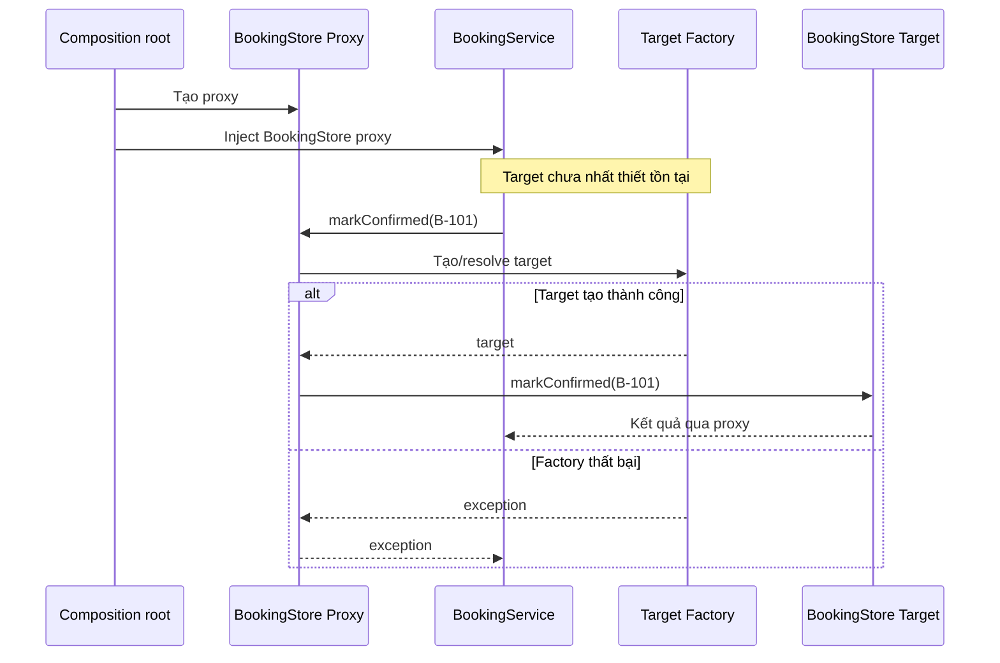
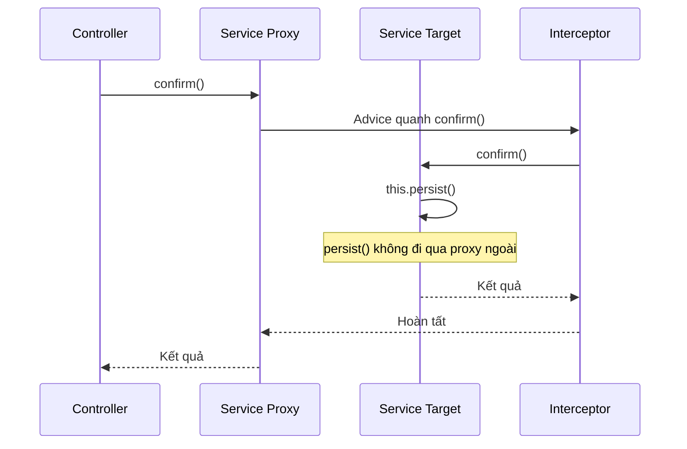

# Proxy và kiểu thực tế gây khác biệt so với kỳ vọng

## 1. Tình huống: inject thành công nhưng đối tượng “không giống” implementation

Khi học **Dependency Injection (DI)**, ta thường bắt đầu bằng constructor injection và composition root:

```java
BookingStore store = new InMemoryBookingStore();
BookingService service = new BookingService(store);
```

Nếu service nhận trực tiếp `InMemoryBookingStore`, đối tượng mà nó giữ chính là implementation đã được tạo. Nhưng khi sử dụng **DI container**, lời gọi inject có thể cấp cho service một **proxy** — một đối tượng đại diện triển khai hợp đồng phù hợp, tiếp nhận phương thức rồi chuyển lời gọi đến **đối tượng đích** (*target*) theo một chính sách nhất định.

Triệu chứng khi đó rất dễ gây hiểu lầm:

- `store instanceof BookingStore` là `true`, nhưng `store.getClass()` không phải `InMemoryBookingStore.class`.
- `(InMemoryBookingStore) store` có thể ném `ClassCastException`.
- Container báo lỗi khi một constructor yêu cầu **kiểu implementation cụ thể**, dù có bean triển khai interface tương ứng.
- Ứng dụng khởi động thành công, nhưng lần gọi đầu qua proxy mới phát hiện lỗi tạo target.
- Hai request đi qua **cùng một tham chiếu proxy**, nhưng nhận **target khác nhau**.
- Một phương thức có annotation giao dịch/bảo mật chạy đúng khi gọi từ ngoài nhưng không chạy như kỳ vọng khi gọi qua `this` bên trong target.

**Không nên vội kết luận “DI inject sai object”.** Có thể container đã cấp đúng một đối tượng theo **hợp đồng**; vấn đề là code đang kỳ vọng **runtime class, danh tính, thời điểm khởi tạo hoặc phạm vi sống** của đối tượng đó giống target.

Bài này thuộc chương **Chẩn đoán DI** trong module **DEPENDENCY_INJECTION**. Mục tiêu của module là học **Dependency Injection và Inversion of Control (IoC)** để tách việc sử dụng phụ thuộc khỏi việc tạo/lắp ghép object; thực hành **constructor injection**, **composition root**, **scope và vòng đời**, kiểm thử bằng **Java thuần** trước khi mở rộng sang DI container. Ở đây, ta dùng công cụ của JDK để tái hiện lỗi và thiết lập quy trình chẩn đoán có thể áp dụng khi làm việc với framework.

> **Mục tiêu:** Trước một lỗi liên quan proxy, phân biệt được **kiểu yêu cầu lúc compile**, **kiểu của tham chiếu được inject lúc runtime**, **target thực sự thực hiện lời gọi**, và **chính sách chọn target theo scope/thời điểm**.

## 2. Bốn khái niệm phải tách ra trước khi debug

Trong một lần chạy có proxy, hãy gọi tên rõ bốn thứ:

| Khái niệm | Ví dụ | Câu hỏi cần trả lời |
| --- | --- | --- |
| **Injection point / required type** | Tham số `BookingService(BookingStore store)` | Consumer yêu cầu **kiểu nào**? |
| **Injected object / proxy** | Một JDK proxy thực thi `BookingStore` | Consumer **thật sự giữ tham chiếu đến object nào**? |
| **Target object** | `InMemoryBookingStore` | Object nào thực hiện logic lưu dữ liệu cuối cùng? |
| **Target-resolution policy** | Lazy, singleton, request scope, AOP chain | Proxy lấy/chọn target **khi nào** và **theo điều kiện nào**? |

Sơ đồ object graph đơn giản:

```mermaid
flowchart LR
    ROOT["Composition root / DI container"]
    SERVICE["BookingService #1"]
    PROXY["BookingStore proxy #1"]
    TARGET["InMemoryBookingStore target #1"]

    ROOT -. "tạo/đăng ký" .-> PROXY
    ROOT -. "inject" .-> SERVICE
    SERVICE -->|"field store"| PROXY
    PROXY -. "giải quyết khi gọi"| TARGET
```

**Lưu ý về mũi tên:** cạnh `BookingService -> proxy` là một **tham chiếu được giữ**. Cạnh `proxy -> target` có thể chỉ là **quan hệ ủy quyền lúc gọi**: target có thể chưa tồn tại, có thể được tạo một lần, hoặc có thể thay đổi theo scope. Không nên suy từ sơ đồ đơn giản này rằng mọi proxy đều có field cố định trỏ tới một target duy nhất.

### Tham chiếu được nhận không nhất thiết là target

```java
// Ví dụ ý tưởng:
BookingStore injected = obtainProxyFromContainer();
BookingStore actualTarget = resolveTargetForCurrentScope();

boolean sameObject = injected == actualTarget;
```

Nếu proxy và target là hai object riêng, `sameObject` bằng `false`. Tuy nhiên, bản thân tên hàm trên chỉ minh họa khái niệm: **không có API chuẩn JDK chung cho mọi container** để “lấy target”, và việc cố mở proxy trong code nghiệp vụ thường là dấu hiệu sai ranh giới.

Điều quan trọng không phải là service có thể lấy target ra hay không; điều quan trọng là service **không cần** lấy target ra nếu hợp đồng được thiết kế phù hợp.

## 3. Kiểu tĩnh, kiểu runtime và kiểu target không đồng nhất

Giả sử interface nghiệp vụ:

```java
interface BookingStore {
    boolean markConfirmed(String bookingId);
}
```

Service nhận nó:

```java
final class BookingService {
    private final BookingStore store;

    BookingService(BookingStore store) {
        this.store = java.util.Objects.requireNonNull(store);
    }
}
```

Có ba lớp thông tin:

1. **Kiểu tĩnh ở điểm inject:** `BookingStore`. Trình biên dịch chỉ cần một object gán được cho kiểu này.
2. **Class runtime của object được inject:** có thể là lớp triển khai thật, lớp JDK proxy sinh động hoặc một subclass proxy của framework.
3. **Class của target:** có thể là `InMemoryBookingStore`, một adapter JDBC, hoặc class khác trong một scope cụ thể.

Để debug đúng:

| Biểu thức | Điều nó xác nhận | Điều **không** được kết luận |
| --- | --- | --- |
| `obj instanceof BookingStore` | `obj` tương thích với interface `BookingStore`. | `obj` chính là `InMemoryBookingStore`. |
| `obj.getClass()` | Class runtime của **đối tượng tham chiếu hiện tại**. | Class của target luôn trùng với kết quả đó. |
| `obj.getClass() == InMemoryBookingStore.class` | Object có **đúng class** đó, không phải subclass. | Một subclass proxy có cùng hành vi sẽ thỏa phép so sánh này. |
| `obj instanceof InMemoryBookingStore` | Object là instance của class đó hoặc subclass của nó. | Mọi proxy qua interface đều thỏa. |
| `Proxy.isProxyClass(obj.getClass())` | Class đó do **JDK dynamic proxy** sinh ra. | Nhận diện được mọi proxy của mọi framework. |
| `obj == target` | Hai tham chiếu trỏ tới cùng object. | Hai object khác nhau thì luôn có hành vi khác. |
| `obj.equals(target)` | Kết quả theo quy tắc equality của object được gọi. | Có thể thay cho kiểm tra danh tính `==`. |

**Đặc biệt:** `getClass()` là method của `Object`, trả class thực của receiver; nó không phải một API “unwrap target” của DI container. Nếu receiver là proxy, nó mô tả proxy.

### Hai cơ chế proxy dễ bị nhầm

**JDK dynamic proxy:** do `java.lang.reflect.Proxy` tạo, thường dựa trên **interface**. Nó có thể thực thi `BookingStore` nhưng **không phải** một `InMemoryBookingStore`. Vì vậy cast về concrete class có thể lỗi.

**Subclass-based proxy:** framework tạo một lớp con của một class phù hợp. Khi ấy `proxy instanceof TargetClass` **có thể đúng**, nhưng `proxy.getClass() == TargetClass.class` vẫn có thể sai vì class runtime là subclass. Các ràng buộc của `final` class, `final`/`private` method và constructor tùy kỹ thuật/framework.

Không nên chẩn đoán mọi proxy theo quy tắc của JDK dynamic proxy: một số container tạo interface proxy, một số dùng subclass proxy, một số không proxy tại điểm inject đang xét. **Cấu hình và phiên bản framework** mới quyết định cơ chế chính xác.

## 4. Bảng triệu chứng → nguyên nhân có thể → bằng chứng cần tìm

| Triệu chứng | Nguyên nhân khả dĩ | Bằng chứng xác nhận | Hướng sửa trước tiên |
| --- | --- | --- | --- |
| `ClassCastException` khi ép `BookingStore` về `JdbcBookingStore` | Object được inject là interface proxy hoặc implementation khác. | Kiểu constructor; class runtime; có phải JDK proxy; bean definition. | Tránh cast; dùng contract phù hợp hoặc điều chỉnh registration đúng. |
| Lỗi giải quyết bean cho concrete type | Container tạo proxy chỉ tương thích interface, hoặc bean chưa đăng ký/không đúng candidate. | Error chain; kiểu injection point; danh sách bean; proxy mode. | Inject interface nếu hợp đồng đủ; xem cấu hình proxy và bean resolution. |
| `getClass() == Implementation.class` trả false | Receiver là proxy hoặc subclass. | `getClass()`, `instanceof` và cơ chế proxy. | Không chọn nhánh nghiệp vụ bằng exact runtime class. |
| Method có annotation AOP không chạy như mong đợi | Lời gọi không đi qua proxy, annotation không áp dụng ở kiểu proxy đó, hoặc chưa bật cơ chế advice. | Call path, proxy creation, interceptor config. | Chẩn đoán đường gọi và cấu hình; tách collaborator nếu cần. |
| Constructor inject thành công nhưng lần gọi đầu thất bại | Proxy/lazy provider trì hoãn khởi tạo target; target phụ thuộc tài nguyên ngoài. | Timestamp tạo bean/target, factory log, nested exception. | Kiểm tra validation/readiness/factory và thời điểm lỗi. |
| Cùng proxy nhưng dữ liệu khác giữa hai request | Scoped proxy tra target theo context từng request. | Proxy identity, scope metadata, target identity theo request. | Kiểm tra scope đúng kỳ vọng; tránh giữ target request ngoài scope. |
| Lỗi không có active scope trong background task | Task chạy ngoài request context. | Executor/thread, thời điểm request kết thúc, scope lookup. | Truyền dữ liệu tường minh; quản lý context/lifetime hợp lệ. |
| Hai lần gọi `equals`/`toString` gây hành vi lạ | Proxy có handler xử lý method của `Object` khác kỳ vọng. | Equality contract của proxy; log interceptor. | Không dùng `equals`/`toString` để đoán target identity. |
| Object bị đóng hoặc mất tài nguyên sau request | Consumer đóng dependency dùng chung, hoặc lifetime của target sai. | Ai gọi `close()`; owner, scope, shutdown logs. | Chỉnh ownership và lifecycle. |
| Test bằng `new Service(fake)` PASS nhưng production FAIL | Test không chạy container/proxy/registration hoặc adapter thật. | Đường test vs đường production, proxy/advice có chạy không. | Giữ unit test và thêm integration/wiring test thích hợp. |

Bảng trên là **giả thuyết chẩn đoán**, không phải bảng tra lỗi với kết luận chắc chắn. Một exception có thể là hệ quả của nhiều lỗi kết hợp: đăng ký thiếu bean, nhiều candidate, cấu hình proxy sai kiểu, lỗi target factory hoặc scope không còn hoạt động. Phải đọc **nguyên nhân gốc** (*root cause*) và tái hiện tối thiểu trước khi thay code.

## 5. Quy trình chẩn đoán từng bước, từ hợp đồng ra runtime

Một quy trình ngắn giúp không bắt đầu bằng việc sửa annotation tùy hứng:

1. **Xác định phương thức đang thất bại và điểm inject.** Constructor/field yêu cầu kiểu gì? Method nào được gọi?
2. **Đọc toàn bộ chuỗi exception.** Tìm exception gốc và lớp code thực sự ném nó; phân biệt lỗi lúc resolve bean với lỗi sau khi method chạy.
3. **Phân biệt object được inject và target.** Quan sát class runtime của reference, nhưng đừng tự động kết luận target class từ đó.
4. **Xác nhận proxy mechanism.** JDK interface proxy, subclass proxy, lazy provider, scoped proxy hay AOP wrapper? Có thể kết hợp nhiều cơ chế.
5. **Kiểm tra khả năng gán kiểu.** Required type ở injection point có tương thích với **kiểu proxy mà container cấp** không?
6. **Kiểm tra lúc target được tạo.** Bootstrap, lần gọi đầu, mỗi request hay một factory riêng? Lỗi khởi tạo có bị trì hoãn không?
7. **Theo dõi đường gọi thực tế.** Caller có gọi qua proxy hay target tự gọi `this.method()`?
8. **Xem scope và threading.** Target có thuộc đúng request không; task có chạy ngoài scope hay sau shutdown không?
9. **Xem ownership, concurrency và tài nguyên.** Consumer có đóng object mượn; nhiều request có cùng target mutable không?
10. **Đối chiếu test đúng tầng.** Unit test fake cho business behavior; integration test cho proxy, profile, advice và lifecycle.

Ghi nhận bằng chứng cụ thể, ví dụ: “Điểm inject yêu cầu `BookingStore`; class runtime là JDK proxy, phép cast sang `JdbcBookingStore` thất bại; gọi qua interface vẫn thành công”. Báo cáo này hữu ích hơn câu “Spring inject sai kiểu”.

### Chẩn đoán không đồng nghĩa log mọi dữ liệu

Khi quan sát object graph, chỉ nên ghi những dữ liệu an toàn như **kiểu, scope định nghĩa, số instance, mốc khởi tạo và phương thức**. Tránh log token, connection string có mật khẩu, dữ liệu khách hàng hoặc toàn bộ object qua `toString()` mà không biết nội dung.

## 6. Java thuần: tự tái hiện chênh lệch giữa proxy và target

Mã dưới đây chạy với **JDK 11 trở lên**, không cần Spring, JUnit hay DI container. Ví dụ sử dụng `Proxy.newProxyInstance(...)` và `InvocationHandler` để tạo một **JDK dynamic proxy** với target được khởi tạo **lazy**.

Ta chủ động định nghĩa handler để quan sát:

- Proxy đã tồn tại ngay sau wiring, nhưng **target chưa được tạo**.
- Proxy tương thích kiểu `BookingStore` nhưng không phải class `InMemoryBookingStore`.
- Cast về concrete class thất bại, trong khi lời gọi qua interface hoạt động.
- Lần gọi nghiệp vụ đầu tạo target; lần sau dùng lại target.
- `equals`, `hashCode` và `toString` trong **proxy của bài** được handler xử lý bằng identity của proxy mà không làm target khởi tạo.

Lưu **toàn bộ** mã sau thành `Main.java`:

```java
import java.lang.reflect.InvocationHandler;
import java.lang.reflect.InvocationTargetException;
import java.lang.reflect.Method;
import java.lang.reflect.Proxy;
import java.util.HashSet;
import java.util.Objects;
import java.util.Set;
import java.util.concurrent.atomic.AtomicInteger;
import java.util.concurrent.atomic.AtomicReference;
import java.util.function.Supplier;

public class Main {
    // Hợp đồng mà consumer cần, không buộc vào implementation.
    public interface BookingStore {
        boolean markConfirmed(String bookingId);
        boolean isConfirmed(String bookingId);
    }

    // Target thật của ví dụ (không dùng chung nhiều thread).
    static final class InMemoryBookingStore implements BookingStore {
        private final Set<String> ids = new HashSet<>();

        @Override
        public boolean markConfirmed(String bookingId) {
            return ids.add(bookingId);
        }

        @Override
        public boolean isConfirmed(String bookingId) {
            return ids.contains(bookingId);
        }
    }

    // Consumer chỉ dùng interface; không cast và không gọi container.
    static final class BookingService {
        private final BookingStore store;

        BookingService(BookingStore store) {
            this.store = Objects.requireNonNull(store, "store");
        }

        boolean confirm(String bookingId) {
            if (bookingId == null || bookingId.isBlank()) {
                throw new IllegalArgumentException("bookingId không hợp lệ");
            }
            return store.markConfirmed(bookingId);
        }

        boolean isConfirmed(String bookingId) {
            return store.isConfirmed(bookingId);
        }
    }

    // Handler tạo một target ở lần gọi interface đầu tiên.
    static final class LazyStoreHandler implements InvocationHandler {
        private final Supplier<? extends BookingStore> factory;
        private volatile BookingStore target;

        LazyStoreHandler(Supplier<? extends BookingStore> factory) {
            this.factory = Objects.requireNonNull(factory, "factory");
        }

        private BookingStore resolveTarget() {
            BookingStore current = target;
            if (current == null) {
                synchronized (this) {
                    current = target;
                    if (current == null) {
                        current = Objects.requireNonNull(
                                factory.get(), "factory trả về null");
                        target = current;
                    }
                }
            }
            return current;
        }

        @Override
        public Object invoke(Object proxy, Method method, Object[] args)
                throws Throwable {
            // Quy tắc của RIÊNG proxy minh họa này.
            // Không tạo target chỉ để gọi Object methods.
            if (method.getDeclaringClass() == Object.class) {
                switch (method.getName()) {
                    case "equals":
                        return proxy == args[0];
                    case "hashCode":
                        return System.identityHashCode(proxy);
                    case "toString":
                        return "DiagnosticBookingStoreProxy";
                    default:
                        throw new IllegalStateException(
                                "Object method không hỗ trợ");
                }
            }

            System.out.println("PROXY gọi: " + method.getName());
            try {
                return method.invoke(resolveTarget(), args);
            } catch (InvocationTargetException error) {
                // Giữ nguyên nguyên nhân gốc từ phương thức target.
                throw error.getCause();
            }
        }
    }

    // Factory proxy do composition root sử dụng.
    static BookingStore newLazyProxy(
            Supplier<? extends BookingStore> targetFactory) {
        return (BookingStore) Proxy.newProxyInstance(
                BookingStore.class.getClassLoader(),
                new Class<?>[] { BookingStore.class },
                new LazyStoreHandler(targetFactory));
    }

    public static void main(String[] args) {
        AtomicInteger createdTargets = new AtomicInteger();
        AtomicReference<InMemoryBookingStore> realTarget =
                new AtomicReference<>();

        // COMPOSITION ROOT: inject proxy thay vì inject target trực tiếp.
        BookingStore injected = newLazyProxy(() -> {
            createdTargets.incrementAndGet();
            System.out.println("FACTORY: tạo target thật");

            InMemoryBookingStore target = new InMemoryBookingStore();
            realTarget.set(target);
            return target;
        });

        BookingService service = new BookingService(injected);

        System.out.println(
                "Target sau constructor injection: "
                + createdTargets.get());
        System.out.println(
                "Là JDK proxy? "
                + Proxy.isProxyClass(injected.getClass()));
        System.out.println(
                "Thỏa interface? "
                + (injected instanceof BookingStore));
        System.out.println(
                "Là class target? "
                + (injected instanceof InMemoryBookingStore));

        try {
            InMemoryBookingStore wrongCast =
                    (InMemoryBookingStore) injected;
            System.out.println(wrongCast);
        } catch (ClassCastException expected) {
            System.out.println(
                    "Cast sang implementation: ClassCastException");
        }

        System.out.println(
                "toString của proxy: " + injected.toString());
        System.out.println(
                "Target sau chẩn đoán kiểu: " + createdTargets.get());

        System.out.println(
                "Lần đầu xác nhận? " + service.confirm("B-101"));
        System.out.println(
                "Đã xác nhận? " + service.isConfirmed("B-101"));
        System.out.println(
                "Số target đã tạo: " + createdTargets.get());
        System.out.println(
                "Proxy == target? " + (injected == realTarget.get()));
    }
}
```

### Biên dịch và chạy

```bash
javac -encoding UTF-8 Main.java
java Main
```

Kết quả **dự kiến**:

```text
Target sau constructor injection: 0
Là JDK proxy? true
Thỏa interface? true
Là class target? false
Cast sang implementation: ClassCastException
toString của proxy: DiagnosticBookingStoreProxy
Target sau chẩn đoán kiểu: 0
PROXY gọi: markConfirmed
FACTORY: tạo target thật
Lần đầu xác nhận? true
PROXY gọi: isConfirmed
Đã xác nhận? true
Số target đã tạo: 1
Proxy == target? false
```

**Điều cần rút ra:**

- `BookingService` nhận một `BookingStore` hợp lệ; không cần biết object đó có phải `InMemoryBookingStore` hay không.
- Cast sang implementation sai vì receiver là **JDK dynamic proxy** sinh từ interface.
- `getClass()` và `Proxy.isProxyClass(...)` mô tả **object được inject**, không cần target được tạo.
- Hai lời gọi nghiệp vụ đi qua handler; handler chỉ chạy factory **một lần** khi thành công.
- `injected == realTarget.get()` bằng `false`: proxy và target là hai instance riêng.
- Việc handler không tạo target khi gọi `toString` là **quy tắc của mã bài này**, không phải cam kết cho mọi framework.

`AtomicReference<InMemoryBookingStore>` chỉ dùng để **quan sát trong chương trình chẩn đoán**. Code nghiệp vụ không nên cần biết cách lấy target concrete để hoạt động.

### Chỉ đổi một dòng cấu hình ở composition root

Nếu cấp thẳng target:

```java
BookingStore injected = new InMemoryBookingStore();
BookingService service = new BookingService(injected);
```

thì `Proxy.isProxyClass(injected.getClass())` sẽ là `false`, `injected instanceof InMemoryBookingStore` là `true`, và không có handler chặn lời gọi. **Chữ ký constructor `BookingService(BookingStore)` không thay đổi.** Đây chính là lợi ích của tách việc sử dụng dependency khỏi việc lắp ghép.

## 7. Kiểm thử Java thuần để ngăn kết luận sai về proxy

Thêm class `ProxyDiagnosticsTest` **bên ngoài class `Main`** ở cuối tệp `Main.java` của mục 6. Bài test dùng những assertion không phụ thuộc tên class proxy do JDK sinh ra.

```java
class ProxyDiagnosticsTest {
    private static void check(boolean value, String description) {
        if (!value) {
            throw new AssertionError(description);
        }
    }

    private static void expectThrows(
            Class<? extends Throwable> expected,
            Runnable action,
            String description) {
        try {
            action.run();
        } catch (Throwable caught) {
            if (expected.isInstance(caught)) {
                return;
            }
            throw new AssertionError(
                    description + ": sai exception", caught);
        }
        throw new AssertionError(
                description + ": không có exception");
    }

    private static void testIdentityAndLazyCreation() {
        java.util.concurrent.atomic.AtomicInteger creations =
                new java.util.concurrent.atomic.AtomicInteger();
        java.util.concurrent.atomic.AtomicReference<Main.InMemoryBookingStore>
                target = new java.util.concurrent.atomic.AtomicReference<>();

        Main.BookingStore proxy = Main.newLazyProxy(() -> {
            creations.incrementAndGet();
            Main.InMemoryBookingStore instance =
                    new Main.InMemoryBookingStore();
            target.set(instance);
            return instance;
        });

        Main.BookingService service = new Main.BookingService(proxy);

        check(creations.get() == 0,
                "Tạo proxy/consumer không được ép tạo target");
        check(java.lang.reflect.Proxy.isProxyClass(proxy.getClass()),
                "Phải là JDK dynamic proxy");
        check(proxy instanceof Main.BookingStore,
                "Proxy không thỏa contract");
        check(!(proxy instanceof Main.InMemoryBookingStore),
                "Proxy không được xem là concrete target");

        // Object methods dùng identity của proxy theo handler của bài.
        check(proxy.equals(proxy), "equals(proxy) phải true");
        check(!proxy.equals(new Main.InMemoryBookingStore()),
                "equals(target khác) phải false");
        check(proxy.hashCode() == System.identityHashCode(proxy),
                "hashCode của proxy không đúng như handler");
        check("DiagnosticBookingStoreProxy".equals(proxy.toString()),
                "toString của proxy không đúng");
        check(creations.get() == 0,
                "Chẩn đoán Object methods không được tạo target");

        expectThrows(ClassCastException.class,
                () -> {
                    Main.InMemoryBookingStore cast =
                            (Main.InMemoryBookingStore) proxy;
                    System.out.println(cast);
                },
                "Cast từ JDK proxy sang target class");

        check(service.confirm("B-201"),
                "Lần xác nhận đầu phải thành công");
        check(service.isConfirmed("B-201"),
                "Lời gọi thứ hai không chuyển tiếp đúng");
        check(!service.confirm("B-201"),
                "Lần xác nhận lặp phải trả false");

        check(creations.get() == 1,
                "Phải tạo đúng một target khi thành công");
        check(target.get() != null && proxy != target.get(),
                "Proxy không được nhầm là target");
    }

    private static void testDeferredFailure() {
        java.util.concurrent.atomic.AtomicInteger attempts =
                new java.util.concurrent.atomic.AtomicInteger();

        Main.BookingStore proxy = Main.newLazyProxy(() -> {
            attempts.incrementAndGet();
            throw new IllegalStateException("Lỗi factory giả lập");
        });
        Main.BookingService service = new Main.BookingService(proxy);

        check(attempts.get() == 0,
                "Inject proxy không chạy factory");

        expectThrows(IllegalStateException.class,
                () -> service.confirm("B-404"),
                "Lỗi phải xuất hiện khi sử dụng target");
        check(attempts.get() == 1,
                "Lần dùng đầu phải gọi factory một lần");

        expectThrows(IllegalStateException.class,
                () -> service.confirm("B-404"),
                "Lỗi lần dùng thứ hai");
        check(attempts.get() == 2,
                "Handler không cache lỗi; lần dùng sau thử lại");
    }

    private static void testDirectImplementation() {
        Main.BookingStore direct = new Main.InMemoryBookingStore();
        check(!java.lang.reflect.Proxy.isProxyClass(direct.getClass()),
                "Direct implementation không phải JDK proxy");
        check(direct instanceof Main.InMemoryBookingStore,
                "Direct implementation phải thỏa concrete type");
        check(new Main.BookingService(direct).confirm("B-301"),
                "Consumer vẫn hoạt động với target trực tiếp");
    }

    public static void main(String[] args) {
        testIdentityAndLazyCreation();
        testDeferredFailure();
        testDirectImplementation();
        System.out.println("PASS: nhận diện proxy, target và lỗi tạo muộn");
    }
}
```

Chạy:

```bash
javac -encoding UTF-8 Main.java
java ProxyDiagnosticsTest
```

Trong quá trình chạy có thể xuất hiện những dòng `PROXY gọi: ...` do handler chẩn đoán chủ động in ra. Dòng cuối khi mọi assertion thành công:

```text
PASS: nhận diện proxy, target và lỗi tạo muộn
```

### Tại sao test không so sánh tên class proxy?

Tên class sinh bởi JVM hoặc thư viện có thể thay đổi theo runtime, phiên bản và cấu hình. Một assertion kiểu:

```java
// Không nên phụ thuộc tên sinh động cụ thể.
check(proxy.getClass().getName().equals("com.sun.proxy.$Proxy0"), "...");
```

rất giòn, và không dùng được để nhận diện các kiểu proxy khác. Với bài này, kiểm tra `Proxy.isProxyClass(...)` vì **ta biết rõ đang dùng JDK dynamic proxy**. Với framework khác, nên xem API chẩn đoán đã được framework hỗ trợ hoặc metadata về bean definition, không đoán từ chuỗi tên lớp.

### Giới hạn của bài test

Bài test xác minh **proxy do chính ta xây bằng JDK**. Nó không chứng minh proxy AOP của Spring có cùng `equals`/`hashCode`, cùng chính sách cache target hay cùng xử lý lỗi. Muốn biết điều đó, cần **integration test đi qua container thật** và cấu hình thực tế.

## 8. Chẩn đoán lỗi cast và yêu cầu concrete class

Xét một service có constructor:

```java
// Mẫu chữ ký gây khó cho JDK interface proxy.
BookingService(InMemoryBookingStore store)
```

Nếu container đang cấp một proxy **chỉ triển khai `BookingStore`**, object đó không phải `InMemoryBookingStore`. Khi điểm inject yêu cầu concrete class, container có thể **không cung cấp được đối tượng tương thích kiểu**, hoặc một phép cast trong code có thể lỗi.

Điều cần làm:

1. Đọc đúng **required type** tại injection point, bao gồm generic và qualifier nếu có.
2. Xem implementation nào được đăng ký và kiểu proxy container thực sự tạo.
3. Phân biệt **thiếu bean**, **nhiều bean tương thích**, **proxy không tương thích kiểu** và **lỗi khi factory tạo target**.
4. Nếu consumer chỉ cần hành vi của `BookingStore`, đổi constructor sang **`BookingStore`** là một hướng phù hợp với DIP.
5. Nếu consumer thật sự cần API riêng của concrete class, xem lại thiết kế hợp đồng hoặc cấu hình cách proxy phù hợp; đừng cast trong mọi method để né vấn đề.

**Không phải mọi lỗi inject concrete class đều do proxy.** Một bean có thể chưa được đăng ký, nằm ngoài component scan, bị vô hiệu bởi profile, không thỏa qualifier hoặc có nhiều ứng viên. Phải kiểm tra nguồn thông tin của container trước khi kết luận.

### Đừng dùng exact class để chọn hành vi nghiệp vụ

Phản ví dụ:

```java
if (store.getClass() == JdbcBookingStore.class) {
    // Làm một chuyện riêng cho JDBC...
}
```

Ngay cả khi `JdbcBookingStore` là target thật, cách viết này khiến use case lệ thuộc công nghệ; nếu receiver là proxy/subclass proxy, nhánh còn có thể không chạy. Nếu hành vi khác nhau theo môi trường, hãy để **composition root** chọn implementation; nếu chọn theo dữ liệu từng request, cung cấp **typed strategy selector** hoặc policy rõ ràng.

### Có nên “unwrap” mọi proxy?

Thường **không**. “Unwrap” có thể bỏ qua interceptor, bỏ qua scope, hoặc làm consumer giữ target lâu hơn vòng đời hợp lệ. Chỉ nên sử dụng API kiểm tra target/bean của framework ở nơi chẩn đoán hoặc integration test khi nó được hỗ trợ rõ ràng; đừng dùng cách suy đoán implementation từ tên lớp rồi truy cập nội bộ proxy.

## 9. Chẩn đoán target tạo muộn: startup PASS chưa chắc lần dùng đầu PASS

Một **lazy proxy** có thể được tạo và inject thành công, nhưng target chỉ xuất hiện khi method đầu tiên cần nó.

Timeline:



Nếu lỗi chỉ xuất hiện ở lần dùng đầu, hãy hỏi:

- **Constructor của target có thực sự chạy ở bootstrap không?** Có lazy initialization hoặc factory provider không?
- **Có validate cấu hình sớm không?** URL thiếu hoặc định dạng sai có thể được phát hiện ở startup dù target tạo muộn.
- **Client đã kết nối thật chưa?** `new HttpClient(...)` không nhất thiết kiểm tra được dịch vụ ngoài đang khỏe.
- **Lỗi thuộc factory, proxy hay nghiệp vụ của target?** Đọc stack trace và cause chain.
- **Thử lại có xảy ra không?** Một lazy handler có thể cache lỗi, thử lại hoặc tạo target mới tùy thiết kế.
- **Sau khi tạo thành công, ai đóng resource?** Proxy, scope manager hoặc graph owner phải có chính sách vòng đời rõ.

Trong `LazyStoreHandler` của ví dụ, nếu factory ném lỗi thì field `target` vẫn null. Lần gọi sau sẽ **thử lại**. Đây là chính sách riêng của handler: không nên suy rằng mọi DI container đều retry như vậy.

**Phân biệt ba mốc:** tham chiếu proxy hợp lệ, target được tạo thành công, và dịch vụ ngoài đã được chứng minh sẵn sàng. Đây là ba bảo đảm khác nhau.

## 10. Scoped proxy: cùng tham chiếu, target thay đổi theo request

Một lỗi khác xảy ra khi service dùng chung giữ proxy của dependency theo request. Tham chiếu `RequestContext` trong service có thể **không đổi**, nhưng proxy giải quyết **target khác nhau** tùy request đang hoạt động.

```mermaid
flowchart TD
    SERVICE["BookingService singleton"]
    PROXY["RequestContext proxy #1"]
    A["Request A / active scope A"]
    B["Request B / active scope B"]
    TARGETA["RequestContext target A"]
    TARGETB["RequestContext target B"]

    SERVICE -->|"field"| PROXY
    A -. "kích hoạt scope"| TARGETA
    B -. "kích hoạt scope"| TARGETB
    PROXY -. "khi đang xử lý A"| TARGETA
    PROXY -. "khi đang xử lý B"| TARGETB
```

Những điều cần kiểm chứng:

| Câu hỏi | Cách nhìn đúng |
| --- | --- |
| `proxy` có giữ nguyên giữa A và B? | Có thể có, nếu proxy sống cùng service singleton. |
| `targetA == targetB`? | Thường không nếu mỗi request có target riêng, nhưng cần xem scope contract cụ thể. |
| Vì sao một field `final RequestContext` vẫn trả dữ liệu khác theo request? | Field giữ **proxy**, còn proxy tra target theo scope mỗi khi gọi. |
| Điều gì xảy ra ngoài request? | Framework có thể báo không có active scope/target. |
| Vì sao async task dùng proxy bị lỗi? | Task có thể chạy ở thread/context khác hoặc sau khi request scope kết thúc. |
| Có thể cache target A để dùng sau request? | Thường không an toàn: phá ranh giới vòng đời và có nguy cơ trộn dữ liệu. |

Để debug, không nên chỉ log `System.identityHashCode(proxy)` một lần rồi tuyên bố mọi request dùng cùng context. Cần quan sát **scope activation và target mà framework giải quyết trong từng lời gọi** bằng cơ chế chẩn đoán được hỗ trợ.

### Khi bất đồng bộ xuất hiện

`CompletableFuture`, `ExecutorService` hoặc message listener có thể chạy ở thread khác. DI không tự truyền `ThreadLocal`/request scope/security context qua mọi async boundary. Thay vì để một background task giữ target request-scoped, hãy truyền **command/value object chứa dữ liệu cần thiết đã được kiểm tra** và thiết kế việc xác thực/quyền, resource lifetime và context propagation phù hợp.

Nếu cần scoped proxy để tích hợp, hãy kiểm tra đúng cơ chế propagation của framework và test trường hợp không có active scope. Không dùng thử một request thành công làm bằng chứng rằng background task luôn có cùng context.

## 11. AOP proxy: vì sao annotation “không chạy”?

Nhiều framework áp dụng giao dịch, bảo mật, cache hoặc metrics bằng **interceptor/proxy**. Khi lời gọi đi **qua proxy**, interceptor có cơ hội chạy. Nhưng trong một cơ chế **proxy-based interception**, lời gọi nội bộ qua `this` có thể đi thẳng đến method trên target và **bỏ qua proxy bên ngoài**.



Phản ví dụ khái niệm:

```java
// Mã khái niệm; không phải chương trình JDK thuần.
class BookingOperations {
    void confirm() {
        persist(); // self-invocation trên this.
    }

    @Transactional
    void persist() {
        // Nếu advice chỉ áp khi gọi qua proxy,
        // lời gọi từ confirm() có thể bỏ qua nó.
    }
}
```

**Không phải mọi cơ chế interception đều giống nhau.** Aspect weaving, proxy based AOP và các container khác có giới hạn khác nhau; visibility, phương thức `final`, kiểu proxy và cấu hình transaction đều quan trọng.

### Checklist cho trường hợp annotation không có hiệu lực

1. Đối tượng caller giữ có đúng là **proxy được container quản lý** không, hay được tạo bằng `new` trực tiếp?
2. Cơ chế AOP/proxy có được bật và có interceptor tương ứng không?
3. Annotation đang áp cho **method/class nào**? Method đó có thể được intercept bằng cơ chế proxy hiện tại không?
4. Lời gọi từ ngoài đi qua proxy hay target gọi chính nó qua `this`?
5. Có nhiều instance/context khiến caller giữ một object không do container quản lý không?
6. Có lỗi transaction scope hoặc async boundary làm thay đổi ngữ cảnh không?
7. Test có đi qua proxy thật không? Unit test bằng `new Service(fake)` **không chứng minh** lời gọi AOP đã diễn ra.

Nếu transaction là bảo đảm cốt lõi, hãy viết **integration test ở đường gọi thực**, không chỉ kiểm tra method có annotation trong mã nguồn.

### Có nên sửa bằng cách tự gọi `ApplicationContext.getBean(this)`?

Không nên chọn đây làm cách mặc định. Nó đưa container lookup vào logic ứng dụng, khiến dependency ẩn và có thể làm phức tạp vòng đời hoặc tạo vòng tham chiếu. Thường nên xem lại **transaction boundary**, tách cộng tác viên qua constructor khi hợp lý, hoặc dùng cơ chế interception/framework được cấu hình đúng.

## 12. Bình đẳng, hash code và logging: những bẫy nhỏ nhưng tốn thời gian

Khi có proxy, `equals`, `hashCode` và `toString` có thể do handler/interceptor xử lý. **Không có một quy tắc equality chung cho mọi framework proxy**.

Trong ví dụ mục 6, handler cố ý định nghĩa:

```java
// Trong handler của bài:
case "equals":
    return proxy == args[0];
case "hashCode":
    return System.identityHashCode(proxy);
case "toString":
    return "DiagnosticBookingStoreProxy";
```

Vì vậy, `proxy.equals(proxy)` đúng, `proxy.equals(target)` sai, và `proxy.toString()` **không khởi tạo target**. Đây chỉ là semantics do bài học viết.

Các vấn đề thực tế:

- Dùng proxy làm key trong `HashMap` rồi so sánh bằng equality của target có thể cho kết quả khác dự đoán.
- Dùng `getClass()` để kiểm tra “cùng loại entity” sẽ loại nhầm subclass proxy nếu đó không phải mục tiêu.
- Log `toString()` có thể đi qua interceptor, tải target hoặc làm lộ dữ liệu tùy implementation.
- So sánh identity giữa hai proxy không chứng minh chúng dùng hai backend/target độc lập.
- Hai proxy khác nhau **có thể** ủy quyền đến cùng một target, và một proxy **có thể** ủy quyền đến nhiều target theo scope.

Đừng dùng đối tượng proxy làm nguồn suy luận nghiệp vụ về danh tính một booking. Danh tính nghiệp vụ thường được biểu diễn bằng ID/value object rõ ràng; danh tính object Java chỉ liên quan tới tham chiếu trong object graph.

## 13. Debug proxy cùng với scope, thread safety và ownership

Proxy có thể hỗ trợ lazy, scope hoặc AOP, nhưng không bảo đảm target được dùng chung một cách an toàn:

| Tình huống | Điều cần kiểm tra |
| --- | --- |
| Một lazy proxy cache một target singleton có `HashMap` mutable | Target có thread-safe khi nhiều request cùng gọi không? |
| Một scoped proxy tra target request-specific | Scope có active đúng request và không bị truyền nhầm sang task khác không? |
| Proxy tạo client tốn tài nguyên ở lần dùng đầu | Có xử lý lỗi factory và dọn resource nếu khởi tạo một phần thất bại không? |
| Consumer gọi `close()` trên dependency inject | Consumer có thật sự là owner không, hay client được nhiều bean dùng chung? |
| Container shutdown trong khi task còn chạy | Có dừng nhận task, chờ tác vụ và đóng theo thứ tự phù hợp không? |
| Target hoặc proxy được cache trong biến static toàn cục | Có làm rò scope, giữ dữ liệu cũ hoặc phá shutdown không? |

**Constructor injection** giúp hợp đồng rõ ràng; nó không làm target thread-safe. `volatile` trong lazy handler giúp công bố reference đúng theo Java Memory Model, nhưng không làm `HashSet` bên trong target an toàn cho cập nhật đồng thời.

Ví dụ `InMemoryBookingStore` trong mục 6 dùng `HashSet` để minh họa lần lượt từng lời gọi; không nên đem instance này phục vụ nhiều thread mà không thay bằng implementation có bảo đảm đồng thời phù hợp.

**Resource ownership:** Nếu proxy/lifecycle manager quản lý target có kết nối/luồng, business service thường chỉ là consumer. Đừng tự đóng tài nguyên dùng chung sau mỗi request. Và nếu target factory mở socket rồi ném exception **trước khi trả target**, factory cần tự dọn phần nội bộ đã mở; proxy không thể đóng một object chưa từng được bàn giao thành công.

## 14. Phân tầng kiểm thử để khoanh vùng nguyên nhân

Một lỗi DI đôi khi chỉ xuất hiện ở production vì đơn vị kiểm thử không chạy cấu hình proxy thật. Ta cần phân biệt:

| Điều muốn chứng minh | Cách kiểm thử hợp lý | Không chứng minh được điều gì? |
| --- | --- | --- |
| `BookingService` gọi `BookingStore` đúng và xử lý dữ liệu đúng | Unit test Java thuần bằng fake, inject qua constructor. | Không chứng minh container đang tạo JDK/subclass proxy. |
| JDK proxy tự viết chuyển tiếp, tạo target lazy và xử lý lỗi | `ProxyDiagnosticsTest` ở mục 7. | Không chứng minh proxy của Spring có cùng semantics. |
| Container đăng ký bean và chọn đúng ứng viên | Wiring/context integration test. | Không tự chứng minh adapter có đúng logic nghiệp vụ. |
| Runtime reference có kiểu tương thích injection point | Container integration test với cấu hình thực. | Không bảo đảm backend/network đã sẵn sàng. |
| Advice transaction/security chạy đúng | Integration test **gọi qua proxy thật**. | Không đủ chỉ nhìn annotation hoặc gọi target trực tiếp. |
| Request-scoped proxy chọn đúng target | Integration test trong hai scope/request rõ ràng. | Không chứng minh async propagation tự động. |
| Lazy target chỉ tạo khi cần | Kiểm thử số lần factory và thời điểm gọi trong cấu hình thật. | Không chứng minh backend luôn khỏe về sau. |
| Resource đóng đúng lúc shutdown | Lifecycle/integration test theo owner và scope. | Không thể suy từ việc bean có interface `AutoCloseable`. |

Khi test fail, hãy khoanh vùng:

1. **Unit test fail:** thường cần kiểm tra logic consumer/hợp đồng fake.
2. **Unit pass, proxy unit fail:** handler, delegation, identity hoặc lazy semantics sai.
3. **Proxy unit pass, container integration fail:** bean registration, proxy mode, scope hoặc advice configuration có vấn đề.
4. **Container integration pass, production fail:** dữ liệu, hạ tầng ngoài, concurrency, configuration drift hoặc thời gian/scope thực tế khác.

Đây là chiến lược phân lớp **bằng chứng**, không phải khẳng định mọi lỗi chỉ có một nguyên nhân ở một tầng.

## 15. Runbook chẩn đoán có thể áp dụng cho một lỗi thực tế

Khi phát sinh lỗi proxy/kiểu runtime, hãy điền bảng dưới đây trước khi sửa code:

| Thông tin cần thu thập | Ví dụ ghi nhận |
| --- | --- |
| Điểm inject | `BookingService(BookingStore store)` |
| Kiểu yêu cầu | `BookingStore`, không phải concrete class |
| Bean/adapter dự kiến | `JdbcBookingStore` ở production |
| Class runtime được cấp | JDK dynamic proxy (xác nhận qua API phù hợp) |
| Target được giải quyết | JDBC adapter khi lần dùng đầu |
| Thời điểm lỗi | Sau startup, ở `confirm("B-101")` |
| Exception gốc | Lỗi factory/kết nối hoặc cast, theo cause chain |
| Thread/scope | Request HTTP, hay background task ngoài scope |
| Đường gọi | Controller → proxy → interceptor → target |
| Bảo đảm bị thiếu | Interface compatibility, active scope, hoặc backend readiness |
| Test tái hiện | Unit proxy + integration context |
| Thay đổi cần kiểm chứng | Injection type/cấu hình proxy, không sửa ngẫu nhiên annotation |

### Những việc nên thử trước

- Kiểm tra **constructor signature** và nơi thực sự tạo/cấp object.
- Ghi class runtime của injected object trong môi trường kiểm soát (không ghi dữ liệu nhạy cảm).
- Nếu biết chắc là JDK proxy, kiểm tra `Proxy.isProxyClass(...)`; nếu không, dùng cơ chế chẩn đoán được framework hỗ trợ.
- So sánh lần chạy **inject target trực tiếp** và **inject proxy** trong một test nhỏ để xác định hành vi chỉ có ở proxy.
- Theo dõi log tạo target, scope activation và nguyên nhân gốc của exception.
- Tái hiện lời gọi **qua proxy từ ngoài** và **self-invocation** nếu liên quan AOP.
- Xác định caller đang giữ **proxy được inject** hay một object tự tạo bằng `new`.
- Chỉ sửa sau khi đã có một **giả thuyết kiểm chứng được** và test chống tái phát.

Không bắt đầu bằng việc đổi mọi bean sang `@Primary`, thêm qualifier tùy ý hoặc tắt AOP. Những thay đổi này có thể chỉ **che triệu chứng**, tạo sai lệch khác và không giải quyết gốc rễ.

## 16. Sai lầm thường gặp khi chẩn đoán

| Sai lầm | Vì sao dẫn tới kết luận sai? | Cách làm tốt hơn |
| --- | --- | --- |
| “Inject thành công nghĩa là target đã được tạo.” | Proxy/lazy có thể chưa khởi tạo target. | Theo dõi factory/target readiness riêng. |
| “`getClass()` sẽ trả class implementation.” | Nó trả class của object được inject, có thể là proxy. | Xác định lớp proxy và target như hai khái niệm. |
| “`Proxy.isProxyClass` trả false nghĩa là không có proxy.” | Nó chỉ nhận diện **JDK dynamic proxy**. | Kiểm tra cơ chế subclass proxy/framework khác. |
| “`instanceof Interface` nghĩa là cast về Implementation an toàn.” | Interface proxy có thể không kế thừa implementation. | Consumer phụ thuộc contract, tránh cast. |
| “Dùng `getClass() == Target.class` là cách phân biệt adapter.” | Subclass proxy khiến exact-class check sai. | Chọn adapter ở composition root/typed policy. |
| “Cùng một proxy nên luôn cùng target.” | Scoped proxy có thể tra nhiều target. | Xem scope/target resolution theo request. |
| “Hai proxy khác nhau nên hai database độc lập.” | Hai proxy có thể dùng chung backend/target. | Kiểm tra dữ liệu và ownership thực tế. |
| “Annotation đã có nên advice chắc chắn chạy.” | Có thể self-invocation hoặc gọi target ngoài proxy. | Test đường proxy thực và cấu hình interceptor. |
| “Unit test với fake chứng minh transaction proxy đúng.” | Fake bỏ qua container/AOP. | Thêm integration test qua proxy thật. |
| “Constructor inject proxy nên hoàn toàn an toàn đa luồng.” | Target mutable vẫn có race. | Đánh giá contract concurrency của target. |
| “Lỗi `ClassCastException` thì buộc container cấp concrete class.” | Làm consumer gắn với implementation và có thể phá abstraction. | Xem lại required contract; chỉ dùng concrete khi thực sự cần. |
| “Unwrap target để gọi thẳng sẽ giải quyết mọi lỗi.” | Có thể bỏ qua scope, security, transaction và lifecycle. | Sửa contract/configuration/call path thay vì bypass proxy. |
| “`toString()` vô hại và luôn chỉ in tên class.” | Handler có thể có side effect hoặc lộ dữ liệu. | Log thông tin chẩn đoán đã được kiểm soát. |
| “DI container phải tự dọn mọi target tạo lỗi một phần.” | Tài nguyên mở trong factory trước khi trả target có thể chưa đăng ký lifecycle. | Factory tự dọn phần chưa bàn giao; owner đóng phần đã sở hữu. |

## 17. Bài thực hành tự đánh giá

### Bài 1 — Dự đoán runtime type

Với `Main.java` ở mục 6, dự đoán kết quả của:

```java
Proxy.isProxyClass(injected.getClass());
injected instanceof BookingStore;
injected instanceof InMemoryBookingStore;
injected.getClass() == InMemoryBookingStore.class;
```

Biểu thức nào kiểm tra hợp đồng, biểu thức nào kiểm tra concrete type, biểu thức nào chỉ kiểm tra một **cơ chế proxy cụ thể**? Vì sao cùng một reference không thể bị ép sang `InMemoryBookingStore` trong ví dụ?

### Bài 2 — Định vị thời điểm lỗi

Đổi factory của `newLazyProxy(...)` thành lambda ném `IllegalStateException("Không khởi tạo được target")`. Lỗi có xuất hiện khi tạo `BookingService` không? Nó xuất hiện khi lệnh nào được gọi? Nếu gọi tiếp, handler có thử factory lần nữa không?

### Bài 3 — Thay injection type

Một constructor đang nhận `JdbcBookingStore` và container inject proxy chỉ triển khai `BookingStore`. Hãy giải thích sự không tương thích kiểu; sửa consumer để chỉ cần `BookingStore`. Có trường hợp nào việc đổi sang interface **không đủ** để khắc phục, chẳng hạn bean chưa đăng ký hoặc target factory lỗi?

### Bài 4 — Scoped proxy

Một singleton service giữ `RequestAuditContext` proxy. Vẽ object graph trước và sau hai request A, B. Chỉ ra identity của proxy, identity của hai target, và đường gọi nào có thể thất bại khi không có active request scope.

### Bài 5 — Self-invocation

Giả sử `confirm()` trong target gọi `this.persist()` còn advice giao dịch chỉ áp khi đi qua proxy. Hãy so sánh `controller -> proxy.persist()` với `controller -> proxy.confirm() -> target.persist()`. Vì sao hai đường gọi có thể khác nhau? Test nào nên chứng minh điều này?

### Bài 6 — Phân biệt loại lỗi

Bạn gặp ba hiện tượng:

- Không có bean phù hợp cho điểm inject.
- Có bean, nhưng runtime reference không cast được về concrete class.
- Đã inject thành công, nhưng lần gọi đầu bị lỗi tạo target.

Hãy xếp mỗi hiện tượng vào một nhóm: **registration/resolution**, **proxy type compatibility**, hoặc **deferred target creation**. Với mỗi nhóm, nêu bằng chứng cần thu thập trước khi sửa.

### Bài 7 — Scope, async và dữ liệu

Một background job được gửi vào executor sau khi request HTTP kết thúc. Job giữ một scoped proxy và cố lấy `tenantId` từ request context. Hãy đề xuất thiết kế command phù hợp để job có dữ liệu cần thiết, đồng thời vẫn thực hiện kiểm tra quyền và quản lý tài nguyên đúng vòng đời.

### Bài 8 — Debug có giới hạn

Viết một danh sách thông tin chẩn đoán an toàn (class runtime, bean name, scope, method, timestamp, exception cause). Những thông tin nào **không nên** in ra log, chẳng hạn token hay toàn bộ request? Khi nào việc gọi `toString()` trên object có proxy có thể gây tác dụng phụ?

### Gợi ý tự đối chiếu

- **Bài 1:** `Proxy.isProxyClass` đúng với JDK proxy của ví dụ; `instanceof BookingStore` đúng; hai kiểm tra concrete class sai. Interface proxy không kế thừa `InMemoryBookingStore`.
- **Bài 2:** constructor consumer không chạy factory; lỗi xuất hiện ở lần gọi method cần target. Handler minh họa không cache lỗi nên lần dùng sau thử lại.
- **Bài 3:** interface proxy không gán được cho tham số concrete implementation; consumer nên yêu cầu hợp đồng nếu đủ. Nhưng vẫn phải kiểm tra bean registration, qualifier, scope và factory.
- **Bài 4:** singleton service có thể giữ cùng proxy; scope A/B cấp hai target khác nhau. Ngoài scope, resolve target có thể thất bại tùy framework.
- **Bài 5:** self-invocation qua `this` thường bỏ qua proxy-based interceptor của method được gọi nội bộ; cần integration test đường gọi thật.
- **Bài 6:** lần lượt là registration/resolution, proxy type compatibility và deferred target creation; stack trace, type metadata, log khởi tạo giúp phân biệt.
- **Bài 7:** truyền một command/value object chứa dữ liệu cần thiết đã được kiểm tra, quản lý ngữ cảnh bảo mật và executor theo chính sách; không giữ request-scoped target quá lifetime.
- **Bài 8:** log tối thiểu có thể giúp nhận diện cơ chế proxy và vị trí lỗi, nhưng không in secret, dữ liệu cá nhân không cần thiết hoặc giả định `toString()` vô hại.

## 18. Kết luận và checklist nhanh

Trước khi quyết định sửa code do một sự cố proxy, hãy xác nhận:

- [ ] Đã biết **kiểu constructor yêu cầu** và **object runtime được inject**.
- [ ] Không dùng `getClass()`/cast concrete class để suy luận nghiệp vụ khi chỉ cần interface.
- [ ] Đã phân biệt **JDK interface proxy**, **subclass proxy** và **target trực tiếp**.
- [ ] Đã biết **target tạo lúc nào**, **theo scope nào**, và ai sở hữu vòng đời.
- [ ] Đã kiểm tra **đường gọi qua proxy** nếu hành vi AOP/transaction/security quan trọng.
- [ ] Đã tách lỗi **resolve bean**, lỗi **kiểu proxy**, lỗi **khởi tạo target** và lỗi **nghiệp vụ runtime**.
- [ ] Đã giữ unit test service bằng fake và bổ sung integration test cho proxy/container khi cần.
- [ ] Đã thu thập log/bằng chứng vừa đủ, tránh lộ dữ liệu nhạy cảm.

**Ghi nhớ:** DI container có thể cấp một **tham chiếu proxy hợp lệ theo hợp đồng** dù **class runtime khác class target**. Điều này có thể ảnh hưởng tới ép kiểu, identity, lazy initialization, scoped context và AOP interception, nhưng không làm constructor injection mất giá trị. Chẩn đoán đúng nghĩa là tách **required type**, **injected object**, **target** và **target-resolution policy**, rồi kiểm tra từng giả thuyết bằng Java thuần và integration test ở ranh giới framework thích hợp.
