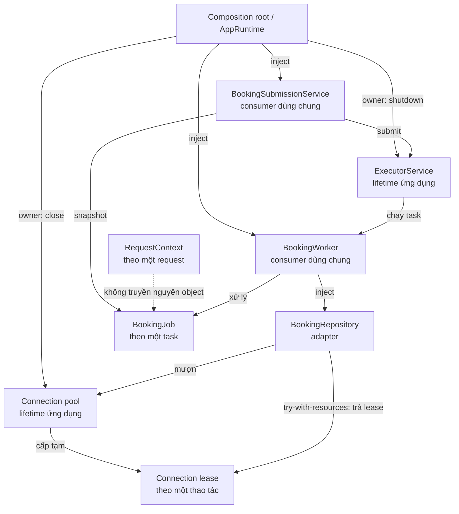

# Rò rỉ tài nguyên hoặc trạng thái do quản lý vòng đời sai

Trong chương **Chẩn đoán DI** của module **Dependency Injection**, một ứng dụng có thể được lắp ghép đúng kiểu, mọi constructor đều nhận đủ tham số, nhưng sau một thời gian chạy lại xuất hiện các triệu chứng: hết connection database, số thread tăng, bộ nhớ không giảm, thông tin của request trước xuất hiện trong request sau, hoặc một background task báo rằng session đã đóng.

Đây không nhất thiết là lỗi ở thuật toán nghiệp vụ. Nhiều trường hợp là **lỗi vòng đời của phụ thuộc** (*dependency lifetime*) và **quyền sở hữu tài nguyên** (*resource ownership*). **Dependency Injection (DI)** và **Inversion of Control (IoC)** tách nơi sử dụng dependency khỏi nơi tạo và lắp ghép nó; nhưng ta vẫn phải trả lời: **ai tạo, ai mượn, ai giữ tham chiếu, ai đóng và khi nào đối tượng không còn hợp lệ?**

**Constructor injection** làm các dependency bắt buộc hiện rõ. **Composition root** hoặc runtime do nó tạo điều phối những tài nguyên dài hạn như connection pool, network client và executor. Mỗi request/transaction/task quản lý các tài nguyên ngắn hạn tương ứng. Một **DI container** có thể hỗ trợ scope và lifecycle callback, nhưng không tự bảo đảm ứng dụng không giữ sai tham chiếu, đóng nhầm pool hoặc bỏ sót việc giải phóng lease.

Sau bài học, bạn có thể:

- Phân biệt **rò rỉ tài nguyên**, **giữ bộ nhớ ngoài ý muốn**, **rò rỉ trạng thái giữa request** và **sử dụng đối tượng sau khi scope kết thúc**.
- Chẩn đoán nguyên nhân qua đồ thị tham chiếu, scope, owner/borrower, connection pool, thread pool, task queue và `ThreadLocal`.
- Tìm hiểu tại sao một field `final`, singleton, proxy, annotation hay garbage collector không tự sửa lỗi vòng đời.
- Viết Java 11 thuần có **connection lease giả lập**, đồng hồ đếm open/close và test chạy task sau khi request đóng.
- Đưa quyền đóng tài nguyên về composition root/runtime và dùng `try-with-resources` cho session/lease ngắn hạn.
- Thiết kế quy trình điều tra từ dấu hiệu, tái hiện, đo, xác định đường giữ reference đến sửa và kiểm thử hồi quy.

## 1. Bốn dạng sự cố thường bị gọi chung là “leak”

Khi chẩn đoán DI, bước đầu tiên là xác định **đang rò rỉ cái gì**. Những triệu chứng có thể giống nhau nhưng cơ chế và cách sửa rất khác nhau.

| Dạng sự cố | Dấu hiệu | Nguyên nhân thường gặp | Điều cần xác minh |
| --- | --- | --- | --- |
| **Resource leak** | Pool cạn connection, socket/file chưa đóng, thread còn chạy sau shutdown | Mở resource nhưng không `close()`/trả lease; không shutdown executor | Active/borrowed/returned, owner thực sự, đường cleanup kể cả khi exception |
| **Memory retention / heap leak** | Live heap tăng, GC không thu hồi các object không còn cần | Singleton/static collection/cache/listener/task queue giữ tham chiếu dài hạn | GC roots, dominator/retained size, lifetime dự kiến của object |
| **State leak giữa request** | Tenant, trace ID hoặc dữ liệu request cũ xuất hiện ở request sau | Singleton giữ mutable state; `ThreadLocal`/MDC không được dọn | Phạm vi ghi/đọc state, thread reuse, isolation giữa request |
| **Use-after-scope / use-after-close** | Session closed, context not active, stream closed, lỗi xảy ra trong task chạy muộn | Task giữ dependency chỉ sống trong request/transaction | Thời điểm đóng scope so với thời điểm callback thực thi |

Một sự cố có thể thuộc nhiều loại. Ví dụ, task xếp hàng lâu giữ nguyên đối tượng `HttpServletRequest`: đây vừa là **giữ tham chiếu** khiến bộ nhớ chưa được thu hồi, vừa có nguy cơ **dùng request sau khi scope đã kết thúc**. Ngược lại, một connection bị mượn rồi quên trả có thể làm pool cạn dù số object Java sống trong heap không quá lớn.

**Thuật ngữ chính xác giúp tìm đúng nơi sửa.** “Có nhiều object” chưa đủ chứng minh memory leak; “có vòng tham chiếu” chưa đủ chứng minh Java GC không thu hồi được; “bean đã có trong container” chưa đủ chứng minh tài nguyên của bean còn hợp lệ.

### 1.1. Tham chiếu còn tồn tại khác với tài nguyên còn mở

Java garbage collector thu hồi những object không còn **reachable** từ GC roots, kể cả một nhóm object tham chiếu vòng với nhau. Nhưng GC **không bảo đảm** gọi `close()` kịp thời để trả JDBC connection, đóng socket, hủy task hoặc dừng thread. Những tài nguyên này thường cần cleanup tường minh theo API.

Ví dụ, gọi `Connection.close()` trên một **logical connection mượn từ pool** thường nghĩa là **trả connection về pool**, không nhất thiết đóng physical connection. Chính **pool** được đóng khi owner của nó kết thúc vòng đời. Mọi chi tiết phải được xác nhận theo implementation của `DataSource` và thư viện pool.

### 1.2. “Rò rỉ trạng thái” không nhất thiết tăng bộ nhớ

Giả sử service singleton dùng một field mutable:

```java
// Anti-pattern minh họa: state của từng request bị giữ trong singleton.
final class BadTenantService {
    private String currentTenant;

    void handle(String tenantId) {
        currentTenant = tenantId;
        // Một request khác có thể ghi đè trước khi thao tác hoàn tất.
    }
}
```

Ngay cả khi heap ổn định, việc hai request cùng chia sẻ `currentTenant` có thể làm thao tác sai tenant. Đây là **lỗi cô lập trạng thái và thread-safety**, không phải nhất thiết là leak về số byte. Lời giải thường là để `tenantId` ở **tham số phương thức hoặc command bất biến**, không cố biến singleton thành một “request store”.

## 2. Đọc hai đồ thị: phụ thuộc và quyền sở hữu

Một sơ đồ DI chỉ mô tả `BookingService → BookingRepository` chưa đủ để chẩn đoán leak. Cần thêm quan hệ **sở hữu** và **mượn tài nguyên**.



Trong sơ đồ, **owner** chịu trách nhiệm quyết định thời điểm đóng, còn **consumer/borrower** chỉ được sử dụng theo hợp đồng. `BookingRepository` có thể dùng pool do root cấp nhưng **không được đóng pool sau mỗi thao tác**. `BookingWorker` có thể dùng `Executor` nhưng **không tự shutdown executor chia sẻ**. `RequestContext` có thể cung cấp dữ liệu đầu vào cho command, nhưng **không được chuyển nguyên một đối tượng gắn với request** sang task có thể chạy muộn.

### 2.1. Ba câu hỏi trước khi sửa code

1. **Đối tượng nào sống lâu hơn dự kiến?** Một connection lease, listener, request context, task hay cache entry?
2. **Ai giữ nó?** Một field singleton, `ThreadLocal` trên thread pool, registry static, callback, queue, transaction manager hay pool?
3. **Ai có trách nhiệm dọn và ở ranh giới nào?** Phương thức mượn resource, transaction, background task, module runtime hay toàn ứng dụng?

Không thể suy ownership chỉ từ việc một class có field `private final DatabaseClient client`. `final` cố định tham chiếu, **không trả lời ai được gọi `client.close()`**. Hợp đồng nên nói rõ “được cấp để dùng”, “mượn rồi trả” hay “chuyển ownership cho caller”.

## 3. Chẩn đoán rò rỉ connection hoặc session

### 3.1. Mùi thiết kế: mượn nhưng không trả

```java
// Anti-pattern: không có try-with-resources.
void store(Booking booking) throws java.sql.SQLException {
    java.sql.Connection connection = dataSource.getConnection();
    java.sql.PreparedStatement statement =
            connection.prepareStatement("INSERT INTO bookings(id) VALUES (?)");
    statement.setString(1, booking.id());
    statement.executeUpdate();
    // Nếu bỏ close hoặc có exception, logical connection có thể không trả về pool.
}
```

Ở đây, việc tiêm `DataSource` bằng constructor là đúng hướng DI, nhưng **resource ownership của connection mượn** vẫn sai. Sửa bằng cách giới hạn vòng đời trong thao tác hoặc transaction:

```java
void store(Booking booking) throws java.sql.SQLException {
    String sql = "INSERT INTO bookings(id) VALUES (?)";
    try (java.sql.Connection connection = dataSource.getConnection();
         java.sql.PreparedStatement statement =
                 connection.prepareStatement(sql)) {
        statement.setString(1, booking.id());
        statement.executeUpdate();
    }
}
```

Hai đoạn trên là **minh họa JDBC riêng** với các kiểu `Booking`, `dataSource` từ ứng dụng thực tế, không thuộc file Java tự chạy ở phần 6. Trong transaction có nhiều thao tác qua các repository, không được mở/đóng connection theo từng method nếu điều đó phá **transaction boundary**. Khi ấy transaction owner cần giữ connection trong cả unit of work, rồi trả về pool đúng một lần khi commit/rollback.

### 3.2. Dữ liệu cần quan sát ở pool

| Chỉ số | Diễn giải khi chẩn đoán |
| --- | --- |
| `active/borrowed connections` | Connection hiện đang được các tác vụ mượn; tăng lâu có thể do tải thật, truy vấn chậm hoặc không trả |
| `idle connections` | Connection sẵn có trong pool; cần đối chiếu với min/max pool size |
| `pending/waiting borrowers` | Nhiều yêu cầu đang chờ connection; có thể là dấu hiệu pool cạn hoặc SQL chậm |
| `acquisition timeout` | Không lấy được connection trong thời hạn; đây là triệu chứng, chưa chứng minh leak |
| `borrow duration / transaction duration` | Transaction giữ connection quá lâu, kể cả khi code cuối cùng vẫn `close()` |
| `leak detection / allocation trace` | Công cụ pool có thể chỉ ra nơi borrow chưa trả quá ngưỡng; cần phân biệt thao tác chậm hợp lệ |

Ví dụ **active connection không giảm** sau khi test đã hoàn tất mọi thao tác là bằng chứng cần điều tra. Nhưng nếu request thực vẫn đang chạy hoặc transaction đang chờ I/O, đó có thể là **giữ lâu** chứ chưa phải **quên trả**. Đừng chỉ tăng `maximumPoolSize` để che nguyên nhân: làm vậy có thể chuyển áp lực sang database.

## 4. Rò trạng thái do singleton, `ThreadLocal` và task queue

### 4.1. Singleton giữ dữ liệu request

Một bean singleton tồn tại xuyên suốt nhiều request. Nếu nó giữ `requestId`, `tenantId`, `SecurityContext` hoặc DTO mutable của request trong field, các request có thể thấy thông tin không thuộc về mình. Chuyển field sang `private final` không thể sửa khi bản thân dependency là một object request-scoped được giữ quá lâu.

Nên chuyển dữ liệu ngắn hạn vào **tham số phương thức** hoặc một **command bất biến**. Nếu worker cần một session/transaction riêng, hãy tiêm **factory tạo session** cho worker và mở theo task; đừng inject sẵn một request session vào singleton.

### 4.2. `ThreadLocal` và thread pool reuse

`ThreadLocal` liên kết giá trị với **thread hiện hành**, không tự động với một HTTP request. Thread pool thường **tái sử dụng worker thread**, nên giá trị tenant/trace được set trong task trước mà không được remove có thể xuất hiện ở task sau:

```java
// Anti-pattern: thiếu cleanup trong pool worker.
tenantContext.set("TENANT-A");
doWork();
// Không remove(): thread xử lý job tiếp theo có thể còn thấy TENANT-A.
```

Cách tốt hơn là thiết lập ngữ cảnh trong scope thực thi và dọn trong `finally`:

```java
String previous = tenantContext.get();
try {
    tenantContext.set(validatedTenantId);
    doWork();
} finally {
    if (previous == null) {
        tenantContext.remove();
    } else {
        tenantContext.set(previous);
    }
}
```

Nếu đã có các giá trị rò từ task trước, việc **restore previous** sẽ khôi phục cả giá trị cũ đó: trước hết phải khắc phục nơi đã không cleanup. Với một executor được thiết kế chỉ chạy các task độc lập và **không yêu cầu nested context**, có thể dùng chính sách set rồi remove nhất quán ở mọi task.

Đặc biệt, **không copy nguyên security context hay access token sang job dài hạn** chỉ để giải quyết `ThreadLocal`. Worker cần mô hình xác thực/ủy quyền phù hợp với thời gian xử lý, có thể kiểm tra lại quyền, và chỉ chuyển những định danh/metadata tối thiểu đã được xác thực.

### 4.3. Queue giữ tham chiếu lâu hơn request

Một lambda như `() -> send(request)` khiến task giữ tham chiếu tới `request` khi đang xếp hàng. Nếu request chứa body lớn, stream, entity hoặc context, một hàng đợi executor tăng liên tục có thể giữ cả một đồ thị object. Đây là **memory retention do queue backlog**, ngay cả khi không có static cache.

`Executors.newFixedThreadPool(n)` giới hạn worker threads nhưng sử dụng **queue không giới hạn theo cấu hình mặc định**; nó không tự tạo backpressure đủ để tránh backlog chiếm heap. Trong production, cần giới hạn công việc đang chờ, chính sách từ chối và xử lý lỗi khi submit. Với công việc bắt buộc xử lý sau restart, nên dùng durable queue/outbox phù hợp thay vì dựa vào queue trong RAM.

## 5. Quy trình điều tra: từ triệu chứng đến đúng cạnh trong đồ thị

Chẩn đoán leak không nên bắt đầu bằng “thêm `@Scope`”, “bật lazy”, “dùng weak reference” hay “tăng heap”. Một quy trình có kiểm chứng:

### Bước 1 — Khoanh vùng triệu chứng

Xác định rõ **nguồn tài nguyên** đang tăng: heap, native memory, thread count, connection pool active, file descriptors, số task chờ hay dữ liệu context sai. So sánh khi **idle** với khi **tải tăng ổn định**; theo dõi error rate, thời lượng transaction và thời điểm deploy.

### Bước 2 — Tái hiện với một luồng kiểm soát được

Viết một test hoặc script thực hiện cùng một thao tác nhiều lần và chờ mọi Future/transaction đã được báo hoàn tất. Khi không còn công việc, những lease theo request phải trở về mức nền. Nếu cần tái hiện use-after-close, hãy **đóng scope trước khi chạy callback** bằng một executor điều khiển được, không dùng `Thread.sleep` may rủi.

### Bước 3 — Ghi lại đường phụ thuộc và ownership

Vẽ từ composition root/container đến service, repository, pool và task. Bổ sung **owner**, **borrower**, **scope** và **điểm cleanup**. Đặc biệt kiểm tra những thứ có thể bị giữ ngoài constructor: static field, listener registration, callback, `ThreadLocal`, queue, timer, cache, session, stream.

### Bước 4 — Đặt phép đo tại boundary

Đếm `borrow`/`return`, `open`/`close`, số task accepted/completed/failed, queue length và thời gian giữ lease. Với adapter thật, dùng metrics/tracing của thư viện thay vì tự thêm log vào từng câu SQL. Tập trung đo **cân bằng sau khi thao tác hoàn tất**, không chỉ một snapshot giữa lúc hệ thống đang bận.

### Bước 5 — Xác nhận đường giữ tham chiếu

Khi nghi heap retention, sử dụng heap dump và **path to GC roots**, **dominator tree** hoặc retained-size analysis. Khi nghi resource ngoài heap, xem metrics pool, số thread, socket/file descriptor và lịch sử acquisition. Với Java, **Java Flight Recorder (JFR)**, công cụ profiling và telemetry ứng dụng có thể hỗ trợ quan sát allocation, thread và I/O theo khả năng của phiên bản/runtime.

Không đính kèm heap dump hay log chứa token, request body, PII vào issue công khai. Khi thu thập dữ liệu production, cần tuân thủ quyền truy cập và chính sách bảo mật.

### Bước 6 — Sửa ở đúng ranh giới

Nếu bỏ sót trả lease, sửa bằng `try-with-resources`/`finally` ở đúng owner. Nếu singleton giữ request state, chuyển dữ liệu sang parameter/immutable command và tạo scope mới ở worker. Nếu task queue giữ quá nhiều object, giới hạn backlog, giảm payload bị capture và áp dụng backpressure. Nếu thread pool không shutdown, chuyển trách nhiệm đóng về runtime.

### Bước 7 — Kiểm thử hồi quy và quan sát sau triển khai

Kiểm tra cả đường **thành công**, **exception**, **timeout**, **cancellation** và **shutdown**. Xác minh không còn active lease sau khi job xong, context đã dọn và tài nguyên dài hạn chỉ đóng khi owner kết thúc. Sau triển khai, theo dõi cùng các chỉ số đã dùng lúc chẩn đoán để tránh kết luận chỉ dựa trên unit test.

## 6. Ví dụ Java 11 thuần: rò lease, dùng scope đã đóng và rò tenant

Ví dụ đầy đủ sau cố ý tạo **ba lỗi** rồi minh họa đường xử lý hợp lệ:

1. Một repository **mượn connection lease nhưng không trả**, khiến pool giả báo còn lease.
2. Một callback **bắt giữ `RequestScope`** rồi chạy sau khi scope đóng, làm Future lỗi.
3. Một task **quên dọn `ThreadLocal`**, khiến task kế tiếp nhìn thấy tenant cũ.
4. Cách đúng **chụp `BookingJob` bất biến**, chạy sau khi request đóng, mở/trả lease trong repository, dọn tenant context bằng `finally` và để `AppRuntime` sở hữu executor/pool.

`MeteredPool` chỉ **mô phỏng** một connection pool bằng bộ đếm; nó không mở JDBC, socket hay file. `ManualExecutor` chạy các task theo yêu cầu của test trên cùng thread, nên trường hợp thread-local là **mô phỏng việc tái sử dụng một worker** chứ không phải bài đo concurrency. Cách này giúp test xác định mà không cần database, server, dependency ngoài hoặc `Thread.sleep`.

Lưu file `DiLifecycleLeakDemo.java` và dùng **Java 11 trở lên**:

```bash
javac DiLifecycleLeakDemo.java
java DiLifecycleLeakDemo
```

```java
import java.util.ArrayList;
import java.util.List;
import java.util.Map;
import java.util.Objects;
import java.util.concurrent.CompletableFuture;
import java.util.concurrent.CompletionException;
import java.util.concurrent.ConcurrentHashMap;
import java.util.concurrent.Executor;
import java.util.concurrent.ExecutorService;
import java.util.concurrent.Executors;
import java.util.concurrent.TimeUnit;

public final class DiLifecycleLeakDemo {
    static void check(boolean condition, String description) {
        if (!condition) {
            throw new AssertionError(description);
        }
    }

    static String required(String value, String name) {
        if (value == null || value.isBlank()) {
            throw new IllegalArgumentException(name + " is required");
        }
        return value;
    }

    // 1. Command bất biến: không giữ object gắn với HTTP request.
    static final class BookingJob {
        final String bookingId;
        final String tenantId;

        BookingJob(String bookingId, String tenantId) {
            this.bookingId = required(bookingId, "bookingId");
            this.tenantId = required(tenantId, "tenantId");
        }
    }

    // 2. Giả lập request-scoped object: không được dùng sau close().
    static final class RequestScope implements AutoCloseable {
        private final String bookingId;
        private final String tenantId;
        private boolean closed;

        RequestScope(String bookingId, String tenantId) {
            this.bookingId = required(bookingId, "bookingId");
            this.tenantId = required(tenantId, "tenantId");
        }

        BookingJob snapshot() {
            ensureOpen();
            return new BookingJob(bookingId, tenantId);
        }

        String tenantId() {
            ensureOpen();
            return tenantId;
        }

        private void ensureOpen() {
            if (closed) {
                throw new IllegalStateException("Request scope closed");
            }
        }

        @Override
        public void close() {
            closed = true;
        }
    }

    // 3. Pool giả có bộ đếm mượn/trả: owner đóng pool, borrower đóng lease.
    static final class MeteredPool implements AutoCloseable {
        private int borrowed;
        private int returned;
        private int active;
        private boolean closed;

        synchronized Lease borrow() {
            ensureOpen();
            borrowed++;
            active++;
            return new Lease(this);
        }

        synchronized void ensureOpen() {
            if (closed) {
                throw new IllegalStateException("Pool closed");
            }
        }

        synchronized void release() {
            if (active < 1) {
                throw new IllegalStateException("No active lease");
            }
            active--;
            returned++;
        }

        synchronized int active() {
            return active;
        }

        synchronized int borrowed() {
            return borrowed;
        }

        synchronized int returned() {
            return returned;
        }

        synchronized boolean isClosed() {
            return closed;
        }

        @Override
        public synchronized void close() {
            if (active != 0) {
                throw new IllegalStateException(
                        "Leases still active: " + active);
            }
            closed = true;
        }
    }

    static final class Lease implements AutoCloseable {
        private final MeteredPool pool;
        private boolean closed;

        Lease(MeteredPool pool) {
            this.pool = Objects.requireNonNull(pool);
        }

        void use() {
            if (closed) {
                throw new IllegalStateException("Lease already closed");
            }
            pool.ensureOpen();
        }

        @Override
        public void close() {
            if (!closed) {
                closed = true;
                pool.release();
            }
        }
    }

    interface BookingRepository {
        void save(BookingJob job);
    }

    // 4. Adapter đúng: mỗi operation mượn và trả một lease.
    static final class PoolBackedRepository implements BookingRepository {
        private final MeteredPool pool;
        private final Map<String, BookingJob> stored =
                new ConcurrentHashMap<>();

        PoolBackedRepository(MeteredPool pool) {
            this.pool = Objects.requireNonNull(pool);
        }

        @Override
        public void save(BookingJob job) {
            Objects.requireNonNull(job);
            try (Lease lease = pool.borrow()) {
                lease.use();
                if ("BK-FAIL".equals(job.bookingId)) {
                    throw new IllegalStateException("Simulated save failure");
                }
                if (stored.putIfAbsent(job.bookingId, job) != null) {
                    throw new IllegalStateException("Duplicate booking ID");
                }
            }
        }

        BookingJob find(String bookingId) {
            return stored.get(bookingId);
        }
    }

    // 5. Anti-pattern được giữ lại chỉ để chứng minh leak.
    static final class LeakyRepository implements BookingRepository {
        private final MeteredPool pool;
        private final List<Lease> forgotten = new ArrayList<>();

        LeakyRepository(MeteredPool pool) {
            this.pool = Objects.requireNonNull(pool);
        }

        @Override
        public void save(BookingJob job) {
            Lease lease = pool.borrow();
            lease.use();
            forgotten.add(lease); // Không close: cố tình vi phạm hợp đồng.
        }

        void releaseForDemoOnly() {
            for (Lease lease : forgotten) {
                lease.close();
            }
            forgotten.clear();
        }
    }

    // 6. ThreadLocal: mô phỏng truyền tenant context sang worker.
    static final class TenantContext {
        private static final ThreadLocal<String> CURRENT =
                new ThreadLocal<>();

        static String current() {
            return CURRENT.get();
        }

        static void setUnsafeForDemo(String tenantId) {
            CURRENT.set(tenantId); // Chỉ dùng trong bài test anti-pattern.
        }

        static void clear() {
            CURRENT.remove();
        }

        static void runWith(String tenantId, Runnable action) {
            required(tenantId, "tenantId");
            Objects.requireNonNull(action);
            String previous = CURRENT.get();
            try {
                CURRENT.set(tenantId);
                action.run();
            } finally {
                if (previous == null) {
                    CURRENT.remove();
                } else {
                    CURRENT.set(previous);
                }
            }
        }
    }

    // 7. Worker sống cùng runtime, không giữ RequestScope hoặc lease.
    static final class BookingWorker {
        private final BookingRepository repository;

        BookingWorker(BookingRepository repository) {
            this.repository = Objects.requireNonNull(repository);
        }

        void process(BookingJob job) {
            TenantContext.runWith(job.tenantId, () -> {
                check(job.tenantId.equals(TenantContext.current()),
                        "Wrong task tenant");
                repository.save(job);
            });
        }
    }

    static final class BookingIntake {
        private final BookingWorker worker;
        private final Executor executor;

        BookingIntake(BookingWorker worker, Executor executor) {
            this.worker = Objects.requireNonNull(worker);
            this.executor = Objects.requireNonNull(executor);
        }

        CompletableFuture<Void> submit(RequestScope request) {
            BookingJob job = Objects.requireNonNull(request).snapshot();
            return CompletableFuture.runAsync(
                    () -> worker.process(job), executor);
        }
    }

    // 8. Chạy task theo lệnh test, không dùng thời gian hoặc thread thật.
    static final class ManualExecutor implements Executor {
        private final List<Runnable> pending = new ArrayList<>();

        @Override
        public void execute(Runnable command) {
            pending.add(Objects.requireNonNull(command));
        }

        int pendingCount() {
            return pending.size();
        }

        void drain() {
            while (!pending.isEmpty()) {
                pending.remove(0).run();
            }
        }
    }

    // 9. Composition root chuyển ownership pool và executor cho runtime.
    static final class AppRuntime implements AutoCloseable {
        final MeteredPool pool;
        final ExecutorService executor;
        final PoolBackedRepository repository;
        final BookingIntake intake;
        private boolean closed;

        AppRuntime() {
            pool = new MeteredPool();
            executor = Executors.newFixedThreadPool(2);
            repository = new PoolBackedRepository(pool);
            intake = new BookingIntake(new BookingWorker(repository), executor);
        }

        @Override
        public synchronized void close() {
            if (closed) {
                return;
            }
            executor.shutdown();
            try {
                if (!executor.awaitTermination(5, TimeUnit.SECONDS)) {
                    executor.shutdownNow();
                    if (!executor.awaitTermination(5, TimeUnit.SECONDS)) {
                        throw new IllegalStateException(
                                "Tasks still running; pool remains open");
                    }
                }
            } catch (InterruptedException failure) {
                executor.shutdownNow();
                Thread.currentThread().interrupt();
                throw new IllegalStateException(
                        "Interrupted during shutdown; pool remains open",
                        failure);
            }
            pool.close();
            closed = true;
        }
    }

    static void testLeakedLease() {
        MeteredPool pool = new MeteredPool();
        LeakyRepository broken = new LeakyRepository(pool);
        broken.save(new BookingJob("BK-LEAK", "TENANT-A"));
        check(pool.borrowed() == 1 && pool.returned() == 0
                && pool.active() == 1, "Leak was not detected");

        try {
            pool.close();
            throw new AssertionError("Expected active lease warning");
        } catch (IllegalStateException expected) {
            check("Leases still active: 1".equals(expected.getMessage()),
                    "Unexpected leak diagnostic");
        }
        // Chỉ cleanup cho demo; sửa đúng là try-with-resources trong save().
        broken.releaseForDemoOnly();
        pool.close();
        check(pool.isClosed() && pool.active() == 0
                && pool.borrowed() == pool.returned(), "Lease not returned");
        System.out.println("Roi ri connection lease: detected");
    }

    static void testCapturedClosedRequest() {
        ManualExecutor executor = new ManualExecutor();
        RequestScope request = new RequestScope("BK-OLD", "TENANT-A");
        CompletableFuture<Void> broken = CompletableFuture.runAsync(
                () -> request.tenantId(), executor);
        request.close(); // Task chưa được chạy.
        executor.drain();

        try {
            broken.join();
            throw new AssertionError("Expected closed request failure");
        } catch (CompletionException expected) {
            check(expected.getCause() instanceof IllegalStateException
                    && "Request scope closed".equals(
                            expected.getCause().getMessage()),
                    "Unexpected request-scope error");
        }
        System.out.println("Request het scope trong task: detected");
    }

    static void testThreadLocalLeak() {
        ManualExecutor executor = new ManualExecutor();
        List<String> seen = new ArrayList<>();
        executor.execute(() ->
                TenantContext.setUnsafeForDemo("TENANT-A"));
        executor.execute(() -> seen.add(TenantContext.current()));
        executor.drain(); // Cùng thread test mô phỏng worker được tái sử dụng.
        check(seen.equals(List.of("TENANT-A")),
                "Stale tenant context was not observed");
        TenantContext.clear(); // Dọn lỗi demo trước khi test cách đúng.

        executor.execute(() ->
                TenantContext.runWith("TENANT-B", () ->
                        check("TENANT-B".equals(TenantContext.current()),
                                "Wrong scoped tenant")));
        executor.drain();
        check(TenantContext.current() == null,
                "Tenant context was not cleaned");
        System.out.println("Tenant ThreadLocal bi giu: detected");
    }

    static void testSafeHandoffAndFailure() {
        MeteredPool pool = new MeteredPool();
        PoolBackedRepository repository = new PoolBackedRepository(pool);
        ManualExecutor executor = new ManualExecutor();
        BookingIntake intake =
                new BookingIntake(new BookingWorker(repository), executor);

        RequestScope request = new RequestScope("BK-OK", "TENANT-B");
        CompletableFuture<Void> saved;
        try (RequestScope scope = request) {
            saved = intake.submit(scope);
            check(executor.pendingCount() == 1, "Job not queued");
            check(repository.find("BK-OK") == null, "Job ran too early");
        }
        executor.drain(); // Chạy sau khi request đã đóng.
        saved.join();
        check(repository.find("BK-OK") != null
                && pool.active() == 0 && pool.borrowed() == 1
                && pool.returned() == 1, "Safe job leaked a lease");
        check(TenantContext.current() == null, "Context leaked after task");

        CompletableFuture<Void> failed;
        try (RequestScope scope =
                new RequestScope("BK-FAIL", "TENANT-C")) {
            failed = intake.submit(scope);
        }
        executor.drain();
        try {
            failed.join();
            throw new AssertionError("Expected save failure");
        } catch (CompletionException expected) {
            check(expected.getCause() instanceof IllegalStateException
                    && "Simulated save failure".equals(
                            expected.getCause().getMessage()),
                    "Unexpected failure");
        }
        check(pool.active() == 0 && pool.borrowed() == 2
                && pool.returned() == 2, "Failed job leaked lease");
        check(TenantContext.current() == null,
                "Failed job leaked tenant context");
        pool.close();
        check(pool.isClosed(), "Pool was not closed");
        System.out.println("Handoff va xu ly loi: lease/context da dong");
    }

    static void testRuntimeOwnership() {
        AppRuntime runtime = new AppRuntime();
        try (AppRuntime app = runtime) {
            CompletableFuture<Void> job;
            try (RequestScope scope =
                    new RequestScope("BK-RUNTIME", "TENANT-D")) {
                job = app.intake.submit(scope);
            }
            job.join();
            check(app.pool.active() == 0, "Runtime job leaked lease");
        }
        check(runtime.executor.isTerminated()
                && runtime.pool.isClosed(),
                "Runtime resources not closed");
        System.out.println("Runtime shutdown: executor/pool da dong");
    }

    public static void main(String[] args) {
        testLeakedLease();
        testCapturedClosedRequest();
        testThreadLocalLeak();
        testSafeHandoffAndFailure();
        testRuntimeOwnership();
        System.out.println("Kiem thu Java thuan: PASS");
    }
}
```

Kết quả dự kiến:

```text
Roi ri connection lease: detected
Request het scope trong task: detected
Tenant ThreadLocal bi giu: detected
Handoff va xu ly loi: lease/context da dong
Runtime shutdown: executor/pool da dong
Kiem thu Java thuan: PASS
```

### 6.1. Giải thích phép kiểm tra

| Test | Đường sai được quan sát | Đường sửa được khẳng định |
| --- | --- | --- |
| `testLeakedLease()` | Mượn 1, trả 0, active 1; pool từ chối đóng | Test dọn lease để tránh để lại trạng thái lỗi; code đúng dùng `try-with-resources` |
| `testCapturedClosedRequest()` | Task chạy sau khi request đóng và Future hoàn tất lỗi | Không chuyển đối tượng request vào lambda sống dài |
| `testThreadLocalLeak()` | Task thứ hai thấy tenant từ task trước | `TenantContext.runWith(...)` cleanup trong `finally` |
| `testSafeHandoffAndFailure()` | Không có lỗi khi job chạy sau request; fake save có thể ném lỗi | Lease và tenant context được dọn ở cả đường thành công và lỗi |
| `testRuntimeOwnership()` | Service sử dụng pool và executor đã được inject | Runtime shutdown executor, chờ task rồi đóng pool |

`ManualExecutor` cho phép test quyết định rõ **request đóng trước, task chạy sau**. Nó tránh `Thread.sleep` và không phụ thuộc thứ tự lập lịch OS. Trong khi đó, `AppRuntime` dùng một `ExecutorService` thật, cho thấy owner dài hạn phải chờ task kết thúc trước khi đóng pool. **Đây không phải stress test về tính an toàn đa luồng**; cần bổ sung kiểm thử với adapter và pool thực theo yêu cầu production.

### 6.2. Những điều ví dụ không mô phỏng

- `MeteredPool` chỉ đếm lease, không thực sự giữ physical connection, timeout mượn connection hay transaction.
- `PoolBackedRepository` ghi vào `ConcurrentHashMap`, không cung cấp ACID hoặc khả năng khôi phục khi tiến trình crash.
- `RequestScope` là giả lập do bài học tự quản lý, không thay thế ngữ nghĩa request scope của Spring/CDI/Servlet.
- `TenantContext` chỉ chứa metadata đơn giản, **không** là cơ chế xác thực/ủy quyền bảo mật.
- `AppRuntime.close()` có giới hạn chờ minh họa. Nếu task không kết thúc sau các lần chờ, nó báo lỗi và **không đóng pool mà task có thể vẫn đang dùng**. Production cần chính sách quản trị lỗi shutdown, logging, cảnh báo và khả năng bảo toàn job phù hợp.
- Bộ đếm borrow/return xác định **hành vi của demo**, không thể thay thế metrics/leak detection của JDBC pool thật.

## 7. Đồ thị DI hợp lệ vẫn có thể sai lifetime

DI container có thể phân giải đúng mọi bean theo kiểu. Nhưng các quan hệ **scope** dưới đây vẫn cần kiểm tra:

| Consumer | Dependency | Vì sao nguy hiểm? | Cách thiết kế phù hợp |
| --- | --- | --- | --- |
| Singleton service | Mutable `RequestContext` được giữ trực tiếp | State request cũ có thể bị dùng lại | Truyền dữ liệu theo method; dùng scoped provider đúng nghĩa khi cần |
| Background worker | Transaction/session từ HTTP request | Task chạy sau request làm session hết hạn | Worker mở transaction riêng bằng factory/port |
| Repository singleton | Một JDBC `Connection` được lưu ở field | Sai transaction, đóng sớm và tranh chấp đồng thời | Inject pool/`DataSource`; mượn theo thao tác |
| Thread pool worker | `ThreadLocal` chứa tenant/trace | Giá trị rò qua task sau | Set và remove/restore trong `finally` |
| Application runtime | HTTP client / executor không đóng | Thread/socket còn tồn tại sau khi ngừng phục vụ | Root sở hữu và shutdown theo thứ tự |
| Singleton cache | Danh sách listener/request không giới hạn | Retained heap tăng theo lượng request | Unsubscribe, bounded cache/eviction và xử lý vòng đời rõ |

### 7.1. Một proxy hoặc provider không tự giải quyết vấn đề

Container có thể cung cấp **scoped proxy**: singleton giữ proxy, và proxy định tuyến lời gọi đến đối tượng của request hiện tại. Nhưng nếu background task chạy **ngoài request scope**, proxy có thể không tìm được instance hợp lệ. Chỉ đổi sang `Provider<RequestContext>` mà không có request active cũng không giúp task lấy được context đúng.

Ngược lại, nếu worker cần một session mới cho chính task, một factory `JobSessionFactory.open()` là hợp lý vì nó **tạo scope mới** và trả quyền đóng session cho worker. Nên kiểm tra contract của provider/factory thật, không giả định `get()` luôn tạo mới hoặc giữ singleton.

### 7.2. Không dùng `WeakReference` như giải pháp mặc định

Weak reference chỉ có ích khi **ngữ nghĩa sử dụng cho phép object biến mất khi GC quyết định**, ví dụ một số dạng cache phụ trợ. Nó không thay thế việc đóng socket/connection, không thay thế hủy listener đúng hạn và không bảo vệ transaction. Nếu một cache phải giữ dữ liệu trong khoảng thời gian có cam kết, weak reference còn có thể làm hành vi khó dự đoán.

Đối với memory retention, trước hết tìm **strong reference nào đang giữ object**. Đối với resource leak, tìm **ai có nghĩa vụ close/release**. Chọn công cụ theo đúng loại leak.

## 8. Khi nào pool hết connection mà không phải do leak?

Không phải mọi triệu chứng “pool active cao” đều là quên `close()`:

- **SQL chậm, lock hoặc deadlock** giữ transaction lâu, khiến connection chưa được trả dù có cleanup đúng.
- **Pool quá nhỏ** so với concurrency thực tế, làm request chờ nhiều.
- **Task queue lớn** tạo hàng loạt transaction đồng thời hoặc giữ connection trong khi chờ I/O khác.
- **Transaction boundary quá rộng** giữ connection xuyên các lời gọi mạng chậm không cần thiết.
- **Connection không còn hoạt động** do timeout/mạng, cần chính sách validation và loại bỏ theo thư viện pool.

Hãy xem **borrow duration**, active/idle/pending, SQL latency, lock wait và số request đồng thời trước khi kết luận. Leak detection của pool thường đặt ngưỡng thời gian; một transaction hợp lệ nhưng chạy lâu có thể bị cảnh báo nhầm là nghi rò.

### 8.1. Đừng trả connection trước khi transaction thật sự hoàn tất

Ngược lại với việc quên close là **đóng quá sớm**. Ví dụ một use case nhiều bước cần cùng transaction; nếu repository tự mở và đóng connection cho từng thao tác mà transaction manager không quản lý được, các bước có thể không cùng transaction. Owner nên là **unit of work/transaction boundary**, không nhất thiết là một phương thức `save` đơn lẻ.

Đây là đánh đổi giữa **resource lifetime ngắn** và **tính nhất quán giao dịch**. Thời gian giữ connection phải vừa đủ theo contract, nhưng không thể thu hẹp tùy tiện rồi phá nghiệp vụ.

## 9. Listener, cache và callback cũng có lifecycle

DI thường khiến service dài hạn có thể truy cập nhiều thành phần. Nếu một request đăng ký callback vào singleton event bus mà không unsubscribe, bus sẽ giữ listener và những object mà listener capture:

```java
// Anti-pattern ý tưởng:
eventBus.subscribe(event -> handleWith(requestContext, event));
// Không unsubscribe khi request kết thúc.
```

Các điểm chẩn đoán:

1. **Owner của subscription là ai?** Request, session, màn hình UI hay module sống cùng ứng dụng?
2. **API có trả một registration/handle đóng được không?** Nếu có, owner đóng trong `finally`, `close()` hoặc lifecycle callback tương ứng.
3. **Callback capture những gì?** `this`, request body lớn, security context hay một entity graph?
4. **Subscription có chủ đích sống toàn ứng dụng không?** Nếu có, callback nên là stateless hoặc quản lý state rõ ràng.

Cache cũng cần giới hạn kích thước, chính sách eviction, TTL và quản lý invalidation. Một cache singleton không giới hạn giữ mọi request result không nhất thiết rò do mất `close()`, nhưng có thể gây **unbounded retention**. Kết quả chẩn đoán cần diễn đạt đúng cơ chế thay vì gọi mọi trường hợp là GC bug.

## 10. Từ Java thuần sang DI container: điều gì vẫn phải kiểm tra?

Khi chuyển ứng dụng sang Spring, CDI hoặc một container khác, những nguyên tắc ownership vẫn giữ nguyên:

- **Registration/resolution** trả lời bean nào được cấp cho constructor. Nó không tự chứng minh bean có scope đúng so với consumer.
- **Singleton** là phạm vi chia sẻ instance; không phải cam kết object thread-safe hay không giữ request state.
- **Request scope / transaction scope** có thời điểm bắt đầu/kết thúc; callback chạy muộn có thể không còn scope active.
- **Destroy callback** chỉ được gọi theo quy tắc của container cho những đối tượng nó thật sự quản lý; không nên mặc định resource tạo bên ngoài và inject vào sẽ được đóng đúng.
- **Provider/lazy/proxy** có thể thay đổi thời điểm phân giải và hành vi scope nhưng không sửa sai ranh giới trách nhiệm hoặc leak của task queue.
- **Wiring test** giúp phát hiện bean thiếu/mơ hồ; **lifecycle/integration test** mới quan sát được connection trả về, executor shutdown, request context cleanup và listener unsubscribe.

Không nhất thiết ép mọi adapter triển khai `AutoCloseable` nếu nó chỉ **mượn** một tài nguyên do runtime sở hữu. Ví dụ `BookingRepository` dùng `DataSource` không cần đóng cả pool khi kết thúc một method. Ngược lại, một adapter tự tạo file/socket có quyền sở hữu riêng cần một hợp đồng cleanup rõ.

### 10.1. Đặt test tại đúng ranh giới

| Kiểu kiểm thử | Điều cần chứng minh | Ví dụ |
| --- | --- | --- |
| Unit test ownership | Mỗi lần borrow có return, kể cả khi exception | Fake pool đếm `borrowed == returned` |
| Unit test state isolation | Task khác không thấy tenant cũ | Gửi hai task liên tiếp trên cùng executor giả |
| Unit test use-after-close | Task chạy sau response không truy cập request object | Manual executor đóng scope trước `drain()` |
| Wiring test | Container lắp ghép đúng scope và implementation | Tạo context với cấu hình thực |
| Integration test JDBC | Logical connection được trả về pool, transaction kết thúc | Metrics pool + database thử nghiệm |
| Load/soak test | Không tăng active leases/retained heap vô hạn trong tải ổn định | Chạy nhiều lượt, quan sát baseline sau khi drain |
| Shutdown test | Executor/client/pool được đóng đúng thứ tự | Chờ in-flight jobs, xác nhận pool đóng |

Không nên coi một unit test với `HashMap` là bằng chứng rằng real driver không leak. Nó chỉ xác minh **quy tắc sở hữu ở tầng code** mà test mô phỏng. Ngược lại, không cần khởi động Spring và database chỉ để kiểm tra một callback có dọn `ThreadLocal` bằng `finally` hay không.

## 11. Những cách sửa sai thường gặp

| Cách làm | Vì sao không đủ hoặc có thể nguy hiểm | Hướng xử lý |
| --- | --- | --- |
| Tăng `maxPoolSize` khi pool cạn | Chuyển áp lực sang database, che leak/SQL chậm | Đo borrow duration, trả lease đúng và giới hạn concurrency |
| Tăng heap khi live memory tăng | Trì hoãn OOM nhưng không xóa nguồn giữ reference | Tìm GC roots/retained size và xử lý cache/listener/queue |
| Gọi `System.gc()` theo lịch để “sửa leak” | Không đóng tài nguyên theo contract, không loại bỏ strong refs | Sửa owner và cleanup tường minh |
| Dùng `WeakReference` cho mọi reference | Không giải quyết socket, transaction hoặc listener semantics | Xác định retention path và nhu cầu weak cache thật |
| Chuyển singleton thành prototype mà không phân tích | Có thể tăng allocation và mở nhiều client/pool | Xác định state nào cần riêng và resource nào cần dùng chung |
| Bật lazy/proxy để bỏ lỗi scope | Task sau request vẫn có thể không có context hợp lệ | Snapshot dữ liệu, tạo scope riêng cho task |
| Chuyển connection thành field `final` của repository | Không làm session thread-safe và có thể giữ sai lifetime | Inject pool/factory, borrow/return theo transaction |
| Bỏ theo dõi `CompletableFuture` vì response đã gửi | Task lỗi muộn không được xử lý; queue giữ dữ liệu | Theo dõi trạng thái/exception, retry và cleanup |
| Dùng `ThreadLocal.remove()` chỉ trong nhánh thành công | Exception khiến tenant cũ lưu trên worker thread | `finally` luôn cleanup |
| Đóng pool ngay khi gọi `executor.shutdown()` | Task đang chạy vẫn dùng pool | Chờ/drain task rồi đóng các dependency |
| Tạo HTTP client hoặc executor mới mỗi request | Rò thread/socket, startup/cleanup lặp lại | Root sở hữu tài nguyên chia sẻ theo nhu cầu |
| Chỉ sửa annotation trong khi field static giữ request | Runtime vẫn giữ strong reference | Tìm toàn bộ đường giữ tham chiếu, kể cả static/cache/listener |

## 12. Bài tập tự đánh giá

**Bài 1 — Connection hay pool?** `BookingRepository` được tiêm `DataSource`; mỗi lần `save` nó gọi `getConnection()` nhưng không đóng connection. Sau vài trăm request, active connection tăng. Ai có trách nhiệm sửa?

*Gợi ý:* Đường mượn connection/transaction owner phải trả logical connection theo hợp đồng, thường bằng `try-with-resources` hoặc transaction manager. Runtime/container đóng pool khi ứng dụng kết thúc; không đóng pool sau từng `save`.

**Bài 2 — Có vòng reference là leak?** Một `Parent` giữ `Child`, `Child` trỏ lại `Parent`. Khi không còn GC root nào tham chiếu đến cả hai, Java có bắt buộc giữ mãi chúng không?

*Gợi ý:* Không. Java GC có thể thu hồi cả nhóm object không còn reachable, dù chúng tham chiếu vòng. Leak do strong reference từ GC root giữ nhóm hoặc tài nguyên ngoài heap chưa đóng là vấn đề khác.

**Bài 3 — Singleton có field `final`.** `BookingService` singleton giữ `private final RequestContext context` tạo từ request đầu tiên. Có an toàn cho request sau không?

*Gợi ý:* Không. `final` không kéo dài scope hợp lệ, không cô lập tenant; nên truyền dữ liệu theo request hoặc dùng scoped dependency đúng hợp đồng.

**Bài 4 — Task chạy muộn.** Lambda giữ `HttpServletRequest` và chạy trên executor sau response. Làm sao viết test xác định để phát hiện lỗi?

*Gợi ý:* Dùng manual executor, tạo request/scope giả, submit, đóng scope, sau đó `drain()`. Handoff đúng bằng immutable command; worker mở tài nguyên riêng.

**Bài 5 — Thread-local bẩn.** Worker pool xử lý tenant A rồi tenant B. Vì sao tenant B có thể thấy trace/tenant cũ dù service không có field mutable?

*Gợi ý:* `ThreadLocal` tồn tại theo thread được tái sử dụng, không theo request. Thiết lập giá trị quanh task và remove/restore trong `finally`; kiểm tra cả đường lỗi.

**Bài 6 — Leak hay transaction chậm?** Metrics cho thấy active connection cao và nhiều request chờ, nhưng các transaction cuối cùng đều trả connection. Nên kết luận leak ngay không?

*Gợi ý:* Chưa. Cần đo thời gian borrow, SQL latency, lock wait, concurrency và pool capacity. Việc giữ lâu có thể là vấn đề hiệu năng/transaction boundary dù không quên close.

**Bài 7 — Listener.** Một service request-scoped đăng ký callback vào singleton event bus rồi kết thúc, không unsubscribe. Điều gì có thể bị giữ?

*Gợi ý:* Event bus có thể giữ callback và các object mà callback capture, kể cả request context hoặc payload lớn. Cần registration handle và lifecycle cleanup hoặc thay đổi kiến trúc subscription.

**Bài 8 — Shutdown.** Runtime gọi `executor.shutdown()` rồi đóng pool ngay, trong khi task đang ghi database. Điều gì sai?

*Gợi ý:* `shutdown()` ngừng nhận task mới nhưng không chờ task đang chạy. Phải phối hợp ngừng ingress, chờ/drain task và sau đó mới đóng pool.

**Bài 9 — Kiểm thử hồi quy.** Sau khi sửa code, số active lease bằng 0 trong một unit test đơn luồng. Đã đủ khẳng định production không leak?

*Gợi ý:* Chưa. Cần integration test với pool thật và theo dõi metrics dưới tải/exception/shutdown; unit test mới xác minh một kịch bản logic.

## 13. Checklist khi gặp rò rỉ tài nguyên hoặc trạng thái

- Đã xác định **loại leak**: tài nguyên không trả, heap retention, state sai request hay use-after-close?
- Đã ghi rõ **owner, borrower và thời điểm hết scope** của connection, session, executor, client, listener và task chưa?
- Các thao tác borrow/open có **cleanup ở mọi đường**, kể cả exception, timeout và cancellation không?
- Có singleton/static/cache/listener/queue nào giữ object theo request hoặc payload lớn quá lâu không?
- `ThreadLocal`/MDC có được set và remove/restore trong `finally` cho mỗi task không?
- Worker bất đồng bộ có nhận **immutable command** thay vì request/session/stream sống ngắn không?
- Background task có tạo **session/transaction riêng** và đóng đúng owner không?
- Connection pool và executor có được chia sẻ theo scope hợp lý, với giới hạn/backpressure thích hợp không?
- Có chẩn đoán bằng **active/idle/pending, borrow duration, thread count, queue length, live heap và retained path** thay vì chỉ đo tổng heap không?
- Có phân biệt **connection giữ lâu do SQL chậm** với **quên trả connection** không?
- Có kiểm thử khi request kết thúc trước task, khi adapter ném lỗi và khi ứng dụng shutdown không?
- Đã xác định cách container quản lý scope/destroy callback cho tài nguyên **thực sự thuộc ownership của nó** chưa?
- Có quan sát sau triển khai để xác nhận active lease, memory và thread baseline trở về mức mong đợi không?

**Chẩn đoán DI không dừng ở việc xem container đã tiêm đủ bean hay chưa.** Khi một dependency sống quá lâu, bị giữ quá chặt hoặc bị đóng quá sớm, ứng dụng vẫn có thể rò tài nguyên, lẫn trạng thái và lỗi khi chạy bất đồng bộ. **Constructor injection** cho thấy service cần gì, **composition root/runtime** quản lý tài nguyên dài hạn, còn request/transaction/worker sở hữu những lease và trạng thái ngắn hạn. Dùng Java thuần để tái hiện và đếm open/close, rồi đo đúng tài nguyên trong runtime thực tế, giúp phát hiện và sửa lỗi vòng đời trước khi mở rộng sang DI container.
