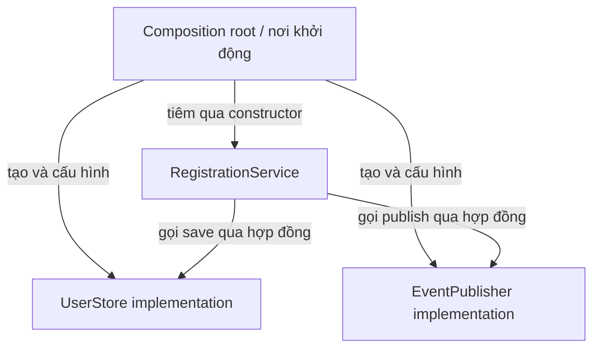

# Đảo ngược điều khiển (IoC) và quan hệ với DI

**Inversion of Control (IoC)**, hay **đảo ngược điều khiển**, là một ý tưởng thiết kế: một thành phần không tự nắm giữ mọi quyết định về cách chương trình được điều phối; một phần trách nhiệm điều phối được chuyển cho bên ngoài thành phần đó. Trong thiết kế hướng đối tượng, sự đảo ngược này có thể liên quan đến **ai quyết định khi nào mã được gọi** hoặc **ai quyết định tạo và lắp ghép những đối tượng mà mã cần sử dụng**.

**Dependency Injection (DI)**, hay **tiêm phụ thuộc**, là một kỹ thuật cụ thể để thực hiện IoC ở khía cạnh thứ hai: một đối tượng **nhận phụ thuộc từ bên ngoài** thay vì tự khởi tạo hoặc tự đi tìm phụ thuộc. DI không yêu cầu framework hay container; Java thuần đã đủ để thực hiện.

Bài học thuộc phần **Nguyên lý liên quan** của module **Dependency Injection**, tập trung vào mối quan hệ giữa IoC và DI, ranh giới trách nhiệm khi tạo đối tượng, composition root và những nhầm lẫn thường gặp trước khi học DI container.

## 1. Hiểu đúng chữ “điều khiển” trong IoC

Từ “điều khiển” dễ gây nhầm lẫn vì nó có thể chỉ những quyết định khác nhau. Khi phân tích IoC, hãy chỉ rõ **quyết định nào đã được chuyển ra ngoài**.

| Khía cạnh | Cách thành phần tự kiểm soát | Ví dụ đảo ngược điều khiển |
| --- | --- | --- |
| **Luồng thực thi** | Thành phần tự quyết định khi nào chạy một đoạn xử lý khác | Framework hoặc cơ chế sự kiện gọi callback do ứng dụng cung cấp |
| **Khởi tạo và lắp ghép đối tượng** | Lớp nghiệp vụ tự gọi `new` để chọn và tạo mọi cộng tác viên | Thành phần bên ngoài tạo phụ thuộc rồi chuyển chúng vào constructor của lớp nghiệp vụ |

Hai khía cạnh có thể xuất hiện riêng hoặc cùng nhau. Vì vậy không nên định nghĩa IoC chỉ là “framework gọi mã của ta”, cũng không nên giới hạn IoC vào một container DI.

### IoC ở luồng thực thi: “đăng ký xử lý, rồi được gọi lại”

Khi viết một ứng dụng theo luồng tuần tự, mã thường trực tiếp gọi một hàm để thực hiện công việc. Với sự kiện hoặc framework, mã ứng dụng có thể **cung cấp một hàm xử lý**, còn hệ thống xung quanh quyết định thời điểm gọi hàm đó.

Ví dụ Java thuần với callback:

```java
import java.util.List;

List<String> names = new java.util.ArrayList<>(List.of("Bình", "An"));
names.sort((left, right) -> left.compareTo(right));
```

Ứng dụng cung cấp phép so sánh, trong khi thuật toán sắp xếp quyết định **khi nào** gọi `compare`. Đây là một ví dụ về việc chuyển một phần quyền điều phối cho thuật toán. Tương tự, event loop hoặc web framework có thể gọi callback/handler khi có sự kiện hoặc request.

Callback giúp thấy ý tưởng IoC về **thời điểm gọi mã**; tuy nhiên, không phải cứ truyền callback là đã áp dụng DI theo nghĩa quản lý phụ thuộc của đối tượng. Để phân biệt chính xác, cần xem đối tượng có đang được **cung cấp cộng tác viên** hay chỉ đang truyền một hành vi tạm thời cho một thao tác.

### IoC ở việc tạo đối tượng: “được cấp cộng tác viên”

Giả sử `RegistrationService` cần một nơi lưu người dùng và một nơi phát sự kiện. Nếu tự tạo các cộng tác viên, lớp sẽ đồng thời quyết định:

- Dùng cơ sở dữ liệu hoặc bộ nhớ để lưu người dùng.
- Phát sự kiện trực tiếp, qua message broker hay chỉ ghi log.
- Tạo phụ thuộc một lần hay tạo lại trong từng lần gọi.
- Dùng cấu hình nào và ai giải phóng tài nguyên.

Đó là những quyết định về **lắp ghép ứng dụng**, không phải quy tắc nghiệp vụ “lưu người dùng rồi phát sự kiện”. Đưa các quyết định này về nơi khởi động chương trình là một cách thực hiện IoC thông qua DI.

## 2. Từ tự tạo phụ thuộc đến constructor injection

Xét cách làm ban đầu dưới đây. Các adapter `JdbcUserStore` và `KafkaEventPublisher` chỉ là tên minh họa cho triển khai hạ tầng, chưa cần cài đặt ở đoạn mã này.

```java
// Minh họa vấn đề: service tự chọn implementation và cấu hình.
final class RegistrationService {
    private final UserStore users = new JdbcUserStore(/* cấu hình */);
    private final EventPublisher events = new KafkaEventPublisher(/* cấu hình */);

    void register(User user) {
        users.save(user);
        events.publish("USER_REGISTERED:" + user.username());
    }
}
```

Ngay cả khi kiểu của trường là interface `UserStore` và `EventPublisher`, biểu thức `new` vẫn gắn service với các triển khai cụ thể. Muốn kiểm thử bằng bộ nhớ, thay message broker hay điều chỉnh vòng đời, người sử dụng `RegistrationService` không thể chọn các phụ thuộc từ bên ngoài theo cách thông thường.

Ta chuyển quyết định khởi tạo ra ngoài:

```java
import java.util.Objects;

final class RegistrationService {
    private final UserStore users;
    private final EventPublisher events;

    RegistrationService(UserStore users, EventPublisher events) {
        this.users = Objects.requireNonNull(users, "users");
        this.events = Objects.requireNonNull(events, "events");
    }

    void register(User user) {
        users.save(user);
        events.publish("USER_REGISTERED:" + user.username());
    }
}
```

Với thiết kế này:

1. `RegistrationService` quyết định **cần làm gì** với `UserStore` và `EventPublisher`.
2. Thành phần lắp ghép quyết định **cung cấp instance nào** cho từng hợp đồng.
3. Cấu hình và vòng đời của các instance có thể được quản lý từ nơi lắp ghép.

Lưu ý: **`RegistrationService` vẫn chủ động gọi `users.save(...)` và `events.publish(...)`**. DI không đảo ngược mọi hướng gọi phương thức; nó chuyển quyền kiểm soát **khởi tạo và cung cấp phụ thuộc**. Nhầm lẫn hai loại điều khiển thường dẫn đến kết luận sai rằng một lớp dùng DI phải được framework gọi hoặc không được phép gọi các phụ thuộc.

## 3. Sơ đồ quan hệ IoC, DI và composition root



**Composition root** là điểm lắp ghép các đối tượng của ứng dụng. Trong một chương trình Java đơn giản, đó thường là `main()`; trong ứng dụng dùng framework, nó có thể nằm ở phần cấu hình hoặc bootstrap. Composition root biết các triển khai cụ thể, còn mã nghiệp vụ tập trung vào hành vi mà mình cần.

Quan hệ các khái niệm có thể diễn đạt chính xác như sau:

| Khái niệm | Vai trò | Có cần framework? |
| --- | --- | --- |
| **IoC** | Ý tưởng chuyển một phần quyền điều phối ra bên ngoài thành phần | Không |
| **DI** | Kỹ thuật cung cấp phụ thuộc từ bên ngoài thành phần | Không |
| **Constructor injection** | Hình thức DI nhận các phụ thuộc qua tham số constructor | Không |
| **Composition root** | Nơi tạo, cấu hình và lắp ghép các instance thành đồ thị đối tượng | Không |
| **DI container** | Công cụ hỗ trợ đăng ký, khởi tạo, nối phụ thuộc và quản lý vòng đời theo cấu hình | Có dùng một container, nhưng không bắt buộc để áp dụng DI |

Nói gọn: **DI là một cách hiện thực IoC**, nhưng **IoC không đồng nghĩa với DI**. Một ứng dụng có thể sử dụng IoC qua callback mà không dùng DI; một ứng dụng có thể thực hiện DI thủ công mà không cần framework đảo ngược luồng gọi request.

## 4. Thực hành IoC bằng DI thủ công trong Java

Ví dụ sau là một chương trình Java 17 độc lập. `RegistrationService` chỉ nhận hợp đồng `UserStore` và `EventPublisher`; `Main` chịu trách nhiệm lắp ghép, còn các implementation nhỏ ghi nhận lời gọi để xác minh hành vi. Không cần Spring, Guice, Mockito hay cơ sở dữ liệu.

```java
import java.util.ArrayList;
import java.util.List;
import java.util.Objects;

record User(String username) {
    User {
        Objects.requireNonNull(username, "username");
        if (username.isBlank()) {
            throw new IllegalArgumentException("username is blank");
        }
    }
}

@FunctionalInterface
interface UserStore {
    void save(User user);
}

@FunctionalInterface
interface EventPublisher {
    void publish(String event);
}

final class RegistrationService {
    private final UserStore users;
    private final EventPublisher events;

    RegistrationService(UserStore users, EventPublisher events) {
        this.users = Objects.requireNonNull(users, "users");
        this.events = Objects.requireNonNull(events, "events");
    }

    void register(User user) {
        Objects.requireNonNull(user, "user");
        users.save(user);
        events.publish("USER_REGISTERED:" + user.username());
    }
}

public class Main {
    public static void main(String[] args) {
        // Composition root cho tình huống kiểm thử:
        List<String> calls = new ArrayList<>();
        UserStore recordingStore =
                user -> calls.add("save:" + user.username());
        EventPublisher recordingEvents =
                event -> calls.add("publish:" + event);

        RegistrationService service =
                new RegistrationService(recordingStore, recordingEvents);
        service.register(new User("lan"));

        List<String> expected = List.of(
                "save:lan",
                "publish:USER_REGISTERED:lan"
        );
        if (!calls.equals(expected)) {
            throw new AssertionError("Expected " + expected + ", got " + calls);
        }

        System.out.println("PASS: " + calls);
    }
}
```

Lưu mã vào `Main.java` rồi chạy với JDK 17 trở lên:

```bash
javac -encoding UTF-8 Main.java
java Main
```

Kết quả mong đợi:

```text
PASS: [save:lan, publish:USER_REGISTERED:lan]
```

Trong phiên bản chạy thật, chính nơi lắp ghép có thể khởi tạo `JdbcUserStore` cùng `KafkaEventPublisher` và truyền vào **cùng** constructor đó. Mã `RegistrationService` không phải sửa theo môi trường sử dụng.

### Thử nghiệm thêm: điều khiển một lỗi trong phụ thuộc

Giả sử lưu người dùng thất bại. Ta có thể lắp ghép một `UserStore` ném ngoại lệ để xác minh sự kiện không được phát. Đoạn sau là phần thử nghiệm bổ sung có thể đặt trong `main()` sau ví dụ trên:

```java
List<String> failureEvents = new ArrayList<>();
UserStore failingStore = user -> {
    throw new IllegalStateException("storage unavailable");
};
EventPublisher failureRecorder = failureEvents::add;

boolean caught = false;
try {
    new RegistrationService(failingStore, failureRecorder)
            .register(new User("minh"));
} catch (IllegalStateException expectedFailure) {
    caught = true;
}

if (!caught || !failureEvents.isEmpty()) {
    throw new AssertionError("Không phát sự kiện khi lưu thất bại");
}
```

Đây là một lợi ích trực tiếp của DI: bài kiểm thử có thể **chọn hành vi của cộng tác viên**. Tuy nhiên, DI không tự bảo đảm tính nhất quán nếu thao tác lưu thành công nhưng phát sự kiện thất bại; đó là bài toán riêng về giao dịch, độ tin cậy và kiến trúc.

## 5. IoC và DI khác Dependency Inversion Principle (DIP) thế nào?

Ba cụm từ dễ bị lẫn vì đều liên quan tới dependency:

- **IoC (Inversion of Control):** mô tả việc chuyển quyền điều phối nào đó ra bên ngoài.
- **DI (Dependency Injection):** mô tả *cách truyền phụ thuộc* vào một đối tượng.
- **DIP (Dependency Inversion Principle):** nguyên lý thiết kế nói rằng mô-đun cấp cao và cấp thấp nên cùng phụ thuộc vào **abstraction**; abstraction không nên phụ thuộc vào chi tiết triển khai.

Ví dụ, đoạn mã dưới đây có **constructor injection** vì phụ thuộc được cung cấp từ ngoài, nhưng service vẫn phụ thuộc trực tiếp vào một kiểu triển khai cụ thể:

```java
final class ReportService {
    private final JdbcReportRepository repository;

    ReportService(JdbcReportRepository repository) {
        this.repository = repository;
    }
}
```

Như vậy, **có DI chưa đủ để kết luận thiết kế tuân DIP**. Nếu `ReportService` phụ thuộc vào interface `ReportRepository`, còn `JdbcReportRepository` triển khai interface ấy, ranh giới giữa chính sách báo cáo và chi tiết JDBC sẽ được tách rõ hơn.

Chiều ngược lại cũng cần phân biệt: một thiết kế phụ thuộc vào interface nhưng vẫn tự `new` một triển khai trong thân service thì chưa đạt mục tiêu **trao quyền chọn dependency** cho người lắp ghép. Dùng interface và dùng DI giải quyết hai câu hỏi khác nhau: **phụ thuộc vào hợp đồng nào** và **ai cấp instance đáp ứng hợp đồng ấy**.

Không cần tạo interface cho mọi đối tượng. Chẳng hạn, một `Clock` cụ thể cũng có thể được tiêm qua constructor để kiểm thử thời gian; và những đối tượng giá trị ngắn hạn vẫn có thể được khởi tạo trực tiếp trong phương thức.

## 6. IoC container, DI container và Service Locator

Trong nhiều framework, các từ **IoC container** và **DI container** được dùng gần như thay thế nhau vì công cụ vừa cấu hình vừa cung cấp đối tượng. Một container thường hỗ trợ đăng ký implementation, giải quyết quan hệ phụ thuộc, tạo object graph, và đôi khi quản lý scope, lifecycle hay callback khởi tạo. Đó là phần **tự động hóa công việc lắp ghép** vốn vẫn có thể viết bằng Java thuần.

Ví dụ, trong ứng dụng không có container:

```java
UserStore store = new JdbcUserStore(/* cấu hình */);
EventPublisher publisher = new KafkaEventPublisher(/* cấu hình */);
RegistrationService service = new RegistrationService(store, publisher);
```

Các lớp `JdbcUserStore` và `KafkaEventPublisher` ở đây là adapter giả định, nên đoạn mã minh họa cấu hình **không phải ví dụ độc lập có thể biên dịch**. Điều cần quan sát là vị trí lắp ghép; container, nếu được dùng sau này, sẽ hỗ trợ thực hiện các bước tương tự.

Một cách khác đôi khi xuất hiện là **Service Locator**:

```java
// Minh họa Service Locator, không phải constructor injection:
final class RegistrationService {
    private final UserStore users = Services.get(UserStore.class);
    private final EventPublisher events = Services.get(EventPublisher.class);
}
```

Một registry ngoài có thể quyết định implementation, nhưng `RegistrationService` vẫn **chủ động tra cứu** các phụ thuộc, còn constructor không cho thấy lớp cần gì. Vì vậy Service Locator và constructor injection không giống nhau. Service Locator có thể là một cách chuyển bớt trách nhiệm tạo đối tượng, nhưng lạm dụng nó làm dependency trở nên ngầm, khó kiểm thử và khó nhận biết lúc khởi tạo. Khi có thể, khai báo rõ các dependency bắt buộc bằng constructor giúp API minh bạch hơn.

## 7. Lợi ích và giới hạn cần nắm trước khi dùng DI container

DI thủ công có các lợi ích thiết thực:

1. **Thay đổi implementation** ở nơi lắp ghép mà giữ nguyên cách service dùng hợp đồng.
2. **Kiểm thử cô lập:** đưa fake/stub vào service để điều khiển kết quả và quan sát lời gọi, giảm phụ thuộc vào môi trường ngoài.
3. **Công khai các điều kiện cần thiết:** constructor cho thấy service cần bao nhiêu cộng tác viên và thuộc loại gì.
4. **Quản lý vòng đời có chủ đích:** nơi lắp ghép có thể chọn chia sẻ một instance, tạo instance cho mỗi request hoặc đóng tài nguyên đúng lúc.

Nhưng DI không tự giải quyết mọi vấn đề thiết kế:

| Nhầm lẫn | Cách hiểu đúng |
| --- | --- |
| “Muốn IoC thì bắt buộc dùng Spring.” | DI bằng Java thuần đã đảo quyền kiểm soát việc lắp ghép; framework chỉ hỗ trợ tự động hóa. |
| “Có DI thì mọi phụ thuộc đều đã được tách lỏng.” | Nếu một lớp vẫn phụ thuộc trực tiếp vào API hạ tầng phức tạp, coupling vẫn tồn tại. |
| “Phải đưa tất cả `new` vào container.” | Khởi tạo đối tượng giá trị hoặc dữ liệu tạm bên trong phương thức vẫn bình thường. |
| “Tiêm singleton là luôn an toàn.” | Chia sẻ instance cần xét trạng thái và tính an toàn khi nhiều luồng cùng truy cập. |
| “DI xử lý được giao dịch, retry hoặc lỗi mạng.” | DI chỉ cung cấp cộng tác viên; hành vi lỗi và chính sách tin cậy phải được thiết kế riêng. |
| “Constructor có nhiều tham số thì thêm container là xong.” | Số phụ thuộc quá lớn có thể cho thấy lớp gánh quá nhiều trách nhiệm; container không tự sửa thiết kế đó. |

Khi ứng dụng phát triển, hãy xác định rõ **ai tạo, ai dùng, ai đóng** các đối tượng giữ tài nguyên như connection pool, HTTP client hay executor. Tiêm một đối tượng dùng chung vào nhiều service có thể có lợi về hiệu năng, nhưng cần kiểm tra thread safety và scope. Với chuỗi phụ thuộc vòng tròn `A → B → A`, constructor injection thường làm vấn đề lộ ra lúc lắp ghép; nên xem lại ranh giới trách nhiệm thay vì che giấu vòng lặp.

## 8. Tự kiểm tra hiểu bài

**Tình huống 1.** Một thư viện gọi hàm listener mỗi khi có sự kiện. Đây có phải IoC không? Ở khía cạnh **điều phối lời gọi**, có: thư viện quyết định thời điểm chạy mã listener. Chưa đủ dữ kiện để kết luận có DI cho các dependency của listener.

**Tình huống 2.** `BillingService` nhận `PaymentClient` qua constructor, còn `Main` quyết định tạo client thật hay client giả. Đây có phải DI không? **Có**: caller cấp cộng tác viên; service không tự tạo hoặc tra cứu client. Nó là một cách hiện thực IoC về khởi tạo/lắp ghép.

**Tình huống 3.** `BillingService` nhận trực tiếp `StripePaymentClient` qua constructor. Có DI không? **Có**, vì instance vẫn được cung cấp từ ngoài; tuy vậy mô-đun cấp cao vẫn gắn với kiểu cụ thể nên chưa đạt mức tách khỏi hạ tầng như khi phụ thuộc vào hợp đồng phù hợp.

**Tình huống 4.** Thay lệnh `new` bằng `GlobalContainer.resolve()` ngay trong mọi service có cải thiện không? Nó có thể tập trung đăng ký implementation, nhưng vẫn che giấu dependency và giữ thói quen tự tra cứu. Ưu tiên truyền dependency vào service từ composition root nếu không có lý do rõ ràng cho cách tra cứu động.

## Ghi nhớ

- **IoC là nguyên lý rộng:** chuyển một phần quyền điều phối về bên ngoài thành phần; có thể áp dụng cho luồng thực thi hoặc việc tạo/lắp ghép phụ thuộc.
- **DI là kỹ thuật cụ thể:** một đối tượng nhận phụ thuộc từ bên ngoài, thường qua constructor đối với dependency bắt buộc.
- **Composition root** sở hữu quyết định tạo và ghép các implementation, trong khi service dùng dependency để thực hiện nghiệp vụ.
- **DI, DIP và DI container không đồng nghĩa:** DI nói về cách cung cấp, DIP nói về hướng phụ thuộc giữa chính sách và chi tiết, còn container là công cụ hỗ trợ lắp ghép và quản lý đối tượng.
- Có thể học và thực hành DI đầy đủ bằng **Java thuần**, từ việc tiêm cộng tác viên, viết test cho đến suy nghĩ về scope và vòng đời, trước khi mở rộng sang container.
