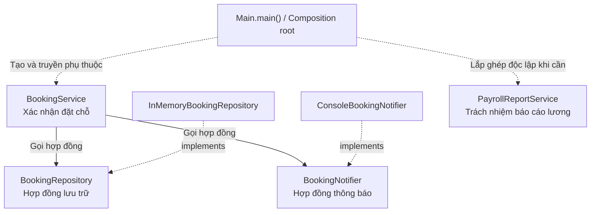

# Giảm liên kết (coupling) và tăng gắn kết trách nhiệm (cohesion)

## 1. Hai tiêu chí thiết kế giải quyết hai câu hỏi khác nhau

Trong thiết kế phần mềm, **coupling (mức liên kết giữa các thành phần)** cho biết một thành phần phụ thuộc vào thành phần khác đến mức nào. **Cohesion (mức gắn kết trách nhiệm bên trong một thành phần)** cho biết các hành vi và dữ liệu của chính thành phần đó có cùng phục vụ một mục tiêu rõ ràng hay không.

Hai câu hỏi nên được đặt riêng:

- **Coupling:** Nếu thay cách lưu dữ liệu, gửi thông báo hoặc gọi hệ thống ngoài, cần sửa bao nhiêu nơi? Thành phần nghiệp vụ có phải biết chi tiết triển khai của các cộng tác viên không?
- **Cohesion:** Nếu quy tắc của một nghiệp vụ thay đổi, các dòng mã liên quan có tập trung vào một trách nhiệm dễ nhận diện không? Một class có đang gánh những lý do thay đổi không liên quan không?

Mục tiêu phổ biến là **liên kết hợp lý, càng ít phụ thuộc không cần thiết càng tốt** (*loose coupling*) và **trách nhiệm có tính thống nhất cao** (*high cohesion*). Đây là những đặc điểm về cách mã nguồn được tổ chức, không phải phép đếm số class, interface hay constructor.

Trong module **DEPENDENCY_INJECTION**, ta học **Dependency Injection (DI)** và **Inversion of Control (IoC)** để tách việc *dùng* phụ thuộc khỏi việc *tạo và lắp ghép* đối tượng. DI là một **công cụ hỗ trợ giảm một số kiểu coupling**: đối tượng nghiệp vụ nhận cộng tác viên từ bên ngoài nên không cần tự chọn hay tự tạo lớp triển khai. Tuy nhiên, dùng DI không tự động bảo đảm cohesion tốt; một class có mười trách nhiệm vẫn rời rạc dù cả mười phụ thuộc đều được inject.

| Tiêu chí | Nhìn vào đâu? | Biểu hiện cần cải thiện | Kết quả mong muốn |
| --- | --- | --- | --- |
| **Coupling** | Quan hệ giữa các thành phần | Service tự mở kết nối database; biết API của nhà cung cấp email; thay một chi tiết phải sửa nhiều consumer. | Consumer phụ thuộc vào hợp đồng vừa đủ, thông tin triển khai nằm ở biên lắp ghép. |
| **Cohesion** | Quan hệ giữa các hành vi trong một thành phần | Một service vừa xác nhận đặt chỗ, vừa tính lương, xuất báo cáo, quản trị người dùng. | Mỗi thành phần có trách nhiệm có thể diễn đạt rõ, các phương thức phục vụ trách nhiệm đó. |

**Phụ thuộc không phải điều xấu tuyệt đối.** Một `BookingService` bắt buộc phải cộng tác với nơi lưu đặt chỗ nếu nghiệp vụ yêu cầu. Điều cần giảm là *mức phụ thuộc vào chi tiết không liên quan*, *số quan hệ không cần thiết* và *sự lan truyền khi có thay đổi*.

## 2. Nhận diện các dạng coupling thường gặp

Không phải mọi quan hệ phụ thuộc đều nguy hiểm như nhau. Khi xem xét một service, hãy phân biệt:

1. **Coupling với lớp triển khai:** `BookingService` gọi `new JdbcBookingRepository(...)`, quyết định driver hoặc URL database. Khi đổi cơ chế lưu trữ, service phải sửa.
2. **Coupling với API cụ thể của nhà cung cấp:** service tự gắn HTTP header, token và payload của dịch vụ thông báo. Thay nhà cung cấp sẽ lan đến nghiệp vụ.
3. **Coupling với dữ liệu nội bộ:** thành phần bên ngoài dựa trực tiếp vào cấu trúc bảng hoặc định dạng file riêng của một module.
4. **Coupling theo thứ tự/thời điểm:** consumer buộc phải gọi `initialize()` trước `confirm()`; quên một bước sẽ lỗi khi chạy. Constructor hoàn chỉnh giúp giảm loại phụ thuộc ngầm này, dù không triệt tiêu mọi ràng buộc về thứ tự nghiệp vụ.
5. **Coupling với vòng đời:** đối tượng dùng chung lâu dài giữ tham chiếu tới trạng thái chỉ nên tồn tại trong một yêu cầu. Đây là ràng buộc về scope, không giải quyết được chỉ bằng thêm interface.

Một dấu hiệu coupling chặt là khi thay một quyết định hạ tầng buộc sửa class nghiệp vụ vốn không chịu trách nhiệm về quyết định ấy. Ngược lại, mã lắp ghép ở điểm khởi động ứng dụng (*composition root*) **được phép biết lớp triển khai**: đó chính là nơi lựa chọn và nối các cộng tác viên.

### Vì sao số import hoặc số tham số constructor chưa nói hết vấn đề?

Service có hai dependency nhưng trực tiếp điều khiển chi tiết JDBC và SMTP có thể bị coupling chặt hơn service có ba dependency đều mô tả các hợp đồng nghiệp vụ rõ ràng. Constructor dài là **tín hiệu cần xem xét**, không phải bằng chứng chắc chắn. Phải đọc các trách nhiệm, mối quan hệ thay đổi và hợp đồng thực tế.

## 3. Nhận diện cohesion theo lý do thay đổi

Một thành phần có cohesion cao khi các thành viên cùng phục vụ **một trách nhiệm nhất quán**. Trách nhiệm thường được hiểu qua **lý do để mã phải thay đổi**, không phải số lượng phương thức.

Ví dụ với hệ thống đặt chỗ:

- `BookingService` điều phối *ca sử dụng xác nhận đặt chỗ*: kiểm tra điều kiện nghiệp vụ, yêu cầu cập nhật xác nhận, phát sự kiện hoặc yêu cầu thông báo phù hợp. Các bước phối hợp này có thể cùng tạo thành một trách nhiệm là xử lý ca sử dụng.
- `BookingRepository` chịu trách nhiệm cung cấp thao tác lưu/truy xuất đặt chỗ cho nghiệp vụ. Việc ánh xạ bảng, tạo câu SQL thuộc một adapter triển khai repository.
- `BookingNotifier` chịu trách nhiệm gửi thông báo đặt chỗ theo hợp đồng ứng dụng. Adapter cụ thể có thể dùng console, email hoặc API.
- `MonthlyPayrollReporter` tính và xuất báo cáo lương; không có lý do rõ để đặt trong `BookingService` chỉ vì cùng ứng dụng.

Không nên cực đoan tách **mỗi phương thức thành một class**. Nếu nhiều phương thức cùng giữ một bất biến nghiệp vụ hoặc cùng hoàn thành một ca sử dụng, việc gom chúng trong một thành phần có thể giúp cohesion cao hơn. Ngược lại, một class có duy nhất một phương thức nhưng làm quá nhiều việc không tự nhiên có cohesion cao.

**Câu hỏi kiểm tra hữu ích:** “Khi một quy tắc xác nhận đặt chỗ thay đổi, lớp nào cần sửa? Khi công nghệ gửi email thay đổi, lớp nào cần sửa?” Nếu cả hai thay đổi đều bắt buộc đụng vào cùng một class, có thể các trách nhiệm đang bị trộn.

## 4. Trước và sau khi áp dụng DI: một tình huống cụ thể

Xét cách viết sau (ví dụ minh họa; `JdbcBookingStore` và `SmtpGateway` là tên hạ tầng giả định, không phải API chuẩn của JDK):

```java
class BookingManager {
    private final JdbcBookingStore store =
            new JdbcBookingStore("jdbc:example:bookings");
    private final SmtpGateway smtp =
            new SmtpGateway("smtp.example.com");

    void confirmBooking(String bookingId, String customerEmail) {
        store.markConfirmed(bookingId);
        smtp.send(customerEmail, "Đặt chỗ đã xác nhận: " + bookingId);
    }

    void exportMonthlyPayrollReport() {
        // Tính và xuất dữ liệu lương nhân viên.
    }
}
```

Có **hai vấn đề độc lập**:

- **Coupling chặt:** `BookingManager` biết chính xác hạ tầng lưu trữ và gửi email. Không thể kiểm thử luồng xác nhận mà không đối mặt với khởi tạo hạ tầng hoặc can thiệp sâu vào mã.
- **Cohesion thấp:** hàm báo cáo lương không phục vụ trách nhiệm xác nhận đặt chỗ. Thay quy định báo cáo lương có thể buộc sửa và phát hành lại thành phần xử lý đặt chỗ.

Một bước cải thiện là **tách báo cáo lương sang trách nhiệm riêng** và **cho consumer nhận cộng tác viên qua constructor**. Mã nghiệp vụ vẫn phụ thuộc vào hành vi cần thiết, nhưng không quyết định cách các hành vi đó được triển khai.

### Đồ thị quan hệ sau khi điều chỉnh



Sơ đồ phân biệt hai chiều quan trọng: **consumer gọi hợp đồng** khi chạy, còn **composition root tạo và kết nối triển khai** khi khởi động. Điều này giúp thay adapter mà không phải làm lại luồng nghiệp vụ.

## 5. Ví dụ Java thuần hoàn chỉnh

Lưu đoạn mã sau vào `Main.java`. Không cần framework, annotation hoặc DI container.

```java
import java.util.HashMap;
import java.util.Map;
import java.util.Objects;

public class Main {
    // Hai hợp đồng nhỏ, chỉ mô tả điều BookingService cần.
    interface BookingRepository {
        void markConfirmed(String bookingId);
    }

    interface BookingNotifier {
        void confirmed(String bookingId, String customerEmail);
    }

    // Cohesion: xử lý một ca sử dụng xác nhận đặt chỗ.
    // Coupling: sử dụng hợp đồng; không biết lớp triển khai.
    static final class BookingService {
        private final BookingRepository repository;
        private final BookingNotifier notifier;

        BookingService(BookingRepository repository, BookingNotifier notifier) {
            this.repository = Objects.requireNonNull(repository, "repository");
            this.notifier = Objects.requireNonNull(notifier, "notifier");
        }

        void confirm(String bookingId, String customerEmail) {
            if (bookingId == null || bookingId.isBlank()) {
                throw new IllegalArgumentException("Mã đặt chỗ không được rỗng");
            }
            if (customerEmail == null || customerEmail.isBlank()) {
                throw new IllegalArgumentException("Email không được rỗng");
            }

            repository.markConfirmed(bookingId);
            notifier.confirmed(bookingId, customerEmail);
        }
    }

    // Adapter hạ tầng có trách nhiệm lưu trạng thái đặt chỗ.
    static final class InMemoryBookingRepository implements BookingRepository {
        private final Map<String, Boolean> confirmed = new HashMap<>();

        InMemoryBookingRepository() {
            confirmed.put("B-101", false);
        }

        @Override
        public void markConfirmed(String bookingId) {
            if (!confirmed.containsKey(bookingId)) {
                throw new IllegalArgumentException(
                        "Không tồn tại đặt chỗ: " + bookingId);
            }
            confirmed.put(bookingId, true);
        }

        boolean isConfirmed(String bookingId) {
            return Boolean.TRUE.equals(confirmed.get(bookingId));
        }
    }

    // Adapter hạ tầng có trách nhiệm xuất thông báo.
    static final class ConsoleBookingNotifier implements BookingNotifier {
        @Override
        public void confirmed(String bookingId, String customerEmail) {
            System.out.println(
                    "Thông báo cho " + customerEmail + ": " + bookingId
                    + " đã được xác nhận.");
        }
    }

    public static void main(String[] args) {
        // Composition root: biết implementation và quản lý việc lắp ghép.
        InMemoryBookingRepository repository =
                new InMemoryBookingRepository();
        BookingNotifier notifier = new ConsoleBookingNotifier();
        BookingService bookingService = new BookingService(repository, notifier);

        bookingService.confirm("B-101", "khach@example.com");

        System.out.println("Đã lưu xác nhận: "
                + repository.isConfirmed("B-101"));
    }
}
```

Biên dịch và chạy với JDK 11 trở lên (ví dụ dùng `String.isBlank()`):

```bash
javac -encoding UTF-8 Main.java
java Main
```

Kết quả dự kiến:

```text
Thông báo cho khach@example.com: B-101 đã được xác nhận.
Đã lưu xác nhận: true
```

**Ranh giới trách nhiệm trong mã:**

| Thành phần | Việc nó biết | Việc nó không phải biết |
| --- | --- | --- |
| `BookingService` | Luồng xác nhận, điều kiện dữ liệu đầu vào, hợp đồng repository và notifier. | `HashMap`, console, địa chỉ SMTP, cách mở kết nối DB. |
| `InMemoryBookingRepository` | Cách lưu trạng thái xác nhận trong bộ nhớ. | Thông báo gửi cho ai, trình bày nội dung thông báo. |
| `ConsoleBookingNotifier` | Cách xuất thông báo trong ví dụ. | Quy tắc lưu trạng thái xác nhận. |
| `Main.main()` | Triển khai cụ thể nào được khởi tạo và truyền vào đâu. | Chi tiết của quy tắc xác nhận nằm trong service. |

Ở đây `BookingService` vẫn **có liên kết** với hai interface. Đó là liên kết có chủ đích vì service cần hai khả năng này. Điều giảm đi là liên kết trực tiếp với công nghệ và quyết định khởi tạo.

### Đổi triển khai không cần sửa consumer

Muốn gửi thông báo vào một hàng đợi, ta có thể viết adapter mới:

```java
// Ví dụ minh họa phần triển khai; QueueClient là hợp đồng giả định.
final class QueueBookingNotifier implements Main.BookingNotifier {
    private final QueueClient queue;

    QueueBookingNotifier(QueueClient queue) {
        this.queue = queue;
    }

    @Override
    public void confirmed(String bookingId, String email) {
        queue.publish("booking.confirmed", bookingId + "|" + email);
    }
}
```

Composition root sẽ tạo `QueueClient` và `QueueBookingNotifier` rồi truyền vào `BookingService`. Đoạn minh họa này không nằm trong ví dụ chạy độc lập ở trên vì `QueueClient` không thuộc JDK; mục đích là chỉ ra **vị trí thay đổi**. Mã `BookingService` không cần phụ thuộc vào API queue.

Cần lưu ý rằng “không sửa consumer” chỉ đúng nếu **hợp đồng nghiệp vụ vẫn phù hợp**. Nếu yêu cầu mới buộc thay hẳn ý nghĩa của việc xác nhận, bản thân service có thể phải đổi; DI không thể loại bỏ những thay đổi thật sự của nghiệp vụ.

## 6. Kiểm chứng bằng fake: test hành vi, không kiểm tra cách lắp ghép nội bộ

Nhờ constructor injection, có thể kiểm thử service bằng cộng tác viên ghi nhận lời gọi. Thêm class sau vào cuối `Main.java` ở mục 5 (không đặt `public`):

```java
class BookingServiceTest {
    static final class RecordingRepository implements Main.BookingRepository {
        String confirmedId;

        @Override
        public void markConfirmed(String bookingId) {
            confirmedId = bookingId;
        }
    }

    static final class RecordingNotifier implements Main.BookingNotifier {
        String id;
        String email;
        int timesCalled;

        @Override
        public void confirmed(String bookingId, String customerEmail) {
            id = bookingId;
            email = customerEmail;
            timesCalled++;
        }
    }

    public static void main(String[] args) {
        RecordingRepository repo = new RecordingRepository();
        RecordingNotifier notifier = new RecordingNotifier();
        Main.BookingService service = new Main.BookingService(repo, notifier);

        service.confirm("B-202", "test@example.com");

        if (!"B-202".equals(repo.confirmedId)) {
            throw new AssertionError("Repository chưa nhận mã đúng");
        }
        if (!"B-202".equals(notifier.id)
                || !"test@example.com".equals(notifier.email)
                || notifier.timesCalled != 1) {
            throw new AssertionError("Notifier chưa nhận dữ liệu đúng");
        }

        System.out.println("PASS: BookingService đã phối hợp đúng");
    }
}
```

Chạy:

```bash
javac -encoding UTF-8 Main.java
java BookingServiceTest
```

Kết quả mong đợi:

```text
PASS: BookingService đã phối hợp đúng
```

Phép kiểm tra này chứng minh `BookingService` dùng đúng các dependency đã cấp và phối hợp chúng trong trường hợp thành công. Nó không xác minh giao dịch database, thời gian gửi email, hay tình huống repository thành công nhưng notifier thất bại. Với ứng dụng thực tế, độ tin cậy giữa lưu trạng thái và phát thông báo có thể cần **transactional outbox**, hàng đợi hoặc cơ chế retry; đó là bài toán kiến trúc khác, không được DI tự động giải quyết.

**Coupling thấp hỗ trợ test:** ta có thể đổi adapter thật thành fake tại composition root của bài test. **Cohesion cao hỗ trợ test:** trường hợp cần kiểm thử được mô tả gần với một trách nhiệm cụ thể, ít phải dựng trạng thái của các chức năng không liên quan.

## 7. DI, IoC và các nguyên lý thiết kế có liên quan

DI có quan hệ chặt với một số nguyên lý thiết kế, nhưng không nên xem các thuật ngữ này là đồng nghĩa.

| Nguyên lý / kỹ thuật | Liên hệ với coupling và cohesion | Điểm cần phân biệt |
| --- | --- | --- |
| **Inversion of Control (IoC)** | Consumer không điều khiển việc lựa chọn/tạo toàn bộ cộng tác viên; ứng dụng cấp chúng từ ngoài. | IoC là ý tưởng rộng; DI là một cách thể hiện. |
| **Dependency Injection (DI)** | Constructor injection làm các dependency bắt buộc hiện rõ và cho phép thay thế đối tượng đã cấp. | Injection không tự bảo đảm rằng interface hợp lý hoặc class có ít trách nhiệm. |
| **Single Responsibility Principle (SRP)** | Khuyến khích một module có một lý do thay đổi nhất quán, thường cải thiện cohesion. | “Một trách nhiệm” không đồng nghĩa “một phương thức”. |
| **Dependency Inversion Principle (DIP)** | Chính sách cấp cao không nên phụ thuộc trực tiếp vào chi tiết cấp thấp; cả hai có thể phụ thuộc abstraction phù hợp. | DIP là nguyên lý về **hướng phụ thuộc mã nguồn**; DI là kỹ thuật cấp đối tượng lúc chạy. Có thể dùng riêng. |
| **Interface Segregation Principle (ISP)** | Consumer chỉ cần biết những thao tác thật sự sử dụng, giảm phụ thuộc vào API thừa. | Không phải cứ tạo nhiều interface một phương thức là tốt; abstraction cần có nghĩa. |
| **Open/Closed Principle (OCP)** | Có thể bổ sung adapter mới mà không sửa phần nghiệp vụ ổn định nếu hợp đồng không đổi. | Không có nghĩa mọi thay đổi đều không phải sửa mã cũ. |

### Hướng phụ thuộc quan trọng hơn vị trí đặt interface

Trong ví dụ, service phụ thuộc vào `BookingRepository` và `BookingNotifier`. Để giảm coupling kiến trúc, các hợp đồng này nên thể hiện **nhu cầu của ứng dụng** (ví dụ `markConfirmed`), không phơi các thao tác chỉ phục vụ một công nghệ như `executeSqlUpdate` hoặc `sendSmtpPacket`.

Nếu interface chỉ sao chép nguyên API của nhà cung cấp, service vẫn bị ràng buộc về khái niệm với nhà cung cấp ấy, dù không gọi đến một class cụ thể. Đó là lý do **trừu tượng hóa đúng ranh giới** quan trọng hơn việc thêm từ khóa `interface`.

### Cohesion và coupling hỗ trợ nhau nhưng không thay thế nhau

Hai trục này có thể thay đổi độc lập:

- Một `BookingService` chỉ lo ca sử dụng xác nhận nhưng gọi trực tiếp JDBC có thể **cohesion tương đối cao, coupling chặt**.
- Một `UniversalManager` được tiêm mười interface độc lập cho đặt chỗ, kế toán, báo cáo và đăng nhập có thể **không trực tiếp phụ thuộc lớp triển khai, nhưng cohesion thấp**.
- Một service tập trung vào đặt chỗ, dùng hợp đồng repository và notifier vừa đủ có cơ hội đạt **cả cohesion cao và coupling hợp lý**.

Không thể nhìn một đoạn code có constructor injection rồi kết luận hai tiêu chí đều đã tối ưu.

## 8. Khi giảm coupling quá mức lại phản tác dụng

Giảm coupling là mục tiêu có đánh đổi. Một số cách làm tưởng như tăng tính linh hoạt nhưng khiến mã khó hiểu:

**Tạo interface cho mọi class.** Interface có ích khi có ranh giới thay thế, vai trò rõ, nhu cầu kiểm thử hoặc khi chính sách cần độc lập với chi tiết. Một đối tượng giá trị bất biến đơn giản thường không cần `IAddress` và `AddressImpl`. Trừu tượng hóa không có ý nghĩa tạo thêm tệp, thêm bước điều hướng mà không giúp thay đổi độc lập.

**Chia một ca sử dụng thành quá nhiều service nhỏ.** Nếu mỗi bước chỉ được dùng một lần, sở hữu quá ít ý nghĩa và liên tục chuyển dữ liệu qua nhiều lớp, việc chia nhỏ có thể làm tăng coupling giữa các thành phần. Nên chọn ranh giới theo trách nhiệm và lý do thay đổi.

**Dùng service locator hoặc registry toàn cục.** Consumer gọi `GlobalContainer.get(BookingRepository.class)` để tự tìm đối tượng. Kiểu này có thể che dependency khỏi constructor; người đọc và người viết test phải biết các đăng ký ngầm. Constructor injection thể hiện rõ điều kiện cần để object hoạt động.

**Chuyển mọi quyết định nghiệp vụ vào composition root.** Composition root nên chọn cách lắp ghép và vòng đời. Nó không nên chứa quy tắc tính tiền, điều kiện xác nhận hay xử lý nghiệp vụ theo từng yêu cầu. Nếu không, cohesion của điểm khởi động sẽ kém đi.

**Dùng chung phụ thuộc có trạng thái theo request.** Một singleton service giữ trạng thái thay đổi theo từng khách hàng tạo coupling giữa các yêu cầu, có thể dẫn đến race condition. Với chương trình đồng thời, `HashMap` trong ví dụ chỉ dành cho minh họa; cần cân nhắc lưu trữ đồng thời an toàn, database thật hoặc scope thích hợp. DI không chọn scope thay cho lập trình viên khi lắp ghép thủ công.

**Giấu mọi thứ sau abstraction bất kể chi phí.** Không cần thêm factory, adapter và interface chỉ để tránh viết một lần `new StringBuilder()`. Các giá trị, cấu trúc dữ liệu cục bộ và phép tính đơn giản không tự nhiên là dependency cần inject.

## 9. Cách đánh giá một thiết kế đang cải thiện hay phức tạp thêm

Hãy thử đánh giá thay đổi bằng tình huống thực tế thay vì quy tắc máy móc:

| Tình huống thay đổi | Thiết kế tốt cho thấy gì? | Nếu phải sửa ở nhiều lớp, nên xem lại |
| --- | --- | --- |
| Chuyển console notifier sang email API | Thay adapter và mã lắp ghép; service giữ hợp đồng cũ. | Service đang biết API gửi hoặc payload nhà cung cấp. |
| Đổi `HashMap` thành database | Thay repository adapter và cấu hình, không thay luồng xác nhận. | Consumer đang thao tác trực tiếp cấu trúc lưu trữ. |
| Đổi điều kiện đủ để xác nhận đặt chỗ | Sửa logic nghiệp vụ trong nơi chịu trách nhiệm về điều kiện ấy. | Quy tắc bị rải ở controller, repository và notifier. |
| Đổi chính sách tính lương | Chỉ ảnh hưởng thành phần tính lương. | Class đặt chỗ đang chứa trách nhiệm không liên quan. |
| Thêm test cho `BookingService` | Dựng fake của các hợp đồng cần thiết và gọi một ca sử dụng. | Phải khởi động mọi hạ tầng hoặc đăng ký service locator ngầm. |

### Quy trình refactor theo từng bước

1. **Tìm lý do thay đổi.** Liệt kê các nhiệm vụ chính của class hiện tại; nhóm các nhiệm vụ liên quan mật thiết đến cùng một ca sử dụng hoặc bất biến. Đừng tách chỉ vì số dòng.
2. **Xác định cộng tác viên ngoài ranh giới.** Phân biệt repository, client dịch vụ bên ngoài và cấu hình với dữ liệu đầu vào của một lần gọi như `bookingId`.
3. **Tạo hợp đồng sát nhu cầu consumer.** Ưu tiên tên và thao tác mang nghĩa nghiệp vụ; tránh truyền thẳng interface khổng lồ chỉ vì đã có sẵn.
4. **Áp dụng constructor injection.** Consumer nhận dependency bắt buộc từ constructor, kiểm tra trạng thái hợp lệ, không tạo adapter ở trong.
5. **Chuyển quyết định triển khai về composition root.** Ở `main()` hoặc bootstrap, chọn triển khai, tạo đối tượng, truyền vào và sắp xếp vòng đời.
6. **Kiểm tra bằng phép thay đổi và test.** Thay fake cho adapter để kiểm tra một ca sử dụng. Thử thay triển khai hạ tầng: số lớp nghiệp vụ phải sửa có giảm hay không? Đồng thời xem class có trách nhiệm rõ hơn không.

## 10. Bài thực hành

**Bài 1 — Phân loại vấn đề.** Cho `PaymentManager` vừa kiểm tra thanh toán, gửi email, kết xuất thống kê truy cập và tự tạo `HttpPaymentGateway`. Hãy chỉ ra chỗ nào là coupling với chi tiết triển khai và chỗ nào là cohesion thấp. Việc gửi thông báo hoàn tất thanh toán có nhất thiết phải tách khỏi quy trình thanh toán không? Giải thích theo phạm vi ca sử dụng.

**Bài 2 — Refactor từng bước.** Từ `BookingManager` ở mục 4, xây dựng một `BookingService` nhận `BookingRepository` và `BookingNotifier` bằng constructor. Để mã lắp ghép chọn implementation. Đưa chức năng báo cáo lương sang thành phần riêng. Thử thay notifier mà không đổi service.

**Bài 3 — Kiểm thử thay đổi.** Sửa fake notifier ở mục 6 để ném `IllegalStateException`. Quan sát thứ tự gọi repository và notifier; nếu repository đã lưu trước khi lỗi, hệ thống ở trạng thái gì? Đề xuất chiến lược xử lý lỗi phù hợp thực tế, phân biệt quyết định này với lợi ích giảm coupling từ DI.

**Bài 4 — Chọn scope.** Nếu nhiều request cùng dùng một `BookingService`, liệu service có an toàn luồng không? Điều gì xảy ra với `InMemoryBookingRepository` trong ví dụ? Phân biệt rủi ro trạng thái trong service với trạng thái của phụ thuộc được tiêm.

### Gợi ý tự đối chiếu

- **Bài 1:** tự tạo `HttpPaymentGateway` gây coupling với công nghệ; thống kê truy cập là ứng viên trách nhiệm khác. Gửi thông báo có thể vẫn là một bước trong ca sử dụng thanh toán, nhưng phần thao tác gửi cụ thể nên do adapter đảm nhận. Cách xử lý thất bại giữa các bước cần thiết kế riêng.
- **Bài 2:** service chỉ biết hai hợp đồng; composition root quyết định đối tượng cụ thể; báo cáo lương không còn nằm trong class xử lý đặt chỗ.
- **Bài 3:** nếu cập nhật đã thành công mà gửi thông báo thất bại, có nguy cơ trạng thái đặt chỗ đã xác nhận nhưng khách chưa được báo. Có thể cân nhắc outbox, retry với idempotency hoặc kiến trúc sự kiện tùy yêu cầu; injection chỉ giúp thay thế và kiểm thử adapter.
- **Bài 4:** `BookingService` mẫu chỉ giữ tham chiếu `final` và không có trạng thái thay đổi theo request, nhưng tính an toàn của **toàn luồng** phụ thuộc cả repository, notifier và cách chúng được triển khai. `HashMap` không an toàn khi nhiều thread thay đổi đồng thời; singleton service không làm dependency tự nhiên an toàn.

Khi đọc hoặc thiết kế một hệ thống DI, hãy đánh giá đồng thời **quan hệ giữa các thành phần** và **trách nhiệm bên trong mỗi thành phần**. *Giảm coupling* giúp thay đổi công nghệ, cấu hình và kiểm thử ít lan sang nghiệp vụ; *tăng cohesion* giúp mỗi thành phần dễ hiểu, có lý do thay đổi rõ. Constructor injection và composition root tạo ranh giới cho việc lắp ghép; các quyết định về scope, vòng đời và phân tách trách nhiệm vẫn cần được thiết kế có chủ đích trước khi áp dụng DI container.
