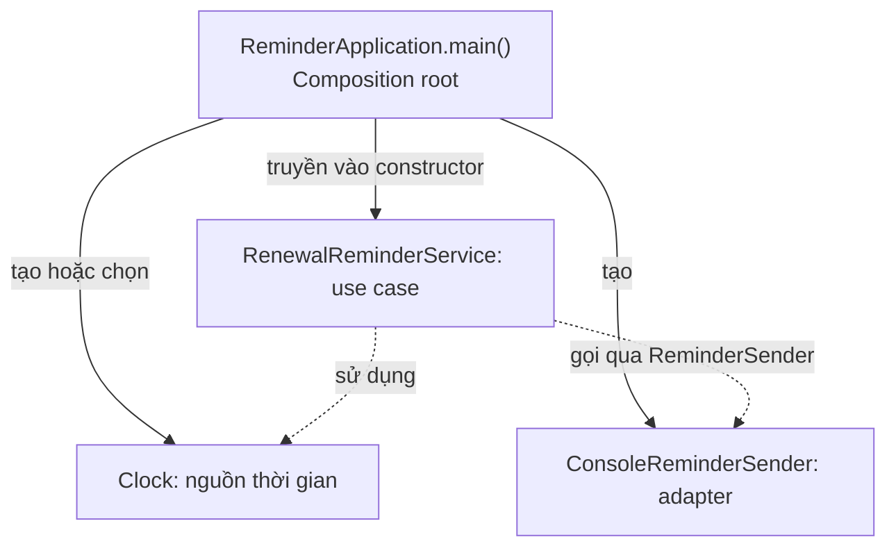

# Tách trách nhiệm nghiệp vụ khỏi trách nhiệm khởi tạo

## 1. Vì sao cần tách hai trách nhiệm này?

Trong thiết kế phần mềm, một lớp có thể **cần sử dụng** cơ sở dữ liệu, dịch vụ gửi email, đồng hồ hệ thống hoặc một API bên ngoài mà **không cần tự quyết định** cách tạo và cấu hình những phụ thuộc đó. Đây là một trong những ranh giới quan trọng của **Dependency Injection (DI)** và **Inversion of Control (IoC)**.

Hãy xét một chức năng nhắc khách hàng gia hạn gói dịch vụ. Quy tắc nghiệp vụ là: *chỉ gửi lời nhắc khi gói còn từ 0 đến 3 ngày trước ngày hết hạn*. Để thực hiện, ứng dụng cần biết ngày hiện tại và cần một phương tiện gửi lời nhắc.

Ba câu hỏi khác nhau xuất hiện:

1. **Khi nào cần nhắc?** Đây là quyết định nghiệp vụ: tính số ngày còn lại và áp dụng quy tắc 0–3 ngày.
2. **Gửi bằng phương tiện nào và lấy thời gian từ đâu?** Đây là quyết định về hiện thực: email, SMS, console; đồng hồ thật hay đồng hồ cố định cho kiểm thử.
3. **Ai tạo các đối tượng đó và kết nối chúng?** Đây là quyết định lắp ghép: nơi khởi động ứng dụng chọn hiện thực, cấp cấu hình và truyền phụ thuộc cho service.

Nếu cả ba quyết định nằm trong một lớp, mỗi lần đổi kênh gửi, cấu hình môi trường hoặc quy tắc nhắc hạn đều có thể dẫn đến sửa cùng một nơi. Kết quả là mã nghiệp vụ bị ràng buộc vào chi tiết vận hành và khó kiểm thử độc lập.

**Tách trách nhiệm nghiệp vụ khỏi trách nhiệm khởi tạo** có nghĩa là lớp nghiệp vụ diễn đạt *nó cần làm gì và cần năng lực gì*, còn mã lắp ghép quyết định *đối tượng nào cung cấp năng lực ấy và được tạo ra như thế nào*.

## 2. Xác định đúng ranh giới trách nhiệm

| Trách nhiệm | Câu hỏi cần trả lời | Nơi thường đặt | Ví dụ trong chức năng nhắc hạn |
| --- | --- | --- | --- |
| **Quy tắc nghiệp vụ (policy)** | Khi nào được thực hiện? Dữ liệu nào hợp lệ? | Domain service hoặc application service phù hợp | Chỉ nhắc khi còn 0–3 ngày |
| **Điều phối use case** | Các bước nghiệp vụ diễn ra theo thứ tự nào? | Application service | Kiểm tra điều kiện, rồi gọi phương tiện gửi |
| **Cơ chế/hạ tầng (mechanism)** | Gửi qua kênh gì, kết nối với hệ thống nào? | Adapter, repository hoặc gateway | Gửi qua email, SMS, console |
| **Tạo và lắp ghép (construction/wiring)** | Dùng hiện thực nào? Cấu hình gì? Tạo bao nhiêu đối tượng? | Composition root, mã cấu hình ứng dụng | Tạo `ConsoleReminderSender`, chọn `Clock` theo múi giờ |
| **Quản lý vòng đời (lifecycle)** | Ai sở hữu, chia sẻ và giải phóng tài nguyên? | Thành phần tạo hoặc quản lý tài nguyên | Tái sử dụng email client, đóng khi ứng dụng dừng |

Ranh giới không bắt buộc tương ứng với năm lớp Java khác nhau. Một use case nhỏ có thể chỉ cần một service, một interface, một adapter và một `main`. Điểm quan trọng là **quyết định thay thế hạ tầng không bị chôn trong thuật toán nghiệp vụ**.

### Những thay đổi có lý do khác nhau

- Nếu quy định kinh doanh đổi từ nhắc trước **3 ngày** thành **5 ngày**, phần thực thi chính sách nhắc hạn cần thay đổi.
- Nếu chuyển từ in console sang gửi email, phần hiện thực `ReminderSender` và cấu hình lắp ghép cần thay đổi.
- Nếu cần kiểm thử tại một ngày cố định, bài kiểm thử cung cấp `Clock` cố định mà không sửa logic nhắc hạn.
- Nếu triển khai ứng dụng sang môi trường khác, địa chỉ server, token hoặc chứng chỉ nên được cung cấp qua cấu hình tại ranh giới khởi động, không viết trực tiếp trong service nghiệp vụ.

Đây cũng là cách suy nghĩ thực tế về **Separation of Concerns (tách mối quan tâm)**: những quyết định có động cơ thay đổi khác nhau được đặt tại các ranh giới phù hợp.

## 3. Trước khi tách: service tự tạo phụ thuộc

Ví dụ sau chỉ là **trích đoạn minh họa vấn đề**; `SmtpReminderSender` được giả định là adapter gửi email đã có trong hệ thống:

```java
final class RenewalReminderService {
    private final SmtpReminderSender sender =
            new SmtpReminderSender(System.getenv("SMTP_HOST"));

    boolean remindIfDue(String accountId, LocalDate expiresOn) {
        long daysLeft = ChronoUnit.DAYS.between(LocalDate.now(), expiresOn);
        if (daysLeft < 0 || daysLeft > 3) {
            return false;
        }

        sender.send(accountId, "Gói dịch vụ sắp hết hạn");
        return true;
    }
}
```

Đoạn code này trộn các trách nhiệm:

- `daysLeft` và điều kiện `0..3` là **quy tắc nghiệp vụ**.
- `new SmtpReminderSender(...)` là **khởi tạo hạ tầng và chọn hiện thực**.
- `System.getenv("SMTP_HOST")` là **đọc cấu hình vận hành**.
- `LocalDate.now()` trực tiếp lấy ngày từ **môi trường đang chạy**; trong kiểm thử rất khó chủ động điều khiển thời gian.

Hệ quả không chỉ là khó thay email bằng SMS. Chỉ cần máy chủ thiếu biến môi trường hoặc server SMTP không hoạt động, việc tạo service hay kiểm thử điều kiện nhắc hạn có thể bị ảnh hưởng. Tại thời điểm đọc lớp `RenewalReminderService`, người đọc cũng phải hiểu thêm chi tiết của SMTP, dù những chi tiết đó không giải thích quy tắc nhắc hạn.

Một cách sửa vội là tạo hàm `createSender()` bên trong service rồi gọi hàm đó. Tuy nhiên, service vẫn sở hữu quyết định chọn và tạo adapter; ta mới chỉ chuyển vị trí mã. Muốn tách trách nhiệm thật sự, **điểm tạo phụ thuộc phải nằm ngoài đối tượng sử dụng nó**.

## 4. Sau khi tách: constructor injection và composition root

Ta đưa hai phụ thuộc qua constructor:

- `ReminderSender`: hợp đồng mô tả hành động gửi lời nhắc. Service không biết email, SMS hay console.
- `Clock`: nguồn thời gian có thể thay đổi. Java đã cung cấp abstraction này trong `java.time`, nên không cần tự tạo interface đồng hồ chỉ để kiểm thử.

Trong ví dụ này, `RenewalReminderService` giữ lại trách nhiệm diễn đạt quy tắc và điều phối use case. Điểm khởi động quyết định hiện thực và cách lắp ghép.

### Ví dụ hoàn chỉnh với Java thuần

Lưu mã sau vào `ReminderApplication.java` (JDK 11 trở lên):

```java
import java.time.Clock;
import java.time.LocalDate;
import java.time.ZoneId;
import java.time.temporal.ChronoUnit;
import java.util.Objects;

// Năng lực mà nghiệp vụ cần, không chứa chi tiết về SMTP/SMS.
interface ReminderSender {
    void send(String accountId, String message);
}

// Một cách thực hiện cụ thể: in ra console.
final class ConsoleReminderSender implements ReminderSender {
    @Override
    public void send(String accountId, String message) {
        System.out.println("[" + accountId + "] " + message);
    }
}

// Chính sách nhắc hạn và điều phối lời gọi gửi.
final class RenewalReminderService {
    private final Clock clock;
    private final ReminderSender sender;

    RenewalReminderService(Clock clock, ReminderSender sender) {
        this.clock = Objects.requireNonNull(clock, "clock");
        this.sender = Objects.requireNonNull(sender, "sender");
    }

    boolean remindIfDue(String accountId, LocalDate expiresOn) {
        if (accountId == null || accountId.isBlank()) {
            throw new IllegalArgumentException("accountId không hợp lệ");
        }
        Objects.requireNonNull(expiresOn, "expiresOn");

        LocalDate today = LocalDate.now(clock);
        long daysLeft = ChronoUnit.DAYS.between(today, expiresOn);

        if (daysLeft < 0 || daysLeft > 3) {
            return false;
        }

        sender.send(accountId, "Gói của bạn hết hạn ngày " + expiresOn);
        return true;
    }
}

public final class ReminderApplication {
    public static void main(String[] args) {
        // Composition root: quyết định cấu hình, tạo và ghép đối tượng.
        Clock clock = Clock.system(ZoneId.of("Asia/Ho_Chi_Minh"));
        ReminderSender sender = new ConsoleReminderSender();
        RenewalReminderService service = new RenewalReminderService(clock, sender);

        service.remindIfDue("khach-001", LocalDate.now(clock).plusDays(2));
    }
}
```

Chạy bằng JDK, không cần framework hoặc DI container:

```bash
javac ReminderApplication.java
java ReminderApplication
```

Chương trình sẽ in một lời nhắc cho `khach-001`, với ngày hết hạn bằng ngày chạy chương trình cộng thêm hai ngày. **Chỉ có `main` dùng `new ConsoleReminderSender()`**; service chỉ nhận một đối tượng tuân theo hợp đồng `ReminderSender`.

### Lắp ghép một đồ thị đối tượng nhỏ



Điểm ghép nối này gọi là **composition root**: nơi gần điểm khởi động ứng dụng, chịu trách nhiệm xây dựng các đối tượng cần thiết và truyền chúng đến nơi sử dụng. Khi ứng dụng dùng Spring hoặc một DI container khác, container có thể tự động hóa bước lắp ghép; nguyên tắc phân chia trách nhiệm vẫn giữ nguyên.

Nếu muốn gửi email thật, ta viết một adapter khác tuân theo `ReminderSender` và thay cấu hình trong composition root:

```java
// Minh họa thay adapter: EmailReminderSender và mailClient
// là các thành phần hạ tầng do ứng dụng triển khai.
ReminderSender sender = new EmailReminderSender(mailClient);
RenewalReminderService service = new RenewalReminderService(clock, sender);
```

Không cần sửa thuật toán `daysLeft` hay câu điều kiện trong `RenewalReminderService`. Mã trên là trích đoạn thay thế, không phải phần của ví dụ hoàn chỉnh ở trên.

## 5. Kiểm thử nghiệp vụ mà không cần khởi tạo hạ tầng thật

Để kiểm thử quy tắc **0–3 ngày**, ta không cần gửi email, cấu hình SMTP hay chờ đồng hồ máy tính đến đúng ngày. Ta cung cấp:

1. Một `Clock.fixed(...)` để ngày hôm nay được xác định trước.
2. Một `RecordingSender` ghi lại số lần gửi thay cho adapter thật.

Tạo file `RenewalReminderServiceTest.java` cùng thư mục với `ReminderApplication.java`:

```java
import java.time.Clock;
import java.time.Instant;
import java.time.LocalDate;
import java.time.ZoneId;

public final class RenewalReminderServiceTest {
    static final class RecordingSender implements ReminderSender {
        int count;
        String lastAccountId;
        String lastMessage;

        @Override
        public void send(String accountId, String message) {
            count++;
            lastAccountId = accountId;
            lastMessage = message;
        }
    }

    static void assertTrue(boolean condition, String message) {
        if (!condition) {
            throw new AssertionError(message);
        }
    }

    public static void main(String[] args) {
        ZoneId zone = ZoneId.of("Asia/Ho_Chi_Minh");
        Clock fixedClock = Clock.fixed(
                Instant.parse("2026-11-18T00:00:00Z"), zone);
        // 07:00 ngày 18/11/2026 tại Việt Nam.
        LocalDate today = LocalDate.now(fixedClock);

        RecordingSender sender = new RecordingSender();
        RenewalReminderService service =
                new RenewalReminderService(fixedClock, sender);

        boolean sent = service.remindIfDue("khach-001", today.plusDays(2));
        assertTrue(sent, "Còn 2 ngày phải gửi lời nhắc");
        assertTrue(sender.count == 1, "Phải gửi đúng một lần");
        assertTrue("khach-001".equals(sender.lastAccountId), "Sai tài khoản");
        assertTrue(sender.lastMessage.contains("2026"), "Thiếu ngày hết hạn");

        boolean tooEarly = service.remindIfDue("khach-002", today.plusDays(7));
        assertTrue(!tooEarly, "Còn 7 ngày chưa được nhắc");
        assertTrue(sender.count == 1, "Không được phát sinh thêm lần gửi");

        boolean expired = service.remindIfDue("khach-003", today.minusDays(1));
        assertTrue(!expired, "Gói đã hết hạn không thuộc quy tắc này");
        assertTrue(sender.count == 1, "Không gửi nhắc hạn cho gói đã hết hạn");

        boolean lastDay = service.remindIfDue("khach-004", today);
        assertTrue(lastDay, "Ngày hết hạn vẫn phải nhắc");
        assertTrue(sender.count == 2, "Phải có hai lần gửi hợp lệ");

        System.out.println("Tất cả kiểm thử đều đạt.");
    }
}
```

Chạy:

```bash
javac ReminderApplication.java RenewalReminderServiceTest.java
java RenewalReminderServiceTest
```

Kết quả mong đợi: `Tất cả kiểm thử đều đạt.` Bài kiểm thử kiểm chứng quy tắc tại **các ranh giới quan trọng**: còn hai ngày, còn bảy ngày, đã hết hạn và đúng ngày hết hạn. Nó cũng xác nhận số lần gửi để phát hiện tác dụng phụ không mong muốn.

Điều này minh họa lợi ích thiết kế: để kiểm chứng *khi nào phải gửi*, ta không cần khởi tạo *cách gửi thật*. Nếu sau này adapter email hỏng hoặc thay nhà cung cấp, bài kiểm thử nghiệp vụ vẫn độc lập. Tuy nhiên, adapter email vẫn cần những bài kiểm thử riêng để xác minh cấu hình và giao tiếp thực tế.

## 6. Liên hệ với SRP, DIP, DI và IoC

Các nguyên lý liên quan củng cố cho nhau nhưng không đồng nghĩa:

| Khái niệm | Trọng tâm | Quan hệ với việc tách khởi tạo |
| --- | --- | --- |
| **Single Responsibility Principle (SRP)** | Một module nên tập trung vào trách nhiệm đối với một nhóm tác nhân hoặc một lý do thay đổi có tính thống nhất | Quy tắc nhắc hạn và việc chọn/cấu hình SMTP thay đổi vì những yêu cầu khác nhau, nên có cơ sở để tách |
| **Separation of Concerns** | Tách các mối quan tâm để người đọc và người sửa có thể tập trung vào vấn đề liên quan | Phân biệt chính sách, điều phối, cơ chế gửi và điểm lắp ghép |
| **Dependency Inversion Principle (DIP)** | Mã nghiệp vụ cấp cao và chi tiết cấp thấp cùng phụ thuộc vào abstraction thích hợp | Service nhận `ReminderSender`; adapter cụ thể triển khai hợp đồng này |
| **Dependency Injection (DI)** | Phụ thuộc được cấp từ bên ngoài cho đối tượng sử dụng | `Clock` và `ReminderSender` được truyền qua constructor |
| **Inversion of Control (IoC)** | Dịch chuyển quyền điều khiển hoặc quyền quyết định khỏi một thành phần | Service không tự chọn adapter hoặc cách lấy đồng hồ; nơi lắp ghép quyết định |

**DI không tự động bảo đảm SRP hay DIP.** Một service có thể nhận 12 dependency qua constructor nhưng vẫn gánh quá nhiều use case. Một service được inject trực tiếp `SmtpReminderSender` vẫn có DI, song bị ràng buộc vào chi tiết SMTP. Chất lượng thiết kế nằm ở *ranh giới trách nhiệm và sự phụ thuộc*, không chỉ ở việc thay `new` bằng tham số constructor.

**Không cần interface cho mọi dependency.** `Clock` là abstraction sẵn có trong JDK; những lớp giá trị bất biến như `LocalDate` không cần interface riêng. Tạo interface hữu ích khi nó diễn đạt một hợp đồng nghiệp vụ hoặc một điểm thay thế thực sự, chứ không phải chỉ để đạt một mẫu cấu trúc.

## 7. `new` vẫn có chỗ đứng: phân biệt tạo giá trị và tạo dịch vụ

Một cách hiểu sai phổ biến là “đã dùng DI thì tuyệt đối không được dùng `new`”. Điều nên tránh là **để logic nghiệp vụ quyết định các dịch vụ hạ tầng mà nó phụ thuộc**. Việc tạo đối tượng giá trị (value object), collection cục bộ hoặc đối tượng nội bộ không làm thay đổi ranh giới kiến trúc vẫn bình thường.

Ví dụ:

```java
// Thường hợp lý trong code nghiệp vụ: tạo một giá trị mới.
LocalDate renewalDate = expiresOn.plusMonths(1);

// Cũng hợp lý: đối tượng cục bộ phục vụ tính toán.
List<String> warnings = new ArrayList<>();
```

Ngược lại, nếu một service tự gọi `new SmtpClient(host, token)` hoặc `new JdbcRepository(url)` thì service phải biết thêm nơi đọc cấu hình, cách xử lý lỗi kết nối và vòng đời tài nguyên. Những quyết định này thường nên đặt ngoài service.

Một số trường hợp cần tạo **đối tượng mới theo từng lần xử lý**. Khi đó không nhất thiết phải tiêm sẵn một instance cố định. Có thể tiêm một factory hoặc một khả năng tạo đối tượng với hợp đồng rõ ràng:

```java
interface ReportWriterFactory {
    ReportWriter create(ReportFormat format);
}

// Service phụ thuộc vào khả năng tạo writer;
// composition root cung cấp hiện thực của factory.
```

Đây là trích đoạn định hướng thiết kế; `ReportWriter` và `ReportFormat` được giả định là các kiểu của ứng dụng. Cần factory khi *quyết định tạo đối tượng thật sự thay đổi theo yêu cầu*, chẳng hạn định dạng xuất file hoặc phạm vi của một phiên xử lý. Nếu chỉ có một dependency bắt buộc ổn định, constructor injection trực tiếp thường đơn giản hơn.

**Factory khác Service Locator:** factory thể hiện rõ năng lực tạo ra một loại đối tượng được cần đến; Service Locator kiểu `container.get(...)` rải trong các service khiến phụ thuộc bị ẩn và kéo cơ chế lắp ghép vào mã nghiệp vụ.

## 8. Quản lý scope và vòng đời khi tách khởi tạo

Tách khởi tạo cũng buộc ta trả lời **ai sở hữu đối tượng**, **dùng chung trong bao lâu** và **khi nào giải phóng**. Đây là các quyết định thiết kế tồn tại cả khi không dùng container.

| Kiểu dùng | Cách tạo thủ công | Điểm cần kiểm tra |
| --- | --- | --- |
| **Dùng chung trong toàn ứng dụng** | Composition root tạo một instance và truyền cho nhiều service | Có giữ trạng thái mutable hay không? Có an toàn khi nhiều luồng truy cập không? |
| **Mỗi request hoặc tác vụ** | Tạo trong phạm vi request/tác vụ, truyền cho các thành phần liên quan, kết thúc khi xử lý xong | Đối tượng sống lâu có vô tình giữ tham chiếu đến tài nguyên đã hết hạn không? |
| **Mỗi lần sử dụng** | Factory tạo instance mới khi cần | Chi phí khởi tạo có lớn không? Ai đóng tài nguyên sau sử dụng? |

`Clock` và `ConsoleReminderSender` trong ví dụ đơn giản có thể được dùng chung. Một client SMTP thật có thể có kết nối, pool và cơ chế dọn dẹp riêng; thành phần sở hữu vòng đời phải đảm bảo đóng tài nguyên theo hợp đồng của client đó. Không nên để `RenewalReminderService` đóng một sender mà nhiều service đang chia sẻ.

Một rủi ro khác là vô tình để trạng thái *theo request* trong một service dùng chung. Chẳng hạn, nếu `RenewalReminderService` có field `currentAccountId` được gán mỗi lần xử lý, hai request đồng thời có thể ghi đè lẫn nhau. Thiết kế stateless như ví dụ, với `accountId` là tham số phương thức, thường tránh được kiểu lỗi này.

DI container có thể hỗ trợ tạo đối tượng theo scope và thực hiện hook vòng đời, nhưng **không thay thế được quyết định về việc ai được dùng chung, ai sở hữu tài nguyên và đối tượng nào có trạng thái**.

## 9. Các dấu hiệu trách nhiệm chưa được tách hợp lý

| Dấu hiệu trong code | Vì sao đáng xem lại | Cách xử lý thường dùng |
| --- | --- | --- |
| Service đọc `System.getenv`, YAML hoặc khóa API để tự cấu hình adapter | Mã nghiệp vụ bị ảnh hưởng bởi môi trường triển khai | Đọc cấu hình ở điểm khởi động rồi truyền đối tượng hoặc giá trị cấu hình cần thiết |
| Service gọi `new HttpClient`, `new Repository` hoặc tự mở kết nối mỗi lần xử lý | Quy tắc nghiệp vụ gắn với cơ chế, chi phí và vòng đời hạ tầng | Cung cấp gateway/repository/client qua constructor; quản lý tài nguyên ở bên sở hữu |
| Bài kiểm thử use case bắt buộc có SMTP, database hay gọi API thật | Khó cô lập quy tắc và điều khiển tình huống lỗi | Tiêm test double và dùng kiểm thử tích hợp riêng cho adapter |
| Service gọi `LocalDate.now()`/`Instant.now()` tại nhiều nơi trong quy tắc phụ thuộc thời gian | Kiểm thử biên thời gian khó ổn định và có thể lệch trong cùng xử lý | Tiêm `Clock` và lấy thời điểm một cách nhất quán |
| Constructor có quá nhiều dependency không liên quan | Có thể một lớp đang gánh nhiều trách nhiệm | Kiểm tra các use case và tách module theo nhu cầu thay đổi thực tế |
| Service nhận trực tiếp container rồi tự `getBean`/`resolve` | Đồ thị phụ thuộc khó nhìn từ API của lớp | Giữ container tại composition root và tiêm dependency rõ ràng |
| Các dependency tạo ra vòng tròn `A -> B -> A` | Trách nhiệm bị đan xen, khó lắp ghép và quản lý vòng đời | Xem lại chiều phụ thuộc, tách phần chung hoặc thiết kế lại luồng phối hợp |

Tách khởi tạo **không có nghĩa** service nghiệp vụ không được điều phối lời gọi nào. `RenewalReminderService` vẫn quyết định **khi nào** gọi `sender.send(...)`; đó là hành vi của use case. Điều được chuyển ra ngoài là quyết định **lấy `sender` nào, tạo nó bằng cách nào và sống trong bao lâu**.

Đồng thời, tách trách nhiệm không tự giải quyết các vấn đề như tính nhất quán giao dịch, gửi trùng thông báo hay xử lý retry. Một hệ thống nhắc hạn thực tế vẫn cần thiết kế cơ chế chống gửi trùng, ghi nhận trạng thái gửi hoặc retry phù hợp; các thành phần đó có thể được đưa qua những abstraction riêng khi nhu cầu xuất hiện.

## 10. Quy trình refactor một lớp đang tự tạo phụ thuộc

Có thể thực hành theo trình tự sau:

1. **Khoanh vùng quy tắc nghiệp vụ.** Xác định điều kiện, bất biến và dữ liệu đầu vào mà kết quả nghiệp vụ phụ thuộc.
2. **Liệt kê các dịch vụ mà lớp tự khởi tạo.** Đánh dấu `new` cho client mạng, repository, sender, scheduler hoặc các đoạn đọc cấu hình; phân biệt chúng với việc tạo value object bình thường.
3. **Xác định hợp đồng tối thiểu.** Chỉ đưa vào các hành động service thật sự cần, ví dụ `ReminderSender.send(...)`, thay vì truyền nguyên hệ thống mail và mọi API của nó.
4. **Đưa phụ thuộc bắt buộc vào constructor.** Giữ field `final` khi có thể và kiểm tra `null` tại điểm nhận để đối tượng luôn hợp lệ.
5. **Chuyển việc tạo và ghép nối tới composition root.** Tạo adapter, cấp cấu hình, chọn `Clock`, sau đó truyền vào service.
6. **Viết kiểm thử với dependency có thể kiểm soát.** Test double ghi lời gọi; `Clock.fixed` tạo thời điểm xác định; kiểm chứng cả trường hợp có và không có tác dụng phụ.
7. **Xem lại scope và ownership.** Quyết định đối tượng nào được chia sẻ, đối tượng nào được tạo mỗi tác vụ và ai chịu trách nhiệm đóng tài nguyên.

Sau khi refactor, hãy thử hai thay đổi giả định: **thay console bằng email** và **đổi quy tắc nhắc từ 3 thành 5 ngày**. Nếu thay adapter chủ yếu ảnh hưởng tới lớp hiện thực và chỗ lắp ghép, còn thay quy tắc chủ yếu ảnh hưởng tới logic use case, ranh giới đã rõ ràng hơn.

## 11. Bài tập tự luyện

**Bài tập 1 — Phân loại trách nhiệm.** Cho đoạn code `OrderService` vừa tính giảm giá, vừa gọi `System.getenv("DB_URL")`, vừa tạo `JdbcOrderRepository`, vừa kiểm tra dữ liệu đơn hàng. Hãy phân loại từng thao tác thành quy tắc nghiệp vụ, điều phối hoặc khởi tạo hạ tầng. Chỉ ra việc nào có thể thay đổi khi chương trình chuyển từ môi trường phát triển sang production.

**Bài tập 2 — Thay hiện thực.** Viết `RecordingSender` và `EmailReminderSender` (có thể mô phỏng việc gửi thay vì kết nối mạng). Thay một trong hai tại `ReminderApplication.main()`. Giữ nguyên lớp `RenewalReminderService` và giải thích vì sao không cần chỉnh nó.

**Bài tập 3 — Biên thời gian.** Dùng `Clock.fixed(...)` để kiểm thử chính xác các trường hợp còn 4 ngày, còn 3 ngày, còn 0 ngày và quá hạn 1 ngày. Nếu nghiệp vụ muốn chỉ nhắc vào *3 ngày trước khi hết hạn*, bạn sẽ sửa vị trí nào? Vì sao?

**Bài tập 4 — Vòng đời.** Giả sử một `SmtpClient` được chia sẻ giữa nhiều service và có phương thức `close()`. Hãy xác định nơi khởi tạo, nơi truyền tham chiếu, ai được phép đóng client và thời điểm đóng. Điều gì xảy ra nếu mỗi service tự ý đóng client ngay sau lời gọi của mình?

Khi tự đánh giá thiết kế, hãy đặt ba câu hỏi: **Lớp nghiệp vụ quyết định điều gì? Nó cần những năng lực nào từ bên ngoài? Ai chọn, tạo và sở hữu các đối tượng cung cấp năng lực ấy?** Trả lời rõ ba câu hỏi bằng Java thuần là nền tảng để tiến tới DI container mà vẫn giữ được ranh giới thiết kế.
