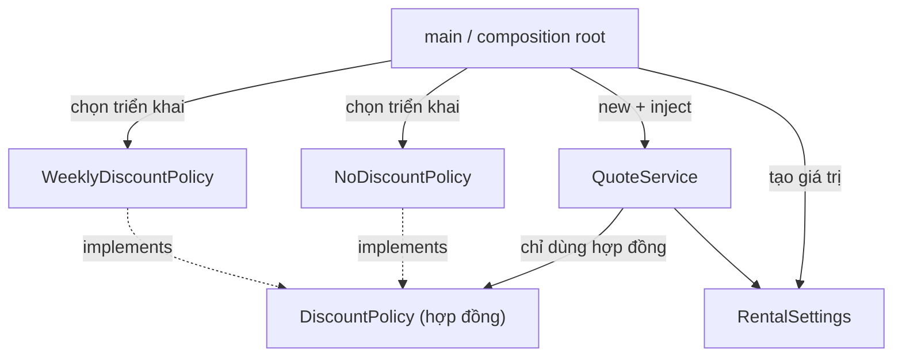

# Đa hình và khả năng thay thế thành phần qua hợp đồng

Trong chương **Nguyên lý liên quan** của module **Dependency Injection (DI)**, đa hình (*polymorphism*) giải thích vì sao một đối tượng có thể gọi cùng một hành vi thông qua một kiểu chung, dù bên dưới có nhiều cách triển khai. Nhưng **cùng triển khai một interface chưa đủ để hai thành phần thay thế được cho nhau**: cả hai còn phải tuân thủ **hợp đồng hành vi** mà bên sử dụng đang dựa vào.

Đây là nền tảng để dùng **constructor injection** có ý nghĩa, tổ chức **composition root** rõ ràng, kiểm thử bằng **Java thuần** và về sau chọn DI container phù hợp. Bài học tập trung vào mối liên hệ giữa đa hình, hợp đồng, nguyên lý thay thế Liskov (LSP), Dependency Inversion (DIP), Inversion of Control (IoC) và vòng đời của đối tượng.

Sau bài này, bạn có thể:

- Giải thích được đa hình theo interface và cách lời gọi được phân phối đến triển khai thực tế.
- Phân biệt **hợp đồng kiểu** (có phương thức đúng chữ ký) với **hợp đồng hành vi** (thực hiện đúng lời hứa về đầu vào, đầu ra, lỗi và tác dụng phụ).
- Nhận biết một triển khai vi phạm khả năng thay thế theo LSP, dù mã vẫn biên dịch.
- Lắp ghép nhiều triển khai bằng DI tại composition root và kiểm tra chung hợp đồng của chúng.
- Hiểu khi nào nên tạo trừu tượng, khi nào chỉ cần một class cụ thể.

## 1. Đa hình: một điểm gọi, nhiều cách thực hiện

Giả sử hệ thống đặt thuê xe cần tính giảm giá theo những chính sách khác nhau. Phần điều phối chỉ cần biết hành vi **tính số tiền được giảm**, không cần biết chính sách cụ thể:

```java
interface DiscountPolicy {
    long discount(long grossPrice, int rentalDays);
}
```

Hai lớp có thể hiện thực cùng hợp đồng:

```java
class NoDiscountPolicy implements DiscountPolicy {
    @Override
    public long discount(long grossPrice, int rentalDays) {
        return 0L;
    }
}

class WeeklyDiscountPolicy implements DiscountPolicy {
    @Override
    public long discount(long grossPrice, int rentalDays) {
        return rentalDays >= 7 ? grossPrice / 10 : 0L;
    }
}
```

Khi một biến có kiểu `DiscountPolicy` tham chiếu đến một đối tượng `WeeklyDiscountPolicy`, câu lệnh `policy.discount(...)` sẽ gọi phiên bản ở `WeeklyDiscountPolicy`. Nếu biến tham chiếu đến `NoDiscountPolicy`, cùng câu lệnh đó sẽ gọi phiên bản còn lại. Đây là **đa hình theo subtype** với cơ chế **dynamic dispatch** của Java.

| Câu hỏi | Câu trả lời |
| --- | --- |
| Mã sử dụng biết điều gì? | Interface `DiscountPolicy` và hợp đồng của `discount(...)` |
| Ai quyết định phương thức nào chạy? | Kiểu thực tế của đối tượng được gán vào tham chiếu tại thời điểm chạy |
| Ai chọn đối tượng nào được cung cấp? | Mã lắp ghép, thường là composition root |
| Hai triển khai có bắt buộc trả về cùng số tiền? | Không; kết quả có thể khác nhau theo chính sách, miễn giữ những bảo đảm chung của hợp đồng |

**Lưu ý:** Ví dụ trên mới cho thấy cú pháp đa hình. Nó chưa kiểm tra đầu vào nên chưa đầy đủ như một hợp đồng đáng tin cậy. Phần tiếp theo sẽ bổ sung những bảo đảm bắt buộc để các triển khai thực sự có thể thay thế nhau.

## 2. Khả năng thay thế không chỉ là có chung interface

**Nguyên lý thay thế Liskov (Liskov Substitution Principle — LSP)** có thể diễn đạt thực dụng như sau:

> Nếu chương trình sử dụng một trừu tượng `T` và một đối tượng cụ thể `S` được công bố là hiện thực `T`, việc dùng `S` ở vị trí `T` không được làm sai những thuộc tính đúng đắn mà bên sử dụng có quyền kỳ vọng từ hợp đồng của `T`.

Điều này đòi hỏi hơn việc Java chấp nhận phép gán `DiscountPolicy policy = new WeeklyDiscountPolicy()`. Tại một điểm gọi, bên sử dụng cần biết các điều kiện sau:

| Thành phần hợp đồng | Câu hỏi cần trả lời | Hệ quả khi bị vi phạm |
| --- | --- | --- |
| **Tiền điều kiện (precondition)** | Những đầu vào nào là hợp lệ? | Triển khai mới đòi thêm điều kiện mà client không thể biết |
| **Hậu điều kiện (postcondition)** | Khi thành công, kết quả đảm bảo điều gì? | Client nhận dữ liệu ngoài miền hợp lệ hoặc thiếu bảo đảm cần thiết |
| **Bất biến (invariant)** | Điều gì phải luôn đúng đối với trạng thái liên quan? | Đối tượng rơi vào trạng thái mà thao tác tiếp theo không còn an toàn |
| **Lỗi và tác dụng phụ** | Điều gì xảy ra khi thất bại; dữ liệu hoặc tài nguyên nào bị thay đổi? | Client xử lý lỗi sai, bị lỗi ngầm hoặc chịu tác dụng phụ ngoài dự kiến |

Diễn đạt thông dụng của LSP là: **không tăng độ chặt của tiền điều kiện, không làm yếu hậu điều kiện**, và giữ những bất biến cùng bảo đảm hành vi mà hợp đồng đã cam kết. LSP không bắt các lớp có chung thuật toán hay luôn tạo cùng kết quả. Hợp đồng phải được mô tả ở độ trừu tượng phù hợp để cho phép các biến thể hợp lệ.

### 2.1. Một hợp đồng cụ thể cho chính sách giảm giá

Ta quy ước `DiscountPolicy.discount(grossPrice, rentalDays)` như sau:

1. **Đầu vào hợp lệ:** `grossPrice >= 0` và `rentalDays >= 1`.
2. **Đầu ra khi thành công:** một số tiền giảm trong khoảng `0 <= discount <= grossPrice`, đơn vị đồng.
3. **Đầu vào không hợp lệ:** ném `IllegalArgumentException`, không tự ý tạo kết quả giả.
4. **Tác dụng phụ:** không ghi cơ sở dữ liệu, không gửi thông báo và không thay đổi trạng thái dùng chung; với cùng tham số, cho cùng kết quả trong ví dụ này.

Hai chính sách **không giảm giá** và **giảm 10% từ 7 ngày** đều phù hợp với hợp đồng: kết quả có thể khác nhau, nhưng không âm, không vượt tổng tiền và chấp nhận cùng miền đầu vào hợp lệ.

Hợp đồng thực tế cũng cần mô tả đơn vị tiền, quy tắc làm tròn, ý nghĩa thời điểm tính giá và cách xử lý tràn số. Nếu bỏ qua những chi tiết có ảnh hưởng đến quyết định nghiệp vụ, interface có thể đúng về mặt kiểu nhưng thiếu bảo đảm để thay thế an toàn.

## 3. Java thuần: thay triển khai bằng constructor injection

Ví dụ dưới đây dùng một file `PolymorphismContractsDemo.java`, tương thích **Java 11 trở lên**. Không cần Spring, CDI hay DI container. Thử biên dịch và chạy:

```bash
javac PolymorphismContractsDemo.java
java PolymorphismContractsDemo
```

```java
import java.util.Objects;

public final class PolymorphismContractsDemo {
    /**
     * Contract:
     * - grossPrice >= 0, rentalDays >= 1.
     * - Return discount in [0, grossPrice].
     * - Invalid input throws IllegalArgumentException.
     * - No external side effects.
     */
    interface DiscountPolicy {
        long discount(long grossPrice, int rentalDays);
    }

    // Các triển khai dùng cùng một bước kiểm tra đầu vào.
    private static void validateInput(long grossPrice, int rentalDays) {
        if (grossPrice < 0 || rentalDays < 1) {
            throw new IllegalArgumentException("Invalid discount input");
        }
    }

    static final class NoDiscountPolicy implements DiscountPolicy {
        @Override
        public long discount(long grossPrice, int rentalDays) {
            validateInput(grossPrice, rentalDays);
            return 0L;
        }
    }

    static final class WeeklyDiscountPolicy implements DiscountPolicy {
        @Override
        public long discount(long grossPrice, int rentalDays) {
            validateInput(grossPrice, rentalDays);
            return rentalDays >= 7 ? grossPrice / 10 : 0L;
        }
    }

    // Cấu hình được xác thực một lần khi tạo.
    static final class RentalSettings {
        final long dailyPrice;

        RentalSettings(long dailyPrice) {
            if (dailyPrice <= 0) {
                throw new IllegalArgumentException("dailyPrice must be positive");
            }
            this.dailyPrice = dailyPrice;
        }
    }

    // Service phụ thuộc vào hợp đồng, không tạo chính sách.
    static final class QuoteService {
        private final DiscountPolicy discountPolicy;
        private final RentalSettings settings;

        QuoteService(DiscountPolicy discountPolicy, RentalSettings settings) {
            this.discountPolicy = Objects.requireNonNull(discountPolicy);
            this.settings = Objects.requireNonNull(settings);
        }

        long totalPrice(int rentalDays) {
            if (rentalDays < 1) {
                throw new IllegalArgumentException("rentalDays must be positive");
            }
            long gross = Math.multiplyExact(settings.dailyPrice, rentalDays);
            long discount = discountPolicy.discount(gross, rentalDays);

            // Phòng vệ tại ranh giới khi nhận plugin/adapter không tin cậy.
            if (discount < 0 || discount > gross) {
                throw new IllegalStateException("Discount policy broke its contract");
            }
            return gross - discount;
        }
    }

    // Cùng một bộ kiểm tra hợp đồng cho mọi triển khai.
    static void checkContract(DiscountPolicy policy) {
        for (int days : new int[] {1, 6, 7, 30}) {
            long gross = 350_000L * days;
            long saving = policy.discount(gross, days);
            if (saving < 0 || saving > gross) {
                throw new AssertionError("Invalid discount: " + saving);
            }
            if (policy.discount(gross, days) != saving) {
                throw new AssertionError("Result must be stable");
            }
        }
        expectInvalid(() -> policy.discount(-1L, 7));
        expectInvalid(() -> policy.discount(1_000L, 0));
    }

    private static void expectInvalid(Runnable operation) {
        try {
            operation.run();
        } catch (IllegalArgumentException expected) {
            return;
        }
        throw new AssertionError("Expected IllegalArgumentException");
    }

    public static void main(String[] args) {
        // Composition root: quyết định chọn và ghép đối tượng.
        RentalSettings settings = new RentalSettings(350_000L);
        DiscountPolicy noDiscount = new NoDiscountPolicy();
        DiscountPolicy weeklyDiscount = new WeeklyDiscountPolicy();

        checkContract(noDiscount);
        checkContract(weeklyDiscount);

        QuoteService normalQuote = new QuoteService(noDiscount, settings);
        QuoteService weeklyQuote = new QuoteService(weeklyDiscount, settings);

        if (normalQuote.totalPrice(7) != 2_450_000L
                || weeklyQuote.totalPrice(7) != 2_205_000L) {
            throw new AssertionError("Unexpected price");
        }
        System.out.println("7 ngay - khong giam: "
                + normalQuote.totalPrice(7) + " VND");
        System.out.println("7 ngay - giam tuan: "
                + weeklyQuote.totalPrice(7) + " VND");
        System.out.println("Contract checks: PASS");
    }
}
```

Kết quả kỳ vọng:

```text
7 ngay - khong giam: 2450000 VND
7 ngay - giam tuan: 2205000 VND
Contract checks: PASS
```

Phân tích luồng:

1. `QuoteService` khai báo phụ thuộc `DiscountPolicy` qua **constructor**, nên không cần sửa mã khi đổi từ `NoDiscountPolicy` sang `WeeklyDiscountPolicy`.
2. `main` làm **composition root**: quyết định tạo đối tượng nào và truyền vào consumer. Trong chương trình lớn, composition root có thể nằm ở khâu bootstrap thay vì luôn là `main`.
3. `RentalSettings` là giá trị **cấu hình** bất biến; chính sách giảm giá là phụ thuộc **nghiệp vụ**. Hai thứ có vai trò khác nhau dù đều được đưa vào qua constructor.
4. `Math.multiplyExact` ngăn phép nhân `long` tràn âm thầm bằng cách ném `ArithmeticException`. Hệ thống sản xuất còn cần một lựa chọn nhất quán về biểu diễn tiền và quy tắc làm tròn.
5. `checkContract` chạy cùng tiêu chí cho mọi triển khai và `QuoteService` kiểm tra miền kết quả ở một ranh giới nhạy cảm. Các kiểm tra giúp phát hiện lỗi, nhưng **không chứng minh đầy đủ LSP** cho mọi đầu vào hay toàn bộ tác dụng phụ.

Sơ đồ dưới đây phân biệt phụ thuộc của **mã sử dụng** với quyền lựa chọn triển khai tại **composition root**:



## 4. Những kiểu vi phạm khả năng thay thế

### 4.1. Tự ý thu hẹp miền đầu vào

Hợp đồng cho phép `rentalDays >= 1`, nhưng một triển khai lại chỉ chấp nhận từ 7 ngày:

```java
class BrokenWeeklyPolicy implements DiscountPolicy {
    @Override
    public long discount(long grossPrice, int rentalDays) {
        if (rentalDays < 7) {
            throw new UnsupportedOperationException("Only weekly rentals");
        }
        return grossPrice / 10;
    }
}
```

Khi `QuoteService.totalPrice(3)` gọi chính sách này, một trường hợp hợp lệ theo interface trở thành lỗi. **Chữ ký phương thức khớp, nhưng hợp đồng bị phá vỡ.** Cách sửa là trả về `0` cho thuê dưới 7 ngày và chỉ ném lỗi khi đầu vào thực sự không hợp lệ theo hợp đồng chung.

### 4.2. Làm yếu hậu điều kiện

Giả sử một triển khai trả về `grossPrice + 1` để thể hiện "phụ phí". Khoản đó không còn là **giảm giá**; kết quả vượt tổng tiền. Nếu hệ thống cần cả phụ phí, hãy tạo mô hình giá diễn tả rõ các thành phần hoặc hợp đồng mới phù hợp, thay vì ép một hành vi ngược nghĩa vào `DiscountPolicy`.

### 4.3. Thay đổi ngữ nghĩa lỗi hoặc tạo tác dụng phụ bất ngờ

Ví dụ một triển khai âm thầm trả về `0` khi đầu vào âm, trong khi hợp đồng yêu cầu `IllegalArgumentException`. Hoặc một triển khai đọc/ghi database mỗi khi tính giảm giá dù hợp đồng yêu cầu tính toán không có tác dụng phụ bên ngoài. Các thay đổi này có thể làm kiểm thử, xử lý lỗi hoặc tính nhất quán của bên gọi thất bại.

Nếu nghiệp vụ thật sự phải tra cứu chính sách từ xa, hãy **thiết kế lại hợp đồng một cách minh bạch**: ví dụ `RemotePricingService` có timeout, lỗi truy cập và khả năng không sẵn sàng. Khi đó bên sử dụng biết các trường hợp cần xử lý; không giả vờ một dịch vụ I/O là hàm thuần đơn giản.

### 4.4. Trạng thái và vòng đời khác mong đợi

Một implementation giữ bộ đếm, cache có thể thay đổi hoặc trạng thái khách hàng trong field dùng chung có thể cho kết quả khác giữa các lời gọi, hoặc gây đua dữ liệu khi cùng instance được nhiều thread dùng. Nếu hợp đồng giả định tính ổn định và không có trạng thái chia sẻ, việc thay một policy không trạng thái bằng policy như vậy có thể làm mất khả năng thay thế.

Tính tương thích còn phụ thuộc vào phạm vi sử dụng: một adapter chỉ an toàn trong một request không thể tùy tiện trở thành singleton. **DI container có thể quản lý scope, nhưng không tự đảm bảo thread-safety hay bảo toàn hợp đồng.**

## 5. Liên hệ đa hình, LSP, DIP, DI và IoC

Các khái niệm hỗ trợ nhau nhưng giải quyết những câu hỏi khác nhau:

| Khái niệm | Câu hỏi chính | Vai trò trong ví dụ |
| --- | --- | --- |
| **Đa hình** | Làm sao một điểm gọi dùng được nhiều triển khai? | `QuoteService` gọi `DiscountPolicy.discount(...)` |
| **LSP** | Triển khai nào có thể thay thế mà vẫn giữ bảo đảm của client? | Mọi `DiscountPolicy` chấp nhận cùng miền đầu vào, bảo đảm đầu ra hợp lệ |
| **DIP (Dependency Inversion Principle)** | Mã nguồn nên phụ thuộc vào đâu? | `QuoteService` phụ thuộc hợp đồng `DiscountPolicy`, không phụ thuộc class giảm giá cụ thể |
| **DI (Dependency Injection)** | Đối tượng nhận phụ thuộc bằng cách nào? | `DiscountPolicy` được truyền qua constructor của `QuoteService` |
| **IoC (Inversion of Control)** | Ai nắm quyền lựa chọn và tạo phụ thuộc? | Composition root quyết định đưa policy nào vào service |
| **OCP (Open/Closed Principle)** | Có thể mở rộng hành vi mà ít sửa consumer không? | Thêm chính sách hợp lệ mới rồi đổi lắp ghép |
| **ISP (Interface Segregation Principle)** | Hợp đồng có bắt client phụ thuộc vào hành vi nó không dùng? | `DiscountPolicy` chỉ cung cấp hành vi cần để báo giá |

Nhìn theo chiều phụ thuộc của mã nguồn:

```text
QuoteService --> DiscountPolicy <-- NoDiscountPolicy
                              <-- WeeklyDiscountPolicy

main / composition root --> tạo và nối các instance
```

Đảo chiều phụ thuộc không có nghĩa đảo thứ tự chạy. Tại runtime, `QuoteService` vẫn gọi code thực tế của policy. Đổi chiều là đổi **điều mà mã nguồn phải biết**: consumer biết interface, còn triển khai đáp ứng interface đó.

DI không bắt buộc phải có interface: ta vẫn có thể constructor-inject một class cụ thể như `RentalSettings`. Đa hình cũng có thể tồn tại mà không dùng DI, chẳng hạn consumer tự viết `new WeeklyDiscountPolicy()`. Tuy nhiên, khi phối hợp **đa hình + hợp đồng rõ + DI**, việc thay triển khai trở nên có chủ đích, kiểm thử được và ít gây ảnh hưởng lan truyền.

## 6. Hợp đồng cần phản ánh nhu cầu của consumer

Không nên thiết kế một interface chỉ vì hai class có phương thức cùng tên. Hãy bắt đầu từ tác vụ mà consumer thực sự cần:

- `QuoteService` cần **lấy số tiền giảm hợp lệ**, nên chỉ phụ thuộc `DiscountPolicy.discount(...)`.
- Nếu một triển khai còn làm báo cáo và xuất hóa đơn, các chức năng đó nên nằm trong giao diện khác, vì `QuoteService` không sử dụng chúng.
- Một hợp đồng hướng nghiệp vụ cần diễn đạt bằng kiểu và khái niệm nghiệp vụ; tránh lộ chi tiết như `ResultSet`, `HttpResponse` hoặc `Socket` nếu consumer không cần biết.
- Các tình huống lỗi, việc gọi lặp, tính idempotent và thread-safety phải được mô tả nếu chúng ảnh hưởng đến cách consumer sử dụng.

Ví dụ với hạ tầng lưu thông tin đặt thuê:

```java
interface BookingRepository {
    // Lưu thành công hoặc báo lỗi rõ ràng; không âm thầm bỏ qua.
    void save(Booking booking);
}
```

Một triển khai in-memory và một triển khai JDBC có thể cùng hiện thực `BookingRepository`, nhưng **mục đích** mới xác định hợp đồng của `save`: có được lưu trùng không, khi lỗi thì ném gì, có cần transaction không, có bảo đảm nhìn thấy dữ liệu sau khi lưu không? Nếu một adapter chỉ log ra console và không thật sự lưu, nó không thể tự nhận là repository thay thế hợp lệ chỉ vì có phương thức `save`.

Để hợp đồng luôn sát nhu cầu, người thiết kế nên hỏi: *Nếu ngày mai thay implementation, client đang dựa vào những điều gì ngoài chữ ký phương thức?*

## 7. Kiểm thử hợp đồng giữa nhiều triển khai

Trong ví dụ Java, `checkContract` là một **bộ kiểm tra dùng lại**. Cùng một danh sách quy tắc được áp dụng cho `NoDiscountPolicy`, `WeeklyDiscountPolicy` và bất kỳ implementation mới nào.

Khi chuyển sang JUnit, có thể tổ chức một nhóm test chung cho mọi implementation thông qua hàm tạo đối tượng (*factory*), rồi kiểm tra riêng công thức của từng chính sách:

| Tầng kiểm thử | Xác nhận điều gì? | Ví dụ |
| --- | --- | --- |
| **Contract test chung** | Tất cả triển khai tuân thủ tiền điều kiện, hậu điều kiện, lỗi và bảo đảm chung | Kết quả luôn trong `[0, gross]`, dữ liệu âm bị từ chối |
| **Test đặc thù triển khai** | Quy tắc riêng được thực hiện chính xác | `WeeklyDiscountPolicy` giảm 10% với 7 ngày; `NoDiscountPolicy` luôn trả 0 |
| **Test consumer** | Consumer phối hợp đúng với hợp đồng, không cần hạ tầng thật | Tạo `QuoteService` bằng fake policy ghi nhận tham số để xác minh luồng gọi |
| **Integration test** | Adapter hạ tầng thật giữ hợp đồng khi làm việc với hệ thống ngoài | Repository JDBC thực sự ghi và đọc dữ liệu; xử lý lỗi kết nối |

Ví dụ fake phục vụ test consumer có thể ghi lại đầu vào:

```java
class RecordingDiscountPolicy implements DiscountPolicy {
    long lastGross;
    int lastDays;

    @Override
    public long discount(long grossPrice, int rentalDays) {
        if (grossPrice < 0 || rentalDays < 1) {
            throw new IllegalArgumentException("Invalid discount input");
        }
        lastGross = grossPrice;
        lastDays = rentalDays;
        return 0L;
    }
}
```

Trong một test Java thuần, truyền fake vào `new QuoteService(fake, settings)` rồi kiểm tra `lastGross`, `lastDays` để chắc rằng consumer gọi đúng hợp đồng. Fake trong ví dụ có trạng thái phục vụ test nên **không dùng chung giữa các test chạy đồng thời**. Test của fake không thay thế các bài test đối với chính sách thật.

**Giới hạn của kiểm thử:** vài trường hợp điển hình không đủ chứng minh hai triển khai tương đương. Với quy tắc phức tạp, bổ sung test biên, test dựa trên thuộc tính (*property-based tests*), test với hệ thống ngoài và đánh giá thủ công hợp đồng theo quy trình nghiệp vụ.

## 8. Chọn triển khai và quản lý vòng đời

Đa hình làm cho consumer có thể sử dụng nhiều triển khai; **composition root** quyết định triển khai nào sẽ được cấp. Có thể chọn policy từ cấu hình khởi động:

```java
// Minh họa mã bootstrap, không đặt trong QuoteService.
String mode = System.getenv().getOrDefault("DISCOUNT_MODE", "NONE");
DiscountPolicy policy;
switch (mode) {
    case "NONE":
        policy = new NoDiscountPolicy();
        break;
    case "WEEKLY":
        policy = new WeeklyDiscountPolicy();
        break;
    default:
        throw new IllegalArgumentException("Unknown discount mode: " + mode);
}
QuoteService service = new QuoteService(policy, new RentalSettings(350_000L));
```

Điểm đáng chú ý là `QuoteService` không cần `switch` theo `DISCOUNT_MODE`. Khi nhu cầu thay đổi chính sách theo từng lần đặt thuê, việc chọn policy có thể trở thành quyết định của một **policy selector** hoặc nghiệp vụ riêng được khai báo rõ; không nhất thiết ép lựa chọn runtime theo từng request vào composition root khởi động.

Xét về vòng đời:

| Thành phần | Lựa chọn thường hợp lý | Điều kiện kèm theo |
| --- | --- | --- |
| `NoDiscountPolicy`, `WeeklyDiscountPolicy` không có trạng thái | Có thể dùng chung một instance | Phải thực sự không có trạng thái yêu cầu và an toàn cho nhiều thread |
| `RentalSettings` bất biến | Tạo khi khởi động, chia sẻ | Chỉ hợp lý khi cấu hình không cần thay đổi trong thời gian chạy |
| `QuoteService` không giữ trạng thái yêu cầu | Có thể dùng chung | Chính sách và phụ thuộc được tiêm cũng cần an toàn |
| Fake ghi nhận tham số | Tạo mới theo từng test | Tránh dùng chung làm các bài test nhiễu nhau |
| Repository với transaction/connection | Thiết kế theo tài nguyên, request hoặc transaction | Bảo đảm giải phóng tài nguyên và không chia sẻ connection sai cách |

**Không đồng nhất khả năng thay thế về hành vi với khả năng thay thế về vòng đời.** Một class có thể tính đúng trong một luồng nhưng không đáp ứng kỳ vọng khi được dùng như singleton trong môi trường nhiều luồng.

## 9. Khi nào nên và không nên trừu tượng hóa?

Tạo interface là hữu ích khi có một **điểm biến đổi rõ ràng** hoặc một **ranh giới giữa consumer và cơ chế bên ngoài**. Ví dụ, các chính sách giá khác nhau thực sự tồn tại; hoặc một adapter email/JDBC cần được thay bằng fake khi kiểm thử.

Không cần interface cho mọi class. Một `RentalSettings` bất biến hoặc một thuật toán nhỏ chỉ có một cách thực hiện ổn định có thể được truyền trực tiếp qua constructor. Thêm interface cho mỗi class sẽ làm tăng số lượng cấu trúc mà không tự động tăng khả năng thay thế.

Trước khi tạo một trừu tượng, hãy tự hỏi:

1. **Consumer cần bảo đảm cụ thể nào** về đầu vào, đầu ra, lỗi và tác dụng phụ?
2. Có từ hai cách thực hiện có ý nghĩa hoặc một ranh giới I/O cần cô lập không?
3. Một triển khai mới có giữ **toàn bộ hợp đồng** đó hay phải thêm ngoại lệ đặc biệt?
4. Chọn triển khai và sở hữu vòng đời ở đâu: composition root, factory có chủ đích hay một thành phần nghiệp vụ?
5. Có thể dùng **cùng bộ contract test** để phát hiện triển khai không tương thích không?

Nếu câu 3 buộc client phải biết `instanceof` rồi xử lý từng loại, rất có thể hợp đồng đang trộn nhiều năng lực hoặc các implementation không thực sự thay thế được nhau. Khi đó nên chỉnh hợp đồng hoặc tách thành các vai trò phù hợp, thay vì đẩy ngoại lệ vào consumer.

## 10. Bài tập tự đánh giá

**Bài 1 — Tiền điều kiện.** Interface `FileStorage.save(byte[])` cam kết nhận mọi mảng byte không null có kích thước tối đa 10 MB. Một adapter S3 chỉ nhận tối đa 1 MB và ném `UnsupportedOperationException` với dữ liệu lớn hơn. Nó có thay thế an toàn không?

*Gợi ý:* Không, vì adapter thu hẹp miền đầu vào hợp lệ. Có thể thay cách upload (ví dụ multipart) để đáp ứng hợp đồng; nếu toàn hệ thống thật sự chỉ hỗ trợ 1 MB, điều chỉnh hợp đồng chung công khai và cập nhật consumer cho phù hợp.

**Bài 2 — Hậu điều kiện.** `DiscountPolicy` cam kết số tiền giảm không vượt tổng tiền. Một triển khai trả `-20_000` để biểu thị phụ phí. Nên sửa gì?

*Gợi ý:* Không sử dụng giá trị âm để lén đổi nghĩa "giảm giá". Tách phụ phí thành chính sách tương ứng, hoặc tạo một kiểu kết quả báo giá mô tả các khoản thành phần.

**Bài 3 — DI và đa hình.** `QuoteService` khởi tạo `new WeeklyDiscountPolicy()` trong constructor của chính nó. Đoạn mã vẫn gọi qua interface, nhưng khó thay policy từ kiểm thử. Hãy sửa thiết kế.

*Gợi ý:* Nhận `DiscountPolicy` qua constructor; tại composition root, tạo policy và truyền vào `QuoteService`. Nếu có nhiều policy, đảm bảo chúng tuân thủ cùng hợp đồng.

**Bài 4 — Scope.** Một policy chứa field `lastCustomerId` và cập nhật nó trong mỗi lời gọi. DI container đăng ký policy làm singleton. Những gì có thể xảy ra?

*Gợi ý:* Dữ liệu các request có thể ghi đè nhau hoặc rò rỉ giữa khách hàng; cần loại bỏ trạng thái theo request khỏi policy dùng chung, hoặc quản lý scope và đồng bộ phù hợp.

**Bài 5 — Thiết kế hợp đồng.** Hai adapter `BookingRepository` đều có `save`, nhưng một adapter thực sự lưu dữ liệu, adapter kia chỉ in log và bỏ yêu cầu. Interface có làm hai adapter tương đương không?

*Gợi ý:* Không. Khả năng thay thế phụ thuộc vào lời hứa **lưu thành công hoặc báo lỗi**, không chỉ chữ ký. Nếu chỉ muốn audit/log, đó là một vai trò khác.

---

Đa hình cho phép gọi qua một kiểu chung; **LSP và hợp đồng hành vi** quyết định những triển khai nào thật sự có thể đứng sau kiểu đó. Kết hợp hợp đồng rõ ràng với **DIP, constructor injection và composition root** giúp mã sử dụng độc lập với cách tạo đối tượng. Kiểm thử hợp đồng bằng Java thuần là bước thực hành quan trọng trước khi mở rộng sang DI container, vốn chỉ hỗ trợ lắp ghép và quản lý vòng đời chứ không thay thế trách nhiệm thiết kế hợp đồng.
