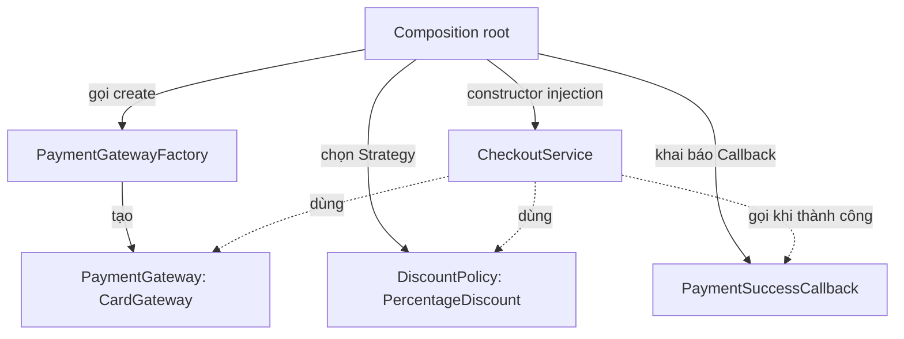
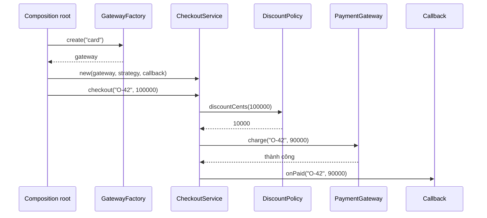

# Phân biệt DI, Factory, Strategy và cơ chế callback

## 1. Bốn khái niệm giải quyết bốn câu hỏi khác nhau

Khi xây dựng một ứng dụng Java, ta thường gặp yêu cầu: thay nhà cung cấp dịch vụ mà không sửa logic nghiệp vụ, tạo đối tượng theo cấu hình, thay thuật toán theo chính sách và thông báo cho thành phần khác khi công việc hoàn tất. **Dependency Injection (DI)**, **Factory**, **Strategy** và **callback** đều có thể góp phần giải quyết, nhưng chúng không cùng một loại khái niệm.

Hãy hình dung một chức năng thanh toán đơn hàng:

- `CheckoutService` cần một cổng thanh toán (`PaymentGateway`), nhưng không nên tự quyết định lớp triển khai cụ thể.
- Ứng dụng phải tạo cổng thanh toán thích hợp với kênh `card` hoặc `wallet`.
- Mức giảm giá thay đổi theo chiến dịch mà vẫn giữ nguyên quy trình thanh toán.
- Khi thanh toán thành công, một hàm cần được gọi để ghi nhận hoặc thông báo kết quả.

Mỗi yêu cầu tương ứng với một câu hỏi:

| Khái niệm | Câu hỏi trọng tâm | Vai trò trong ví dụ |
| --- | --- | --- |
| **Dependency Injection** | Đối tượng **nhận dependency từ đâu**? | `CheckoutService` nhận `PaymentGateway` qua constructor |
| **Factory** | Đối tượng **được tạo bằng cách nào**? | Tạo hiện thực gateway theo kênh thanh toán |
| **Strategy** | **Thuật toán/chính sách nào** được thực thi? | Chọn cách tính giảm giá |
| **Callback** | **Khi nào và bởi ai** một hàm được gọi lại? | Chạy xử lý sau khi thanh toán thành công |

Đây là bài trong chương **Nguyên lý liên quan** của module **Dependency Injection**. Mục tiêu xuyên suốt là hiểu **Inversion of Control (IoC)** và tách việc *sử dụng* dependency khỏi việc *tạo và lắp ghép* đối tượng. Ta sẽ dùng constructor injection, composition root, ví dụ Java thuần và kiểm thử không cần DI container; từ đó có cơ sở để hiểu cơ chế container, scope và vòng đời sau này.

## 2. Dependency Injection: ai cung cấp dependency cho đối tượng?

### 2.1. Khi không có DI

`CheckoutService` tự tạo một hiện thực gateway:

```java
final class CheckoutService {
    private final PaymentGateway gateway = new CardGateway();

    void checkout(String orderId, int amountCents) {
        gateway.charge(orderId, amountCents);
    }
}
```

Ở đây service phụ thuộc vào quyết định cụ thể `new CardGateway()`. Muốn dùng ví điện tử trong một cấu hình khác hoặc dùng fake trong kiểm thử, ta phải đổi service hoặc thêm logic tạo/chọn hiện thực vào nó.

### 2.2. Constructor injection

Tách phần khởi tạo ra bên ngoài:

```java
interface PaymentGateway {
    void charge(String orderId, int amountCents);
}

final class CheckoutService {
    private final PaymentGateway gateway;

    CheckoutService(PaymentGateway gateway) {
        this.gateway = java.util.Objects.requireNonNull(gateway);
    }

    void checkout(String orderId, int amountCents) {
        gateway.charge(orderId, amountCents);
    }
}

// Trong composition root, nơi lắp ghép ứng dụng:
PaymentGateway gateway = new CardGateway();
CheckoutService checkout = new CheckoutService(gateway);
```

Constructor của `CheckoutService` khai báo **nó cần gì**; mã ở **composition root** quyết định **đưa instance nào vào**. Đây là DI thủ công (manual DI), không cần annotation hay thư viện. Đoạn code trên cố ý chỉ xét dependency gateway; ví dụ hoàn chỉnh ở mục 7 bổ sung cả Strategy và callback.

DI không bắt buộc dùng interface: một dependency là lớp cụ thể cũng có thể được inject. Tuy nhiên, dùng abstraction như `PaymentGateway` thường giúp thay thế hiện thực và kiểm thử thuận lợi hơn. DI cũng không tự quyết định dependency tồn tại bao lâu: nơi tạo/lắp ghép vẫn phải xác định trách nhiệm quản lý vòng đời.

**Điểm nhận diện DI:** đối tượng sử dụng dependency nhận nó qua một ranh giới rõ ràng (constructor, phương thức hoặc setter), thay vì tự tìm/tạo dependency mà nó cần.

## 3. Factory: đóng gói quá trình tạo đối tượng

Factory tập trung **logic khởi tạo** ở một nơi. Điều này hữu ích khi cách tạo phụ thuộc vào cấu hình, tham số, hiện thực cụ thể hoặc các bước khởi tạo nhiều tầng.

```java
final class PaymentGatewayFactory {
    PaymentGateway create(String channel) {
        switch (channel) {
            case "card":
                return new CardGateway();
            case "wallet":
                return new WalletGateway();
            default:
                throw new IllegalArgumentException("Unknown channel: " + channel);
        }
    }
}
```

Nếu composition root gọi:

```java
PaymentGateway gateway = new PaymentGatewayFactory().create("wallet");
CheckoutService checkout = new CheckoutService(gateway);
```

thì ta đang dùng **cả Factory lẫn DI**: Factory *tạo* gateway, còn constructor injection *cung cấp* gateway cho service. Factory tự thân không thực hiện DI nếu sản phẩm được tạo ra mà không được đưa vào consumer qua một cơ chế injection.

### 3.1. Factory được gọi bên ngoài hay bên trong service?

Hai lựa chọn có ý nghĩa vòng đời khác nhau:

- **Tạo tại composition root, inject instance:** phù hợp khi service dùng một gateway đã chọn cho suốt vòng đời của nó.
- **Inject factory, tạo theo mỗi thao tác:** phù hợp khi mỗi lần gọi cần một sản phẩm mới, ví dụ một stream, phiên xử lý hoặc gateway phụ thuộc tham số runtime.

Ví dụ thứ hai:

```java
final class OperationService {
    private final PaymentGatewayFactory factory;

    OperationService(PaymentGatewayFactory factory) {
        this.factory = java.util.Objects.requireNonNull(factory);
    }

    void pay(String channel, String orderId, int cents) {
        PaymentGateway gateway = factory.create(channel);
        gateway.charge(orderId, cents);
    }
}
```

Ở đây **factory chính là dependency được inject**. Cách này có cơ sở khi sản phẩm cần được chọn/tạo cho từng thao tác. Nếu service luôn cần đúng một gateway cố định, inject trực tiếp `PaymentGateway` thường đơn giản và thể hiện rõ trách nhiệm hơn.

**Factory không đồng nghĩa với DI container.** Container có thể đảm nhiệm nhiều việc của factory (tạo instance) và việc lắp ghép (inject), nhưng một factory Java thuần không mặc nhiên có cơ chế scope, quản lý vòng đời hay giải quyết toàn bộ đồ thị phụ thuộc.

## 4. Strategy: đóng gói và hoán đổi một thuật toán

**Strategy** là mẫu thiết kế hành vi. Nó định nghĩa một hợp đồng cho một nhóm thuật toán và cho phép context sử dụng các hiện thực khác nhau mà không phải tự chứa nhiều nhánh quyết định thuật toán.

Ví dụ chính sách giảm giá:

```java
interface DiscountPolicy {
    int discountCents(int subtotalCents);
}

final class NoDiscount implements DiscountPolicy {
    @Override
    public int discountCents(int subtotalCents) {
        return 0;
    }
}

final class PercentageDiscount implements DiscountPolicy {
    private final int percent;

    PercentageDiscount(int percent) {
        if (percent < 0 || percent > 100) {
            throw new IllegalArgumentException("percent must be 0..100");
        }
        this.percent = percent;
    }

    @Override
    public int discountCents(int subtotalCents) {
        return Math.toIntExact((long) subtotalCents * percent / 100);
    }
}
```

`DiscountPolicy` là **hợp đồng Strategy**; `NoDiscount` và `PercentageDiscount` là hai thuật toán có thể hoán đổi. `CheckoutService` gọi `discountCents` nhưng không cần biết công thức bên trong.

### Strategy khác DI như thế nào?

Strategy trả lời **thay đổi thuật toán nào**. DI trả lời **đưa đối tượng chứa thuật toán vào context bằng cách nào**. Ta có thể kết hợp hai cơ chế:

```java
DiscountPolicy promotion = new PercentageDiscount(10);
PaymentSuccessCallback callback =
    (orderId, amount) -> System.out.println("Paid: " + orderId);
// Với CheckoutService hoàn chỉnh ở mục 7:
CheckoutService checkout = new CheckoutService(gateway, promotion, callback);
```

Ở đây `promotion` là **Strategy được inject**. Không phải mọi dependency đều là Strategy: logger, clock, repository hay HTTP client được inject có thể không đại diện cho thuật toán có thể hoán đổi. Ngược lại, Strategy không bắt buộc được chọn qua DI; một chương trình nhỏ có thể truyền trực tiếp strategy vào phương thức xử lý.

Trong Java, Strategy có thể được biểu diễn bằng class hoặc lambda khi hợp đồng có một phương thức trừu tượng. Hình thức cú pháp không quyết định khái niệm: **vai trò thay thế thuật toán** mới là điểm chính.

## 5. Callback: trao một hàm để bên khác gọi khi đến thời điểm

**Callback** là một hàm/hành vi mà thành phần A cung cấp cho B để **B quyết định khi nào gọi lại** theo hợp đồng. Callback thường dùng khi có sự kiện, khi một thao tác hoàn tất, khi lặp qua dữ liệu hoặc khi thư viện/framework nắm quyền điều khiển luồng chạy.

```java
@FunctionalInterface
interface PaymentSuccessCallback {
    void onPaid(String orderId, int chargedCents);
}

final class ConsolePaymentCallback implements PaymentSuccessCallback {
    @Override
    public void onPaid(String orderId, int chargedCents) {
        System.out.println("Paid " + orderId + ": " + chargedCents);
    }
}
```

Consumer có thể truyền callback bằng object hoặc lambda:

```java
PaymentSuccessCallback callback =
    (orderId, chargedCents) ->
        System.out.println("Callback for " + orderId + ": " + chargedCents);
```

Trong luồng thanh toán, `CheckoutService` gọi `callback.onPaid(...)` **sau** khi `gateway.charge(...)` trả về thành công. Bên cung cấp callback quyết định *phải làm gì khi được gọi*; service quyết định *khi nào gọi* theo quy trình.

### 5.1. Callback không nhất thiết chạy bất đồng bộ

Ví dụ gọi `onPaid` trực tiếp là **đồng bộ**: hàm callback chạy trên cùng luồng và hoàn tất trước khi `checkout` trả về. Callback cũng có thể được giữ lại và gọi sau bởi scheduler, event loop hoặc kết quả của tác vụ bất đồng bộ. Muốn biết hành vi thực tế, phải đọc hợp đồng về thời điểm gọi, thread, thứ tự, số lần gọi và cách xử lý lỗi.

### 5.2. Callback khác Strategy ra sao?

Cả Strategy lẫn callback đều có thể là interface một phương thức hoặc lambda. Chúng khác nhau chủ yếu ở **mục đích trong thiết kế**:

- Strategy cung cấp **chính sách/thuật toán** để context thực hiện một bước xử lý, chẳng hạn tính giảm giá.
- Callback cung cấp **phản ứng/hook** được kích hoạt tại một thời điểm hoặc sự kiện, chẳng hạn thông báo thanh toán thành công.

Một hàm nhận từ bên ngoài có thể đóng cả hai vai trò tùy hợp đồng; không có ranh giới cú pháp tuyệt đối. Chẳng hạn `Comparator` được truyền vào phép sort thường đóng vai trò Strategy so sánh, dù thư viện liên tục “gọi lại” phương thức `compare`.

## 6. So sánh nhanh trên cùng trục thiết kế

| Tiêu chí | DI | Factory | Strategy | Callback |
| --- | --- | --- | --- | --- |
| Loại cơ chế | Cung cấp/lắp ghép dependency | Khởi tạo đối tượng | Mẫu hành vi hoán đổi thuật toán | Cơ chế giao quyền gọi hàm |
| Thay đổi chủ yếu | Nguồn cung cấp dependency | Cách tạo hoặc chọn hiện thực | Quy tắc tính toán/hành vi | Phản ứng khi xảy ra bước/sự kiện |
| Được chọn ở đâu? | Composition root hoặc điểm injection | Nơi gọi factory | Root, cấu hình hoặc runtime | Bên đăng ký/truyền callback |
| Bên nào chủ động lúc sử dụng? | Consumer gọi dependency đã nhận | Caller yêu cầu factory tạo | Context gọi thuật toán đang chọn | Bên giữ callback kích hoạt nó |
| Cần interface? | Không bắt buộc | Không bắt buộc | Thường có một hợp đồng chung | Interface hàm, lambda hoặc method reference |
| Tự quản lý scope/lifecycle? | Không | Không mặc nhiên | Không | Không |
| Ví dụ | `new CheckoutService(gateway)` | `factory.create("card")` | `discountPolicy.discountCents(total)` | `callback.onPaid(orderId, due)` |

**Quy tắc đọc code:** gặp `new` trong factory thì nghĩ tới *creation*; gặp constructor nhận dependency thì nghĩ tới *injection*; gặp nhiều hiện thực của cùng một hành vi thì nghĩ tới *strategy*; gặp đăng ký hoặc truyền hàm để bên khác gọi lại tại một sự kiện thì nghĩ tới *callback*.

## 7. Ví dụ kết hợp hoàn chỉnh bằng Java thuần

Ví dụ sau mô phỏng một lần checkout bằng Java 8 trở lên. Nó không thực hiện giao dịch thật; các gateway chỉ ghi ra console để làm rõ luồng điều khiển.

Tạo file `DiFactoryStrategyCallbackDemo.java`:

```java
import java.util.Objects;

// Dependency contract của checkout.
interface PaymentGateway {
    void charge(String orderId, int amountCents);
}

final class CardGateway implements PaymentGateway {
    @Override
    public void charge(String orderId, int amountCents) {
        System.out.println("CARD charged " + orderId + ": " + amountCents);
    }
}

final class WalletGateway implements PaymentGateway {
    @Override
    public void charge(String orderId, int amountCents) {
        System.out.println("WALLET charged " + orderId + ": " + amountCents);
    }
}

// FACTORY: quyết định cách tạo hiện thực PaymentGateway.
final class PaymentGatewayFactory {
    PaymentGateway create(String channel) {
        switch (channel) {
            case "card":
                return new CardGateway();
            case "wallet":
                return new WalletGateway();
            default:
                throw new IllegalArgumentException("Unknown channel: " + channel);
        }
    }
}

// STRATEGY: hợp đồng thuật toán giảm giá.
@FunctionalInterface
interface DiscountPolicy {
    int discountCents(int subtotalCents);
}

final class PercentageDiscount implements DiscountPolicy {
    private final int percent;

    PercentageDiscount(int percent) {
        if (percent < 0 || percent > 100) {
            throw new IllegalArgumentException("percent must be 0..100");
        }
        this.percent = percent;
    }

    @Override
    public int discountCents(int subtotalCents) {
        return Math.toIntExact((long) subtotalCents * percent / 100);
    }
}

// CALLBACK: hành vi được gọi sau một lần charge thành công.
@FunctionalInterface
interface PaymentSuccessCallback {
    void onPaid(String orderId, int chargedCents);
}

final class CheckoutService {
    private final PaymentGateway gateway;
    private final DiscountPolicy discountPolicy;
    private final PaymentSuccessCallback onPaid;

    // DI: nhận ba cộng tác viên, không tự tạo hiện thực của chúng.
    CheckoutService(
            PaymentGateway gateway,
            DiscountPolicy discountPolicy,
            PaymentSuccessCallback onPaid) {
        this.gateway = Objects.requireNonNull(gateway);
        this.discountPolicy = Objects.requireNonNull(discountPolicy);
        this.onPaid = Objects.requireNonNull(onPaid);
    }

    void checkout(String orderId, int subtotalCents) {
        Objects.requireNonNull(orderId);
        if (subtotalCents < 0) {
            throw new IllegalArgumentException("subtotalCents must be >= 0");
        }

        int discount = discountPolicy.discountCents(subtotalCents);
        if (discount < 0 || discount > subtotalCents) {
            throw new IllegalStateException("Invalid discount: " + discount);
        }

        int due = subtotalCents - discount;
        gateway.charge(orderId, due);
        // Gọi đồng bộ sau khi gateway.charge không ném lỗi.
        onPaid.onPaid(orderId, due);
    }
}

public final class DiFactoryStrategyCallbackDemo {
    public static void main(String[] args) {
        // Composition root: tạo, lựa chọn và lắp ghép object graph.
        PaymentGatewayFactory factory = new PaymentGatewayFactory();
        PaymentGateway gateway = factory.create("card"); // Factory

        DiscountPolicy promotion = new PercentageDiscount(10); // Strategy
        PaymentSuccessCallback callback = (orderId, chargedCents) ->
            System.out.println("Callback: " + orderId +
                               " completed with " + chargedCents);

        CheckoutService checkout =
            new CheckoutService(gateway, promotion, callback); // DI
        checkout.checkout("O-42", 100_000);
    }
}
```

Biên dịch và chạy:

```bash
javac DiFactoryStrategyCallbackDemo.java
java DiFactoryStrategyCallbackDemo
```

Kết quả dự kiến:

```text
CARD charged O-42: 90000
Callback: O-42 completed with 90000
```

Trong ví dụ này, dùng `new PercentageDiscount(10)` tại root là **tạo Strategy**; truyền nó vào constructor là **DI**. Dùng `factory.create("card")` là **Factory**; việc service gọi `discountPolicy.discountCents` là **áp dụng Strategy**; việc gọi `onPaid.onPaid` khi charge thành công là **kích hoạt callback**.

### 7.1. Hai sơ đồ của cùng một luồng

**Cấu trúc lắp ghép:**



**Thứ tự xử lý lúc chạy:**



**Điểm cần chú ý:** trong ví dụ mô phỏng, `charge` trả về `void` và không ném exception được xem là thành công. Hệ thống thật cần hợp đồng biểu diễn rõ kết quả thanh toán và xử lý các trạng thái thất bại, timeout hoặc trùng yêu cầu.

## 8. DI và callback liên hệ với Inversion of Control như thế nào?

**Inversion of Control (IoC)** là nguyên tắc rộng: một phần quyền quyết định vốn nằm trong đối tượng ứng dụng được chuyển cho một bên khác theo một hợp đồng. Nhưng nơi xảy ra việc đảo quyền điều khiển khác nhau:

- **DI:** consumer không tự điều khiển *việc tạo và tìm dependency*; composition root/container cấp dependency cho nó.
- **Callback:** bên gửi callback không tự quyết định *thời điểm callback được chạy*; bên nhận callback gọi nó khi đạt sự kiện/điều kiện đã hứa.
- **Strategy:** context vẫn là bên chủ động gọi thuật toán, còn logic thuật toán nằm trong strategy được chọn. Chọn Strategy qua DI có thể kết hợp hai cơ chế.
- **Factory:** caller chủ động yêu cầu tạo sản phẩm nhưng giao *chi tiết khởi tạo* cho factory; đây là phân chia trách nhiệm tạo đối tượng, không tự động đồng nghĩa với toàn bộ IoC.

Không nên nói mọi callback đều là DI, hoặc mọi factory đều là IoC container. Hai khái niệm có thể kết hợp nhưng phục vụ các mối quan tâm khác nhau.

Một nguyên lý liên quan là **Dependency Inversion Principle (DIP)**: chính sách nghiệp vụ cấp cao nên phụ thuộc vào abstraction phù hợp thay vì bị buộc vào chi tiết triển khai cấp thấp. `CheckoutService` phụ thuộc vào `PaymentGateway` là một cách áp dụng tinh thần đó; còn **DI là cơ chế cấp instance theo hợp đồng**. Có DI không bảo đảm tự động rằng hệ thống đã áp dụng tốt DIP, nhất là khi constructor vẫn nhận một lớp cụ thể có nhiều chi tiết hạ tầng.

## 9. Factory, Strategy và callback ảnh hưởng vòng đời/scope ra sao?

**Tạo được một object không có nghĩa biết ai sở hữu và khi nào đóng nó.** DI, Factory, Strategy và callback đều không tự thiết lập ownership hay scope trong Java thuần.

Xét một dependency có tài nguyên như `Connection`, stream hoặc socket:

1. Nếu composition root tạo một instance và inject vào nhiều service, root phải quyết định khi nào instance kết thúc vòng đời và liệu nó có an toàn để dùng chung không.
2. Nếu factory tạo một instance mới cho **mỗi thao tác**, hợp đồng factory cần nói rõ bên gọi có nhận **quyền sở hữu** tài nguyên và phải đóng hay không.
3. Nếu Strategy có trạng thái thay đổi, phải xác định nó được dùng chung trong toàn ứng dụng hay tạo riêng theo request. Stateless Strategy bất biến thường dễ chia sẻ hơn.
4. Nếu callback chạy bất đồng bộ, cần chú ý thời gian sống của các đối tượng mà callback giữ tham chiếu. Callback được gọi sau khi scope kết thúc có thể chạm tài nguyên đã đóng.

Ví dụ về factory cấp resource cho từng thao tác, trong đó bên gọi nhận trách nhiệm đóng:

```java
interface InputFactory {
    java.io.InputStream open() throws java.io.IOException;
}

final class ImportService {
    private final InputFactory inputFactory;

    ImportService(InputFactory inputFactory) {
        this.inputFactory = inputFactory;
    }

    long countBytes() throws java.io.IOException {
        // Factory được inject; stream do thao tác này sở hữu và đóng.
        try (java.io.InputStream input = inputFactory.open()) {
            long count = 0;
            while (input.read() != -1) {
                count++;
            }
            return count;
        }
    }
}
```

Ngược lại, nếu factory trả về một connection **mượn** từ pool, `close()` có thể mang nghĩa trả connection về pool; phải tuân theo hợp đồng của API/pool cụ thể. Không thể suy ra ownership chỉ bằng việc nhìn thấy tên `create` hay `get`.

Một trường hợp khác cần cảnh giác: callback được ứng dụng giữ lâu nhưng lambda đóng trên dữ liệu thuộc request ngắn hạn, ví dụ context gắn với giao dịch đã kết thúc. Trong hệ thống có scope, phải kiểm tra thời điểm callback chạy và tránh giữ trực tiếp đối tượng có vòng đời ngắn hơn.

## 10. Kiểm thử từng vai trò mà không dùng DI container

Constructor injection cho phép thay gateway thật bằng fake, Strategy tùy chỉnh và callback ghi nhận. Ta có thể kiểm tra **số tiền**, **thứ tự gọi** và **điều kiện kích hoạt** bằng Java thuần.

Đặt file `DiFactoryStrategyCallbackTest.java` bên cạnh file demo ở mục 7:

```java
import java.util.ArrayList;
import java.util.Arrays;
import java.util.List;

public final class DiFactoryStrategyCallbackTest {
    public static void main(String[] args) {
        List<String> calls = new ArrayList<>();

        // Fake gateway: không thực hiện thanh toán thật.
        PaymentGateway fakeGateway = (id, cents) ->
            calls.add("charge:" + cents);

        // Strategy test: giảm cố định 100 cents.
        DiscountPolicy policy = subtotal -> 100;

        // Callback test: ghi nhận sau khi gateway xử lý.
        PaymentSuccessCallback callback = (id, cents) ->
            calls.add("callback:" + cents);

        CheckoutService service =
            new CheckoutService(fakeGateway, policy, callback);
        service.checkout("O-test", 1_000);

        List<String> expected =
            Arrays.asList("charge:900", "callback:900");
        if (!calls.equals(expected)) {
            throw new AssertionError("Unexpected calls: " + calls);
        }

        // Nếu gateway ném lỗi, callback thành công không được gọi.
        int[] successCallbacks = {0};
        PaymentGateway failingGateway = (id, cents) -> {
            throw new IllegalStateException("declined");
        };
        CheckoutService failing = new CheckoutService(
            failingGateway,
            subtotal -> 0,
            (id, cents) -> successCallbacks[0]++
        );

        try {
            failing.checkout("O-failed", 1_000);
            throw new AssertionError("Expected gateway failure");
        } catch (IllegalStateException expectedFailure) {
            // Dự kiến: gateway ném lỗi trước khi callback được gọi.
        }

        if (successCallbacks[0] != 0) {
            throw new AssertionError("Callback ran after failure");
        }
        System.out.println("PASS");
    }
}
```

Chạy:

```bash
javac DiFactoryStrategyCallbackDemo.java DiFactoryStrategyCallbackTest.java
java DiFactoryStrategyCallbackTest
```

Điều cần rút ra: test **không cần tạo Factory** vì service chỉ quan tâm `PaymentGateway` đã được inject; test có thể thay Strategy để kiểm chứng quy tắc tính; callback có thể được quan sát độc lập. Đây là lợi ích trực tiếp của việc tách các vai trò.

Nếu cần kiểm thử bản thân Factory, hãy kiểm tra nó tạo đúng hiện thực từ đầu vào hợp lệ và từ chối đầu vào không hợp lệ. Nếu cần kiểm thử từng Strategy, kiểm tra các giá trị biên như 0%, 100%, số tiền 0 và đầu vào không hợp lệ. Những kiểm thử này có mục tiêu khác với kiểm thử luồng checkout.

## 11. Các nhầm lẫn và lỗi thiết kế thường gặp

| Nhầm lẫn | Vì sao chưa đúng? | Cách thiết kế rõ hơn |
| --- | --- | --- |
| “Dùng Factory là đã áp dụng DI.” | Factory chỉ đóng gói việc tạo, còn service có thể vẫn tự chọn/tự gọi factory cố định. | Để composition root chọn và inject instance, hoặc inject factory khi cần tạo theo thao tác. |
| “Có interface tức là Strategy.” | Interface có thể biểu diễn repository, logger, gateway; không phải tất cả đều là thuật toán hoán đổi. | Nhận diện Strategy qua vai trò chính sách/hành vi và context sử dụng nó. |
| “Callback luôn chạy trong luồng khác.” | Callback có thể được gọi đồng bộ ngay trong phương thức. | Định nghĩa rõ đồng bộ/bất đồng bộ, thread và hợp đồng lỗi. |
| “Inject Strategy thì Strategy chính là DI.” | Strategy là cái được chọn; DI là cách cung cấp nó. | Tách quyết định thuật toán khỏi cơ chế lắp ghép. |
| “Một lambda luôn là callback.” | Lambda chỉ là cách viết implementation của functional interface. | Xem vai trò: thuật toán, callback, mapper, filter hoặc dependency khác. |
| “DI container sẽ tự giải quyết mọi tài nguyên.” | Ownership/scope khác nhau, đặc biệt khi object do factory tự tạo hoặc thoát scope. | Xác định rõ người sở hữu, điểm đóng, phạm vi sử dụng. |
| “Callback thành công nghĩa là toàn bộ hệ thống đã giao dịch thành công.” | Callback có thể lỗi sau khi gateway đã charge xong. | Định nghĩa semantics thành công, xử lý lỗi, retry/idempotency. |
| “Mọi lớp đều cần Factory, Strategy và callback.” | Quá nhiều lớp trung gian làm code khó theo dõi. | Chọn cơ chế đúng với loại biến đổi thực sự cần thiết. |

### 11.1. Đặc biệt lưu ý lỗi callback sau thao tác không thể hoàn tác

Trong ví dụ, `gateway.charge` hoàn tất rồi mới gọi callback. Nếu callback ném exception, phương thức `checkout` cũng có thể ném exception **mặc dù gateway đã xử lý xong**. Vì vậy, trong hệ thống thanh toán thật cần thiết kế hợp đồng kết quả, retry, idempotency và tách các tác vụ thông báo khỏi quyết định trạng thái giao dịch. Callback chỉ là cơ chế gọi hàm, không tự tạo transaction hoặc khả năng hoàn tác.

## 12. Bài tập áp dụng

**Bài 1 — Nhận diện vai trò.** Một ứng dụng gọi `new EmailSender(smtpClient)` ở startup, trong khi `smtpClient` được tạo bằng `SenderFactory.create(config)`. Khi gửi email xong, `EmailSender` gọi `onDelivered.accept(messageId)`. Xác định DI, Factory và callback.

*Gợi ý:* constructor là injection; factory tạo SMTP client; `onDelivered` là callback. Nếu ứng dụng có nhiều cách chọn nội dung/email policy hoán đổi, chính sách đó có thể là Strategy.

**Bài 2 — Thay chính sách.** `ShippingService` tính phí bằng nhiều khối `if/else` cho “tiêu chuẩn”, “nhanh”, “hỏa tốc”. Hãy thiết kế `ShippingCostPolicy` với hai hiện thực, rồi inject hiện thực được chọn vào service.

*Gợi ý:* phí vận chuyển là hành vi Strategy; constructor inject giúp service không cần chọn lớp cụ thể. Nếu chính sách đổi theo từng request, có thể truyền strategy theo mỗi lần gọi hoặc inject bộ chọn Strategy với hợp đồng rõ ràng.

**Bài 3 — Factory theo thao tác.** `ImageProcessor` mở một stream mới cho mỗi ảnh. Nếu constructor inject duy nhất một stream và service xử lý nhiều ảnh, điều gì có thể sai?

*Gợi ý:* stream có vòng đời một thao tác; inject một factory tạo stream, dùng `try-with-resources` và xác định ai chịu trách nhiệm đóng. Không chia sẻ một stream đã đọc/đóng cho nhiều lần xử lý.

**Bài 4 — Callback bất đồng bộ.** Một service đăng ký callback giữ tham chiếu tới `RequestContext`. Callback chỉ được gọi sau khi request đã kết thúc. Cần kiểm tra điều gì?

*Gợi ý:* vòng đời context, thời điểm chạy callback, tính hợp lệ của dữ liệu, thread an toàn, số lần gọi và xử lý lỗi. Có thể truyền snapshot dữ liệu bất biến thay vì giữ object thuộc request.

**Bài 5 — Chọn cơ chế phù hợp.** Yêu cầu: “Mỗi lần nhập tệp phải tạo parser mới theo định dạng; thuật toán kiểm tra checksum có thể thay; sau khi nhập thành công cần ghi log”.

*Gợi ý:* Factory tạo parser theo định dạng; Strategy biểu diễn checksum; callback hoặc observer thông báo khi nhập xong; DI lắp ghép các dependency cần thiết như parser factory, checksum policy và nơi nhận sự kiện.

## 13. Ghi nhớ

**DI cung cấp dependency; Factory tạo đối tượng; Strategy thay thuật toán; callback giao hành vi để được gọi vào thời điểm quy định.** Chúng thường cùng xuất hiện trong một hệ thống nhưng không thay thế nhau.

Một thiết kế Java thuần hợp lý thường bắt đầu ở **composition root**: chọn hiện thực, tạo object graph, inject dependency qua constructor; chỉ bổ sung Factory khi việc tạo cần được đóng gói hoặc thực hiện theo từng thao tác; dùng Strategy khi có chính sách hoán đổi; dùng callback khi cần trao phản ứng cho bên điều khiển sự kiện. Cuối cùng, hãy gắn rõ **scope, ownership và điểm kết thúc vòng đời** cho các đối tượng và kiểm thử từng hợp đồng một cách độc lập trước khi mở rộng sang DI container.
