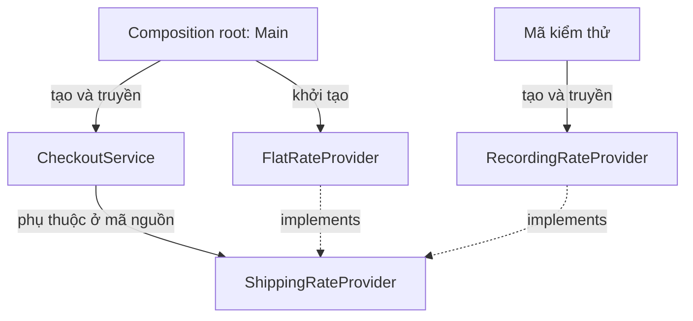

# Vì sao dùng interface hoặc annotation chưa đủ để chứng minh thiết kế tốt

Trong Java, việc thấy nhiều `interface`, `@Inject`, `@Autowired` hoặc `@Component` dễ tạo cảm giác rằng hệ thống đã áp dụng **Dependency Injection (DI)** và **Inversion of Control (IoC)** đúng cách. Tuy nhiên, các dấu hiệu đó mới nói lên **cú pháp hoặc cơ chế cấu hình**. Chúng chưa trả lời những câu hỏi quyết định chất lượng thiết kế: một thành phần có đúng trách nhiệm không, hợp đồng có đủ ý nghĩa không, phụ thuộc có đi đúng hướng không, các triển khai có thay thế an toàn không, và đối tượng được lắp ghép, quản lý vòng đời như thế nào?

Bài này thuộc chương **Nguyên lý liên quan** của module **DEPENDENCY_INJECTION**. Mục tiêu là học cách đánh giá **hành vi và quan hệ phụ thuộc** thay vì đánh giá thiết kế qua số lượng interface hay annotation. Ta bắt đầu với Java thuần, **constructor injection** và **composition root**, rồi liên hệ đến DI container, scope và vòng đời.

## 1. Kết quả cần đạt

Sau bài học, bạn có thể:

- Phân biệt **interface của ngôn ngữ Java** với **hợp đồng hành vi** mà các triển khai phải giữ.
- Giải thích vì sao một lớp có `@Inject` vẫn có thể phụ thuộc vào chi tiết hạ tầng, giấu phụ thuộc hoặc khó kiểm thử.
- Xem xét thiết kế qua các nguyên lý liên quan như **DIP**, **SRP**, **ISP**, khả năng **thay thế theo hợp đồng (LSP)** và ranh giới trách nhiệm.
- Dùng constructor injection trong Java thuần để tạo một object graph rõ ràng, kiểm thử bằng test double và xác định điểm lắp ghép.
- Đặt câu hỏi về scope, vòng đời, hiệu ứng phụ và khả năng thay thế khi đánh giá hệ thống có DI container.

## 2. Interface là công cụ biểu diễn kiểu, không tự tạo ra hợp đồng tốt

Một `interface` cho trình biên dịch biết **những phương thức có thể gọi**. Ví dụ:

```java
interface ShippingRateProvider {
    long feeInCents(String destination);
}
```

Chữ ký cho biết có thao tác nhận điểm đến và trả về một số nguyên kiểu `long`. Nó **không tự định nghĩa** các quy tắc quan trọng, chẳng hạn:

- `destination` là mã vùng, địa chỉ đầy đủ hay mã bưu chính? Giá trị rỗng có hợp lệ không?
- Số tiền trả về phải không âm hay có thể biểu thị khoản giảm giá?
- Nếu vùng vận chuyển không hỗ trợ, phương thức trả về giá trị đặc biệt hay ném exception?
- Khi có lỗi mạng, người gọi được phép thử lại không? Kết quả có ổn định trong cùng một đơn hàng không?

Nếu hai triển khai diễn giải các câu hỏi này khác nhau, chúng có thể **cùng biên dịch** mà vẫn **không thay thế an toàn cho nhau**.

### 2.1. Chữ ký giống nhau, hành vi khác nhau

```java
interface ShippingRateProvider {
    long feeInCents(String destination);
}

// Triển khai A: trả về phí, hoặc ném lỗi nếu không hỗ trợ điểm đến.
// Triển khai B: trả về -1 nếu không hỗ trợ điểm đến.
```

Giả sử `CheckoutService` cộng thẳng giá trị phí vào tổng tiền. Khi chuyển từ A sang B, một đơn hàng có thể bị tính **giảm 1 cent** thay vì bị từ chối. Việc cả hai lớp `implements ShippingRateProvider` không giải quyết được mâu thuẫn về **ngữ nghĩa lỗi**.

Một hợp đồng đủ tốt cần nêu **ý nghĩa thao tác, điều kiện đầu vào, kết quả, lỗi, hiệu ứng phụ và những bảo đảm quan trọng**. Với ví dụ này, ta có thể chọn quy ước: phí tính bằng cent, luôn không âm; điểm đến không hỗ trợ thì ném một exception được xác định rõ. Đó là một **quyết định thiết kế** phải được ghi lại và kiểm chứng, không phải điều được suy ra tự động từ từ khóa `interface`.

### 2.2. Interface vẫn có thể phụ thuộc chặt vào một nhà cung cấp

Xem một hợp đồng giả định sau:

```java
// Minh họa: VendorQuote và VendorCredentials là kiểu thuộc SDK bên ngoài.
interface ShippingRateProvider {
    VendorQuote calculate(VendorCredentials credentials, String destination);
}
```

Tầng nghiệp vụ sử dụng interface này vẫn phải biết `VendorQuote` và `VendorCredentials` của một SDK. Nếu đổi nhà cung cấp, các lớp dùng hợp đồng có thể phải sửa theo. Ta đã thêm một interface nhưng **chưa tạo được ranh giới độc lập với hạ tầng**.

Một hợp đồng gần nhu cầu của bên sử dụng hơn có thể là:

```java
interface ShippingRateProvider {
    long feeInCents(String destination);
}
```

Adapter của nhà cung cấp chịu trách nhiệm chuyển đổi qua lại giữa kiểu SDK và dữ liệu mà nghiệp vụ cần. Ví dụ này cố ý giữ mô hình đơn giản; hệ thống thật có thể cần thêm khối lượng, kích thước, loại dịch vụ và một kiểu `Money` thay cho `long`.

### 2.3. Interface nhiều chưa chắc coupling thấp

Nếu mỗi lớp đều có một interface sao chép nguyên mọi phương thức của lớp đó, codebase sẽ có nhiều tên kiểu hơn nhưng chưa chắc có **ranh giới thay đổi** rõ hơn. Hai dấu hiệu nên xem xét:

1. Interface quá rộng: một service chỉ cần `feeInCents` nhưng phải phụ thuộc hợp đồng bao gồm tạo đơn vận chuyển, in nhãn, quản lý kho và hủy đơn. Điều này đi ngược tinh thần **Interface Segregation Principle (ISP)**.
2. Interface được viết theo chi tiết triển khai: hợp đồng chứa lệnh, trạng thái hoặc kiểu dữ liệu của một thư viện bên ngoài. Đổi triển khai vẫn lan thay đổi vào nghiệp vụ.

Không có quy tắc bắt buộc **mỗi lớp phải có interface** hoặc **phải có từ hai triển khai trở lên mới được tạo interface**. Một hợp đồng dùng bởi duy nhất một adapter vẫn hữu ích ở ranh giới với cơ sở dữ liệu hoặc dịch vụ ngoài, miễn nó thể hiện nhu cầu thực và hạn chế thay đổi lan truyền. Ngược lại, lớp giá trị, thuật toán thuần hoặc thành phần nội bộ ổn định đôi khi không cần trừu tượng bổ sung.

## 3. Annotation mô tả cấu hình, không chứng nhận kiến trúc

Trong một DI framework, annotation như `@Inject` hay `@Autowired` thường được dùng để đánh dấu điểm nhận phụ thuộc; `@Component` hoặc annotation tương đương hỗ trợ đăng ký thành phần. **Ý nghĩa cụ thể tùy API và framework.** Java thuần không tự xây dựng object graph chỉ vì một lớp có annotation. Cần có mã lắp ghép hoặc container xử lý metadata, đăng ký thành phần và chọn đối tượng thích hợp.

Ví dụ dưới đây là **mã minh họa ý tưởng**, không phải chương trình Java thuần độc lập:

```java
final class CheckoutService {
    @Inject
    private VendorShippingClient shippingClient;

    long total(long goodsCents, String destination) {
        return goodsCents + shippingClient.fetchFee(destination);
    }
}
```

Mặc dù có `@Inject`, thiết kế vẫn tồn tại các vấn đề:

- `CheckoutService` phụ thuộc trực tiếp vào `VendorShippingClient`, tức **chi tiết nhà cung cấp**.
- Phụ thuộc ở trường được thiết lập qua cơ chế ngoài constructor, khiến một lời gọi `new CheckoutService()` không cung cấp được giá trị cho trường đó; khi gọi `total`, chương trình có thể gặp `NullPointerException`.
- Không thể biết từ constructor rằng `CheckoutService` cần một client vận chuyển để hoạt động.
- Phép cộng chưa kiểm tra quy tắc tiền tệ, số âm hoặc tràn số; annotation không khắc phục logic nghiệp vụ.

Annotation có thể hữu ích để yêu cầu container tiêm phụ thuộc, quản lý transaction, chọn qualifier, đăng ký scope hoặc quản lý vòng đời, nhưng **việc có annotation không chứng minh lựa chọn đó hợp lý**. Một trường được tiêm thành công vẫn có thể tham chiếu kiểu sai, giữ trạng thái không an toàn hoặc che giấu vòng phụ thuộc trong graph.

### 3.1. DI và DIP là hai câu hỏi khác nhau

```java
// Đây là DI qua constructor, nhưng vẫn gắn với kiểu cụ thể.
final class CheckoutService {
    private final VendorShippingClient client;

    CheckoutService(VendorShippingClient client) {
        this.client = client;
    }
}
```

**Dependency Injection** trả lời *đối tượng nhận phụ thuộc từ đâu*. Ví dụ trên là DI dù không có interface hay annotation. **Dependency Inversion Principle (DIP)** đặt câu hỏi *mã nguồn cấp cao có phụ thuộc vào chi tiết cấp thấp, hay cả hai hướng đến một abstraction phù hợp*. Muốn đạt cả hai mục tiêu trong trường hợp cần tách nhà cung cấp, constructor nên nhận một hợp đồng như `ShippingRateProvider` và quyết định tạo adapter được chuyển ra composition root.

Ngược lại, một lớp có trường kiểu `ShippingRateProvider` nhưng tự gán `new VendorShippingAdapter()` vẫn tự quyết định triển khai. Có interface **chưa đồng nghĩa** với việc đã tách quá trình sử dụng và quá trình lắp ghép.

### 3.2. Khi nào annotation có ích?

Một container được cấu hình đúng có thể tự xây dựng nhiều tầng đối tượng, chọn triển khai theo môi trường và quản lý scope. Chẳng hạn, với framework có hỗ trợ constructor injection:

```java
// Minh họa khi tích hợp framework; không cần dùng trong ví dụ Java thuần.
@Inject
CheckoutService(ShippingRateProvider rateProvider) {
    this.rateProvider = rateProvider;
}
```

Giá trị của đoạn mã nằm ở **contract và cách cung cấp dependency qua constructor**; annotation chỉ giúp cơ chế runtime nhận diện điểm tiêm theo cấu hình của framework. Trong một số framework, constructor đơn nhất còn có thể được tiêm mà không cần đánh dấu annotation. Điều cần kiểm tra là graph được tạo ra đúng, các đối tượng hợp lệ và hành vi có thể kiểm thử.

## 4. Đánh giá thiết kế qua các nguyên lý liên quan

| Lăng kính | Câu hỏi cần trả lời | Dấu hiệu đáng nghi dù có interface/annotation |
| --- | --- | --- |
| **SRP – Single Responsibility Principle** | Lớp có một lý do thay đổi rõ ràng không? | Service vừa tính giá, gọi SDK, gửi email, ghi log nghiệp vụ và cấu hình kết nối. |
| **DIP – Dependency Inversion Principle** | Nghiệp vụ có phụ thuộc abstraction theo nhu cầu của nó không? | Interface làm lộ các kiểu dữ liệu riêng của nhà cung cấp. |
| **ISP – Interface Segregation Principle** | Bên sử dụng có bị buộc biết thao tác không cần thiết không? | Service chỉ cần đọc phí nhưng interface chứa cả API quản trị vận chuyển. |
| **LSP – Liskov Substitution Principle** | Các triển khai có giữ các bảo đảm của hợp đồng không? | Một adapter trả phí âm khi lỗi, adapter khác ném exception. |
| **Cohesion và coupling** | Trách nhiệm có tập trung hợp lý và số ranh giới phụ thuộc có được kiểm soát không? | Lớp nhỏ nhưng phải nhận mười interface để chạy một ca sử dụng. |
| **Composition root** | Quyết định tạo/chọn phụ thuộc nằm ở đâu? | Service tự `new` adapter hoặc tìm nó từ registry toàn cục. |
| **Lifecycle và scope** | Đối tượng được chia sẻ, tạo mới và đóng tài nguyên đúng lúc không? | Một singleton giữ dữ liệu riêng của request trong trường mutable. |
| **Testability và observability** | Có thể kiểm tra hành vi và chẩn đoán lỗi ở ranh giới hợp đồng không? | Test phải khởi động toàn bộ framework hoặc gọi dịch vụ thật để kiểm chứng một quy tắc đơn giản. |

Các nguyên lý này là **công cụ đánh giá lựa chọn**, không phải bộ luật áp dụng máy móc. Tên interface, số lớp, số annotation hoặc khả năng khởi động container **không phải thước đo thay thế** cho hành vi và chi phí thay đổi.

## 5. Thiết kế lại bằng Java thuần: hợp đồng rõ và nơi lắp ghép rõ

Giả sử hệ thống báo giá đơn hàng cần cộng phí vận chuyển vào giá hàng. `CheckoutService` chỉ cần biết **phí cho điểm đến**. Adapter có thể lấy phí từ cấu hình cố định, API vận chuyển hoặc một kho dữ liệu. Ta tách quyết định lấy phí khỏi phép tính tổng.

Hợp đồng minh họa:

> `feeInCents(destination)` nhận một mã điểm đến không rỗng và trả về **phí vận chuyển không âm**, tính bằng đơn vị cent. Nếu không xác định được phí, triển khai phải báo lỗi thay vì âm thầm trả một số âm như mã lỗi.

Ví dụ dưới đây có thể lưu nguyên khối thành **`Main.java`**, chạy với JDK 11 trở lên. Nó không cần DI container, không thực hiện gọi mạng, và dùng `RecordingRateProvider` để kiểm tra việc phối hợp với phụ thuộc.

```java
import java.util.ArrayList;
import java.util.List;
import java.util.Objects;

public class Main {
    interface ShippingRateProvider {
        // Trả về phí tính bằng cent; không trả về số âm.
        // Không hỗ trợ điểm đến thì ném lỗi thay vì trả mã âm.
        long feeInCents(String destination);
    }

    // Một adapter đơn giản, được chọn tại nơi lắp ghép.
    static final class FlatRateProvider implements ShippingRateProvider {
        private final long flatFeeCents;

        FlatRateProvider(long flatFeeCents) {
            if (flatFeeCents < 0) {
                throw new IllegalArgumentException("fee must be non-negative");
            }
            this.flatFeeCents = flatFeeCents;
        }

        @Override
        public long feeInCents(String destination) {
            Objects.requireNonNull(destination, "destination");
            if (destination.isBlank()) {
                throw new IllegalArgumentException("destination is blank");
            }
            return flatFeeCents;
        }
    }

    // Chính sách ứng dụng chỉ nhận hợp đồng nó cần.
    static final class CheckoutService {
        private final ShippingRateProvider rateProvider;

        CheckoutService(ShippingRateProvider rateProvider) {
            this.rateProvider = Objects.requireNonNull(rateProvider, "rateProvider");
        }

        long totalInCents(long goodsCents, String destination) {
            if (goodsCents < 0) {
                throw new IllegalArgumentException("goods price must be non-negative");
            }
            Objects.requireNonNull(destination, "destination");
            if (destination.isBlank()) {
                throw new IllegalArgumentException("destination is blank");
            }

            long shippingCents = rateProvider.feeInCents(destination);
            if (shippingCents < 0) {
                throw new IllegalStateException("provider violated its contract");
            }
            return Math.addExact(goodsCents, shippingCents);
        }
    }

    // Test double: quan sát tương tác, không gọi dịch vụ thật.
    static final class RecordingRateProvider implements ShippingRateProvider {
        private final long feeCents;
        private final List<String> requestedDestinations = new ArrayList<>();

        RecordingRateProvider(long feeCents) {
            if (feeCents < 0) {
                throw new IllegalArgumentException("fee must be non-negative");
            }
            this.feeCents = feeCents;
        }

        @Override
        public long feeInCents(String destination) {
            requestedDestinations.add(destination);
            return feeCents;
        }

        List<String> requestedDestinations() {
            return List.copyOf(requestedDestinations);
        }
    }

    public static void main(String[] args) {
        // Composition root: tạo triển khai và lắp ghép service.
        ShippingRateProvider productionProvider = new FlatRateProvider(15_000);
        CheckoutService production = new CheckoutService(productionProvider);
        System.out.println("Total: " + production.totalInCents(110_000, "HCM") + " cents");

        // Kiểm tra lớp sử dụng bằng test double trong Java thuần.
        RecordingRateProvider fake = new RecordingRateProvider(2_500);
        CheckoutService underTest = new CheckoutService(fake);
        long total = underTest.totalInCents(90_000, "DN");

        if (total != 92_500 || !fake.requestedDestinations().equals(List.of("DN"))) {
            throw new AssertionError("incorrect total or interaction");
        }
        System.out.println("Plain Java check: PASS");
    }
}
```

Biên dịch và chạy:

```bash
javac -encoding UTF-8 Main.java
java Main
```

Kết quả dự kiến:

```text
Total: 125000 cents
Plain Java check: PASS
```

Ba điểm thiết kế có thể quan sát trực tiếp:

1. **Hợp đồng định nghĩa nhu cầu và bảo đảm.** `CheckoutService` không cần biết class hoặc SDK lấy phí; nó chỉ yêu cầu một phí không âm.
2. **Phụ thuộc bắt buộc hiện rõ ở constructor.** Không thể tạo một `CheckoutService` hợp lệ nếu không cung cấp `ShippingRateProvider`; kiểm tra `null` làm lỗi cấu hình bộc lộ sớm.
3. **Composition root quyết định triển khai.** `main` chọn `FlatRateProvider` cho đường chạy minh họa và `RecordingRateProvider` cho thử nghiệm. `CheckoutService` không biết lựa chọn đó.

Đoạn kiểm thử chứng minh cách `CheckoutService` sử dụng hợp đồng, **không chứng minh** rằng một adapter thực kết nối hãng vận chuyển sẽ trả giá đúng, xử lý timeout tốt hoặc giữ chính sách tính phí trong mọi tình huống. Cần kiểm thử adapter theo hợp đồng và kiểm thử tích hợp tại ranh giới với hệ thống ngoài. Các giá trị tiền và mã vùng trong ví dụ chỉ nhằm dạy DI; ứng dụng thực tế phải thống nhất đơn vị tiền tệ, làm tròn, thuế và dữ liệu đầu vào.

## 6. Sơ đồ: hướng phụ thuộc và hướng khởi tạo



Biên dịch `CheckoutService` chỉ cần biết `ShippingRateProvider`, còn `FlatRateProvider` biết nó phải hiện thực hợp đồng này. **Điểm lắp ghép** biết cả lớp sử dụng lẫn lớp triển khai để tạo object graph cụ thể. Không nên nhầm **đảo hướng phụ thuộc mã nguồn** với việc runtime không còn sử dụng lớp cụ thể: khi chạy, luôn có một đối tượng triển khai thực hiện lời gọi.

## 7. Vì sao DI container vẫn không tự bảo đảm thiết kế tốt?

Container có thể tạo, tìm và cung cấp dependency đúng cấu hình, nhưng nó không thể tự xác định đâu là ranh giới nghiệp vụ phù hợp hay hành vi hợp đồng có hợp lý không.

### 7.1. Scope và vòng đời phải phù hợp trạng thái

Một component **singleton** có thể được dùng đồng thời bởi nhiều request. Nếu nó giữ `currentUserId`, giỏ hàng hoặc trạng thái mutable của từng request trong trường của chính nó, dữ liệu có thể bị chia sẻ sai hoặc gây race condition. Ngược lại, đối tượng có kết nối hoặc tài nguyên đóng được cần người chịu trách nhiệm về thời điểm giải phóng.

Một số container hỗ trợ scope như singleton, request, prototype/transient và các proxy/provider để kết nối chúng. Tên và hành vi cụ thể phụ thuộc framework. Khi một đối tượng sống lâu hơn đối tượng mà nó giữ tham chiếu, phải kiểm tra xem scope đó có hợp lệ, đối tượng được tạo và hủy đúng lúc, và có xảy ra **captive dependency** hay không. Annotation đặt scope không tự xử lý được các sai lầm về quyền sở hữu trạng thái.

### 7.2. Graph có thể hợp lệ về kiểu nhưng sai về ý nghĩa

Nếu có hai adapter `ShippingRateProvider`, container có thể yêu cầu qualifier hoặc quy tắc chọn bean. Chọn được một bean không đồng nghĩa nó phù hợp với môi trường hiện tại: adapter tính phí thử nghiệm không được dùng để báo giá thật; adapter trả giá theo loại đơn hàng khác có thể phá chính sách kinh doanh. Điều cần kiểm tra là **cấu hình + điều kiện kinh doanh + hành vi**, không chỉ việc startup thành công.

Tương tự, một dependency được tiêm đúng có thể dẫn đến vòng gọi lặp, retry không kiểm soát, đọc dữ liệu sai transaction hoặc bất đồng bộ hóa thời điểm lỗi. Những vấn đề đó nằm ở **thiết kế cộng tác và vòng đời**, vượt quá khả năng biểu đạt của annotation tiêm đối tượng.

### 7.3. Framework có thể bị lan vào lõi nghiệp vụ

Khi service nghiệp vụ cần biết API container để chủ động tìm bean, ví dụ:

```java
// Mã khái niệm, không phải API Java chuẩn:
final class CheckoutService {
    long total(long goodsCents, String destination) {
        ShippingRateProvider provider = GlobalContainer.get(ShippingRateProvider.class);
        return goodsCents + provider.feeInCents(destination);
    }
}
```

Dependency của `CheckoutService` bị **ẩn** trong phần thân phương thức. Để chạy unit test, người kiểm thử có thể phải cấu hình global container hoặc thay đổi trạng thái toàn cục. Đây là ví dụ về **Service Locator**. Khi phù hợp, constructor injection giúp thể hiện rõ dependency trong API của lớp và cho phép khởi tạo lớp không cần framework.

Không phải mọi annotation của framework đều gây coupling không mong muốn: nhiều annotation ở lớp cấu hình hoặc adapter là lựa chọn hợp lý. Câu hỏi là **quyết định nào cần thuộc nghiệp vụ, quyết định nào nên ở rìa tích hợp**, và đổi framework có khiến quy tắc nghiệp vụ phải thay đổi hay không.

## 8. Những phản ví dụ thường gặp

| Nhìn bên ngoài | Vấn đề có thể ẩn bên trong | Cách kiểm tra thực chất |
| --- | --- | --- |
| “Lớp nào cũng implements interface” | Interface chỉ lặp lại API lớp cụ thể; không có nhu cầu thay thế rõ ràng | Đổi một adapter giả định: lớp sử dụng có phải sửa không? |
| “Service đã có `@Autowired`” | Service phụ thuộc lớp SDK và field injection làm ẩn yêu cầu constructor | Có thể tạo service hợp lệ bằng `new` cùng test double không? |
| “Dùng `@Inject` trên mọi trường” | Nhiều dependency làm trách nhiệm lớp bị dàn trải | Mỗi dependency có phục vụ cùng một ca sử dụng rõ ràng không? |
| “Container khởi động thành công” | Bean được chọn có thể sai môi trường, sai scope hoặc sai chính sách | Có kiểm thử cấu hình thực và hành vi quan trọng không? |
| “Có fake nên chắc chắn dễ test” | Fake có thể chấp nhận hành vi mà adapter thật không đáp ứng | Có kiểm chứng cùng bộ quy tắc hợp đồng cho adapter không? |
| “Trường hợp lỗi đã trả được một giá trị” | Giá trị đặc biệt như `-1` có thể bị tính như dữ liệu hợp lệ | Hợp đồng có quy định lỗi và xử lý lỗi tương ứng không? |
| “Singleton giúp tiết kiệm tài nguyên” | Trạng thái theo request bị chia sẻ hoặc tài nguyên sống quá lâu | Đối tượng có mutable state không, ai sở hữu và đóng tài nguyên? |
| “Đã tách interface vào package riêng” | Interface vẫn import kiểu của hạ tầng hoặc phụ thuộc framework | Hướng import thực tế đi từ đâu đến đâu? |

## 9. Cách đánh giá một thiết kế DI trước khi mở rộng container

Khi đọc một service có interface hoặc annotation, có thể đi theo trình tự sau:

1. **Viết thành một câu nhu cầu nghiệp vụ.** Ví dụ: “Checkout cần phí vận chuyển theo điểm đến để tính tổng”. Nếu không diễn đạt được, hãy xem lại phạm vi trách nhiệm của service.
2. **Liệt kê dependency bắt buộc.** Kiểm tra constructor, những trường bị tiêm, lời gọi `new`, locator toàn cục và các lời gọi đến framework; đảm bảo không có phụ thuộc quan trọng bị giấu.
3. **Kiểm tra hợp đồng từ góc nhìn bên dùng.** Tên phương thức, input/output, exception và bảo đảm hành vi có đủ để viết code và test mà không biết adapter không?
4. **Thử thay một triển khai.** Đổi nguồn dữ liệu từ API sang fake hoặc adapter khác: thay đổi chỉ ở nơi lắp ghép hay phải sửa chính service?
5. **Kiểm tra hướng phụ thuộc.** Chính sách nghiệp vụ có đang import SDK, thông tin database, lớp UI hoặc container để thực hiện quy tắc của mình không?
6. **Kiểm tra object graph và vòng đời.** Ai tạo, chia sẻ, đóng từng đối tượng? Có state theo request lọt vào singleton không? Những triển khai được chọn theo môi trường có chính xác không?
7. **Xác minh hành vi theo mức kiểm thử.** Unit test cho service dùng test double, contract test cho các adapter quan trọng, integration test ở biên với hệ thống ngoài khi cần.

Danh sách này giúp đánh giá **chi phí thay đổi và độ tin cậy** của thiết kế. Một service thuần Java có constructor tốt và hợp đồng rõ ràng có thể đáp ứng các tiêu chí trên dù không dùng bất kỳ annotation nào.

## 10. Tự kiểm tra

**Tình huống A.** Một nhóm tạo interface `DatabaseOrderRepository` có phương thức `VendorSqlRow find(...)`, rồi tiêm vào `OrderService` bằng `@Inject`. Khi đổi driver hoặc database, `OrderService` phải chỉnh code. Nguyên nhân là gì?

**Gợi ý:** Interface làm lộ kiểu của tầng lưu trữ vào tầng sử dụng. Annotation đã tiêm được dependency nhưng chưa giải quyết **hướng và nội dung của coupling**. Nên tạo hợp đồng theo dữ liệu/nghiệp vụ mà `OrderService` cần, để adapter chuyển đổi dữ liệu ở ranh giới.

**Tình huống B.** Hai class `DiscountPolicy` cùng có phương thức `int discountPercent()`. Một class trả 20 nếu không có cấu hình, class kia trả -1. Có thể coi chúng thay thế nhau chỉ vì cùng implements interface không?

**Gợi ý:** Không. Cần quy định miền giá trị hợp lệ, cách diễn giải “không có cấu hình” và hành vi lỗi; sau đó kiểm chứng các triển khai tuân theo hợp đồng chung. Đây là khía cạnh **thay thế hành vi** của LSP.

**Tình huống C.** `CheckoutService` chỉ nhận `ShippingRateProvider` qua constructor, không có annotation nào; `Main` tạo adapter rồi truyền vào service. Cách làm này có phải DI không?

**Gợi ý:** Có. Đó là **constructor injection bằng Java thuần**; DI không đòi hỏi annotation hoặc container. Có thể đánh giá chất lượng qua hợp đồng, vị trí lắp ghép, kiểm thử và vòng đời.

**Tình huống D.** Một `@Singleton` giữ `lastCustomerId` trong trường và ghi đè mỗi request. Tại sao điều này vẫn sai dù container quản lý bean thành công?

**Gợi ý:** Dữ liệu của các request có nguy cơ trộn lẫn và có race condition. Phải thiết kế lại luồng dữ liệu hoặc scope; việc container tạo đúng một instance không bảo đảm thread-safety hay cách ly trạng thái.

## 11. Ghi nhớ

- **Interface là một phương tiện định nghĩa kiểu; hợp đồng tốt cần ngữ nghĩa và bảo đảm hành vi rõ ràng.** Việc triển khai cùng chữ ký không bảo đảm thay thế an toàn.
- **Annotation là metadata cho một cơ chế runtime; nó không tự chứng minh DIP, SRP, ISP, LSP hay tính đúng đắn của object graph.**
- **DI**, **DIP** và **IoC** liên quan nhưng khác vai trò: cung cấp dependency từ ngoài, định hướng quan hệ phụ thuộc mã nguồn và giao quyền điều khiển việc lắp ghép.
- **Constructor injection và composition root** cho phép luyện cách tạo và kiểm thử thiết kế bằng Java thuần trước khi sử dụng DI container.
- Thiết kế tốt được đánh giá bằng **trách nhiệm rõ, hợp đồng nhất quán, khả năng thay đổi có kiểm soát, kiểm thử được và quản lý vòng đời đúng** — không qua số lượng interface hoặc annotation.

Khi gặp một hệ thống được giới thiệu là “đã áp dụng DI”, câu hỏi có ích nhất không phải “có bao nhiêu `@Inject`?”, mà là **“nếu thay một phụ thuộc, nghiệp vụ cần sửa những gì, hành vi còn đúng không, và ai chịu trách nhiệm lắp ghép, quản lý đối tượng?”**
