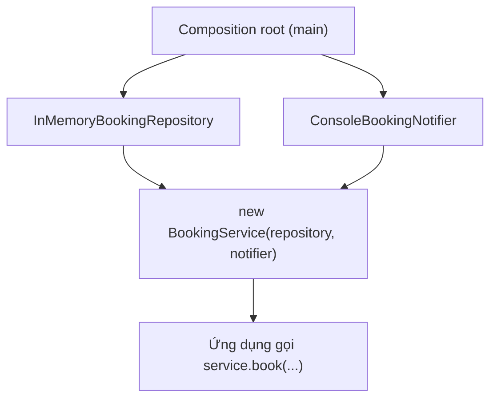
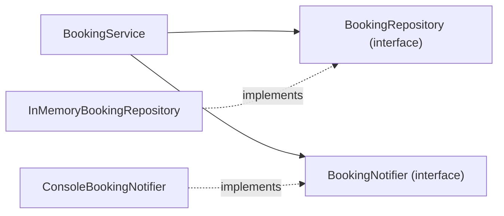
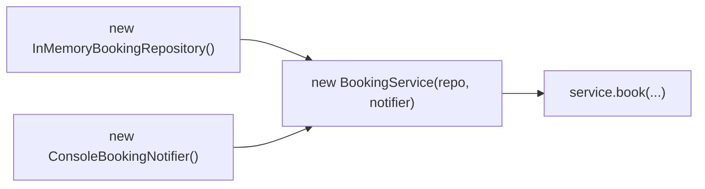

# Truyền phụ thuộc qua constructor (constructor injection)

Trong ứng dụng Java, `BookingService` cần một nơi lưu thông tin đặt chỗ và một thành phần gửi thông báo. Nếu service tự tạo các đối tượng này bằng `new`, service vừa xử lý nghiệp vụ, vừa quyết định phải dùng cách lưu dữ liệu và cách thông báo nào. Khi thay đổi công nghệ lưu trữ hoặc kiểm thử, mã nghiệp vụ dễ bị kéo theo những thay đổi không liên quan.

**Constructor injection** giải quyết vấn đề bằng cách đưa các cộng tác viên mà một đối tượng cần dùng vào **tham số constructor**. Đối tượng nhận phụ thuộc đã được tạo và lắp ghép từ bên ngoài, thay vì tự khởi tạo các cộng tác viên đó. Đây là một cách áp dụng **Dependency Injection (DI)** để thực hiện **Inversion of Control (IoC)** ở khâu tạo và nối đối tượng. Trong Java thuần, ta có thể làm điều này mà không cần Spring hay bất kỳ DI container nào.

Bài học thuộc chương **Các cách truyền phụ thuộc**, tập trung vào constructor injection: vì sao dùng, cách viết đúng, cách tạo đồ thị đối tượng tại **composition root**, cách nhận diện phạm vi/vòng đời và cách kiểm thử bằng Java thuần. Các cách truyền qua setter, field hoặc method được nhắc đến để đặt constructor injection vào bối cảnh, nhưng không phải trọng tâm.

## 1. Constructor injection hoạt động thế nào?

Một lớp cần `BookingRepository` và `BookingNotifier` khai báo nhu cầu đó ngay trong constructor:

```java
final class BookingService {
    private final BookingRepository repository;
    private final BookingNotifier notifier;

    BookingService(BookingRepository repository, BookingNotifier notifier) {
        this.repository = java.util.Objects.requireNonNull(repository, "repository");
        this.notifier = java.util.Objects.requireNonNull(notifier, "notifier");
    }

    // Các phương thức nghiệp vụ dùng repository và notifier.
}
```

Constructor thể hiện hai điều:

1. Một `BookingService` hợp lệ **cần cả hai cộng tác viên** trước khi có thể hoạt động.
2. Ai tạo `BookingService` phải chịu trách nhiệm cung cấp những cộng tác viên đó.

Khi chạy chương trình, một nơi lắp ghép có thể chọn repository lưu trong bộ nhớ và notifier ghi ra console; môi trường khác có thể chọn adapter lưu database và notifier gửi email. Mã của service không cần biết **ai tạo các đối tượng**, cũng không phải tự quyết định **implementation cụ thể**.



Sơ đồ cho thấy **thứ tự lắp ghép**; còn sơ đồ phụ thuộc mã nguồn hướng từ `BookingService` đến các hợp đồng `BookingRepository` và `BookingNotifier` mà service sử dụng:



Đừng nhầm hai chiều nhìn: mũi tên trên đồ thị **phụ thuộc** đi từ người dùng đến phụ thuộc; ở quá trình **lắp ghép**, đối tượng phụ thuộc thường được tạo trước rồi truyền lên đối tượng sử dụng.

## 2. Vấn đề khi lớp tự tạo cộng tác viên

Giả sử một service viết như sau (các kiểu được định nghĩa ở ví dụ đầy đủ phía dưới):

```java
final class TightlyCoupledBookingService {
    private final BookingRepository repository =
        new InMemoryBookingRepository();
    private final BookingNotifier notifier =
        new ConsoleBookingNotifier();

    Booking book(String id, int amount) {
        Booking booking = new Booking(id, amount);
        repository.save(booking);
        notifier.onCreated(booking);
        return booking;
    }
}
```

Ở cách này, service tự chốt hai implementation. Muốn kiểm thử không ghi console hoặc dùng một kho dữ liệu khác, ta phải sửa service, tạo thêm nhánh điều kiện, hoặc dùng thủ thuật thay thế trạng thái. Ranh giới giữa **nghiệp vụ sử dụng cộng tác viên** và **cấu hình ứng dụng tạo cộng tác viên** bị trộn lẫn.

Chú ý: constructor injection không có nghĩa là cấm mọi lệnh `new` trong service. Tạo một đối tượng dữ liệu nghiệp vụ mới như `new Booking(id, amount)` là bình thường nếu đối tượng đó thuộc trách nhiệm của service. Điều cần tránh là để service tự chọn và tự quản lý những **cộng tác viên bên ngoài** mà nó nên nhận từ nơi lắp ghép.

## 3. Ví dụ hoàn chỉnh bằng Java thuần

Ta xây dựng chức năng tạo booking. Service có hai phụ thuộc bắt buộc: repository để lưu và notifier để thông báo. Ví dụ dùng kho dữ liệu trong bộ nhớ và ghi thông báo ra console, nên chạy được mà không cần framework, cơ sở dữ liệu hay dịch vụ bên ngoài.

Tạo file `BookingApp.java` với toàn bộ nội dung sau:

```java
import java.util.HashMap;
import java.util.Map;
import java.util.Objects;

final class Booking {
    private final String id;
    private final int amount;

    Booking(String id, int amount) {
        this.id = id;
        this.amount = amount;
    }

    String id() {
        return id;
    }

    int amount() {
        return amount;
    }
}

interface BookingRepository {
    void save(Booking booking);
}

interface BookingNotifier {
    void onCreated(Booking booking);
}

final class BookingService {
    private final BookingRepository repository;
    private final BookingNotifier notifier;

    BookingService(BookingRepository repository, BookingNotifier notifier) {
        this.repository = Objects.requireNonNull(repository, "repository");
        this.notifier = Objects.requireNonNull(notifier, "notifier");
    }

    Booking book(String id, int amount) {
        if (id == null || id.trim().isEmpty()) {
            throw new IllegalArgumentException("id khong duoc rong");
        }
        if (amount < 0) {
            throw new IllegalArgumentException("amount phai >= 0");
        }

        Booking booking = new Booking(id, amount);
        repository.save(booking);
        notifier.onCreated(booking);
        return booking;
    }
}

final class InMemoryBookingRepository implements BookingRepository {
    private final Map<String, Booking> bookings = new HashMap<>();

    @Override
    public void save(Booking booking) {
        bookings.put(booking.id(), booking);
    }

    boolean contains(String id) {
        return bookings.containsKey(id);
    }
}

final class ConsoleBookingNotifier implements BookingNotifier {
    @Override
    public void onCreated(Booking booking) {
        System.out.println("Da tao booking " + booking.id());
    }
}

public class BookingApp {
    public static void main(String[] args) {
        // Composition root: chọn implementation, tạo và lắp các đối tượng.
        InMemoryBookingRepository repository = new InMemoryBookingRepository();
        BookingNotifier notifier = new ConsoleBookingNotifier();

        BookingService service = new BookingService(repository, notifier);

        // Phần sử dụng chỉ gọi nghiệp vụ.
        Booking result = service.book("BK-001", 200);
        System.out.println("Tong tien: " + result.amount());
        System.out.println("Da luu: " + repository.contains("BK-001"));
    }
}
```

Biên dịch và chạy:

```bash
javac BookingApp.java
java BookingApp
```

Kết quả:

```text
Da tao booking BK-001
Tong tien: 200
Da luu: true
```

Đọc lần lượt các vai trò trong ví dụ:

| Thành phần | Trách nhiệm | Có tự tạo cộng tác viên không? |
| --- | --- | --- |
| `BookingService` | Kiểm tra yêu cầu, tạo booking, phối hợp lưu và thông báo | Không; nhận repository và notifier qua constructor |
| `BookingRepository`, `BookingNotifier` | Hợp đồng mà nghiệp vụ cần | Không quyết định implementation |
| `InMemoryBookingRepository` | Cài đặt lưu booking trong bộ nhớ | Tự tạo `HashMap` để quản lý trạng thái nội bộ của chính nó |
| `ConsoleBookingNotifier` | Cài đặt thông báo trên console | Không cần phụ thuộc bên ngoài |
| `BookingApp.main` | Chọn implementation và lắp các đối tượng | Có; đây là composition root minh họa |

Một class **không bắt buộc** phải phụ thuộc vào interface mới được gọi là constructor injection. Ta vẫn có thể truyền một class cụ thể vào constructor khi đó là hợp đồng phù hợp. Interface trở nên hữu ích khi có nhiều implementation hoặc cần thay thế tại ranh giới kiểm thử; không nên tạo interface cho mọi class một cách máy móc.

## 4. Vì sao ưu tiên constructor injection cho phụ thuộc bắt buộc?

### 4.1. Đối tượng đủ điều kiện sử dụng ngay sau khi khởi tạo

Với constructor injection, đối tượng chỉ được tạo thành công khi caller đã truyền đủ các phụ thuộc bắt buộc. `Objects.requireNonNull` giúp phát hiện sớm việc truyền `null`, ngay tại nơi lắp ghép:

```java
new BookingService(null, new ConsoleBookingNotifier());
// Ném NullPointerException với thông tin "repository" ngay khi khởi tạo.
```

Phát hiện lỗi lúc khởi tạo dễ lần nguyên nhân hơn việc tạo được service nhưng đến một request sau đó mới gặp `NullPointerException`. Điều này không có nghĩa chỉ cần không-null là cấu hình hoàn toàn hợp lệ: ví dụ, adapter vẫn có thể nhận cấu hình sai hoặc kết nối tới tài nguyên chưa sẵn sàng. Constructor nên kiểm tra những bất biến cơ bản mà nó có thể kiểm tra một cách hợp lý.

### 4.2. Phụ thuộc hiện rõ trong API

Nhìn chữ ký `BookingService(BookingRepository, BookingNotifier)`, người đọc biết ngay class cần gì. Khi thêm một phụ thuộc bắt buộc mới, các nơi đang khởi tạo service sẽ phải cập nhật; compiler giúp chỉ ra những nơi cần xem lại. Đây thường là tín hiệu tốt để đánh giá xem trách nhiệm của service có đang tăng quá rộng không.

### 4.3. Dễ giữ tham chiếu ổn định

Đặt các trường là `private final` giúp service không gán lại tham chiếu sang repository hay notifier khác sau khi đã khởi tạo. Tuy nhiên, **`final` không làm đối tượng được tham chiếu trở nên bất biến hoặc an toàn cho nhiều luồng**: `InMemoryBookingRepository` ở ví dụ dùng `HashMap` vẫn có trạng thái có thể thay đổi.

### 4.4. Tạo ranh giới kiểm thử rõ

Muốn kiểm thử service, ta truyền vào fake/stub/spy qua đúng hai tham số constructor đã công khai nhu cầu. Không cần chạy ứng dụng đầy đủ hay dùng reflection để thay trường private. Kiểm thử được cách phối hợp nghiệp vụ giữa các cộng tác viên mà không dính đến adapter thật.

## 5. Kiểm thử không cần DI container

Ví dụ tiếp theo ghi nhận những gì service gửi tới repository và notifier. Tạo file `BookingServiceTest.java` **cùng thư mục** với `BookingApp.java`:

```java
public class BookingServiceTest {
    static final class RecordingRepository implements BookingRepository {
        Booking saved;

        @Override
        public void save(Booking booking) {
            saved = booking;
        }
    }

    static final class RecordingNotifier implements BookingNotifier {
        Booking notified;

        @Override
        public void onCreated(Booking booking) {
            notified = booking;
        }
    }

    public static void main(String[] args) {
        RecordingRepository repository = new RecordingRepository();
        RecordingNotifier notifier = new RecordingNotifier();

        BookingService service = new BookingService(repository, notifier);
        Booking result = service.book("BK-TEST", 350);

        if (!"BK-TEST".equals(result.id()) || result.amount() != 350) {
            throw new AssertionError("Sai ket qua nghiep vu");
        }
        if (repository.saved != result) {
            throw new AssertionError("Booking chua duoc luu");
        }
        if (notifier.notified != result) {
            throw new AssertionError("Booking chua duoc thong bao");
        }

        System.out.println("BookingServiceTest PASSED");
    }
}
```

Chạy:

```bash
javac BookingApp.java BookingServiceTest.java
java BookingServiceTest
```

Kết quả mong đợi:

```text
BookingServiceTest PASSED
```

Thử thay `RecordingRepository` bằng một fake ném lỗi khi `save` để kiểm tra hành vi ứng dụng khi lưu không thành công. Với thứ tự hiện tại (`save` trước `onCreated`), nếu `save` ném exception thì notifier không được gọi. Đây là một đặc tính có thể kiểm chứng ở cấp unit test; ví dụ chưa giải quyết các vấn đề nhất quán dữ liệu, retry hoặc giao dịch trong hệ thống thật.

**Điểm cốt lõi:** chính constructor của `BookingService` cho phép cấp fake mà không sửa mã nghiệp vụ. Việc thay adapter không nhất thiết phải dùng thư viện mock hoặc DI container.

## 6. Composition root quyết định lắp ghép và vòng đời

Constructor injection chỉ nói **cách một đối tượng nhận phụ thuộc**. Nó không tự quyết định **ai tạo đối tượng, bao nhiêu instance được tạo, dùng lại trong bao lâu và ai giải phóng tài nguyên**. Những việc đó thuộc về composition root và cơ chế quản lý vòng đời của ứng dụng.

Trong ví dụ, `BookingApp.main` là composition root đơn giản nhất. Nó khởi tạo các nút lá (repository, notifier), sau đó mới tạo `BookingService`, cuối cùng chuyển service vào luồng sử dụng:



Nếu ứng dụng có nhiều service dùng cùng repository, composition root có thể truyền **cùng một instance** cho nhiều service, hoặc tạo instance riêng nếu nghiệp vụ và ranh giới trạng thái yêu cầu. Đưa một object vào constructor không mặc định biến nó thành singleton; **scope là quyết định của nơi tạo và cung cấp object**.

Ví dụ về các phạm vi thường gặp:

| Phạm vi | Ý nghĩa minh họa | Điều phải kiểm tra |
| --- | --- | --- |
| Theo ứng dụng | Một instance được tái sử dụng suốt lúc ứng dụng chạy | Có an toàn khi nhiều luồng cùng truy cập và có quản lý tài nguyên đúng không? |
| Theo yêu cầu | Tạo các đối tượng cần thiết cho một request, bỏ sau request | Có vô tình giữ dữ liệu của request trong đối tượng sống lâu hơn không? |
| Mỗi lần cần | Tạo đối tượng mới khi thành phần khác yêu cầu | Chi phí tạo và việc giải phóng tài nguyên ra sao? |

**Cảnh báo về vòng đời:** Nếu một `BookingService` sống suốt ứng dụng mà lại nhận trực tiếp một `RequestContext` thuộc một request cụ thể và giữ trong trường `final`, service có thể giữ dữ liệu hết hạn hoặc của sai request. Giải pháp là thiết kế lại ranh giới scope, truyền dữ liệu request theo tham số của lời gọi khi thích hợp, hoặc dùng cơ chế cung cấp đối tượng theo đúng scope. Không nên chỉ bỏ `final` để đổi tham chiếu tùy tiện.

Với phụ thuộc chứa tài nguyên như socket hay kết nối, phải xác định **ai sở hữu trách nhiệm đóng**. Đối tượng dùng phụ thuộc không nhất thiết là chủ sở hữu tài nguyên: ví dụ, một service nhận `DataSource` thường không tự đóng toàn bộ nguồn kết nối sau mỗi request. Trong ứng dụng thuần Java, composition root có thể quản lý tài nguyên của chính nó bằng `try-with-resources` nếu loại tài nguyên hỗ trợ `AutoCloseable` và scope phù hợp.

## 7. Constructor injection so với các hình thức cung cấp phụ thuộc khác

| Cách truyền | Cơ chế | Khi nào phù hợp | Điều cần cân nhắc |
| --- | --- | --- | --- |
| **Constructor injection** | Cấp phụ thuộc lúc tạo đối tượng | Phụ thuộc bắt buộc, dùng xuyên suốt vòng đời | Constructor dài có thể báo hiệu class quá nhiều trách nhiệm |
| Setter injection | Gọi phương thức đặt phụ thuộc sau khi tạo | Cấu hình/khả năng thay đổi thực sự tùy chọn | Có thể tồn tại trạng thái chưa cấu hình đầy đủ |
| Field injection | Framework hoặc reflection gán trực tiếp vào trường | Một số môi trường framework có hỗ trợ | Khó nhìn nhu cầu từ API, khó khởi tạo trực tiếp khi kiểm thử |
| Method parameter | Truyền dữ liệu hoặc cộng tác viên cho từng lần gọi | Giá trị thay đổi theo thao tác/request | Không thay thế được nhu cầu dùng ổn định trong cả vòng đời |

Không có quy tắc rằng mọi tham số đều phải đặt trong constructor. **Phụ thuộc ổn định, bắt buộc của đối tượng** thường phù hợp với constructor; **dữ liệu riêng của thao tác** như `bookingId` và `amount` nên đi vào `book(id, amount)`. Nếu mọi lần gọi đều truyền một cùng repository vào `book(...)` mà service luôn cần nó, đó có thể là dấu hiệu nên xem lại thiết kế.

## 8. Các lỗi thường gặp và cách tránh

### 8.1. Truyền `null` để biểu diễn “không cần phụ thuộc”

```java
BookingService service = new BookingService(repository, null);
```

Cách này làm một phụ thuộc bắt buộc trở nên mập mờ. Nếu thông báo thật sự tùy chọn, có thể cấp một implementation **không làm gì** (null object) khi hợp đồng cho phép, hoặc thiết kế lại vai trò dịch vụ để thể hiện rõ biến thể nghiệp vụ. Không nên để service rải rác `if (notifier != null)` nếu notifier là điều kiện cần của hợp đồng đã thiết kế.

### 8.2. Constructor tự tạo phụ thuộc làm giá trị mặc định

```java
// Không nên dùng làm đường khởi tạo mặc định cho service cần DI.
BookingService() {
    this(new InMemoryBookingRepository(), new ConsoleBookingNotifier());
}
```

Constructor không tham số như trên đưa quyết định chọn implementation trở lại trong service. Nếu cần cấu hình tiện lợi cho một ứng dụng nhỏ, đặt factory hoặc mã khởi tạo tại composition root. Khi thật sự hỗ trợ nhiều constructor có ý nghĩa khác nhau, phải làm rõ bất biến và đường khởi tạo, tránh để một đường tạo đối tượng bỏ sót phụ thuộc bắt buộc.

### 8.3. Constructor có quá nhiều phụ thuộc

Constructor nhận mười hoặc mười lăm cộng tác viên không phải lỗi cú pháp DI, nhưng thường là tín hiệu class đang xử lý quá nhiều trách nhiệm. Hãy xem nhóm thao tác nào có thể tách thành service riêng hoặc tạo một thành phần chuyên trách thực sự có ý nghĩa. Không nên gộp mọi phụ thuộc vào một “`DependencyBag`” chỉ để rút ngắn danh sách tham số: điều đó che giấu nhu cầu thực tế của class.

### 8.4. Vòng phụ thuộc qua constructor

```text
ServiceA cần ServiceB
ServiceB cần ServiceA
```

Nếu cả hai constructor đều cần một instance hoàn chỉnh của đối phương, composition root không thể khởi tạo theo trình tự thông thường. Đây là dấu hiệu cần xem lại ranh giới trách nhiệm, hướng gọi hoặc tách một phần nhiệm vụ ra đối tượng thứ ba. Một số container có cơ chế tạo trễ, nhưng đó không mặc nhiên là cách sửa thiết kế.

### 8.5. Cho rằng constructor injection tự đảm bảo an toàn luồng

Các trường `final` ổn định tham chiếu, nhưng một repository có `HashMap` hoặc bộ đếm nội bộ vẫn có thể bị race condition khi nhiều request cùng dùng. Cần chọn implementation, cơ chế đồng bộ và scope phù hợp với mô hình thực thi; DI không thay thế thiết kế concurrency.

### 8.6. Dùng service locator thay vì khai báo nhu cầu

```java
// Phác họa một anti-pattern: service tự tra cứu phụ thuộc ở kho toàn cục.
repository = GlobalContainer.get(BookingRepository.class);
```

Với cách này, nhu cầu repository không xuất hiện trong chữ ký constructor; môi trường kiểm thử phải cấu hình kho toàn cục và lỗi thiếu phụ thuộc dễ xuất hiện muộn. Constructor injection làm đầu vào của service rõ ràng. Ví dụ trên chỉ minh họa anti-pattern, không phải mã có thể biên dịch độc lập.

## 9. Từ Java thuần đến DI container

Khi ứng dụng tăng số thành phần, việc viết tay nhiều câu lệnh `new` có thể trở nên dài. Một DI container có thể đảm nhiệm việc tạo instance, ánh xạ interface đến implementation, quyết định scope và gọi constructor theo cấu hình.

**Phần không đổi** là thiết kế của `BookingService`:

```java
BookingService(BookingRepository repository, BookingNotifier notifier) {
    this.repository = Objects.requireNonNull(repository);
    this.notifier = Objects.requireNonNull(notifier);
}
```

Trong ứng dụng Java thuần, `main` gọi constructor và truyền các object. Với DI container, container có thể gọi chính constructor đó sau khi tìm hoặc tạo các phụ thuộc tương ứng. Container giúp **tự động hóa composition**, nhưng không thay thế việc hiểu mỗi class thực sự cần gì, vì sao cần và instance sống bao lâu. Học cách ghép đối tượng thủ công trước giúp bạn dễ chẩn đoán lỗi thiếu binding, nhiều implementation cùng loại hoặc vòng phụ thuộc khi dùng container về sau.

## 10. Quy trình áp dụng trong một tính năng mới

1. **Xác định trách nhiệm** của lớp, ví dụ `BookingService` chỉ điều phối việc tạo booking.
2. **Liệt kê các cộng tác viên bắt buộc** mà lớp phải dùng; phân biệt chúng với dữ liệu riêng của từng request.
3. **Khai báo constructor** nhận đúng các cộng tác viên, lưu tham chiếu `private final` khi không cần thay đổi, và kiểm tra giá trị không hợp lệ sớm.
4. **Chọn implementation ở composition root**, tạo các instance phù hợp và truyền chúng vào constructor theo đúng đồ thị.
5. **Viết unit test bằng fake** cho các phụ thuộc ở ranh giới; dùng integration test để kiểm tra adapter thật và tài nguyên bên ngoài.
6. **Kiểm tra scope/vòng đời** nếu phụ thuộc chứa trạng thái, dùng chung giữa luồng hoặc cần giải phóng tài nguyên.

## 11. Bài tập tự luyện

**Bài 1.** `InvoiceService` tự tạo `new PdfExporter()` và `new EmailSender()` trong constructor. Hãy sửa để service nhận `InvoiceExporter` và `MessageSender` qua constructor; nơi khởi động ứng dụng quyết định dùng PDF và email hay các implementation thử nghiệm. *Gợi ý:* mỗi interface chỉ cần mô tả thao tác nghiệp vụ mà service thật sự sử dụng.

**Bài 2.** Cho `BookingService` nhận thêm `String bookingId` vào constructor để mỗi service giữ một booking ID. Trong ứng dụng phục vụ nhiều request, thiết kế này có hợp lý không? *Gợi ý:* nếu một instance service được dùng lại, ID sẽ bị cố định theo lần tạo. Dữ liệu gắn với thao tác thường thuộc tham số `book(...)`, không phải phụ thuộc ổn định của service.

**Bài 3.** Tại sao `new Booking(id, amount)` trong `book(...)` không vi phạm nguyên tắc constructor injection? *Đáp án định hướng:* `Booking` là dữ liệu nghiệp vụ mà service đang tạo; DI chủ yếu tách việc cung cấp các cộng tác viên và hạ tầng mà service sử dụng. Khi việc tạo dữ liệu trở nên phức tạp, có thể xem xét factory riêng dựa trên nhu cầu thực tế.

**Bài 4.** Hãy sửa `BookingServiceTest` để notifier ghi số lần được gọi. Kiểm tra rằng sau một lệnh `book(...)` thành công, `onCreated(...)` được gọi đúng một lần; sau một lời gọi với `amount = -1`, cả repository lẫn notifier đều không được gọi. Đó là cách kiểm chứng hành vi tại ranh giới phụ thuộc mà không dùng framework.

Khi nắm vững constructor injection, bạn có thể đọc chữ ký constructor để hiểu nhu cầu của một class, đặt việc chọn implementation tại composition root, kiểm thử độc lập bằng Java thuần và có cơ sở để quản lý scope, vòng đời trước khi chuyển sang DI container.
