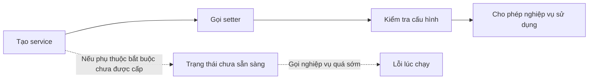

# Truyền phụ thuộc qua setter hoặc thuộc tính

Trong Java, một đối tượng có thể nhận cộng tác viên từ bên ngoài qua constructor, qua phương thức setter hoặc qua một cơ chế gán thuộc tính do framework hỗ trợ. Cả ba đều có thể phục vụ **Dependency Injection (DI)**: tách lớp *sử dụng* phụ thuộc khỏi nơi *tạo và lắp ghép* phụ thuộc. Tuy nhiên, chúng tạo ra những cam kết khác nhau về tính hợp lệ của đối tượng, thời điểm cấu hình và khả năng thay đổi sau khởi tạo.

Bài này thuộc chương **Các cách truyền phụ thuộc** của module **DEPENDENCY_INJECTION**. Ta sẽ thực hành **setter injection** bằng Java thuần, phân biệt nó với **property/field injection**, tìm hiểu mối liên hệ với **Inversion of Control (IoC)** và **composition root**, rồi đánh giá ảnh hưởng tới scope, vòng đời và kiểm thử trước khi tiếp cận DI container.

## 1. Setter injection là gì?

**Setter injection** là việc đối tượng nhận một cộng tác viên thông qua phương thức gán công khai, thông thường có tên `setXxx(...)`, sau khi đối tượng đã được tạo:

```java
final class ReportService {
    private ReportExporter exporter;

    public void setExporter(ReportExporter exporter) {
        this.exporter = java.util.Objects.requireNonNull(exporter, "exporter");
    }
}
```

Trong đó `ReportExporter` là một kiểu cộng tác viên được khai báo ở nơi khác. Đoạn mã trên minh họa cơ chế gán; tự nó chưa tạo thành chương trình hoàn chỉnh.

Trình tự sử dụng thường là:

1. Composition root tạo `ReportService`.
2. Composition root tạo hoặc lấy `ReportExporter` thích hợp.
3. Composition root gọi `service.setExporter(exporter)`.
4. Ứng dụng gọi các thao tác nghiệp vụ của `service`.

Lớp `ReportService` **không tự `new` exporter**. Nơi lắp ghép có quyền cấp bản thật, bản giả lập hoặc một hiện thực khác. Đây là DI và thể hiện IoC đối với quyết định tạo, chọn và nối các cộng tác viên.

Khác với constructor injection, setter injection tạo ra một khoảng thời gian mà đối tượng **đã tồn tại nhưng chưa chắc đã được cấu hình xong**. Nếu `exporter` bắt buộc mà không có giá trị mặc định, lời gọi nghiệp vụ quá sớm có thể thất bại. Nếu setter được gọi lần nữa, hành vi các lần gọi sau có thể thay đổi.

## 2. Phân biệt setter, property và field injection

Trong tài liệu và framework, từ *property injection* đôi khi có nghĩa là **cấu hình thuộc tính qua setter**, đôi khi được dùng rộng hơn để chỉ việc container điền giá trị vào các thuộc tính của đối tượng. Cần xem cơ chế cụ thể thay vì coi mọi cách gán đều giống nhau.

| Cách cấp phụ thuộc | Điểm nhận giá trị | Đặc điểm |
| --- | --- | --- |
| **Constructor injection** | Tham số constructor | Phù hợp với phụ thuộc bắt buộc; đối tượng có thể được tạo với đầy đủ cộng tác viên ngay từ đầu |
| **Setter injection** | Phương thức như `setExporter(...)` | Phù hợp cho cấu hình tùy chọn hoặc cần thay sau khi tạo; có thể phát sinh trạng thái chưa cấu hình |
| **Property injection qua setter** | Thuộc tính JavaBeans có setter tương ứng | Về cơ chế nhận phụ thuộc, thường chính là setter injection; container hoặc mã lắp ghép gọi setter |
| **Field injection** | Gán trực tiếp vào trường, thường nhờ reflection/container | Không cần setter công khai, nhưng phụ thuộc khó nhìn thấy ở API khởi tạo và khó cấp thủ công trong kiểm thử |

Trong JavaBeans, một thuộc tính có tên `exporter` có thể được biểu diễn bởi các phương thức `getExporter()` và `setExporter(...)`; không nhất thiết phải có trường cùng tên. **Một trường Java không tự động trở thành điểm tiêm phụ thuộc** chỉ vì tên của nó giống một property. Java thuần không cung cấp cơ chế tự tìm đối tượng và gán vào trường khi thấy một chú thích tùy ý.

Ví dụ field injection thường gặp trong ứng dụng có DI container (mã minh họa, cần thư viện cung cấp annotation và cơ chế xử lý):

```java
class ReportService {
    @Inject
    private ReportExporter exporter;
}
```

`@Inject` ở đây chỉ biểu thị ý định; phải có thư viện annotation phù hợp và container hoặc bộ xử lý thực hiện việc tiêm. Lệnh `new ReportService()` trong Java thuần **không tự cấp** `exporter`. Trong bài này ta chủ động gọi setter, để quá trình cấp phụ thuộc có thể quan sát và kiểm thử mà không cần framework.

Ngoài ra, `setTimeoutMillis(int)` hoặc `setEndpoint(String)` có thể nhận **giá trị cấu hình**, chứ không nhất thiết nhận một đối tượng dịch vụ. Chúng đều là setter về cú pháp, nhưng chỉ nên gọi là *dependency injection* khi giá trị đó thật sự là một đầu vào/phụ thuộc cần cung cấp từ bên ngoài theo thiết kế.

## 3. Chọn setter khi cộng tác viên có tính tùy chọn

Một trường hợp phù hợp là dịch vụ đặt chỗ luôn phải lưu thông tin, nhưng thao tác gửi biên nhận có thể bật hoặc tắt. Khả năng lưu trữ là **phụ thuộc bắt buộc** và được nhận qua constructor. Khả năng gửi biên nhận là **cấu hình tùy chọn**, có một hành vi mặc định an toàn là không gửi; chương trình có thể cấp bộ gửi qua setter.

Lưu toàn bộ chương trình sau vào `SetterInjectionExample.java`:

```java
import java.util.ArrayList;
import java.util.List;
import java.util.Objects;

public final class SetterInjectionExample {
    interface ReservationStore {
        void save(String reservationCode);
    }

    interface ReceiptSender {
        void sendReceipt(String reservationCode);
    }

    static final class InMemoryReservationStore implements ReservationStore {
        private final List<String> savedCodes = new ArrayList<>();

        @Override
        public void save(String reservationCode) {
            savedCodes.add(reservationCode);
        }

        List<String> savedCodes() {
            return List.copyOf(savedCodes);
        }
    }

    static final class ConsoleReceiptSender implements ReceiptSender {
        @Override
        public void sendReceipt(String reservationCode) {
            System.out.println("Da gui bien nhan: " + reservationCode);
        }
    }

    static final class ReservationService {
        private final ReservationStore store;

        // Mặc định: không gửi biên nhận; đây là một khả năng tùy chọn.
        private ReceiptSender receiptSender = reservationCode -> { };

        ReservationService(ReservationStore store) {
            this.store = Objects.requireNonNull(store, "store");
        }

        public void setReceiptSender(ReceiptSender receiptSender) {
            this.receiptSender =
                Objects.requireNonNull(receiptSender, "receiptSender");
        }

        void confirm(String reservationCode) {
            if (reservationCode == null || reservationCode.isBlank()) {
                throw new IllegalArgumentException("reservationCode is blank");
            }
            store.save(reservationCode);
            receiptSender.sendReceipt(reservationCode);
        }
    }

    public static void main(String[] args) {
        // Composition root: tạo, cấu hình rồi mới đưa service vào sử dụng.
        InMemoryReservationStore store = new InMemoryReservationStore();
        ReservationService service = new ReservationService(store);

        service.confirm("R-001"); // Lưu, không gửi biên nhận.

        ReceiptSender sender = new ConsoleReceiptSender();
        service.setReceiptSender(sender);
        service.confirm("R-002"); // Lưu và gửi biên nhận.

        System.out.println("Da luu: " + store.savedCodes());
    }
}
```

Chạy bằng JDK 11 trở lên:

```bash
javac SetterInjectionExample.java
java SetterInjectionExample
```

Kết quả:

```text
Da gui bien nhan: R-002
Da luu: [R-001, R-002]
```

Trong ví dụ, cả `ReservationStore` và `ReceiptSender` đều là những hợp đồng cộng tác rõ ràng. `ReservationService` không biết cách tạo `ConsoleReceiptSender`. Việc bật gửi biên nhận được quyết định tại composition root. Hàm `confirm()` vẫn chủ động lưu rồi yêu cầu gửi; IoC không có nghĩa là toàn bộ quyền điều khiển nghiệp vụ phải chuyển cho framework.

Điểm khác biệt có chủ ý: `store` là trường `final`, tồn tại trong mọi `ReservationService` hợp lệ; `receiptSender` có hành vi mặc định và có thể đổi sau khi tạo. Với nghiệp vụ bắt buộc phải gửi biên nhận, thiết kế mặc định *không gửi* có thể làm mất chức năng âm thầm. Khi đó nên nhận sender qua constructor hoặc có cơ chế xác nhận cấu hình rõ ràng.

## 4. Setter cho phụ thuộc bắt buộc: trạng thái chưa sẵn sàng

Giả sử một dịch vụ chỉ có thể hoạt động sau khi được cấp `PaymentGateway`. Nếu sử dụng setter thay constructor, đối tượng cần chặn lời gọi nghiệp vụ trước khi cấu hình:

```java
import java.util.Objects;

interface PaymentGateway {
    void charge(int amount);
}

final class PaymentService {
    private PaymentGateway gateway;

    public void setPaymentGateway(PaymentGateway gateway) {
        this.gateway = Objects.requireNonNull(gateway, "gateway");
    }

    public void pay(int amount) {
        if (gateway == null) {
            throw new IllegalStateException(
                "PaymentGateway chua duoc cau hinh");
        }
        if (amount <= 0) {
            throw new IllegalArgumentException("amount must be positive");
        }
        gateway.charge(amount);
    }
}
```

Lệnh `new PaymentService().pay(100)` sẽ phát sinh `IllegalStateException`; lỗi này giúp nhận biết thiếu cấu hình, nhưng vẫn chỉ xảy ra **khi thực thi**. Constructor `PaymentService(PaymentGateway gateway)` có thể buộc bên tạo truyền đối số ngay lúc khởi tạo, giảm nguy cơ sử dụng một instance chưa sẵn sàng. Với phụ thuộc bắt buộc và ổn định suốt vòng đời, **constructor injection thường là lựa chọn mặc định dễ kiểm soát hơn**.

Có thể dùng setter bắt buộc khi bị ràng buộc bởi giao thức tạo đối tượng, chẳng hạn một framework yêu cầu constructor không tham số. Khi đó cần xây dựng quy tắc rõ ràng về giai đoạn khởi tạo, kiểm tra thiếu cấu hình và bảo đảm đối tượng chưa được xuất bản cho mã nghiệp vụ trước khi cấu hình xong.

Sơ đồ vòng đời tối giản:



## 5. Kiểm thử setter injection bằng Java thuần

Cách kiểm thử tốt nhất là tạo một đối tượng ghi nhận các lần gửi thay vì gửi email, gọi HTTP hoặc phụ thuộc hạ tầng thật. Với setter injection, bài kiểm thử có thể cấu hình fake trực tiếp bằng API công khai của đối tượng.

Tạo `SetterInjectionCheck.java` trong cùng thư mục với `SetterInjectionExample.java`:

```java
import java.util.ArrayList;
import java.util.List;

public final class SetterInjectionCheck {
    public static void main(String[] args) {
        SetterInjectionExample.InMemoryReservationStore store =
            new SetterInjectionExample.InMemoryReservationStore();
        SetterInjectionExample.ReservationService service =
            new SetterInjectionExample.ReservationService(store);

        List<String> receiptCodes = new ArrayList<>();
        service.setReceiptSender(receiptCodes::add);

        service.confirm("TEST-001");
        check(store.savedCodes().equals(List.of("TEST-001")),
            "Ma dat cho chua duoc luu dung");
        check(receiptCodes.equals(List.of("TEST-001")),
            "Bo gui chua nhan ma dat cho");

        boolean rejectedNull = false;
        try {
            service.setReceiptSender(null);
        } catch (NullPointerException expected) {
            rejectedNull = true;
        }
        check(rejectedNull, "Setter phai tu choi dependency null");

        SetterInjectionExample.ReservationService withoutSender =
            new SetterInjectionExample.ReservationService(store);
        withoutSender.confirm("TEST-002");
        check(store.savedCodes().equals(List.of("TEST-001", "TEST-002")),
            "Cau hinh tuy chon khong duoc chan thao tac luu");
        check(receiptCodes.equals(List.of("TEST-001")),
            "Service khac khong duoc dung nham sender da tiem");

        System.out.println("PASS: setter injection");
    }

    private static void check(boolean condition, String message) {
        if (!condition) {
            throw new AssertionError(message);
        }
    }
}
```

```bash
javac SetterInjectionExample.java SetterInjectionCheck.java
java SetterInjectionCheck
```

Kết quả mong đợi: `PASS: setter injection`.

Đoạn kiểm thử xác nhận bốn hành vi: dữ liệu vẫn được lưu; fake sender nhận đúng mã; setter từ chối `null`; instance chưa được cấu hình sender vẫn hoạt động theo chính sách *không gửi*. Không cần DI container và không có lời gọi mạng thật. Trong sản phẩm thực tế, phải kiểm thử tích hợp riêng để xác nhận `ConsoleReceiptSender`, email adapter hoặc hạ tầng gửi thực sự hoạt động.

Đối với field injection, việc thay fake trong bài kiểm thử có thể phải khởi động container, dùng reflection hoặc tạo thêm điểm cấu hình riêng. Đó là một lý do thực dụng để ưu tiên constructor/setter công khai khi cần kiểm thử lớp trong Java thuần.

## 6. Vì sao thay đổi setter sau khởi tạo cần thận trọng?

Setter công khai là **khả năng thay đổi cấu hình**, không chỉ là cách tạo ban đầu. Nếu đối tượng đang phục vụ request, thay sender hoặc repository giữa chừng có thể gây hành vi khó dự đoán:

- **Thời điểm cấu hình:** một luồng gọi nghiệp vụ trước khi composition root gọi setter có thể nhận trạng thái mặc định hoặc thất bại vì thiếu cộng tác viên.
- **Tính nhất quán:** lần gọi trước có thể dùng sender A, lần gọi sau dùng sender B. Nếu nghiệp vụ yêu cầu một cấu hình bất biến, đây có thể là lỗi thiết kế.
- **An toàn luồng:** trường mutable được đọc/ghi từ nhiều luồng mà không đồng bộ có thể gây vấn đề về khả năng nhìn thấy giá trị hoặc nhất quán. Thêm `volatile` có thể hỗ trợ nhìn thấy tham chiếu mới, nhưng không tự bảo đảm toàn bộ thao tác nghiệp vụ là nguyên tử.
- **Độ chia sẻ:** một service có scope toàn ứng dụng nhận phụ thuộc mang dữ liệu riêng của từng request có thể giữ nhầm dữ liệu hoặc dùng một đối tượng đã hết vòng đời.
- **Tài nguyên:** thay phụ thuộc sở hữu kết nối, file hoặc thread có thể đòi hỏi quy tắc đóng/thu hồi tài nguyên. Một setter đơn giản không tự giải quyết vòng đời của cộng tác viên cũ.

**Cách làm thực tế:** cấu hình setter tại composition root **trước khi công bố đối tượng cho các thành phần dùng nó**; tránh đổi cộng tác viên khi request đang chạy, trừ khi đó là một yêu cầu thiết kế chủ động với cơ chế đồng bộ và quản lý vòng đời thích hợp.

Khi cần cấu hình thay đổi thường xuyên, có thể cân nhắc tiêm một đối tượng chính sách có API truy vấn dữ liệu hiện hành, hoặc thiết kế một cơ chế cập nhật cấu hình chuyên biệt. Việc chọn cách nào phụ thuộc mức độ nhất quán cần thiết; không nên chỉ mở thêm setter trên singleton dùng chung.

## 7. Setter injection, scope và vòng đời trong DI container

DI container có thể tạo đối tượng, gọi các setter theo cấu hình và quản lý vòng đời. Tuy nhiên, việc container hỗ trợ setter injection không loại bỏ các câu hỏi thiết kế:

| Tình huống | Câu hỏi cần giải quyết |
| --- | --- |
| Service tạo mới cho từng yêu cầu | Setter đã được gọi trước khi request truy cập service chưa? |
| Service singleton | Phụ thuộc được tiêm có an toàn khi chia sẻ cho nhiều luồng không? |
| Phụ thuộc chỉ sống trong một request | Có bị giữ lâu hơn request khi được gán vào một service sống lâu không? |
| Setter được gọi lại | Ai được phép thay, khi nào thay và các lời gọi đang thực hiện sẽ thấy phiên bản nào? |
| Phụ thuộc quản lý tài nguyên | Ai đóng tài nguyên, và việc thay tham chiếu có làm rò rỉ tài nguyên không? |

Container có thể có scope application/singleton, request, session hoặc scope tùy biến tùy công nghệ. Không có quy tắc chung rằng mọi setter-injected dependency đều sống cùng vòng đời với đối tượng nhận nó. Cần xét cách container thực sự tạo proxy, cung cấp instance và quản lý tài nguyên, nhất là khi scope của hai bên khác nhau.

Trong Java thuần, composition root làm điều đó một cách tường minh. Ví dụ, `main()` tạo một sender và gọi `setReceiptSender` trước khi cho service phục vụ các lời gọi. Khi chuyển sang container, thay đổi chủ yếu là **cơ chế lắp ghép**; yêu cầu về tính hợp lệ, tính nhất quán và vòng đời vẫn tồn tại.

## 8. Chọn constructor, setter hay field injection?

Hãy quyết định từ **hợp đồng của đối tượng**, trước khi quyết định framework sẽ cấp phụ thuộc bằng cách nào:

| Tiêu chí | Constructor injection | Setter injection | Field injection qua container |
| --- | --- | --- | --- |
| Phụ thuộc bắt buộc | Thường phù hợp nhất | Có thể dùng nhưng phải bảo vệ trạng thái chưa sẵn sàng | Cần container kiểm tra và gán đúng trước khi dùng |
| Phụ thuộc tùy chọn | Dùng constructor quá tải/giá trị mặc định khi hợp lý | Phù hợp nếu có mặc định rõ và hợp lệ | Có thể hỗ trợ, nhưng cách cấu hình tùy container |
| Cấu hình lại sau khởi tạo | Không trực tiếp qua tham chiếu `final` | Có thể, cần quản lý đồng thời và vòng đời | Có thể khó hoặc không được hỗ trợ như một API cấu hình công khai |
| Quan sát yêu cầu tại API | Thấy trong chữ ký constructor | Thấy ở setter; có thể bỏ sót lời gọi | Thường phải đọc annotation/trường và biết container |
| Kiểm thử không có framework | Truyền fake khi tạo | Gọi setter với fake | Có thể cần container/reflection |
| Bất biến của tham chiếu phụ thuộc | Dễ giữ bằng `final` | Trường thường mutable | Thường do container kiểm soát, phụ thuộc cách triển khai |

Ưu tiên **constructor injection** cho các thành phần bắt buộc và ổn định trong suốt vòng đời của service. Dùng **setter injection** khi phụ thuộc thực sự tùy chọn, có giá trị mặc định hợp lệ, hoặc khi yêu cầu tích hợp bắt buộc phải khởi tạo trước rồi cấu hình sau. Hạn chế **field injection** khi cần API khởi tạo tường minh hoặc kiểm thử Java thuần, vì phụ thuộc được che trong chi tiết framework.

Một số bẫy cần tránh:

1. **Setter nhưng vẫn tự tạo implementation:** `setSender(...)` tồn tại nhưng `send()` lại gọi `new MailSender()`; khi đó đường thực thi vẫn phụ thuộc vào thứ tự tạo và hiện thực bên trong.
2. **Phụ thuộc bắt buộc nhưng chỉ mong framework nhớ gọi setter:** thiếu kiểm tra cấu hình có thể gây `NullPointerException` muộn trong nghiệp vụ.
3. **Setter nhận `null` để tắt tính năng mà không quy định rõ:** cùng một giá trị `null` dễ bị hiểu là cấu hình thiếu hoặc hành vi chủ đích. Nên có chính sách mặc định hoặc API bật/tắt rõ ràng.
4. **Setter quá nhiều cho một service:** có thể là dấu hiệu lớp gánh nhiều trách nhiệm hoặc cấu hình phức tạp. Cần xem lại ranh giới lớp thay vì chỉ bổ sung điểm tiêm.
5. **Truyền cả container/service locator vào lớp:** khiến phụ thuộc thật bị ẩn phía sau lời gọi tra cứu, làm giảm lợi ích của DI.

## 9. Bài tập áp dụng

Một `InvoiceService` cần `InvoiceStore` để lưu hóa đơn, có thể thêm `AuditLogger` nếu môi trường triển khai bật kiểm toán. Đối tượng được dùng trong ứng dụng có nhiều request.

**Yêu cầu:**

1. Dùng constructor để nhận `InvoiceStore`; dùng setter để nhận `AuditLogger` nếu đây thật sự là tính năng tùy chọn.
2. Định nghĩa một hành vi mặc định hợp lệ khi không cấu hình logger, ví dụ logger không ghi gì.
3. Đặt nơi tạo và lắp ghép trong `main()`, không tạo logger trực tiếp trong logic lưu hóa đơn.
4. Viết một bản fake `InvoiceStore` và logger ghi nhận danh sách sự kiện; xác nhận dữ liệu được lưu và chỉ ghi log khi bật logger.
5. Giải thích vì sao không nên gọi lại setter để thay logger đồng thời với các request đang chạy nếu chưa có cơ chế đồng bộ.

**Gợi ý thiết kế:** `InvoiceService(InvoiceStore store)` tạo ra service có phụ thuộc bắt buộc; `setAuditLogger(AuditLogger logger)` cấu hình hành vi tùy chọn. Nếu chính sách nghiệp vụ quy định mọi hóa đơn bắt buộc phải có bản ghi kiểm toán, hãy chuyển `AuditLogger` sang constructor để không tồn tại đường chạy âm thầm bỏ qua kiểm toán.

**Điểm cần ghi nhớ:** Setter injection là một hình thức DI hợp lệ, thường hữu ích cho khả năng tùy chọn và cấu hình sau khi tạo. Property injection có thể dùng setter hoặc một cơ chế do container định nghĩa; field injection cần hỗ trợ từ framework. Chọn điểm nhận phụ thuộc theo **mức độ bắt buộc, thời điểm cấu hình, khả năng kiểm thử, scope và vòng đời**, rồi để composition root hoặc DI container thực hiện việc tạo và lắp ghép đối tượng.
