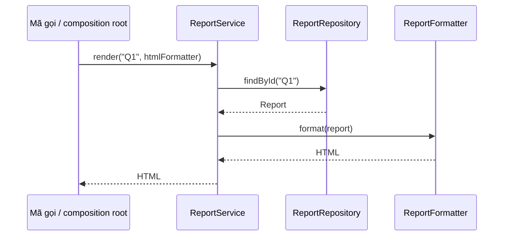
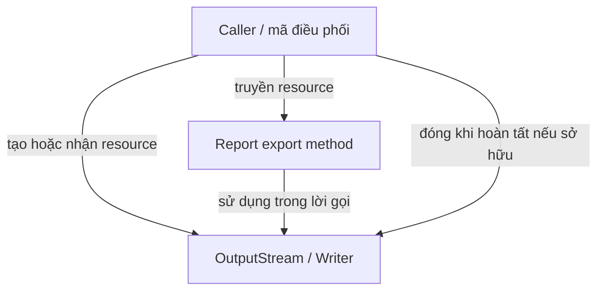

# Truyền phụ thuộc qua tham số của phương thức

**Truyền phụ thuộc qua tham số của phương thức** (*method parameter injection*, thường được gọi là *method injection* theo nghĩa rộng) là cách để một đối tượng nhận cộng tác viên cần thiết **ngay tại thời điểm thực hiện một thao tác**, qua tham số của phương thức. Đối tượng sử dụng cộng tác viên đó mà không tự khởi tạo hoặc tự tra cứu nó.

Đây là một kỹ thuật **Dependency Injection (DI)** áp dụng trực tiếp bằng Java thuần. Trong bối cảnh **Inversion of Control (IoC)**, quyền chọn và cung cấp cộng tác viên được trao cho mã gọi phương thức. Kỹ thuật này đặc biệt phù hợp khi một phụ thuộc **khác nhau giữa các lần gọi** hoặc chỉ cần thiết trong **một thao tác cụ thể**.

Bài học nằm trong phần **Các cách truyền phụ thuộc** của module **Dependency Injection**. Mục tiêu là hiểu khi nào nên truyền dependency theo từng lời gọi, khi nào nên ưu tiên constructor injection, hệ quả đối với composition root, scope, vòng đời và cách viết kiểm thử không cần DI container.

## 1. Vấn đề: cùng một dịch vụ, mỗi lần xử lý cần một cộng tác viên khác

Giả sử ứng dụng tạo báo cáo từ dữ liệu đã lưu. Một `ReportService` cần:

- `ReportRepository` để tải nội dung báo cáo. Đây là phụ thuộc tương đối ổn định của service.
- `ReportFormatter` để chuyển báo cáo sang HTML, văn bản thuần hoặc định dạng khác. Người gọi có thể chọn **một formatter khác cho mỗi lần xuất**.

Nếu `ReportService` tự khởi tạo formatter, nó phải biết từng implementation và cách lựa chọn chúng:

```java
// Minh họa thiết kế gắn chặt: HtmlReportFormatter và
// TextReportFormatter là các lớp giả định đã được định nghĩa.
final class ReportService {
    private final ReportRepository repository;

    ReportService(ReportRepository repository) {
        this.repository = repository;
    }

    String render(String reportId, boolean html) {
        Report report = repository.findById(reportId);
        ReportFormatter formatter = html
                ? new HtmlReportFormatter()
                : new TextReportFormatter();
        return formatter.format(report);
    }
}
```

Lớp nghiệp vụ hiện quyết định **cách tạo** formatter, phải sửa khi có một implementation mới và khó buộc formatter phát sinh tình huống lỗi đặc biệt trong unit test. Thay `boolean` bằng `enum` có thể làm giao diện rõ hơn, nhưng nếu logic vẫn tạo tất cả formatter bên trong thì quyền lắp ghép vẫn nằm ở đó.

Một cách khác là **truyền formatter vào phương thức**:

```java
final class ReportService {
    private final ReportRepository repository;

    ReportService(ReportRepository repository) {
        this.repository = repository;
    }

    String render(String reportId, ReportFormatter formatter) {
        Report report = repository.findById(reportId);
        return formatter.format(report);
    }
}
```

Lúc này `ReportService` biết **phải định dạng báo cáo** nhưng không quyết định dùng implementation nào. Mã gọi `render` chọn formatter cho thao tác đang thực hiện:

```java
String html = service.render("Q1", htmlFormatter);
String text = service.render("Q1", textFormatter);
```

Điểm cốt lõi là **dependency được cung cấp từ bên ngoài đúng lúc gọi phương thức**, không cần được giữ thành trường của service.

## 2. Cơ chế hoạt động và ranh giới trách nhiệm

Một lời gọi có method injection gồm ba vai trò:

1. **Bên sử dụng:** phương thức có một tham số kiểu hợp đồng cộng tác viên, chẳng hạn `ReportFormatter`.
2. **Bên lắp ghép hoặc gọi:** chọn instance cụ thể đáp ứng hợp đồng và truyền instance đó vào.
3. **Cộng tác viên:** thực hiện thao tác mà bên sử dụng yêu cầu, chẳng hạn `format(report)`.



Lưu ý rằng method injection **không làm đảo ngược toàn bộ hướng gọi phương thức**: `ReportService` vẫn chủ động gọi `repository.findById(...)` rồi `formatter.format(...)`. Quyền được chuyển ra ngoài là **quyền chọn formatter cụ thể cho lời gọi hiện tại**. Đây là ứng dụng của IoC về việc cung cấp phụ thuộc.

Một tham số chỉ được xem là *dependency* khi nó đóng vai trò **cộng tác viên cung cấp hành vi hoặc dịch vụ** mà phương thức cần, không đơn thuần là dữ liệu đang được xử lý. Trong ví dụ:

| Tham số | Vai trò |
| --- | --- |
| `reportId` | Dữ liệu đầu vào: xác định báo cáo cần tạo |
| `formatter` | Dependency: cộng tác viên cung cấp hành vi định dạng |

Không phải mọi phương thức nhận tham số đều là ví dụ về DI. Chuyển một `String`, một `Order` hoặc một DTO thông thường vào phương thức thường chỉ là **truyền dữ liệu**. Ngược lại, truyền một `Comparator`, `Clock`, `Validator`, `Formatter` hoặc `OutputSink` để chúng thực hiện hành vi có thể là cung cấp dependency, tùy trách nhiệm thực sự trong thiết kế.

## 3. Ví dụ Java 17 chạy độc lập: thay formatter theo mỗi lần gọi

Đoạn mã dưới đây dùng Java thuần, không cần framework, thư viện mock hay máy chủ bên ngoài. Chương trình có hai loại injection:

- `ReportRepository` được cung cấp **một lần qua constructor**, vì service dùng nó cho mọi lần tạo báo cáo.
- `ReportFormatter` được cung cấp **mỗi lần gọi `render`**, vì người gọi chọn định dạng cho từng yêu cầu.

Lưu toàn bộ ví dụ vào một tệp `Main.java`:

```java
import java.util.ArrayList;
import java.util.List;
import java.util.Objects;

record Report(String id, String title) {}

@FunctionalInterface
interface ReportRepository {
    Report findById(String id);
}

@FunctionalInterface
interface ReportFormatter {
    String format(Report report);
}

final class ReportService {
    private final ReportRepository repository;

    ReportService(ReportRepository repository) {
        this.repository = Objects.requireNonNull(repository, "repository");
    }

    String render(String reportId, ReportFormatter formatter) {
        Objects.requireNonNull(reportId, "reportId");
        Objects.requireNonNull(formatter, "formatter");

        Report report = repository.findById(reportId);
        return formatter.format(report);
    }
}

public class Main {
    public static void main(String[] args) {
        // Bên lắp ghép chọn các dependency của bài thử.
        List<String> calls = new ArrayList<>();
        ReportRepository repository = id -> {
            calls.add("load:" + id);
            return new Report(id, "Doanh thu");
        };

        ReportFormatter htmlFormatter = report -> {
            calls.add("format:html");
            return "<h1>" + report.title() + "</h1>";
        };

        ReportFormatter textFormatter = report -> {
            calls.add("format:text");
            return report.title();
        };

        ReportService service = new ReportService(repository);

        // Cùng service và repository, hai lần gọi chọn hai formatter.
        String html = service.render("R-01", htmlFormatter);
        String text = service.render("R-01", textFormatter);

        check(html.equals("<h1>Doanh thu</h1>"), "Sai kết quả HTML");
        check(text.equals("Doanh thu"), "Sai kết quả văn bản");
        check(calls.equals(List.of(
                "load:R-01", "format:html",
                "load:R-01", "format:text")),
                "Sai thứ tự gọi cộng tác viên");

        // Tình huống lỗi: nếu tải báo cáo thất bại,
        // formatter không được gọi.
        List<String> formatCallsOnFailure = new ArrayList<>();
        ReportRepository failingRepository = id -> {
            throw new IllegalStateException("Không đọc được báo cáo");
        };
        ReportFormatter recordingFormatter = report -> {
            formatCallsOnFailure.add(report.id());
            return report.title();
        };

        boolean failed = false;
        try {
            new ReportService(failingRepository)
                    .render("R-02", recordingFormatter);
        } catch (IllegalStateException expected) {
            failed = true;
        }

        check(failed, "Phải nhận lỗi từ repository");
        check(formatCallsOnFailure.isEmpty(),
                "Không được định dạng khi tải báo cáo thất bại");

        System.out.println("PASS");
    }

    private static void check(boolean condition, String message) {
        if (!condition) {
            throw new AssertionError(message);
        }
    }
}
```

Biên dịch và chạy bằng JDK 17 trở lên:

```bash
javac -encoding UTF-8 Main.java
java Main
```

Kết quả mong đợi:

```text
PASS
```

Điều cần quan sát: `ReportService` **không giữ `ReportFormatter` trong trường**, không tự `new` formatter và không thay đổi trạng thái của service giữa hai lần gọi. Chính người gọi chọn cách xử lý theo từng thao tác. Các đối tượng thử nghiệm cũng cho phép quan sát **thứ tự gọi** và mô phỏng một lỗi mà không cần cơ sở dữ liệu thật.

Ví dụ cố ý giữ đơn giản: `ReportRepository` luôn trả về báo cáo khi thành công. Ứng dụng thực tế cần xác định rõ cách xử lý báo cáo không tồn tại (chẳng hạn `Optional` hoặc ngoại lệ được quy ước), đồng thời viết integration test cho adapter truy cập dữ liệu thật.

## 4. So sánh method, constructor và setter injection

Ba kỹ thuật đều có thể nhận dependency từ ngoài, nhưng thời điểm và nơi lưu dependency khác nhau.

| Tiêu chí | Constructor injection | Method parameter injection | Setter injection |
| --- | --- | --- | --- |
| **Thời điểm nhận** | Khi tạo đối tượng | Mỗi lần gọi thao tác cần dependency | Khi mã bên ngoài gọi setter |
| **Vị trí lưu thông thường** | Trường của đối tượng (`final` nếu phù hợp) | Biến tham số, thường chỉ dùng trong lời gọi | Trường của đối tượng có thể thay đổi |
| **Tính bắt buộc** | Có thể buộc cung cấp ngay khi tạo đối tượng | Bắt buộc đối với từng lời gọi có tham số đó | Có thể tạo trạng thái chưa được cấu hình nếu không kiểm soát |
| **Phù hợp với** | Phụ thuộc ổn định, dùng ở nhiều phương thức | Phụ thuộc theo từng yêu cầu hoặc chỉ một thao tác | Cấu hình lại hoặc cung cấp phụ thuộc tùy chọn có kiểm soát |
| **Điểm cần chú ý** | Constructor quá dài có thể báo hiệu trách nhiệm quá lớn | API lặp tham số nếu dependency thật ra ổn định | Thay đổi trạng thái có thể ảnh hưởng lời gọi đồng thời |

Ví dụ ba cách thể hiện cùng một vai trò `ReportFormatter`:

```java
// Constructor injection: một formatter gắn với instance.
final class ConstructorReportService {
    private final ReportFormatter formatter;

    ConstructorReportService(ReportFormatter formatter) {
        this.formatter = Objects.requireNonNull(formatter);
    }

    String render(Report report) {
        return formatter.format(report);
    }
}

// Method parameter injection: mỗi lần gọi chọn một formatter.
final class MethodReportService {
    String render(Report report, ReportFormatter formatter) {
        return Objects.requireNonNull(formatter).format(report);
    }
}

// Setter injection: thay formatter được giữ trong trạng thái object.
final class SetterReportService {
    private ReportFormatter formatter;

    void setFormatter(ReportFormatter formatter) {
        this.formatter = Objects.requireNonNull(formatter);
    }

    String render(Report report) {
        if (formatter == null) {
            throw new IllegalStateException("Chưa cấu hình formatter");
        }
        return formatter.format(report);
    }
}
```

Các kiểu `Report` và `ReportFormatter` được hiểu như trong ví dụ trước; đoạn trên nhằm **so sánh cấu trúc**, không phải một tệp hoàn chỉnh độc lập.

Điểm khác biệt đáng chú ý là **method injection không cần cập nhật trạng thái giữ trong service**. Nếu nhiều request cùng sử dụng một `ReportService`, mỗi lời gọi có tham số formatter riêng của nó; nguy cơ request này vô tình thay formatter của request kia thấp hơn cách dùng setter để thay đổi một trường dùng chung. Tuy nhiên, thread safety vẫn phụ thuộc vào trạng thái của repository, formatter và các cộng tác viên khác: chỉ truyền qua tham số không tự bảo đảm mọi đối tượng an toàn khi dùng đồng thời.

## 5. Chọn method injection khi nào?

Method parameter injection hữu ích khi có một hoặc nhiều đặc điểm sau:

1. **Phụ thuộc phụ thuộc vào yêu cầu hiện tại.** Ví dụ, `render(report, formatter)` dùng formatter được chọn từ định dạng xuất mà người dùng yêu cầu.
2. **Phụ thuộc chỉ cần cho một thao tác.** Ví dụ, `write(document, OutputStream destination)` nhận đích ghi được người gọi mở cho lần xuất hiện tại; service không cần giữ đích ghi cho các lần sau.
3. **Người gọi sở hữu hoặc kiểm soát vòng đời của phụ thuộc.** Người gọi tạo một đối tượng theo request, truyền vào, rồi chịu trách nhiệm đóng nó nếu hợp đồng yêu cầu.
4. **Muốn thay cộng tác viên trực tiếp trong test.** Test truyền formatter giả, bộ ghi nhận lời gọi hoặc một implementation ném lỗi mà không phải sửa nội bộ service.

Tuy nhiên, nếu dependency được sử dụng ở nhiều phương thức và gần như không thay đổi giữa các lần gọi, hãy cân nhắc **constructor injection**. Ví dụ, thay vì bắt mọi phương thức `create`, `update`, `delete` đều nhận `UserRepository` lặp đi lặp lại, một `UserService` thường rõ ràng hơn khi nhận repository trong constructor.

### Ví dụ kết hợp đúng trách nhiệm

```java
// Repository là collaborator ổn định của service.
ReportService service = new ReportService(reportRepository);

// Formatter được chọn riêng cho từng thao tác xuất báo cáo.
String html = service.render("R-01", htmlFormatter);
String text = service.render("R-01", textFormatter);
```

Đây là một ví dụ kết hợp **constructor injection** và **method parameter injection**; cả hai đều có thể được điều phối ở **composition root**, hoặc một thành phần gọi được composition root cung cấp các đối tượng cần thiết. Người gọi trực tiếp không nhất thiết phải tự `new` formatter: nó cũng có thể nhận hoặc tra cứu formatter từ một phần lắp ghép cấp cao đã được thiết kế rõ ràng.

### Method injection khác tham số điều khiển thông thường ra sao?

Giả sử API chỉ cần hỗ trợ hai định dạng và việc chọn định dạng hoàn toàn là chi tiết của chức năng. Phương thức `render(id, OutputFormat.HTML)` có thể là thiết kế gọn hơn `render(id, formatter)` đối với người dùng API. Không nên tạo một interface và thêm DI chỉ vì có một nhánh `if`.

Đánh giá nên dựa trên việc formatter có thực sự là **cộng tác viên cần chọn hoặc thay thế** hay không: có nhiều thuật toán độc lập, cấu hình khác nhau, vòng đời khác nhau, yêu cầu thử nghiệm riêng hoặc khả năng mở rộng qua implementation mới. Nếu chỉ có dữ liệu đầu vào đơn giản, truyền dữ liệu thường dễ hiểu hơn.

## 6. Scope và vòng đời của dependency truyền vào phương thức

Vì service nhận dependency tại lúc gọi, người đọc mã cần biết **ai tạo, ai được phép giữ và ai đóng** dependency đó. Method injection không tự xác định các quy tắc vòng đời.



Ví dụ nếu người gọi mở file để ghi báo cáo:

```java
// Minh họa: exporter.write(...) có hợp đồng KHÔNG đóng stream.
try (java.io.OutputStream output =
             java.nio.file.Files.newOutputStream(targetPath)) {
    exporter.write(report, output);
}
```

Trong trường hợp này, **người gọi sở hữu stream** và `try-with-resources` bảo đảm đóng stream sau thao tác, kể cả khi `write` ném lỗi. Nếu API quy định phương thức nhận quyền sở hữu rồi tự đóng resource, hợp đồng phải nói rõ điều đó; không có một quy tắc mặc định áp dụng cho mọi API.

Ba điểm cần cân nhắc:

- **Không giữ tùy tiện dependency theo request vào trường lâu sống.** Nếu service singleton giữ reference tới stream hoặc đối tượng request, nguy cơ rò rỉ tài nguyên và dùng sai scope tăng lên.
- **Không mặc định đóng dependency do bên ngoài cung cấp.** Hãy thỏa thuận rõ quyền sở hữu và điều kiện đóng; có trường hợp caller tiếp tục dùng dependency sau lời gọi.
- **Không suy ra thread safety từ hình thức tiêm.** Một formatter stateless có thể được chia sẻ; formatter có trạng thái mutable có thể phải tạo riêng hoặc đồng bộ hóa. Method parameter injection chỉ làm ranh giới từng lời gọi rõ hơn.

## 7. Những lỗi thiết kế thường gặp

### 7.1. Tạo dependency trong phương thức rồi gọi nó là method injection

```java
String render(String id) {
    ReportFormatter formatter = new HtmlReportFormatter();
    return formatter.format(repository.findById(id));
}
```

Đây **không phải** tiêm dependency qua tham số. Bên sử dụng vẫn chủ động tạo implementation; quyền lựa chọn không được chuyển ra ngoài.

### 7.2. Dùng Service Locator trong thân phương thức

```java
String render(String id) {
    ReportFormatter formatter = GlobalServices.get(ReportFormatter.class);
    return formatter.format(repository.findById(id));
}
```

Đoạn này chuyển việc lưu trữ instance sang registry nhưng service vẫn **tự tra cứu** phụ thuộc. Phụ thuộc không xuất hiện trong chữ ký method hoặc constructor, nên dễ bị ẩn khỏi người gọi và khó hiểu khi test. Một Service Locator có thể có lý do tồn tại ở ranh giới đặc biệt, nhưng nó không tương đương với method parameter injection.

### 7.3. Truyền quá nhiều dependency qua mỗi lần gọi

```java
// Dấu hiệu nên xem lại thiết kế nếu đa số dependency luôn giống nhau.
void checkout(Order order, Repository repo, Validator validator,
              TaxCalculator tax, AuditLogger audit, Clock clock);
```

Khi phần lớn cộng tác viên ổn định và cùng phục vụ nhiều thao tác, việc bắt caller chuyển chúng lặp lại làm API cồng kềnh, tăng khả năng truyền nhầm instance và phân tán trách nhiệm lắp ghép. Hãy đưa các dependency ổn định qua constructor; giữ method parameter cho những cộng tác viên thật sự thay đổi theo lời gọi.

### 7.4. Dùng setter để đổi phụ thuộc cho từng request

```java
// Không phù hợp nếu cùng một service được nhiều request dùng đồng thời.
sharedService.setFormatter(htmlFormatter);
String html = sharedService.render(report);
```

Một request khác có thể gọi `setFormatter(textFormatter)` giữa hai lệnh trên. Nếu formatter nên do từng thao tác quyết định, `sharedService.render(report, htmlFormatter)` trực tiếp hơn và tránh phụ thuộc vào trạng thái cấu hình chung đang thay đổi.

### 7.5. Không xác định cách xử lý null hoặc sai hợp đồng

Tham số dependency bắt buộc nên được kiểm tra sớm, chẳng hạn `Objects.requireNonNull(formatter, "formatter")`. Có thể sử dụng `Objects.requireNonNull(...)` trong constructor cho dependency ổn định. Nếu cho phép không truyền dependency, hãy thể hiện tính tùy chọn rõ ràng bằng overload hoặc một hợp đồng có ý nghĩa; tránh dùng `null` để ngầm bật một chế độ không được tài liệu hóa.

### 7.6. Nhầm với framework method injection

Một số tài liệu framework dùng tên *method injection* cho những cơ chế khác, như container gọi setter hoặc một phương thức cấu hình để cấp dependency, hay container ghi đè phương thức nhằm tra cứu bean. Bài này sử dụng nghĩa rõ ràng hơn là **dependency xuất hiện như tham số của một thao tác nghiệp vụ và được caller cung cấp tại thời điểm gọi**. Khi gặp tài liệu về framework, cần kiểm tra chính xác cơ chế nào đang được nói đến; không mặc định mọi cơ chế được gọi “method injection” đều có cùng vòng đời hoặc cách sử dụng.

## 8. Bài tập thực hành

**Bài 1 — Refactor.** Cho `InvoiceService` có phương thức `export(String id)` tự tạo `new CsvFormatter()` và gọi `format(invoice)`. Hãy đổi API thành `export(String id, InvoiceFormatter formatter)`; giữ repository ổn định trong constructor, tạo `CsvFormatter` ở nơi gọi và truyền vào từng lần xuất.

**Bài 2 — Kiểm thử.** Viết formatter giả trả về một chuỗi cố định và ghi nhận dữ liệu nhận được. Xác minh service chuyển đúng đối tượng `Invoice` sang formatter, và khi repository ném ngoại lệ thì formatter không được gọi.

**Bài 3 — Lựa chọn kỹ thuật.** Với ba phụ thuộc sau, chọn nơi cung cấp hợp lý rồi giải thích:

| Phụ thuộc | Phương án khởi đầu nên cân nhắc | Lý do |
| --- | --- | --- |
| `UserRepository` dùng trong mọi thao tác của `UserService` | Constructor injection | Ổn định trong vòng đời service |
| `OutputStream` mở riêng cho mỗi lần tải xuống | Method parameter injection | Thuộc thao tác cụ thể, vòng đời thường do caller quản lý |
| `ReportFormatter` được chọn riêng cho từng định dạng xuất | Method parameter injection | Có thể thay đổi theo yêu cầu |

Các phương án trên là gợi ý thiết kế, không phải luật tuyệt đối. Chẳng hạn nếu một instance `ReportService` luôn tạo duy nhất HTML, constructor injection cho formatter lại có thể hợp lý hơn.

## 9. Tự kiểm tra mức độ hiểu

**Câu 1.** Lệnh `service.render("R-01", htmlFormatter)` có phải DI không? **Có**, nếu `htmlFormatter` là cộng tác viên cung cấp hành vi định dạng, được chọn từ bên ngoài và service chỉ sử dụng nó.

**Câu 2.** Có nên truyền `ReportRepository` qua mọi lần gọi `render` không? **Có thể**, nhưng nếu repository là dependency bắt buộc và không thay đổi giữa các lời gọi, constructor injection thường giúp API gọn và rõ hơn.

**Câu 3.** Tại sao `setFormatter` rồi `render` thường kém phù hợp cho chọn định dạng theo request? **Vì** setter thay đổi trạng thái chung của đối tượng, có thể khiến các lời gọi đồng thời ảnh hưởng nhau. Đưa formatter vào chính lời gọi `render` biểu thị rõ lựa chọn cho request đó.

**Câu 4.** Method parameter injection có bắt buộc dùng DI container không? **Không.** Người gọi có thể khởi tạo hoặc nhận instance bằng Java thuần rồi truyền vào phương thức.

**Câu 5.** Nếu `render(report, formatter)` thành công, có thể kết luận formatter thread-safe không? **Không.** Cần xem formatter có trạng thái dùng chung và có được nhiều luồng truy cập đồng thời hay không.

## Ghi nhớ

- **Method parameter injection** cung cấp cộng tác viên qua tham số **ở mỗi lần gọi phương thức**. Nó chuyển quyền chọn dependency cho caller và là một cách thực hành DI/IoC bằng Java thuần.
- Phân biệt **dependency** (cung cấp hành vi, dịch vụ) với **dữ liệu đầu vào** của thao tác; không phải tham số nào cũng là dependency.
- **Constructor injection** thường phù hợp với phụ thuộc bắt buộc, ổn định; **method injection** phù hợp với phụ thuộc chỉ cần trong một thao tác hoặc thay đổi theo từng yêu cầu.
- Việc truyền tham số **không tự quyết định scope, quyền sở hữu, thời điểm đóng tài nguyên hoặc thread safety**; các quy tắc này phải được thiết kế rõ.
- Composition root và caller có thể lắp ghép bằng `new` trong Java thuần; DI container chỉ là bước mở rộng hỗ trợ công việc lắp ghép khi hệ thống lớn hơn.
