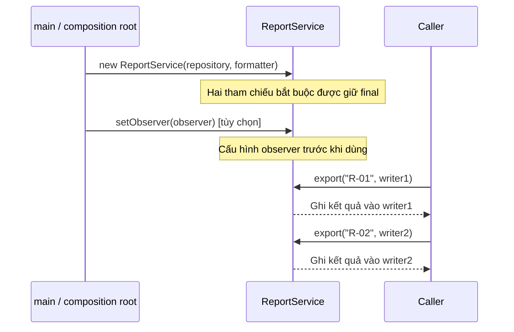

# So sánh theo tính bắt buộc, tính bất biến và thời điểm sử dụng

Trong chương **Các cách truyền phụ thuộc** của module **Dependency Injection**, ta không chỉ hỏi “có những cách inject nào?” mà cần biết **vì sao chọn cách đó**. Một phụ thuộc có thể bắt buộc để đối tượng hoạt động, chỉ là tiện ích tùy chọn, hoặc chỉ xuất hiện trong một lần thực hiện tác vụ. Nó có thể được giữ cố định trong suốt vòng đời đối tượng, được phép thay thế sau khi tạo, hoặc không cần lưu thành field.

**Dependency Injection (DI)** là kỹ thuật để thành phần sử dụng nhận phụ thuộc từ bên ngoài, qua đó tách **việc sử dụng** khỏi **việc tạo và lắp ghép** đối tượng. Đây là một cách thực hiện **Inversion of Control (IoC)**. Ta sẽ bắt đầu bằng Java thuần và **constructor injection**, tự lắp ghép các đối tượng tại *composition root*, xét tiếp các vấn đề **scope** và **vòng đời**, rồi mới liên hệ với DI container.

Sau bài này, bạn có thể:

- Chọn giữa **constructor injection**, **setter injection**, **field injection** và **method-parameter injection** theo những ràng buộc cụ thể.
- Giải thích vì sao phụ thuộc bắt buộc nên có mặt khi khởi tạo; phân biệt `final` của **tham chiếu** với tính bất biến của **đối tượng được tham chiếu**.
- Nhận ra khác biệt giữa phụ thuộc có thời gian sống bằng service và phụ thuộc chỉ dùng cho từng thao tác.
- Tự lắp ghép và kiểm thử một dịch vụ Java mà không cần DI container; biết khi nào factory/provider có ích.

## 1. Ba câu hỏi quyết định cách truyền phụ thuộc

Hãy hình dung một dịch vụ xuất báo cáo có ba thành phần:

1. `ReportRepository` cung cấp dữ liệu: thiếu nó, dịch vụ không thể xuất báo cáo.
2. `ExportObserver` nhận thông báo hoàn thành để hiển thị tiến trình: tính năng thông báo có thể không được bật.
3. `Writer` là đích xuất nội dung: mỗi lần xuất có thể ghi vào tệp, bộ nhớ hoặc một luồng khác nhau.

Ba thành phần trên đều có thể được **cung cấp từ bên ngoài**. Nhưng thời điểm và trách nhiệm cung cấp có thể khác nhau. Trước khi chọn cú pháp, đặt ba câu hỏi:

| Trục quyết định | Câu hỏi cần trả lời | Hệ quả khi thiết kế |
| --- | --- | --- |
| **Tính bắt buộc** | Nếu thiếu phụ thuộc, đối tượng có còn trạng thái hợp lệ và làm được công việc cốt lõi không? | Nếu **không**, nên yêu cầu ngay lúc xây dựng đối tượng. Nếu **có**, có thể dùng hành vi mặc định hoặc cấu hình tùy chọn. |
| **Tính bất biến** | Tham chiếu đến phụ thuộc có cần thay đổi sau khi khởi tạo không? | Nếu không, ưu tiên field `final` được gán trong constructor. Nếu có lý do thay đổi, cần giao thức cấu hình lại và bảo đảm nhất quán. |
| **Thời điểm sử dụng** | Phụ thuộc được dùng qua nhiều lần gọi hay chỉ tồn tại trong một lần thực hiện? | Phụ thuộc ổn định thuộc về constructor; phụ thuộc theo từng thao tác phù hợp hơn với tham số phương thức, hoặc được tạo theo yêu cầu qua factory/provider. |

Một lớp có thể áp dụng **nhiều cách truyền phụ thuộc cùng lúc**, vì từng thành phần có ràng buộc khác nhau. Không có quy tắc rằng mọi thứ phải được đưa hết vào constructor hoặc mọi dependency phải trở thành một bean trong container.

## 2. Bảng so sánh các cách truyền phụ thuộc

| Cách truyền | Khi nào được cấp? | Phụ thuộc bắt buộc? | Giữ được tham chiếu `final`? | Phù hợp nhất | Rủi ro chính |
| --- | --- | --- | --- | --- | --- |
| **Constructor injection** | Trong quá trình `new` đối tượng | **Có**, đặc biệt phù hợp | **Có** | Phụ thuộc thiết yếu, ổn định suốt vòng đời consumer | Constructor dài có thể bộc lộ lớp đang ôm quá nhiều trách nhiệm; khó dùng trực tiếp cho tài nguyên chỉ có khi chạy tác vụ |
| **Setter injection** | Sau khi tạo; có thể gọi lại | Thường **không**; nên là tùy chọn | **Không**, nếu thay field sau khi tạo | Bật/tắt tính năng phụ, thay cấu hình có chủ đích | Trạng thái chưa cấu hình, thay đổi khi đang dùng, vấn đề đồng thời |
| **Field injection** | Framework/container gán trực tiếp vào field, thường sau constructor | Không thể hiện chắc qua API constructor | Thông thường **không** | Chủ yếu để đọc, duy trì mã framework cũ | Phụ thuộc bị ẩn, khó khởi tạo bằng `new`, dễ có giai đoạn field chưa được gán |
| **Method-parameter injection** | Khi caller gọi thao tác | Có thể bắt buộc **cho thao tác đó** | Không cần lưu field | Đích ghi, ngữ cảnh hoặc collaborator thay đổi theo từng lần gọi | API phình to nếu bắt caller truyền cả những dịch vụ ổn định |
| **Factory/provider được inject** | Factory/provider được cấp trước; đối tượng cần dùng được tạo/lấy sau | Phụ thuộc vào hợp đồng | Tham chiếu factory có thể `final` | Tạo đối tượng theo yêu cầu, chọn triển khai bằng dữ liệu lúc chạy, xử lý khác biệt vòng đời | Che giấu chi phí khởi tạo, quyền sở hữu tài nguyên hoặc tạo nhầm đối tượng trong mỗi lần gọi |

**Ghi nhớ:** Bảng nói về **cách thiết kế**, không phải bảo đảm tuyệt đối. Ví dụ, một setter vẫn có thể được framework yêu cầu gọi, nhưng Java không tự bảo đảm rằng nó đã được gọi trước khi đối tượng được sử dụng. Hoặc một constructor có thể nhận `null` nếu không kiểm tra đầu vào; vì thế chữ “bắt buộc” phải được biến thành bất biến của lớp bằng API và kiểm tra thích hợp.

## 3. Constructor injection: bắt buộc và sẵn sàng sử dụng

Đây thường là lựa chọn mặc định cho **phụ thuộc cần thiết và có danh tính ổn định** trong suốt đời của consumer.

```java
import java.util.Objects;

interface ReportRepository {
    String load(String reportId);
}

interface ReportFormatter {
    String format(String rawContent);
}

final class ReportService {
    private final ReportRepository repository;
    private final ReportFormatter formatter;

    ReportService(ReportRepository repository, ReportFormatter formatter) {
        this.repository = Objects.requireNonNull(repository, "repository");
        this.formatter = Objects.requireNonNull(formatter, "formatter");
    }

    String render(String reportId) {
        return formatter.format(repository.load(reportId));
    }
}
```

Với API này, `new ReportService()` không biên dịch vì thiếu hai đối số; truyền `null` thì constructor báo lỗi sớm. Mọi instance tạo thành công đều có tham chiếu đến hai phụ thuộc cần thiết. Vì hai field là `final`, mã của `ReportService` không thể gán lại chúng sau constructor.

Tuy nhiên, cần phân biệt:

```java
private final ReportRepository repository;
```

`final` **chỉ ngăn gán lại field**. Nó không làm cho object repository trở thành bất biến, không khiến truy cập đa luồng tự động an toàn và cũng không cho biết khi nào phải đóng kết nối/tài nguyên mà repository quản lý. Một `final List<String>` vẫn có thể bị `add`, `remove` nếu danh sách đó có thể thay đổi.

Khi dùng constructor injection, ta bảo đảm được một phần quan trọng của trạng thái đối tượng: **các tham chiếu cần thiết được cung cấp trước khi đối tượng bắt đầu phục vụ yêu cầu**. Kiểm tra hợp lệ của cấu hình và hành vi của các dependency vẫn cần được xử lý riêng.

### Khi constructor quá nhiều tham số

Đừng vội chuyển sang field injection chỉ để constructor trông ngắn hơn. Sáu, bảy phụ thuộc bắt buộc có thể là dấu hiệu một lớp đang gánh nhiều trách nhiệm, nhưng không có một ngưỡng số học áp dụng cho mọi trường hợp. Hãy hỏi: có nhóm hành vi nào nên chuyển sang một collaborator riêng? Một đối tượng cấu hình có phạm vi rõ có thay thế được nhiều primitive liên quan không? Chỉ thêm abstraction khi nó phản ánh một trách nhiệm thực sự.

## 4. Setter injection: cấu hình tùy chọn và khả năng thay thế

Setter phù hợp khi đối tượng vẫn có thể hoạt động có nghĩa **ngay cả khi setter chưa được gọi**. Ví dụ, thông báo tiến trình xuất báo cáo là tiện ích tùy chọn.

```java
interface ExportObserver {
    void exported(String reportId);
}

final class ReportServiceWithObserver {
    private final ReportRepository repository;
    private ExportObserver observer = reportId -> { }; // mặc định: không làm gì

    ReportServiceWithObserver(ReportRepository repository) {
        this.repository = java.util.Objects.requireNonNull(repository);
    }

    void setObserver(ExportObserver observer) {
        this.observer = java.util.Objects.requireNonNull(observer);
    }

    String export(String reportId) {
        String raw = repository.load(reportId);
        observer.exported(reportId);
        return raw;
    }
}
```

Ở đây, `observer` có một **triển khai mặc định không làm gì** (*no-op*), nên không có trạng thái `null` cần kiểm tra trong mọi lần xuất. Caller có thể truyền một observer tùy chọn qua setter. Đây là một quyết định thiết kế: việc không có observer không được làm sai chức năng cốt lõi.

Nếu `ReportRepository` lại được cung cấp qua setter, mã phải xử lý khả năng `export()` được gọi **trước khi** setter chạy:

```java
// API dễ tạo trạng thái chưa hợp lệ nếu repository là bắt buộc:
final class FragileReportService {
    private ReportRepository repository;

    void setRepository(ReportRepository repository) {
        this.repository = repository;
    }

    String export(String id) {
        return repository.load(id); // có thể NullPointerException
    }
}
```

Đó là lý do **không dùng setter như giải pháp mặc định cho phụ thuộc bắt buộc**. Nếu framework yêu cầu tạo đối tượng trước rồi cấu hình sau, phải có cơ chế đảm bảo đầy đủ cấu hình **trước khi công bố hoặc sử dụng** đối tượng; không nên giả định mọi caller sẽ nhớ thứ tự thao tác.

Setter còn làm field có thể đổi sau khi tạo. Trong ứng dụng đa luồng, thay `observer` lúc dịch vụ đang xử lý yêu cầu có thể tạo hành vi khó đoán và vấn đề hiển thị bộ nhớ. Ví dụ này chỉ dành cho cấu hình ban đầu hoặc môi trường đơn luồng; nếu cần cấu hình động thực sự, phải xác định cơ chế đồng bộ, thời điểm chuyển đổi và tính nhất quán. Thêm `volatile` có thể giải quyết một phần việc nhìn thấy tham chiếu mới, nhưng **không tự giải quyết** tất cả yêu cầu về thay đổi trạng thái và vòng đời tài nguyên.

## 5. Field injection: ngắn cú pháp nhưng phụ thuộc ít hiển lộ

Một số framework cho phép viết mã tương tự:

```java
// Minh họa ý tưởng, không phải đoạn Java thuần có thể chạy độc lập.
// @Inject là annotation do framework/thư viện hỗ trợ.
class FrameworkReportService {
    @Inject
    private ReportRepository repository;

    String export(String id) {
        return repository.load(id);
    }
}
```

Constructor không thể hiện rằng `ReportRepository` là bắt buộc. Khi dùng `new FrameworkReportService()` bên ngoài container, field `repository` chưa được gán và lời gọi `export` có thể thất bại. Kiểm thử Java thuần cũng phải dựa vào framework, reflection hoặc cơ chế khác để điền field.

So với constructor injection, field injection thường làm kém rõ hợp đồng khởi tạo của lớp và khó áp dụng tính chất `final` theo cách Java thông thường. Một số framework xử lý injection bằng reflection; chi tiết này **phụ thuộc framework**, không phải tính năng của ngôn ngữ Java. Vì vậy, khi có quyền thiết kế lớp mới, hãy ưu tiên constructor cho phụ thuộc bắt buộc; khi bảo trì mã đã dùng field injection, cần hiểu vòng đời khởi tạo của framework trước khi thay đổi.

**Phân biệt với setter injection:** cả hai có thể được thực hiện sau khi constructor chạy, nhưng setter là một API phương thức công khai/được truy cập có kiểm soát, còn field injection để container ghi trực tiếp vào field. Dù được đánh dấu bằng annotation, phụ thuộc không mặc nhiên “an toàn” nếu framework chưa thực hiện giai đoạn inject.

## 6. Method-parameter injection: cung cấp đúng lúc sử dụng

Có những phụ thuộc **chỉ có ý nghĩa trong một lần gọi**. Chẳng hạn, mỗi yêu cầu xuất báo cáo có một `Writer` riêng: lần thứ nhất ghi vào bộ nhớ, lần thứ hai ghi ra tệp. Truyền `Writer` vào constructor của một service có thể được tái sử dụng sẽ ràng buộc nó vào đích xuất của một yêu cầu; đó thường là scope không phù hợp.

```java
import java.io.IOException;
import java.io.Writer;

final class ReportExporter {
    private final ReportRepository repository;

    ReportExporter(ReportRepository repository) {
        this.repository = java.util.Objects.requireNonNull(repository);
    }

    void export(String reportId, Writer destination) throws IOException {
        java.util.Objects.requireNonNull(destination, "destination");
        destination.write(repository.load(reportId));
    }
}
```

Ở đây:

- `repository` là một collaborator ổn định của `ReportExporter`: constructor injection.
- `destination` là collaborator **của lần xuất cụ thể**: truyền qua tham số `export`.
- Caller tạo và **sở hữu** `Writer`, nên caller quyết định đóng nó. Nếu đó là `FileWriter` hoặc writer giữ tài nguyên hệ điều hành, nên dùng `try-with-resources` ở nơi tạo.

Một cách dùng:

```java
ReportRepository repository = id -> "Bao cao " + id;
ReportExporter exporter = new ReportExporter(repository);

java.io.StringWriter output = new java.io.StringWriter();
exporter.export("R-01", output);
System.out.println(output); // Bao cao R-01
```

**Lưu ý về thuật ngữ:** “method injection” có thể được dùng theo hai nghĩa. Trong Java thuần, ta thường nói **method-parameter injection** khi caller truyền một collaborator vào phương thức nghiệp vụ cho mỗi lần gọi. Trong tài liệu một số DI framework, “method injection” lại có nghĩa container **gọi một phương thức cấu hình** để cấp dependency, tương tự setter injection, hoặc cung cấp một instance mới khi một phương thức được gọi. Khi đọc tài liệu, hãy xác định **ai gọi phương thức, lúc nào và đối tượng nào được cấp**.

Ngoài ra, không phải **mọi tham số phương thức** đều được xem là dependency injection theo nghĩa thiết kế. `reportId`, `pageSize` hay chuỗi tìm kiếm là **dữ liệu đầu vào**. `Writer` là một đối tượng cộng tác cung cấp hành vi ghi, vì vậy việc truyền nó theo từng lời gọi thể hiện ý tưởng inject phụ thuộc tại thời điểm sử dụng. Nếu một collaborator luôn được dùng trong mọi lần gọi và không thay đổi, truyền lặp lại qua từng method có thể làm API rườm rà; lúc đó constructor hợp lý hơn.

## 7. Ví dụ hoàn chỉnh: kết hợp ba thời điểm trong Java thuần

Ví dụ sau cho thấy một dịch vụ thực tế có thể kết hợp constructor injection, setter injection và method-parameter injection. Lưu mã vào `InjectionMethodsDemo.java` (Java 11 trở lên):

```java
import java.io.IOException;
import java.io.StringWriter;
import java.io.Writer;
import java.util.ArrayList;
import java.util.List;
import java.util.Objects;

public class InjectionMethodsDemo {
    @FunctionalInterface
    interface ReportRepository {
        String load(String reportId);
    }

    @FunctionalInterface
    interface ReportFormatter {
        String format(String raw);
    }

    @FunctionalInterface
    interface ExportObserver {
        void exported(String reportId);
    }

    static final class ReportService {
        // Bắt buộc, ổn định: constructor injection.
        private final ReportRepository repository;
        private final ReportFormatter formatter;

        // Tùy chọn, được cấu hình trước khi dùng: setter injection.
        private ExportObserver observer = reportId -> { };

        ReportService(ReportRepository repository, ReportFormatter formatter) {
            this.repository = Objects.requireNonNull(repository, "repository");
            this.formatter = Objects.requireNonNull(formatter, "formatter");
        }

        void setObserver(ExportObserver observer) {
            this.observer = Objects.requireNonNull(observer, "observer");
        }

        // Theo từng lần xuất: method-parameter injection.
        void export(String reportId, Writer destination) throws IOException {
            if (reportId == null || reportId.isBlank()) {
                throw new IllegalArgumentException("reportId must not be blank");
            }
            Objects.requireNonNull(destination, "destination");

            String raw = repository.load(reportId);
            String formatted = formatter.format(raw);
            destination.write(formatted);
            observer.exported(reportId);
        }
    }

    public static void main(String[] args) throws IOException {
        // Composition root: tạo và nối các phụ thuộc ổn định.
        ReportRepository repository = id -> "Noi dung " + id;
        ReportFormatter formatter = raw -> "[" + raw + "]";
        ReportService service = new ReportService(repository, formatter);

        // Chức năng tùy chọn: thiết lập trước khi sử dụng service.
        List<String> completed = new ArrayList<>();
        service.setObserver(completed::add);

        // Mỗi lời gọi có một đích ghi khác nhau.
        StringWriter first = new StringWriter();
        StringWriter second = new StringWriter();
        service.export("R-01", first);
        service.export("R-02", second);

        // Kiểm thử tối giản bằng Java thuần, không cần container.
        if (!first.toString().equals("[Noi dung R-01]")) {
            throw new AssertionError("First export is incorrect");
        }
        if (!second.toString().equals("[Noi dung R-02]")) {
            throw new AssertionError("Second export is incorrect");
        }
        if (!completed.equals(List.of("R-01", "R-02"))) {
            throw new AssertionError("Observer was not called correctly");
        }
        System.out.println("PASS: " + completed);
    }
}
```

Chạy:

```bash
javac InjectionMethodsDemo.java
java InjectionMethodsDemo
```

Kết quả dự kiến:

```text
PASS: [R-01, R-02]
```

Trong ví dụ, `ReportService` **không tự tạo** repository, formatter, observer hoặc writer. Mã ở `main` thực hiện lắp ghép và caller của `export` cấp đích ghi cho từng thao tác. Không có DI container nhưng vẫn có DI và IoC: mã sử dụng không nắm trách nhiệm chọn triển khai và tạo các phụ thuộc ấy.

### Dòng thời gian lắp ghép và sử dụng



Hai lần xuất có thể cùng dùng `repository` và `formatter`, nhưng **không chia sẻ cùng một `Writer`**. Bằng cách đó, service không giữ tham chiếu lâu dài tới tài nguyên thuộc một thao tác ngắn hạn.

Ví dụ cố ý đơn giản và chạy tuần tự. Nếu một `ReportService` được dùng đồng thời, hãy cân nhắc tính an toàn luồng của `repository`, `formatter`, `observer` và `Writer` do mỗi caller truyền vào. Setter chỉ nên gọi trong giai đoạn cấu hình trước khi đưa service vào sử dụng nếu không có giao thức thay đổi động được thiết kế rõ ràng.

## 8. Tính bất biến, scope và vòng đời: ba điều khác nhau

Một lỗi suy luận phổ biến là “đã inject qua constructor và lưu `final` thì an toàn khi chia sẻ ở mọi nơi”. Thực tế có ba lớp quyết định độc lập:

| Khía cạnh | Mô tả | Ví dụ |
| --- | --- | --- |
| **Tính ổn định của tham chiếu** | Field có được gán lại không? | `final ReportRepository repository` không thể gán sang repository khác sau constructor. |
| **Tính bất biến / an toàn của đối tượng** | Trạng thái bên trong collaborator có thể thay đổi không, và nhiều luồng có thể dùng an toàn không? | Một `InMemoryRepository` giữ `ArrayList` vẫn có trạng thái thay đổi và không mặc nhiên thread-safe. |
| **Scope / vòng đời** | Ai tạo, ai dùng lại, ai đóng đối tượng và nó tồn tại trong bao lâu? | Một `Writer` mỗi lần xuất do caller quản lý; repository có thể được chia sẻ theo ứng dụng nếu thiết kế phù hợp. |

**Constructor injection không tự quy định scope**. Hai `ReportService` có thể nhận cùng một repository hoặc hai repository riêng. Cũng như vậy, DI container có thể cung cấp singleton, instance theo request hoặc instance mới, tùy cấu hình container. Scope và vòng đời phải phù hợp với trạng thái, tài nguyên và cách sử dụng thực tế; không có kiểu injection nào tự sửa một lựa chọn scope sai.

Trong Java thuần, nơi tạo và sở hữu tài nguyên nên xác định rõ người đóng tài nguyên:

```java
// Ở tầng gọi xuất báo cáo, không nằm trong một service chia sẻ toàn ứng dụng:
// try (Writer writer = Files.newBufferedWriter(path)) {
//     service.export("R-01", writer);
// }
```

Ở đây `Files.newBufferedWriter` tạo `Writer` cần được đóng bằng `try-with-resources`; `service.export(...)` dùng writer trong phạm vi lời gọi mà không tự nhận quyền sở hữu hoặc đóng nó. Với một pool hoặc client giữ tài nguyên lâu dài, composition root hay thành phần quản lý vòng đời tương ứng thường cần đảm nhiệm việc khởi tạo và đóng khi ứng dụng dừng.

## 9. Factory/provider: khi phụ thuộc chỉ sẵn có sau này

Một số tình huống cần **tạo collaborator mới trong quá trình xử lý**, nhưng không muốn consumer biết constructor của một triển khai cụ thể. Khi đó ta có thể inject một **factory** hoặc **provider** qua constructor, rồi yêu cầu nó cung cấp đối tượng đúng lúc cần dùng.

```java
import java.util.Objects;
import java.util.function.Supplier;

interface RenderSession extends AutoCloseable {
    String render(String raw);
    @Override void close();
}

final class RenderJob {
    private final Supplier<RenderSession> sessionFactory;

    RenderJob(Supplier<RenderSession> sessionFactory) {
        this.sessionFactory = Objects.requireNonNull(sessionFactory);
    }

    String execute(String raw) {
        try (RenderSession session = sessionFactory.get()) {
            return session.render(raw);
        }
    }
}
```

Ở đây, tham chiếu tới factory ổn định (`final`), còn `RenderSession` chỉ được **lấy khi `execute` chạy**, dùng xong thì đóng. Nhưng tên `Supplier` tự nó **không bảo đảm** mỗi `get()` sẽ trả đối tượng mới; factory có thể trả lại instance cũ. Hợp đồng của factory phải nêu rõ quy tắc tạo mới, quyền sở hữu và xử lý lỗi.

Nên cân nhắc factory/provider khi phụ thuộc cần tham số chỉ biết ở thời điểm chạy, có vòng đời ngắn hơn consumer hoặc tạo ra tốn tài nguyên. Ngược lại, nếu cần một collaborator ổn định từ lúc tạo và không có yêu cầu đặc biệt, constructor injection trực tiếp đơn giản hơn.

## 10. Chọn cách truyền theo từng tình huống

| Tình huống | Cách nên cân nhắc | Lý do |
| --- | --- | --- |
| Service không thể hoạt động nếu thiếu repository | **Constructor** | Phụ thuộc bắt buộc; lỗi được phát hiện lúc tạo đối tượng. |
| Một strategy tính giá được chọn tại lúc khởi động và giữ cố định | **Constructor** | Quyết định chọn triển khai nằm ở composition root; tham chiếu có thể `final`. |
| Bộ lắng nghe tiến trình chỉ bật trong một số môi trường | **Setter** hoặc constructor với no-op mặc định | Có thể thiết kế như tính năng tùy chọn; thiết lập trước khi chia sẻ instance. |
| Một `Writer` hay `RequestContext` khác nhau theo từng request | **Tham số phương thức** | Dùng trong một thao tác; tránh giữ trạng thái request ở singleton. Lưu ý `RequestContext` chủ yếu là dữ liệu đầu vào, không nhất thiết là service dependency. |
| Client kết nối hoặc phiên xử lý cần tạo và đóng cho từng công việc | **Factory/provider** hoặc tham số phương thức | Kiểm soát thời điểm tạo và quyền sở hữu tài nguyên. |
| Một framework đang dùng `@Inject` trực tiếp trên field | **Hiểu vòng đời hiện có**, cân nhắc refactor sang constructor | Field injection hoạt động theo cơ chế framework; hợp đồng khởi tạo và kiểm thử Java thuần kém rõ. |

Nếu chỉ nhớ một quy tắc thực hành, hãy dùng: **constructor cho yêu cầu ổn định và bắt buộc; tham số phương thức cho collaborator của từng thao tác; setter khi thật sự cần cấu hình tùy chọn hoặc thay đổi có kiểm soát; factory khi phải tạo/lấy phụ thuộc theo nhu cầu**.

## 11. Những lỗi lựa chọn thường gặp

1. **Dùng setter cho phụ thuộc cốt lõi mà không có trạng thái hợp lệ mặc định.** Consumer có thể bị gọi trước khi cấu hình xong. Dùng constructor hoặc xây dựng cơ chế khởi tạo hai giai đoạn có kiểm soát nếu buộc phải làm vậy.
2. **Coi `final` là bất biến toàn bộ.** `final` chặn gán lại tham chiếu, không chặn đối tượng bên trong thay đổi. Cần kiểm tra thread-safety và scope riêng.
3. **Dùng method parameter cho mọi dịch vụ ổn định.** Caller phải truyền nhiều collaborator lặp lại ở mọi lần gọi; API trở nên khó dùng và ranh giới composition root bị phân tán.
4. **Giữ dữ liệu request trong field của service dùng chung.** Dễ tạo rò rỉ trạng thái và lỗi đồng thời. Chuyển dữ liệu request sang tham số hoặc đối tượng theo scope request.
5. **Gọi container/service locator ngay trong nghiệp vụ.** Ví dụ `container.get(ReportRepository.class)` trong `ReportService` giấu phụ thuộc và khiến consumer phải biết cơ chế truy xuất. Hãy yêu cầu phụ thuộc qua API rõ ràng.
6. **Chọn field injection chỉ vì ít dòng mã.** Constructor cho biết chính xác consumer cần gì và hỗ trợ kiểm thử với Java thuần. Hạn chế về cú pháp không phải lý do đủ để làm mờ hợp đồng.
7. **Inject một tài nguyên có vòng đời không tương thích.** Ví dụ, singleton giữ `Writer` của một request hoặc phiên kết nối đã đóng. Cần xác định nơi sở hữu và thời điểm sử dụng trước khi lắp ghép.

## 12. Bài thực hành và câu hỏi tự kiểm tra

Hãy thực hiện trên `InjectionMethodsDemo.java`:

1. **Bắt buộc:** Thử `new ReportService(null, raw -> raw)` và quan sát lỗi xuất hiện ở **constructor**. Giải thích vì sao lỗi sớm hữu ích hơn lỗi trong `export`.
2. **Tùy chọn:** Bỏ dòng `service.setObserver(...)`, chạy lại chương trình sau khi điều chỉnh phần assertion của observer. Xác minh xuất báo cáo vẫn thành công với no-op observer.
3. **Theo từng lời gọi:** Tạo thêm `StringWriter third` và xuất `R-03`. Kiểm tra nội dung chỉ ghi vào writer của chính lượt đó, không ảnh hưởng `first` và `second`.
4. **Thiết kế API:** Giả sử mỗi tác vụ có `Locale` và `ZoneId` riêng. Bạn sẽ truyền chúng qua constructor dùng chung, qua tham số của `export`, hay gói thành một `ExportRequest`? Giải thích dựa trên scope.
5. **Vòng đời:** Thay `StringWriter` bằng `Files.newBufferedWriter(...)` trong `try-with-resources` ở caller. Giải thích ai tạo, ai đóng và vì sao `ReportService` không nên tự đóng `Writer` được truyền vào khi hợp đồng quy định caller sở hữu nó.

Tự trả lời các câu hỏi sau trước khi học về DI container:

- Vì sao một dependency “bắt buộc” không nên chỉ tồn tại trong một field được gán sau constructor nếu không có cơ chế bảo đảm cấu hình đầy đủ?
- Vì sao `private final Repository repository` không chứng minh repository là bất biến hoặc thread-safe?
- Khi nào truyền qua tham số phương thức tốt hơn việc lưu một dependency vào field?
- Vì sao DI container chỉ **thực hiện việc lắp ghép theo cấu hình**, chứ không thể tự quyết định đâu là trạng thái nghiệp vụ cần cách ly theo request?

Khi giải thích được **phụ thuộc nào phải có ngay**, **tham chiếu nào cần cố định** và **phụ thuộc nào chỉ nên xuất hiện đúng lúc dùng**, bạn sẽ chọn được phương thức injection phù hợp ngay bằng Java thuần. Đó cũng là nền tảng để cấu hình constructor injection, scope, lifecycle và factory/provider chính xác khi ứng dụng phát triển đến mức cần DI container.
