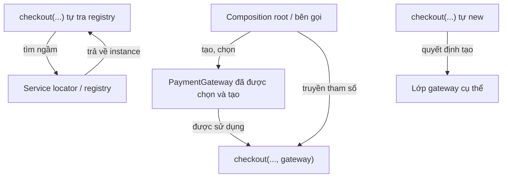
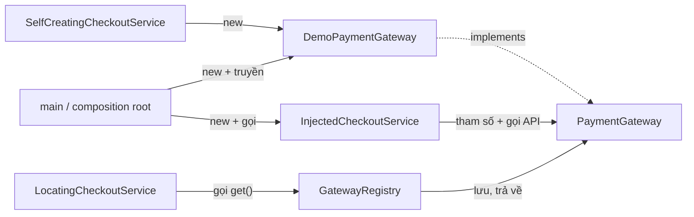

# Phân biệt phương thức nhận đối tượng được tạo sẵn với phương thức tự lấy phụ thuộc

Trong chương **Các cách truyền phụ thuộc** của học phần **Dependency Injection (DI)**, cần trả lời một câu hỏi khi đọc bất kỳ phương thức Java nào: **đối tượng mà phương thức cần để làm việc được cung cấp từ bên ngoài, hay chính phương thức tự tìm cách lấy nó?** Hai cách viết có thể cùng cho ra một kết quả, nhưng khác nhau về khả năng thay thế implementation, kiểm thử và quản lý vòng đời.

Ví dụ, một phương thức thanh toán cần `PaymentGateway`:

```java
// Cách A: nhận dependency đã được tạo và chọn ở nơi khác.
String pay(String orderId, long amountVnd, PaymentGateway gateway) {
    return gateway.charge(orderId, amountVnd);
}

// Cách B: tự chọn và tạo dependency tại nơi sử dụng.
String pay(String orderId, long amountVnd) {
    PaymentGateway gateway = new DemoPaymentGateway();
    return gateway.charge(orderId, amountVnd);
}
```

Ở cách A, tham số `gateway` là **đường đưa dependency vào phương thức**. Ở cách B, phương thức vừa thực hiện nghiệp vụ vừa quyết định cách tạo dependency. Đây là một điểm phân biệt của **method injection** (truyền phụ thuộc qua tham số phương thức) với việc **tự lấy phụ thuộc** bên trong phương thức.

Mục tiêu bài học:

- Nhìn vào chữ ký và thân phương thức để xác định quan hệ phụ thuộc có tường minh không.
- Phân biệt truyền một đối tượng đã có với tạo/tra cứu đối tượng mới.
- Hiểu vì sao DI và **Inversion of Control (IoC)** giúp tách *sử dụng* khỏi *tạo và lắp ghép*.
- Chọn giữa method injection, constructor injection và factory dựa trên phạm vi sử dụng; kiểm thử bằng Java thuần trước khi dùng DI container.

## 1. Hai câu hỏi khác nhau: “cần gì?” và “lấy ở đâu?”

Một phương thức thực hiện nghiệp vụ thường cần hai loại thông tin:

1. **Dữ liệu của thao tác**: mã đơn hàng, số tiền, danh sách mặt hàng...
2. **Cộng tác viên (dependency)**: cổng thanh toán, kho lưu trữ, dịch vụ gửi thông báo, đồng hồ hệ thống...

Giá trị dữ liệu mô tả *việc cần làm*; dependency cung cấp *năng lực để làm việc đó*. Ví dụ `orderId` là dữ liệu, còn `PaymentGateway` là đối tượng có hành vi `charge(...)`. Không phải mọi tham số đối tượng đều là dependency theo nghĩa thiết kế: một `Order` cũng là đối tượng nhưng có thể chỉ là dữ liệu đầu vào.

Xét hai thiết kế:

```java
// Biết rõ cần cộng tác viên nào, nhưng không quyết định ai tạo nó.
void issue(Invoice invoice, InvoiceSender sender) {
    sender.send(invoice);
}

// Không nêu cộng tác viên trong chữ ký và tự khởi tạo cụ thể.
void issue(Invoice invoice) {
    InvoiceSender sender = new SmtpInvoiceSender();
    sender.send(invoice);
}
```

*Đoạn trên là minh họa chữ ký; các kiểu `Invoice` và `InvoiceSender` sẽ được định nghĩa trong ứng dụng thực tế.*

Ở thiết kế thứ nhất, bên gọi phải cung cấp `sender` hợp lệ. Bên gọi hoặc một thành phần lắp ghép ở phía trên quyết định dùng `SmtpInvoiceSender`, một sender ghi log hay một test double. Ở thiết kế thứ hai, thay đổi cơ chế gửi thường buộc sửa mã của phương thức; một bài test khó tránh việc phụ thuộc vào lựa chọn bên trong.

**“Đối tượng được tạo sẵn” không nhất thiết được tạo ngay khi ứng dụng khởi động.** Nó chỉ cần tồn tại **trước lúc gọi phương thức** và được bên gọi truyền vào. Đối tượng đó có thể được tạo ở đầu chương trình, đầu request hoặc ngay trước một thao tác.

## 2. Ba cách một phương thức nhận hoặc tìm dependency

| Cách viết | Dependency xuất hiện ở đâu? | Ai chọn implementation? | Hệ quả chính |
| --- | --- | --- | --- |
| **Method injection**: `run(input, gateway)` | Tham số phương thức, thường mang kiểu interface | Bên gọi hoặc composition root | Dễ nhìn thấy, thay thế theo mỗi lần gọi |
| **Tự khởi tạo**: `new DemoPaymentGateway()` trong `run` | Thân phương thức, tham chiếu trực tiếp lớp cụ thể | Chính phương thức | Gắn logic nghiệp vụ với quyết định tạo đối tượng |
| **Tự tra cứu**: `GatewayRegistry.get()` trong `run` | Thân phương thức qua registry/service locator/global | Registry và cấu hình toàn cục; phương thức quyết định tra cứu | Dependency bị che trong chữ ký; test phụ thuộc trạng thái bên ngoài |

Sơ đồ về **quyền quyết định lắp ghép**:



Điểm quyết định không phải sự có mặt của từ khóa `new` ở bất cứ đâu trong chương trình. **Một nơi nào đó vẫn phải tạo đối tượng.** Vấn đề là quyết định tạo và chọn implementation có được đặt trong chính phần mã nghiệp vụ sử dụng dependency hay được chuyển ra **composition root** hoặc thành phần cấp dependency có trách nhiệm rõ ràng.

## 3. Ví dụ Java thuần: so sánh ba phương thức thực thi cùng nghiệp vụ

Đặt mã sau trong file `MethodInjectionDemo.java`. Ví dụ chạy độc lập, không cần framework hoặc DI container.

```java
import java.util.Objects;

public class MethodInjectionDemo {
    interface PaymentGateway {
        String charge(String orderId, long amountVnd);
    }

    static final class DemoPaymentGateway implements PaymentGateway {
        private int sequence = 0;

        @Override
        public String charge(String orderId, long amountVnd) {
            if (amountVnd <= 0) {
                throw new IllegalArgumentException("Amount must be positive");
            }
            sequence++;
            return "PAY-" + orderId + "-" + sequence;
        }
    }

    // Cách A: dependency là tham số được truyền từ bên ngoài.
    static final class InjectedCheckoutService {
        String checkout(String orderId, long amountVnd,
                        PaymentGateway gateway) {
            Objects.requireNonNull(gateway, "gateway");
            return gateway.charge(orderId, amountVnd);
        }
    }

    // Cách B: phương thức tự tạo gateway cụ thể mỗi lần gọi.
    static final class SelfCreatingCheckoutService {
        String checkout(String orderId, long amountVnd) {
            PaymentGateway gateway = new DemoPaymentGateway();
            return gateway.charge(orderId, amountVnd);
        }
    }

    // Ví dụ service locator đơn giản để thấy dependency bị ẩn.
    static final class GatewayRegistry {
        private static PaymentGateway current;

        static void set(PaymentGateway gateway) {
            current = Objects.requireNonNull(gateway, "gateway");
        }

        static PaymentGateway get() {
            return Objects.requireNonNull(
                    current, "GatewayRegistry has not been configured");
        }
    }

    // Cách C: phương thức tự tra cứu gateway đã đăng ký ở nơi khác.
    static final class LocatingCheckoutService {
        String checkout(String orderId, long amountVnd) {
            return GatewayRegistry.get().charge(orderId, amountVnd);
        }
    }

    public static void main(String[] args) {
        // Composition root cho cách A: chọn, tạo và truyền dependency.
        PaymentGateway sharedGateway = new DemoPaymentGateway();
        InjectedCheckoutService injected = new InjectedCheckoutService();

        System.out.println(injected.checkout("O-101", 120_000, sharedGateway));
        System.out.println(injected.checkout("O-102", 150_000, sharedGateway));

        SelfCreatingCheckoutService selfCreating =
                new SelfCreatingCheckoutService();
        System.out.println(selfCreating.checkout("O-103", 120_000));
        System.out.println(selfCreating.checkout("O-104", 150_000));

        // Chỉ để minh họa service locator, không phải cách khuyến nghị.
        GatewayRegistry.set(new DemoPaymentGateway());
        LocatingCheckoutService locating = new LocatingCheckoutService();
        System.out.println(locating.checkout("O-105", 120_000));
    }
}
```

Biên dịch và chạy bằng JDK:

```bash
javac MethodInjectionDemo.java
java MethodInjectionDemo
```

Kết quả:

```text
PAY-O-101-1
PAY-O-102-2
PAY-O-103-1
PAY-O-104-1
PAY-O-105-1
```

### 3.1. Vì sao kết quả khác nhau?

- Hai lần gọi `InjectedCheckoutService.checkout` nhận **cùng một instance** `sharedGateway` nên bộ đếm của gateway tăng từ 1 lên 2. Sử dụng chung là quyết định của **bên gọi**.
- Hai lần gọi `SelfCreatingCheckoutService.checkout` mỗi lần `new DemoPaymentGateway()` nên mỗi gateway riêng bắt đầu với bộ đếm 0. Phương thức đã quyết định cả **kiểu cụ thể** lẫn **cách tạo mới theo lần gọi**.
- `LocatingCheckoutService.checkout` không có tham số gateway nhưng vẫn phụ thuộc vào nó. Nếu chưa cấu hình `GatewayRegistry`, phương thức ném lỗi ở lúc chạy; chữ ký không báo cho bên gọi biết yêu cầu này.

Ví dụ dùng bộ đếm để làm rõ **danh tính và phạm vi dùng chung của đối tượng**; không có nghĩa rằng cổng thanh toán thật nên tạo mã giao dịch bằng bộ đếm trong bộ nhớ.

### 3.2. Quan hệ phụ thuộc giữa các kiểu



Dù interface `PaymentGateway` xuất hiện trong cả hệ thống, **phương thức tự tạo** vẫn tham chiếu trực tiếp đến implementation `DemoPaymentGateway`. **Phương thức tra cứu** chỉ đưa quan hệ phụ thuộc qua một lớp trung gian: thông tin bắt buộc về gateway không còn nằm trong chữ ký `checkout`.

## 4. Method injection không phải “tạo dependency bằng phương thức”

Trong thực hành DI, “method injection” thường chỉ việc **cung cấp dependency cho một phương thức qua tham số**. Một số framework cũng dùng tên gọi liên quan đến phương thức setter hoặc cơ chế gọi phương thức cấu hình do container thực hiện; cần đọc định nghĩa cụ thể của framework. Trong bài học Java thuần này, ta xét chủ yếu **dependency được truyền qua tham số mỗi lần gọi**.

```java
void exportReport(Report report, ReportWriter writer) {
    writer.write(report);
}
```

Ở đây:

- `report` chủ yếu là dữ liệu của thao tác.
- `writer` là cộng tác viên cung cấp hành vi ghi báo cáo.
- Phương thức **sử dụng** `writer`, còn trách nhiệm lựa chọn và tạo nó thuộc về bên gọi.
- Nếu `writer` có tài nguyên cần đóng, việc truyền tham số **không tự chuyển quyền sở hữu**. Phải có hợp đồng ai quản lý vòng đời.

Ngay cả khi bên gọi tự viết `service.exportReport(report, new FileReportWriter(...))`, dependency vẫn được truyền qua tham số của phương thức nhận. Tuy nhiên, nơi gọi lúc này đã gắn với implementation cụ thể; quyết định khởi tạo nên đặt ở ranh giới lắp ghép thích hợp nếu cần thay thế hoặc quản lý tài nguyên.

### Cách truyền vào không quyết định phạm vi sống

```java
PaymentGateway first = new DemoPaymentGateway();
PaymentGateway second = new DemoPaymentGateway();

service.checkout("O-201", 100_000, first);
service.checkout("O-202", 200_000, second);
service.checkout("O-203", 300_000, first);
```

Cùng một phương thức nhận tham số có thể dùng instance khác nhau theo từng lần gọi hoặc dùng lại một instance. **Method injection không mặc nhiên có scope “transient”**; nơi tạo và truyền dependency quyết định việc đó.

## 5. Constructor injection hay method injection?

Cả hai đều có thể tách việc dùng dependency khỏi việc tạo nó. Sự khác biệt chính nằm ở **thời gian và phạm vi mà đối tượng nhận giữ dependency**.

| Tiêu chí | Constructor injection | Method injection |
| --- | --- | --- |
| Cách cung cấp | `new Service(gateway)` | `service.run(input, gateway)` |
| Thời điểm cung cấp | Khi tạo service | Mỗi lần gọi phương thức |
| Phù hợp | Dependency bắt buộc và ổn định cho hầu hết vòng đời service | Dependency thay đổi theo thao tác, hoặc chỉ một phương thức cần |
| Chữ ký bộc lộ | Yêu cầu để tạo instance hợp lệ | Yêu cầu để thực hiện từng thao tác |
| Cách sử dụng | Service thường lưu ở field | Phương thức có thể chỉ dùng trong lần gọi |
| Rủi ro thiết kế | Giữ phụ thuộc có vòng đời ngắn trong service sống dài | Danh sách tham số dài; bên gọi phải cung cấp đầy đủ |

Ví dụ chuyển từ method injection sang constructor injection khi gateway là cộng tác viên ổn định:

```java
final class CheckoutService {
    private final PaymentGateway gateway;

    CheckoutService(PaymentGateway gateway) {
        this.gateway = java.util.Objects.requireNonNull(gateway);
    }

    String checkout(String orderId, long amountVnd) {
        return gateway.charge(orderId, amountVnd);
    }
}
```

Trong đoạn trên, `PaymentGateway` thuộc bộ phụ thuộc bắt buộc của **instance `CheckoutService`**. Ngược lại, nếu mỗi giao dịch chủ động chọn gateway khác nhau theo đầu vào được phép, method injection có thể diễn đạt sự thay đổi đó dễ hơn.

**Không nên dùng method injection chỉ để né việc khai báo dependency bắt buộc trong constructor.** Nếu service luôn cần cùng một dependency ở mọi lần gọi, việc phải truyền nó lặp lại có thể làm API rườm rà. Tương tự, không nên đẩy một dependency sống theo request vào constructor của singleton sống suốt ứng dụng.

## 6. Kiểm thử: hành vi tường minh dễ cô lập hơn

Với method injection, bài test có thể tự tạo test double và đưa nó vào một lời gọi. Không cần thay đổi biến toàn cục hay dựng registry.

Tạo file `MethodInjectionTest.java` trong cùng thư mục với `MethodInjectionDemo.java`:

```java
public class MethodInjectionTest {
    static final class RecordingGateway
            implements MethodInjectionDemo.PaymentGateway {
        String receivedOrderId;
        long receivedAmount;
        int calls;

        @Override
        public String charge(String orderId, long amountVnd) {
            receivedOrderId = orderId;
            receivedAmount = amountVnd;
            calls++;
            return "FAKE-TX";
        }
    }

    public static void main(String[] args) {
        RecordingGateway fake = new RecordingGateway();
        MethodInjectionDemo.InjectedCheckoutService service =
                new MethodInjectionDemo.InjectedCheckoutService();

        String result = service.checkout("O-900", 99_000, fake);

        if (!"FAKE-TX".equals(result)
                || !"O-900".equals(fake.receivedOrderId)
                || fake.receivedAmount != 99_000
                || fake.calls != 1) {
            throw new AssertionError("Gateway was not used as expected");
        }

        System.out.println("PASS");
    }
}
```

Chạy:

```bash
javac MethodInjectionDemo.java MethodInjectionTest.java
java MethodInjectionTest
```

Kết quả: `PASS`.

Bài test này chứng minh đúng một điều: `InjectedCheckoutService` dùng **đối tượng gateway được truyền vào** để xử lý giao dịch. Vì fake là đối tượng do bài test kiểm soát, nó có thể ghi lại tham số và số lần gọi mà không kết nối cổng thanh toán thật.

Với `SelfCreatingCheckoutService`, muốn làm việc tương tự phải thay đổi thiết kế, can thiệp quá trình tạo đối tượng hoặc dùng kỹ thuật kiểm thử phức tạp hơn. Với `LocatingCheckoutService`, bài test có thể gọi `GatewayRegistry.set(fake)` nhưng sẽ sửa **trạng thái dùng chung**: test khác có thể chịu ảnh hưởng nếu không khôi phục trạng thái. Khi chạy song song, một registry mutable toàn cục còn tạo nguy cơ đua dữ liệu.

## 7. Phương thức “tự lấy” qua factory được inject: trường hợp khác cần hiểu đúng

Không phải mọi lời gọi tạo đối tượng **bên trong** một phương thức đều vi phạm DI. Có sự khác biệt lớn giữa:

```java
// Phụ thuộc ẩn và bị gắn với nơi sử dụng:
InputStream input = GlobalStorage.open("orders.csv");
```

và:

```java
// Factory là dependency tường minh đã được inject:
// input được tạo theo nhu cầu của thao tác.
InputStream input = sourceFactory.open("orders.csv");
```

Ví dụ Java thuần sau làm rõ sự khác biệt:

```java
import java.io.IOException;
import java.io.InputStream;
import java.util.Objects;

interface SourceFactory {
    InputStream open(String name) throws IOException;
}

final class ImportService {
    private final SourceFactory sourceFactory;

    ImportService(SourceFactory sourceFactory) {
        this.sourceFactory = Objects.requireNonNull(sourceFactory);
    }

    long countBytes(String name) throws IOException {
        // Mở một resource cho thao tác này, rồi đóng đúng phạm vi.
        try (InputStream input = sourceFactory.open(name)) {
            long count = 0;
            while (input.read() != -1) {
                count++;
            }
            return count;
        }
    }
}
```

Ở đây `ImportService` **có yêu cầu phụ thuộc rõ ràng** là `SourceFactory`, được cung cấp qua constructor. Phương thức `countBytes` chủ động yêu cầu factory tạo một `InputStream` mới khi cần; nhưng nó **không quyết định implementation của factory**. Nó cũng sở hữu stream vừa nhận **theo hợp đồng giả định của `SourceFactory.open`** và đóng bằng `try-with-resources`.

Để thiết kế này đúng, tài liệu hợp đồng của `SourceFactory.open` phải quy định rằng stream được trả về thuộc quyền quản lý của bên gọi và phải được đóng. Nếu factory trả về một tài nguyên dùng chung không được phép đóng, quy ước trên sẽ không còn hợp lệ.

Cách này đặc biệt hữu ích với tài nguyên cần tạo riêng theo thao tác như stream, transaction, session hoặc đối tượng gắn với request. **DI container không bắt buộc**: composition root có thể truyền một implementation của `SourceFactory` bằng Java thuần.

### Khi nào `new` trong phương thức vẫn hợp lý?

`new` không phải tín hiệu lỗi tự động. Tạo đối tượng dữ liệu cục bộ như `new StringBuilder()` hoặc `new ArrayList<>()` thường là chi tiết triển khai bình thường. Điểm cần xem xét là **đối tượng được tạo có phải một cộng tác viên bên ngoài/điểm tích hợp cần thay thế, kiểm soát hoặc quản lý vòng đời hay không**. Ví dụ, một adapter kết nối database cần chính sách cấu hình khác với một bộ đệm tạm chỉ sống trong một lần gọi.

## 8. Vòng đời, sử dụng chung và tính an toàn khi truyền phụ thuộc

Truyền dependency qua phương thức là truyền **giá trị tham chiếu**. Nó không tạo bản sao của đối tượng, không tự đóng tài nguyên và cũng không chuyển quyền sở hữu theo quy tắc ngôn ngữ Java.

Giả sử hai lời gọi dùng cùng gateway:

```java
PaymentGateway gateway = new DemoPaymentGateway();
service.checkout("O-301", 100_000, gateway);
service.checkout("O-302", 200_000, gateway);
```

Cả hai cùng quan sát trạng thái của một instance. Nếu gateway có trạng thái thay đổi, cần xem xét an toàn luồng khi gọi đồng thời. Nếu gateway có `close()` hoặc nắm giữ kết nối, phải chỉ rõ **ai tạo, ai sử dụng và ai đóng**. Phương thức chỉ nhận tham chiếu thường được hiểu là *mượn* dependency theo hợp đồng; nó không nên tự đóng dependency dùng chung do bên gọi quản lý.

| Trường hợp | Gợi ý thiết kế | Điều phải bảo đảm |
| --- | --- | --- |
| Cùng một gateway dùng cho nhiều thao tác | Constructor injection hoặc truyền một instance vào nhiều lần gọi | Gateway phù hợp với chia sẻ trạng thái và concurrency |
| Mỗi thao tác cần gateway khác nhau | Method injection | Bên gọi chọn đúng implementation và quản lý vòng đời |
| Mỗi thao tác cần một stream mới | Inject factory, tạo stream trong phạm vi thao tác | Hợp đồng factory xác định bên đóng stream |
| Service sống lâu nhưng tài nguyên chỉ sống theo request | Truyền theo lời gọi hoặc dùng factory/provider theo scope | Không lưu giữ tham chiếu sau khi request kết thúc |
| Dependency có cấu hình nhạy cảm hoặc tài nguyên đắt tiền | Tạo/lắp ghép ở ranh giới có trách nhiệm | Không tự ý khởi tạo lặp trong mỗi lời gọi |

Một **composition root** là nơi khởi tạo các cộng tác viên chính, quyết định cách chia sẻ và đưa chúng vào consumer. Khi mở rộng sang DI container, container có thể giúp tạo instance và quản lý scope, nhưng trách nhiệm xác định ranh giới vẫn thuộc về thiết kế ứng dụng.

## 9. Cách đọc và cải tiến mã đang “tự lấy” dependency

Nếu bắt gặp một phương thức như sau:

```java
public void sendReceipt(String orderId) {
    EmailSender sender = EmailSenderSingleton.getInstance();
    sender.send(orderId);
}
```

Hãy phân tích tuần tự:

1. **Xác định cộng tác viên**: `EmailSender` là service dùng để gửi biên nhận.
2. **Tìm quyết định lấy dependency**: lời gọi `getInstance()` nằm ngay trong phương thức; đây là quan hệ ẩn với singleton/service locator.
3. **Xác định scope thật**: sender được dùng chung hay giữ tài nguyên? Ai đóng? Mã hiện tại không cho câu trả lời rõ ràng.
4. **Chọn điểm truyền dependency**: nếu sender ổn định suốt đời đối tượng xử lý, dùng constructor injection; nếu thay đổi theo mỗi thao tác, cân nhắc tham số phương thức.
5. **Đưa quyết định chọn implementation ra ngoài**: composition root hoặc bên gọi cấp sender.
6. **Viết test bằng fake**: xác minh đúng phương thức, dữ liệu và số lần gọi mà không dùng singleton toàn cục.

Chuyển thành method injection khi cần lựa chọn sender theo từng lần gọi:

```java
public void sendReceipt(String orderId, EmailSender sender) {
    java.util.Objects.requireNonNull(sender, "sender");
    sender.send(orderId);
}
```

*Các đoạn `EmailSender` và `EmailSenderSingleton` ở mục này minh họa kỹ thuật refactor; chúng không thuộc chương trình chạy độc lập ở mục 3.*

Việc thay đổi chữ ký có thể buộc cập nhật các bên gọi. Chính chi phí đó thường cho thấy dependency trước đây đã bị **che giấu**: nay yêu cầu cung cấp sender được thể hiện trực tiếp tại nơi sử dụng.

### Những nhầm lẫn thường gặp

- **“Có interface là đã có DI.”** Không đủ: nếu phương thức vẫn tự `new` hoặc tra một implementation cụ thể, quyền chọn phụ thuộc vẫn nằm tại nơi sử dụng.
- **“Truyền tham số luôn là method injection.”** Tham số dữ liệu không nhất thiết là dependency. Method injection có ý nghĩa khi đối tượng được truyền cung cấp năng lực mà consumer cần dùng và được lắp ghép từ bên ngoài.
- **“Phương thức tự lấy qua registry thì không còn phụ thuộc.”** Phụ thuộc vẫn tồn tại, chỉ không hiện trên API.
- **“Nếu dùng factory thì phải tự tạo mọi thứ trong service.”** Service có thể nhận factory qua DI và yêu cầu tạo tài nguyên ở thời điểm cần. Cần hiểu rõ quyền sở hữu của tài nguyên được trả về.
- **“Truyền dependency là tự động chuyển ownership.”** Java chỉ truyền giá trị tham chiếu; trách nhiệm đóng phụ thuộc vào hợp đồng và vòng đời.
- **“Method injection thay thế constructor injection trong mọi trường hợp.”** Hai cách giải quyết nhu cầu khác nhau: theo từng lời gọi và theo đời service.

## 10. Bài tập thực hành và tự đánh giá

**Bài 1 — Phân loại.** Xác định dependency tường minh hay bị ẩn và ai chọn implementation:

```java
// A
void print(Receipt receipt, Printer printer) {
    printer.print(receipt);
}

// B
void print(Receipt receipt) {
    Printer printer = PrinterRegistry.defaultPrinter();
    printer.print(receipt);
}

// C
void print(Receipt receipt) {
    Printer printer = new ConsolePrinter();
    printer.print(receipt);
}
```

**Gợi ý:** A nhận dependency từ bên gọi; B tự tra cứu; C tự tạo lớp cụ thể. `Receipt` là dữ liệu. B và C có dependency đối với printer dù chữ ký không cho thấy.

**Bài 2 — Thay implementation.** Từ `MethodInjectionDemo`, tạo một implementation `PaymentGateway` trả về `"FAKE-OK"`. Truyền nó vào `InjectedCheckoutService.checkout`; xác minh không cần sửa `InjectedCheckoutService`. Thử làm điều tương tự với `SelfCreatingCheckoutService` và ghi lại vì sao không thực hiện được bằng cách thay tham số.

**Bài 3 — Phân tích scope.** Một phương thức `generateReport(report, writer)` nhận writer từ bên gọi. Bên gọi truyền cùng writer cho năm báo cáo và đóng writer sau báo cáo cuối. Phương thức có nên tự đóng writer sau mỗi báo cáo không? **Gợi ý:** không, nếu hợp đồng là mượn writer; bên gọi đang sở hữu và cần sử dụng nó cho các báo cáo tiếp theo.

**Bài 4 — Chọn cách truyền.** Một `AuditService` luôn ghi sự kiện qua cùng một `AuditLog` trong toàn bộ vòng đời. Một `ExportService` lại nhận `OutputStream` khác nhau theo từng file. **Gợi ý:** `AuditLog` thường phù hợp với constructor injection; `OutputStream` có thể được truyền theo mỗi lần gọi hoặc tạo từ factory đã inject, kèm hợp đồng đóng rõ ràng.

## 11. Ghi nhớ

Để phân biệt **phương thức nhận đối tượng được tạo sẵn** với **phương thức tự lấy phụ thuộc**, đừng chỉ xem phương thức có gọi được API hay không. Hãy tìm **ai quyết định implementation, ai tạo instance, ai truyền tham chiếu và ai quản lý vòng đời**.

Khi dependency được truyền qua tham số, phương thức nêu rõ cộng tác viên cần dùng và có thể được kiểm thử bằng Java thuần với fake. Khi phương thức tự `new` hoặc tra cứu qua registry, một phần quyết định lắp ghép nằm ẩn bên trong logic sử dụng. Constructor injection, method injection và factory đã inject giúp đặt trách nhiệm đó tại ranh giới thích hợp, thực hiện tinh thần **Dependency Injection và Inversion of Control** trước khi mở rộng sang DI container.
