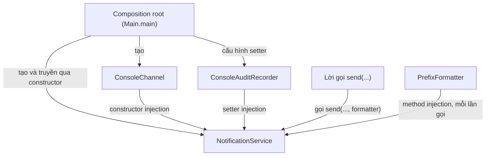

# Phối hợp nhiều cách truyền phụ thuộc trong cùng một lớp

> **Chương:** Các cách truyền phụ thuộc  
> **Chủ đề:** Chọn và kết hợp constructor injection, setter injection và method injection một cách có chủ đích trong Java thuần.

## 1. Mục tiêu học tập

Sau bài học, bạn có thể:

1. Giải thích vì sao một lớp đôi khi cần **nhiều cách nhận dependency** thay vì dùng duy nhất một cách.
2. Phân loại dependency theo tính **bắt buộc**, **tùy chọn**, **ổn định** và **thay đổi theo lời gọi** để chọn điểm truyền phù hợp.
3. Viết một lớp Java kết hợp constructor injection, setter injection và method injection mà vẫn bảo đảm trạng thái hợp lệ.
4. Xác định trách nhiệm lắp ghép tại **composition root**, đồng thời nhận biết tác động của scope và vòng đời.
5. Kiểm thử từng đường truyền bằng **Java thuần**, trước khi cân nhắc dùng DI container.

## 2. Vì sao cần phối hợp nhiều cách truyền?

**Dependency Injection (DI, tiêm phụ thuộc)** tách việc *sử dụng* các cộng tác viên khỏi việc *tạo và lắp ghép* chúng. Trong một đối tượng, các dependency không nhất thiết có cùng vai trò hoặc vòng đời.

Xét một dịch vụ gửi thông báo:

- Dịch vụ **bắt buộc** có một kênh gửi để thực hiện công việc. Kênh này thường được chọn khi tạo dịch vụ và dùng lâu dài.
- Dịch vụ **có thể** ghi log kiểm toán. Ứng dụng nhỏ có thể tắt chức năng này; môi trường khác có thể cấu hình bộ ghi phù hợp khi khởi tạo.
- Mỗi lần gửi có thể cần **cách định dạng nội dung riêng**, tùy người nhận hoặc tình huống; việc định dạng được quyết định tại lần gọi.

Nếu ép cả ba vào constructor, caller phải cung cấp ngay cả thành phần tùy chọn và phải cố định formatter cho toàn bộ vòng đời đối tượng. Nếu chuyển cả ba sang setter, đối tượng có thể được tạo ra mà chưa có kênh gửi bắt buộc. Nếu yêu cầu truyền kênh gửi trong *mọi* lời gọi, API sẽ lặp lại một cấu hình vốn ổn định.

Phối hợp các cách truyền giải quyết sự khác nhau đó, với điều kiện mỗi lựa chọn phản ánh một nhu cầu thiết kế thật.

| Đặc điểm của dependency | Cách truyền nên cân nhắc | Lý do |
| --- | --- | --- |
| Bắt buộc, ổn định suốt đời đối tượng | **Constructor injection** | Đối tượng hợp lệ ngay khi tạo; biểu diễn rõ hợp đồng bắt buộc. |
| Tùy chọn, có mặc định an toàn; cấu hình trước khi sử dụng | **Setter injection** | Caller có thể ghi đè mặc định khi thực sự cần. |
| Chỉ cần cho một thao tác hoặc thay đổi theo từng lần gọi | **Method injection** | Mỗi lời gọi chọn dependency thích hợp mà không đổi trạng thái chung. |
| Bắt buộc nhưng chỉ được cung cấp qua setter | **Cân nhắc thiết kế lại** | Tạo ra khoảng thời gian đối tượng chưa sẵn sàng hoạt động. |
| Được framework gán trực tiếp vào trường (field injection) | **Hạn chế trong thiết kế mới** | Khó nhận biết dependency và tự khởi tạo khi kiểm thử không dùng framework. |

> **Nguyên tắc:** Một lớp có thể kết hợp nhiều hình thức tiêm phụ thuộc, nhưng **một dependency cụ thể nên có một cách cung cấp rõ ràng**. Đừng vừa cho phép truyền cùng một đối tượng qua constructor, vừa thay đổi nó bằng setter mà không có yêu cầu nghiệp vụ cụ thể.

## 3. Ví dụ hoàn chỉnh: ba cách truyền trong một dịch vụ

Ví dụ dưới đây hoàn toàn chạy bằng JDK, không cần Spring, Guice hay thư viện bổ sung.

Ta định nghĩa ba hợp đồng:

- `DeliveryChannel`: gửi nội dung đến đích; **bắt buộc và ổn định**, truyền qua constructor.
- `AuditRecorder`: lưu dấu vết gửi; **tùy chọn**, mặc định không làm gì, có thể gắn bằng setter.
- `MessageFormatter`: định dạng nội dung; **có thể thay đổi theo từng thông báo**, truyền qua phương thức `send`.

Tạo file `Main.java`:

```java
import java.util.Objects;

interface DeliveryChannel {
    void deliver(String recipient, String message);
}

interface AuditRecorder {
    void record(String recipient, String message);
}

interface MessageFormatter {
    String format(String message);
}

// Mặc định an toàn khi ứng dụng không cần ghi kiểm toán.
final class NoOpAuditRecorder implements AuditRecorder {
    static final NoOpAuditRecorder INSTANCE = new NoOpAuditRecorder();

    private NoOpAuditRecorder() {}

    @Override
    public void record(String recipient, String message) {
        // Cố ý không làm gì.
    }
}

final class NotificationService {
    private final DeliveryChannel channel;
    private AuditRecorder auditRecorder = NoOpAuditRecorder.INSTANCE;

    // 1. Constructor injection: phụ thuộc bắt buộc.
    NotificationService(DeliveryChannel channel) {
        this.channel = Objects.requireNonNull(channel, "channel");
    }

    // 2. Setter injection: phụ thuộc tùy chọn, có mặc định.
    void setAuditRecorder(AuditRecorder auditRecorder) {
        this.auditRecorder = Objects.requireNonNull(
                auditRecorder, "auditRecorder");
    }

    // 3. Method injection: phụ thuộc chỉ dùng trong lần gửi này.
    void send(String recipient, String content, MessageFormatter formatter) {
        Objects.requireNonNull(recipient, "recipient");
        Objects.requireNonNull(content, "content");

        MessageFormatter selected =
                Objects.requireNonNull(formatter, "formatter");
        String formatted = Objects.requireNonNull(
                selected.format(content), "formatted");

        channel.deliver(recipient, formatted);
        auditRecorder.record(recipient, formatted);
    }
}

final class ConsoleChannel implements DeliveryChannel {
    @Override
    public void deliver(String recipient, String message) {
        System.out.println("SEND " + recipient + ": " + message);
    }
}

final class ConsoleAuditRecorder implements AuditRecorder {
    @Override
    public void record(String recipient, String message) {
        System.out.println("AUDIT " + recipient + ": " + message);
    }
}

final class PrefixFormatter implements MessageFormatter {
    private final String prefix;

    PrefixFormatter(String prefix) {
        this.prefix = Objects.requireNonNull(prefix, "prefix");
    }

    @Override
    public String format(String message) {
        return prefix + message;
    }
}

public class Main {
    public static void main(String[] args) {
        // Composition root: tạo và cấu hình các đối tượng.
        DeliveryChannel channel = new ConsoleChannel();
        NotificationService service = new NotificationService(channel);
        service.setAuditRecorder(new ConsoleAuditRecorder());

        // Caller cung cấp formatter cho từng thao tác.
        service.send(
                "an@example.test",
                "Đơn hàng đã xác nhận",
                new PrefixFormatter("[VI] "));
        service.send(
                "binh@example.test",
                "Payment completed",
                new PrefixFormatter("[EN] "));
    }
}
```

Biên dịch và chạy:

```bash
javac -encoding UTF-8 Main.java
java Main
```

Kết quả mong đợi:

```text
SEND an@example.test: [VI] Đơn hàng đã xác nhận
AUDIT an@example.test: [VI] Đơn hàng đã xác nhận
SEND binh@example.test: [EN] Payment completed
AUDIT binh@example.test: [EN] Payment completed
```

Đây là ví dụ mô phỏng: `ConsoleChannel` in thông báo ra màn hình, không gửi email thật. `ConsoleAuditRecorder` cũng chỉ in ra console.

### 3.1. Đọc ví dụ theo thời điểm truyền phụ thuộc



**Constructor:** `NotificationService` không có trạng thái thiếu `DeliveryChannel` sau khi khởi tạo thành công; trường `final` ngăn thay tham chiếu kênh gửi bằng cách gán lại.

**Setter:** nếu không gọi `setAuditRecorder`, dịch vụ vẫn chạy với `NoOpAuditRecorder`. Bộ ghi là tùy chọn thật sự. Ở ví dụ, setter được gọi **trước khi bắt đầu gửi**, tại bước cấu hình ứng dụng.

**Method:** hai lần gọi `send` sử dụng hai `PrefixFormatter` khác nhau. Formatter không bị giữ trong một trường của `NotificationService`, nên không vô tình trở thành trạng thái dùng chung giữa các lần gọi.

## 4. Cách chọn ranh giới giữa ba kiểu truyền

### 4.1. Dependency bắt buộc: constructor

Khi thiếu một cộng tác viên khiến dịch vụ **không thể hoạt động đúng**, hãy thể hiện yêu cầu đó trong constructor. Kiểm tra `null` ngay tại nơi tạo đối tượng:

```java
NotificationService service = new NotificationService(channel);
// new NotificationService(null) ném NullPointerException ngay.
```

Lợi ích là lỗi cấu hình xuất hiện sớm, không đợi đến lời gọi nghiệp vụ đầu tiên. Người đọc chữ ký constructor cũng biết dịch vụ cần gì.

### 4.2. Dependency tùy chọn: setter với mặc định có chủ ý

Setter phù hợp khi tính năng bổ sung có thể **không được cấu hình**, nhưng đối tượng vẫn mang hành vi rõ ràng. Trong ví dụ, bộ ghi mặc định `NoOpAuditRecorder` giúp dịch vụ hợp lệ mà không phụ thuộc `null`:

```java
NotificationService service = new NotificationService(channel);
service.send("a@example.test", "Hello", new PrefixFormatter(""));
// Vẫn gửi được, không có dòng AUDIT.
```

Nếu nghiệp vụ bắt buộc phải ghi dấu vết cho **mọi** lần gửi, `AuditRecorder` không còn tùy chọn. Khi đó hãy chuyển nó sang constructor:

```java
// Minh họa thiết kế thay thế khi audit là yêu cầu bắt buộc.
final class AuditedNotificationService {
    private final DeliveryChannel channel;
    private final AuditRecorder audit;

    AuditedNotificationService(DeliveryChannel channel, AuditRecorder audit) {
        this.channel = Objects.requireNonNull(channel);
        this.audit = Objects.requireNonNull(audit);
    }
}
```

Không nên tạo một đối tượng thiếu dependency bắt buộc rồi buộc caller phải nhớ gọi setter trước mọi thao tác. Cách đó làm xuất hiện **temporal coupling**: việc đúng hay sai phụ thuộc vào thứ tự gọi phương thức.

### 4.3. Dependency gắn với thao tác: method

Method injection phù hợp khi lựa chọn implementation phụ thuộc vào **ngữ cảnh của đúng lần gọi**. Ví dụ một thông báo được định dạng bằng tiếng Việt, thông báo kế tiếp bằng tiếng Anh; caller chọn formatter tương ứng.

Không có quy tắc rằng mọi tham số phương thức đều là dependency injection. Chuỗi `recipient` và `content` là **dữ liệu đầu vào**; `MessageFormatter` là **cộng tác viên thực hiện hành vi**. Phân biệt này giúp API thể hiện đúng ý nghĩa.

Nếu mọi lần gửi đều sử dụng cùng một `MessageFormatter`, việc truyền lặp lại ở mỗi lời gọi có thể không cần thiết. Khi đó có thể chuyển formatter sang constructor. Đừng dùng method injection chỉ vì muốn giảm số tham số constructor.

## 5. Composition root chịu trách nhiệm đến đâu?

Với Java thuần, **composition root** thường là `main` hoặc mã khởi động ứng dụng. Nó tạo adapter cụ thể, truyền chúng qua constructor, gọi setter để hoàn thiện cấu hình tùy chọn, rồi mới đưa service vào hoạt động.

Trình tự hợp lý với `NotificationService`:

1. Chọn implementation `DeliveryChannel` theo môi trường, tạo kênh gửi.
2. Tạo `NotificationService(channel)`, bảo đảm dependency bắt buộc đã có.
3. Nếu muốn audit, tạo và truyền `AuditRecorder` qua setter **trước khi service được chia sẻ hoặc phục vụ request**.
4. Khi xử lý từng thao tác, caller truyền `MessageFormatter` thích hợp.
5. Khi ứng dụng kết thúc, bên sở hữu tài nguyên giải phóng các adapter cần đóng.

**Inversion of Control (IoC)** thể hiện ở đây qua việc `NotificationService` không tự quyết định tạo kênh gửi hoặc bộ ghi. **Dependency Inversion Principle (DIP)** được hỗ trợ nhờ `NotificationService` phụ thuộc vào các interface `DeliveryChannel`, `AuditRecorder`, `MessageFormatter` thay vì ràng buộc trực tiếp vào các lớp console. DI là kỹ thuật cung cấp dependency; IoC và DIP là các khái niệm có liên quan nhưng không đồng nghĩa.

Khi dùng DI container về sau, container có thể tự tạo và nối các dependency ổn định. Các lựa chọn mang tính **mỗi lời gọi**, như `MessageFormatter` trong `send`, vẫn cần được diễn tả rõ qua API hoặc một cơ chế phù hợp; container không tự biết cách chọn ngữ cảnh cho từng request.

## 6. Kiểm thử sự phối hợp bằng Java thuần

Việc trộn nhiều kiểu truyền cần được kiểm thử theo đúng hợp đồng của mỗi kiểu:

- Constructor từ chối dependency bắt buộc không hợp lệ.
- Bỏ qua setter vẫn dùng được nhờ mặc định an toàn.
- Gọi setter thay đổi bộ ghi theo cấu hình mong muốn.
- Formatter truyền qua method tác động lên **đúng lần gửi**.

Giữ `Main.java` ở mục 3 và tạo thêm `NotificationServiceTest.java` cùng thư mục:

```java
final class RecordingChannel implements DeliveryChannel {
    int sendCount;
    String lastRecipient;
    String lastMessage;

    @Override
    public void deliver(String recipient, String message) {
        sendCount++;
        lastRecipient = recipient;
        lastMessage = message;
    }
}

final class RecordingAudit implements AuditRecorder {
    int recordCount;
    String lastMessage;

    @Override
    public void record(String recipient, String message) {
        recordCount++;
        lastMessage = message;
    }
}

public class NotificationServiceTest {
    public static void main(String[] args) {
        RecordingChannel channel = new RecordingChannel();
        NotificationService service = new NotificationService(channel);

        // Không gọi setter: audit là tùy chọn và service vẫn gửi.
        service.send("a@example.test", "Ready", new PrefixFormatter("A: "));
        check(channel.sendCount == 1, "Phải gửi đúng một lần");
        check("A: Ready".equals(channel.lastMessage), "Formatter lần 1");

        // Có audit và đổi formatter theo lần gọi.
        RecordingAudit audit = new RecordingAudit();
        service.setAuditRecorder(audit);
        service.send("b@example.test", "Done", new PrefixFormatter("B: "));

        check(channel.sendCount == 2, "Phải có hai lần gửi");
        check("b@example.test".equals(channel.lastRecipient), "Người nhận");
        check("B: Done".equals(channel.lastMessage), "Formatter lần 2");
        check(audit.recordCount == 1, "Audit chỉ bật sau setter");
        check("B: Done".equals(audit.lastMessage), "Nội dung audit");

        // Constructor từ chối một phụ thuộc bắt buộc bị thiếu.
        boolean rejectedNull = false;
        try {
            new NotificationService(null);
        } catch (NullPointerException expected) {
            rejectedNull = true;
        }
        check(rejectedNull, "Constructor phải từ chối null");

        System.out.println("PASS");
    }

    private static void check(boolean condition, String description) {
        if (!condition) {
            throw new AssertionError(description);
        }
    }
}
```

```bash
javac -encoding UTF-8 Main.java NotificationServiceTest.java
java NotificationServiceTest
```

Kết quả mong đợi: `PASS`. Bài kiểm thử dùng fake tự viết, không chạm mạng hoặc database. Nó kiểm tra khả năng **thay thế dependency** và phối hợp giữa các hình thức injection; nó chưa chứng minh khả năng gửi thực tế của một email/SMS adapter.

## 7. Scope, vòng đời và an toàn luồng khi phối hợp

Trong ví dụ, `NotificationService` có thể được tái sử dụng nhiều lần; `DeliveryChannel` được giữ trong trường `final`, `AuditRecorder` được giữ trong trường có thể thay đổi, còn `MessageFormatter` chỉ tồn tại trong phạm vi lời gọi `send`.

| Thành phần | Ai cung cấp? | Thời gian giữ tham chiếu trong service | Điều cần kiểm soát |
| --- | --- | --- | --- |
| `DeliveryChannel` | Composition root qua constructor | Trong suốt vòng đời của `NotificationService` | Có được thiết kế để dùng chung không? Ai đóng tài nguyên? |
| `AuditRecorder` | Composition root qua setter (nếu cần) | Đến khi bị cấu hình lại hoặc service kết thúc | Tránh cấu hình lại trong lúc có các lời gọi đồng thời. |
| `MessageFormatter` | Caller qua `send` | Chỉ trong quá trình xử lý lần gửi đó | Không lưu vào field dùng chung nếu formatter chỉ hợp lệ cho một request. |

**Cảnh báo về concurrency:** setter trong ví dụ dùng cho **giai đoạn cấu hình một luồng**, trước khi dịch vụ được chia sẻ. Nếu một thread gọi `setAuditRecorder` trong lúc thread khác gọi `send`, mã hiện tại không bảo đảm sự đồng bộ hoặc khả năng quan sát bản cập nhật. Nếu thật sự phải đổi recorder khi đang chạy, cần thiết kế riêng để đồng bộ hóa truy cập (ví dụ một `AtomicReference`), đồng thời xem xét tính nhất quán của mỗi thao tác.

**Cảnh báo về scope:** không nên đưa trực tiếp một dependency chỉ hợp lệ trong request vào field của một service dùng chung toàn ứng dụng. Nếu formatter, transaction context hoặc dữ liệu người dùng chỉ đúng cho một request, truyền qua phương thức có thể giúp tránh lưu nhầm trạng thái request vào một đối tượng sống lâu. Tuy nhiên, method injection tự nó không thay thế việc quản lý tài nguyên và scope chính xác.

**Cảnh báo về sở hữu tài nguyên:** nếu `DeliveryChannel` trong thực tế dùng kết nối hoặc executor, nơi tạo và quản lý vòng đời cần xác định khi nào đóng chúng. Tiêm phụ thuộc không tự gọi `close()`; container cũng cần cấu hình vòng đời phù hợp để dọn dẹp đúng.

## 8. Những cách phối hợp dễ gây lỗi

### 8.1. Bắt buộc qua setter nhưng không có mặc định

```java
// Phản ví dụ: thiếu cấu hình vẫn tạo được đối tượng.
final class FragileSender {
    private DeliveryChannel channel;

    void setChannel(DeliveryChannel channel) {
        this.channel = channel;
    }

    void send(String to, String text) {
        channel.deliver(to, text); // NPE nếu quên setChannel(...)
    }
}
```

Với `channel` bắt buộc, dùng constructor injection để loại bỏ trạng thái chưa sẵn sàng.

### 8.2. Truyền cùng một dependency qua nhiều cửa mà không có quy tắc

Giả sử constructor nhận `AuditRecorder`, nhưng setter cũng có thể thay nó; một phương thức khác lại nhận `AuditRecorder` riêng. Người dùng API sẽ không biết recorder nào có ưu tiên và khi nào được dùng. Hãy chọn **một nguồn duy nhất** cho từng trách nhiệm hoặc ghi rõ quy tắc override khi thật sự cần.

### 8.3. Đổi setter giữa các request đồng thời

Một service singleton đang phục vụ nhiều request không nên dùng setter để nạp `userContext`, `currentTenant` hoặc `requestId` cho từng request. Request sau có thể ghi đè trạng thái của request trước. Truyền ngữ cảnh theo lời gọi hoặc thiết kế một đối tượng có scope phù hợp.

### 8.4. Dùng method injection cho mọi thứ

```java
// API này bắt caller lặp lại một phụ thuộc ổn định ở mọi lời gọi.
void send(
        String recipient,
        String content,
        DeliveryChannel channel,
        MessageFormatter formatter) {
    // ...
}
```

Nếu kênh gửi không đổi giữa các lần gọi, giữ `DeliveryChannel` ở constructor sẽ giảm lỗi bỏ sót và giúp service có trách nhiệm rõ ràng. Ngược lại, nếu lựa chọn kênh thực sự khác nhau theo từng yêu cầu, method injection có thể hợp lý; hãy đưa ra quyết định từ hành vi thực tế.

### 8.5. Giấu dependency bằng field injection hoặc service locator

Một field được framework gán ngầm có thể làm constructor trông như không cần dependency, trong khi test Java thuần không biết phải cung cấp gì. Tương tự, gọi registry toàn cục từ bên trong nghiệp vụ làm nguồn phụ thuộc khó theo dõi. Đối với mã mới, nên ưu tiên API thể hiện rõ cách truyền qua constructor, setter hoặc method.

### 8.6. Constructor ngày càng dài

Một constructor có quá nhiều dependency không liên quan có thể báo hiệu lớp đang gánh quá nhiều trách nhiệm. **Không nên chuyển bừa sang setter** chỉ để rút ngắn chữ ký. Xem lại ranh giới nghiệp vụ, nhóm hành vi liên quan và phân chia service trước.

## 9. Quy trình ra quyết định khi thiết kế một lớp

Với **mỗi** dependency, lần lượt hỏi:

1. **Thiếu nó, đối tượng còn hoạt động hợp lệ không?** Nếu không, ưu tiên constructor.
2. **Nó có thay đổi theo từng thao tác không?** Nếu có và việc lựa chọn thuộc ngữ cảnh lời gọi, xem xét method injection.
3. **Nó có thật sự tùy chọn và có mặc định an toàn không?** Nếu có, setter có thể phù hợp khi cấu hình trước lúc sử dụng.
4. **Đối tượng có được dùng đồng thời hoặc sống lâu hơn request không?** Nếu có, tránh mutable field chứa trạng thái request; rà soát an toàn luồng và scope.
5. **Ai tạo và ai dọn dẹp tài nguyên?** Xác định trách nhiệm rõ tại composition root hoặc nơi quản lý lifecycle.

Ví dụ, một `ReportService` luôn cần `ReportRepository` và `Renderer` thì cả hai có thể vào constructor; nếu từng lời gọi cần lựa chọn `ExportPolicy` khác nhau, policy có thể đi qua method. Nếu tracing là chức năng tùy chọn, có mặc định `NoOpTraceSink`, setter có thể dùng trong bước khởi tạo. Phối hợp này nên giữ cho hợp đồng đối tượng **dễ đoán** và **kiểm thử độc lập**.

## 10. Tự luyện tập

**Bài 1 — Chọn cách truyền:** `PaymentService` cần `PaymentGateway` cho mọi giao dịch; một số môi trường bật `FraudAuditSink`; mỗi lần thanh toán nhận `ExchangeRateProvider` riêng theo thời điểm định giá. Hãy chỉ ra cách truyền thích hợp cho từng dependency, giải thích vì sao và nêu một rủi ro về vòng đời.

**Bài 2 — Sửa lỗi thiết kế:** Một singleton `EmailService` gọi `setCurrentUser(...)` trước mỗi lần gửi trong ứng dụng đa luồng. Chỉ ra lỗi có thể xảy ra và đề xuất thay đổi chữ ký phương thức để tránh trạng thái dùng chung.

**Bài 3 — Mở rộng ví dụ:** Viết `UppercaseFormatter` hiện thực `MessageFormatter`, truyền nó cho **một** lời gọi `send` rồi kiểm tra rằng các lời gọi khác vẫn dùng formatter được truyền riêng. Không sửa `NotificationService`.

**Đáp án gợi ý:** (1) Gateway bắt buộc nên qua constructor; audit tùy chọn với mặc định an toàn có thể qua setter; provider thay theo giao dịch có thể qua method. Không giữ provider request-scoped trong singleton. (2) Trạng thái `currentUser` có thể bị request khác ghi đè; truyền người dùng/ngữ cảnh vào `send(...)` theo lần gọi. (3) Thêm một implementation của interface `MessageFormatter` và truyền qua tham số `send`, không thay đổi wiring của constructor hoặc setter.

## 11. Tổng kết

Phối hợp các cách truyền phụ thuộc trong cùng một lớp là một quyết định về **hợp đồng, thời điểm cung cấp và vòng đời**. Constructor injection bảo đảm những gì bắt buộc; setter injection phù hợp với thành phần tùy chọn có mặc định rõ ràng; method injection cho phép chọn cộng tác viên theo từng thao tác. Khi đặt việc tạo và cấu hình ở composition root, bảo vệ trạng thái hợp lệ và kiểm soát concurrency, bạn có thể áp dụng thiết kế này hoàn toàn bằng Java thuần trước khi mở rộng sang DI container.
