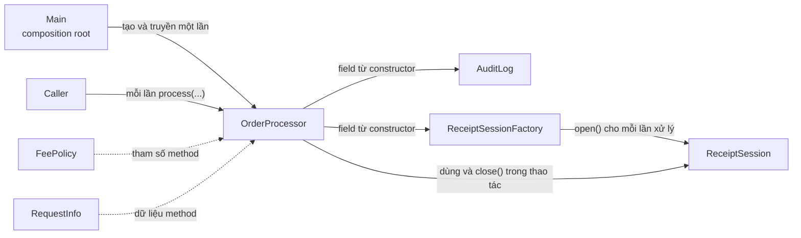
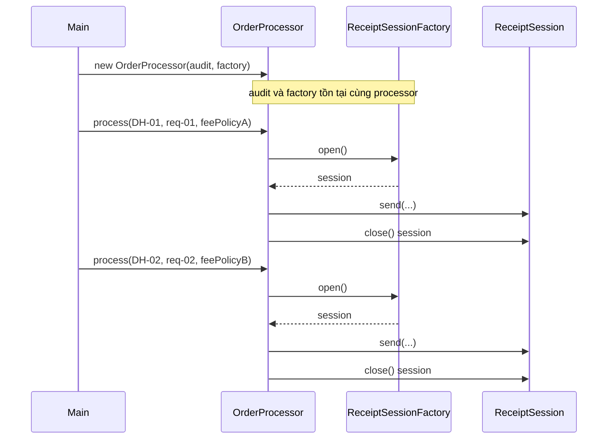

# Chọn cách truyền theo vòng đời và phạm vi sử dụng thực tế

## Mục tiêu học tập

Sau bài này, bạn có thể:

- Chọn **constructor injection**, **method injection** hoặc **setter injection** dựa trên thời điểm cần phụ thuộc, tính bắt buộc và mức độ thay đổi của nó.
- Phân biệt **cách truyền phụ thuộc** với **scope và vòng đời của instance**: truyền qua constructor không tự động biến một đối tượng thành singleton, cũng như truyền qua method không tự động tạo đối tượng mới.
- Nhận biết trường hợp một dịch vụ sống lâu hơn phụ thuộc mà nó cần; xử lý bằng tham số theo lần gọi hoặc factory/provider phù hợp.
- Xác định ai **tạo**, ai **sử dụng**, ai **sở hữu và đóng tài nguyên** trong chương trình Java thuần, trước khi áp dụng DI container.
- Kiểm tra quyết định lắp ghép bằng các implementation giả, không gọi hệ thống bên ngoài.

Đây là bài thuộc chương **Các cách truyền phụ thuộc** của chủ đề **Dependency Injection (DI)** và **Inversion of Control (IoC)**. Trọng tâm không phải tìm ra một cách truyền tốt nhất cho mọi lớp; trọng tâm là đặt quyết định khởi tạo và cung cấp phụ thuộc đúng chỗ, để consumer dùng được chức năng cần thiết trong phạm vi thời gian phù hợp.

## 1. Ba câu hỏi trước khi chọn cách truyền

Mọi đối tượng sử dụng một phụ thuộc đều đặt ra ba câu hỏi:

1. **Phụ thuộc bắt buộc hay tùy chọn?** Nếu thiếu nó, đối tượng có còn hợp lệ và làm đúng việc của mình không?
2. **Phụ thuộc ổn định bao lâu?** Giữ nguyên trong suốt đời consumer, thay theo từng thao tác, hay được chọn lại khi cấu hình thay đổi?
3. **Ai quản lý vòng đời của instance?** Nó được dùng chung, được tạo riêng cho mỗi lần xử lý, có trạng thái riêng hay phải đóng sau khi dùng?

Không thể quyết định chỉ từ tên lớp. Cùng một interface `NotificationSender` có thể được triển khai bởi một sender không trạng thái và an toàn để chia sẻ, hoặc bởi một phiên kết nối có trạng thái, chỉ dùng trong một yêu cầu rồi đóng. **Hành vi, trạng thái và quyền sở hữu tài nguyên** quyết định cách lắp ghép thích hợp.

### Hai khái niệm cần tách riêng

| Khái niệm | Trả lời câu hỏi nào? | Ví dụ |
| --- | --- | --- |
| **Injection method** | Phụ thuộc được **đưa vào consumer qua đâu**? | Constructor, method parameter, setter. |
| **Scope / lifecycle** | **Instance nào** được tạo, chia sẻ, còn sống và đóng vào lúc nào? | Một logger dùng chung cho nhiều service; một phiên gửi thông báo mới cho mỗi thao tác. |

Một instance được đưa vào constructor có thể chỉ sống trong một request. Ngược lại, một instance dùng chung vẫn có thể được truyền qua tham số method. Hai chiều này độc lập: **cách truyền không tự quyết định vòng đời**.

## 2. Bảng chọn nhanh theo nhu cầu thực tế

| Tình huống | Cách ưu tiên | Vì sao? | Điểm cần kiểm tra |
| --- | --- | --- | --- |
| Phụ thuộc **bắt buộc**, dùng ở nhiều phương thức, ổn định trong đời consumer | **Constructor injection** | Consumer hợp lệ ngay khi khởi tạo; field có thể `final`. | Instance có an toàn để giữ và chia sẻ lâu dài không? |
| Phụ thuộc **chỉ cần cho một thao tác**, có thể khác giữa các lần gọi | **Method injection** bằng tham số | Thể hiện phạm vi sử dụng tại nơi gọi; không lưu trạng thái ngắn hạn vào service. | Ai tạo/chọn instance cho từng lời gọi? |
| Phụ thuộc **tùy chọn**, có giá trị mặc định hợp lệ hoặc được cấu hình trước khi sử dụng | **Setter injection** khi có lý do rõ ràng | Có thể gắn/thay phụ thuộc sau khi tạo consumer. | Trạng thái chưa cấu hình, `null`, thay đổi đồng thời và thứ tự khởi tạo. |
| Cần **một instance mới cho mỗi thao tác**, hoặc một tài nguyên phải mở/đóng | Tiêm **factory/provider** rồi tạo trong lúc xử lý | Consumer nhận năng lực tạo tài nguyên, không giữ một phiên ngắn hạn quá lâu. | Ai đóng tài nguyên? Factory trả instance mới hay instance dùng lại? |
| Chỉ là **dữ liệu của yêu cầu**: mã đơn, người dùng hiện tại, thời điểm xử lý | **Tham số method** | Dữ liệu gắn với từng lần xử lý; tránh lưu vào service dùng chung. | Dữ liệu có bị giữ lại sau request không? |
| Phụ thuộc thay đổi hiếm khi nhưng luôn bắt buộc | Thường vẫn **constructor injection**, tạo consumer mới khi cần đổi | Giữ cấu hình rõ ràng và trạng thái ổn định. | Có thật sự cần setter để thay nóng trong khi chạy? |

**Lưu ý:** tham số method có thể mang một *collaborator* (ví dụ `FeePolicy`, đây là method injection), hoặc mang *dữ liệu đầu vào* (ví dụ `RequestInfo`, đây chỉ là tham số dữ liệu). Không phải tham số nào cũng là dependency injection theo nghĩa thiết kế.

## 3. Tình huống xuyên suốt: xác nhận tổng tiền đơn hàng

Giả sử một ứng dụng xử lý nhiều yêu cầu xác nhận đơn hàng. Ta muốn:

- Một `OrderProcessor` có thể **được tái sử dụng** cho nhiều lời gọi.
- `AuditLog` và `ReceiptSessionFactory` là các cộng tác viên **bắt buộc, ổn định** của processor.
- `FeePolicy` có thể **khác nhau cho từng đơn**: miễn phí hoặc phí cố định.
- `RequestInfo` chứa **mã yêu cầu và email người nhận của lần xử lý hiện tại**.
- Mỗi lần xử lý mở một `ReceiptSession`, dùng để gửi xác nhận rồi **đóng đúng phiên đó**.

Ví dụ chỉ **giả lập việc ghi audit và gửi xác nhận bằng console**. Không thanh toán, gửi email hoặc kết nối dịch vụ thật.

### Sơ đồ phạm vi sử dụng



Mũi tên liền từ `OrderProcessor` đến `AuditLog`/`ReceiptSessionFactory` là **tham chiếu phụ thuộc được giữ trong field**. Đường từ `FeePolicy` và `RequestInfo` cho thấy hai giá trị **đến theo từng lời gọi**; riêng `FeePolicy` là collaborator được tiêm qua method. `ReceiptSession` được tạo trong phạm vi thao tác, sau đó được đóng. `Main` là **nơi lắp ghép**, không phải một phụ thuộc mà processor cần giữ.

## 4. Ví dụ Java hoàn chỉnh: ba vòng đời trong một luồng

Lưu toàn bộ đoạn sau vào **`Main.java`**. Code chỉ cần JDK, không phụ thuộc Spring, CDI hay DI container.

```java
import java.util.Objects;
import java.util.concurrent.atomic.AtomicInteger;

// Cộng tác viên ổn định: có thể dùng cho nhiều lần xử lý.
interface AuditLog {
    void record(String message);
}

final class ConsoleAuditLog implements AuditLog {
    @Override
    public void record(String message) {
        System.out.println("[AUDIT] " + message);
    }
}

// Cộng tác viên được chọn theo từng đơn hàng.
interface FeePolicy {
    long feeFor(long subtotalVnd);
}

final class NoFeePolicy implements FeePolicy {
    @Override
    public long feeFor(long subtotalVnd) {
        return 0L;
    }
}

final class FixedFeePolicy implements FeePolicy {
    private final long feeVnd;

    FixedFeePolicy(long feeVnd) {
        if (feeVnd < 0) {
            throw new IllegalArgumentException("feeVnd must be >= 0");
        }
        this.feeVnd = feeVnd;
    }

    @Override
    public long feeFor(long subtotalVnd) {
        return feeVnd;
    }
}

// Dữ liệu của một yêu cầu; không cần giữ trong OrderProcessor.
final class RequestInfo {
    final String requestId;
    final String recipient;

    RequestInfo(String requestId, String recipient) {
        this.requestId = Objects.requireNonNull(requestId, "requestId");
        this.recipient = Objects.requireNonNull(recipient, "recipient");
    }
}

// Mỗi session có trạng thái riêng và phải đóng sau khi dùng.
interface ReceiptSession extends AutoCloseable {
    void send(String recipient, String message);

    @Override
    void close();
}

interface ReceiptSessionFactory {
    ReceiptSession open();
}

final class ConsoleReceiptSession implements ReceiptSession {
    private final int id;
    private boolean closed;

    ConsoleReceiptSession(int id) {
        this.id = id;
    }

    @Override
    public void send(String recipient, String message) {
        if (closed) {
            throw new IllegalStateException("session already closed");
        }
        System.out.printf("[SESSION %d] %s: %s%n", id, recipient, message);
    }

    @Override
    public void close() {
        if (!closed) {
            closed = true;
            System.out.printf("[SESSION %d] đóng%n", id);
        }
    }
}

// Factory được chia sẻ, nhưng mỗi open() tạo một session mới.
final class ConsoleReceiptSessionFactory implements ReceiptSessionFactory {
    private final AtomicInteger sequence = new AtomicInteger();

    @Override
    public ReceiptSession open() {
        return new ConsoleReceiptSession(sequence.incrementAndGet());
    }
}

final class OrderProcessor {
    private final AuditLog auditLog;
    private final ReceiptSessionFactory sessionFactory;

    // Constructor injection: bắt buộc và ổn định trong đời processor.
    OrderProcessor(AuditLog auditLog, ReceiptSessionFactory sessionFactory) {
        this.auditLog = Objects.requireNonNull(auditLog, "auditLog");
        this.sessionFactory = Objects.requireNonNull(sessionFactory, "sessionFactory");
    }

    // Method injection: FeePolicy có thể khác nhau ở mỗi lời gọi.
    // RequestInfo là dữ liệu của request, không phải service được lưu trong field.
    long process(String orderId, long subtotalVnd,
                 RequestInfo request, FeePolicy feePolicy) {
        Objects.requireNonNull(orderId, "orderId");
        Objects.requireNonNull(request, "request");
        Objects.requireNonNull(feePolicy, "feePolicy");

        if (subtotalVnd <= 0) {
            throw new IllegalArgumentException("subtotalVnd must be positive");
        }

        long fee = feePolicy.feeFor(subtotalVnd);
        if (fee < 0) {
            throw new IllegalArgumentException("fee must be >= 0");
        }

        long total = Math.addExact(subtotalVnd, fee);
        auditLog.record("request=" + request.requestId
                + " order=" + orderId + " total=" + total);

        // Mỗi lần xử lý mở một session và luôn đóng khi rời khối try.
        try (ReceiptSession session = sessionFactory.open()) {
            session.send(request.recipient,
                    "Đơn " + orderId + " có tổng tiền " + total + " VND");
        }
        return total;
    }
}

// Composition root: chọn implementation, tạo và nối các đối tượng.
public class Main {
    public static void main(String[] args) {
        AuditLog auditLog = new ConsoleAuditLog();
        ReceiptSessionFactory sessionFactory = new ConsoleReceiptSessionFactory();
        OrderProcessor processor = new OrderProcessor(auditLog, sessionFactory);

        processor.process("DH-01", 100_000L,
                new RequestInfo("req-01", "a@example.com"),
                new FixedFeePolicy(5_000L));

        processor.process("DH-02", 200_000L,
                new RequestInfo("req-02", "b@example.com"),
                new NoFeePolicy());
    }
}
```

Chạy chương trình:

```bash
javac -encoding UTF-8 Main.java
java Main
```

Kết quả dự kiến:

```text
[AUDIT] request=req-01 order=DH-01 total=105000
[SESSION 1] a@example.com: Đơn DH-01 có tổng tiền 105000 VND
[SESSION 1] đóng
[AUDIT] request=req-02 order=DH-02 total=200000
[SESSION 2] b@example.com: Đơn DH-02 có tổng tiền 200000 VND
[SESSION 2] đóng
```

Ở đây, `Main` tạo **một** `OrderProcessor` rồi dùng cho **hai** thao tác. Hai lời gọi dùng **hai chính sách phí**, **hai bộ dữ liệu request** và **hai session** khác nhau. Không có field `currentRequest` hoặc `currentFeePolicy` trong processor, nên một yêu cầu không ghi đè dữ liệu của yêu cầu khác chỉ vì service được dùng lại.

## 5. Nhìn vào từng cách truyền trong ví dụ

### 5.1. Constructor injection: trạng thái hợp lệ ngay từ đầu

```java
OrderProcessor(AuditLog auditLog, ReceiptSessionFactory sessionFactory) {
    this.auditLog = Objects.requireNonNull(auditLog, "auditLog");
    this.sessionFactory = Objects.requireNonNull(sessionFactory, "sessionFactory");
}
```

`OrderProcessor` không hoạt động đúng nếu thiếu audit hoặc khả năng mở session. Constructor buộc bên tạo phải cung cấp đủ hai phụ thuộc. Vì các field là `final`, tham chiếu của processor không bị thay sau khi khởi tạo.

Đây là lựa chọn thường phù hợp khi **phụ thuộc bắt buộc, dùng lặp lại ở nhiều thao tác và được xác định lúc tạo consumer**. Tuy nhiên, `final` chỉ cố định **tham chiếu**, không khiến đối tượng được tham chiếu trở nên bất biến hoặc an toàn luồng. Nếu `AuditLog` giữ trạng thái có thể thay đổi, cách chia sẻ nó vẫn phải được xem xét riêng.

Ví dụ cũng cho thấy `OrderProcessor` chỉ biết interface `AuditLog` và `ReceiptSessionFactory`. `Main` chọn implementation nào; quyết định này nằm ở **composition root**, thể hiện việc tách tạo khỏi sử dụng trong DI/IoC.

### 5.2. Method injection: phụ thuộc thay theo lần xử lý

```java
long process(String orderId, long subtotalVnd,
             RequestInfo request, FeePolicy feePolicy) { ... }
```

`FeePolicy` là một **collaborator cung cấp hành vi**: processor gọi `feePolicy.feeFor(...)`, và caller quyết định dùng chính sách nào cho đơn này. Nếu lưu `FeePolicy` trong một field dùng chung rồi thay liên tục trước mỗi yêu cầu, các yêu cầu có thể ảnh hưởng lẫn nhau khi xử lý đồng thời.

Truyền qua method hợp lý khi chính lời gọi **quyết định phụ thuộc nào cần dùng** và consumer không phải giữ nó sau khi hoàn thành công việc. Ví dụ khác gồm bộ lọc hoặc thuật toán xuất báo cáo được chọn cho từng lượt chạy.

Trường hợp `RequestInfo` cũng được truyền qua method, nhưng nó đóng vai trò **dữ liệu đầu vào của request**. Truyền dữ liệu theo lần gọi là thiết kế tốt; không cần gọi mọi tham số như vậy là DI.

Một `FeePolicy` không trạng thái vẫn **có thể được dùng chung giữa nhiều lời gọi**. Method injection không có nghĩa caller bắt buộc phải `new FeePolicy()` trước mỗi lần gọi; ví dụ tạo mới trong `Main` chỉ để minh họa cách chọn chính sách riêng.

### 5.3. Factory được tiêm để lấy phụ thuộc ngắn hạn

```java
try (ReceiptSession session = sessionFactory.open()) {
    session.send(request.recipient, "Thông báo của đơn hàng");
}
```

`ReceiptSessionFactory` là phụ thuộc **ổn định** nên được tiêm qua constructor; `ReceiptSession` là tài nguyên **ngắn hạn** nên được mở tại thời điểm sử dụng. Khi rời khối `try` — kể cả khi `send` ném ngoại lệ — Java gọi `close()` của session theo cơ chế `try-with-resources`.

Thiết kế cần quy định rõ **hợp đồng của factory**. Trong ví dụ, mỗi `open()` trả một instance mới. Một factory khác có thể dùng pool và trả một *handle* tới tài nguyên được chia sẻ; khi đó `close()` có thể mang nghĩa trả handle về pool. Bản thân từ “factory” không bảo đảm `new` mỗi lần nếu hợp đồng không nói vậy.

Chú ý hai trách nhiệm vòng đời khác nhau:

- **Factory** quyết định cách mở/tạo session.
- **Consumer sử dụng session** quyết định phạm vi dùng session và gọi `close()` theo hợp đồng sở hữu của ví dụ.

Nếu factory hoặc container có trách nhiệm quản lý việc đóng thay consumer, phải nêu rõ trong API và cấu hình; không nên tự động giả định bên nhận dependency luôn được quyền đóng một instance dùng chung.

## 6. Setter injection phù hợp khi nào?

**Setter injection** đưa phụ thuộc vào sau khi đối tượng đã được tạo. Cách này có ích khi phụ thuộc **thật sự tùy chọn**, có giá trị mặc định hợp lệ hoặc có nhu cầu thay cấu hình của một đối tượng cục bộ trước khi dùng.

Ví dụ độc lập dưới đây cho phép giao diện xem trước đổi cách trình bày; khi chưa gọi setter, nó dùng kiểu văn bản gốc:

```java
import java.util.Objects;

interface PreviewStyle {
    String format(String text);
}

final class PreviewPane {
    private PreviewStyle style = text -> text; // mặc định hợp lệ

    void setStyle(PreviewStyle style) {
        this.style = Objects.requireNonNull(style, "style");
    }

    String show(String text) {
        return style.format(text);
    }
}

// Một nơi gọi trong ứng dụng:
// PreviewPane pane = new PreviewPane();
// pane.setStyle(text -> text.toUpperCase(java.util.Locale.ROOT));
// System.out.println(pane.show("xin chào"));
```

Ở đây, `PreviewPane` vẫn hợp lệ nếu không gọi setter. Thay `style` là một **tính năng có chủ đích**. Nếu chọn setter cho phụ thuộc **bắt buộc** mà không có mặc định, ta dễ tạo được object chưa sẵn sàng:

```java
// Minh họa trạng thái không hợp lệ, không dùng trong chương trình chính.
class RiskyProcessor {
    AuditLog auditLog; // chưa được bảo đảm có giá trị

    void setAuditLog(AuditLog auditLog) {
        this.auditLog = auditLog;
    }

    void run() {
        auditLog.record("running"); // NullPointerException nếu chưa cấu hình
    }
}
```

**Không nên dùng setter để thay một dependency đang được nhiều luồng sử dụng** nếu chưa có thiết kế đồng bộ, khả năng quan sát thay đổi và quy tắc tính nhất quán. Thông thường, với dependency bắt buộc và ổn định, tạo consumer mới qua constructor rõ ràng hơn so với thay nóng một field chung.

### Field injection có phải lựa chọn tương đương?

Field injection thường được thấy dưới dạng framework gán trực tiếp vào field, ví dụ `@Inject` trên thuộc tính. Nó có thể khiến phụ thuộc **khó nhìn thấy từ constructor**, khó tạo object hợp lệ bằng `new` trong kiểm thử Java thuần và khó biểu đạt tính bất biến của tham chiếu. Vì bài này chưa dùng DI container, hãy ưu tiên constructor hoặc method parameter; chỉ dựa vào field injection khi có lý do cụ thể gắn với framework và vòng đời của nó.

## 7. Phạm vi instance: sống lâu, sống ngắn và chia sẻ

Từ “scope” thường được dùng cho thời gian và ranh giới mà một instance được tái sử dụng. Trong Java thuần, chính mã ở composition root và các factory quyết định điều đó; tên gọi `singleton`, `request` hay `prototype` chưa có cơ chế tự động nếu chưa có container.

| Phạm vi thực tế | Cách tạo và truyền phù hợp | Rủi ro cần tránh |
| --- | --- | --- |
| **Dùng chung trong ứng dụng**: logger không trạng thái hoặc thread-safe | Tạo một instance ở composition root, truyền qua constructor cho các consumer | Chia sẻ đối tượng chứa trạng thái không an toàn luồng. |
| **Một request / một thao tác**: thông tin khách hiện tại, correlation ID | Truyền tham số method; nếu cần collaborator riêng, tạo trong request rồi truyền | Giữ request hiện tại trong field của service dùng chung, dẫn đến rò rỉ hoặc lẫn dữ liệu. |
| **Một lần mở tài nguyên**: session/transaction/stream | Tiêm factory ổn định, `open()` đúng lúc, `close()` theo hợp đồng | Giữ session đã đóng ở field, hoặc đóng nhầm instance dùng chung. |
| **Một consumer có state riêng**: bộ đếm hoặc bộ đệm phục vụ đúng consumer đó | Tạo instance riêng và tiêm qua constructor | Dùng chung vô tình qua nhiều consumer, làm lẫn trạng thái. |

### Timeline của ví dụ



Sơ đồ cho thấy **processor được tái sử dụng**, trong khi **policy, request và session được lựa chọn hoặc tạo cho từng lần xử lý**. Trong chương trình thực tế, `ReceiptSession` có thể là một kết nối, stream hoặc resource handle; việc đóng không nhất thiết đồng nghĩa bộ nhớ được giải phóng ngay lập tức.

### Lỗi thường gặp: request data nằm trong service dùng chung

```java
// Ví dụ phản diện: không dùng trong hệ thống xử lý đồng thời.
class SharedOrderService {
    private RequestInfo currentRequest;

    void process(RequestInfo request) {
        currentRequest = request;
        // Các tác vụ bất đồng bộ/đa luồng khác có thể ghi đè currentRequest.
    }
}
```

Nếu `SharedOrderService` xử lý đồng thời nhiều yêu cầu, một lời gọi có thể nhìn thấy `currentRequest` của lời gọi khác. Truyền request qua tham số và giữ nó ở biến cục bộ của lời gọi giúp tránh loại lỗi do *field dùng chung* này. Dẫu vậy, an toàn luồng của toàn bộ luồng xử lý còn phụ thuộc vào các collaborator bên trong, không tự động được bảo đảm chỉ nhờ method injection.

## 8. Kiểm thử lựa chọn vòng đời bằng Java thuần

Ta có thể kiểm tra hai điều: processor gọi audit đúng số lần, và **mỗi lần xử lý mở rồi đóng một session riêng**. Bài kiểm tra dưới đây thay implementation thật bằng implementation ghi nhận hành vi.

Lưu thành **`OrderProcessorCheck.java`** cạnh `Main.java`:

```java
import java.util.ArrayList;
import java.util.List;

public class OrderProcessorCheck {
    static final class RecordingAudit implements AuditLog {
        int calls;

        @Override
        public void record(String message) {
            calls++;
        }
    }

    static final class RecordingSession implements ReceiptSession {
        int sends;
        int closes;
        String recipient;

        @Override
        public void send(String recipient, String message) {
            if (closes > 0) {
                throw new IllegalStateException("session already closed");
            }
            this.recipient = recipient;
            sends++;
        }

        @Override
        public void close() {
            closes++;
        }
    }

    static final class RecordingSessionFactory implements ReceiptSessionFactory {
        final List<RecordingSession> sessions = new ArrayList<>();

        @Override
        public ReceiptSession open() {
            RecordingSession session = new RecordingSession();
            sessions.add(session);
            return session;
        }
    }

    public static void main(String[] args) {
        RecordingAudit audit = new RecordingAudit();
        RecordingSessionFactory factory = new RecordingSessionFactory();
        OrderProcessor processor = new OrderProcessor(audit, factory);

        long first = processor.process("DH-01", 100_000L,
                new RequestInfo("test-01", "a@example.com"),
                new FixedFeePolicy(5_000L));
        long second = processor.process("DH-02", 200_000L,
                new RequestInfo("test-02", "b@example.com"),
                new NoFeePolicy());

        if (first != 105_000L || second != 200_000L || audit.calls != 2
                || factory.sessions.size() != 2
                || factory.sessions.get(0) == factory.sessions.get(1)) {
            throw new AssertionError("Sai giá trị hoặc sai số session");
        }

        RecordingSession one = factory.sessions.get(0);
        RecordingSession two = factory.sessions.get(1);
        if (one.sends != 1 || one.closes != 1
                || two.sends != 1 || two.closes != 1
                || !"a@example.com".equals(one.recipient)
                || !"b@example.com".equals(two.recipient)) {
            throw new AssertionError("Session không được sử dụng và đóng đúng");
        }

        System.out.println("PASS: mỗi xử lý dùng đúng policy và một session riêng");
    }
}
```

Chạy:

```bash
javac -encoding UTF-8 Main.java OrderProcessorCheck.java
java OrderProcessorCheck
```

Bài kiểm tra không gọi tài nguyên bên ngoài. `RecordingSessionFactory` ghi lại hai instance, cho phép xác nhận **khác nhau về định danh đối tượng** (`one != two`), số lần gọi `send` và số lần `close`. Ta có thể thay logger, factory và chính sách mà không sửa `OrderProcessor` — đúng lợi ích của việc tách **sử dụng** khỏi **tạo và lắp ghép**.

## 9. Các ngộ nhận cần tránh

| Ngộ nhận | Cách hiểu đúng |
| --- | --- |
| “Constructor injection tức là singleton.” | Constructor chỉ là điểm nhận phụ thuộc. Instance dùng chung hay riêng tùy nơi tạo và cách truyền. |
| “Method injection tạo một dependency mới mỗi lần.” | Method nhận một tham chiếu. Caller có thể truyền lại cùng instance nhiều lần. |
| “Setter injection luôn linh hoạt hơn nên tốt hơn.” | Setter thêm trạng thái thay đổi và nguy cơ sử dụng trước khi cấu hình; chỉ dùng khi nhu cầu thay đổi là có thật. |
| “Factory lúc nào cũng `new` object.” | Hợp đồng factory có thể tạo mới, lấy từ pool hoặc trả đối tượng dùng chung. Cần đọc/định nghĩa rõ. |
| “Một service dùng chung có thể lưu `currentUser` ở field.” | Dữ liệu request giữ trong field có thể lẫn giữa các lời gọi; ưu tiên tham số method. |
| “DI tự đóng các dependency.” | Việc đóng tài nguyên theo quyền sở hữu và hợp đồng vòng đời; Java thuần cần `try-with-resources` hoặc bước đóng rõ ràng. |
| “Dùng DI phải có DI container.” | Tự truyền qua constructor/method và tự lắp ghép tại `Main` đã là DI bằng Java thuần. |

## 10. Quy trình lựa chọn khi gặp một phụ thuộc mới

Khi thêm collaborator vào một consumer, hãy kiểm tra theo thứ tự:

1. **Có bắt buộc để consumer hợp lệ không?** Nếu có, bắt đầu bằng constructor injection.
2. **Có thay theo từng lần gọi không?** Nếu có và chỉ cần trong thao tác đó, cân nhắc method injection.
3. **Có phải tài nguyên ngắn hạn, có bước mở/đóng không?** Nếu có, xem xét tiêm factory/provider rồi dùng tài nguyên trong phạm vi `try-with-resources`.
4. **Có thật sự tùy chọn hoặc cần đổi sau khởi tạo không?** Chỉ khi có, cân nhắc setter và thiết kế trạng thái mặc định/đồng bộ.
5. **Consumer có sống lâu hơn dependency không?** Nếu có, tránh giữ reference tới request hoặc session ngắn hạn trong field lâu dài.
6. **Một instance có được nhiều consumer dùng chung không?** Xem xét thread safety, dữ liệu mutable và quyền đóng tài nguyên.
7. **Có thể thay implementation tại nơi lắp ghép để kiểm thử không?** Nếu không, tìm vị trí đang tự `new` collaborator bên trong consumer.

### Bài tập vận dụng

Giả sử hệ thống có `ReportService` chạy lâu dài, `ReportRepository` an toàn để dùng chung, `ReportFilter` khác nhau theo từng báo cáo, một `FileOutput` được mở để ghi và phải đóng sau mỗi lần xuất.

Hãy thử chọn cách truyền từng thành phần trước khi xem đáp án:

- `ReportRepository` là phụ thuộc bắt buộc, dùng lại trong nhiều báo cáo: **constructor injection**.
- `ReportFilter` thay theo từng báo cáo: **method injection** nếu là collaborator cung cấp hành vi lọc; dữ liệu tiêu chí lọc cũng thường là tham số method.
- `FileOutput` được mở và đóng trong từng thao tác: tiêm **`FileOutputFactory` qua constructor**, gọi factory khi xuất báo cáo và đóng file sau khi hoàn tất.
- Nếu màn hình xem báo cáo có một kiểu trình bày **tùy chọn**, mặc định đã hợp lệ và có nhu cầu đổi khi người dùng thao tác, **setter** có thể phù hợp với component giao diện cục bộ; cần tránh thay một field dùng chung mà các yêu cầu đồng thời đang đọc.

Khi mở rộng sang một DI container, bạn sẽ gặp các scope cấu hình như singleton, request hoặc prototype. Các khái niệm đó không thay đổi nguyên tắc cốt lõi: **phải biết dependency được cần lúc nào, có thể được chia sẻ với ai, và ai chịu trách nhiệm kết thúc vòng đời của nó**. Từ những câu hỏi đó mới chọn constructor, method, setter hay factory để truyền đúng instance vào đúng thời điểm.
