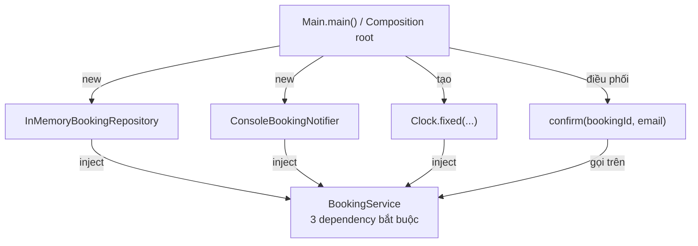

# Khai báo đầy đủ phụ thuộc cần để đối tượng hoạt động hợp lệ

## 1. Vì sao constructor phải thể hiện điều kiện để đối tượng sẵn sàng hoạt động?

Trong **Dependency Injection (DI)**, một đối tượng nhận các cộng tác viên cần thiết từ bên ngoài thay vì tự tạo chúng. Khi dùng **constructor injection**, chữ ký constructor trở thành một phần quan trọng của **hợp đồng khởi tạo**: người đọc có thể biết đối tượng cần những gì trước khi được sử dụng.

Xét một service xác nhận đặt chỗ. Để thực hiện công việc, nó cần nơi lưu trạng thái đặt chỗ, kênh gửi xác nhận và nguồn thời gian. Nếu thiếu bất cứ thành phần nào trong thiết kế này, service không thể thực hiện trọn vẹn trách nhiệm đã công bố. Vì vậy, các phụ thuộc đó nên được khai báo như **tham số bắt buộc của constructor**.

```java
BookingService(
        BookingRepository repository,
        BookingNotifier notifier,
        Clock clock)
```

Ý nghĩa của chữ ký này:

- Mọi người muốn tạo `BookingService` phải **cung cấp rõ ba phụ thuộc**.
- Service không cần biết repository dùng bộ nhớ hay cơ sở dữ liệu, notifier gửi console hay email, và clock lấy thời gian từ đâu.
- Có thể kiểm tra tính hợp lệ của các tham số **ngay tại ranh giới khởi tạo**, thay vì đợi đến lời gọi nghiệp vụ đầu tiên.
- Các cộng tác viên có thể được lưu trong trường `private final` để tham chiếu không bị thay đổi sau khi tạo.

Chủ đề này nằm trong nhóm **Thiết kế constructor** của module **DEPENDENCY_INJECTION**. Nó cụ thể hóa mục tiêu học **DI và Inversion of Control (IoC)**: tách việc **sử dụng** phụ thuộc khỏi việc **tạo và lắp ghép** đối tượng bằng Java thuần, rồi mới mở rộng đến DI container.

> **Nguyên tắc thực hành:** Nếu một đối tượng không thể thực hiện đúng trách nhiệm của nó khi thiếu một cộng tác viên, cộng tác viên đó nên xuất hiện trong hợp đồng khởi tạo và được kiểm tra khi khởi tạo.

Đây là hướng dẫn thiết kế, không có nghĩa *mọi* giá trị đều phải đi qua constructor. Cần phân biệt phụ thuộc lâu dài, cấu hình, và dữ liệu của từng lần gọi.

## 2. “Hoạt động hợp lệ” nghĩa là gì?

Một đối tượng được **khởi tạo hợp lệ về mặt phụ thuộc** khi các điều kiện cần của riêng nó đã được thiết lập: những tham chiếu bắt buộc tồn tại, cấu hình khởi tạo hợp lệ, và các bất biến nội bộ mà constructor chịu trách nhiệm đã được bảo đảm.

Một bất biến khởi tạo của `BookingService` có thể là:

```text
repository != null
notifier   != null
clock      != null
```

Tuy nhiên, điều này **không chứng minh** rằng database đang hoạt động, email chắc chắn gửi thành công hoặc giao dịch sẽ không thất bại. Constructor chỉ xác nhận những điều mà nó có thể kiểm tra một cách hợp lý tại thời điểm tạo đối tượng. Trạng thái của mạng, database và các điều kiện nghiệp vụ khi chạy phải được xử lý bằng cơ chế thích hợp ở tầng khác.

### Phân biệt ba loại đầu vào

| Loại | Ví dụ | Nên khai báo ở đâu? | Lý do |
| --- | --- | --- | --- |
| **Phụ thuộc bắt buộc** | `BookingRepository`, `BookingNotifier`, `Clock` | Constructor | Được dùng xuyên suốt trách nhiệm của service; thiếu chúng service không thực hiện được hợp đồng. |
| **Cấu hình khởi tạo bắt buộc** | Số lần thử tối đa, ngưỡng timeout có ràng buộc | Constructor hoặc đối tượng cấu hình được truyền vào constructor | Cần hợp lệ ngay khi đối tượng được tạo; giá trị nên được kiểm tra phạm vi. |
| **Dữ liệu theo từng lần gọi** | `bookingId`, `customerEmail` | Tham số phương thức `confirm(...)` | Mỗi lượt xử lý có dữ liệu khác nhau; không nên giữ chúng thành trạng thái toàn cục của service. |

Phụ thuộc **không nhất thiết là interface**. `Clock` là một lớp trừu tượng của JDK và vẫn có thể được truyền vào constructor. Một lớp cụ thể phù hợp cũng có thể được inject. Interface hữu ích khi nó diễn đạt một hợp đồng ổn định và giúp thay thế triển khai, không phải là điều kiện tiên quyết để gọi đó là DI.

## 3. Những lỗi thường xảy ra khi giấu phụ thuộc bắt buộc

### 3.1. Constructor rỗng rồi setter: tạo ra trạng thái chưa sẵn sàng

```java
class FragileBookingService {
    private BookingRepository repository; // Chưa có giá trị.
    private BookingNotifier notifier;

    void setRepository(BookingRepository repository) {
        this.repository = repository;
    }

    void setNotifier(BookingNotifier notifier) {
        this.notifier = notifier;
    }

    void confirm(String bookingId, String email) {
        repository.saveConfirmation(bookingId); // Có thể NullPointerException.
        notifier.sendConfirmation(bookingId, email);
    }
}
```

Đây là đoạn **minh họa chống mẫu**, không phải mã độc lập để chạy; các interface xuất hiện trong ví dụ đầy đủ ở mục 5. Đối tượng có thể được tạo, truyền qua nhiều tầng, nhưng quên gọi setter rồi mới lỗi ở lần xử lý nào đó. Setter injection vẫn có chỗ dùng cho **khả năng tùy chọn** hoặc môi trường có ràng buộc riêng, nhưng không nên dùng tùy tiện cho phụ thuộc mà đối tượng bắt buộc phải có.

### 3.2. Tự tạo phụ thuộc trong consumer

```java
class HardwiredBookingService {
    // Tên triển khai được ví dụ hóa; không phải lớp thư viện chuẩn.
    private final BookingRepository repository =
            new JdbcBookingRepository();
}
```

Service không thể lựa chọn triển khai khi viết test hoặc cấu hình môi trường nếu không sửa mã. Điều này làm **coupling với chi tiết** tăng lên. Nên đưa quyết định khởi tạo repository về **composition root**.

### 3.3. Tìm phụ thuộc ngầm qua global registry

```java
// Mã giả minh họa ý tưởng service locator:
var repository = GlobalServices.get(BookingRepository.class);
```

Dù không trực tiếp gọi `new`, service vẫn có dependency nhưng chữ ký constructor không nói ra. Test có thể thất bại vì chưa đăng ký `GlobalServices`, và quan hệ phụ thuộc khó nhìn thấy hơn. Nếu repository là bắt buộc, hãy thể hiện nó trong constructor.

### 3.4. Cho phép null rồi bỏ qua công việc

```java
if (notifier != null) {
    notifier.sendConfirmation(bookingId, email);
}
```

Nếu việc gửi xác nhận là **một phần bắt buộc của hợp đồng** của service, đoạn mã này có thể khiến chương trình báo hoàn tất dù chức năng bắt buộc không chạy. Đó là cách che giấu lỗi lắp ghép. Nếu thông báo thực sự không bắt buộc, hãy thiết kế chính sách rõ ràng, không dựa vào một `null` mơ hồ.

## 4. Hợp đồng constructor: nêu rõ, kiểm tra sớm, giữ ổn định

Một constructor cho các dependency bắt buộc thường có ba việc:

1. **Khai báo đầy đủ** các cộng tác viên cần có dưới dạng tham số.
2. **Từ chối trạng thái không hợp lệ** bằng kiểm tra rõ ràng và thông báo lỗi có ý nghĩa.
3. **Lưu các tham chiếu ổn định** vào trường `private final` nếu không có nhu cầu thay đổi sau khởi tạo.

Ví dụ lõi:

```java
import java.time.Clock;
import java.util.Objects;

final class BookingService {
    private final BookingRepository repository;
    private final BookingNotifier notifier;
    private final Clock clock;

    BookingService(BookingRepository repository,
                   BookingNotifier notifier,
                   Clock clock) {
        this.repository = Objects.requireNonNull(repository, "repository");
        this.notifier = Objects.requireNonNull(notifier, "notifier");
        this.clock = Objects.requireNonNull(clock, "clock");
    }

    // Các phương thức nghiệp vụ sử dụng ba field đã sẵn sàng.
}
```

Ở đây `Objects.requireNonNull` ném `NullPointerException` **ngay khi gọi constructor** nếu một dependency bắt buộc bằng `null`. Tên tham số trong thông báo giúp biết chỗ lắp ghép bị thiếu. Với giá trị cấu hình không hợp lệ (ví dụ timeout âm), có thể ném `IllegalArgumentException`; với yêu cầu nghiệp vụ sai ở thời điểm gọi `confirm`, kiểm tra tại phương thức đó.

**`final` có tác dụng gì?** Trường `final` ngăn việc gán lại tham chiếu từ bên trong lớp sau khi khởi tạo. Nó **không** làm cho chính đối tượng phụ thuộc bất biến hoặc an toàn khi nhiều luồng truy cập. Một repository có `HashMap` thay đổi được vẫn cần chính sách đồng thời phù hợp.

**Có cần mở database hoặc gửi thử email trong constructor?** Thường không nên. Constructor nên dễ hiểu, không gây tác dụng phụ lớn, không phụ thuộc mạng nếu không thực sự cần, và tránh “phát tán” `this` đến các luồng/callback trước khi khởi tạo xong. Quy trình kiểm tra sức khỏe kết nối (*health check*) và xử lý lỗi hệ thống có thể nằm trong phần khởi động và quản lý vòng đời thích hợp.

## 5. Ví dụ tự chạy bằng Java thuần

Ví dụ này có đủ lớp để biên dịch trong **một tệp `Main.java`**, sử dụng Java 11 trở lên. `BookingService` yêu cầu ba dependency. `Main.main()` là **composition root**, chọn triển khai và truyền vào constructor.

```java
import java.time.Clock;
import java.time.Instant;
import java.time.ZoneOffset;
import java.util.HashMap;
import java.util.Map;
import java.util.Objects;

public class Main {
    interface BookingRepository {
        void saveConfirmation(String bookingId, Instant confirmedAt);
    }

    interface BookingNotifier {
        void sendConfirmation(String bookingId, String customerEmail);
    }

    // CONSUMER: luôn có đủ dependency sau khi tạo thành công.
    static final class BookingService {
        private final BookingRepository repository;
        private final BookingNotifier notifier;
        private final Clock clock;

        BookingService(BookingRepository repository,
                       BookingNotifier notifier,
                       Clock clock) {
            this.repository = Objects.requireNonNull(repository, "repository");
            this.notifier = Objects.requireNonNull(notifier, "notifier");
            this.clock = Objects.requireNonNull(clock, "clock");
        }

        void confirm(String bookingId, String customerEmail) {
            // Dữ liệu của từng lời gọi được kiểm tra tại lời gọi.
            if (bookingId == null || bookingId.isBlank()) {
                throw new IllegalArgumentException("bookingId không được rỗng");
            }
            if (customerEmail == null || customerEmail.isBlank()) {
                throw new IllegalArgumentException("customerEmail không được rỗng");
            }

            Instant confirmedAt = clock.instant();
            repository.saveConfirmation(bookingId, confirmedAt);
            notifier.sendConfirmation(bookingId, customerEmail);
        }
    }

    static final class InMemoryBookingRepository implements BookingRepository {
        private final Map<String, Instant> confirmations = new HashMap<>();

        @Override
        public void saveConfirmation(String bookingId, Instant confirmedAt) {
            confirmations.put(bookingId, confirmedAt);
        }

        Instant confirmedAt(String bookingId) {
            return confirmations.get(bookingId);
        }
    }

    static final class ConsoleBookingNotifier implements BookingNotifier {
        @Override
        public void sendConfirmation(String bookingId, String customerEmail) {
            System.out.println(
                    "Đã gửi xác nhận " + bookingId + " tới " + customerEmail);
        }
    }

    public static void main(String[] args) {
        // COMPOSITION ROOT: khởi tạo các cộng tác viên trước consumer.
        InMemoryBookingRepository repository =
                new InMemoryBookingRepository();
        BookingNotifier notifier = new ConsoleBookingNotifier();
        Clock clock = Clock.fixed(
                Instant.parse("2026-01-02T10:15:30Z"), ZoneOffset.UTC);

        BookingService service =
                new BookingService(repository, notifier, clock);

        service.confirm("B-101", "khach@example.com");

        System.out.println(
                "Thời điểm được lưu: " + repository.confirmedAt("B-101"));
    }
}
```

Biên dịch và chạy:

```bash
javac -encoding UTF-8 Main.java
java Main
```

Kết quả minh họa:

```text
Đã gửi xác nhận B-101 tới khach@example.com
Thời điểm được lưu: 2026-01-02T10:15:30Z
```

Ở bài học này, `Clock.fixed(...)` chỉ nhằm tạo kết quả có thể dự đoán. Trong ứng dụng thật, composition root có thể cấp `Clock.systemUTC()`; `BookingService` **không phải sửa**, vì service chỉ phụ thuộc vào hợp đồng `Clock`. Đây cũng là ví dụ về **khả năng kiểm thử nhờ injection**.

### Vì sao cả ba dependency đều là bắt buộc?

| Dependency | Trách nhiệm trong `BookingService` | Nếu thiếu |
| --- | --- | --- |
| `BookingRepository` | Lưu việc xác nhận cùng thời điểm | Không có nơi ghi nhận kết quả. |
| `BookingNotifier` | Gửi thông báo xác nhận cho khách theo thiết kế hiện tại | Không hoàn thành quy trình đã cam kết. |
| `Clock` | Cấp thời điểm xác nhận | Không thể tự xác định thời điểm mà không chọn nguồn thời gian ngầm. |

Nếu sản phẩm quyết định việc gửi thông báo chỉ là **tùy chọn**, hợp đồng service phải được **thiết kế lại có chủ đích**. Chỉ bỏ `notifier` khỏi constructor nhưng vẫn có phương thức gọi nó sẽ tái tạo trạng thái không hợp lệ.

### Minh họa luồng lắp ghép



Composition root biết ai tạo đối tượng; consumer chỉ biết các khả năng nó cần. Đây là sự phân tách trách nhiệm mà DI/IoC hướng tới.

## 6. Kiểm thử điều kiện khởi tạo và hành vi bằng Java thuần

Việc khai báo dependency qua constructor mang lại **hai tầng kiểm thử khác nhau**:

- **Kiểm thử bất biến khởi tạo:** dependency bắt buộc bằng `null` phải bị từ chối ngay khi tạo service.
- **Kiểm thử hành vi:** với các fake được truyền vào, service sử dụng đúng repository, notifier và clock.

Thêm đoạn sau **cuối tệp `Main.java`** của mục 5, bên ngoài class `Main`, không thêm từ khóa `public`:

```java
class BookingServiceTest {
    static final class RecordingRepository implements Main.BookingRepository {
        String id;
        java.time.Instant when;

        @Override
        public void saveConfirmation(String bookingId, java.time.Instant confirmedAt) {
            id = bookingId;
            when = confirmedAt;
        }
    }

    static final class RecordingNotifier implements Main.BookingNotifier {
        String id;
        String email;
        int calls;

        @Override
        public void sendConfirmation(String bookingId, String customerEmail) {
            id = bookingId;
            email = customerEmail;
            calls++;
        }
    }

    public static void main(String[] args) {
        RecordingRepository repo = new RecordingRepository();
        RecordingNotifier notifier = new RecordingNotifier();
        java.time.Instant instant =
                java.time.Instant.parse("2026-05-06T07:08:09Z");
        java.time.Clock clock = java.time.Clock.fixed(
                instant, java.time.ZoneOffset.UTC);

        Main.BookingService service = new Main.BookingService(
                repo, notifier, clock);
        service.confirm("B-202", "test@example.com");

        if (!"B-202".equals(repo.id) || !instant.equals(repo.when)) {
            throw new AssertionError("Repository chưa nhận đúng dữ liệu");
        }
        if (!"B-202".equals(notifier.id)
                || !"test@example.com".equals(notifier.email)
                || notifier.calls != 1) {
            throw new AssertionError("Notifier chưa nhận đúng dữ liệu");
        }

        boolean nullRejected = false;
        try {
            new Main.BookingService(null, notifier, clock);
        } catch (NullPointerException expected) {
            nullRejected = true;
        }
        if (!nullRejected) {
            throw new AssertionError("Constructor phải từ chối repository null");
        }

        System.out.println("PASS: dependency bắt buộc và hành vi được kiểm tra");
    }
}
```

Chạy:

```bash
javac -encoding UTF-8 Main.java
java BookingServiceTest
```

Kết quả dự kiến:

```text
PASS: dependency bắt buộc và hành vi được kiểm tra
```

Bạn có thể mở rộng test để xác nhận `notifier == null` và `clock == null` cũng bị từ chối, hoặc gọi `confirm("", ...)` để kiểm tra dữ liệu của *lần gọi*. Những test đó khác nhau về **thời điểm kiểm tra** và **phạm vi trách nhiệm**.

Ở đây ta không cần khởi động database, server hay DI container để kiểm tra `BookingService`. Mã test tự đóng vai trò một **composition root dành cho kiểm thử**, cung cấp fake phù hợp thay cho adapter thực tế.

## 7. Tham số cấu hình, phụ thuộc tùy chọn và các ngoại lệ thiết kế

### 7.1. Cấu hình ảnh hưởng bất biến cũng phải được kiểm tra

Một worker gửi thông báo có thể cần số lần thử tối đa. Khác với `BookingRepository`, `maxRetries` là **giá trị cấu hình**, nhưng nếu nó quyết định hành vi xuyên suốt vòng đời của đối tượng thì vẫn thích hợp để constructor nhận và kiểm tra:

```java
final class RetryPolicy {
    private final int maxRetries;

    RetryPolicy(int maxRetries) {
        if (maxRetries < 0 || maxRetries > 10) {
            throw new IllegalArgumentException(
                    "maxRetries phải trong khoảng 0..10");
        }
        this.maxRetries = maxRetries;
    }

    int maxRetries() {
        return maxRetries;
    }
}
```

Ví dụ này có thể dùng như một **value object cấu hình** để truyền vào consumer cần nó. Không cần tạo một interface chỉ cho `RetryPolicy` nếu không có hợp đồng thay thế hợp lý.

### 7.2. Nếu phụ thuộc thực sự tùy chọn thì sao?

Trước tiên phải mô tả ngữ nghĩa rõ ràng:

- Nếu service **bắt buộc** thông báo, `BookingNotifier` là tham số bắt buộc, `null` bị từ chối.
- Nếu service có thể hoạt động theo chế độ **không gửi thông báo**, composition root có thể cung cấp một implementation `NoOpBookingNotifier` thực hiện hợp đồng một cách có chủ đích. Khi đó `BookingService` vẫn luôn có notifier, nhưng việc không thông báo là cấu hình được chọn.
- Nếu hai chế độ kéo theo nghiệp vụ khác nhau đáng kể, cân nhắc **hai cách điều phối riêng** hoặc một chính sách rõ ràng thay vì dùng `null` để biểu thị nhiều ý nghĩa.

Ví dụ no-op đơn giản (đặt thành lớp lồng vào `Main` của mục 5 nếu muốn biên dịch cùng file):

```java
static final class NoOpBookingNotifier implements BookingNotifier {
    @Override
    public void sendConfirmation(String bookingId, String customerEmail) {
        // Chế độ cố ý không gửi thông báo.
    }
}
```

**No-op không phải giải pháp mặc định để che thiếu cấu hình.** Nếu hệ thống bắt buộc gửi xác nhận, lắp `NoOpBookingNotifier` sẽ làm sai yêu cầu. Hãy chỉ dùng khi “không làm gì” là một hành vi hợp lệ đã được quyết định.

### 7.3. Constructor quá dài: tín hiệu kiểm tra trách nhiệm

Constructor có rất nhiều dependency có thể chỉ ra class đảm nhiệm quá nhiều việc. Hãy kiểm tra:

1. Mỗi dependency có phục vụ **cùng một trách nhiệm** hay không?
2. Có thể gom những thông số cấu hình liên quan thành một **đối tượng cấu hình có bất biến rõ ràng** không?
3. Có những nhóm công việc độc lập nên tách thành cộng tác viên/coordinator riêng không?
4. Có dependency nào chỉ dùng trong một phương thức vốn không thuộc trách nhiệm của class không?

Đừng mặc định thay một constructor dài bằng `ServiceLocator` hoặc `Map<String, Object>` chỉ để che đi danh sách dependency. Cách đó làm hợp đồng khó đọc và chuyển lỗi từ lúc biên dịch/khởi tạo sang lúc chạy.

### 7.4. Tránh công việc nặng trong constructor

Constructor nên xác lập bất biến và nhận tham chiếu. Việc gọi API từ xa, đăng ký listener, khởi chạy thread hoặc đọc cấu hình toàn cục trong constructor có thể khiến lỗi khó phục hồi và quá trình test khó kiểm soát. Khi tài nguyên cần khởi tạo/đóng, composition root có thể thiết lập vòng đời rõ ràng; `AutoCloseable` và `try-with-resources` hữu ích cho tài nguyên có sở hữu xác định.

## 8. Scope và vòng đời: constructor đầy đủ chưa giải quyết tất cả

Một constructor hợp lệ đảm bảo **consumer nhận đầy đủ dependency**. Nó không tự quyết định dependency đó được chia sẻ bao lâu. Khi dùng Java thuần, composition root cần quyết định vòng đời:

| Cách cấp | Ví dụ | Rủi ro cần xem |
| --- | --- | --- |
| **Một đối tượng dùng chung** | Một `BookingService` được tạo khi ứng dụng bắt đầu | Mọi dependency chia sẻ phải phù hợp với sử dụng đồng thời; `final` không khiến các adapter tự an toàn luồng. |
| **Đối tượng mới cho từng request** | Tạo một consumer cho mỗi request | Đừng cấp nhầm trạng thái từ request khác hoặc làm mất dữ liệu cần lưu dài hạn. |
| **Tài nguyên có vòng đời riêng** | Repository adapter nắm connection pool | Phải có nơi quản lý mở/đóng tài nguyên; consumer không nên tự đóng tài nguyên dùng chung sau mỗi lời gọi. |

Ví dụ `InMemoryBookingRepository` dùng `HashMap` không an toàn cho các cập nhật đồng thời không được đồng bộ. Nếu chuyển ví dụ thành ứng dụng nhiều luồng, cần thiết kế cơ chế lưu trữ, đồng bộ hoặc scope phù hợp. Việc inject `BookingRepository` không tự giải quyết rủi ro đó.

Khi mở rộng sang **DI container**, container thường giúp mô tả/lắp các dependency, quản lý scope và lifecycle. Nhưng các quyết định thiết kế **cái gì bắt buộc**, **cái gì là dữ liệu của request** và **hợp đồng nào cần tồn tại** vẫn do lập trình viên chịu trách nhiệm.

## 9. Checklist khi thiết kế constructor

| Câu hỏi | Nếu câu trả lời là “không” |
| --- | --- |
| Có thể nhìn vào chữ ký constructor và biết các cộng tác viên bắt buộc không? | Thêm tham số dependency còn bị giấu trong `new`, setter hoặc locator. |
| Mọi tham số bắt buộc được kiểm tra đúng ràng buộc khi tạo không? | Thêm `requireNonNull` hoặc kiểm tra giá trị cấu hình hợp lệ. |
| Consumer có thể thực hiện trách nhiệm chính ngay sau khởi tạo thành công không? | Xem lại bước cấu hình ngầm, thứ tự gọi setter hoặc đăng ký toàn cục. |
| Mọi tham số có vai trò rõ: dependency, cấu hình, hay dữ liệu từng lời gọi không? | Chuyển dữ liệu từng request khỏi trạng thái giữ lâu dài của service. |
| Constructor tập trung thiết lập bất biến, tránh tác dụng phụ nặng không? | Chuyển kết nối, khởi động hoặc kiểm tra hạ tầng sang vòng đời phù hợp. |
| Có thể truyền fake vào constructor để test độc lập không? | Tách quyết định tạo triển khai ra composition root. |
| Scope của các dependency có phù hợp cách consumer được chia sẻ không? | Xem lại trạng thái đồng thời, quyền sở hữu và thời điểm đóng tài nguyên. |

## 10. Bài tập thực hành và gợi ý tự đối chiếu

**Bài 1 — Tìm dependency bị giấu.** Một `InvoiceService` có constructor rỗng, trong `sendInvoice()` tự tạo `EmailClient`, trong `save()` lấy `InvoiceRepository` qua một global registry. Hãy viết chữ ký constructor mới và nói những đối tượng nào nên được tạo tại composition root.

**Bài 2 — Chọn đúng thời điểm kiểm tra.** Chia các dữ liệu sau vào hai nhóm *constructor* và *tham số phương thức*: `PaymentGateway`, `Clock`, `orderId`, `customerEmail`, `retryLimit` dùng chung cho mọi lượt xử lý. Nêu cách xử lý `null` hoặc giá trị sai.

**Bài 3 — Tự viết test constructor.** Mở rộng `BookingServiceTest` để chắc chắn constructor từ chối cả `notifier == null` và `clock == null`, nhưng nhận các fake hợp lệ. Kiểm tra rằng một input `bookingId` rỗng bị từ chối ở `confirm(...)`.

**Bài 4 — Thảo luận scope.** Một singleton `BookingService` được inject repository đang giữ `HashMap` và một notifier có bộ đếm nội bộ. Nếu nhiều request gọi đồng thời, constructor dùng `final` có đủ bảo đảm an toàn không? Hãy đề xuất cách quản lý scope hoặc adapter an toàn.

### Gợi ý

- **Bài 1:** `InvoiceService(InvoiceRepository repository, EmailClient emailClient)` hoặc một hợp đồng gửi hóa đơn phù hợp; composition root tạo repository và email adapter, rồi cấp cho service. Không cần phụ thuộc trực tiếp class hạ tầng khi có abstraction hữu ích.
- **Bài 2:** constructor nhận `PaymentGateway`, `Clock` và `retryLimit` (kiểm tra phạm vi); `orderId` và `customerEmail` là input từng lần gọi (kiểm tra lúc gọi). `null` không hợp lệ với dependency bắt buộc; tham số cấu hình phải đáp ứng bất biến đã đặt.
- **Bài 3:** thử truyền từng dependency null riêng lẻ và xác nhận ngoại lệ được ném ngay tại `new BookingService(...)`; input nghiệp vụ không hợp lệ nên thất bại ở `confirm(...)`.
- **Bài 4:** `final` chỉ giữ ổn định tham chiếu, không làm `HashMap` hoặc bộ đếm tự an toàn luồng. Cần giải pháp đồng thời, phạm vi tạo đối tượng hoặc hạ tầng có cơ chế đồng bộ phù hợp.

Điều cần rút ra là: **constructor nên công bố và xác lập đầy đủ các phụ thuộc cần để đối tượng thực hiện hợp đồng của mình**, còn composition root chịu trách nhiệm cung cấp chúng. Thiết kế này làm trạng thái khởi tạo rõ ràng, phát hiện lỗi lắp ghép sớm và cho phép thay fake khi kiểm thử; quản lý scope, vòng đời và lỗi hạ tầng vẫn cần được xem xét riêng.
