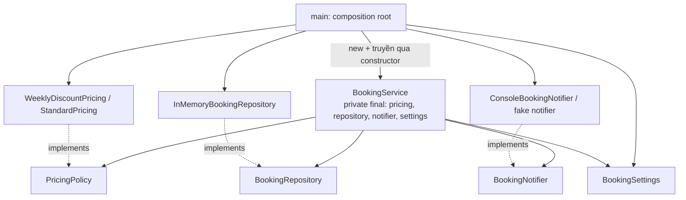

# Lưu phụ thuộc bằng trường `final` trong thiết kế Java phù hợp

Trong chương **Thiết kế constructor** của module **Dependency Injection**, một thực hành cơ bản là **nhận các phụ thuộc bắt buộc qua constructor và lưu chúng bằng trường `private final`**. Nhờ đó, đối tượng biểu lộ rõ những gì nó cần để hoạt động và giữ nguyên các tham chiếu ấy trong suốt vòng đời của mình.

Quy tắc này đặc biệt hữu ích khi học **Dependency Injection (DI)** và **Inversion of Control (IoC)** bằng Java thuần: lớp sử dụng chỉ quan tâm tới hợp đồng của phụ thuộc, còn **composition root** quyết định đối tượng nào được tạo và lắp ghép. Tuy nhiên, `final` có ý nghĩa chính xác, giới hạn cụ thể và không thể thay thế việc quản lý scope, vòng đời hay an toàn luồng.

Sau bài này, bạn sẽ có thể:

- Viết constructor injection cho các phụ thuộc bắt buộc bằng `private final`.
- Phân biệt **tham chiếu không thể gán lại** với **đối tượng không thể thay đổi**.
- Thiết lập invariant trong constructor, từ chối tham số không hợp lệ và tránh đối tượng ở trạng thái thiếu phụ thuộc.
- Kiểm thử lớp nhận phụ thuộc bằng fake hoặc adapter in-memory trong Java thuần.
- Chọn trường `final`, biến cục bộ hoặc đối tượng có vòng đời ngắn theo đúng trách nhiệm.
- Tránh nhầm `final` với singleton, thread-safety và cơ chế quản lý vòng đời của DI container.

## 1. Tại sao dùng `private final` cho phụ thuộc bắt buộc?

Xét một dịch vụ đặt thuê xe cần chính sách tính giá và cổng lưu đặt chỗ. Nếu mỗi lần xử lý dịch vụ lại tự `new` adapter hoặc có setter cho phép đổi phụ thuộc bất kỳ lúc nào, người đọc mã khó biết lúc nào đối tượng sẵn sàng hoạt động và lúc nào phụ thuộc có thể bị thay thế.

Thay vào đó, constructor nhận đầy đủ cộng tác viên:

```java
interface PricingPolicy {
    long calculate(long dailyRate, int days);
}

interface BookingRepository {
    void save(Booking booking);
}

final class BookingService {
    private final PricingPolicy pricingPolicy;
    private final BookingRepository repository;

    BookingService(PricingPolicy pricingPolicy, BookingRepository repository) {
        this.pricingPolicy = java.util.Objects.requireNonNull(
                pricingPolicy, "pricingPolicy");
        this.repository = java.util.Objects.requireNonNull(
                repository, "repository");
    }
    // Các phương thức nghiệp vụ dùng pricingPolicy và repository.
}
```

Đoạn ví dụ rút gọn trên giả định `Booking` đã được định nghĩa trong ứng dụng. Một ví dụ **tự chứa, biên dịch và chạy được** sẽ xuất hiện ở phần 4.

Hai trường `private final` giúp thể hiện một quyết định thiết kế:

| Thành phần | Ý nghĩa |
| --- | --- |
| `private` | Mã bên ngoài không thể truy cập trực tiếp và thay đổi trường; lớp kiểm soát trạng thái của mình |
| `final` | Mỗi trường instance phải được gán khi đối tượng được xây dựng và không thể gán lại qua mã Java thông thường sau đó |
| Tham số constructor | Người tạo đối tượng phải cung cấp các cộng tác viên cần thiết từ đầu |
| `Objects.requireNonNull(...)` | Phát hiện sớm tham chiếu thiếu; lỗi xuất hiện tại nơi lắp ghép, thay vì khi yêu cầu nghiệp vụ đang chạy |
| Kiểu `PricingPolicy` / `BookingRepository` | Dịch vụ phụ thuộc vào hợp đồng cần dùng, không ràng buộc việc khởi tạo một triển khai |

Việc dùng `final` **không tự thực hiện DI**. DI đến từ việc **bên ngoài cấp phụ thuộc cho constructor**. `final` bổ trợ bằng cách thể hiện rằng tham chiếu được cấp là thành phần cố định của đối tượng.

## 2. Hiểu đúng ngữ nghĩa `final` trong Java

### 2.1. Trường `final`: gán một lần, không tự làm bất biến đối tượng được tham chiếu

Với trường instance kiểu tham chiếu:

```java
private final BookingRepository repository;
```

Sau khi được gán hợp lệ trong quá trình khởi tạo, tham chiếu `repository` không thể được gán sang một repository khác bằng câu lệnh thông thường:

```java
// Trong một phương thức của lớp chứa trường:
// this.repository = anotherRepository; // Lỗi biên dịch: final field
```

Nhưng chính đối tượng repository **vẫn có thể thay đổi nội bộ**. Ví dụ:

```java
private final java.util.List<String> bookingIds = new java.util.ArrayList<>();

void addBooking(String id) {
    bookingIds.add(id); // Hợp lệ: thay đổi nội dung List, không gán lại tham chiếu.
}
```

Vì vậy cần phân biệt:

- **Tính ổn định của tham chiếu:** `final` giữ trường trỏ đến cùng một đối tượng sau khi xây dựng.
- **Tính bất biến của đối tượng:** bản thân đối tượng không cho phép trạng thái quan sát được thay đổi; điều này phụ thuộc vào thiết kế của đối tượng, không suy ra chỉ từ `final`.
- **Tính an toàn khi dùng đồng thời:** nhiều thread truy cập phụ thuộc có trạng thái phải được đồng bộ hoặc thiết kế thread-safe; `final` không tự giải quyết các tranh chấp dữ liệu.

Tương tự, một trường `final long dailyRate` giữ nguyên **giá trị nguyên thủy** đó. Với `final List<Booking>`, chỉ **tham chiếu tới List** không đổi, còn các phần tử có thể được thêm hoặc xóa.

### 2.2. `final` không đồng nghĩa với `static final`

`private final PricingPolicy pricingPolicy` là trường **của từng instance** `BookingService`. Hai instance dịch vụ có thể giữ hai chính sách giá khác nhau:

```java
BookingService serviceA = new BookingService(standardPolicy, repositoryA);
BookingService serviceB = new BookingService(promotionPolicy, repositoryB);
```

Ngược lại, `static final` là trường thuộc **lớp**, thường phù hợp với hằng số thực sự như `private static final int MAX_RETRIES = 3;`. Đưa các adapter có trạng thái, connection hoặc client cần cấu hình vào `static final` có thể tạo phụ thuộc toàn cục ngầm, khó thay thế trong test và khó kiểm soát vòng đời. Một DI container quản lý singleton cũng không đòi hỏi trường trong consumer phải là `static`.

### 2.3. Tại sao phải gán đủ giá trị trong constructor?

Một trường instance `final` không được khởi tạo ngay tại chỗ khai báo phải được gán đúng một lần trên **mọi đường đi kết thúc constructor thành công**. Trình biên dịch kiểm tra tính chất này:

```java
final class InvalidService {
    private final PricingPolicy policy;

    // Lỗi biên dịch: variable policy might not have been initialized.
    // InvalidService() { }
}
```

Điều này giúp tránh trạng thái "đã tạo nhưng chưa cấu hình xong". Tuy nhiên, `final` không cấm gán giá trị `null`; đó là lý do constructor vẫn cần xác thực đầu vào. `Objects.requireNonNull` không cần thiết với mọi giá trị nguyên thủy; các giá trị đó nên được kiểm tra theo miền hợp lệ (`maxDays > 0`, `dailyRate > 0`, v.v.).

### 2.4. Bảo đảm của Java Memory Model có giới hạn

Java Memory Model có những **bảo đảm khởi tạo đặc biệt dành cho các trường `final`** nếu đối tượng được xây dựng đúng cách. Điều kiện quan trọng là **không để tham chiếu `this` thoát ra cho code khác sử dụng trước khi constructor hoàn tất**. Ví dụ, đăng ký listener hoặc khởi chạy thread truy cập `this` ngay trong constructor có thể khiến đối tượng chưa xây dựng xong bị quan sát.

Không nên suy diễn rằng "mọi trường `final` đều khiến toàn bộ đồ thị đối tượng thread-safe". Bảo đảm này không biến trạng thái mutable bên trong `BookingRepository` thành bất biến, không làm cho việc thêm vào `ArrayList` an toàn giữa các thread và không thay thế cơ chế đồng bộ hay quản lý tài nguyên. Trong thực tế, hãy hoàn tất việc xây dựng trước khi đưa đối tượng vào ứng dụng và chọn cách chia sẻ an toàn thích hợp.

## 3. Quy tắc chọn trường `final` trong thiết kế constructor

Khi thiết kế một lớp nhận DI, hãy phân loại dữ liệu trước khi thêm field:

| Dữ liệu cần dùng | Lưu thế nào? | Lý do |
| --- | --- | --- |
| Cộng tác viên bắt buộc như `PricingPolicy`, `BookingRepository` | `private final`, cấp qua constructor | Mọi phương thức đều cần một phụ thuộc ổn định |
| Đối tượng cấu hình bất biến như `BookingSettings` | Thường là `private final` | Các giá trị được chọn và kiểm tra lúc tạo service |
| Mã khách hàng, số ngày thuê, thông tin của từng lời gọi | Tham số phương thức và biến cục bộ | Không trộn dữ liệu các request vào trạng thái dùng chung |
| Tài nguyên phải mở/đóng theo thao tác như transaction hay stream | Tạo/đóng trong scope thích hợp, thường qua port/factory | Không gắn một tài nguyên ngắn hạn với toàn bộ vòng đời service |
| Trạng thái thật sự thay đổi theo thời gian | Chỉ tạo mutable field khi cần, có invariant và cơ chế đồng bộ rõ ràng | `final` không thay thế thiết kế trạng thái |
| Phụ thuộc tùy chọn | Mô hình hóa rõ chính sách mặc định hoặc optional capability | Không dùng `null` mơ hồ khiến nhiều phương thức phải tự kiểm tra |

Nguyên tắc thực dụng: **phụ thuộc mà một đối tượng cần trong toàn bộ vòng đời của nó** thường là ứng viên tốt cho `private final`. **Dữ liệu biến đổi theo từng yêu cầu** thường nên ở scope của phương thức, không thành field của service.

## 4. Ví dụ Java thuần: constructor injection với `private final`

Ví dụ đầy đủ sau mô phỏng chức năng đặt thuê xe:

1. `BookingService` nhận chính sách giá, cổng lưu dữ liệu, cổng gửi thông báo và cấu hình.
2. Tất cả phụ thuộc bắt buộc được lưu vào trường `private final`.
3. Dữ liệu khách thuê và số ngày chỉ tồn tại trong lời gọi `book(...)`, không lưu trên service.
4. `main` là **composition root**, quyết định triển khai cụ thể và xây dựng đồ thị đối tượng.
5. Một phép kiểm tra bằng Java thuần thay adapter thật bằng fake/in-memory để kiểm tra hành vi.

Lưu toàn bộ nội dung sau vào `FinalDependenciesDemo.java`. Có thể biên dịch và chạy với **Java 11 trở lên**:

```bash
javac FinalDependenciesDemo.java
java FinalDependenciesDemo
```

```java
import java.util.ArrayList;
import java.util.List;
import java.util.Objects;

public class FinalDependenciesDemo {
    // Hợp đồng nghiệp vụ: tính tổng tiền theo số ngày và đơn giá.
    interface PricingPolicy {
        long total(long dailyRate, int days);
    }

    static final class StandardPricing implements PricingPolicy {
        @Override
        public long total(long dailyRate, int days) {
            if (dailyRate <= 0 || days <= 0) {
                throw new IllegalArgumentException("Invalid pricing input");
            }
            return Math.multiplyExact(dailyRate, days);
        }
    }

    static final class WeeklyDiscountPricing implements PricingPolicy {
        @Override
        public long total(long dailyRate, int days) {
            if (dailyRate <= 0 || days <= 0) {
                throw new IllegalArgumentException("Invalid pricing input");
            }
            long gross = Math.multiplyExact(dailyRate, days);
            return days >= 7 ? gross - gross / 10 : gross;
        }
    }

    // Giá trị cấu hình được xác thực ngay khi xây dựng.
    static final class BookingSettings {
        final long dailyRate;
        final int maxDays;

        BookingSettings(long dailyRate, int maxDays) {
            if (dailyRate <= 0 || maxDays <= 0) {
                throw new IllegalArgumentException("Invalid booking settings");
            }
            this.dailyRate = dailyRate;
            this.maxDays = maxDays;
        }
    }

    // Dữ liệu của từng lần đặt, được tạo mới cho mỗi lời gọi.
    static final class Booking {
        final String customerId;
        final int days;
        final long totalPrice;

        Booking(String customerId, int days, long totalPrice) {
            this.customerId = Objects.requireNonNull(customerId);
            this.days = days;
            this.totalPrice = totalPrice;
        }
    }

    // Port hạ tầng: service không phụ thuộc vào kiểu adapter cụ thể.
    interface BookingRepository {
        void save(Booking booking);
    }

    interface BookingNotifier {
        void bookingConfirmed(Booking booking);
    }

    // Adapter in-memory đơn giản để minh họa và kiểm thử đơn luồng.
    static final class InMemoryBookingRepository implements BookingRepository {
        private final List<Booking> saved = new ArrayList<>();

        @Override
        public void save(Booking booking) {
            saved.add(Objects.requireNonNull(booking));
        }

        int size() {
            return saved.size();
        }
    }

    static final class ConsoleBookingNotifier implements BookingNotifier {
        @Override
        public void bookingConfirmed(Booking booking) {
            System.out.println("Da xac nhan cho " + booking.customerId);
        }
    }

    // Consumer khai báo tất cả phụ thuộc bắt buộc bằng private final.
    static final class BookingService {
        private final PricingPolicy pricing;
        private final BookingRepository repository;
        private final BookingNotifier notifier;
        private final BookingSettings settings;

        BookingService(
                PricingPolicy pricing,
                BookingRepository repository,
                BookingNotifier notifier,
                BookingSettings settings) {
            this.pricing = Objects.requireNonNull(pricing, "pricing");
            this.repository = Objects.requireNonNull(repository, "repository");
            this.notifier = Objects.requireNonNull(notifier, "notifier");
            this.settings = Objects.requireNonNull(settings, "settings");
        }

        Booking book(String customerId, int days) {
            if (customerId == null || customerId.isBlank()) {
                throw new IllegalArgumentException("Customer ID required");
            }
            if (days < 1 || days > settings.maxDays) {
                throw new IllegalArgumentException("Invalid number of days");
            }

            // Biến cục bộ: không lưu trạng thái của yêu cầu trên service.
            long amount = pricing.total(settings.dailyRate, days);
            Booking booking = new Booking(customerId, days, amount);
            repository.save(booking);
            notifier.bookingConfirmed(booking);
            return booking;
        }
    }

    public static void main(String[] args) {
        // Composition root: lựa chọn và lắp ghép phụ thuộc bên ngoài service.
        BookingSettings settings = new BookingSettings(200_000L, 30);
        PricingPolicy pricing = new WeeklyDiscountPricing();
        InMemoryBookingRepository repository = new InMemoryBookingRepository();
        BookingNotifier notifier = new ConsoleBookingNotifier();
        BookingService service =
                new BookingService(pricing, repository, notifier, settings);

        Booking booking = service.book("KH-001", 7);
        if (booking.totalPrice != 1_260_000L || repository.size() != 1) {
            throw new AssertionError("Unexpected booking result");
        }
        System.out.println("Tong tien: " + booking.totalPrice + " VND");

        checkWithFakes();
    }

    static void checkWithFakes() {
        // Mỗi phép kiểm tra tạo phụ thuộc riêng, không cần database/email thật.
        BookingSettings settings = new BookingSettings(100_000L, 10);
        InMemoryBookingRepository repository = new InMemoryBookingRepository();
        List<Booking> notified = new ArrayList<>();
        BookingNotifier fakeNotifier = notified::add;
        BookingService service = new BookingService(
                new StandardPricing(), repository, fakeNotifier, settings);

        Booking booking = service.book("TEST-01", 2);
        if (booking.totalPrice != 200_000L
                || repository.size() != 1
                || notified.size() != 1
                || notified.get(0) != booking) {
            throw new AssertionError("Dependency injection test failed");
        }

        try {
            new BookingService(null, repository, fakeNotifier, settings);
            throw new AssertionError("Expected constructor to reject null");
        } catch (NullPointerException expected) {
            // Có thể kiểm tra lỗi thiếu phụ thuộc ngay tại thời điểm tạo.
        }
        System.out.println("Java thuần: PASS");
    }
}
```

Kết quả dự kiến:

```text
Da xac nhan cho KH-001
Tong tien: 1260000 VND
Java thuần: PASS
```

Với 7 ngày thuê, đơn giá `200_000` VND/ngày và giảm 10%, kết quả là `7 × 200_000 × 90% = 1_260_000` VND. Phần `checkWithFakes` sử dụng `StandardPricing` và `fakeNotifier` để xác minh khả năng thay thế thành phần ngay ở **constructor**, không cần container. Điều kiện `notified.get(0) == booking` xác nhận fake nhận đúng instance đặt thuê.

Đây là ví dụ về việc lưu phụ thuộc, chưa mô phỏng đầy đủ transaction. Trong ứng dụng thực tế, trường hợp `repository.save` thành công nhưng `notifier.bookingConfirmed` lỗi cần cơ chế xử lý rõ ràng (ví dụ outbox) thay vì coi DI hay `final` là lời giải tự động.

## 5. Tách quyền tạo đối tượng khỏi quyền sử dụng

Trong ví dụ, hướng phụ thuộc tại mức mã nguồn và hành vi lắp ghép có thể biểu diễn như sau:



**Dependency Injection** nói về việc đối tượng *nhận phụ thuộc từ bên ngoài*. **Inversion of Control** là ý tưởng rộng hơn: dịch vụ không tự quyết định quy trình tạo và kết nối các cộng tác viên. Khi `BookingService` nhận `PricingPolicy` và `BookingRepository` qua constructor, composition root có thể chọn các triển khai mà không cần sửa service.

Lưu ý ba quyết định khác nhau:

- **Chọn phụ thuộc:** `main` tạo `WeeklyDiscountPricing` hoặc `StandardPricing`.
- **Truyền phụ thuộc:** constructor cấp những đối tượng đã chọn cho `BookingService`.
- **Giữ tham chiếu:** các trường `private final` khiến dịch vụ không thể gán sang phụ thuộc khác sau khi khởi tạo.

Việc thêm DI container về sau chủ yếu giúp **khai báo cấu hình và tự động lắp ghép**, có thể quản lý scope và lifecycle; bản thân container không làm các trường `final` tự xuất hiện, cũng không biến adapter có trạng thái thành thread-safe.

## 6. Tại sao constructor phù hợp hơn setter cho phụ thuộc bắt buộc?

Xét thiết kế sau:

```java
class FragileService {
    private BookingRepository repository;

    void setRepository(BookingRepository repository) {
        this.repository = repository;
    }

    void run(Booking booking) {
        repository.save(booking); // Có thể NullPointerException nếu quên gọi setter.
    }
}
```

`FragileService` có thể được tạo mà chưa đủ phụ thuộc; đối tượng trải qua các trạng thái "chưa lắp ghép", "đã lắp ghép" và có thể "đã đổi repository". Nếu repository là **bắt buộc suốt vòng đời**, những trạng thái trung gian đó không có ý nghĩa nghiệp vụ.

Với constructor injection:

```java
class CompleteService {
    private final BookingRepository repository;

    CompleteService(BookingRepository repository) {
        this.repository = Objects.requireNonNull(repository);
    }
}
```

Mọi instance tạo thành công đều giữ một tham chiếu repository không null. **Setter injection** vẫn có ứng dụng hợp lý khi thật sự cần khả năng thay đổi phụ thuộc sau khi khởi tạo, nhưng quyết định đó nên được thể hiện rõ và quản lý thay đổi an toàn; không nên dùng mặc định chỉ để né một constructor nhiều tham số.

Nếu constructor có quá nhiều phụ thuộc, hãy xem lại trách nhiệm của lớp, thay vì dùng field injection hoặc service locator để giấu danh sách phụ thuộc. Một constructor dài thường gợi ý consumer đang làm nhiều việc không liên quan.

## 7. Các tình huống thiết kế cần cân nhắc

### 7.1. Phụ thuộc có thể là mutable, ngay cả khi field `final`

Trong ví dụ, `InMemoryBookingRepository.saved` có kiểu `List<Booking>` và có thể thay đổi. Trường tham chiếu `saved` là `final`, nhưng `ArrayList` vẫn nhận thêm phần tử. Cấu trúc này phù hợp để minh họa **chạy đơn luồng**, không tự an toàn khi nhiều thread cùng ghi.

Nếu `BookingService` được dùng chung giữa nhiều request, phụ thuộc do nó giữ cũng cần phù hợp với cách dùng đó. Những adapter chứa mutable state có thể cần đồng bộ, cấu trúc dữ liệu thread-safe, hoặc vòng đời khác. Không chỉ xét xem field trong consumer có `final` hay không.

### 7.2. Không giữ dữ liệu yêu cầu trong field dùng chung

Một thiết kế có rủi ro:

```java
class SharedBookingService {
    private final BookingRepository repository;
    private String currentCustomerId; // Trạng thái theo request trong service dùng chung.

    SharedBookingService(BookingRepository repository) {
        this.repository = Objects.requireNonNull(repository);
    }
}
```

Hai thread có thể ghi đè `currentCustomerId` của nhau. Thường nên truyền `customerId` qua tham số phương thức và giữ dữ liệu tạm trong biến cục bộ. Chỉ đưa trạng thái vào instance nếu service được thiết kế có trạng thái và có chính sách vòng đời, đồng bộ rõ.

### 7.3. Tài nguyên ngắn hạn không nên bị giữ sai vòng đời

Một database connection hoặc transaction thường có vòng đời gắn với thao tác hay request. Không nên đưa một connection không thread-safe vào trường `final` của singleton service rồi chia sẻ cho mọi lời gọi. Có thể tiêm một `DataSource`/repository phù hợp và để adapter quản lý việc lấy, trả, đóng connection đúng scope.

Trường `final` có thể giữ **factory** hoặc **pool** có vòng đời dài, trong khi tài nguyên thực được lấy và đóng theo từng thao tác. Việc chọn scope và sở hữu tài nguyên quan trọng hơn việc dùng `final` một cách máy móc.

### 7.4. Cấu hình thay đổi lúc chạy

`private final BookingSettings settings` giữ tham chiếu tới cùng một object. Nếu cần thay bảng giá theo thời gian thực, có ít nhất hai cách thiết kế tùy yêu cầu:

- Tạo **snapshot cấu hình bất biến** cho mỗi lần xử lý để dùng nhất quán trong một giao dịch.
- Tiêm một **provider/service** có hợp đồng đọc cấu hình hiện hành, rồi lấy snapshot tại đầu phương thức.

Không thay đổi ngầm các field của một object cấu hình đang được chia sẻ mà không xác định cơ chế đồng bộ và tính nhất quán. Cũng không dùng giá trị cấu hình như chỗ giấu logic nghiệp vụ: mức giá do dữ liệu động quyết định có thể cần một dịch vụ tra cứu nghiệp vụ riêng.

### 7.5. Tương tác với kế thừa và callback

Tránh gọi phương thức có thể bị override hoặc công bố `this` cho listener/thread trong constructor. Đối tượng con có thể chưa khởi tạo xong khi callback chạy, dù trường ở lớp cha đã được gán. Cấu trúc ưu tiên **composition** với cộng tác viên cấp qua constructor thường dễ kiểm soát hơn cách lắp ghép bằng chuỗi constructor có side effect.

### 7.6. Trường `final` với đối tượng immutable và Java `record`

Với những giá trị cấu hình bất biến đơn giản, Java 16 trở lên có thể dùng `record`:

```java
record BookingSettings(long dailyRate, int maxDays) {
    BookingSettings {
        if (dailyRate <= 0 || maxDays <= 0) {
            throw new IllegalArgumentException("Invalid booking settings");
        }
    }
}
```

Các thành phần của record được lưu qua trường instance `private final` do compiler sinh. Dù vậy, nếu một thành phần của record là `List` mutable thì record vẫn **không tự trở thành bất biến sâu**; cần sao chép phòng vệ và chọn kiểu dữ liệu phù hợp. Ví dụ Java 11 ở phần 4 không sử dụng record để dễ chạy trong môi trường học Java phổ biến.

## 8. Lỗi thường gặp và cách sửa

| Lỗi | Hệ quả | Hướng sửa |
| --- | --- | --- |
| Có trường `final` nhưng khởi tạo adapter bằng `new` ngay trong consumer | Khó thay adapter trong test; consumer vẫn quyết định cơ chế tạo | Nhận adapter qua constructor; chỉ `new` ở composition root |
| Lưu phụ thuộc bắt buộc bằng trường thường rồi dùng setter | Có thể tồn tại instance chưa sẵn sàng hoặc bị đổi bất ngờ | Constructor injection và `private final` |
| Gán `null` vào trường `final` | `final` không đảm bảo khác null, lỗi phát sinh muộn | Xác thực trong constructor bằng `Objects.requireNonNull` |
| Dùng `public final` cho phụ thuộc | Client truy cập trực tiếp, giảm tính đóng gói | Dùng `private final`, công bố hành vi cần thiết qua phương thức |
| Dùng `static final` cho mọi service | Tạo trạng thái toàn cục và làm khó kiểm thử, quản lý tài nguyên | Để composition root quản lý instance và inject qua constructor |
| Cho rằng `final Repository` đồng nghĩa database access thread-safe | Dễ xuất hiện race condition hoặc lỗi connection | Xem xét thread-safety của adapter và scope |
| Đưa thông tin từng yêu cầu vào field của singleton | Rò rỉ dữ liệu và tranh chấp giữa các request | Tham số phương thức, biến cục bộ hoặc đối tượng theo request |
| Cho rằng constructor nhiều tham số phải được giấu bằng container lookup | Phụ thuộc trở thành ngầm định, khó kiểm thử | Xem lại trách nhiệm; nhóm các khái niệm thật sự gắn kết |

## 9. Thực hành tự kiểm tra

**Bài 1 — Phân biệt bất biến tham chiếu.** Cho đoạn mã:

```java
private final List<String> messages = new ArrayList<>();
```

Điều nào hợp lệ: `messages = new ArrayList<>()`, `messages.add("ok")` hay cả hai?

*Gợi ý:* `add` hợp lệ vì không gán lại tham chiếu. Phép gán lại `messages` không hợp lệ sau khi trường `final` đã được khởi tạo.

**Bài 2 — Phụ thuộc bắt buộc.** Một lớp `InvoiceService` cần `TaxPolicy` và `InvoiceRepository` để chạy. Hãy viết constructor đủ tham số và hai trường `private final`, từ chối `null` ngay tại constructor.

*Gợi ý:*

```java
final class InvoiceService {
    private final TaxPolicy taxPolicy;
    private final InvoiceRepository repository;

    InvoiceService(TaxPolicy taxPolicy, InvoiceRepository repository) {
        this.taxPolicy = Objects.requireNonNull(taxPolicy);
        this.repository = Objects.requireNonNull(repository);
    }
}
```

Các kiểu `TaxPolicy` và `InvoiceRepository` ở đây là hợp đồng giả định của bài tập.

**Bài 3 — Thay triển khai.** Cần đổi từ `StandardPricing` sang `WeeklyDiscountPricing` mà không sửa `BookingService`. Bạn thay đổi nơi nào?

*Gợi ý:* Composition root tạo chính sách mới rồi truyền vào constructor của một `BookingService` mới. Một trường `final` trong instance cũ không được gán lại.

**Bài 4 — Scope.** `BookingService` có bốn trường `final` và được đăng ký singleton. `BookingRepository` giữ một `ArrayList` mutable không có đồng bộ. Có kết luận được toàn bộ service thread-safe không?

*Gợi ý:* Không. Cần xem hành vi đồng thời của từng phụ thuộc, dữ liệu được chia sẻ và chính sách vòng đời. `final` chỉ khóa việc gán lại các tham chiếu.

**Bài 5 — Thiết kế dữ liệu yêu cầu.** Một service singleton lưu `customerId` vào field mỗi khi xử lý. Hãy chọn phương án an toàn hơn.

*Gợi ý:* Dùng tham số phương thức và biến cục bộ; không giữ `customerId` của yêu cầu hiện tại trong field của service dùng chung.

## 10. Checklist trước khi hoàn thành constructor

- Mọi **phụ thuộc bắt buộc** đã xuất hiện rõ trong tham số constructor chưa?
- Các tham chiếu cần ổn định trong vòng đời instance đã là `private final` chưa?
- Constructor đã từ chối `null` và các cấu hình không hợp lệ tại thời điểm tạo chưa?
- Lớp có tạo trực tiếp adapter, đọc biến môi trường hoặc gọi container/service locator trong nghiệp vụ không? Nếu có, nên chuyển việc đó đến composition root.
- Dữ liệu theo request đã được giữ trong tham số/biến cục bộ, tách khỏi state dùng chung chưa?
- Vòng đời của phụ thuộc có phù hợp với vòng đời của consumer không? Tài nguyên và vấn đề thread-safety đã được xác định chưa?
- Có thể tạo service bằng Java thuần với fake/in-memory adapter và kiểm tra hành vi mà không khởi động DI container không?

Lưu các cộng tác viên bắt buộc bằng **`private final`** giúp thiết kế constructor dễ đọc, phát hiện lỗi lắp ghép sớm và giữ tham chiếu phụ thuộc ổn định. Khi phối hợp với **constructor injection**, **composition root**, phân biệt dữ liệu theo request và quản lý scope/vòng đời, đây là bước chuẩn bị vững chắc trước khi dùng DI container. Hãy luôn ghi nhớ giới hạn cốt lõi: **`final` khóa việc gán lại trường, không tự biến mọi đối tượng phụ thuộc thành bất biến hay an toàn luồng**.
