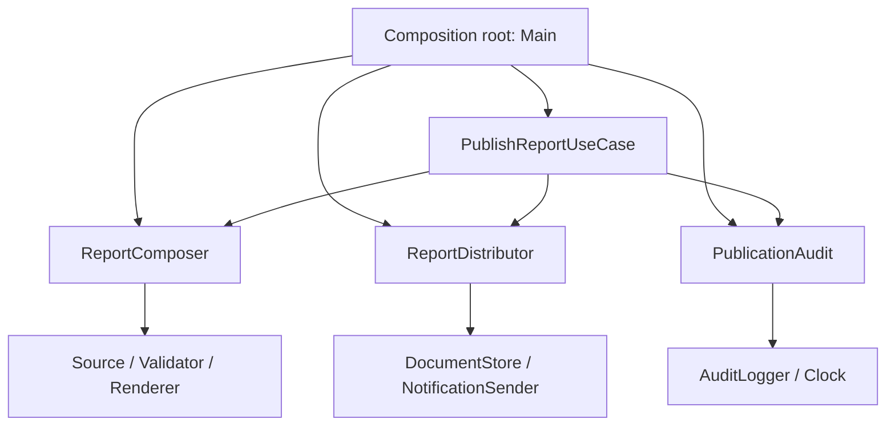

# Độ lớn constructor như tín hiệu cần xem lại trách nhiệm lớp

Trong **Dependency Injection (DI)**, constructor thường là nơi một đối tượng công khai những phụ thuộc bắt buộc để hoạt động. Vì vậy, khi constructor nhận ngày càng nhiều tham số, ta có cơ hội nhìn thấy mức độ phức tạp của lớp: lớp đang phải phối hợp với bao nhiêu thành phần, làm bao nhiêu loại công việc và có bao nhiêu lý do để thay đổi?

Tuy nhiên, **constructor dài là tín hiệu cần điều tra, không phải bằng chứng tự động rằng thiết kế sai**. Một lớp điều phối có thể cần nhiều cộng tác viên vì một quy trình nghiệp vụ thực sự phức tạp. Ngược lại, một lớp chỉ có hai tham số vẫn có thể ôm quá nhiều trách nhiệm nếu nó dùng một đối tượng bao gồm cả hệ thống hoặc phụ thuộc vào service locator toàn cục.

Bài thuộc chương **Thiết kế constructor** trong module **DEPENDENCY_INJECTION**. Ta sẽ dùng **Java thuần** để đọc tín hiệu từ constructor, xem xét trách nhiệm theo **Single Responsibility Principle (SRP)**, xác định nơi nên tách lớp, giữ **constructor injection** minh bạch và lắp ghép đối tượng tại **composition root** trước khi mở rộng sang DI container, scope và vòng đời.

## 1. Kết quả cần đạt

Sau bài học, bạn có thể:

- Giải thích vì sao danh sách tham số constructor phản ánh một phần mức độ phụ thuộc và trách nhiệm của lớp.
- Phân biệt constructor dài do **nhiều cộng tác viên** với constructor dài do **dữ liệu cấu hình, dữ liệu nghiệp vụ hoặc tham số tạo đối tượng**.
- Nhận diện các nhóm phụ thuộc thay đổi cùng nhau và đề xuất ranh giới trách nhiệm hợp lý.
- Refactor theo hành vi thực tế, dùng constructor injection và composition root, mà không che giấu phụ thuộc trong container hoặc một đối tượng “túi đồ”.
- Kiểm tra bằng Java thuần rằng hành vi bên ngoài còn được giữ, đồng thời biết giới hạn của một phép refactor thuần cấu trúc.

## 2. Constructor dài cho ta biết điều gì?

Xem ví dụ:

```java
final class PublishReportUseCase {
    PublishReportUseCase(
            ReportSource source,
            ReportValidator validator,
            ReportRenderer renderer,
            DocumentStore store,
            NotificationSender notifier,
            AuditLogger auditLogger,
            java.time.Clock clock) {
        // Gán các phụ thuộc vào trường tương ứng.
    }
}
```

Đây là **đoạn mã minh họa chữ ký constructor**; các kiểu cộng tác viên sẽ được định nghĩa trong ví dụ Java chạy được ở phần sau.

Một lần đọc thấy bảy tham số chưa đủ để kết luận lớp có sai phạm SRP. Nhưng nó giúp ta đặt những câu hỏi cụ thể:

- Lớp đang **đọc**, **kiểm tra**, **kết xuất**, **lưu**, **thông báo** và **ghi audit** vì tất cả là một trách nhiệm gắn kết, hay vì nhiều quy trình bị gom vào một nơi?
- Các phụ thuộc được sử dụng cùng nhau trong một hành vi, hay chia thành những cụm rõ ràng theo từng phương thức?
- Khi yêu cầu thay đổi định dạng báo cáo, quy tắc thông báo hoặc chính sách audit, cùng một lớp có liên tục phải chỉnh sửa không?
- Có thể kiểm thử quy tắc tạo nội dung báo cáo mà không cần tạo bộ lưu trữ, notifier và audit logger không?
- Có thành phần nào được truyền vào chỉ vì lớp tự làm thêm công việc vốn có thể thuộc một đối tượng khác không?

Số lượng tham số là một **chỉ số để bắt đầu đọc code**, không phải kết quả phân tích. **Không có ngưỡng phổ quát** như “quá bốn tham số chắc chắn vi phạm SRP”. Có thể dùng các ngưỡng nội bộ để nhắc nhóm review, nhưng quyết định sửa cần dựa trên *cohesion*, hướng phụ thuộc, chi phí thay đổi và hành vi của lớp.

### 2.1. Constructor injection làm lộ phụ thuộc

```java
final class InvoiceService {
    private final TaxPolicy taxPolicy;
    private final InvoiceStore invoiceStore;

    InvoiceService(TaxPolicy taxPolicy, InvoiceStore invoiceStore) {
        this.taxPolicy = java.util.Objects.requireNonNull(taxPolicy);
        this.invoiceStore = java.util.Objects.requireNonNull(invoiceStore);
    }
}
```

Từ chữ ký constructor, người đọc biết `InvoiceService` cần `TaxPolicy` và `InvoiceStore`. Đối tượng không phải tự đi tìm hai thành phần đó trong mã nghiệp vụ. Nếu cấu hình thiếu dependency, lỗi có thể được phát hiện ngay khi tạo đối tượng.

Tính minh bạch ấy có thể làm constructor trông dài hơn so với field injection hoặc service locator. **Đừng vội coi sự dài ra là suy giảm thiết kế**: có khi constructor chỉ đang phơi bày một mức phụ thuộc vốn đã tồn tại nhưng trước đó bị che khuất.

### 2.2. Số tham số không đồng nghĩa với số trách nhiệm

Một lớp với bảy dịch vụ tiêm vào có thể có một trách nhiệm điều phối rõ ràng; một lớp chỉ nhận `ApplicationContext` có thể tùy ý truy xuất hàng chục dịch vụ:

```java
// Mã khái niệm: ServiceLocator không thuộc Java chuẩn.
final class OrderService {
    private final ServiceLocator locator;

    OrderService(ServiceLocator locator) {
        this.locator = locator;
    }

    void placeOrder() {
        PaymentGateway payment = locator.get(PaymentGateway.class);
        // Còn có thể truy xuất nhiều phụ thuộc ẩn khác.
    }
}
```

Constructor này chỉ có **một tham số** nhưng phụ thuộc thực tế vẫn tồn tại, nay nằm trong thân phương thức. Vì vậy, mục tiêu không phải ép giảm số tham số bằng mọi giá; mục tiêu là **thu gọn trách nhiệm và giữ phụ thuộc cần thiết hiển thị rõ**.

## 3. Phân loại tham số trước khi đánh giá

Constructor dài vì nhiều lý do. Đếm tất cả tham số thành “dependency” dễ dẫn đến refactor sai mục tiêu.

| Loại tham số | Ví dụ | Câu hỏi cần xem xét |
| --- | --- | --- |
| **Cộng tác viên** được tiêm | `PaymentGateway`, `OrderRepository`, `Clock` | Lớp đang cộng tác với quá nhiều trách nhiệm khác nhau không? |
| **Dữ liệu cấu hình** | `timeout`, `baseUrl`, `retryLimit` | Chúng có tạo thành một nhóm cấu hình ổn định, có bất biến cần kiểm tra không? |
| **Giá trị miền nghiệp vụ** | `customerId`, `currency`, `address` | Đây là trạng thái của đối tượng hay tham số của một thao tác? |
| **Đối tượng chứa nhiều thuộc tính** | `ReportSettings`, `PostalAddress` | Nhóm dữ liệu có ý nghĩa độc lập không, hay chỉ được gom để che bớt tham số? |
| **Dependency tùy chọn** | `MetricsSink`, `FeaturePolicy` | Có thật sự tùy chọn không? Nếu thiếu, hành vi nào được bảo đảm? |
| **Factory hoặc provider** | `ConnectionFactory`, `Supplier<Client>` | Có nhu cầu tạo theo lượt gọi, trì hoãn tạo hay quản lý scope không? |

Ví dụ một đối tượng giá trị `PostalAddress` có sáu trường địa chỉ có thể hoàn toàn hợp lý nếu các trường tạo thành **một khái niệm nhất quán** và được xác thực cùng nhau. Tạo `PostalAddress` không đồng nghĩa với việc nên giấu sáu dịch vụ không liên quan vào một `Dependencies` chỉ để constructor còn một tham số.

Với một service sống lâu, dữ liệu thay đổi theo từng request thường nên đến từ **tham số phương thức**, không được giữ như trạng thái dùng chung trong constructor. Chẳng hạn, `CheckoutService` thường nhận `PaymentGateway` qua constructor, nhưng `orderId` của mỗi lượt thanh toán sẽ là tham số của `checkout(orderId)`. Ranh giới này còn ảnh hưởng đến **scope và an toàn luồng**.

## 4. Tín hiệu mạnh hơn việc đếm tham số

### 4.1. Nhiều lý do thay đổi

**SRP** không có nghĩa “mỗi lớp đúng một phương thức”. Một cách diễn giải thực dụng là mỗi lớp nên có **một nhóm lý do thay đổi gắn kết với một trách nhiệm**. Nếu một thay đổi về định dạng báo cáo, một thay đổi nhà cung cấp lưu trữ và một thay đổi chính sách thông báo đều thường xuyên buộc sửa cùng một lớp, đó là tín hiệu lớp đang gánh nhiều chính sách khác nhau.

Hãy xem **lịch sử thay đổi và các tình huống thay đổi dự kiến** nếu có. Đừng tự động tách lớp chỉ vì tên dependency khác nhau.

### 4.2. Dependency tạo thành các cụm

Giả sử trong `PublishReportUseCase`:

- `source`, `validator` và `renderer` chỉ tham gia vào công việc **tạo nội dung báo cáo**.
- `store` và `notifier` tham gia vào **phân phối báo cáo**.
- `auditLogger` và `clock` phục vụ quy tắc **ghi nhận việc công bố**.

Các cụm này gợi ý những đối tượng có hành vi riêng để xem xét: `ReportComposer`, `ReportDistributor` và `PublicationAudit`. Tuy vậy, chỉ gom ba tham số vào một lớp trung gian mà lớp mới không sở hữu quy tắc hoặc ranh giới có ý nghĩa thì có thể chỉ chuyển sự phức tạp từ nơi này sang nơi khác.

### 4.3. Phải dựng cả hệ thống để kiểm thử một quy tắc nhỏ

Nếu kiểm thử việc kiểm tra nội dung bắt buộc khởi tạo SMTP client, kho lưu trữ và hệ thống audit, đối tượng kiểm thử có thể đang chứa nhiều trách nhiệm. Một ranh giới hợp lý cho phép kiểm tra riêng việc tạo báo cáo bằng các cộng tác viên cần cho phần đó, rồi kiểm tra quy trình công bố bằng test double của các tác vụ cấp dưới.

Không nên lấy “số dòng setup của unit test” làm thước đo độc lập: dữ liệu miền phức tạp đôi khi vốn đòi hỏi nhiều thiết lập. Cần xem *vì sao* các dependency đó xuất hiện trong bài kiểm thử.

### 4.4. Nhiều dependency chỉ dùng ở nhánh riêng biệt

Nếu constructor có mười tham số nhưng từng phương thức chỉ dùng một nhóm nhỏ, có thể lớp là **tập hợp nhiều use case** thay vì một abstraction thống nhất. Ví dụ `UserService` chứa cả đăng ký, khóa tài khoản, gửi marketing và xuất dữ liệu cá nhân có khả năng cần được tách theo ca sử dụng. Một lớp dùng nhiều cộng tác viên trong cùng một **orchestration** có thể vẫn hợp lý khi nhiệm vụ điều phối có ranh giới rõ.

## 5. Ví dụ trước refactor: lớp điều phối đang làm quá nhiều việc

Giả sử chức năng “công bố báo cáo” phải tạo nội dung, phân phối và ghi nhận sự kiện công bố. Phiên bản đầu tiên nhận trực tiếp mọi cộng tác viên:

```java
// Chỉ minh họa thiết kế trước refactor; các interface được định nghĩa ở mục 6.
final class PublishReportUseCase {
    private final ReportSource source;
    private final ReportValidator validator;
    private final ReportRenderer renderer;
    private final DocumentStore store;
    private final NotificationSender notifier;
    private final AuditLogger auditLogger;
    private final java.time.Clock clock;

    PublishReportUseCase(
            ReportSource source,
            ReportValidator validator,
            ReportRenderer renderer,
            DocumentStore store,
            NotificationSender notifier,
            AuditLogger auditLogger,
            java.time.Clock clock) {
        this.source = source;
        this.validator = validator;
        this.renderer = renderer;
        this.store = store;
        this.notifier = notifier;
        this.auditLogger = auditLogger;
        this.clock = clock;
    }

    String publish(String reportId, String recipient) {
        String content = source.load(reportId);
        validator.check(content);
        byte[] document = renderer.render(content);
        String link = store.save(reportId, document);
        notifier.notifyRecipient(recipient, link);
        auditLogger.record(clock.instant() + " published: " + reportId);
        return link;
    }
}
```

Đây là một **đường đi tuần tự rõ ràng**, nhưng chính lớp điều phối cũng biết chi tiết của từng bước. Khi quy tắc tạo nội dung thay đổi, ta phải sửa hoặc kiểm thử lại lớp này; khi phân phối thay đổi, cũng phải mở lớp này. Những trách nhiệm có thể tách thành nhóm có tên và có hành vi để làm chủ:

1. **Soạn báo cáo**: tải, kiểm tra và kết xuất nội dung.
2. **Phân phối báo cáo**: lưu bản kết xuất và thông báo liên kết.
3. **Ghi nhận công bố**: tạo sự kiện audit theo thời gian chuẩn.
4. **Điều phối ca sử dụng**: gọi các bước theo thứ tự của quy trình công bố.

Điểm quan trọng là bước 4 vẫn cần tồn tại. Refactor không nhằm xóa bỏ việc điều phối, mà nhằm để **thành phần điều phối không phải sở hữu chi tiết quy tắc của mọi bước**.

## 6. Java thuần: refactor thành trách nhiệm có nghĩa

Đoạn dưới đây là một chương trình **tự chứa**, lưu toàn bộ thành tệp `Main.java`. Ví dụ dùng nội dung văn bản chuyển thành byte UTF-8 để minh họa bước “render”; **không tạo PDF thật, không gửi email và không lưu tệp ra ổ đĩa**. Các adapter sử dụng trong `main` là triển khai trong bộ nhớ để quan sát hành vi.

```java
import java.nio.charset.StandardCharsets;
import java.time.Clock;
import java.time.Instant;
import java.time.ZoneOffset;
import java.util.ArrayList;
import java.util.List;
import java.util.Objects;

public class Main {
    interface ReportSource {
        String load(String reportId);
    }

    interface ReportValidator {
        void check(String content);
    }

    interface ReportRenderer {
        byte[] render(String content);
    }

    interface DocumentStore {
        String save(String reportId, byte[] document);
    }

    interface NotificationSender {
        void notifyRecipient(String recipient, String link);
    }

    interface AuditLogger {
        void record(String event);
    }

    // Trách nhiệm: tạo một bản báo cáo hợp lệ ở dạng byte.
    static final class ReportComposer {
        private final ReportSource source;
        private final ReportValidator validator;
        private final ReportRenderer renderer;

        ReportComposer(
                ReportSource source,
                ReportValidator validator,
                ReportRenderer renderer) {
            this.source = Objects.requireNonNull(source, "source");
            this.validator = Objects.requireNonNull(validator, "validator");
            this.renderer = Objects.requireNonNull(renderer, "renderer");
        }

        byte[] compose(String reportId) {
            String content = source.load(reportId);
            validator.check(content);
            return renderer.render(content);
        }
    }

    // Trách nhiệm: lưu và gửi thông tin truy cập một tài liệu.
    static final class ReportDistributor {
        private final DocumentStore store;
        private final NotificationSender notifier;

        ReportDistributor(DocumentStore store, NotificationSender notifier) {
            this.store = Objects.requireNonNull(store, "store");
            this.notifier = Objects.requireNonNull(notifier, "notifier");
        }

        String distribute(String reportId, byte[] document, String recipient) {
            String link = store.save(reportId, document);
            notifier.notifyRecipient(recipient, link);
            return link;
        }
    }

    // Trách nhiệm: gắn thời gian và ghi nhận sự kiện công bố.
    static final class PublicationAudit {
        private final AuditLogger logger;
        private final Clock clock;

        PublicationAudit(AuditLogger logger, Clock clock) {
            this.logger = Objects.requireNonNull(logger, "logger");
            this.clock = Objects.requireNonNull(clock, "clock");
        }

        void published(String reportId, String link) {
            logger.record(
                    clock.instant() + " published " + reportId + " at " + link);
        }
    }

    // Trách nhiệm: điều phối trình tự công bố báo cáo.
    static final class PublishReportUseCase {
        private final ReportComposer composer;
        private final ReportDistributor distributor;
        private final PublicationAudit audit;

        PublishReportUseCase(
                ReportComposer composer,
                ReportDistributor distributor,
                PublicationAudit audit) {
            this.composer = Objects.requireNonNull(composer, "composer");
            this.distributor = Objects.requireNonNull(distributor, "distributor");
            this.audit = Objects.requireNonNull(audit, "audit");
        }

        String publish(String reportId, String recipient) {
            byte[] document = composer.compose(reportId);
            String link = distributor.distribute(reportId, document, recipient);
            audit.published(reportId, link);
            return link;
        }
    }

    public static void main(String[] args) {
        // Composition root: tạo, chọn và kết nối các dependency.
        ReportSource source = id -> "Báo cáo " + id;
        ReportValidator validator = content -> {
            if (content == null || content.isBlank()) {
                throw new IllegalArgumentException("report content is blank");
            }
        };
        ReportRenderer renderer =
                text -> text.getBytes(StandardCharsets.UTF_8);

        DocumentStore store = (reportId, bytes) ->
                "memory://reports/" + reportId;

        List<String> notifications = new ArrayList<>();
        NotificationSender notifier = (recipient, link) ->
                notifications.add(recipient + " -> " + link);

        List<String> auditEvents = new ArrayList<>();
        AuditLogger logger = auditEvents::add;
        Clock clock = Clock.fixed(
                Instant.parse("2026-01-01T00:00:00Z"),
                ZoneOffset.UTC);

        ReportComposer composer =
                new ReportComposer(source, validator, renderer);
        ReportDistributor distributor =
                new ReportDistributor(store, notifier);
        PublicationAudit audit = new PublicationAudit(logger, clock);
        PublishReportUseCase useCase =
                new PublishReportUseCase(composer, distributor, audit);

        String link = useCase.publish("q4", "team@example.com");

        if (!link.equals("memory://reports/q4")
                || !notifications.equals(List.of(
                        "team@example.com -> memory://reports/q4"))
                || auditEvents.size() != 1
                || !auditEvents.get(0).contains("published q4")) {
            throw new AssertionError("unexpected publication behavior");
        }

        System.out.println("Published: " + link);
        System.out.println("Notifications: " + notifications.size());
        System.out.println("Audit events: " + auditEvents.size());
        System.out.println("Plain Java check: PASS");
    }
}
```

Biên dịch và chạy với **JDK 11 trở lên**:

```bash
javac -encoding UTF-8 Main.java
java Main
```

Kết quả dự kiến:

```text
Published: memory://reports/q4
Notifications: 1
Audit events: 1
Plain Java check: PASS
```

**Chú ý khi đọc ví dụ:**

- `PublishReportUseCase` giờ nhận ba cộng tác viên theo **ba khả năng có ý nghĩa**. Nó mô tả luồng công bố, còn mỗi thành phần khác quản lý quy tắc ở bước của mình.
- `ReportComposer` vẫn có ba dependency, không phải vì ba là con số “đẹp” mà vì cả ba phục vụ cùng một trách nhiệm soạn báo cáo.
- `PublicationAudit` nhận `Clock` qua constructor để thời gian có thể điều khiển trong kiểm thử; nó không gọi trực tiếp `Instant.now()` và không cần container.
- `Main` biết tất cả lớp cụ thể và lắp chúng thành object graph. **Nhiều lời gọi khởi tạo ở composition root là bình thường**: nhiệm vụ của nơi này chính là quyết định và nối các phụ thuộc.
- Các lambda trong `main` đóng vai trò adapter minh họa/test double. Kiểm tra hiện tại chỉ xác nhận đường đi thành công của bản demo, chưa chứng minh hành vi của một hệ thống gửi thông báo hoặc lưu trữ thật.

Sơ đồ cho thấy sự thay đổi ranh giới:



Việc tách lớp có ích khi mỗi nhóm có **lý do thay đổi và bộ quy tắc riêng**. Nếu `ReportDistributor` chỉ chuyển tiếp nguyên bốn phương thức của lớp cũ, trong khi mọi lớp bên ngoài vẫn phải hiểu `DocumentStore` và `NotificationSender`, nó có thể trở thành một lớp bọc không cần thiết. Cần xem xét **API mới có giảm kiến thức mà caller phải có hay không**, không chỉ xem constructor đã ngắn lại bao nhiêu.

## 7. Đừng nhầm refactor với đảm bảo toàn vẹn quy trình

Chương trình minh họa thực hiện lần lượt:

1. Tạo báo cáo.
2. Lưu tài liệu.
3. Thông báo người nhận.
4. Ghi audit.

Nếu lưu đã thành công nhưng thông báo thất bại, ứng dụng có thể để lại một tài liệu chưa được thông báo. Nếu audit thất bại sau khi đã thông báo, lặp lại cả quy trình có thể gây gửi trùng. **Việc tách trách nhiệm không tự tạo transaction, retry an toàn, idempotency hay xử lý lỗi toàn diện**. Đây là những quy tắc nghiệp vụ và vận hành phải thiết kế riêng.

Ranh giới lớp hợp lý giúp ta đặt chính sách lỗi ở nơi có ngữ cảnh. Ví dụ, `ReportDistributor` có thể chịu trách nhiệm về chiến lược thông báo lại, còn `PublishReportUseCase` quyết định tình trạng hoàn tất của ca sử dụng. Với hệ thống thật, có thể cần outbox, hàng đợi, trạng thái xử lý, hoặc cơ chế bù trừ; không nên thêm các cơ chế đó chỉ để sửa một constructor dài.

## 8. Những cách “làm ngắn constructor” thường gây hiểu lầm

### 8.1. Gom mọi dependency vào một đối tượng chứa dịch vụ

```java
final class Dependencies {
    ReportSource source;
    ReportValidator validator;
    ReportRenderer renderer;
    DocumentStore store;
    NotificationSender notifier;
    AuditLogger auditLogger;
}

final class PublishReportUseCase {
    PublishReportUseCase(Dependencies dependencies) {
        // Constructor có một tham số nhưng lớp vẫn biết mọi dịch vụ ở trên.
    }
}
```

Đây là **ví dụ minh họa anti-pattern**, không phải một thiết kế hoàn chỉnh. Nếu `Dependencies` chỉ là “túi” công khai hàng loạt service không cùng trách nhiệm, số tham số giảm từ sáu xuống một nhưng **fan-out, coupling và trách nhiệm của lớp sử dụng không đổi**. Nó còn làm tăng nguy cơ phụ thuộc tùy ý, nhầm cấu hình và thiếu thành phần ở runtime.

**Khác biệt quan trọng:** nhóm các *giá trị dữ liệu* thành `MailSettings(host, port, timeout)` có thể hợp lý vì chúng tạo một khái niệm cấu hình có bất biến chung. Nhóm *các service không liên quan* vào `Dependencies` chỉ để lách cảnh báo độ dài constructor thường không mang cùng ý nghĩa.

### 8.2. Chuyển sang field injection hoặc service locator

```java
// Cú pháp minh họa framework, không chạy độc lập bằng Java thuần.
final class PublishReportUseCase {
    @Inject ReportSource source;
    @Inject ReportRenderer renderer;
    @Inject DocumentStore store;
    @Inject NotificationSender notifier;
}
```

Field injection không tự làm lớp có ít dependency hơn; nó chỉ khiến chữ ký constructor không bộc lộ chúng. Tương tự, `GlobalContainer.get(...)` trong phương thức nghiệp vụ giấu quyết định tìm dependency ở một nơi khác. Đây không phải cách sửa nguyên nhân của constructor dài.

Annotation như `@Inject` hữu ích khi một DI container hiểu nó, nhưng **constructor injection có thể thực hiện hoàn toàn bằng Java thuần**. Cấu trúc dependency cần được xem xét độc lập với cơ chế container tiêm đối tượng.

### 8.3. Tạo facade chỉ để giảm con số

Một `BigFacade` nhận bảy dependency rồi cung cấp bảy phương thức chuyển tiếp không nhất thiết giảm coupling của hệ thống. Chỉ nên thêm facade hay service con khi nó **đóng gói một nhiệm vụ có nghĩa**, có hợp đồng rõ ràng và giảm kiến thức mà lớp gọi cần sở hữu.

### 8.4. Tạo interface cho từng lớp mà không có ranh giới

Việc đổi `EmailSender` thành `IEmailSender` có thể giữ nguyên mọi chi tiết phụ thuộc nếu hợp đồng vẫn lộ kiểu của nhà cung cấp. **Dependency Inversion Principle (DIP)** đòi hỏi bên sử dụng hướng tới abstraction phù hợp với nhu cầu của nó, chứ không chỉ là thêm một interface.

### 8.5. Tách nhỏ quá mức

Một lớp chỉ làm một phép chuyển tiếp không có quy tắc hoặc mục đích riêng có thể tăng số đối tượng, số tệp và độ khó lần theo luồng xử lý. Refactor chỉ được xem là có ích khi **giảm chi phí thay đổi, tăng độ gắn kết hoặc làm rõ chính sách**, kể cả khi số lớp tăng.

## 9. Cân nhắc về scope, vòng đời và tài nguyên

Constructor dài có thể xuất hiện khi một lớp nhận nhiều phụ thuộc có **vòng đời khác nhau**. Đó là thêm một lý do để kiểm tra, nhưng không tự động là lỗi:

- Một `ReportComposer` không giữ trạng thái theo request có thể dùng chung nếu các cộng tác viên của nó an toàn cho cách chia sẻ đó.
- `Clock` thông thường có thể được chia sẻ; một bộ đọc dữ liệu hoặc client kết nối có thể cần cấu hình, đồng bộ hoặc đóng tài nguyên đúng lúc.
- Một singleton không nên giữ trực tiếp dữ liệu chỉ thuộc một request trong trường mutable. Việc tiêm một đối tượng scope ngắn hơn vào đối tượng sống lâu phải được giải quyết theo ngữ nghĩa container hoặc thiết kế lại nơi lấy dữ liệu.
- Nếu một đối tượng sở hữu `AutoCloseable` hoặc kết nối đắt đỏ, hãy xác định rõ **ai tạo, ai sử dụng và ai đóng**. Đưa thêm `Closeable` vào constructor không tự giải quyết ownership.

Khi chưa dùng container, **composition root** là nơi phù hợp để quyết định tạo, chia sẻ và giải phóng các dependency. Khi chuyển sang DI container, cần kiểm tra lại cấu hình scope của từng thành phần. Container giúp thực thi chiến lược vòng đời; nó không tự quyết định chiến lược đó có đúng với nghiệp vụ hay không.

## 10. Quy trình xem xét và refactor có kiểm soát

Khi gặp constructor dài trong một dự án Java, có thể thực hiện theo trình tự:

1. **Ghi lại hành vi quan sát được.** Các phương thức công khai làm gì, giá trị trả về và hiệu ứng phụ là gì? Xác định những bảo đảm cần giữ khi chỉnh sửa.
2. **Phân loại tham số.** Tách cộng tác viên, dữ liệu trạng thái, cấu hình và factory/provider; xem có dữ liệu theo request bị đưa nhầm vào constructor không.
3. **Vẽ bản đồ sử dụng dependency.** Đánh dấu phụ thuộc được gọi trong phương thức nào, phục vụ bước nào, và những phụ thuộc nào luôn thay đổi cùng nhau.
4. **Tìm lý do thay đổi.** Dựa trên yêu cầu nghiệp vụ, lỗi từng gặp, lịch sử thay đổi hoặc kịch bản thay thế adapter; tránh tách theo con số tùy tiện.
5. **Đề xuất ranh giới có tên và hợp đồng rõ.** Chẳng hạn `ReportComposer` chịu trách nhiệm tạo bản báo cáo; `ReportDistributor` phân phối bản đã tạo. Không đặt tên chung chung như `Helper` chỉ vì cần giảm tham số.
6. **Di chuyển hành vi vào đối tượng sở hữu nó.** Lớp điều phối gọi các khả năng cấp cao; nó không còn phải biết chi tiết của từng quy tắc con.
7. **Giữ phụ thuộc bắt buộc ở constructor.** Dùng `Objects.requireNonNull` hoặc kiểm tra bất biến thích hợp, đồng thời giữ lựa chọn triển khai ở composition root.
8. **Kiểm tra lại đường chạy thành công và thất bại.** Unit test cho từng trách nhiệm, test cho thứ tự gọi hoặc điều phối khi quan trọng, và integration test cho adapter thực nếu có.
9. **Đánh giá chi phí sau refactor.** Trách nhiệm, API, số dependency mỗi lớp và phạm vi tác động khi thay đổi có thực sự cải thiện không? Nếu chỉ thêm lớp trung gian, hãy cân nhắc rút lại.

Việc giữ hành vi là bắt buộc: khi chia một quy trình nhiều hiệu ứng phụ thành nhiều service, thứ tự lưu dữ liệu, thông báo, audit và xử lý exception có thể quyết định tính đúng đắn. **Đừng ngầm đổi chính sách lỗi hoặc biên transaction chỉ vì đang refactor cấu trúc.**

## 11. Khi constructor dài vẫn có thể hợp lý

Có những trường hợp không nên ép rút gọn:

| Tình huống | Vì sao có thể chấp nhận | Điều vẫn nên xác minh |
| --- | --- | --- |
| **Composition root** hoặc lớp cấu hình ứng dụng | Nhiệm vụ của nó chính là biết nhiều triển khai và nối object graph | Quyền sở hữu tài nguyên, thứ tự khởi tạo, scope và cấu hình |
| **Application orchestrator** cho một ca sử dụng phức tạp | Một quy trình có thể cần nhiều khả năng phối hợp khác nhau | Lớp có làm thêm các quy tắc chi tiết vốn thuộc bước con không? |
| **Đối tượng giá trị có nhiều trường bắt buộc** | Các giá trị mô tả một khái niệm miền thống nhất | Bất biến có rõ ràng; builder hoặc value object có giúp API dễ dùng hơn không? |
| **Cấu hình được xác thực cùng nhau** | Một nhóm tham số cấu hình thật sự thuộc một khái niệm chung | Có tránh việc tạo một bag chứa tham số không liên quan không? |
| **Hệ thống cũ đang được chuyển dần sang constructor injection** | Số tham số tăng vì dependency ẩn đã được bộc lộ | Sau khi minh bạch hóa, có xuất hiện những ranh giới để cải tiến tiếp không? |

Ví dụ, một **builder** hữu ích khi đối tượng có nhiều tùy chọn cấu hình, nhưng builder không tự sửa một service đang gánh nhiều trách nhiệm. Với những dependency bắt buộc của service, constructor vẫn thường dễ thấy thiếu sót hơn chuỗi setter không được bảo đảm gọi đủ.

## 12. Tự kiểm tra

**Tình huống A.** `OrderService` có constructor nhận `PaymentGateway`, `InvoiceGenerator`, `EmailSender`, `InventoryService`, `AuditLogger` và `Clock`. Nhóm quyết định chuyển tất cả vào `ServiceDependencies` để constructor còn một tham số. Đã giải quyết vấn đề chưa?

**Gợi ý:** Chưa có bằng chứng. Các dependency và trách nhiệm vẫn tồn tại. Cần xem những nhóm hành vi nào thực sự thuộc cùng ca sử dụng, những bước nào có chính sách riêng và sau khi tách thì phạm vi thay đổi, kiểm thử có thu hẹp không.

**Tình huống B.** Một constructor có sáu tham số mô tả một `PostalAddress` bất biến; tất cả đều là giá trị bắt buộc và được xác thực trong constructor. Có cần tách thành ba lớp để đạt “tối đa hai tham số” không?

**Gợi ý:** Không. Đây chủ yếu là câu hỏi về cách biểu diễn dữ liệu, không phải sáu cộng tác viên. Nên đánh giá tính gắn kết của địa chỉ, bất biến và độ dễ dùng của API.

**Tình huống C.** Sau khi dùng constructor injection thay field injection, một service lộ ra tám dependency và unit test setup dài hơn. Có nên quay lại field injection?

**Gợi ý:** Không chỉ vì chữ ký dài. Constructor đang hiển thị các dependency đã tồn tại. Hãy kiểm tra trách nhiệm và các cụm sử dụng để refactor đúng nguyên nhân, đồng thời giữ đường khởi tạo hợp lệ và dễ kiểm thử.

**Tình huống D.** `PublishReportUseCase` chỉ còn ba dependency sau refactor, nhưng khi thông báo thất bại thì bản báo cáo đã được lưu. Constructor ngắn có chứng minh thiết kế hoàn chỉnh không?

**Gợi ý:** Không. Thiết kế trách nhiệm đã rõ hơn, nhưng cần đặc tả và kiểm thử quy tắc lỗi, retry, idempotency và trạng thái công bố. Đây là yêu cầu khác với việc chia lớp.

**Tình huống E.** Một lớp điều phối cần năm cộng tác viên, tất cả cùng tham gia xử lý một yêu cầu và mỗi dependency là một khả năng riêng với hợp đồng hợp lý. Có bắt buộc thêm facade chỉ để giảm còn ba tham số?

**Gợi ý:** Không. Nếu lớp có một trách nhiệm rõ, mức phụ thuộc là hệ quả thật của use case, và không có một nhóm hành vi có ý nghĩa để trích xuất, việc tạo facade có thể chỉ tăng tầng trung gian.

## 13. Ghi nhớ

- **Độ lớn constructor là một tín hiệu thiết kế**, hữu ích vì constructor injection bộc lộ dependency bắt buộc; nó không phải phép đo trực tiếp số trách nhiệm.
- **Đếm tham số là bước đầu.** Muốn đánh giá đúng cần xem loại tham số, các cụm dependency, lý do thay đổi, mức gắn kết và hành vi của lớp.
- **Refactor theo trách nhiệm và hợp đồng**, không chỉ giảm số tham số. Đối tượng được trích xuất phải sở hữu hành vi có nghĩa và làm rõ ranh giới thay đổi.
- **Đừng giấu phụ thuộc** bằng field injection, service locator hoặc đối tượng chứa hàng loạt service để né constructor dài.
- **Composition root có thể biết rất nhiều dependency** vì nó chịu trách nhiệm tạo và lắp ghép object graph. Việc dùng DI container sau này không thay thế việc thiết kế scope, vòng đời và hành vi đúng.
- **Constructor ngắn không bảo đảm một quy trình đúng**: xử lý lỗi, tính nhất quán và hiệu ứng phụ cần được thiết kế, kiểm chứng riêng.

Khi thấy constructor dài, hãy hỏi: **“Mỗi dependency phục vụ trách nhiệm nào, những trách nhiệm nào thực sự thuộc lớp này, và việc thay đổi một phần hành vi sẽ tác động đến đâu?”** Câu trả lời cho các câu hỏi đó có giá trị thiết kế hơn một ngưỡng số lượng tham số cố định.
