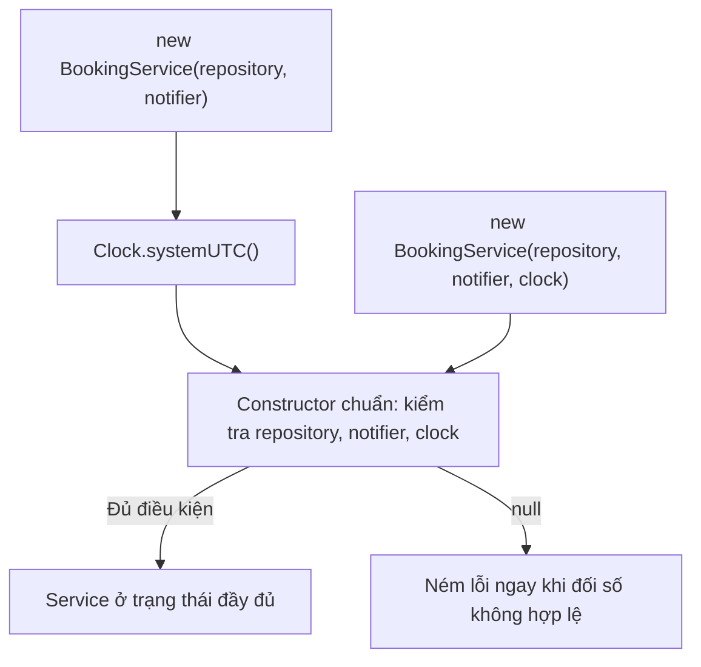

# Nhiều constructor và nguy cơ tạo đối tượng ở trạng thái không đầy đủ

Một lớp Java có thể khai báo nhiều constructor (constructor overloading). Đây là tính năng hữu ích khi cần cung cấp các cách khởi tạo thuận tiện. Tuy nhiên, với **Dependency Injection (DI)**, mỗi constructor còn là một **hợp đồng về những phụ thuộc phải có** để đối tượng hoạt động đúng. Nếu các constructor yêu cầu những tập phụ thuộc khác nhau mà không làm rõ lý do, chương trình có thể tạo được đối tượng nhưng chỉ phát hiện thiếu phụ thuộc khi gọi một phương thức sau đó.

Ví dụ: `BookingService` bắt buộc cần `BookingRepository` để lưu dữ liệu và `BookingNotifier` để thông báo. Nếu tồn tại constructor chỉ nhận repository rồi để notifier bằng `null`, người gọi vẫn tạo được service, nhưng luồng nghiệp vụ gửi thông báo sẽ lỗi muộn. Mục tiêu của thiết kế constructor là làm cho **trạng thái hợp lệ trở thành trạng thái mặc định sau khi khởi tạo thành công**, đồng thời giữ việc tạo và lắp ghép phụ thuộc tại **composition root**.

Bài này thuộc chương **Thiết kế constructor** trong nội dung học **Dependency Injection và Inversion of Control (IoC)**. Ta sẽ phân tích các constructor chồng lấp, cách duy trì bất biến, cách dùng constructor chaining, thiết kế phụ thuộc bắt buộc và tùy chọn, kiểm thử bằng Java thuần, rồi liên hệ tới scope, vòng đời và DI container.

## 1. Thế nào là đối tượng ở trạng thái không đầy đủ?

Một đối tượng ở trạng thái không đầy đủ khi constructor trả về một instance nhưng instance đó **chưa có đủ dữ liệu hoặc cộng tác viên để thực hiện những hành vi mà API của nó cam kết**.

Với `BookingService`, các điều kiện sau có thể là **bất biến** (*invariants*) của đối tượng:

- `repository` khác `null` vì mọi booking hợp lệ phải được lưu.
- `notifier` khác `null` vì quy trình tạo booking bắt buộc thông báo.
- `clock` khác `null` vì hệ thống phải ghi thời điểm tạo booking.
- Các điều kiện này đúng **ngay sau khi constructor hoàn tất**, và tiếp tục được duy trì trong vòng đời của instance.

Một đối tượng không nhất thiết phải có dữ liệu nghiệp vụ ngay khi khởi tạo. Chẳng hạn, một repository rỗng vẫn là repository hợp lệ; một service chưa xử lý booking nào vẫn hợp lệ. **Chưa có dữ liệu** và **chưa được cấu hình đủ để hoạt động** là hai trạng thái khác nhau.

Trong Java, trình biên dịch chỉ đảm bảo các quy tắc về cú pháp và khởi tạo trường `final`, chứ không tự biết một trường tham chiếu có bắt buộc phải khác `null` hay không. Trường `final BookingRepository repository` vẫn có thể nhận giá trị `null` nếu constructor cho phép. Vì vậy, thiết kế API và kiểm tra bất biến vẫn là trách nhiệm của người viết lớp.

## 2. Lỗi điển hình: nhiều constructor, mỗi đường khởi tạo thiếu một phần

Xét lớp sau (các interface sẽ được định nghĩa trong ví dụ đầy đủ ở phần 5):

```java
final class UnsafeBookingService {
    private BookingRepository repository;
    private BookingNotifier notifier;

    UnsafeBookingService() {
        // Không gán repository, notifier.
    }

    UnsafeBookingService(BookingRepository repository) {
        this.repository = repository;
    }

    UnsafeBookingService(
            BookingRepository repository,
            BookingNotifier notifier) {
        this.repository = repository;
        this.notifier = notifier;
    }

    void create(Booking booking) {
        repository.save(booking);
        notifier.onCreated(booking);
    }
}
```

Các câu lệnh sau **đều biên dịch được**:

```java
new UnsafeBookingService();
new UnsafeBookingService(repository);
new UnsafeBookingService(repository, notifier);
```

Nhưng:

| Cách khởi tạo | Trạng thái sau constructor | Lỗi có thể xuất hiện |
| --- | --- | --- |
| `new UnsafeBookingService()` | Thiếu cả repository và notifier | `NullPointerException` ở lần gọi `create` đầu |
| `new UnsafeBookingService(repository)` | Có repository, thiếu notifier | Có thể đã lưu rồi mới lỗi ở bước thông báo |
| `new UnsafeBookingService(repository, notifier)` | Có đủ hai phụ thuộc *nếu* caller truyền giá trị hợp lệ | Vẫn có thể lỗi nếu truyền `null` |

Nguy hiểm nhất là tình huống thứ hai: repository có thể đã thay đổi trạng thái, còn notifier chưa được gọi. Đó không còn đơn thuần là lỗi khởi tạo; nó có thể để lại hệ quả nghiệp vụ cần xử lý. Constructor không đầy đủ **đẩy lỗi cấu hình từ thời điểm khởi động sang thời điểm sử dụng**.

Thêm setter sau đó không tự giải quyết được vấn đề:

```java
UnsafeBookingService service = new UnsafeBookingService(repository);
// service.setNotifier(notifier);  // Ai đảm bảo lệnh này luôn được gọi?
service.create(booking);           // Vẫn có nguy cơ dùng instance chưa đủ.
```

Setter injection có chỗ dùng với thuộc tính thực sự tùy chọn hoặc thay đổi trong vòng đời. Với **phụ thuộc bắt buộc** của service, constructor injection giúp thể hiện yêu cầu ngay trên API và giảm trạng thái trung gian phải quản lý.

## 3. Nguyên tắc cốt lõi: mọi constructor công khai phải giữ cùng bất biến

Đặt câu hỏi trước khi thêm một constructor mới: **sau khi đi qua constructor này, đối tượng có thể được sử dụng an toàn theo hợp đồng chung của lớp không?**

Một thiết kế rõ ràng có thể chọn **một constructor duy nhất nhận đủ phụ thuộc bắt buộc**:

```java
final class BookingService {
    private final BookingRepository repository;
    private final BookingNotifier notifier;

    BookingService(
            BookingRepository repository,
            BookingNotifier notifier) {
        this.repository = java.util.Objects.requireNonNull(
            repository, "repository");
        this.notifier = java.util.Objects.requireNonNull(
            notifier, "notifier");
    }
}
```

Khi đó, caller không thể bỏ một đối số bắt buộc mà vẫn biên dịch; nếu truyền `null`, lỗi xuất hiện **ngay tại lúc khởi tạo**. `Objects.requireNonNull` kiểm tra ranh giới, còn `final` giúp giữ tham chiếu ổn định sau khi tạo. Tuy nhiên, `final` không khiến các đối tượng được tham chiếu trở nên bất biến hoặc an toàn cho nhiều luồng.

### Có nhất thiết cấm nhiều constructor?

Không. Nhiều constructor có thể hợp lý nếu mỗi đường khởi tạo **đều dẫn tới một trạng thái đầy đủ** và chỉ khác nhau ở **giá trị mặc định có ý nghĩa** hoặc một chế độ được thiết kế rõ. Ví dụ: repository và notifier là bắt buộc; `Clock` là cấu hình thời gian có thể dùng mặc định `Clock.systemUTC()`.

Khi đó, hai constructor sau đều hợp lệ:

```java
BookingService(BookingRepository repository, BookingNotifier notifier) {
    this(repository, notifier, java.time.Clock.systemUTC());
}

BookingService(
        BookingRepository repository,
        BookingNotifier notifier,
        java.time.Clock clock) {
    this.repository = java.util.Objects.requireNonNull(
        repository, "repository");
    this.notifier = java.util.Objects.requireNonNull(
        notifier, "notifier");
    this.clock = java.util.Objects.requireNonNull(clock, "clock");
}
```

Đây là **constructor chaining**: constructor ngắn ủy quyền cho constructor đầy đủ qua `this(...)`. Với cú pháp Java phổ biến trước các thay đổi mới của ngôn ngữ, lệnh `this(...)` phải là câu lệnh đầu tiên trong constructor gọi nó. Cách này gom việc gán trường và kiểm tra điều kiện vào một nơi, giảm nguy cơ mỗi constructor xử lý một kiểu.

Không thể xem mọi giá trị mặc định là an toàn. Ví dụ, ngầm thay notifier bị thiếu bằng một implementation không làm gì có thể khiến hệ thống âm thầm bỏ qua thông báo bắt buộc. **Giá trị mặc định chỉ hợp lệ nếu phù hợp hợp đồng nghiệp vụ**, không phải vì nó tránh được `NullPointerException`.

## 4. Phân biệt phụ thuộc bắt buộc và cấu hình tùy chọn

Đối với từng tham số dự định đưa vào constructor, hãy xác định vai trò của nó:

| Vai trò | Ví dụ | Cách biểu đạt nên cân nhắc |
| --- | --- | --- |
| Phụ thuộc bắt buộc | `BookingRepository`, `BookingNotifier` | Constructor yêu cầu tham số; kiểm tra `null` và bất biến |
| Cấu hình có giá trị mặc định hợp lệ | `Clock` mặc định UTC | Constructor tiện lợi gọi constructor chuẩn với giá trị mặc định |
| Dữ liệu của từng lần gọi | `bookingId`, giá tiền yêu cầu | Tham số của phương thức `book(...)` |
| Trạng thái thuộc một request | ID xác thực, ngữ cảnh người dùng | Truyền theo request hoặc cung cấp trong scope phù hợp |
| Khả năng thực sự không bắt buộc | Bộ đo lường tùy chọn, nếu được hợp đồng cho phép | Implementation no-op, phương thức factory có tên rõ, hoặc thiết kế vai trò khác |

Không nên đưa dữ liệu theo từng request vào constructor của một service dùng chung lâu dài. Một service được tạo lúc khởi động ứng dụng với `bookingId = "BK-001"` không thể xử lý đúng nhiều booking nếu ID bị giữ cố định ở trường chỉ đọc.

Nếu có hai cách tạo khác nhau về *ý nghĩa nghiệp vụ*, một **static factory có tên** thường rõ hơn thêm nhiều overload khó phân biệt:

```java
// Chỉ minh họa tên API; mặc định có hợp lệ hay không tùy quy tắc nghiệp vụ.
static BookingService withStandardClock(
        BookingRepository repository,
        BookingNotifier notifier) {
    return new BookingService(repository, notifier, java.time.Clock.systemUTC());
}
```

Trong ứng dụng thật, factory có thể là phương thức `static` ở lớp thích hợp hoặc hàm tại composition root. Đừng tạo factory chỉ để che việc thiếu một cộng tác viên bắt buộc. Một lớp có thể chỉ cần một constructor đầy đủ là đủ.

## 5. Ví dụ hoàn chỉnh: hai constructor, một trạng thái hợp lệ

Ví dụ dưới đây chạy với **Java thuần**, không cần framework hay DI container. `BookingService` luôn nhận repository và notifier; constructor hai tham số cung cấp đồng hồ UTC mặc định, constructor ba tham số cho phép truyền đồng hồ tùy chỉnh để kiểm thử.

Tạo file `BookingConstructorDemo.java`:

```java
import java.time.Clock;
import java.time.Instant;
import java.util.HashMap;
import java.util.Map;
import java.util.Objects;

final class Booking {
    private final String id;
    private final Instant createdAt;

    Booking(String id, Instant createdAt) {
        String normalizedId = Objects.requireNonNull(id, "id").trim();
        if (normalizedId.isEmpty()) {
            throw new IllegalArgumentException("id khong duoc rong");
        }
        this.id = normalizedId;
        this.createdAt = Objects.requireNonNull(createdAt, "createdAt");
    }

    String id() {
        return id;
    }

    Instant createdAt() {
        return createdAt;
    }
}

interface BookingRepository {
    void save(Booking booking);
}

interface BookingNotifier {
    void onCreated(Booking booking);
}

final class InMemoryBookingRepository implements BookingRepository {
    private final Map<String, Booking> items = new HashMap<>();

    @Override
    public void save(Booking booking) {
        items.put(booking.id(), booking);
    }

    Booking find(String id) {
        return items.get(id);
    }
}

final class ConsoleBookingNotifier implements BookingNotifier {
    @Override
    public void onCreated(Booking booking) {
        System.out.println("Da thong bao booking " + booking.id());
    }
}

final class BookingService {
    private final BookingRepository repository;
    private final BookingNotifier notifier;
    private final Clock clock;

    // Constructor tien loi: chi mac dinh Clock, khong bo phu thuoc bat buoc.
    BookingService(BookingRepository repository, BookingNotifier notifier) {
        this(repository, notifier, Clock.systemUTC());
    }

    // Constructor chuan: bat bien duoc kiem tra tai mot noi.
    BookingService(
            BookingRepository repository,
            BookingNotifier notifier,
            Clock clock) {
        this.repository = Objects.requireNonNull(repository, "repository");
        this.notifier = Objects.requireNonNull(notifier, "notifier");
        this.clock = Objects.requireNonNull(clock, "clock");
    }

    Booking book(String id) {
        Booking booking = new Booking(id, clock.instant());
        repository.save(booking);
        notifier.onCreated(booking);
        return booking;
    }
}

public class BookingConstructorDemo {
    public static void main(String[] args) {
        // Composition root: tao va ket noi cac phu thuoc.
        InMemoryBookingRepository repository = new InMemoryBookingRepository();
        BookingNotifier notifier = new ConsoleBookingNotifier();

        // Chon constructor tien loi; Clock da co mac dinh hop le.
        BookingService service = new BookingService(repository, notifier);

        Booking booking = service.book("BK-001");
        System.out.println("Da luu: " + (repository.find("BK-001") == booking));
        System.out.println("Thoi diem UTC: " + booking.createdAt());
    }
}
```

Chạy chương trình:

```bash
javac BookingConstructorDemo.java
java BookingConstructorDemo
```

Kết quả có dạng (thời điểm thay đổi theo lần chạy):

```text
Da thong bao booking BK-001
Da luu: true
Thoi diem UTC: 2026-11-18T02:00:00Z
```

Thời điểm trong ví dụ đầu ra chỉ là minh họa. Điều quan trọng là **cả hai constructor đều tạo một `BookingService` có repository, notifier và clock khác `null`**. Nếu truyền thiếu repository hoặc notifier, không có constructor một tham số hoặc không tham số nào để vô tình lách qua yêu cầu.

### Đường khởi tạo của hai constructor



Đồ thị này cũng chỉ rõ nơi triển khai **IoC**: `BookingService` không tự tạo repository hay notifier. Composition root chọn implementation và chuyển instance vào constructor. Việc constructor tự cung cấp `Clock.systemUTC()` chỉ hợp lý vì đây là **chính sách mặc định được xác định rõ** của API, không phải một phụ thuộc hạ tầng bắt buộc đang bị giấu.

## 6. Kiểm thử mọi đường tạo đối tượng bằng Java thuần

Một bài kiểm thử quan trọng với nhiều constructor là: **mọi đường khởi tạo được hỗ trợ đều giữ cùng bất biến**. Đồng thời, thử constructor đầy đủ bằng đồng hồ cố định để kết quả không phụ thuộc thời gian thực.

Tạo file `BookingConstructorTest.java` trong cùng thư mục:

```java
import java.time.Clock;
import java.time.Instant;
import java.time.ZoneOffset;

public class BookingConstructorTest {
    static final class RecordingRepository implements BookingRepository {
        Booking saved;

        @Override
        public void save(Booking booking) {
            saved = booking;
        }
    }

    static final class RecordingNotifier implements BookingNotifier {
        Booking notified;
        int count;

        @Override
        public void onCreated(Booking booking) {
            notified = booking;
            count++;
        }
    }

    public static void main(String[] args) {
        RecordingRepository repository = new RecordingRepository();
        RecordingNotifier notifier = new RecordingNotifier();
        Instant expected = Instant.parse("2026-01-01T00:00:00Z");
        Clock fixedClock = Clock.fixed(expected, ZoneOffset.UTC);

        // Constructor du ba doi so: co the kiem soat thoi gian.
        BookingService service =
            new BookingService(repository, notifier, fixedClock);
        Booking result = service.book("BK-TEST");

        check(result.createdAt().equals(expected), "Sai thoi diem");
        check(repository.saved == result, "Chua luu booking");
        check(notifier.notified == result, "Chua thong bao booking");
        check(notifier.count == 1, "Thong bao phai duoc goi mot lan");

        // Constructor hai doi so van tao ra service hoat dong duoc.
        BookingService defaultClockService =
            new BookingService(repository, notifier);
        check(defaultClockService.book("BK-DEFAULT") != null,
            "Constructor tien loi khong hoat dong");

        // Thieu phu thuoc bat buoc: phat hien loi ngay luc new.
        boolean rejectedNull = false;
        try {
            new BookingService(null, notifier);
        } catch (NullPointerException expectedException) {
            rejectedNull = true;
        }
        check(rejectedNull, "Phai tu choi repository null");

        boolean rejectedClock = false;
        try {
            new BookingService(repository, notifier, null);
        } catch (NullPointerException expectedException) {
            rejectedClock = true;
        }
        check(rejectedClock, "Phai tu choi clock null");

        System.out.println("BookingConstructorTest PASSED");
    }

    static void check(boolean condition, String message) {
        if (!condition) {
            throw new AssertionError(message);
        }
    }
}
```

Biên dịch và chạy:

```bash
javac BookingConstructorDemo.java BookingConstructorTest.java
java BookingConstructorTest
```

Kết quả mong đợi:

```text
BookingConstructorTest PASSED
```

Các `RecordingRepository` và `RecordingNotifier` là fake ghi nhận hành vi. Chúng giúp kiểm tra service mà không tạo kết nối DB hoặc gửi thông báo thật. `Clock.fixed(...)` giúp xác minh chính xác thời điểm, không cần chờ hoặc phụ thuộc vào giờ máy chạy. Test này kiểm tra **ngữ nghĩa khởi tạo và phối hợp của service**; nó chưa chứng minh rằng một adapter DB thực có hoạt động đúng. Phần đó cần kiểm thử tích hợp riêng.

## 7. Khi các constructor quá nhiều: dấu hiệu cần xem lại API

Một kiểu viết thường gặp là *telescoping constructors*: liên tiếp bổ sung tham số tùy chọn.

```java
// Phác họa API giả định, không phải một ví dụ đầy đủ để biên dịch.
new ReportService(repository);
new ReportService(repository, clock);
new ReportService(repository, clock, locale);
new ReportService(repository, clock, locale, retryPolicy);
```

Điều này có thể dẫn tới:

1. **Số lượng đường khởi tạo tăng:** mỗi overload phải tuân theo cùng tập bất biến.
2. **Ý nghĩa đối số khó đoán:** nhiều tham số cùng kiểu, như `String region` và `String currency`, dễ bị truyền nhầm mà compiler không phát hiện.
3. **Giá trị mặc định phân tán:** constructor A đặt một default, constructor B đặt default khác; khi đổi quy tắc phải sửa nhiều chỗ.
4. **Tích hợp DI khó hiểu:** nếu class có nhiều constructor có thể dùng để inject, cần quy tắc rõ ràng về constructor nào được chọn.

Để xử lý, trước tiên hãy **giảm số biến thể không cần thiết** và phân biệt phụ thuộc bắt buộc với cấu hình tùy chọn. Nếu thực sự có nhiều cấu hình tùy chọn, cân nhắc object cấu hình có kiểm tra hợp lệ hoặc builder. Một builder **chỉ an toàn khi phương thức `build()` từ chối cấu hình thiếu trường bắt buộc**; không nên chuyển đối tượng không đầy đủ từ constructor sang builder rồi xem như vấn đề đã biến mất.

Ví dụ, một object cấu hình không nên có trạng thái `retryCount = -1` hoặc timeout âm nếu không có ý nghĩa. Có thể dùng một constructor hoặc static factory xác thực cấu hình ngay khi tạo, rồi truyền object cấu hình hợp lệ vào service.

## 8. Các tình huống dễ nhầm trong thiết kế constructor

### 8.1. Nghĩ `final` tự động bảo đảm khác `null`

```java
final class BadExample {
    private final BookingRepository repository;

    BadExample() {
        repository = null; // Java cho phép gán một lần, nhưng sai bất biến.
    }
}
```

Trường `final` không bị gán lại, nhưng vẫn thiếu phụ thuộc. Cần ràng buộc trong constructor bằng API bắt buộc và kiểm tra giá trị.

### 8.2. Giữ constructor không tham số chỉ để “cho tiện”

Trong Java, nếu lớp **không khai báo constructor nào**, compiler cung cấp constructor không tham số mặc định (với mức truy cập tương ứng). Nhưng khi đã tự khai báo constructor có tham số, compiler **không tự tạo thêm** constructor không tham số.

Đừng vội thêm constructor rỗng để đáp ứng một đoạn mã khởi tạo cũ nếu service có phụ thuộc bắt buộc. Hãy cập nhật composition root cho đúng hợp đồng mới. Nếu một framework thực sự cần constructor rỗng, cần hiểu mô hình tạo và gán thuộc tính của framework đó; không nên áp dụng yêu cầu ấy lên mọi service DI theo thói quen.

### 8.3. Dùng một overload để giấu lựa chọn implementation

```java
// Neu notifier bat buoc va co nhieu cach gui, day la lua chon ngam.
BookingService(BookingRepository repository) {
    this(repository, new ConsoleBookingNotifier());
}
```

Overload này không để service thiếu notifier, nhưng nó **chuyển lựa chọn implementation vào service**. Nếu thông báo console chỉ dành cho môi trường phát triển, việc tạo mặc định như vậy có thể gây sai mục đích ở môi trường khác. Nên giữ lựa chọn adapter tại composition root, còn constructor chỉ yêu cầu những cộng tác viên cần dùng.

### 8.4. Chọn nhầm overload khi truyền `null`

```java
// API minh họa:
ExampleService(BookingRepository repository, Clock clock) { ... }
ExampleService(BookingRepository repository, BookingNotifier notifier) { ... }
```

Khi caller viết `new ExampleService(repository, null)`, Java không thể chọn rõ constructor thứ hai là `Clock` hay `BookingNotifier` vì các kiểu không liên quan; lời gọi sẽ không biên dịch do mơ hồ. Ngay cả khi có thể ép kiểu để chọn overload, truyền `null` vẫn làm mục đích sử dụng khó hiểu. Tên factory rõ nghĩa và kiểm tra tham số giúp API dễ dùng hơn.

### 8.5. Gọi phương thức có thể override trong constructor

Nếu constructor của lớp cha gọi phương thức bị lớp con override, phương thức lớp con có thể chạy **trước khi trường riêng của lớp con khởi tạo xong**. Tương tự, đăng ký `this` vào listener hoặc luồng khác ngay trong constructor có thể làm lộ object chưa hoàn tất. Đây là một dạng trạng thái không đầy đủ xảy ra *trong quá trình xây dựng đối tượng*, dù các tham số DI có đủ. Ưu tiên giữ constructor đơn giản: kiểm tra, gán trường, thiết lập bất biến; chỉ công bố instance sau khi hoàn tất.

## 9. Liên hệ composition root, scope và DI container

Constructor injection tách hai trách nhiệm: **service sử dụng phụ thuộc** còn **composition root tạo và lắp ghép phụ thuộc**. Trong ví dụ, `main` chọn `InMemoryBookingRepository`, `ConsoleBookingNotifier` rồi truyền cả hai vào service. Khi chuyển sang DI container, ý tưởng không đổi, nhưng container có thể làm phần lắp ghép tự động.

Số constructor có ảnh hưởng tới quá trình lắp ghép trong container:

- Một số container chọn constructor theo quy ước; một số cần đánh dấu constructor được inject hoặc cấu hình binding. **Không có quy tắc chọn constructor chung áp dụng cho mọi DI container**.
- Nếu một class có cả constructor rỗng và constructor nhận đủ phụ thuộc, phải đảm bảo container chọn đường khởi tạo phù hợp; nếu không, có thể tạo instance chưa được cấu hình đúng.
- Khi có nhiều constructor cần phân biệt, **một constructor injection rõ ràng** thường dễ kiểm soát hơn. Chỉ thêm overload nếu nó giữ bất biến và có lợi ích rõ.

Đồng thời, **số lượng constructor không quyết định scope**. Một `BookingService` được tạo một lần hay theo request phụ thuộc vào cách composition root/container quản lý vòng đời. Constructor có đủ tham số không giúp một singleton an toàn nếu nó giữ trực tiếp trạng thái riêng của request hoặc một phụ thuộc không an toàn khi truy cập đồng thời.

Một dấu hiệu cần rà soát là service sống lâu nhận qua constructor một đối tượng chỉ hợp lệ trong một request. Điều này cần giải quyết ở ranh giới scope hoặc qua dữ liệu của từng lời gọi, thay vì thêm overload nhận `RequestContext` tùy lúc và để service dùng trạng thái đã hết hạn.

## 10. Checklist trước khi thêm một constructor

Trước khi đưa overload mới vào một class nhận DI, hãy tự trả lời:

1. **Phụ thuộc nào thực sự bắt buộc** để mọi phương thức công khai của class hoạt động đúng?
2. Constructor mới có thể trả về instance khi thiếu một trong các phụ thuộc đó không?
3. Mọi giá trị mặc định có **ý nghĩa nghiệp vụ rõ ràng** hay chỉ đang che việc thiếu phụ thuộc?
4. Có thể dùng **`this(...)` gọi constructor chuẩn** để tập trung kiểm tra bất biến không?
5. Đối số có dễ bị truyền nhầm vì overload hoặc nhiều tham số cùng kiểu không?
6. Composition root hoặc DI container có chọn được **đúng đường khởi tạo** theo thiết kế không?
7. Các bài kiểm thử có bao phủ **mọi constructor được hỗ trợ**, trường hợp đầu vào không hợp lệ và hành vi sau khi tạo không?
8. Instance được tạo có giữ phụ thuộc đúng **scope và vòng đời** của nó không?

## 11. Bài tập tự luyện

**Bài 1 — Tìm bất biến bị phá vỡ.** Một `PaymentService` có ba constructor: rỗng, chỉ nhận `PaymentGateway`, và nhận cả `PaymentGateway` lẫn `AuditLogger`. Phương thức `pay(...)` luôn gọi hai cộng tác viên. Hãy chỉ ra constructor nào có nguy cơ tạo instance không đầy đủ và đề xuất chữ ký constructor an toàn. *Hướng giải:* nếu cả gateway và logger đều bắt buộc, chỉ cho phép khởi tạo với đủ hai phụ thuộc hoặc một đường ủy quyền có giá trị mặc định thật sự hợp lệ.

**Bài 2 — Viết constructor chaining.** Mở rộng `BookingService` để có thêm cấu hình `ZoneId`. Constructor tiện lợi mặc định `ZoneOffset.UTC`; constructor đầy đủ nhận `ZoneId` khác `null`. Hãy bảo đảm mọi đường khởi tạo đều đi qua một constructor chuẩn. *Lưu ý:* nếu chỉ dùng `Clock`, hãy cân nhắc `Clock.getZone()` đã đủ cho yêu cầu chưa trước khi thêm trường mới.

**Bài 3 — Bẫy `null`.** Tạo hai overload nhận `Clock` hoặc `BookingNotifier` ở vị trí tham số thứ hai rồi thử gọi bằng `null`. Quan sát lỗi biên dịch và giải thích vì sao overload mơ hồ. Thay bằng các static factory có tên hoặc API constructor rõ hơn.

**Bài 4 — Kiểm thử đường khởi tạo.** Bổ sung test `new BookingService(repository, null)` phải thất bại ngay, đồng thời kiểm tra rằng sau khi service được tạo hợp lệ, lời gọi `book(...)` chỉ lưu và thông báo một lần. Dùng các fake ghi nhận hành vi; không cần thư viện mock.

Điều cần giữ xuyên suốt là **mỗi constructor được hỗ trợ phải tạo ra một đối tượng đã sẵn sàng thực hiện hợp đồng của nó**. Constructor injection phát huy tác dụng khi các phụ thuộc bắt buộc được khai báo rõ, mọi đường khởi tạo cùng tuân theo bất biến, và việc lựa chọn implementation vẫn nằm ở nơi lắp ghép đối tượng.
