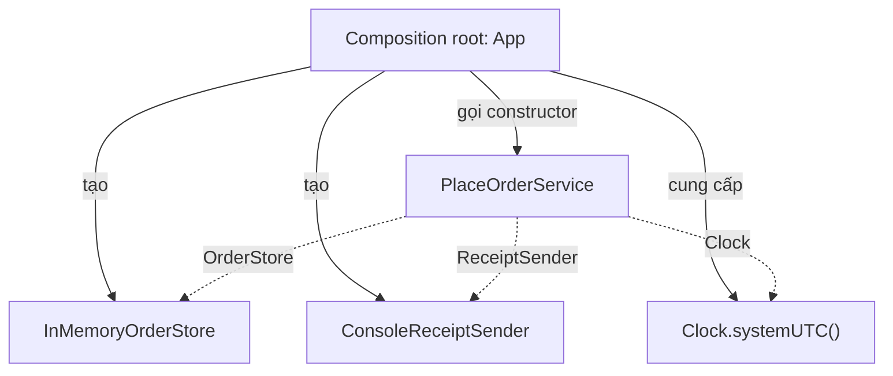

# Giữ constructor dễ sử dụng trong cả mã ứng dụng và kiểm thử

## 1. Constructor là hợp đồng lắp ghép đối tượng

Trong **Dependency Injection (DI)**, constructor không chỉ khởi tạo trạng thái ban đầu. Nó còn là một hợp đồng công khai cho biết đối tượng **cần những dependency nào để hoạt động đúng**. Mã ứng dụng ở **composition root** dùng hợp đồng đó để tạo và nối các đối tượng; mã kiểm thử cũng dùng đúng hợp đồng ấy để cung cấp fake, stub hoặc instance thật có kiểm soát.

Ở chương **Thiết kế constructor** của module **Dependency Injection**, mục tiêu là giữ ranh giới này rõ ràng, đặc biệt khi học **Inversion of Control (IoC)** bằng Java thuần trước khi mở rộng sang DI container. Một constructor tốt giúp tách việc *sử dụng dependency* khỏi việc *tạo và lắp ghép dependency*, đồng thời không buộc kiểm thử phải khởi động cả ứng dụng.

Sau bài này, bạn có thể:

1. Nhận biết khi nào constructor khó gọi, khó kiểm thử hoặc che giấu dependency.
2. Thiết kế constructor injection với dependency bắt buộc và điều kiện hợp lệ được diễn đạt rõ.
3. Dùng composition root để cấu hình đối tượng trong ứng dụng, dùng test double và `Clock.fixed` để kiểm thử có tính xác định.
4. Chọn cách xử lý dependency tùy chọn, cấu hình nhiều tham số, factory và vòng đời mà không biến constructor thành nơi làm toàn bộ công việc.

## 2. “Dễ sử dụng” có nghĩa gì?

**Dễ dùng không có nghĩa là constructor nhận càng ít tham số càng tốt.** Ví dụ, `new ReportService(repository, renderer, clock)` có ba dependency thiết yếu nhưng dễ hiểu hơn `new ReportService()` nếu constructor rỗng lại tự tìm repository, đọc biến môi trường và tạo HTTP client bên trong.

Một constructor dễ sử dụng thường có các đặc điểm:

| Đặc điểm | Khi dùng trong ứng dụng | Khi dùng trong kiểm thử |
| --- | --- | --- |
| Dependency bắt buộc hiện rõ trong chữ ký | Composition root biết phải cấp gì | Test nhìn thấy các cộng tác viên cần thay |
| Tham số có ý nghĩa, không mơ hồ | Tránh đảo nhầm tham số cùng kiểu hoặc cờ `boolean` | Không phải nhớ “`true, false, null`” nghĩa là gì |
| Không tự tạo/tìm dịch vụ hạ tầng | Root chịu trách nhiệm cấu hình và lắp ghép | Không mở DB, gọi mạng, đọc file khi chỉ muốn test logic |
| Không làm công việc nặng hoặc có hiệu ứng phụ | Tạo object nhanh, thời điểm bắt đầu xử lý rõ ràng | Khởi tạo test double rẻ và không phụ thuộc môi trường |
| Kiểm tra invariant sớm, có thông báo rõ | Phát hiện sai cấu hình tại điểm tạo | Test lỗi dễ định vị |
| Vòng đời dependency được xác định | Root có thể quản lý đóng tài nguyên | Test không bị kẹt vì tài nguyên hoặc luồng chạy ngoài ý muốn |

Độ dễ dùng được đánh giá từ **cả người gọi lẫn người bảo trì**: constructor có thể ngắn nhưng giấu quá nhiều quyết định, hoặc có thể dài nhưng phơi bày việc một class đang ôm quá nhiều trách nhiệm.

## 3. Những thiết kế khiến constructor khó dùng

### 3.1. Tự tạo dependency trong constructor

```java
// Ví dụ nên tránh: service vừa làm nghiệp vụ, vừa chọn hạ tầng.
final class PlaceOrderService {
    private final OrderStore store;
    private final ReceiptSender sender;

    PlaceOrderService() {
        this.store = new DatabaseOrderStore();
        this.sender = new SmtpReceiptSender();
    }
}
```

Mã sử dụng `new PlaceOrderService()` rất ngắn, nhưng test cho service có thể phải chuẩn bị database, cấu hình SMTP và kiểm soát lỗi kết nối. Service còn bị buộc vào hai hiện thực cụ thể. Muốn thay hạ tầng, ta phải sửa logic bên trong service.

Trong DI thủ công, những quyết định đó nên nằm ở composition root; service chỉ nhận `OrderStore` và `ReceiptSender`. Hai class hạ tầng trong ví dụ trên mang tính minh họa, không cần triển khai chúng để hiểu vấn đề.

### 3.2. Constructor nhiều cờ và giá trị “ma thuật”

```java
// Khó đọc và dễ đảo tham số:
new ExportService(repo, client, true, false, 3, 2000, "fast");
```

Người đọc không biết `true` bật tính năng gì, `3` là số lần retry hay số luồng, `2000` là mili giây hay kích thước bộ đệm. Nhiều lần overload để thay thế các tổ hợp giá trị mặc định càng làm quy tắc khởi tạo khó đoán.

Cách xử lý là đặt tên có ý nghĩa cho các cấu hình liên quan, ví dụ `RetryOptions` với `maxAttempts` và `timeoutMillis`, hoặc để factory/root chọn một cấu hình có tên. **Chỉ gom mọi tham số thành một object lớn để làm constructor ngắn đi không giải quyết được class có quá nhiều trách nhiệm.**

### 3.3. Constructor tự làm tác vụ có hiệu ứng phụ

```java
final class MetricsClient {
    MetricsClient(String endpoint) {
        // Nếu constructor ở đây kết nối mạng, mở luồng nền
        // hoặc đăng ký callback thì việc tạo object sẽ khó kiểm soát.
    }
}
```

Không nên mặc định thực hiện mạng, truy vấn DB, gửi thông báo hay chạy background job trong constructor nghiệp vụ. Bên gọi cần biết **khi nào thao tác bắt đầu** và xử lý thất bại như thế nào. Với tài nguyên hạ tầng vốn phải mở lúc khởi tạo, có thể dùng factory tại root và hợp đồng vòng đời rõ ràng, thay vì để service nghiệp vụ âm thầm mở chúng.

## 4. Mẫu constructor injection gọn và rõ bằng Java thuần

Ta xây dựng tình huống đặt hàng tối giản. `PlaceOrderService` có ba dependency:

- `OrderStore` lưu đơn hàng.
- `ReceiptSender` gửi thông báo sau khi lưu.
- `java.time.Clock` cung cấp thời gian hiện tại, giúp tránh gọi trực tiếp `Instant.now()` phụ thuộc đồng hồ thật trong logic cần kiểm thử.

Đó là ba nhu cầu thực tế của service; không cần tạo thêm abstraction `TimeProvider` chỉ để test khi JDK đã cung cấp `Clock`.

Tạo file **`App.java`**:

```java
import java.time.Clock;
import java.time.Instant;
import java.util.LinkedHashMap;
import java.util.Map;
import java.util.Objects;

interface OrderStore {
    void save(String orderId, Instant createdAt);
}

interface ReceiptSender {
    void sendReceipt(String orderId);
}

final class PlaceOrderService {
    private final OrderStore store;
    private final ReceiptSender sender;
    private final Clock clock;

    PlaceOrderService(OrderStore store, ReceiptSender sender, Clock clock) {
        // Chỉ xác nhận các dependency bắt buộc và lưu tham chiếu.
        this.store = Objects.requireNonNull(store, "store");
        this.sender = Objects.requireNonNull(sender, "sender");
        this.clock = Objects.requireNonNull(clock, "clock");
    }

    void place(String orderId) {
        if (orderId == null || orderId.trim().isEmpty()) {
            throw new IllegalArgumentException("orderId must not be blank");
        }
        Instant createdAt = Instant.now(clock);
        store.save(orderId, createdAt);
        sender.sendReceipt(orderId);
    }
}

// Hiện thực đơn giản chỉ để minh họa cách lắp ghép tại root.
final class InMemoryOrderStore implements OrderStore {
    private final Map<String, Instant> orders = new LinkedHashMap<>();

    @Override
    public void save(String orderId, Instant createdAt) {
        orders.put(orderId, createdAt);
    }

    Instant createdAtOf(String orderId) {
        return orders.get(orderId);
    }
}

final class ConsoleReceiptSender implements ReceiptSender {
    @Override
    public void sendReceipt(String orderId) {
        System.out.println("Receipt sent for " + orderId);
    }
}

public final class App {
    public static void main(String[] args) {
        // Composition root: quyết định và lắp ghép các hiện thực.
        InMemoryOrderStore store = new InMemoryOrderStore();
        ReceiptSender sender = new ConsoleReceiptSender();
        Clock clock = Clock.systemUTC();

        PlaceOrderService orders = new PlaceOrderService(store, sender, clock);
        orders.place("O-100");
        System.out.println("Created at " + store.createdAtOf("O-100"));
    }
}
```

Biên dịch và chạy với JDK 8 trở lên:

```bash
javac App.java
java App
```

Ví dụ in một dòng xác nhận gửi receipt và một mốc thời gian UTC do `Clock.systemUTC()` cung cấp. Kết quả mốc thời gian thay đổi theo lúc chạy.

**Quan sát trách nhiệm:**

1. `PlaceOrderService` biết *cách dùng* `OrderStore` và `ReceiptSender`, không biết cách khởi tạo hiện thực cụ thể.
2. `App.main` là **composition root**: tạo, cấu hình và truyền dependency. Trong hệ thống thực, nơi này có thể tạo adapter DB, HTTP client và các service liên quan.
3. Constructor lưu ba tham chiếu `final` và kiểm tra `null` ngay. Nó không gọi `save`, `sendReceipt`, hay lấy thời gian.
4. `place` nhận `orderId` là **dữ liệu cho mỗi thao tác**, nên xác thực ở phương thức nghiệp vụ, không trộn vào constructor.

Trong ví dụ, lưu đơn rồi gửi receipt là quy trình minh họa, **chưa xử lý tính nguyên tử giữa lưu và gửi**. Ứng dụng thật cần xét lỗi gửi, retry/outbox hoặc ranh giới giao dịch phù hợp. Mục tiêu của đoạn code là cách tổ chức dependency và constructor.

### 4.1. Sơ đồ phụ thuộc



Hai loại mũi tên được tách riêng: root chịu trách nhiệm tạo và nối đối tượng, còn service chỉ sử dụng các dependency đã nhận. Đây là ứng dụng thực tế của **IoC trong việc khởi tạo và lắp ghép**.

## 5. Cùng constructor ấy giúp kiểm thử đơn giản hơn

Một lợi ích trực tiếp của constructor injection là **test không cần khởi tạo hạ tầng thực**. Chỉ cần cung cấp những object đáp ứng đúng hợp đồng.

Ở ví dụ tiếp theo, `RecordingOrderStore` và `RecordingReceiptSender` là các **fake** ghi nhận lời gọi. `Clock.fixed` làm thời gian trở thành dữ liệu cố định. Ta kiểm tra kết quả nghiệp vụ quan sát được thay vì kiểm tra chi tiết private của service.

Tạo file **`AppTest.java`** cùng thư mục với `App.java`:

```java
import java.time.Clock;
import java.time.Instant;
import java.time.ZoneOffset;

public final class AppTest {
    static final class RecordingOrderStore implements OrderStore {
        String savedId;
        Instant savedAt;
        int saveCount;

        @Override
        public void save(String orderId, Instant createdAt) {
            savedId = orderId;
            savedAt = createdAt;
            saveCount++;
        }
    }

    static final class RecordingReceiptSender implements ReceiptSender {
        String sentId;
        int sendCount;

        @Override
        public void sendReceipt(String orderId) {
            sentId = orderId;
            sendCount++;
        }
    }

    public static void main(String[] args) {
        RecordingOrderStore store = new RecordingOrderStore();
        RecordingReceiptSender sender = new RecordingReceiptSender();
        Instant fixedTime = Instant.parse("2025-01-01T00:00:00Z");
        Clock clock = Clock.fixed(fixedTime, ZoneOffset.UTC);

        // Cùng constructor mà composition root dùng trong App.java.
        PlaceOrderService service = new PlaceOrderService(store, sender, clock);
        service.place("O-101");

        check("O-101".equals(store.savedId), "wrong saved order");
        check(fixedTime.equals(store.savedAt), "wrong createdAt");
        check(store.saveCount == 1, "unexpected save count");
        check("O-101".equals(sender.sentId), "wrong receipt id");
        check(sender.sendCount == 1, "unexpected receipt count");

        // Đầu vào sai bị chặn trước khi gọi dependency.
        try {
            service.place("   ");
            throw new AssertionError("expected IllegalArgumentException");
        } catch (IllegalArgumentException expected) {
            // Hợp lệ: phương thức đã từ chối orderId rỗng.
        }
        check(store.saveCount == 1, "invalid order was saved");
        check(sender.sendCount == 1, "invalid order sent receipt");

        System.out.println("PASS");
    }

    private static void check(boolean condition, String message) {
        if (!condition) {
            throw new AssertionError(message);
        }
    }
}
```

Chạy:

```bash
javac App.java AppTest.java
java AppTest
```

Kết quả mong đợi:

```text
PASS
```

Không có DI container, test framework, database hay sleep. Mỗi test double chỉ hiện thực phương thức thực sự mà service cần. Khi chuyển sang JUnit/Mockito, **hợp đồng constructor không cần đổi**; chỉ cách thiết lập test và assertion khác đi.

### 5.1. Điều test đang chứng minh

- Service dùng đúng `orderId` và `Instant` nhận từ `Clock` để lưu.
- Service gọi sender sau khi dữ liệu hợp lệ được chấp nhận.
- Dữ liệu sai bị chặn trước khi phát sinh tác dụng lên hai dependency.
- Test được phép chọn toàn bộ dependency mà không phải sửa code của `PlaceOrderService`.

Các assertion trên **chưa chứng minh thứ tự gọi giữa store và sender**; để xác minh thứ tự đó, cho cả hai fake ghi vào một danh sách sự kiện chung. Đây là một ví dụ về việc chọn test đúng theo hành vi cần bảo đảm, không nên kiểm tra quá mức chi tiết triển khai nếu không có yêu cầu.

### 5.2. Test dễ viết là phép thử chất lượng của API

Nếu để tạo một service nhằm kiểm tra một nhánh logic mà test phải khai báo hàng chục mock, thiết lập nhiều flag khó hiểu hoặc khởi động một container, hãy xem lại cách phân chia trách nhiệm và cách khai báo dependency. Đừng mặc định thêm “constructor dành riêng cho test” để che giấu vấn đề.

Ưu tiên **cùng một API khởi tạo** cho runtime và test. Runtime truyền hiện thực thật đã được cấu hình; test truyền fake hoặc hiện thực đơn giản có thể kiểm soát. Điều này giúp hai môi trường kiểm tra cùng một hợp đồng thiết kế.

## 6. Dependency bắt buộc, dependency tùy chọn và giá trị mặc định

Constructor injection hiệu quả nhất khi mỗi tham số thể hiện **một nhu cầu thật sự bắt buộc** của đối tượng. Với các nhu cầu tùy chọn, có ba cách xử lý thường gặp:

| Tình huống | Cách cân nhắc | Lưu ý |
| --- | --- | --- |
| Chức năng chính luôn cần gửi thông báo | Inject `ReceiptSender` bắt buộc | Không dùng `null` để biểu diễn “không gửi” |
| Một cấu hình triển khai muốn bỏ qua gửi thông báo | Root chủ động inject `NoOpReceiptSender` nếu nghiệp vụ cho phép | Ý nghĩa không gửi phải rõ ràng, tránh bỏ qua sự kiện quan trọng |
| Nhiều tùy chọn cấu hình liên quan nhau | Tạo value object bất biến cho nhóm tùy chọn | Không gộp các dependency không liên quan chỉ để giảm số tham số |
| Sản phẩm thay đổi theo từng request | Inject factory/provider hoặc truyền dữ liệu theo phương thức | Không giữ object sống ngắn trong singleton |
| Có một số trường tùy chọn do người dùng xây dựng | Cân nhắc builder cho *giá trị cấu hình phức tạp* | Builder không thay thế phân tích trách nhiệm class |

Ví dụ rõ ý nghĩa khi cần tắt thông báo trong một chế độ chạy:

```java
final class NoOpReceiptSender implements ReceiptSender {
    @Override
    public void sendReceipt(String orderId) {
        // Chế độ chạy này cố ý không gửi receipt.
    }
}

// Quyết định nằm ở composition root:
ReceiptSender sender = new NoOpReceiptSender();
PlaceOrderService service = new PlaceOrderService(store, sender, clock);
```

Không nên tự động thêm `new NoOpReceiptSender()` khi `sender == null` trong service, vì điều đó làm mất cơ hội phát hiện lắp ghép sai. Chỉ áp dụng Null Object khi **bỏ qua hành vi là một lựa chọn hợp lệ của nghiệp vụ** và người cấu hình nhìn thấy quyết định này.

### 6.1. Phân biệt dependency với dữ liệu của một lần gọi

Không phải dữ liệu nào cũng nên đưa vào constructor. Trong ví dụ:

- `OrderStore`, `ReceiptSender`, `Clock` là các cộng tác viên ổn định trong vòng đời `PlaceOrderService`.
- `orderId` là dữ liệu thay đổi mỗi lần gọi, nên nằm ở `place(orderId)`.

Đưa `orderId` vào constructor sẽ buộc tạo service mới cho mỗi đơn ngay cả khi tất cả dependency còn dùng chung tốt; đồng thời làm chữ ký constructor lẫn lộn giữa *hệ thống được lắp ghép như thế nào* và *lần thao tác này xử lý dữ liệu gì*.

Tuy nhiên, không phải mọi giá trị vô hướng đều thuộc phương thức. Một timeout hoặc cấu hình vùng được cố định cho cả đời một instance có thể là tham số constructor hợp lệ. Câu hỏi chính là **giá trị được xác định ở thời điểm lắp ghép hay ở thời điểm thực thi thao tác?**

## 7. Constructor quá dài: cải thiện đúng nguyên nhân

Giả sử:

```java
final class BillingService {
    BillingService(
            InvoiceRepository invoices,
            CustomerRepository customers,
            TaxCalculator taxes,
            DiscountPolicy discounts,
            PaymentGateway gateway,
            EmailSender emails,
            AuditLog audit,
            Clock clock) {
        // ...
    }
}
```

Tám dependency không phải là một ngưỡng cấm tuyệt đối, nhưng là **tín hiệu cần điều tra**. Có thể class đang vừa lập hóa đơn, tính giá, thu tiền, gửi thư và ghi audit. Cách sửa thường là tách các trách nhiệm thành cộng tác viên có ý nghĩa, chẳng hạn `InvoiceCalculator` và `PaymentProcessor`; sau đó một orchestration service phối hợp chúng.

Đừng che vấn đề bằng một object kiểu `Dependencies` chứa tất cả tám service nếu chúng không tạo thành một khái niệm cohesive. Điều đó khiến constructor trông ngắn hơn nhưng test vẫn phải dựng toàn bộ các dependency và class vẫn ôm quá nhiều việc.

### 7.1. Parameter Object khi các giá trị thật sự liên quan

Ngược lại, các cấu hình cùng một mục đích có thể được gom thành một value object:

```java
final class RetryOptions {
    final int maxAttempts;
    final long timeoutMillis;

    RetryOptions(int maxAttempts, long timeoutMillis) {
        if (maxAttempts < 1 || timeoutMillis <= 0) {
            throw new IllegalArgumentException("invalid retry options");
        }
        this.maxAttempts = maxAttempts;
        this.timeoutMillis = timeoutMillis;
    }
}

// Đoạn minh họa: giữ cấu hình thành một khái niệm rõ ràng.
RetryOptions options = new RetryOptions(3, 2_000);
```

`RetryOptions` diễn tả một nhóm cấu hình có invariant chung. Nếu nhiều nơi dùng cùng cấu hình retry, việc gói lại giúp root và test truyền một giá trị dễ hiểu, dễ kiểm tra. Đây là cách giải quyết **nhóm tham số có nghĩa**, không phải cách giấu dependency.

### 7.2. Constructor overload, builder và factory

Không có một lựa chọn duy nhất cho mọi trường hợp:

- **Constructor chính:** phù hợp cho số lượng dependency bắt buộc vừa phải. Giữ một điểm kiểm tra invariant và các trường `final`.
- **Constructor overload:** hữu ích khi có lựa chọn mặc định rất phổ biến và rõ nghĩa. Nếu thêm overload, nên ủy quyền về constructor chính; không để mỗi overload tạo dependency theo cách khác nhau.
- **Builder:** phù hợp với object cấu hình có nhiều trường tùy chọn hoặc thứ tự tham số khó hiểu. Builder cần xác thực các trường bắt buộc trước khi xây dựng.
- **Factory:** phù hợp khi việc tạo phức tạp, phải chọn hiện thực theo cấu hình, hoặc phải tạo resource có vòng đời riêng. Factory có thể được gọi ở composition root; với resource theo thao tác thì inject chính factory nếu cần.

Đừng dùng builder chỉ để né một constructor dài nếu class đang thực sự thực hiện nhiều trách nhiệm. Cũng không nên tạo một constructor rỗng rồi yêu cầu gọi một chuỗi setter để object mới hợp lệ: điều đó tạo ra **trạng thái khởi tạo dở dang** và khiến test dễ quên một bước thiết lập.

## 8. Validation trong constructor: kiểm tra đúng thứ

Constructor nên bảo vệ những invariant cần đúng ngay từ lúc object được tạo:

```java
PlaceOrderService(OrderStore store, ReceiptSender sender, Clock clock) {
    this.store = Objects.requireNonNull(store, "store");
    this.sender = Objects.requireNonNull(sender, "sender");
    this.clock = Objects.requireNonNull(clock, "clock");
}
```

Việc kiểm tra `null` cho dependency bắt buộc giúp lỗi xảy ra ở điểm lắp ghép, thay vì dẫn đến `NullPointerException` muộn khi chạy một use case. Thông điệp chứa tên dependency giúp xác định nhanh cấu hình thiếu.

Tuy nhiên, đừng đưa toàn bộ kiểm tra nghiệp vụ hoặc I/O vào constructor. Ví dụ, validate `orderId` tại `place` vì id thuộc lần gọi. Việc constructor truy vấn DB “để chắc chắn kết nối còn sống” có thể khiến test không thể tạo service; kiểm tra health/connectivity nên có bước vận hành hoặc khởi động riêng theo kiến trúc ứng dụng.

### 8.1. Không gọi phương thức có thể bị override trong constructor

Một lỗi Java phổ biến:

```java
class BaseProcessor {
    BaseProcessor() {
        initialize(); // Gọi dynamic dispatch trước khi subclass khởi tạo xong.
    }

    void initialize() { }
}

class CustomProcessor extends BaseProcessor {
    private final String prefix = "READY";

    @Override
    void initialize() {
        // prefix có thể vẫn null khi BaseProcessor() đang chạy.
        System.out.println(prefix);
    }
}
```

Trong Java, constructor của superclass chạy **trước** bước khởi tạo trường instance của subclass. Gọi phương thức có thể override ở constructor có thể khiến subclass chạy với trạng thái chưa sẵn sàng. Giữ constructor đơn giản và chỉ thiết lập invariant của chính object là lựa chọn an toàn hơn.

## 9. Constructor liên quan gì đến scope, ownership và vòng đời?

Constructor injection giải quyết câu hỏi **“consumer nhận dependency thế nào?”**, không tự giải quyết **“ai sở hữu và khi nào dependency bị đóng?”**.

Nếu composition root tạo `DataSource` hoặc một client có thể đóng rồi inject vào nhiều service, root phải giữ tài nguyên sống đủ lâu để các service sử dụng và đóng khi chúng ngừng hoạt động. Consumer không nên tự ý đóng dependency chung nếu hợp đồng chỉ cho phép mượn.

Với tài nguyên sống ngắn, một constructor nhận trực tiếp resource thường dễ dẫn đến lỗi giữ reference quá lâu:

```java
// Có nguy cơ sai scope nếu service tồn tại suốt ứng dụng:
final class ExportService {
    private final java.io.InputStream input;

    ExportService(java.io.InputStream input) {
        this.input = input;
    }
}
```

Nếu `ExportService` được tái sử dụng nhiều lần nhưng stream chỉ hợp lệ cho một export, nên cấp resource theo thao tác qua một factory:

```java
interface InputStreamFactory {
    java.io.InputStream open() throws java.io.IOException;
}

final class ExportService {
    private final InputStreamFactory inputFactory;

    ExportService(InputStreamFactory inputFactory) {
        this.inputFactory = java.util.Objects.requireNonNull(
            inputFactory, "inputFactory");
    }

    int firstByte() throws java.io.IOException {
        // Mỗi thao tác nhận resource mới và tự đóng trong phạm vi dùng.
        try (java.io.InputStream input = inputFactory.open()) {
            return input.read();
        }
    }
}
```

Ở đây factory được inject vào constructor; **mỗi stream mới thuộc trách nhiệm đóng của phương thức `firstByte`** theo hợp đồng `open()`. Đó là mối liên hệ thực tế giữa DI, factory, scope và quản lý vòng đời, dù chưa dùng container.

Một DI container sau này có thể giúp tạo và cấp các instance theo scope, nhưng constructor vẫn là điểm công khai dependency bắt buộc; container không làm biến mất trách nhiệm thiết kế ownership, đặc biệt với object do chương trình tự tạo.

## 10. Những dấu hiệu cần xem lại thiết kế

| Dấu hiệu | Vì sao gây khó khăn | Hướng xử lý |
| --- | --- | --- |
| Constructor rỗng nhưng service dùng DB/email/clock thật | Dependency bị giấu; test cần hạ tầng | Constructor injection + composition root |
| Constructor nhận nhiều `boolean` và số không có tên | Lời gọi khó đọc, dễ đảo thứ tự | Cấu hình có tên, value object cohesive |
| Gọi DB, mạng hoặc khởi chạy background job trong constructor | Tạo object có hiệu ứng phụ; test chậm và khó ổn định | Tách bước thực thi/khởi động; khởi tạo hạ tầng ở root |
| Dùng `null` để báo “không cần dependency” | Invariant không rõ, dễ gây lỗi muộn | Mô hình hóa lựa chọn thực sự; dùng Null Object nếu hợp lệ |
| Constructor có rất nhiều service hạ tầng | Có thể vi phạm single responsibility | Tách use case và cộng tác viên theo vai trò |
| Cần constructor riêng chỉ cho unit test | Hai đường khởi tạo khác nhau dễ lệch logic | Dùng cùng constructor; inject fake |
| Dùng `ServiceLocator.get(...)` bên trong constructor | Nhu cầu không hiện trong chữ ký | Truyền trực tiếp dependency cần thiết |
| Singleton giữ resource theo request qua constructor | Dependency hết hạn trước consumer | Inject factory/provider hoặc truyền resource theo thao tác |
| Tất cả dependency dùng một `Object` / `Map` chung | Mất type safety và khả năng đọc API | Khai báo kiểu cụ thể hoặc abstraction có ý nghĩa |
| Builder che tám dependency độc lập trong một class | Constructor ngắn nhưng gánh nặng thiết kế vẫn lớn | Phân chia trách nhiệm trước khi tối ưu cú pháp |

## 11. Bài tập thực hành

**Bài 1 — Chuyển sang constructor injection.** Một `NotificationService` trong constructor tự gọi `new SmtpClient()` và `System.currentTimeMillis()`. Hãy đề xuất chữ ký constructor để runtime cấp client, test không gửi mail và thời gian kiểm soát được.

*Gợi ý:* inject một abstraction gửi mail và `Clock`; lấy thời gian từ `Instant.now(clock)` trong phương thức xử lý. Composition root chọn hiện thực thật, test chọn fake và `Clock.fixed`.

**Bài 2 — Constructor với cờ khó hiểu.** Xét `new ReportService(repo, true, false, 5000, 2)`. Hãy viết lại API cho trường hợp `true` nghĩa là xuất CSV, `false` nghĩa là không nén, `5000` là timeout và `2` là số lần thử.

*Gợi ý:* phân biệt chính sách định dạng, nén và cấu hình retry/timeouts. Đặt tên cho từng lựa chọn, gộp cấu hình liên quan như `RetryOptions`; không nhất thiết tạo interface cho mọi giá trị.

**Bài 3 — Test không cần mạng.** Một `CurrencyConverter` nhận `ExchangeRateClient` trong constructor. Viết fake trả tỉ giá cố định và kiểm tra số tiền đổi, bao gồm trường hợp client báo lỗi.

*Gợi ý:* test dùng cùng constructor như runtime, kiểm soát phản hồi fake; chỉ khởi tạo client thật ở composition root.

**Bài 4 — Cảnh báo số lượng dependency.** `OrderCoordinator` đang nhận repository, HTTP client, gateway, logger, email sender, tax policy, discount policy, validator và scheduler. Nên làm gì trước khi thêm builder?

*Gợi ý:* nhóm hành vi theo use case và trách nhiệm; xác định collaborator nào có thể sở hữu từng bước nghiệp vụ. Builder không tự chữa class làm quá nhiều việc.

**Bài 5 — Resource theo thao tác.** Một singleton `ImportService` nhận `InputStream` trong constructor, xử lý nhiều file tuần tự. Phân tích lỗi và đề xuất lại API.

*Gợi ý:* stream thường chỉ dùng được cho một lần đọc; inject factory tạo stream hoặc truyền stream vào từng phương thức, xác định ai đóng, và test bằng `ByteArrayInputStream`.

## 12. Checklist trước khi chốt constructor

Hãy tự đánh giá nhanh:

1. **Mọi dependency bắt buộc đã xuất hiện trong chữ ký?** Service có tự gọi `new` cho adapter hạ tầng hay dùng service locator không?
2. **Mỗi tham số có mục đích rõ?** Có giá trị `boolean`, `null` hay con số không rõ đơn vị khiến lời gọi khó đọc không?
3. **Object hợp lệ ngay sau constructor?** Có tình trạng phải gọi thêm setter hoặc `init()` mới dùng được nhưng hợp đồng không nói rõ không?
4. **Constructor có rẻ và ít hiệu ứng phụ?** Các thao tác I/O, gửi thông báo, retry và background task nằm đúng chỗ chưa?
5. **Dependency sống đủ lâu và được đóng đúng nơi?** Có resource theo request bị giữ trong service sống lâu không?
6. **Test có thể lắp ghép service bằng Java thuần?** Có thể cung cấp fake và đồng hồ cố định mà không sửa class hay chạy ứng dụng thật không?
7. **Số lượng dependency phản ánh trách nhiệm hợp lý?** Nếu quá nhiều, đã cân nhắc tách class thay vì chỉ bọc một object chứa tất cả chưa?

## 13. Tổng kết

Constructor tốt làm cho **dependency bắt buộc hiển nhiên, object hợp lệ ngay khi tạo và việc lắp ghép dễ hiểu**. Trong ứng dụng, composition root chọn hiện thực, cấu hình và cấp dependency. Trong kiểm thử, cùng constructor đó nhận fake, stub hoặc các đối tượng có trạng thái xác định như `Clock.fixed`.

Hãy ưu tiên **constructor injection đơn giản, kiểm tra invariant cần thiết, hạn chế hiệu ứng phụ và đặt dependency đúng vòng đời**. Khi constructor phình to, hãy xem lại trách nhiệm và mối quan hệ giữa các cộng tác viên. Các nguyên tắc này giữ nguyên giá trị khi hệ thống phát triển từ Java thuần sang DI container và những cơ chế scope phức tạp hơn.
