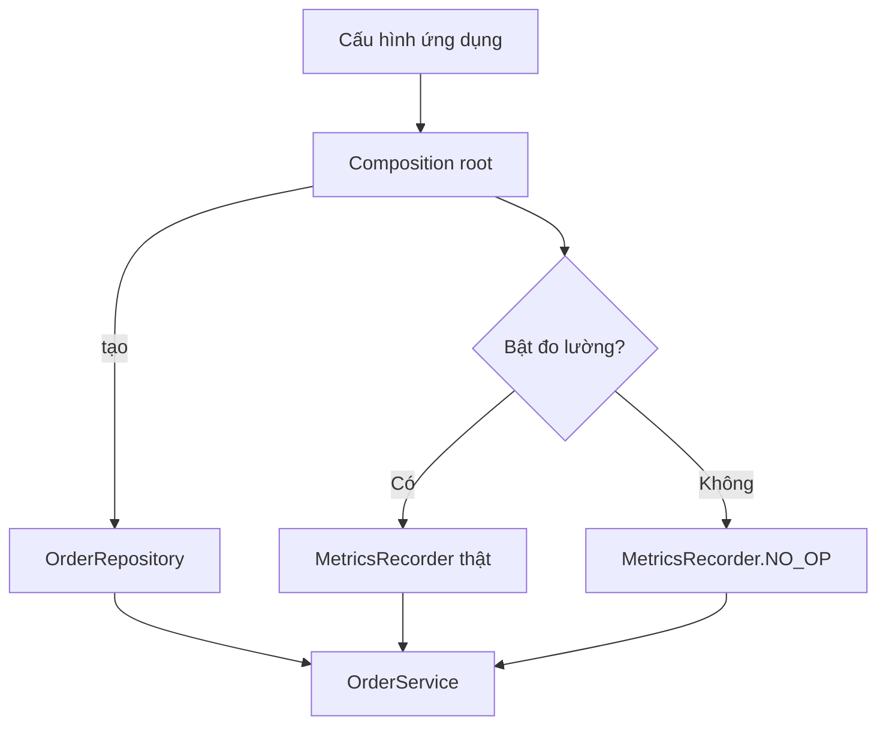

# Phụ thuộc tùy chọn và lựa chọn giá trị mặc định có chủ đích

Trong **Dependency Injection (DI)**, constructor thường biểu đạt những gì một đối tượng **cần để hoạt động đúng**. Tuy nhiên, không phải cộng tác viên nào cũng luôn bắt buộc: một dịch vụ có thể ghi thêm metric khi hệ thống giám sát được bật, có thể bổ sung thông tin bằng một dịch vụ tùy chọn, hoặc sử dụng một chính sách mặc định khi người gọi không cung cấp cấu hình riêng.

Điểm khó không nằm ở cách viết một tham số có thể nhận `null`. Điểm khó là **xác định khi nào việc thiếu một phụ thuộc thật sự hợp lệ và nếu thiếu thì đối tượng phải cư xử như thế nào**. Một giá trị mặc định không được lựa chọn cẩn thận có thể làm chương trình tiếp tục chạy nhưng âm thầm bỏ qua một trách nhiệm quan trọng.

Bài này thuộc phần **Thiết kế constructor** của module **Dependency Injection**. Ta sẽ thực hành bằng Java thuần: phân biệt phụ thuộc bắt buộc và tùy chọn, thiết kế overload và đối tượng mặc định, giữ rõ ranh giới của *composition root*, kiểm thử các trường hợp có và không có phụ thuộc, rồi xem xét scope và vòng đời trước khi sử dụng DI container.

## 1. Thế nào là một phụ thuộc *thật sự* tùy chọn?

Một dependency là **bắt buộc** nếu thiếu nó thì đối tượng không thể thực hiện đúng hợp đồng đã công bố. Một dependency chỉ nên gọi là **tùy chọn** khi sự vắng mặt của nó đã có **ngữ nghĩa hợp lệ, xác định trước**.

Ví dụ, một `OrderService` có thể cần:

- `OrderRepository` để lưu đơn hàng: **bắt buộc**. Nếu không lưu được đơn thì thao tác đặt hàng thất bại; thay repository bằng đối tượng bỏ qua thao tác `save` sẽ tạo ra kết quả sai.
- `MetricsRecorder` để đếm số đơn được đặt: **có thể tùy chọn** nếu hợp đồng sản phẩm chấp nhận chạy khi không thu thập metric. Khi không bật đo lường, hành vi mặc định có thể là *không ghi metric*.
- `AuditTrail` để ghi nhật ký kiểm toán theo yêu cầu pháp lý: **bắt buộc** nếu hệ thống yêu cầu mọi đơn đều phải được ghi dấu vết. Dùng `NoOpAuditTrail` khi không cấu hình audit là che giấu lỗi cấu hình, không phải tính linh hoạt của DI.

Tính tùy chọn là **quyết định về hợp đồng và nghiệp vụ**, không phải thuộc tính của kiểu Java. Cùng một `Notifier` có thể là tùy chọn trong công cụ nội bộ nhưng bắt buộc trong hệ thống yêu cầu gửi thông báo xác nhận theo giao dịch.

| Tình huống | Có thể thiếu dependency? | Hành vi cần làm rõ |
| --- | --- | --- |
| Không cấu hình công cụ đo hiệu năng trong môi trường học tập | Có, nếu đo lường không thuộc hợp đồng bắt buộc | Bỏ qua việc ghi metric một cách chủ đích |
| Không có repository để lưu đơn | Không | Từ chối tạo `OrderService` ngay lúc lắp ghép |
| Không cấu hình cổng thanh toán cho chức năng thanh toán thật | Không | Báo lỗi cấu hình thay vì giả vờ thanh toán thành công |
| Không có bộ làm giàu dữ liệu phụ trợ | Có thể | Trả dữ liệu gốc; hợp đồng phải cho biết thông tin làm giàu có thể vắng mặt |
| Không có hệ thống ghi nhật ký kiểm toán bắt buộc | Không | Không khởi chạy chức năng cần audit khi chưa cấu hình |

**Câu hỏi quyết định:** “Nếu dependency vắng mặt, hành vi nào vẫn đúng theo hợp đồng?” Nếu không thể trả lời cụ thể, chưa nên đánh dấu phụ thuộc là tùy chọn.

## 2. Vì sao `null` không phải một thiết kế mặc định tốt?

Một cách dễ viết nhưng khó hiểu khi sử dụng là cho phép tham số constructor bằng `null`:

```java
// Minh họa cách thiết kế dễ gây mơ hồ.
final class OrderService {
    private final OrderRepository repository;
    private final MetricsRecorder metrics;

    OrderService(OrderRepository repository, MetricsRecorder metrics) {
        this.repository = repository;
        this.metrics = metrics; // null có được chấp nhận hay là lỗi?
    }

    void place(Order order) {
        repository.save(order);
        if (metrics != null) {
            metrics.increment("orders.placed");
        }
    }
}
```

Thiết kế trên đặt một quy tắc cấu hình quan trọng vào câu lệnh `if (metrics != null)` sâu trong nghiệp vụ. Người gọi phải đoán `null` là “tắt metric”, “chưa cấu hình”, hay một lỗi lập trình. Nếu có nhiều phương thức, kiểm tra `null` có thể lặp lại hoặc bị bỏ sót.

Một biến thể cũng đáng cân nhắc:

```java
// Đỡ lặp kiểm tra null, nhưng API vẫn dùng null để mã hóa ý nghĩa.
this.metrics = metrics == null ? MetricsRecorder.NO_OP : metrics;
```

Đoạn trên có thể hoạt động đúng về mặt kỹ thuật, nhưng nếu ai đó vô tình truyền `null` do wiring sai, lỗi ấy bị chuyển thành “tắt đo lường”. Tốt hơn là **có một đường chọn mặc định rõ ràng** và **từ chối `null` ở constructor nhận đầy đủ tham số**.

## 3. Hai constructor: có mặc định và có cấu hình tường minh

Nếu **vắng mặt metric là một chế độ hợp lệ**, có thể dùng constructor overload để nói rõ hai cách tạo đối tượng:

```java
final class OrderService {
    private final OrderRepository repository;
    private final MetricsRecorder metrics;

    // Chế độ mặc định được công bố: không ghi metric.
    OrderService(OrderRepository repository) {
        this(repository, MetricsRecorder.NO_OP);
    }

    // Chế độ cấu hình cụ thể: yêu cầu metrics khác null.
    OrderService(OrderRepository repository, MetricsRecorder metrics) {
        this.repository = java.util.Objects.requireNonNull(
                repository, "repository");
        this.metrics = java.util.Objects.requireNonNull(
                metrics, "metrics");
    }

    void place(Order order) {
        repository.save(order);
        metrics.increment("orders.placed");
    }
}
```

Ở ví dụ này, `MetricsRecorder.NO_OP` là implementation của hợp đồng `MetricsRecorder` có tác dụng không làm gì; ta sẽ định nghĩa đầy đủ ở phần thực hành. Hai constructor diễn đạt hai lựa chọn:

```java
// Có chủ đích chọn chế độ không thu thập metric.
OrderService withoutMetrics = new OrderService(repository);

// Có chủ đích cung cấp cộng tác viên thu thập metric.
OrderService withMetrics = new OrderService(repository, metricsRecorder);
```

Phần xử lý nghiệp vụ `place` chỉ tương tác với **hợp đồng `MetricsRecorder`**, không cần rẽ nhánh theo `null`. Nếu truyền `null` vào constructor hai tham số, chương trình báo lỗi ngay lúc tạo object. Nếu `repository` vắng mặt, **cả hai constructor** đều từ chối khởi tạo.

### Vì sao ưu tiên một constructor làm điểm chuẩn?

Constructor một tham số gọi `this(repository, MetricsRecorder.NO_OP)`; constructor hai tham số là nơi **duy nhất** kiểm tra tham số và gán các trường `final`. Đây là dạng **constructor chaining**, giúp tránh nhân đôi logic khởi tạo và bảo đảm các đường tạo đối tượng tuân cùng bất biến.

Nếu một lớp có ba hoặc bốn dependency tùy chọn, việc tạo overload cho mọi tổ hợp sẽ phình to nhanh chóng. Khi đó nên cân nhắc đối tượng cấu hình, builder hoặc để composition root cung cấp đầy đủ các dependency, thay vì tạo hàng loạt constructor với thứ tự tham số khó nhớ.

## 4. Mẫu Null Object: một mặc định có hành vi rõ ràng

**Null Object** là một implementation thỏa cùng interface với cộng tác viên thật, nhưng đại diện cho hành vi “không thực hiện tác vụ phụ”. Ví dụ:

```java
@FunctionalInterface
interface MetricsRecorder {
    void increment(String metricName);

    MetricsRecorder NO_OP = metricName -> { };
}
```

`NO_OP` có thể được dùng ở mọi nơi chấp nhận `MetricsRecorder`; caller và service không cần nhánh `if` để phân biệt chế độ. Implementation này **không giữ trạng thái**, nên việc dùng chung instance là phù hợp với riêng ví dụ này.

Tuy nhiên, **Null Object chỉ an toàn khi “không làm gì” là một kết quả hợp lệ**. Không nên tạo `NoOpPaymentGateway` giả vờ trả về thanh toán thành công hoặc `NoOpAuditTrail` âm thầm bỏ qua dấu vết bắt buộc. Với dependency quan trọng, cách thiết kế đúng là **fail fast**: yêu cầu cung cấp đối tượng hợp lệ trước khi thực hiện nghiệp vụ.

So sánh một số lựa chọn mặc định:

| Cách mặc định | Khi nào thích hợp | Rủi ro nếu dùng sai |
| --- | --- | --- |
| `MetricsRecorder.NO_OP` | Ghi metric được phép tắt hoàn toàn | Tưởng rằng ứng dụng luôn thu thập số liệu |
| Implementation bảo thủ, ví dụ `RetryPolicy.noRetry()` | Không retry là chính sách hợp lệ đã thống nhất | Bỏ lỡ yêu cầu retry bắt buộc; chính sách không phù hợp với loại lỗi |
| Chọn timeout cụ thể ở nơi cấu hình | Tồn tại giá trị hợp lý và được công bố | Giá trị mặc định lỗi thời hoặc khác biệt giữa môi trường |
| Không có mặc định, bắt buộc tiêm | Thiếu dependency khiến hợp đồng sai | Cần wiring đầy đủ trước khi chạy, nhưng lỗi được phát hiện sớm |

Các lựa chọn trong bảng không có cách nào mặc nhiên đúng cho mọi hệ thống. Cần dựa vào hợp đồng và các yêu cầu vận hành.

## 5. Ví dụ Java 17 hoàn chỉnh: hai cách lắp ghép và kiểm thử

Ví dụ sau có thể chạy độc lập bằng JDK 17 trở lên. `OrderRepository` luôn bắt buộc; `MetricsRecorder` có một chế độ mặc định được định nghĩa rõ; các test double dùng Java thuần kiểm tra cả hai chế độ và lỗi khởi tạo.

```java
import java.util.ArrayList;
import java.util.List;
import java.util.Objects;

record Order(String id, int quantity) {
    Order {
        Objects.requireNonNull(id, "id");
        if (id.isBlank() || quantity <= 0) {
            throw new IllegalArgumentException("Invalid order");
        }
    }
}

@FunctionalInterface
interface OrderRepository {
    void save(Order order);
}

@FunctionalInterface
interface MetricsRecorder {
    void increment(String metricName);

    // Được phép không ghi metric nếu hệ thống chọn chế độ này.
    MetricsRecorder NO_OP = metricName -> { };
}

final class OrderService {
    private final OrderRepository repository;
    private final MetricsRecorder metrics;

    OrderService(OrderRepository repository) {
        this(repository, MetricsRecorder.NO_OP);
    }

    OrderService(OrderRepository repository, MetricsRecorder metrics) {
        this.repository = Objects.requireNonNull(repository, "repository");
        this.metrics = Objects.requireNonNull(metrics, "metrics");
    }

    void place(Order order) {
        Objects.requireNonNull(order, "order");
        repository.save(order);
        metrics.increment("orders.placed");
    }
}

public class Main {
    public static void main(String[] args) {
        List<Order> saved = new ArrayList<>();
        List<String> metrics = new ArrayList<>();

        // Test double: lưu vào danh sách thay vì database thật.
        OrderRepository repository = saved::add;

        // Chế độ có thu thập metric: truyền cộng tác viên từ ngoài.
        OrderService observed = new OrderService(repository, metrics::add);
        observed.place(new Order("O-101", 2));

        // Chế độ mặc định được chọn qua overload: không thu thập metric.
        OrderService quiet = new OrderService(repository);
        quiet.place(new Order("O-102", 1));

        check(saved.equals(List.of(
                new Order("O-101", 2), new Order("O-102", 1))),
                "Hai đơn phải được lưu");
        check(metrics.equals(List.of("orders.placed")),
                "Chỉ lời gọi có recorder thật mới ghi metric");

        // Truyền null tường minh vào overload hai tham số là lỗi cấu hình.
        boolean rejectedNull = false;
        try {
            new OrderService(repository, null);
        } catch (NullPointerException expected) {
            rejectedNull = true;
        }
        check(rejectedNull, "Constructor phải từ chối metrics null");

        // Lỗi lưu đơn xảy ra trước khi ghi metric.
        List<String> metricsAfterFailure = new ArrayList<>();
        OrderRepository failingRepository = order -> {
            throw new IllegalStateException("Storage unavailable");
        };

        boolean storageFailed = false;
        try {
            new OrderService(failingRepository, metricsAfterFailure::add)
                    .place(new Order("O-103", 3));
        } catch (IllegalStateException expected) {
            storageFailed = true;
        }
        check(storageFailed, "Lỗi lưu đơn phải được truyền ra");
        check(metricsAfterFailure.isEmpty(),
                "Không ghi metric khi lưu đơn thất bại");

        System.out.println("PASS");
    }

    private static void check(boolean condition, String message) {
        if (!condition) {
            throw new AssertionError(message);
        }
    }
}
```

Lưu mã vào `Main.java` và chạy:

```bash
javac -encoding UTF-8 Main.java
java Main
```

Kết quả mong đợi:

```text
PASS
```

Ví dụ kiểm tra bốn hành vi riêng biệt: repository bắt buộc vẫn lưu đơn trong cả hai chế độ; recorder được tiêm ghi nhận metric; lựa chọn mặc định không ghi metric; truyền `null` tường minh không được hiểu là “hãy tự chọn một chế độ”. Đồng thời, khi repository báo lỗi, service không tiến đến bước ghi metric.

**Giới hạn cần hiểu:** nếu việc lưu thành công nhưng `metrics.increment(...)` ném ngoại lệ, phương thức `place` cũng ném ngoại lệ dù đơn đã được lưu. Việc đo lường có được phép làm thất bại thao tác hay không là một **chính sách lỗi khác**, cần quyết định riêng. Không nên âm thầm nuốt mọi ngoại lệ trong `OrderService` chỉ vì `MetricsRecorder` được gọi là tùy chọn. Nếu yêu cầu thu thập số liệu theo kiểu *best effort*, có thể thiết kế một adapter có chính sách xử lý lỗi rõ ràng tại ranh giới đo lường và kiểm thử chính sách đó.

## 6. Mặc định ở constructor hay ở composition root?

Hai vị trí đều có thể hợp lý nhưng mang mức độ cam kết khác nhau.

### Cách A: constructor công bố mặc định ổn định

```java
// Caller không cần biết chi tiết recorder khi chấp nhận chế độ mặc định.
OrderService service = new OrderService(repository);
```

Phù hợp khi **không ghi metric là một chế độ mặc định ổn định, được tài liệu hóa**, và mọi caller dùng constructor một tham số đều có thể chấp nhận. Constructor overload là một phần API công khai: nếu sau này đổi mặc định từ `NO_OP` sang recorder thật, những nơi đang gọi overload một tham số có thể thay đổi hành vi dù không sửa mã của họ.

### Cách B: composition root quyết định mọi chế độ

```java
// Minh họa wiring: productionRecorder đã được tạo ở lớp khởi động.
MetricsRecorder recorder = metricsEnabled
        ? productionRecorder
        : MetricsRecorder.NO_OP;

OrderService service = new OrderService(repository, recorder);
```

Ở phương án này, `OrderService` chỉ cần constructor hai tham số và luôn đòi `MetricsRecorder` không null. Cấu hình **bật/tắt metric** nằm tại *composition root* (thường là `main`, bootstrap hoặc cấu hình ứng dụng), nơi biết môi trường triển khai. Nó đặc biệt phù hợp nếu từng môi trường phải quyết định chế độ một cách tường minh.



**Quy tắc thực dụng:** nếu lựa chọn mặc định là một cam kết thuộc API của đối tượng, constructor overload có thể tốt. Nếu lựa chọn phụ thuộc vào môi trường, tenant, chính sách vận hành hoặc cấu hình triển khai, nên đưa quyết định ấy về composition root và tiêm dependency đã được chọn.

Không nên đặt logic đọc biến môi trường, tạo kết nối mạng hoặc chọn triển khai theo profile ngay trong constructor nghiệp vụ:

```java
// Không nên để service tự quyết định phụ thuộc từ môi trường chạy.
this.metrics = System.getenv("ENABLE_METRICS") != null
        ? new NetworkMetricsRecorder(/* ... */)
        : MetricsRecorder.NO_OP;
```

`NetworkMetricsRecorder` ở đây chỉ là tên minh họa. Cách viết này khiến `OrderService` phụ thuộc vào môi trường, implementation cụ thể và vòng đời tài nguyên; cũng làm unit test khó kiểm soát. Nếu một mặc định cần mở kết nối, cấp phát executor hoặc đóng tài nguyên, **composition root** thường là nơi thích hợp hơn để tạo và sở hữu nó.

## 7. Phân biệt mặc định của *dependency* và mặc định của *giá trị cấu hình*

Không phải mọi tham số có giá trị mặc định đều là một dependency có thể tiêm. Ví dụ `Duration timeout`, số lần thử lại, ngôn ngữ hiển thị hoặc kích cỡ batch thường là **giá trị cấu hình**. Chúng vẫn cần thiết kế rõ, nhưng không nhất thiết phải tạo interface chỉ để biểu diễn giá trị.

```java
import java.time.Duration;
import java.util.Objects;

record ClientOptions(Duration timeout, int maxRetries) {
    ClientOptions {
        Objects.requireNonNull(timeout, "timeout");
        if (timeout.isZero() || timeout.isNegative() || maxRetries < 0) {
            throw new IllegalArgumentException("Invalid client options");
        }
    }

    static ClientOptions defaults() {
        return new ClientOptions(Duration.ofSeconds(3), 0);
    }
}
```

Đây là đoạn minh họa một kiểu cấu hình độc lập, không phải phần cần ghép vào `Main.java` ở mục 5. `ClientOptions.defaults()` cho biết **chính xác** timeout là ba giây và số lần retry mặc định bằng không. Các giá trị chỉ là ví dụ; ứng dụng thật phải chọn theo đặc tính dịch vụ và thỏa thuận vận hành, chứ không nên sao chép tùy tiện.

Nếu một client nhận `ClientOptions` trong constructor, có thể dùng overload `new Client(options)` hoặc `new Client(ClientOptions.defaults())`; điều quan trọng là giá trị mặc định được đặt tên, kiểm tra tính hợp lệ và dễ thay thế bằng cấu hình chủ động.

### Khi nào dùng đối tượng cấu hình hoặc builder?

Nếu có nhiều tham số cùng biểu đạt *một nhóm cấu hình*, một record như `ClientOptions` giúp loại bỏ constructor kiểu `Client(Duration, int, boolean, int, ...)` khó đọc. Builder có thể hữu ích khi số lựa chọn lớn, nhiều trường thực sự tùy chọn và cần cú pháp đặt tên cho từng cấu hình. Tuy nhiên, builder không làm cho dependency bắt buộc trở thành tùy chọn: lúc `build()` vẫn phải kiểm tra đầy đủ các điều kiện bắt buộc.

Nên tránh tạo một “options bag” chứa đủ loại repository, connection pool, event publisher, timeout và boolean không liên quan. Những dependency có trách nhiệm riêng cần được biểu diễn minh bạch; nhóm cấu hình chỉ có ích khi các giá trị thực sự thuộc cùng một khái niệm.

## 8. `Optional<T>`, `null` và các overload: lựa chọn nào dễ đọc?

Trong Java, `Optional<T>` diễn đạt một giá trị *có thể có hoặc không* ở một số API. Nó không tự động là lựa chọn tốt nhất cho mọi tham số hoặc trường dependency.

| Cách biểu diễn | Ưu điểm | Điều cần xem xét |
| --- | --- | --- |
| Constructor overload `OrderService(repo)` và `OrderService(repo, recorder)` | API tường minh về chế độ mặc định, dễ đọc tại nơi gọi | Số overload có thể tăng nhanh nếu có nhiều lựa chọn |
| Constructor đầy đủ `OrderService(repo, recorder)` và tiêm `NO_OP` tại composition root | Không có trạng thái thiếu dependency, wiring rõ | Nơi lắp ghép phải chọn mọi chế độ |
| Tham số `Optional<MetricsRecorder>` | Diễn đạt khả năng không có bằng kiểu | Caller phải tạo `Optional`; làm API dài; vẫn cần định nghĩa hành vi vắng mặt |
| Cho phép `null` | Ít mã ở nơi gọi | Dễ nhầm giá trị thiếu với lỗi wiring; hợp đồng kém rõ ràng |
| Setter để bổ sung sau khi tạo | Có thể thay đổi cấu hình lúc chạy | Đối tượng có thể chưa được cấu hình; khó kiểm soát dùng chung và đồng thời |

Không cần cấm tuyệt đối `Optional` trong constructor, nhưng khi một mặc định hợp lệ đã được biểu diễn bằng Null Object hoặc overload, `Optional<MetricsRecorder>` thường không giúp mã dễ hiểu hơn. Đặc biệt, **`Optional.empty()` không nói hành vi mặc định là gì**; nó chỉ biểu diễn rằng giá trị vắng mặt.

Ngược lại, khi sự **vắng mặt chính là dữ liệu của miền nghiệp vụ** (ví dụ một kết quả tìm kiếm có thể không tồn tại), `Optional` thường có ý nghĩa riêng. Đừng nhầm việc mô hình hóa dữ liệu có thể thiếu với cách quản lý một cộng tác viên tùy chọn trong constructor.

## 9. Scope, vòng đời và lỗi mặc định âm thầm

DI tách việc **sử dụng** dependency khỏi việc **tạo và lắp ghép** nó, nhưng riêng constructor overload hoặc Null Object không quyết định được scope và vòng đời của mọi implementation.

1. **No-Op không trạng thái:** `MetricsRecorder.NO_OP` trong ví dụ không giữ dữ liệu nên có thể chia sẻ an toàn; đây không phải kết luận áp dụng cho mọi implementation của interface.
2. **Implementation có tài nguyên:** recorder sử dụng socket, HTTP client, thread pool hoặc file có thể cần quy tắc đóng rõ ràng. Nếu composition root tạo nó, composition root thường cũng chịu trách nhiệm điều phối việc đóng sau khi các service ngừng sử dụng.
3. **Phụ thuộc có trạng thái theo request:** không nên giấu nó trong một trường singleton chỉ vì có overload mặc định. Có thể cần truyền theo lời gọi hoặc tạo theo scope phù hợp.
4. **Default có thể làm thay đổi hành vi quan sát được:** thay `NO_OP` bằng recorder thật có thể phát sinh I/O, tăng độ trễ hoặc xuất hiện lỗi mới. Hãy xem việc đổi mặc định như một thay đổi hợp đồng đáng kiểm thử.

Quan trọng hơn, **“tùy chọn” không đồng nghĩa “được phép thất bại âm thầm”**. Một dependency có thể tùy chọn *khi khởi tạo*, nhưng sau khi người gọi chủ động bật nó, việc lỗi ghi metric có phải làm thất bại request hay không vẫn cần chính sách riêng. Tương tự, thiếu một dependency bắt buộc phải được phát hiện sớm thay vì thay bằng implementation giả chỉ để ứng dụng khởi chạy.

## 10. Những lỗi thiết kế cần tránh

### 10.1. Dùng No-Op để che lỗi cấu hình

```java
// SAI nếu lưu đơn là trách nhiệm bắt buộc của dịch vụ.
OrderRepository noOpRepository = order -> { };
OrderService service = new OrderService(noOpRepository);
```

Lệnh `place` có vẻ thành công nhưng đơn không hề được lưu. Đây không phải mặc định an toàn cho repository. Đừng biến lỗi thiếu dependency quan trọng thành thành công giả.

### 10.2. Mặc định phụ thuộc vào môi trường nhưng giấu trong constructor

Một service tự đọc `System.getenv(...)`, tự tạo adapter và thay đổi chế độ theo biến môi trường khiến kết quả kiểm thử, vòng đời tài nguyên và wiring khó quan sát. Đưa việc chọn adapter về composition root.

### 10.3. Chấp nhận `null` để tiết kiệm một overload

Nếu cần hai cách tạo hợp lệ, dùng hai cách gọi có ý nghĩa rõ ràng. Constructor hai tham số nên từ chối `null` để phát hiện lỗi gán giá trị từ bên ngoài.

### 10.4. Tạo quá nhiều constructor chỉ để mô tả mọi tổ hợp

Ví dụ một service có ba lựa chọn độc lập `metrics`, `tracing`, `cache` sẽ có nhiều tổ hợp bật/tắt. Không nên vội tạo constructor cho từng tổ hợp. Có thể giữ một constructor đầy đủ và để composition root truyền implementation phù hợp; hoặc nhóm các **giá trị cấu hình** liên quan thành một kiểu chuyên biệt.

### 10.5. Đổi mặc định mà không cập nhật kiểm thử và tài liệu

Việc thay đổi mặc định có thể ảnh hưởng trực tiếp hành vi của hàng chục chỗ khởi tạo service. Hãy đặt tên rõ giá trị mặc định, kiểm thử một đường mặc định và một đường tùy chỉnh; khi hợp đồng thay đổi, cập nhật nơi sử dụng và tài liệu.

## 11. Bài tập thực hành

**Bài 1 — Phân loại dependency.** `CheckoutService` có `PaymentGateway`, `AuditTrail` theo yêu cầu bắt buộc, và `PerformanceMetrics` có thể tắt. Hãy chọn cái nào được phép có mặc định No-Op. Giải thích bằng hợp đồng của hệ thống, không dựa vào việc có interface hay không.

**Bài 2 — Refactor constructor.** Một `ExportService` nhận `DocumentRepository` và `MetricsRecorder`, nhưng hiện chấp nhận `null` cho cả hai. Hãy yêu cầu repository bắt buộc, thêm overload lựa chọn `MetricsRecorder.NO_OP`, và kiểm tra tham số bằng `Objects.requireNonNull` ở constructor đầy đủ.

**Bài 3 — Lựa chọn nơi đặt mặc định.** Một deployment bật metric, deployment khác tắt metric; cả hai dùng chung mã `OrderService`. Hãy so sánh việc cho `OrderService` đọc cấu hình môi trường với việc để composition root chọn recorder rồi tiêm vào service. Giải thích tác động lên unit test và vòng đời tài nguyên.

**Bài 4 — Kiểm thử lỗi metric.** Với ví dụ ở mục 5, tạo một `MetricsRecorder` luôn ném `IllegalStateException`. Quan sát rằng repository đã lưu đơn trước khi lỗi được ném. Đề xuất chính sách xử lý đúng với yêu cầu nghiệp vụ của một ứng dụng giả định và quyết định lớp nào nên thực thi chính sách đó.

## 12. Tự kiểm tra hiểu bài

**Câu 1.** Vì sao `repository` không nên tùy chọn trong `OrderService`? Vì hành vi đặt đơn cam kết lưu dữ liệu; thiếu repository thì hợp đồng không thực hiện được.

**Câu 2.** `MetricsRecorder.NO_OP` có phải là DI không? Bản thân nó là một implementation. Việc cung cấp instance này từ bên ngoài, hoặc chọn nó qua constructor overload rồi ủy quyền cho constructor đầy đủ, là một cách tổ chức dependency; DI cốt lõi nằm ở việc service sử dụng cộng tác viên được cung cấp thay vì tự tạo adapter hạ tầng.

**Câu 3.** Một default được dùng trong mọi môi trường có thể thay đổi mà không ảnh hưởng caller không? Không chắc. Đổi mặc định có thể thay đổi I/O, lỗi phát sinh, hiệu năng hoặc kết quả nên cần xem như thay đổi hành vi quan sát được.

**Câu 4.** Có nên dùng `Optional<AuditTrail>` để giải quyết việc thiếu audit bắt buộc? Không. `Optional` chỉ thể hiện giá trị có thể vắng mặt; nó không biến việc thiếu một cộng tác viên bắt buộc thành hợp lệ.

**Câu 5.** Nếu metric là tùy chọn, `metrics.increment` có được phép ném lỗi không? Đây là quyết định riêng về chính sách lỗi. Constructor lựa chọn chế độ có/không đo lường không tự quy định ứng dụng phải làm gì khi recorder đang bật nhưng bị lỗi.

## Ghi nhớ

- **Phụ thuộc tùy chọn** chỉ thật sự tùy chọn khi hệ thống định nghĩa được một hành vi hợp lệ, cụ thể lúc không cung cấp nó.
- **Dependency bắt buộc** phải được kiểm tra khi khởi tạo; không dùng `null` hoặc No-Op để che đi việc thiếu chức năng thiết yếu.
- **Constructor overload** có thể công bố một mặc định ổn định; **Null Object** giúp biểu diễn chế độ “không làm gì” khi chế độ ấy có nghĩa nghiệp vụ rõ ràng.
- Nếu chế độ phụ thuộc vào môi trường hoặc cấu hình triển khai, để **composition root** chọn implementation rồi tiêm vào service sẽ giữ ranh giới lắp ghép minh bạch hơn.
- Mặc định phải xét đến **hợp đồng, hành vi lỗi, scope, vòng đời và tác động khi thay đổi**. Constructor tốt giúp người đọc nhận ra đâu là điều bắt buộc và đâu là lựa chọn có chủ đích, trước cả khi sử dụng DI container.
