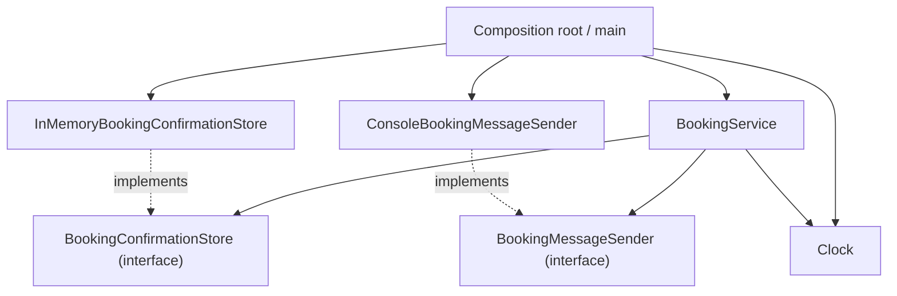

# Thiết kế interface từ nhu cầu của đối tượng sử dụng

Trong một ứng dụng Java, ta thường tách phần xử lý nghiệp vụ khỏi các chi tiết như cơ sở dữ liệu, dịch vụ HTTP hoặc hệ thống gửi thông báo. Một cách phổ biến là định nghĩa `interface` rồi dùng **Dependency Injection (DI)** để truyền đối tượng triển khai interface vào lớp nghiệp vụ. Tuy nhiên, chỉ dùng `interface` chưa bảo đảm thiết kế đã tốt. Nếu hợp đồng được thiết kế theo những gì công nghệ cung cấp, lớp nghiệp vụ vẫn phải biết nhiều chi tiết không cần thiết.

Bài này thuộc chương **Hợp đồng phụ thuộc** của chủ đề **Dependency Injection**. Ta học cách thiết kế interface **từ nhu cầu của bên sử dụng phụ thuộc** (consumer), thay vì sao chép toàn bộ khả năng của bên cung cấp (provider). Cách tiếp cận này hỗ trợ **Inversion of Control (IoC)**, constructor injection, composition root, kiểm thử Java thuần và việc quản lý vòng đời khi ứng dụng lớn dần hoặc chuyển sang DI container.

## 1. Interface là hợp đồng giữa ai với ai?

Giả sử có `BookingService` xử lý nghiệp vụ xác nhận đặt chỗ. Sau khi kiểm tra dữ liệu, service cần:

1. Ghi nhận rằng một mã đặt chỗ đã được xác nhận vào một thời điểm.
2. Yêu cầu gửi thông báo cho khách hàng.

Đó là **nhu cầu của service**, dù ứng dụng có dùng PostgreSQL, Redis, tệp, HTTP API hay một hệ thống hàng đợi.

Một hướng thiết kế dễ mắc là bắt đầu bằng danh sách thao tác của cơ sở dữ liệu:

```java
interface DatabaseGateway {
    void connect(String jdbcUrl);
    int executeUpdate(String sql);
    Object executeQuery(String sql);
    void commit();
    void rollback();
    void close();
}
```

Nếu `BookingService` nhận `DatabaseGateway`, nó có thể phải tự tạo câu SQL, biết cách mở/đóng kết nối và hiểu transaction. Lớp nghiệp vụ bị buộc vào ngôn ngữ và vòng đời của hạ tầng. Việc đổi sang một API lưu trữ khác sẽ đòi sửa cả service, dù nghiệp vụ *xác nhận đặt chỗ* vẫn như cũ.

Một hợp đồng thiết kế theo nhu cầu của `BookingService` có thể là:

```java
interface BookingConfirmationStore {
    void saveConfirmed(String bookingId, java.time.Instant confirmedAt);
}

interface BookingMessageSender {
    void sendConfirmation(String bookingId);
}
```

Tên và tham số thể hiện *ý định nghiệp vụ*. Service không cần biết nhà cung cấp lưu bằng SQL hay gửi tin nhắn qua API nào.

> Nguyên tắc: Bên sử dụng phụ thuộc nên quyết định **khả năng tối thiểu mà nó cần**. Bên triển khai quyết định **cách thực hiện khả năng đó**.

Điều này không có nghĩa mỗi service bắt buộc phải có một interface mới. Nhiều consumer có thể dùng chung một hợp đồng ổn định nếu họ thật sự có cùng nhu cầu và cùng ngữ nghĩa. Ngược lại, một interface rất lớn thường là dấu hiệu nhiều nhu cầu khác nhau bị gộp vào một chỗ.

## 2. Bắt đầu từ hành vi, không bắt đầu từ lớp triển khai

Một quy trình thiết kế hiệu quả là viết ngắn gọn hành vi của consumer trước khi đặt tên interface.

| Câu hỏi | Ví dụ với `BookingService` | Quyết định thiết kế |
| --- | --- | --- |
| Consumer phải hoàn thành việc gì? | Xác nhận một mã đặt chỗ | Đây là trách nhiệm nghiệp vụ của service |
| Nó cần ai giúp? | Một thành phần ghi nhận xác nhận | `BookingConfirmationStore` |
| Nó cần thao tác nào? | Lưu mã và thời điểm xác nhận | `saveConfirmed(id, time)` |
| Nó cần thêm khả năng nào? | Yêu cầu gửi thông báo | `BookingMessageSender.sendConfirmation(id)` |
| Nó có cần biết SQL, kết nối hoặc HTTP không? | Không | Giữ chi tiết đó trong adapter |
| Ai tạo và chọn adapter? | Điểm khởi động ứng dụng | Composition root |

Đi từ câu hỏi này giúp tránh hai cực đoan: **phụ thuộc trực tiếp vào API hạ tầng** và **trừu tượng hóa quá mức** với hàng chục interface không diễn tả thêm điều gì.

### 2.1. Đặt tên theo khả năng được yêu cầu

`saveConfirmed(...)` thường rõ hơn `execute(...)` hay `process(...)` vì nêu việc đang làm. `BookingConfirmationStore` có thể rõ hơn `CommonDAO` vì giới hạn vai trò. Tham số nên mang dữ liệu nghiệp vụ như mã đặt chỗ và thời điểm, không phải `Connection`, `PreparedStatement`, `HttpRequest` hay các đối tượng cấu hình của một thư viện cụ thể.

Tên gọi không thay thế được ngữ nghĩa: `saveConfirmed` phải có quy định hành vi tương ứng. Phần tiếp theo sẽ làm rõ những cam kết cần có bên cạnh chữ ký phương thức.

### 2.2. Phân biệt hợp đồng và adapter

- **Consumer:** `BookingService`, biết cần lưu xác nhận và gửi thông báo.
- **Hợp đồng (port/interface):** `BookingConfirmationStore` và `BookingMessageSender`, mô tả khả năng consumer cần.
- **Adapter/provider:** `JdbcBookingConfirmationStore`, `InMemoryBookingConfirmationStore`, `EmailBookingMessageSender`..., biến hợp đồng thành thao tác công nghệ cụ thể.
- **Composition root:** nơi chọn adapter, tạo đối tượng và truyền chúng vào `BookingService`.



Trong **mã nguồn**, service phụ thuộc vào các hợp đồng; adapter phụ thuộc vào hợp đồng khi triển khai chúng. Trong **đồ thị đối tượng lúc chạy**, composition root kết nối service với instance adapter cụ thể. Hai góc nhìn này không mâu thuẫn nhau.

## 3. Ví dụ Java hoàn chỉnh: interface xuất phát từ nhu cầu của service

Ví dụ sau chạy bằng **Java 11 trở lên**, không dùng framework hay DI container. Để tập trung vào hợp đồng, phần lưu trữ được mô phỏng bằng `Map` và thông báo được in ra console.

Lưu toàn bộ mã vào tệp `ConsumerContractExample.java`:

```java
import java.time.Clock;
import java.time.Instant;
import java.util.HashMap;
import java.util.Map;
import java.util.Objects;

public final class ConsumerContractExample {
    // Hợp đồng do nhu cầu ghi nhận xác nhận của consumer xác định.
    public interface BookingConfirmationStore {
        void saveConfirmed(String bookingId, Instant confirmedAt);
    }

    // Hợp đồng do nhu cầu gửi thông báo của consumer xác định.
    public interface BookingMessageSender {
        void sendConfirmation(String bookingId);
    }

    public static final class BookingService {
        private final BookingConfirmationStore confirmationStore;
        private final BookingMessageSender messageSender;
        private final Clock clock;

        public BookingService(
                BookingConfirmationStore confirmationStore,
                BookingMessageSender messageSender,
                Clock clock) {
            this.confirmationStore = Objects.requireNonNull(
                confirmationStore, "confirmationStore");
            this.messageSender = Objects.requireNonNull(
                messageSender, "messageSender");
            this.clock = Objects.requireNonNull(clock, "clock");
        }

        public void confirm(String bookingId) {
            if (bookingId == null || bookingId.trim().isEmpty()) {
                throw new IllegalArgumentException("bookingId must not be blank");
            }

            Instant confirmedAt = clock.instant();
            confirmationStore.saveConfirmed(bookingId, confirmedAt);
            messageSender.sendConfirmation(bookingId);
        }
    }

    public static final class InMemoryBookingConfirmationStore
            implements BookingConfirmationStore {
        private final Map<String, Instant> confirmed = new HashMap<>();

        @Override
        public void saveConfirmed(String bookingId, Instant confirmedAt) {
            confirmed.put(bookingId, confirmedAt);
        }

        // Khả năng tra cứu này phục vụ nơi kiểm tra hoặc debug.
        // Consumer BookingService không cần nên nó không nằm trong interface.
        public Instant findConfirmedAt(String bookingId) {
            return confirmed.get(bookingId);
        }
    }

    public static final class ConsoleBookingMessageSender
            implements BookingMessageSender {
        @Override
        public void sendConfirmation(String bookingId) {
            System.out.println("Sent confirmation request for " + bookingId);
        }
    }

    public static void main(String[] args) {
        // Composition root: quyết định adapter và vòng đời của mỗi đối tượng.
        InMemoryBookingConfirmationStore store =
            new InMemoryBookingConfirmationStore();
        BookingMessageSender sender = new ConsoleBookingMessageSender();
        Clock clock = Clock.systemUTC();

        BookingService service = new BookingService(store, sender, clock);
        service.confirm("BK-101");

        System.out.println("Stored at: " + store.findConfirmedAt("BK-101"));
    }
}
```

Biên dịch và chạy:

```bash
javac ConsumerContractExample.java
java ConsumerContractExample
```

Chương trình in một dòng thông báo và một thời điểm lưu theo UTC, chẳng hạn:

```text
Sent confirmation request for BK-101
Stored at: 2026-01-10T10:15:30Z
```

Thời điểm thực tế phụ thuộc lúc chạy. Điều quan trọng là `BookingService` không import JDBC, không biết bảng dữ liệu và không tạo `ConsoleBookingMessageSender`. Constructor công bố đúng **ba phụ thuộc trực tiếp bắt buộc**; `main()` tạo và lắp ghép chúng.

Trong ví dụ này, `Clock` là một lớp trừu tượng sẵn có của JDK, không phải interface do ta tự định nghĩa. Service vẫn nhận được đồng hồ từ bên ngoài để kiểm soát thời gian khi kiểm thử. **Không cần tạo một interface riêng** như `MyClock` chỉ để có thêm một lớp trừu tượng, trừ khi miền nghiệp vụ thật sự đòi một hợp đồng khác.

## 4. Viết hợp đồng hành vi, không dừng ở chữ ký

Chữ ký `void saveConfirmed(String bookingId, Instant confirmedAt)` chưa trả lời hết những câu hỏi quan trọng: dữ liệu hợp lệ là gì, gọi lại có tác dụng nào, khi gặp lỗi phải làm sao và kết quả thành công bảo đảm điều gì?

Một bản mô tả hợp đồng tối thiểu có thể là:

| Thành phần hợp đồng | Cam kết trong ví dụ |
| --- | --- |
| Tiền điều kiện | `bookingId` không null/không trắng; `confirmedAt` biểu thị thời điểm hợp lệ do caller cung cấp |
| Tác dụng của `saveConfirmed` | Ghi nhận mã và thời điểm tương ứng trong kho lưu trữ mà adapter quản lý |
| Kết quả thành công | Adapter hoàn thành việc ghi theo cơ chế của nó; không hàm ý email đã được gửi |
| Khi thất bại | Adapter báo lỗi qua exception; không âm thầm bỏ qua lỗi |
| Phạm vi dữ liệu | Ví dụ lưu trong bộ nhớ của instance `InMemoryBookingConfirmationStore`, không bền vững sau khi chương trình kết thúc |
| `sendConfirmation` | Thực hiện yêu cầu thông báo; với adapter console, tác dụng là ghi ra standard output |

**Đây là hợp đồng minh họa, chưa phải chính sách nghiệp vụ hoàn chỉnh.** Trong hệ thống thực, cần quyết định rõ những điểm như kiểm tra đặt chỗ có tồn tại, xác nhận trùng mã, tính idempotent, quyền truy cập, transaction, retry và mức bảo đảm gửi thông báo. Không nên âm thầm coi `void` là đã cam kết dữ liệu bền vững hoặc người nhận đã đọc tin nhắn.

Ví dụ: nếu `saveConfirmed(...)` thành công nhưng `sendConfirmation(...)` lỗi, chương trình có thể đã lưu xác nhận trong khi chưa gửi được thông báo. Đó là **vấn đề nhất quán giữa hai tác dụng phụ**, không được tự giải quyết chỉ bằng cách thêm interface hoặc DI. Hệ thống có yêu cầu bảo đảm giao tin có thể cần transaction/outbox, hàng đợi, retry và xử lý trùng lặp theo thiết kế riêng.

### 4.1. Thiết kế kiểu trả về dựa trên quyết định của consumer

Nếu consumer cần biết xác nhận có thành công về mặt nghiệp vụ hay không, một API chỉ ném exception cho mọi tình huống có thể gây khó đọc. Ví dụ, với trường hợp có thể xảy ra bình thường là đặt chỗ không tồn tại, ta có thể cân nhắc kiểu kết quả tường minh:

```java
enum ConfirmationOutcome {
    CONFIRMED,
    ALREADY_CONFIRMED,
    BOOKING_NOT_FOUND
}

interface BookingConfirmationPort {
    ConfirmationOutcome confirm(String bookingId, java.time.Instant at);
}
```

Đây là **phương án hợp đồng khác** cho tình huống nghiệp vụ khác; không ghép trực tiếp với ví dụ trước mà không điều chỉnh trách nhiệm của `BookingService`. `BookingConfirmationPort` lúc này đảm nhiệm cả kiểm tra/trạng thái xác nhận, nên cần quyết định logic nào thuộc domain/service và logic nào thuộc kho dữ liệu. Mục đích là cho thấy kiểu kết quả phải phản ánh **thông tin consumer cần để ra quyết định**. Không trả thêm dữ liệu chỉ vì adapter dễ lấy được dữ liệu đó.

### 4.2. Tránh chi tiết kỹ thuật lọt vào hợp đồng

Một interface phục vụ nghiệp vụ không nên ép caller biết `SQLException`, mã HTTP của nhà cung cấp, chuỗi SQL hay đối tượng phiên của ORM. Adapter có thể chuyển lỗi kỹ thuật thành một loại lỗi ứng dụng có ý nghĩa, hoặc giữ nguyên một exception phù hợp nếu đó thực sự là điều consumer cần xử lý. Không nên bắt rồi nuốt lỗi; thông tin chẩn đoán phải được giữ ở ranh giới thích hợp.

Ngược lại, **không cần che mọi khái niệm công nghệ** bằng mọi giá. Nếu consumer thực chất là một thành phần truy vấn kỹ thuật, việc sử dụng một API kỹ thuật có thể là hợp đồng chính xác. Ranh giới thiết kế phụ thuộc trách nhiệm của consumer.

## 5. Kiểm thử bằng Java thuần để chứng minh tính thay thế

Nhờ phụ thuộc qua interface và constructor, ta có thể kiểm tra `BookingService` mà không tạo DB, không gửi thông báo thật và không dựa vào đồng hồ hệ thống.

Lưu đoạn kiểm tra sau vào tệp `ConsumerContractCheck.java`, cùng thư mục với ví dụ trên:

```java
import java.time.Clock;
import java.time.Instant;
import java.time.ZoneOffset;
import java.util.ArrayList;
import java.util.Arrays;
import java.util.List;

public final class ConsumerContractCheck {
    public static void main(String[] args) {
        Instant expectedAt = Instant.parse("2026-01-10T10:15:30Z");
        Clock fixedClock = Clock.fixed(expectedAt, ZoneOffset.UTC);

        List<String> calls = new ArrayList<>();
        List<Instant> savedTimes = new ArrayList<>();

        // Test double 1: chỉ ghi nhận những gì consumer yêu cầu.
        ConsumerContractExample.BookingConfirmationStore store =
            (bookingId, confirmedAt) -> {
                calls.add("save:" + bookingId);
                savedTimes.add(confirmedAt);
            };

        // Test double 2: không có email, SMS hoặc stdout thật.
        ConsumerContractExample.BookingMessageSender sender =
            bookingId -> calls.add("notify:" + bookingId);

        ConsumerContractExample.BookingService service =
            new ConsumerContractExample.BookingService(store, sender, fixedClock);

        service.confirm("BK-TEST");

        check(calls.equals(Arrays.asList("save:BK-TEST", "notify:BK-TEST")),
              "Sai thứ tự hoặc thiếu thao tác");
        check(savedTimes.size() == 1 && expectedAt.equals(savedTimes.get(0)),
              "Thời điểm xác nhận phải lấy từ Clock được tiêm vào");

        // Khi lưu thất bại, không được gọi gửi thông báo.
        List<String> attemptedNotifications = new ArrayList<>();
        ConsumerContractExample.BookingConfirmationStore failingStore =
            (bookingId, confirmedAt) -> {
                throw new IllegalStateException("Storage unavailable");
            };
        ConsumerContractExample.BookingMessageSender recordingSender =
            attemptedNotifications::add;
        ConsumerContractExample.BookingService failingService =
            new ConsumerContractExample.BookingService(
                failingStore, recordingSender, fixedClock);

        boolean failed = false;
        try {
            failingService.confirm("BK-FAIL");
        } catch (IllegalStateException expected) {
            failed = true;
        }
        check(failed && attemptedNotifications.isEmpty(),
              "Không gửi thông báo khi lưu thất bại");

        System.out.println("PASS: contract-based consumer tests");
    }

    private static void check(boolean condition, String message) {
        if (!condition) {
            throw new AssertionError(message);
        }
    }
}
```

Chạy:

```bash
javac ConsumerContractExample.java ConsumerContractCheck.java
java ConsumerContractCheck
```

Kết quả mong đợi:

```text
PASS: contract-based consumer tests
```

Hai test double được tạo bằng lambda vì mỗi interface có đúng **một phương thức trừu tượng**, phù hợp với functional interface của Java. `Clock.fixed(...)` làm kết quả thời gian lặp lại chính xác. Các phép `check(...)` luôn hoạt động, không phụ thuộc cờ `-ea` của Java assertion.

Kiểm thử này chứng minh **quy tắc điều phối của consumer**: lưu trước khi gửi, dùng đồng hồ đã cấp, dừng khi lưu lỗi. Nó chưa chứng minh adapter JDBC, API tin nhắn hoặc cơ chế giao nhận ngoài đời hoạt động đúng; những phần đó cần kiểm thử adapter và kiểm thử tích hợp riêng.

### 5.1. Contract test cho adapter

Mỗi adapter triển khai interface phải tuân thủ **cùng một ngữ nghĩa công khai**. Chẳng hạn, sau `saveConfirmed("BK-1", instant)` thành công, adapter lưu trữ có khả năng đọc phải phản ánh dữ liệu đúng theo cam kết. Với adapter in-memory, có thể xác minh qua `findConfirmedAt(...)`; với adapter DB, kiểm tra qua truy vấn trong môi trường thử nghiệm. Những bài test đó kiểm tra *adapter*, không làm consumer biết thêm thao tác truy vấn không thuộc nhu cầu của nó.

Một bộ contract test có thể được tái sử dụng cho nhiều adapter nếu có cơ chế tạo adapter thử nghiệm và cách quan sát kết quả tương ứng. Tuy nhiên, không nên viết test giả định mọi adapter đều lưu vô hạn, dùng chung instance hay có độ bền giống nhau nếu hợp đồng không quy định các điều đó. **Tính thay thế được đo bằng cam kết mà consumer dựa vào**, không phải bằng việc các triển khai có cấu trúc giống nhau.

## 6. Interface Segregation: mỗi consumer chỉ biết phần nó dùng

Một interface lớn thường phát sinh khi nhóm phát triển gom mọi thao tác liên quan đến một thực thể vào cùng một kiểu:

```java
interface BookingManagementGateway {
    void saveConfirmed(String id, java.time.Instant at);
    String exportReport();
    void deleteOldBookings();
    void rebuildSearchIndex();
    void updateCustomerContact(String id, String email);
}
```

`BookingService` chỉ cần `saveConfirmed(...)`. Nếu nó nhận `BookingManagementGateway`, các triển khai phục vụ test có thể phải khai báo thêm bốn phương thức không liên quan, dù không gọi đến chúng. Đó là dấu hiệu vi phạm tinh thần **Interface Segregation Principle (ISP)**: consumer không nên phụ thuộc vào những thao tác nó không sử dụng.

Có thể chia hợp đồng theo vai trò:

```java
interface BookingConfirmationWriter {
    void saveConfirmed(String id, java.time.Instant at);
}

interface BookingReportExporter {
    String exportReport();
}

interface BookingRetentionManager {
    void deleteOldBookings();
}
```

Một class adapter vẫn có thể triển khai nhiều interface nếu thực sự cung cấp đủ các khả năng đó. Việc chia interface **không buộc** phải chia thành nhiều database hay tạo nhiều instance. Nó chỉ giúp mỗi consumer nhìn thấy phần hợp đồng phù hợp với trách nhiệm của mình.

Với ví dụ đã chạy, `BookingConfirmationStore` chính là một hợp đồng nhỏ theo một nhu cầu. Nếu sau này có `BookingQueryService` cần đọc lịch sử, hãy thiết kế hợp đồng đọc từ câu hỏi cụ thể của query service, thay vì tự động thêm mọi phương thức đọc vào hợp đồng ghi của service xác nhận.

## 7. Interface hướng consumer và Dependency Inversion Principle

**Dependency Inversion Principle (DIP)** nói rằng phần chính sách cấp cao không nên phụ thuộc trực tiếp vào chi tiết cấp thấp; cả hai nên dựa trên abstraction phù hợp. Khi `BookingService` quyết định hợp đồng ghi nhận xác nhận và adapter lưu trữ triển khai hợp đồng đó, hướng phụ thuộc của mã nguồn không còn buộc service biết class DB cụ thể.

**DI** là cơ chế cấp instance của adapter qua constructor. **IoC** mô tả việc quyền tạo và chọn cộng tác viên được giao cho bên ngoài. Ba khái niệm liên quan nhưng khác nhau:

| Khái niệm | Câu hỏi chính | Trong ví dụ |
| --- | --- | --- |
| Interface/contract design | Consumer cần khả năng và cam kết nào? | `BookingConfirmationStore.saveConfirmed(...)` |
| DIP | Mã nguồn phụ thuộc vào chính sách hay chi tiết công nghệ? | Service dùng interface; adapter triển khai interface |
| DI | Instance cần thiết được đưa vào bằng cách nào? | Truyền store, sender, clock qua constructor |
| IoC/composition root | Ai nắm quyền tạo và lắp ghép các đối tượng? | `main()` chọn adapter và tạo `BookingService` |

Chỉ đổi trường `JdbcBookingStore` thành `BookingStore` nhưng vẫn `new JdbcBookingStore()` ngay trong service thì chưa tách được quyền chọn triển khai. Ngược lại, một service được constructor injection với lớp cụ thể vẫn có thể hưởng lợi từ việc nhận đối tượng từ ngoài, dù mức độ đảo hướng phụ thuộc mã nguồn chưa bằng hợp đồng ổn định do consumer xác định.

Vị trí package của interface thường nên phản ánh quyền sở hữu về mặt kiến trúc: có thể nằm trong lớp application/domain hoặc module chứa consumer, nơi hạ tầng có thể phụ thuộc vào. Nhưng tránh máy móc đưa tất cả interface vào một package `common` vô nghĩa; **ranh giới và hướng import thực tế** mới quyết định mức độ tách biệt.

## 8. Phụ thuộc, scope và vòng đời vẫn cần được quyết định

Một interface nhỏ không tự động giải quyết vấn đề tài nguyên và trạng thái. Composition root trong ví dụ tạo `InMemoryBookingConfirmationStore` một lần; nếu tạo service mới với store khác, dữ liệu đã lưu ở store trước không tự xuất hiện trong store mới. Nếu cùng một store được chia sẻ qua nhiều service, cách chia sẻ đó là một quyết định về scope.

| Thành phần | Quyết định vòng đời có thể phù hợp | Điều kiện cần kiểm tra |
| --- | --- | --- |
| `BookingService` | Chia sẻ nếu không giữ trạng thái riêng theo request | Cộng tác viên được chia sẻ cũng phải đáp ứng yêu cầu đồng thời |
| `Clock.systemUTC()` | Thường có thể dùng chung | Không cần tạo lại đồng hồ ở mỗi lần gọi |
| `InMemoryBookingConfirmationStore` | Một instance theo bài thực hành | `HashMap` không an toàn khi nhiều luồng ghi đồng thời |
| Adapter truy cập DB | Theo thiết kế của pool, connection và transaction | Không giữ một connection có vòng đời ngắn trong singleton thiếu kiểm soát |
| Thông tin người dùng/request | Gắn với request hoặc truyền từng lần gọi | Tránh giữ dữ liệu riêng request trong service dùng chung |

**Hợp đồng hành vi có thể phải đề cập an toàn luồng hoặc vòng đời** nếu consumer thực sự dựa vào những bảo đảm này. Nhưng không nên mặc định mọi adapter đều thread-safe hay mọi method có transaction chỉ vì dùng chung interface. DI container có thể quản lý singleton, request scope, factory hoặc lifecycle hook; trách nhiệm thiết kế hợp đồng vẫn thuộc về ứng dụng trước khi chuyển sang container.

## 9. Những cách thiết kế nên tránh

### 9.1. Sao chép 1:1 API nhà cung cấp

Nếu interface chỉ đổi tên `JdbcTemplate.execute(...)` thành `DatabasePort.execute(...)`, lớp nghiệp vụ vẫn phải biết SQL. Một abstraction hữu ích cần nâng lên mức **khả năng mà consumer sử dụng**, chẳng hạn `saveConfirmed(...)`, thay vì chỉ bọc tên công nghệ.

### 9.2. Tạo interface cho mọi class dù không có ranh giới cần bảo vệ

Một hàm tính tiền thuần túy, bất biến và ổn định có thể dùng trực tiếp một class cụ thể. Nếu chỉ có một triển khai, không có nhu cầu cô lập hạ tầng hoặc không có lựa chọn hành vi, thêm `SimpleCalculatorInterface` thường không giúp nhiều. Interface có ích khi biểu diễn **hợp đồng ổn định có người dùng thực sự**, không phải chỉ để tăng số lượng tệp.

### 9.3. Đặt tên rộng và trả về kiểu mơ hồ

`process(Object input): Object` làm consumer phải ép kiểu và đoán trạng thái. Một chữ ký cụ thể theo mục đích và kiểu miền nghiệp vụ thường giúp lỗi bị phát hiện sớm hơn tại lúc biên dịch. Hạn chế truyền `Map<String, Object>` cho dữ liệu đã có cấu trúc rõ ràng.

### 9.4. Ràng buộc giả lập kiểm thử vào chi tiết triển khai

Test double chỉ nên phản hồi các thao tác thuộc hợp đồng. Nếu bài test của `BookingService` phải dựng cả connection pool, transaction manager và máy chủ HTTP giả, hãy xem service có đang phụ thuộc vào API quá thấp hay không. Tuy vậy, fake đơn giản cũng có thể bỏ sót lỗi điều kiện tranh chấp hoặc transaction; kiểm thử tích hợp vẫn là bổ sung cần thiết.

### 9.5. Sửa hợp đồng theo từng adapter riêng lẻ

Thêm một tham số chỉ vì adapter X cần token hoặc object cấu hình riêng có thể làm tất cả consumer bị kéo theo chi tiết X. Nếu token là cấu hình triển khai, hãy đưa nó vào lúc tạo adapter tại composition root. Chỉ đưa thông tin vào lời gọi nếu nó thực sự thay đổi ý nghĩa yêu cầu của consumer.

### 9.6. Thay đổi interface mà không xem xét các consumer khác

Khi nhiều consumer cùng dùng một interface, thêm phương thức trừu tượng mới có thể khiến các implementation cũ phải sửa hoặc không biên dịch. Cần xem tác động tới tất cả bên triển khai, lựa chọn tách interface nếu nhu cầu mới chỉ thuộc một nhóm consumer, và kiểm thử hợp đồng sau thay đổi. `default method` có thể hữu ích trong một số thư viện nhưng không phải cách che giấu một hợp đồng ngày càng mất tập trung.

## 10. Quy trình áp dụng vào dự án thực tế

1. **Chọn một consumer cụ thể.** Ví dụ `BookingService.confirm(...)`, không bắt đầu bằng mọi khả năng của database hoặc SDK.
2. **Viết các hành vi cần từ bên ngoài.** Ghi nhận xác nhận, yêu cầu thông báo, đọc thời gian; phân biệt dữ liệu đầu vào với cộng tác viên.
3. **Thiết kế chữ ký nhỏ, rõ nghĩa.** Tên theo nghiệp vụ, tham số và kết quả đúng thông tin consumer dùng; tránh chi tiết provider.
4. **Mô tả ngữ nghĩa.** Tiền điều kiện, hậu điều kiện, lỗi, tính lặp lại, khả năng đồng thời và mức bảo đảm khi cần.
5. **Đặt hợp đồng ở ranh giới phù hợp.** Consumer phụ thuộc vào interface; adapter triển khai và chuyển đổi chi tiết kỹ thuật.
6. **Cấp instance từ composition root.** Quyết định cấu hình, constructor injection, scope và vòng đời ở nơi lắp ghép.
7. **Kiểm thử từng ranh giới.** Dùng test double cho quy tắc service, contract test cho adapter, integration test cho tài nguyên thật.
8. **Xem lại khi nhu cầu thay đổi.** Tách interface khi consumer bắt đầu chỉ dùng một phần nhỏ; không mở rộng hợp đồng chỉ vì một adapter có thêm tính năng.

### Bài tập tự kiểm tra

Một `InvoiceService` hiện nhận `CloudBillingClient` với các phương thức `createInvoice`, `searchCustomer`, `uploadLogo`, `listProjects`, `closeSession`, `deleteArchive`. Service thực tế chỉ cần **gửi hóa đơn đã duyệt** và **tra cứu trạng thái gửi**; mã nguồn hiện khởi tạo `CloudBillingClient` bằng API key ngay trong constructor.

Hãy thử thiết kế lại trước khi xem gợi ý:

1. Consumer cần những khả năng nào? Các phương thức nào là chi tiết không liên quan?
2. Bạn sẽ đặt tên interface và định nghĩa chữ ký như thế nào để tránh phụ thuộc vào API của một nhà cung cấp?
3. API key nên được dùng ở đâu? Ai chịu trách nhiệm tạo adapter và quản lý vòng đời client?
4. Làm thế nào kiểm thử quy tắc gửi hóa đơn và tra trạng thái mà không gọi mạng?

Một hướng giải: định nghĩa `InvoiceDelivery` với `requestDelivery(ApprovedInvoice invoice)` và `lookupDeliveryStatus(InvoiceId id)` nếu cả hai thao tác thuộc cùng một nhu cầu của consumer. Nếu các consumer khác nhau chỉ dùng một thao tác, cân nhắc tách thành `InvoiceSender` và `InvoiceStatusReader`. Đặt cấu hình API key vào adapter tại composition root, truyền hợp đồng qua constructor, rồi dùng fake adapter để mô phỏng thành công, lỗi và thay đổi trạng thái. Các kiểu `ApprovedInvoice`, `InvoiceId`, `DeliveryStatus` cần có ngữ nghĩa nghiệp vụ rõ ràng; đây chỉ là tên minh họa, không phải lớp có sẵn của Java.

**Điểm cần nhớ:** Thiết kế interface theo nhu cầu của consumer làm cho phụ thuộc thể hiện đúng *điều lớp cần*, đồng thời giảm kiến thức về *cách bên ngoài thực hiện*. Constructor injection cung cấp hiện thực cụ thể qua hợp đồng đó; composition root quyết định lắp ghép và vòng đời; kiểm thử Java thuần kiểm tra được hành vi của service trước khi tích hợp với DI container.
