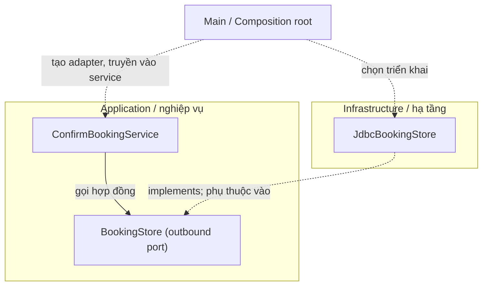

# Quyền sở hữu abstraction giữa lớp nghiệp vụ và lớp hạ tầng

## 1. Ai nên định nghĩa hợp đồng mà lớp nghiệp vụ sử dụng?

Trong hệ thống dùng **Dependency Injection (DI)**, một service có thể cần lưu đơn đặt chỗ, gửi thông báo hoặc gọi hệ thống thanh toán. Những nhu cầu đó có thể được mô tả qua **abstraction** (trừu tượng), thường là interface trong Java. Câu hỏi thiết kế quan trọng là: **interface ấy thuộc về bên cần sử dụng khả năng đó, hay bên đang cung cấp một công nghệ cụ thể?**

Ví dụ, `ConfirmBookingService` cần lưu một xác nhận đặt chỗ. Nếu service phải import `JdbcBookingRepository` hoặc một interface chứa chi tiết JDBC, phần nghiệp vụ sẽ phải biết cách hạ tầng vận hành. Nếu nghiệp vụ tự định nghĩa một hợp đồng như `BookingStore.markConfirmed(...)` và hạ tầng triển khai hợp đồng đó, lớp nghiệp vụ có thể thay cách lưu dữ liệu mà không đổi nhu cầu của mình.

Ý tưởng chủ đạo:

> **Hợp đồng phục vụ một ca sử dụng nên được thiết kế theo nhu cầu của phía sử dụng; adapter hạ tầng triển khai hợp đồng đó.** Đặt hợp đồng ở tầng nghiệp vụ hoặc ứng dụng phù hợp để chiều phụ thuộc mã nguồn hướng vào trong.

“**Quyền sở hữu abstraction**” không chỉ là việc đặt file ở thư mục nào. Nó còn là quyền quyết định **ý nghĩa của các phương thức, kiểu dữ liệu, điều kiện hợp lệ và quy tắc thay đổi của hợp đồng**. Tổ chức đúng vị trí giúp làm rõ ai được phép thay đổi API và vì sao.

Bài này thuộc nhóm **Hợp đồng phụ thuộc** của module **DEPENDENCY_INJECTION**. Mục tiêu là hiểu mối liên hệ giữa **Dependency Inversion Principle (DIP)**, **Inversion of Control (IoC)**, constructor injection và **composition root**, trước khi đưa DI container vào ứng dụng. Ta sẽ dùng Java thuần để thể hiện cả chiều phụ thuộc khi biên dịch lẫn quá trình lắp ghép khi chạy.

## 2. Phân biệt ba hướng quan hệ thường bị nhầm lẫn

Xét hai thành phần:

- **Nghiệp vụ/ứng dụng:** `ConfirmBookingService` quyết định cần xác nhận đặt chỗ và yêu cầu lưu kết quả.
- **Hạ tầng:** `JdbcBookingStore` biết dùng JDBC để ghi dữ liệu.

Ở lúc chạy, service **gọi** một đối tượng repository. Nhưng điều đó không buộc **mã nguồn** service phải import lớp repository cụ thể.

| Quan hệ | Câu hỏi | Thiết kế mong muốn |
| --- | --- | --- |
| **Lời gọi lúc chạy** (*runtime call*) | Ai gọi phương thức của ai? | Service gọi `BookingStore.markConfirmed(...)` trên adapter đã nhận. |
| **Phụ thuộc mã nguồn** (*compile-time dependency*) | Class nào import/tham chiếu kiểu nào để biên dịch? | Service biết `BookingStore`; `JdbcBookingStore` implements `BookingStore`. |
| **Quan hệ lắp ghép** (*object wiring*) | Ai tạo instance rồi kết nối chúng? | `Main.main()` hoặc bootstrap tạo `JdbcBookingStore` và truyền vào service. |

Ta có thể hình dung:



**Điểm đảo chiều:** mặc dù service gọi hạ tầng **khi chạy**, dependency ở mức mã nguồn từ hạ tầng có thể hướng về abstraction do phía ứng dụng sở hữu. Đây là một ứng dụng của **DIP**. **DI** thực hiện việc cấp đối tượng lúc chạy; **composition root** chọn triển khai thực tế.

Đừng nhầm **DIP** với **DI**:

- **DIP** nói về cách tổ chức phụ thuộc giữa module cấp cao, chi tiết cấp thấp và abstraction.
- **DI** nói về cách cung cấp những đối tượng mà consumer cần, ví dụ qua constructor.
- Có thể dùng DI nhưng vẫn thiết kế abstraction kém (service nhận nguyên `JdbcConnection` và biết mọi câu SQL).
- Cũng có thể tổ chức chiều phụ thuộc theo DIP mà không dùng framework DI; ví dụ Java thuần phía dưới.

## 3. Khi hợp đồng thuộc về phía hạ tầng, điều gì có thể xảy ra?

Một thiết kế dễ gặp là hạ tầng tạo interface riêng rồi yêu cầu mọi service nghiệp vụ phụ thuộc vào đó:

```java
// Ví dụ minh họa, không phải code độc lập để chạy.
// Interface thuộc thư viện hạ tầng và phơi chi tiết công nghệ.
interface JdbcBookingRepository {
    int executeUpdate(String sql, Object... parameters);
}

final class ConfirmBookingService {
    private final JdbcBookingRepository repository;

    ConfirmBookingService(JdbcBookingRepository repository) {
        this.repository = repository;
    }

    void confirm(String bookingId) {
        repository.executeUpdate(
                "UPDATE bookings SET confirmed = true WHERE id = ?", bookingId);
    }
}
```

Service phải biết cấu trúc bảng, cú pháp SQL, cách đóng gói tham số và ý nghĩa của số dòng ảnh hưởng. Dù đã *inject interface*, logic nghiệp vụ vẫn bị **liên kết với một API hạ tầng**. Thay cơ chế lưu trữ bằng HTTP API hoặc event store có thể kéo theo sửa service.

Một biến thể khác là interface nằm trong package `infrastructure.persistence` và chứa tên/hàm mang tư duy công nghệ:

```text
infrastructure.persistence.JdbcRepository
    executeSql(...)
    getConnection(...)
    flushEntityManager(...)
```

Mã nghiệp vụ import interface như trên vẫn phụ thuộc về mặt kiến trúc vào khái niệm ở tầng ngoài. **Tên “interface” không tự tạo ra một ranh giới tốt.**

Cải thiện bằng cách xuất phát từ nhu cầu của ca sử dụng:

```java
interface BookingStore {
    void markConfirmed(String bookingId);
}
```

Phương thức mang ý nghĩa nghiệp vụ và không buộc caller biết cách ghi. Một adapter JDBC có thể tự chuyển `markConfirmed` thành SQL; adapter HTTP có thể gọi API; bản giả khi kiểm thử có thể chỉ ghi nhận lời gọi.

Tuy vậy, abstraction không nên mơ hồ đến mức bỏ mất những quy tắc quan trọng. Nếu ca sử dụng cần bảo đảm “đặt chỗ phải tồn tại” hoặc “xác nhận không được ghi hai lần”, hợp đồng cần nêu rõ điều kiện và cách báo lỗi.

## 4. Vị trí sở hữu port: domain, application hay infrastructure?

Trong thiết kế chia tầng, đừng mặc định mọi interface đều phải được đặt chung vào một thư mục `domain`. Hãy xác định **ai cần hợp đồng và ai được phép quyết định ý nghĩa của nó**.

| Abstraction | Bên thường sở hữu | Lý do |
| --- | --- | --- |
| `BookingStore` cho use case “xác nhận đặt chỗ” | **Application**, ví dụ `application.port.out` | Use case cần lưu hoặc đọc trạng thái qua một hợp đồng độc lập công nghệ. |
| `CurrencyRateProvider` nếu chính quy tắc domain cần tỷ giá | **Domain** hoặc phần lõi có quy tắc này | Domain cần diễn đạt yêu cầu giá trị tỷ giá, tránh phụ thuộc API ngoài. |
| `ConfirmBookingUseCase` được controller gọi | **Application**, ví dụ `application.port.in` | Đây là hợp đồng vào của một ca sử dụng. |
| `JdbcConnectionFactory`, `SmtpTransport` | **Infrastructure** | Hợp đồng mang ý nghĩa kỹ thuật và chỉ được các adapter hạ tầng dùng. |
| `Clock` của JDK | Thư viện chuẩn Java | Một abstraction chung đã phù hợp; không cần sao chép thành interface mới nếu không có nhu cầu riêng. |

**Quy tắc chọn tầng sở hữu:** nếu bỏ toàn bộ JDBC, SMTP và HTTP client khỏi dự án, liệu ý nghĩa của interface có vẫn đầy đủ, dễ hiểu với nghiệp vụ? Nếu có, nó là ứng viên của tầng application/domain. Nếu interface chỉ có ý nghĩa khi biết API công nghệ, nó thường thuộc adapter hạ tầng.

### Gợi ý cấu trúc package

```text
com.example.booking
├── domain
│   └── Booking.java
├── application
│   ├── usecase
│   │   └── ConfirmBookingService.java
│   └── port
│       ├── in
│       │   └── ConfirmBookingUseCase.java
│       └── out
│           ├── BookingStore.java
│           └── ConfirmationNotifier.java
├── infrastructure
│   ├── persistence
│   │   └── JdbcBookingStore.java
│   └── notification
│       └── EmailConfirmationNotifier.java
└── bootstrap
    └── Main.java
```

Cấu trúc trên là **một ví dụ kiến trúc**, không phải quy tắc bắt buộc đặt tên. Một dự án nhỏ có thể dùng ít package hơn. Quan trọng hơn:

1. `ConfirmBookingService` biết domain model và `application.port.out`.
2. `JdbcBookingStore` **implements** `BookingStore` và biết JDBC.
3. `EmailConfirmationNotifier` **implements** `ConfirmationNotifier` và biết email client.
4. `Main` biết cả các interface, consumer và các implementation để lắp ghép.
5. Không cần cho `application` import `infrastructure`, không tạo vòng phụ thuộc package.

Ở hệ thống đóng gói bằng nhiều Java module hoặc Gradle module, hướng phụ thuộc mã nguồn có thể được kiểm soát cả bằng cấu hình module: `infrastructure` phụ thuộc `application` để triển khai port; `application` không phụ thuộc `infrastructure`. Ví dụ bài này tập trung Java thuần nên chỉ minh họa cấu trúc logic.

### Port vào và port ra không phải cùng một vai trò

- **Inbound port** như `ConfirmBookingUseCase` mô tả cách **bên ngoài gọi ứng dụng**. Service thường triển khai port này; controller gọi qua interface khi có lợi.
- **Outbound port** như `BookingStore` mô tả điều **ứng dụng cần bên ngoài cung cấp**. Service sử dụng port; adapter hạ tầng triển khai port.

Trong cả hai trường hợp, **hợp đồng application** mô tả nhu cầu của ứng dụng. Từ “port” chỉ là một cách gọi phổ biến trong kiến trúc ports and adapters (hexagonal architecture); không phải annotation hay tính năng đặc biệt của Java.

## 5. Ví dụ Java thuần: nghiệp vụ sở hữu hợp đồng cần dùng

Ví dụ dưới đây đặt các loại trong một tệp `Main.java` để dễ biên dịch. Trong dự án thực, hãy chuyển port sang package `application.port.out`, service sang `application.usecase`, adapter sang `infrastructure`. **Việc đặt chúng thành các lớp lồng ở đây chỉ phục vụ minh họa**, không có nghĩa composition root nên sở hữu mã nguồn của abstraction.

```java
import java.util.HashMap;
import java.util.Map;
import java.util.Objects;

public class Main {
    // OUTBOUND PORT: định nghĩa từ nhu cầu của use case.
    interface BookingStore {
        void markConfirmed(String bookingId);
    }

    // OUTBOUND PORT: mô tả điều ứng dụng cần từ kênh thông báo.
    interface ConfirmationNotifier {
        void confirmed(String bookingId, String email);
    }

    // APPLICATION USE CASE: phụ thuộc vào port, không biết adapter.
    static final class ConfirmBookingService {
        private final BookingStore store;
        private final ConfirmationNotifier notifier;

        ConfirmBookingService(
                BookingStore store, ConfirmationNotifier notifier) {
            this.store = Objects.requireNonNull(store, "store");
            this.notifier = Objects.requireNonNull(notifier, "notifier");
        }

        void confirm(String bookingId, String email) {
            if (bookingId == null || bookingId.isBlank()) {
                throw new IllegalArgumentException("bookingId không được rỗng");
            }
            if (email == null || email.isBlank()) {
                throw new IllegalArgumentException("email không được rỗng");
            }

            store.markConfirmed(bookingId);
            notifier.confirmed(bookingId, email);
        }
    }

    // ADAPTER: hạ tầng thay thế cho database trong ví dụ.
    static final class InMemoryBookingStore implements BookingStore {
        private final Map<String, Boolean> bookings = new HashMap<>();

        InMemoryBookingStore() {
            bookings.put("B-100", false);
        }

        @Override
        public void markConfirmed(String bookingId) {
            if (!bookings.containsKey(bookingId)) {
                throw new IllegalArgumentException(
                        "Không tồn tại đặt chỗ: " + bookingId);
            }
            bookings.put(bookingId, true);
        }

        boolean isConfirmed(String bookingId) {
            return Boolean.TRUE.equals(bookings.get(bookingId));
        }
    }

    // ADAPTER: một cách triển khai notification cụ thể.
    static final class ConsoleConfirmationNotifier
            implements ConfirmationNotifier {
        @Override
        public void confirmed(String bookingId, String email) {
            System.out.println(
                    "Đã gửi xác nhận " + bookingId + " tới " + email);
        }
    }

    public static void main(String[] args) {
        // COMPOSITION ROOT: tạo implementation rồi truyền vào consumer.
        InMemoryBookingStore store = new InMemoryBookingStore();
        ConfirmationNotifier notifier = new ConsoleConfirmationNotifier();
        ConfirmBookingService service = new ConfirmBookingService(store, notifier);

        service.confirm("B-100", "khach@example.com");
        System.out.println("Đã lưu: " + store.isConfirmed("B-100"));
    }
}
```

Biên dịch và chạy bằng JDK 11 trở lên:

```bash
javac -encoding UTF-8 Main.java
java Main
```

Kết quả mong đợi:

```text
Đã gửi xác nhận B-100 tới khach@example.com
Đã lưu: true
```

Trong ví dụ:

- **Bên sở hữu ý nghĩa hợp đồng:** use case cần thao tác `markConfirmed` và `confirmed`. Các interface mô tả đúng nhu cầu đó.
- **Bên triển khai hợp đồng:** `InMemoryBookingStore` và `ConsoleConfirmationNotifier`. Chúng biết công nghệ riêng của mình.
- **Bên cấp dependency:** `Main.main()`. Composition root quyết định chọn adapter nào và tiêm nó qua constructor.
- **Bên dùng dependency:** `ConfirmBookingService`. Consumer không tự `new InMemoryBookingStore()` hay lấy adapter từ global registry.

Thay `InMemoryBookingStore` bằng một `JdbcBookingStore` triển khai `BookingStore` sẽ chỉ yêu cầu điều chỉnh adapter và mã lắp ghép, **miễn là hợp đồng nghiệp vụ vẫn giữ nguyên**. Không có nghĩa bất kỳ thay đổi yêu cầu nào cũng tránh sửa service.

### Interface nên thể hiện những gì?

`BookingStore.markConfirmed(String bookingId)` mới thể hiện được tên hành động. Trong hệ thống thực, hợp đồng còn phải trả lời các câu hỏi về **ngữ nghĩa**:

| Câu hỏi | Quyết định cần rõ |
| --- | --- |
| Nếu `bookingId` không tồn tại thì sao? | Ném một exception do application/domain định nghĩa, hoặc trả về kết quả tường minh. |
| Nếu xác nhận lặp lại thì sao? | Có cho phép idempotent hay xem là lỗi nghiệp vụ? |
| Khi method trả về, dữ liệu đã được cam kết chưa? | Thỏa thuận về ranh giới transaction và mức bảo đảm lưu trữ. |
| Có gọi được đồng thời hay không? | Quy ước thread safety/scope trong môi trường vận hành. |
| Nếu nguồn dữ liệu tạm thời không khả dụng thì sao? | Hợp đồng lỗi có thể ánh xạ lỗi kỹ thuật sang lỗi ứng dụng thích hợp. |

Các điều khoản này **không nhất thiết phải là phương thức bổ sung**. Có thể diễn đạt bằng API, kiểu trả về, kiểu exception có nghĩa và tài liệu hợp đồng. Tránh để application phải catch `SQLException`, trả `ResultSet` hoặc đưa `EntityManager` vào port: khi đó chi tiết hạ tầng đã chảy ngược vào lõi.

## 6. Kiểm thử cho thấy lợi ích của quyền sở hữu abstraction

Nếu port là một hợp đồng nhỏ theo nhu cầu của consumer, test có thể tạo fake tối thiểu. Thêm class `ConfirmBookingTest` sau class `Main` trong chính tệp `Main.java` ở mục 5:

```java
class ConfirmBookingTest {
    static final class RecordingStore implements Main.BookingStore {
        String confirmedId;
        int calls;

        @Override
        public void markConfirmed(String bookingId) {
            confirmedId = bookingId;
            calls++;
        }
    }

    static final class RecordingNotifier implements Main.ConfirmationNotifier {
        String confirmedId;
        String recipient;
        int calls;

        @Override
        public void confirmed(String bookingId, String email) {
            confirmedId = bookingId;
            recipient = email;
            calls++;
        }
    }

    public static void main(String[] args) {
        RecordingStore store = new RecordingStore();
        RecordingNotifier notifier = new RecordingNotifier();
        Main.ConfirmBookingService service =
                new Main.ConfirmBookingService(store, notifier);

        service.confirm("B-200", "test@example.com");

        if (!"B-200".equals(store.confirmedId) || store.calls != 1) {
            throw new AssertionError("Không lưu đúng xác nhận");
        }
        if (!"B-200".equals(notifier.confirmedId)
                || !"test@example.com".equals(notifier.recipient)
                || notifier.calls != 1) {
            throw new AssertionError("Không thông báo đúng");
        }

        System.out.println("PASS: use case hoạt động qua outbound ports");
    }
}
```

Biên dịch lại, sau đó chạy:

```bash
javac -encoding UTF-8 Main.java
java ConfirmBookingTest
```

Kết quả:

```text
PASS: use case hoạt động qua outbound ports
```

Bài kiểm thử này xác nhận service gọi hợp đồng và truyền dữ liệu đúng trong tình huống thành công. Nó **chưa kiểm tra** việc lưu database thật, gửi email thực tế hay tính nhất quán khi `store.markConfirmed` thành công nhưng `notifier.confirmed` thất bại. Các bài toán transaction, retry, idempotency hoặc transactional outbox cần được giải quyết thêm theo yêu cầu hệ thống.

Lưu ý: fake trong bài test **không phải lý do duy nhất** để tạo interface. Lý do kiến trúc chính vẫn là **xác lập một ranh giới có ý nghĩa, do ứng dụng xác định và hạ tầng triển khai**. Khả năng kiểm thử là lợi ích đi kèm.

## 7. Khi nào không nên để application tự tạo interface?

Quy tắc “consumer sở hữu abstraction” phải được hiểu theo **ngữ cảnh**, không áp dụng máy móc cho mọi class.

### 7.1. Một hợp đồng chung đã đủ phù hợp

Nếu service cần nguồn thời gian, Java đã có `java.time.Clock`. Nếu chỉ cần bộ phát sinh số ngẫu nhiên, có thể dùng abstraction thích hợp của JDK. Việc bắt buộc tạo `ApplicationClock`, `ClockPort` và thêm adapter chỉ để gọi `clock.instant()` có thể làm hệ thống phức tạp mà không thêm giá trị.

Hãy dùng abstraction có sẵn khi nó không làm rò rỉ chi tiết công nghệ không phù hợp với ranh giới nghiệp vụ.

### 7.2. Tầng ứng dụng không thực sự cần thay thế

Một helper nội bộ nhỏ, thuần túy và ổn định, chẳng hạn bộ chuyển đổi giá trị không có side effect, có thể được gọi trực tiếp mà không tạo interface. DI là một kỹ thuật, không phải mục tiêu “mọi constructor đều phải có interface”.

### 7.3. Cần tuân thủ API của phía cung cấp

Khi tích hợp một framework, protocol hoặc extension point mà bên cung cấp đã định nghĩa rõ hợp đồng, phía ứng dụng có thể buộc phải implements interface do framework sở hữu. Ví dụ, một listener giao diện người dùng hoặc plugin interface thường do nền tảng định nghĩa. Cách tổ chức phù hợp là giữ lớp adapter thực thi hợp đồng của framework ở phía biên, rồi chuyển yêu cầu vào application bằng lời gọi phù hợp.

**Không nên ép framework sửa hợp đồng để “đổi chủ sở hữu”.** Thay vào đó, chọn đúng ranh giới để framework API không lan vào phần lõi nghiệp vụ.

### 7.4. Nhiều consumer có nhu cầu khác nhau

Một interface hạ tầng khổng lồ:

```java
interface EverythingRepository {
    void markBookingConfirmed(String bookingId);
    void generatePayrollReport();
    void deleteUser(String userId);
    void flushDatabaseCache();
}
```

không phải hợp đồng tốt chỉ vì nó được đặt trong `application`. `ConfirmBookingService` chỉ cần `markBookingConfirmed`. Tách interface theo **nhu cầu thực tế của các consumer** sẽ tránh ép một service biết hàng loạt thao tác không liên quan (liên hệ **Interface Segregation Principle – ISP**).

Đồng thời, không cần chia thành hàng chục interface một phương thức nếu tất cả thực sự thuộc về một vai trò thống nhất. Quy mô hợp đồng phải cân bằng giữa độ rõ, cohesion và chi phí bảo trì.

## 8. Những sai lầm thường gặp khi phân chia quyền sở hữu

| Sai lầm | Vấn đề | Cách cải thiện |
| --- | --- | --- |
| Đặt `BookingStore` trong `infrastructure` rồi application import nó. | Lõi phụ thuộc package hạ tầng, có thể phát sinh vòng phụ thuộc khi adapter cần model ứng dụng. | Đưa hợp đồng theo nhu cầu ca sử dụng vào `application.port.out` hoặc `domain` phù hợp. |
| Đặt interface trong application nhưng phương thức là `executeSql(String sql)`. | Quyền sở hữu file thay đổi, nhưng API vẫn ràng buộc với SQL. | Đổi sang thao tác mang nghĩa nghiệp vụ như `markConfirmed`. |
| Phơi `SQLException`, `ResultSet` hay entity của ORM ra port. | Lớp nghiệp vụ phải hiểu lỗi và kiểu dữ liệu hạ tầng. | Dùng domain/application type và hợp đồng lỗi có chủ đích; adapter chuyển đổi. |
| Application tự `new JdbcBookingStore()`. | Mã nghiệp vụ quyết định triển khai, dù có interface. | Composition root tạo adapter và tiêm qua constructor. |
| Hạ tầng định nghĩa luôn quy tắc xác nhận đặt chỗ. | Quy tắc nghiệp vụ có thể bị chôn trong adapter và khó kiểm thử độc lập. | Đặt chính sách nghiệp vụ ở nơi có trách nhiệm; adapter thực hiện chức năng hạ tầng đã được hợp đồng hóa. |
| Cố đưa mọi interface vào `domain`. | Domain bị lẫn các chi tiết của tầng điều phối và dịch vụ ứng dụng. | Phân biệt domain cần gì và use case/application cần gì. |
| Tạo interface chỉ để mock một class có hành vi đơn giản. | Tăng số loại và mức điều hướng nhưng không rõ ranh giới thay thế. | Xem xét nhu cầu kiến trúc trước; chỉ tạo abstraction có ý nghĩa. |
| Nhầm interface là nơi sở hữu resource thực tế. | Consumer có thể tự đóng connection pool dùng chung hoặc giữ request-scoped adapter quá lâu. | Composition root hoặc quản lý vòng đời sở hữu việc tạo, scope và đóng tài nguyên. |

**Phân biệt hai chữ “sở hữu”:** application có thể **sở hữu hợp đồng** (`BookingStore`) nhưng không **sở hữu vòng đời** của instance adapter (`JdbcBookingStore`). Composition root/DI container quyết định tạo, chia sẻ và hủy instance theo scope; hạ tầng triển khai logic sử dụng tài nguyên. Đây là hai trách nhiệm khác nhau.

## 9. Các bước thiết kế hợp đồng từ một ca sử dụng

Khi bổ sung một dependency mới, có thể làm lần lượt:

1. **Bắt đầu từ hành vi của consumer.** Viết một câu: “Để xác nhận đặt chỗ, use case cần ghi nhận trạng thái xác nhận cho mã đặt chỗ”.
2. **Đặt tên hợp đồng từ ngôn ngữ nghiệp vụ.** `BookingStore.markConfirmed` nói về *việc cần làm*, không nói về JDBC hay HTTP.
3. **Chọn tầng sở hữu.** Đặt hợp đồng ở application nếu nó phục vụ điều phối use case; ở domain nếu chính model/quy tắc domain cần nó; ở infrastructure nếu chỉ adapter nội bộ dùng.
4. **Xác định kiểu tham số và trả về.** Ưu tiên value object/domain type hoặc kiểu Java phù hợp; không truyền các cấu trúc nội bộ của framework qua biên.
5. **Nêu rõ ngữ nghĩa lỗi và tính nhất quán.** Đặt chỗ không tồn tại, xung đột trạng thái, không khả dụng tạm thời và retry có thể dẫn đến các quyết định khác nhau.
6. **Tạo một adapter triển khai port.** Adapter JDBC/HTTP/bộ nhớ phụ thuộc vào abstraction, chuyển đổi lời gọi thành công việc hạ tầng.
7. **Tiêm adapter vào consumer tại composition root.** Dùng constructor injection để các dependency bắt buộc lộ rõ.
8. **Thử thay adapter bằng fake.** Nếu cần sửa use case để thay fake, hãy kiểm tra liệu hợp đồng có rò rỉ chi tiết công nghệ không.
9. **Xem lại vòng đời.** Adapter có trạng thái hoặc resource cần scope và cơ chế đóng an toàn; `final` trên consumer không làm adapter tự an toàn luồng.

Để tự kiểm tra, hãy thử **xóa các package `infrastructure` khỏi đường biên dịch của `application`**. Nếu phần ứng dụng vẫn có thể biên dịch với port/domain model của chính nó, đây là một tín hiệu tốt cho chiều phụ thuộc mã nguồn. Bài viết chỉ minh họa nguyên tắc; trong dự án nhiều module, cách kiểm tra cụ thể phụ thuộc cấu hình build.

## 10. Bài tập thực hành

### Bài 1 — Xác định chủ sở hữu abstraction

Một use case tính giá cuối cùng cần tỷ giá. Có ba lựa chọn:

- `application.port.out.ExchangeRateProvider` với `rate(from, to)`.
- `infrastructure.http.RatesApiClient` với `getRawJson(url, apiKey)`.
- `java.time.Clock` để đo thời điểm báo giá.

Hãy phân tích loại nào nên được inject trực tiếp vào use case, loại nào nên nằm trong adapter, và khi nào cần `Clock` mà không cần tự viết interface mới.

### Bài 2 — Đổi chiều phụ thuộc

Giả sử `CheckoutService` đang import `infrastructure.payment.StripeGateway` và gọi `charge(String apiKey, Map<String, Object> payload)`. Hãy đề xuất một outbound port theo nhu cầu checkout, một adapter triển khai port và vị trí đặt mã lắp ghép. Giải thích vì sao chỉ chuyển `StripeGateway` thành interface nhưng vẫn giữ tham số API key/payload chưa chắc giảm coupling.

### Bài 3 — Thiết kế hợp đồng lỗi

Với `BookingStore.markConfirmed`, cần phân biệt: đặt chỗ không tồn tại, đặt chỗ đã xác nhận, và database tạm mất kết nối. Đề xuất hợp đồng trả kết quả/exception sao cho ứng dụng hiểu các trạng thái nghiệp vụ mà không phải import `SQLException`. Nêu cách thiết kế idempotency nếu xác nhận lặp lại được phép.

### Bài 4 — Thay triển khai và kiểm thử

Từ mã Java ở mục 5, bổ sung `SilentConfirmationNotifier implements ConfirmationNotifier` không in console và thay đúng chỗ lắp ghép ở `main()`. Sau đó chạy `ConfirmBookingTest` ở mục 6. Giải thích vì sao không cần sửa `ConfirmBookingService`. Nếu thêm email API thật, phần nào sẽ phải hiểu token và HTTP status?

### Gợi ý tự đối chiếu

- **Bài 1:** use case cần một nguồn tỷ giá có ngữ nghĩa nghiệp vụ, ví dụ `ExchangeRateProvider`. `RatesApiClient` là chi tiết HTTP bên trong adapter. `Clock` của JDK có thể được inject nếu use case cần thời gian; không cần bọc lại chỉ để “có port”.
- **Bài 2:** đặt `PaymentGateway.charge(PaymentRequest)` hoặc tên thao tác tương đương ở tầng application, dùng kiểu dữ liệu có ý nghĩa nghiệp vụ; `StripePaymentAdapter` triển khai và chuyển đổi sang payload riêng. Composition root cấp adapter; application không giữ API key hoặc payload Stripe.
- **Bài 3:** có thể dùng kết quả có kiểu rõ ràng hoặc exception do domain/application định nghĩa, adapter ánh xạ lỗi kỹ thuật phù hợp. Nếu xác nhận lặp là idempotent, hãy quy định lời gọi lặp trả thành công hoặc cùng trạng thái; bảo đảm cần được adapter/lưu trữ thực thi chính xác.
- **Bài 4:** use case chỉ gọi `ConfirmationNotifier.confirmed` nên việc thay adapter được thực hiện tại composition root; token và HTTP status nằm trong adapter email/API cùng tầng hạ tầng, chỉ chuyển thông tin lỗi có ý nghĩa qua hợp đồng nếu cần.

**Ghi nhớ:** quyền sở hữu abstraction nên phản ánh **nhu cầu và chính sách của bên sử dụng**, chứ không chỉ phản ánh vị trí tình cờ tạo ra một interface. Khi application/domain định nghĩa những port phù hợp, hạ tầng thực thi chúng và composition root tiêm implementation, ta tách được **quy tắc nghiệp vụ**, **chi tiết công nghệ** và **lắp ghép đối tượng**. Đây là nền tảng để áp dụng constructor injection, quản lý scope/vòng đời và kiểm thử Java thuần một cách có ý nghĩa trước khi chuyển sang DI container.
