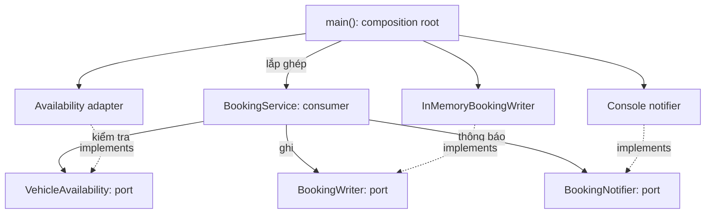

# Interface quá rộng, chia nhỏ hợp đồng và tránh lộ chi tiết triển khai

Trong chương **Hợp đồng phụ thuộc** của module **Dependency Injection**, câu hỏi thiết kế không dừng ở “đã tạo interface chưa?”. Điều quan trọng hơn là: **interface đang hứa điều gì, ai thực sự cần lời hứa đó, và nó có buộc mã nghiệp vụ phải hiểu cơ chế kỹ thuật phía sau không?**

**Dependency Injection (DI)** giúp đối tượng nhận các cộng tác viên từ bên ngoài, tách mã **sử dụng** phụ thuộc khỏi mã **tạo và lắp ghép**. **Inversion of Control (IoC)** diễn tả việc quyền điều phối lắp ghép được chuyển ra ngoài mã sử dụng. Tuy nhiên, cả DI và DI container đều không tự bảo đảm hợp đồng phụ thuộc được thiết kế tốt: một interface quá rộng hoặc làm lộ chi tiết hạ tầng vẫn khiến consumer phụ thuộc vào những thứ không cần thiết.

Bài này tập trung vào việc tạo **hợp đồng vừa đủ** cho consumer. Ta sẽ phân tích một interface quá rộng, chia nó theo **vai trò**, thiết kế chữ ký phương thức không rò rỉ JDBC/HTTP, rồi thực hành **constructor injection**, **composition root**, **kiểm thử bằng Java thuần**, đồng thời xem xét hệ quả về scope và vòng đời trước khi dùng DI container.

Sau bài này, bạn có thể:

- Nhận diện interface quá rộng qua số trách nhiệm, số consumer, nhu cầu thay đổi và phương thức mà một consumer không dùng.
- Áp dụng **Interface Segregation Principle (ISP)** để thiết kế hợp đồng dựa trên nhu cầu của consumer, thay vì chia máy móc mỗi phương thức thành một interface.
- Phân biệt **port** (hợp đồng mà use case cần) với **adapter** (cách triển khai bằng JDBC, HTTP, file, email...) và giữ chi tiết công nghệ khỏi chữ ký nghiệp vụ.
- Tạo, thay thế, kiểm thử những adapter qua constructor injection và lắp ghép tại composition root bằng Java thuần.
- Biết các trường hợp nên giữ một interface lớn hơn, xử lý nhiều thao tác trong cùng transaction, hoặc cần factory/provider và quản lý vòng đời riêng.

## 1. Một interface có thể “đúng cú pháp” nhưng sai ranh giới

Giả sử ứng dụng đặt thuê xe có use case **xác nhận đặt xe**. Để xác nhận, chương trình cần kiểm tra xe còn khả dụng, lưu đặt xe và gửi thông báo. Ban đầu nhóm phát triển tạo một interface duy nhất cho mọi chức năng liên quan đến thuê xe:

```java
import java.io.OutputStream;
import java.sql.Connection;
import java.time.LocalDate;

interface RentalPlatform {
    boolean isVehicleAvailable(String vehicleId,
                               LocalDate from, LocalDate untilExclusive);
    void saveBooking(String bookingId, String vehicleId);
    void cancelBooking(String bookingId);
    void chargeCard(String bookingId, String paymentToken);
    void exportBookings(OutputStream target);
    Connection openConnection();
}
```

Một `BookingService` chỉ dùng `isVehicleAvailable` và `saveBooking` nhưng vẫn phải khai báo phụ thuộc `RentalPlatform`. Hệ quả:

1. **Phụ thuộc thừa:** Mã nghiệp vụ bị ràng buộc với các chức năng hủy đặt, thanh toán, xuất báo cáo, kết nối JDBC mà nó không cần.
2. **Triển khai giả khó viết:** Một adapter chỉ hỗ trợ kiểm tra tình trạng xe vẫn phải triển khai cả các phương thức không liên quan, thường bằng `throw new UnsupportedOperationException()`.
3. **Thay đổi lan rộng:** Đổi kiểu dữ liệu thanh toán hoặc cách truy cập JDBC có thể buộc các triển khai cùng interface phải biên dịch lại, dù consumer đặt xe không dùng chúng.
4. **Lộ chi tiết kỹ thuật:** `Connection` và `OutputStream` nói về JDBC và cơ chế I/O thay vì nhu cầu nghiệp vụ. Một consumer chỉ muốn xác nhận đặt xe không nên có quyền nhìn thấy hoặc quản lý connection.
5. **Khó xác định vòng đời:** Đối tượng triển khai một interface “làm mọi thứ” có thể vô tình trộn phụ thuộc sống dài với connection, stream hay transaction sống ngắn.

Đặc biệt, `openConnection()` cho phép consumer tự thao tác JDBC. Dù `RentalPlatform` là một interface, use case vẫn phải hiểu transaction, connection và tài nguyên JDBC; vậy việc đặt interface chưa tạo ra ranh giới trừu tượng phù hợp.

Interface quá rộng còn có tên thường gặp là **fat interface** hoặc **god interface**. Không thể đánh giá chỉ qua số lượng phương thức: vấn đề cốt lõi là **nhóm hành vi có phục vụ cùng một trách nhiệm và cùng nhóm consumer hay không**.

## 2. Nguyên tắc ISP: hợp đồng theo nhu cầu của consumer

**Interface Segregation Principle (ISP)** thường được diễn đạt: *client không nên bị buộc phụ thuộc vào phương thức mà nó không sử dụng*. “Client” ở đây là **mã tiêu thụ interface**, chẳng hạn một application service, bộ xử lý tác vụ, job xuất dữ liệu hoặc lớp triển khai một hợp đồng.

Với use case đặt xe, ta có thể tách:

```java
import java.time.LocalDate;

interface VehicleAvailability {
    boolean isAvailable(String vehicleId,
                        LocalDate from, LocalDate untilExclusive);
}

interface BookingWriter {
    void save(Booking booking);
}

interface BookingNotifier {
    void confirmed(Booking booking);
}
```

Giờ đây, mỗi interface mô tả **một khả năng mà use case cần**:

| Hợp đồng | Consumer cần điều gì? | Có thể được triển khai như thế nào? |
| --- | --- | --- |
| `VehicleAvailability` | Trả lời xe có khả dụng trong khoảng thời gian đặt không | Dữ liệu trong bộ nhớ, database, API quản lý đội xe |
| `BookingWriter` | Lưu một đặt xe theo quy tắc của ứng dụng | Repository JDBC/JPA, dịch vụ lưu trữ, adapter giả trong test |
| `BookingNotifier` | Phát tín hiệu xác nhận đặt xe | Console, email, message broker, bộ ghi sự kiện trong test |

**Điểm đáng chú ý:** Không phải một interface cho mỗi lớp triển khai; một hợp đồng có thể có nhiều adapter. Cũng không bắt buộc một interface cho từng phương thức. Chỉ tách khi có **ranh giới trách nhiệm hoặc nhóm consumer khác nhau**.

### ISP liên quan thế nào đến DIP và DI?

| Khái niệm | Quyết định thiết kế |
| --- | --- |
| **ISP** | Consumer nên thấy một hợp đồng vừa đủ với những hành vi nó thực sự dùng. |
| **Dependency Inversion Principle (DIP)** | Mã nghiệp vụ cấp cao phụ thuộc vào trừu tượng phù hợp, thay vì phụ thuộc trực tiếp vào chi tiết JDBC/email. |
| **DI** | Đối tượng nhận các cộng tác viên qua constructor hoặc điểm cấp phụ thuộc khác, thay vì tự tạo chúng. |
| **IoC** | Việc lựa chọn và lắp ghép các thành phần được điều phối từ bên ngoài consumer, chẳng hạn tại composition root. |

ISP giúp **định hình** interface, DIP giúp **định hướng** phụ thuộc trong mã nguồn, DI giúp **cung cấp** phụ thuộc; chúng bổ trợ nhau nhưng không đồng nghĩa. Một hệ thống có DI và nhiều interface vẫn có thể vi phạm ISP nếu mỗi consumer phải nhận một hợp đồng khổng lồ.

## 3. Chia theo vai trò, không chia máy móc theo phương thức

Một quy trình phân tích thực tế là **đi từ consumer về hợp đồng**:

1. Liệt kê các consumer cụ thể, ví dụ `BookingService`, `CancellationService`, `BookingReportJob`.
2. Với từng consumer, viết **các hành vi thực sự cần**, kèm ngữ nghĩa mong đợi và các trường hợp lỗi.
3. Nhóm các hành vi thường cần **cùng nhau vì cùng một trách nhiệm** thành một hợp đồng.
4. Xem biến thể nào có thể đổi độc lập: cách kiểm tra khả dụng, cách lưu dữ liệu, cách gửi thông báo.
5. Để composition root lựa chọn adapter và nối chúng vào consumer qua constructor.

Ví dụ về góc nhìn consumer:

| Consumer | Hành vi cần | Hợp đồng phù hợp |
| --- | --- | --- |
| `BookingService` | Kiểm tra xe, ghi đặt xe, gửi xác nhận | `VehicleAvailability`, `BookingWriter`, `BookingNotifier` |
| `CancellationService` | Tìm đặt xe và hủy theo quy tắc | Có thể là `BookingReader` và `BookingCanceller` hoặc một `BookingRepository` phù hợp với cả hai hành vi |
| `BookingReportJob` | Truy vấn dữ liệu tổng hợp để lập báo cáo | `BookingReportQuery` |
| Lớp adapter JDBC | Tạo câu SQL, quản lý connection/transaction trong phạm vi được giao | Chi tiết nội bộ adapter; không bắt consumer gọi API JDBC |

Không nhất thiết phải tạo interface `BookingReader` và `BookingWriter` chỉ vì một cái đọc, một cái ghi. Nếu một use case luôn cần đọc và ghi **trong cùng một giao dịch** và chúng tạo thành một trách nhiệm gắn kết, một `BookingRepository` có hai phương thức có thể rõ ràng hơn. Cũng không nên ép nhiều consumer dùng một interface chung chỉ vì chúng truy cập cùng bảng database.

**Cấu trúc hợp đồng phải phản ánh hành vi ổn định mà consumer cần**, không phản ánh danh sách khả năng ngẫu nhiên của công cụ đang dùng hoặc tên các package.

### Dấu hiệu cần tách một hợp đồng

- Nhiều adapter phải ném `UnsupportedOperationException` ở những phương thức vốn không thuộc trách nhiệm của chúng.
- Test double của một use case phải cài đặt nhiều phương thức không bao giờ được gọi.
- Một thay đổi chỉ liên quan đến báo cáo, thanh toán hoặc tích hợp bên ngoài lại làm consumer đặt xe bị ảnh hưởng.
- Một lớp dùng toàn bộ quyền của gateway dù về nghiệp vụ chỉ được phép đọc hoặc chỉ được phép ghi.
- Hợp đồng chứa cả hành vi nghiệp vụ, cấu hình runtime, quyền truy cập tài nguyên và cơ chế truyền dữ liệu.

Nhưng **không tự động chia ngay** khi thấy interface có nhiều phương thức. Một `Map` hoặc một hợp đồng xử lý giao dịch có thể chứa nhiều thao tác gắn kết và vẫn hợp lý. Hãy dựa vào sự thay đổi, mức kết dính và nhu cầu thực tế của consumer.

## 4. Đừng để kiểu dữ liệu hạ tầng đi qua ranh giới nghiệp vụ

Chữ ký phương thức chính là hợp đồng công khai giữa consumer và dependency. Kiểu trả về, kiểu tham số, exception, hành vi và tính nhất quán dữ liệu đều là các phần của hợp đồng.

Hợp đồng sau vẫn khiến use case biết JDBC:

```java
import java.sql.Connection;
import java.sql.ResultSet;
import java.sql.SQLException;

interface JdbcBookingLookup {
    ResultSet executeSearch(Connection connection, String sql)
            throws SQLException;
}
```

Lúc này consumer phải biết cách viết SQL, duyệt `ResultSet`, xử lý `SQLException`, giữ `Connection` còn mở và chịu trách nhiệm đóng tài nguyên. Interface chỉ đổi tên nơi gọi JDBC, **không tách được chi tiết triển khai**.

Thay vào đó, hãy diễn tả khả năng đúng ngôn ngữ của consumer:

```java
interface BookingReader {
    java.util.Optional<Booking> findById(String bookingId);
}
```

Adapter có thể dùng `PreparedStatement`, `ResultSet` hoặc HTTP bên trong, chuyển dữ liệu thành một kiểu domain/application như `Booking`, rồi trả về `Optional.empty()` khi không tìm thấy. Consumer chỉ thấy **nghĩa của thao tác**, không phải công cụ.

### Quy tắc thiết kế chữ ký

| Khía cạnh | Dễ làm lộ triển khai | Hợp đồng hướng consumer |
| --- | --- | --- |
| Đầu vào | `String sql`, `Connection connection`, tên bảng | `bookingId`, `Booking`, khoảng ngày cần kiểm tra |
| Kết quả | `ResultSet`, `HttpResponse`, JSON của nhà cung cấp | `Booking`, `Optional<Booking>`, kiểu kết quả có ý nghĩa nghiệp vụ |
| Lỗi | `SQLException` hoặc mã HTTP cụ thể chạy xuyên mọi tầng | Ngoại lệ ứng dụng có ngữ nghĩa rõ; giữ nguyên thông tin lỗi kỹ thuật trong log/`cause` |
| Tài nguyên | Consumer phải giữ và đóng connection/stream của adapter | Adapter hoặc lớp quản lý vòng đời phù hợp sở hữu, đóng tài nguyên |
| Cấu hình | Consumer tự truy xuất URL, credential hoặc pool | Cấu hình và adapter được chọn tại composition root |

Giữ ngoài ranh giới không có nghĩa là **xóa mọi thông tin lỗi**. Ví dụ, lỗi “không tìm thấy đặt xe” khác lỗi “database đang không khả dụng”. Adapter nên diễn đạt sự khác biệt theo hợp đồng của ứng dụng, giữ `cause` để chẩn đoán khi bọc ngoại lệ, và không biến mọi lỗi lưu trữ thành `Optional.empty()`. Ngoài ra, những chi tiết như transaction, deadline hoặc tính idempotent cần được thiết kế thành **cam kết hành vi**, dù chữ ký không nhắc đến JDBC.

**Tránh trừu tượng giả:** Đổi tên `ResultSet` thành `MyResultSet` hay bọc nguyên `HttpResponse` vào `BookingResponse` mà consumer vẫn phải đọc status code/header của nhà cung cấp thì chưa thực sự tạo ranh giới. Hãy bắt đầu bằng câu hỏi “use case muốn biết kết quả gì?”.

## 5. Ví dụ Java thuần: hợp đồng hẹp và composition root

Ví dụ sau dùng Java 11 trở lên, chỉ cần JDK. Nó minh họa một `BookingService` phụ thuộc vào ba **port nhỏ**. Adapter in-memory và console được lắp từ `main`; test tự tạo fake bằng lambda.

Lưu vào file `NarrowContractsDemo.java`:

```java
import java.time.LocalDate;
import java.util.ArrayList;
import java.util.List;
import java.util.Objects;

public class NarrowContractsDemo {
    // Mô hình nghiệp vụ không biết JDBC, HTTP hoặc console.
    static final class Booking {
        final String id;
        final String vehicleId;
        final LocalDate from;
        final LocalDate untilExclusive;

        Booking(String id, String vehicleId,
                LocalDate from, LocalDate untilExclusive) {
            if (id == null || id.isBlank()
                    || vehicleId == null || vehicleId.isBlank()) {
                throw new IllegalArgumentException("Invalid booking identity");
            }
            this.from = Objects.requireNonNull(from, "from");
            this.untilExclusive =
                    Objects.requireNonNull(untilExclusive, "untilExclusive");
            if (!untilExclusive.isAfter(from)) {
                throw new IllegalArgumentException("Booking range is empty");
            }
            this.id = id;
            this.vehicleId = vehicleId;
        }
    }

    @FunctionalInterface
    interface VehicleAvailability {
        boolean isAvailable(String vehicleId,
                            LocalDate from, LocalDate untilExclusive);
    }

    @FunctionalInterface
    interface BookingWriter {
        void save(Booking booking);
    }

    @FunctionalInterface
    interface BookingNotifier {
        void confirmed(Booking booking);
    }

    static final class VehicleUnavailableException
            extends RuntimeException {
        VehicleUnavailableException(String vehicleId) {
            super("Vehicle unavailable: " + vehicleId);
        }
    }

    // Consumer chỉ phụ thuộc vào những hành vi mà nó cần.
    static final class BookingService {
        private final VehicleAvailability availability;
        private final BookingWriter writer;
        private final BookingNotifier notifier;

        BookingService(VehicleAvailability availability,
                       BookingWriter writer, BookingNotifier notifier) {
            this.availability =
                    Objects.requireNonNull(availability, "availability");
            this.writer = Objects.requireNonNull(writer, "writer");
            this.notifier = Objects.requireNonNull(notifier, "notifier");
        }

        void book(Booking booking) {
            Objects.requireNonNull(booking, "booking");
            boolean available = availability.isAvailable(
                    booking.vehicleId, booking.from, booking.untilExclusive);
            if (!available) {
                throw new VehicleUnavailableException(booking.vehicleId);
            }
            writer.save(booking);
            notifier.confirmed(booking);
        }
    }

    // Adapter minh họa, chỉ triển khai đúng hành vi ghi đặt xe.
    static final class InMemoryBookingWriter implements BookingWriter {
        final List<Booking> saved = new ArrayList<>();

        @Override
        public void save(Booking booking) {
            saved.add(booking);
        }
    }

    public static void main(String[] args) {
        // Composition root: chọn và tạo các phụ thuộc.
        VehicleAvailability availability =
                (vehicleId, from, until) -> true;
        InMemoryBookingWriter realWriter = new InMemoryBookingWriter();
        BookingNotifier consoleNotifier =
                booking -> System.out.println("Confirmed: " + booking.id);
        BookingService service = new BookingService(
                availability, realWriter, consoleNotifier);

        Booking booking = new Booking(
                "B-01", "CAR-12",
                LocalDate.of(2026, 12, 1), LocalDate.of(2026, 12, 4));
        service.book(booking);
        if (realWriter.saved.size() != 1
                || realWriter.saved.get(0) != booking) {
            throw new AssertionError("Booking was not stored");
        }

        // Test doubles chỉ cần hiện thực hành vi mà consumer sử dụng.
        List<Booking> stored = new ArrayList<>();
        List<Booking> notified = new ArrayList<>();
        BookingService testService = new BookingService(
                (vehicleId, from, until) -> true,
                stored::add,
                notified::add);
        testService.book(booking);
        if (stored.size() != 1 || notified.size() != 1
                || stored.get(0) != booking || notified.get(0) != booking) {
            throw new AssertionError("Successful flow was incorrect");
        }

        // Nhánh lỗi: xe không khả dụng thì không ghi, không thông báo.
        BookingService unavailableService = new BookingService(
                (vehicleId, from, until) -> false,
                stored::add,
                notified::add);
        boolean rejected = false;
        try {
            unavailableService.book(booking);
        } catch (VehicleUnavailableException expected) {
            rejected = true;
        }
        if (!rejected || stored.size() != 1 || notified.size() != 1) {
            throw new AssertionError("Unavailable flow was incorrect");
        }
        System.out.println("Pure Java test: PASS");
    }
}
```

Chạy trong thư mục chứa file:

```bash
javac NarrowContractsDemo.java
java NarrowContractsDemo
```

Kết quả dự kiến:

```text
Confirmed: B-01
Pure Java test: PASS
```

**Điều cần quan sát:** `BookingService` không biết `InMemoryBookingWriter` hay cách gửi thông báo; constructor thể hiện **ba phụ thuộc bắt buộc** và lưu chúng trong các field `final`. `main` là **composition root**, nơi quyết định adapter cụ thể. Kiểm thử chỉ cần lambda hoặc method reference đáp ứng từng interface, không phải một mock khổng lồ hỗ trợ thanh toán, xuất báo cáo và JDBC.



Đồ thị phân biệt **hướng phụ thuộc trong mã nguồn** (`BookingService` nhìn thấy các port) với **đối tượng được chọn khi chạy** (`main` tạo và truyền adapter). Khi thay `InMemoryBookingWriter` bằng `JdbcBookingWriter`, lớp `BookingService` không cần thay đổi nếu adapter mới giữ đúng hợp đồng `BookingWriter`.

Ví dụ cố ý đơn giản: `VehicleAvailability` trả về `true` để tập trung vào hình dạng hợp đồng; danh sách trong bộ nhớ không an toàn cho ghi đồng thời. Trong sản phẩm thật, phải thiết kế cách kiểm tra và ghi đặt xe nhất quán khi nhiều yêu cầu cùng chọn một xe.

## 6. Ngoài chữ ký: hợp đồng phải nêu cả ngữ nghĩa

Một interface nhỏ nhưng **mơ hồ** vẫn có thể gây lỗi. Chẳng hạn:

```java
interface BookingWriter {
    void save(Booking booking);
}
```

Consumer và adapter cần thống nhất các điểm sau:

- **Điều kiện đầu vào:** `booking` có hợp lệ không? `id` đã tồn tại thì ghi đè, từ chối hay coi là thao tác idempotent?
- **Ý nghĩa thành công:** `save` chỉ ghi vào bộ đệm hay đã bảo đảm được lưu trữ theo cam kết? Có cần transaction không?
- **Lỗi có thể xảy ra:** Lỗi dữ liệu nghiệp vụ có khác lỗi hạ tầng tạm thời? Ngoại lệ nào được cho phép chạy qua ranh giới?
- **Tính đồng thời:** Hai lệnh `save` cạnh tranh cùng một xe được xử lý thế nào? `isAvailable` trước `save` có thể bị thay đổi giữa hai bước.
- **Vòng đời:** Có thể dùng chung adapter giữa nhiều luồng, request không? Ai tạo và đóng những tài nguyên mà nó sở hữu?

**Không thể giải quyết race condition chỉ bằng việc tách interface.** Trong ví dụ, khoảng thời gian giữa `isAvailable` và `save` có thể cho phép hai yêu cầu cùng thấy xe khả dụng rồi cùng lưu. Nếu yêu cầu nghiệp vụ là “không bao giờ đặt trùng”, hợp đồng có thể cần thay đổi thành **một thao tác bảo đảm tính nguyên tử**:

```java
interface BookingCommitter {
    // Hợp đồng ứng dụng: hoàn tất đặt xe nếu còn khả dụng,
    // hoặc trả về một kết quả từ chối có ngữ nghĩa rõ.
    BookingAttempt tryBook(Booking booking);
}
```

Trong đó `BookingAttempt` là kiểu kết quả nghiệp vụ cần được định nghĩa rõ (thành công, hết chỗ, đặt xe đã tồn tại...). Adapter thực hiện thao tác nguyên tử bằng transaction, khóa dữ liệu hoặc cơ chế nhất quán thích hợp. Đây là ví dụ cho thấy **ranh giới hợp đồng phải phản ánh bất biến nghiệp vụ**, không chỉ gom/tách phương thức.

Tương tự, việc `BookingService` gọi `writer.save` rồi `notifier.confirmed` không khiến hai tác vụ thành một giao dịch phân tán. Nếu ghi thành công nhưng gửi thông báo thất bại, cần chính sách riêng: retry, outbox hoặc xử lý trạng thái chờ thông báo. Không nên che lỗi phân tán bằng cách coi mọi adapter là một đối tượng “tất cả trong một”.

## 7. Đừng lạm dụng interface và abstraction

Tách hợp đồng là để **giảm phụ thuộc không cần thiết**, không phải để tối đa số lượng file. Những trường hợp sau cần cân nhắc:

| Tình huống | Cách chọn hợp lý |
| --- | --- |
| Một thuật toán ổn định chỉ có một triển khai, không có ranh giới I/O hoặc nhu cầu thay thế rõ | Có thể inject **lớp cụ thể** qua constructor; DI không đòi hỏi interface. |
| Một consumer cần đọc và ghi cùng một thực thể theo một giao dịch thống nhất | Một hợp đồng repository gắn kết có thể tốt hơn hai port làm mất cam kết transaction. |
| Hai consumer cùng gọi phương thức nhưng có chính sách quyền truy cập khác nhau | Cân nhắc hai role interface khác nhau để biểu đạt quyền cần thiết, thay vì phát hết quyền của gateway. |
| Chia mỗi phương thức thành interface riêng dù luôn được dùng cùng nhau | Cân nhắc gom các phương thức có cùng một trách nhiệm và cùng nhóm consumer. |
| Adapter trả đối tượng domain nhưng thực chất chỉ chứa toàn bộ JSON của nhà cung cấp | Cần tái thiết kế kiểu kết quả theo ngữ nghĩa ứng dụng; đổi tên kiểu dữ liệu thôi chưa đủ. |
| Có hàng chục interface chỉ chuyển tiếp cùng một chữ ký | Kiểm tra xem abstraction có tạo ranh giới hữu ích, cô lập thay đổi hoặc hỗ trợ kiểm thử thực tế không. |

Một dấu hiệu abstraction tốt là: **có thể viết adapter thay thế mà không cần mở mã nguồn consumer để biết các chi tiết ẩn**. Một interface không cần phải “dùng lại ở mọi nơi”; nó có thể là hợp đồng rất cụ thể của một use case. Ngược lại, đừng tạo abstraction chỉ vì dự đoán xa rằng “sau này có thể đổi mọi thứ”.

## 8. Scope, vòng đời và DI container

Hợp đồng xác định **consumer cần hành vi nào**; scope và vòng đời xác định **instance nào được cấp, sử dụng bao lâu và ai chịu trách nhiệm tài nguyên**. Đây là những quyết định liên quan nhưng không đồng nhất.

| Thành phần | Lựa chọn vòng đời có thể phù hợp | Điều phải kiểm tra |
| --- | --- | --- |
| `BookingService` không giữ trạng thái request | Có thể dùng lại nếu mọi dependency phù hợp | Tránh đặt dữ liệu đơn đặt xe trong field của service chia sẻ. |
| Adapter in-memory dùng `ArrayList` | Chỉ để demo/kiểm thử đơn luồng, hoặc cần đồng bộ khi chia sẻ | `final` của tham chiếu không làm `ArrayList` thread-safe. |
| Adapter JDBC dùng connection pool | Có thể giữ tham chiếu pool lâu dài | Connection được mượn/trả theo thao tác hoặc transaction; không chia sẻ tùy tiện một `Connection` giữa các thread. |
| Adapter giữ session hoặc request context | Thường dùng trong phạm vi thao tác/request | Tránh đưa instance sống ngắn vào singleton rồi tái sử dụng quá hạn. |
| Factory/provider của tài nguyên sống ngắn | Có thể inject factory vào consumer | Factory phải công bố rõ nó trả instance mới hay dùng lại và ai đóng tài nguyên. |

Trong Java thuần, composition root có thể tạo adapter và truyền qua constructor. Khi ứng dụng có nhiều thành phần, DI container giúp tự động hóa việc tạo, chọn và cấp các instance theo cấu hình scope; nó **không tự xác định** ranh giới ISP đúng, không biến adapter thiếu an toàn thành thread-safe và không loại bỏ nhu cầu đóng tài nguyên đúng cách.

Đối với adapter cần `close()`, phải thống nhất **quyền sở hữu**: nơi tạo và quản lý vòng đời adapter thường chịu trách nhiệm đóng, còn `BookingService` chỉ sử dụng port. Nếu adapter mở kết nối cho mỗi thao tác, adapter cần đóng kết nối trong phạm vi thao tác phù hợp; consumer không nên nhận `Connection` chỉ để đóng hộ.

## 9. Quy trình refactor một interface quá rộng

Khi gặp một interface đang được nhiều lớp sử dụng, hãy refactor có kiểm soát:

1. **Liệt kê các consumer và phương thức thật sự được gọi.** Đừng suy từ tên interface. Vẽ bảng consumer × hành vi để tìm các nhóm có trách nhiệm riêng.
2. **Định nghĩa port theo ngôn ngữ ứng dụng.** Tên và tham số nên thể hiện hành vi mà consumer cần, kèm quy tắc lỗi và ngữ nghĩa giao dịch.
3. **Đưa các kiểu hạ tầng vào adapter.** Dịch `ResultSet`, `SQLException`, `HttpResponse` hoặc định dạng của nhà cung cấp thành kiểu/domain result thích hợp.
4. **Đổi constructor của consumer.** Chỉ nhận các port cần thiết. Tạo các adapter cụ thể tại composition root, không đặt `new Jdbc...` trong nghiệp vụ.
5. **Kiểm thử từng hành vi qua fake đơn giản.** Xác nhận trường hợp thành công, không tìm thấy, thất bại hạ tầng và biên nghiệp vụ tùy hợp đồng.
6. **Xem lại tính nguyên tử và vòng đời.** Đảm bảo tách interface không làm mất transaction, khả năng đồng bộ, chính sách đóng tài nguyên.
7. **Loại bỏ đường phụ thuộc cũ khi các caller đã chuyển xong.** Không duy trì một “gateway tổng” chỉ để mọi lớp tiếp tục dựa vào API quá rộng.

Khi thay một hợp đồng đã xuất bản cho nhiều thành phần, hãy xét tương thích ngược và chiến lược di chuyển. **Không xóa phương thức đang được consumer khác sử dụng** nếu chưa di chuyển các consumer đó. Với phạm vi bài học này, việc lắp ghép và kiểm thử Java thuần giúp quan sát tác động refactor trước khi chuyển sang annotation/container.

## 10. Bài thực hành và tự kiểm tra

### Bài tập 1 — Phát hiện hợp đồng dư thừa

Cho interface `CustomerGateway` có các phương thức `findCustomer`, `saveCustomer`, `sendMarketingEmail`, `generateInvoicePdf`, `openConnection`. Một `CustomerLookupService` chỉ cần tìm thông tin khách.

Hãy chỉ ra những phương thức bị buộc phụ thuộc không cần thiết. Đề xuất một port chỉ cung cấp khả năng tra cứu; xác định rõ trường hợp “không tìm thấy” khác “backend thất bại”. Giải thích vì sao trả `ResultSet` không phải thiết kế tốt cho port đó.

### Bài tập 2 — Thay adapter không thay consumer

Từ `NarrowContractsDemo.java`:

1. Tạo `RejectAllAvailability` trả về `false` và truyền vào `BookingService` tại composition root.
2. Chạy trường hợp xe không khả dụng. Kiểm tra không có lệnh lưu và thông báo nào được gọi.
3. Tạo `RecordingNotifier` lưu danh sách `Booking` đã xác nhận; thay `ConsoleBookingNotifier`. Kiểm tra không phải sửa code của `BookingService`.

### Bài tập 3 — Xét lại transaction

Giả sử nhiều khách có thể đặt cùng một xe trong cùng một khoảng thời gian. Dù có `VehicleAvailability` và `BookingWriter` riêng, hãy giải thích tình huống hai yêu cầu cùng được chấp nhận. Thiết kế port như `BookingCommitter.tryBook(...)` với cam kết nguyên tử; viết bảng kết quả có thể xảy ra. Tránh đưa `Connection` hoặc tên transaction của framework vào chữ ký dùng bởi nghiệp vụ.

### Bài tập 4 — Cân nhắc khi nào không nên tách

Một use case cần `loadCart`, `addLine` và `removeLine` trong một phạm vi làm việc nhất quán. Hãy so sánh thiết kế ba interface đơn phương thức với một hợp đồng `CartRepository` gắn kết. Chọn dựa trên **ranh giới giao dịch và các consumer thực tế**, không dựa trên số phương thức.

### Câu hỏi tự kiểm tra

- ISP giải quyết vấn đề gì mà việc chỉ dùng constructor injection không tự giải quyết?
- Một interface trả `HttpResponse` hoặc `ResultSet` có phải đã “ẩn hạ tầng” khỏi use case chưa? Vì sao?
- Nếu hai port nhỏ riêng biệt khiến một bất biến nghiệp vụ không thể bảo đảm nguyên tử, bạn cần thay đổi điều gì trong **ngữ nghĩa hợp đồng**?
- Vì sao `private final BookingWriter writer` không bảo đảm adapter bên dưới là bất biến hoặc an toàn đa luồng?
- Khi nào DI container giúp ích, và vì sao vẫn cần thiết kế port, adapter, scope, vòng đời trước?

Một hợp đồng phụ thuộc tốt cho phép consumer nói rõ **mình cần hành vi gì**, adapter tự quyết định **thực hiện bằng kỹ thuật nào**, còn composition root quyết định **ghép triển khai nào vào ứng dụng**. Khi interface vừa đủ, không rò rỉ chi tiết hạ tầng và giữ đúng cam kết nghiệp vụ, constructor injection cùng kiểm thử Java thuần trở nên rõ ràng; việc mở rộng sang DI container sau này chủ yếu thay đổi cơ chế lắp ghép, không phải mục đích của các hợp đồng.
