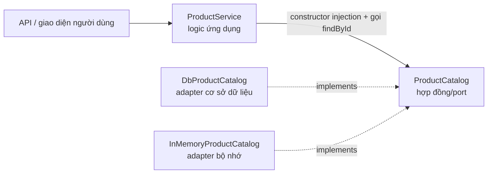
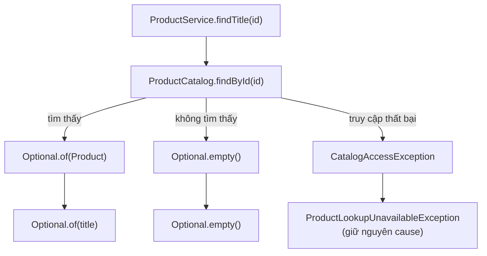
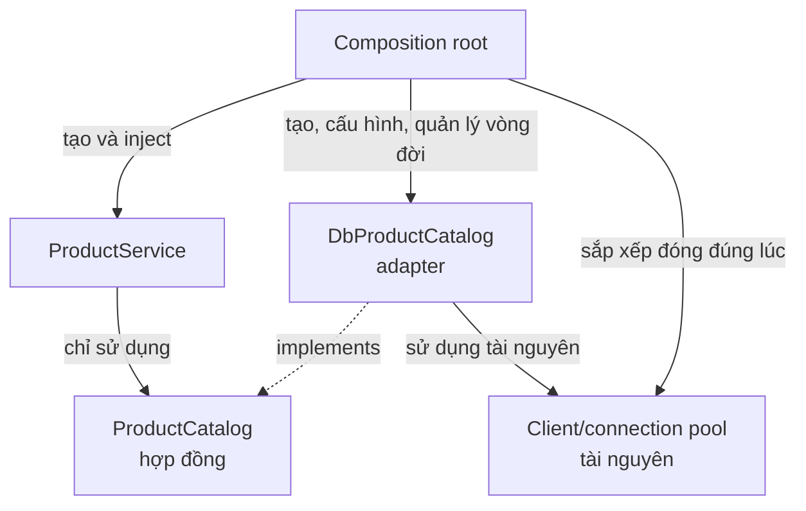

# Kiểu dữ liệu, lỗi và ngoại lệ đi qua ranh giới phụ thuộc

Trong **Dependency Injection (DI)**, thay một implementation bằng implementation khác chỉ an toàn khi chúng cùng tuân thủ **hợp đồng phụ thuộc** (*dependency contract*). Hợp đồng ấy không dừng ở tên phương thức và kiểu tham số: nó còn xác định **giá trị hợp lệ**, **kết quả khi nghiệp vụ không thành công**, **lỗi khi không thể thực hiện thao tác**, **ngoại lệ có thể phát sinh** và **trách nhiệm đối với tài nguyên**.

Xét hai implementation của `ProductCatalog`: một đọc từ bộ nhớ, một truy vấn cơ sở dữ liệu. Cả hai có thể khai báo:

```java
Optional<Product> findById(String productId) throws CatalogAccessException;
```

Nhưng để một `ProductService` có thể sử dụng chúng như nhau, ta phải thống nhất thêm:

- `Optional.of(product)` nghĩa là đã tìm thấy dữ liệu hợp lệ.
- `Optional.empty()` nghĩa là đã truy vấn thành công nhưng **không có sản phẩm tương ứng**.
- `CatalogAccessException` nghĩa là không lấy được câu trả lời đáng tin cậy do lỗi truy cập; **không được coi tương đương với “không tìm thấy”**.
- Không implementation nào được trả về `null` thay cho `Optional`.
- `productId` phải hợp lệ; ứng xử với tham số sai cũng phải rõ ràng.

Bài học thuộc chương **Hợp đồng phụ thuộc** của module **DEPENDENCY_INJECTION**, kết nối thiết kế API với **Inversion of Control (IoC)**, constructor injection, composition root, quản lý scope/vòng đời và kiểm thử bằng Java thuần trước khi dùng DI container.

## 1. Ranh giới phụ thuộc là nơi nào?

Một *ranh giới phụ thuộc* là điểm mà thành phần sử dụng gọi một hợp đồng do thành phần khác cung cấp. Ví dụ:



`ProductService` chỉ cần biết API của `ProductCatalog`, không cần biết chi tiết truy vấn SQL, HTTP hay cách dữ liệu được cache. Khi chạy, **composition root** chọn adapter cụ thể rồi truyền nó vào service.

Đối với mỗi lời gọi qua ranh giới ấy, cần mô tả tối thiểu bốn mặt của hợp đồng:

| Mặt hợp đồng | Câu hỏi cần trả lời | Ví dụ |
| --- | --- | --- |
| **Kiểu dữ liệu vào** | Đầu vào nào hợp lệ? Có được `null` không? | `productId` là chuỗi không rỗng |
| **Kiểu dữ liệu ra** | Giá trị nào biểu đạt thành công và không có dữ liệu? | `Optional<Product>`; `empty` là không tìm thấy |
| **Lỗi và ngoại lệ** | Trường hợp nào là kết quả nghiệp vụ; trường hợp nào là sự cố? | Không tìm thấy khác với mất kết nối |
| **Thời gian sống và quyền sở hữu** | Ai quản lý dependency và tài nguyên được trả về? | Root đóng kết nối do adapter sở hữu; caller không đóng dependency dùng chung |

**Interface Java giúp thể hiện một phần hợp đồng**, đặc biệt là tên, kiểu và ngoại lệ kiểm tra (*checked exception*). Các bảo đảm như “không trả về `null`”, “không đóng tài nguyên của bên gọi” hoặc “`empty` chỉ mang nghĩa không tìm thấy” vẫn cần được ghi trong tài liệu và xác minh bằng kiểm thử.

## 2. Chọn kiểu dữ liệu để diễn đạt đúng ý nghĩa nghiệp vụ

### 2.1. Kiểu đầu vào: tránh mất nghĩa khi đi qua ranh giới

Phương thức sau có thể biên dịch nhưng cho phép nhiều giá trị vô nghĩa:

```java
void charge(String id, double amount, String currency);
```

Các vấn đề cần xem xét:

- `id` có thể là `null` hoặc chuỗi toàn khoảng trắng.
- `double` có sai số biểu diễn nhị phân; không phù hợp để đại diện trực tiếp cho tiền tệ cần tính chính xác.
- `currency` có thể là bất kỳ chuỗi nào, chẳng hạn `"ABC"` hoặc chuỗi rỗng.
- Không rõ `amount` là đơn vị tiền chính hay đơn vị nhỏ nhất.

Với một ứng dụng thực tế, có thể thay bằng kiểu mang ý nghĩa rõ hơn: `OrderId`, `Money` và `Currency`, hoặc dùng `long amountVnd` với quy ước rõ **đơn vị VND** cho bài tập đơn giản. Khi dùng `BigDecimal` cho tiền, cần thống nhất đơn vị, scale và cách làm tròn ở ranh giới, thay vì chỉ đổi từ `double` sang `BigDecimal` rồi xem như đã đủ.

Đừng tạo kiểu riêng cho mọi chuỗi nếu không đem lại giá trị. Nhưng các giá trị có nhiều ràng buộc, được dùng xuyên nhiều dependency hoặc dễ nhầm đơn vị thường xứng đáng có **value object bất biến** và kiểm tra đầu vào tại nơi tạo.

### 2.2. Kiểu đầu ra: phân biệt “không có” với “không truy cập được”

| Tình huống | Cách biểu đạt thường phù hợp | Điều cần chú ý |
| --- | --- | --- |
| Tìm được đúng một sản phẩm | `Product` hoặc `Optional.of(product)` | Đối tượng trả về hợp lệ và theo hợp đồng |
| Truy vấn thành công nhưng không tìm thấy | `Optional.empty()` | Không đồng nghĩa lỗi database |
| Truy vấn danh sách thành công nhưng không có phần tử | Danh sách rỗng, ví dụ `List.of()` | Thường không cần trả về `null` |
| Có nhiều kết quả nghiệp vụ dự kiến | Kiểu kết quả với trạng thái rõ ràng, ví dụ `APPROVED` / `DECLINED` | Không nhét nhiều trạng thái mơ hồ vào `null` hoặc boolean |
| Không thể nhận kết quả đáng tin cậy | Ngoại lệ hoặc kiểu lỗi tường minh, tùy hợp đồng | Caller phải phân biệt với vắng dữ liệu thông thường |

`Optional<T>` đặc biệt hữu ích ở **giá trị trả về** của truy vấn có thể không tìm thấy. Nó không phải phương án thay thế mặc định cho mọi field, tham số hoặc tập hợp. Với danh sách, thường trả về danh sách rỗng sẽ đơn giản hơn `Optional<List<T>>`.

Ví dụ, nếu một phương thức xử lý thanh toán có các trạng thái **thành công, bị từ chối vì quy tắc nghiệp vụ, cần xác thực thêm**, `Optional<Receipt>` sẽ che mất những lý do đó. Khi ấy, nên dùng kiểu kết quả phân biệt rõ các trường hợp: enum cùng dữ liệu liên quan, hoặc các kiểu kết quả riêng phù hợp với phiên bản Java và nhu cầu hệ thống.

### 2.3. Tránh cho kiểu hạ tầng xâm nhập hợp đồng nghiệp vụ

Một hợp đồng nghiệp vụ không nên bắt caller phải hiểu `ResultSet`, `SQLException`, `HttpResponse` hay JSON DTO do nhà cung cấp bên ngoài định nghĩa nếu những khái niệm ấy không thuộc nghiệp vụ. Khi đổi từ JDBC sang API HTTP, lớp ứng dụng sẽ bị ảnh hưởng không cần thiết nếu kiểu hạ tầng lộ ra ngoài port.

Thay vì:

```java
// Ví dụ API bị gắn với JDBC:
java.sql.ResultSet findProduct(String id) throws java.sql.SQLException;
```

ta có thể định nghĩa:

```java
interface ProductCatalog {
    // Optional.empty(): đã đọc thành công nhưng không tìm thấy.
    // CatalogAccessException: không thể có câu trả lời đáng tin cậy.
    java.util.Optional<Product> findById(String id)
            throws CatalogAccessException;
}
```

*Hai đoạn này minh họa hình dạng API; phần tiếp theo cung cấp chương trình Java đầy đủ có thể chạy.*

Hợp đồng thứ hai cho phép adapter thực hiện công việc **chuyển đổi dữ liệu** và **dịch lỗi hạ tầng** trước khi trả quyền kiểm soát cho lớp nghiệp vụ.

## 3. Phân loại lỗi trước khi quyết định dùng kết quả hay ngoại lệ

Cần làm rõ sự khác biệt giữa **kết quả dự kiến** và **thất bại của thao tác**. Đây là một lựa chọn thiết kế, không chỉ là sở thích đặt tên ngoại lệ.

| Loại tình huống | Ví dụ | Biểu đạt đề xuất | Caller có thể làm gì? |
| --- | --- | --- | --- |
| Thành công | Tìm thấy sản phẩm | Giá trị hợp lệ | Dùng kết quả |
| Không có dữ liệu là bình thường | Không có sản phẩm theo ID | `Optional.empty()` | Hiển thị không tìm thấy |
| Từ chối nghiệp vụ dự kiến | Tài khoản không đủ hạn mức | `Declined` trong kiểu kết quả | Thông báo, yêu cầu hành động khác |
| Dữ liệu đầu vào không hợp lệ | ID rỗng, số lượng âm | Validate; có thể ném `IllegalArgumentException` ở API nội bộ | Sửa đầu vào; ở biên HTTP có thể trả lỗi 400 |
| Phụ thuộc không sẵn sàng | Hết thời gian truy vấn, DB mất kết nối | Ngoại lệ hạ tầng qua port và được dịch ở lớp thích hợp | Xử lý lỗi tạm thời; có thể retry theo chính sách |
| Vi phạm hợp đồng/lỗi lập trình | Adapter trả `null` khi hứa `Optional` | Phát hiện và báo lỗi rõ | Sửa implementation hoặc test |
| Hủy/gián đoạn thao tác | Thread bị interrupt | Tuân theo hợp đồng hủy/interrupt | Dừng, làm sạch tài nguyên, không nuốt tín hiệu |

Đây là **gợi ý thiết kế**, không có một quy tắc Java duy nhất buộc mọi kết quả dự kiến phải dùng giá trị hoặc mọi sự cố phải ném ngoại lệ. Quan trọng là các implementation cùng diễn giải một trạng thái theo **cùng nghĩa** và consumer biết cách xử lý.

Không nên viết:

```java
try {
    return catalog.findById(id);
} catch (Exception error) {
    return java.util.Optional.empty(); // SAI: biến mọi lỗi thành "không tìm thấy".
}
```

Đoạn này làm sai hợp đồng: kết quả không tìm thấy bị lẫn với lỗi mạng, lỗi cấu hình, lỗi lập trình và có thể cả tình trạng bị gián đoạn. Người dùng nhận kết quả sai, còn vận hành mất tín hiệu về sự cố.

## 4. Chương trình Java thuần: một hợp đồng, hai kết quả và một lỗi hạ tầng

Tạo file `DependencyContractDemo.java`. Chương trình dùng một interface cho truy vấn sản phẩm, mô phỏng adapter bộ nhớ và service nhận phụ thuộc qua constructor.

```java
import java.util.Objects;
import java.util.Optional;

public class DependencyContractDemo {

    // Dữ liệu mà lớp ứng dụng hiểu; không chứa kiểu JDBC/HTTP.
    static final class Product {
        private final String id;
        private final String title;

        Product(String id, String title) {
            this.id = Objects.requireNonNull(id, "id");
            this.title = Objects.requireNonNull(title, "title");
        }

        String getId() {
            return id;
        }

        String getTitle() {
            return title;
        }
    }

    // Lỗi khi truy cập catalog: không thể có kết quả đáng tin cậy.
    static final class CatalogAccessException extends Exception {
        CatalogAccessException(String message) {
            super(message);
        }

        CatalogAccessException(String message, Throwable cause) {
            super(message, cause);
        }
    }

    // Hợp đồng bắt buộc mọi adapter tuân thủ.
    interface ProductCatalog {
        /**
         * @param productId ID hợp lệ, không null hoặc rỗng.
         * @return sản phẩm nếu tìm thấy; Optional.empty() nếu không có.
         *         Không bao giờ trả về null.
         * @throws CatalogAccessException nếu truy cập thất bại.
         */
        Optional<Product> findById(String productId)
                throws CatalogAccessException;
    }

    // Adapter mô phỏng: không cần database hay mạng.
    static final class InMemoryProductCatalog implements ProductCatalog {
        private final boolean unavailable;

        InMemoryProductCatalog(boolean unavailable) {
            this.unavailable = unavailable;
        }

        @Override
        public Optional<Product> findById(String productId)
                throws CatalogAccessException {
            if (unavailable) {
                throw new CatalogAccessException("Simulated catalog outage");
            }

            if ("P-101".equals(productId)) {
                return Optional.of(new Product("P-101", "Java co ban"));
            }

            return Optional.empty();
        }
    }

    // Lỗi có ý nghĩa ở tầng ứng dụng, không ràng buộc vào adapter.
    static final class ProductLookupUnavailableException
            extends RuntimeException {
        ProductLookupUnavailableException(String message, Throwable cause) {
            super(message, cause);
        }
    }

    static final class ProductService {
        private final ProductCatalog catalog;

        // Constructor injection: service không tự new/tra cứu adapter.
        ProductService(ProductCatalog catalog) {
            this.catalog = Objects.requireNonNull(catalog, "catalog");
        }

        Optional<String> findTitle(String productId) {
            if (productId == null || productId.trim().isEmpty()) {
                throw new IllegalArgumentException(
                        "productId must not be blank");
            }

            try {
                return catalog.findById(productId).map(Product::getTitle);
            } catch (CatalogAccessException cause) {
                // Giữ nguyên cause để chẩn đoán; không trả empty().
                throw new ProductLookupUnavailableException(
                        "Cannot look up product now", cause);
            }
        }
    }

    public static void main(String[] args) {
        // Composition root chọn implementation và lắp ghép đối tượng.
        ProductCatalog catalog = new InMemoryProductCatalog(false);
        ProductService service = new ProductService(catalog);

        System.out.println("FOUND: "
                + service.findTitle("P-101").orElse("missing"));
        System.out.println("MISSING: "
                + service.findTitle("P-999").orElse("missing"));

        ProductService unavailableService = new ProductService(
                new InMemoryProductCatalog(true));

        try {
            unavailableService.findTitle("P-101");
        } catch (ProductLookupUnavailableException error) {
            System.out.println("ERROR: TEMPORARILY_UNAVAILABLE");
        }
    }
}
```

Chạy bằng JDK:

```bash
javac DependencyContractDemo.java
java DependencyContractDemo
```

Kết quả:

```text
FOUND: Java co ban
MISSING: missing
ERROR: TEMPORARILY_UNAVAILABLE
```

### 4.1. Ba đường đi khác nhau qua cùng một ranh giới



Điều quan trọng: `Optional.empty()` và `CatalogAccessException` có **ngữ nghĩa khác nhau**. Consumer có thể chuyển chúng thành giao diện người dùng hoặc phản hồi HTTP khác nhau. Một API HTTP thường có thể map *không tìm thấy* thành 404 và *hạ tầng tạm thời không sẵn sàng* thành 503, tùy chính sách của ứng dụng; đây là quyết định tại **biên HTTP**, không phải chi tiết cần chèn vào `ProductCatalog`.

### 4.2. Những ranh giới được bảo vệ trong ví dụ

- **Dữ liệu vào:** service chặn ID `null` hoặc toàn khoảng trắng trước khi gọi port. Với hệ thống thật, có thể đưa ID vào một value object nếu nhiều nơi cần cùng quy tắc.
- **Dữ liệu ra:** port trả `Optional<Product>`; service chuyển sang `Optional<String>` phù hợp với nhu cầu của caller.
- **Lỗi:** adapter báo `CatalogAccessException`, service dịch thành `ProductLookupUnavailableException` và giữ nguyên `cause`.
- **Lắp ghép:** `main` quyết định dùng adapter nào; service chỉ biết interface.
- **Vòng đời:** adapter mô phỏng không nắm tài nguyên nên không có `close()`. Adapter thật có kết nối hoặc tài nguyên cần đóng phải có chủ sở hữu rõ ràng, thường được tổ chức ở composition root.

## 5. Dịch lỗi tại đúng ranh giới, giữ nguyên nguyên nhân

Không nên để tầng ứng dụng bắt trực tiếp các lỗi riêng của từng adapter, ví dụ `SQLException` hoặc ngoại lệ của HTTP client. Thay vào đó, adapter chuyển lỗi kỹ thuật sang **lỗi được định nghĩa ở hợp đồng port**; service có thể tiếp tục dịch sang lỗi ứng dụng khi cần.

```text
SQLException / IOException / lỗi thư viện HTTP
                  |
                  v
       Adapter cụ thể
       -> CatalogAccessException(cause)
                  |
                  v
       ProductCatalog (port)
                  |
                  v
       ProductService
       -> ProductLookupUnavailableException(cause)
                  |
                  v
       Biên API: quyết định phản hồi và log phù hợp
```

Ví dụ khung xử lý bên trong một adapter JDBC:

```java
// Minh họa đoạn xử lý trong adapter; không phải file chạy độc lập.
try {
    // Mở kết nối và thực hiện truy vấn với try-with-resources.
    // Chuyển dữ liệu ResultSet thành Product.
} catch (java.sql.SQLException cause) {
    throw new CatalogAccessException("Catalog query failed", cause);
}
```

`CatalogAccessException` là lỗi theo hợp đồng port; `SQLException` được giữ trong chuỗi nguyên nhân để tìm vấn đề kỹ thuật. Phương thức `ProductService` không phụ thuộc vào JDBC và có thể dùng adapter khác mà không đổi phần xử lý lỗi.

Các nguyên tắc khi dịch lỗi:

1. **Chỉ bắt những ngoại lệ có thể giải thích được tại tầng hiện tại.** Tránh `catch (Exception)` hoặc `catch (Throwable)` bao trùm để chuyển tất cả lỗi thành một giá trị.
2. **Giữ `cause`** khi chuyển loại ngoại lệ để không mất stack trace và bối cảnh chẩn đoán.
3. **Không làm rò rỉ thông tin nhạy cảm** trong thông báo trả cho người dùng; thông điệp hiển thị có thể tổng quát, trong khi log nội bộ được kiểm soát ghi chi tiết phù hợp.
4. **Không tuyên bố thành công khi trạng thái chưa xác định.** Một lỗi mạng không chứng minh nghiệp vụ đã thất bại.
5. **Đừng dịch lại vô hạn ở mọi lớp.** Chỉ tạo loại lỗi mới khi tầng nhận cần thêm ý nghĩa ổn định hoặc một chính sách xử lý khác.

Các thư viện có thể ném ngoại lệ unchecked, checked hoặc báo lỗi bằng đối tượng kết quả. Adapter cần làm cho những cách biểu diễn ấy thống nhất với hợp đồng port, chứ không bắt buộc phải bọc mọi `RuntimeException`.

### Checked exception và unchecked exception

Java có hai nhóm thường dùng:

| Nhóm | Ví dụ | Ý nghĩa với API |
| --- | --- | --- |
| **Checked** | `IOException`, `CatalogAccessException extends Exception` | Caller phải bắt hoặc khai báo `throws`; hữu ích khi dự kiến có đường xử lý cụ thể |
| **Unchecked** | `IllegalArgumentException`, `ProductLookupUnavailableException extends RuntimeException` | Không bắt buộc khai báo `throws`; vẫn là một phần ngữ nghĩa cần tài liệu hóa |

Không có quy tắc “checked luôn tốt hơn” hoặc “unchecked luôn tốt hơn”. Trong ví dụ, port dùng checked exception để làm rõ lỗi truy cập; service đổi sang unchecked exception để tầng ứng dụng có thể xử lý ở biên tập trung. Một hệ thống có thể chọn checked exception xuyên các tầng hoặc một kiểu `Result<Success, Error>` nếu muốn lỗi xuất hiện ngay trong kiểu trả về. Dù chọn gì, **đừng trộn lẫn một cách vô thức các quy ước giữa các implementation của cùng port**.

Khi thay đổi ngoại lệ checked trong chữ ký public, các bên gọi và implementation có thể phải cập nhật. Đây cũng là một phần của **quản lý phiên bản hợp đồng**.

## 6. Kiểm thử bằng Java thuần: buộc ba tình huống có nghĩa khác nhau

Constructor injection cho phép tạo test double của `ProductCatalog` mà không cần database, HTTP hay DI container. Tạo file `DependencyContractTest.java` cùng thư mục với chương trình trên:

```java
import java.util.Optional;

public class DependencyContractTest {
    static final class FakeCatalog
            implements DependencyContractDemo.ProductCatalog {
        private final Optional<DependencyContractDemo.Product> result;
        private final boolean unavailable;
        int calls;
        String lastId;

        FakeCatalog(
                Optional<DependencyContractDemo.Product> result,
                boolean unavailable) {
            this.result = result;
            this.unavailable = unavailable;
        }

        @Override
        public Optional<DependencyContractDemo.Product> findById(String id)
                throws DependencyContractDemo.CatalogAccessException {
            calls++;
            lastId = id;

            if (unavailable) {
                throw new DependencyContractDemo.CatalogAccessException(
                        "Fake outage");
            }
            return result;
        }
    }

    public static void main(String[] args) {
        FakeCatalog found = new FakeCatalog(
                Optional.of(new DependencyContractDemo.Product(
                        "P-101", "Sach Java")), false);
        DependencyContractDemo.ProductService service =
                new DependencyContractDemo.ProductService(found);

        String title = service.findTitle("P-101").orElse("missing");
        if (!"Sach Java".equals(title)
                || found.calls != 1
                || !"P-101".equals(found.lastId)) {
            throw new AssertionError("Found case failed");
        }

        FakeCatalog missing = new FakeCatalog(Optional.empty(), false);
        if (new DependencyContractDemo.ProductService(missing)
                .findTitle("P-404").isPresent()) {
            throw new AssertionError("Missing case must be empty");
        }

        FakeCatalog down = new FakeCatalog(Optional.empty(), true);
        try {
            new DependencyContractDemo.ProductService(down)
                    .findTitle("P-101");
            throw new AssertionError("Outage must not return empty");
        } catch (DependencyContractDemo.ProductLookupUnavailableException e) {
            if (!(e.getCause()
                    instanceof DependencyContractDemo.CatalogAccessException)) {
                throw new AssertionError("Original cause was lost", e);
            }
        }

        // Dữ liệu sai bị chặn trước khi chạm vào dependency.
        int callsBefore = found.calls;
        try {
            service.findTitle("   ");
            throw new AssertionError("Blank ID must be rejected");
        } catch (IllegalArgumentException expected) {
            if (found.calls != callsBefore) {
                throw new AssertionError("Invalid request reached catalog");
            }
        }

        System.out.println("PASS");
    }
}
```

Biên dịch và chạy:

```bash
javac DependencyContractDemo.java DependencyContractTest.java
java DependencyContractTest
```

Kết quả mong đợi: `PASS`.

Bài test trên kiểm tra bốn cam kết:

1. Khi tìm thấy, service dùng dữ liệu của dependency và gọi đúng đầu vào.
2. Khi không tìm thấy, service giữ nguyên ý nghĩa “không có dữ liệu”.
3. Khi truy cập lỗi, service ném ngoại lệ ứng dụng, **không giả thành không tìm thấy**, đồng thời giữ `cause`.
4. Khi đầu vào sai, service từ chối trước khi gọi dependency.

Một bộ **contract test** cho từng adapter có thể bổ sung kiểm tra rằng adapter luôn trả về `Optional` khác `null`, không đánh đồng truy vấn rỗng với lỗi truy cập và chuyển lỗi của thư viện thành `CatalogAccessException`. Unit test của service không thay thế cho việc kiểm tra adapter thật.

## 7. Hợp đồng lỗi với thao tác có tác dụng phụ cần chặt chẽ hơn

Ví dụ truy vấn `findById` là thao tác **đọc**; nếu lỗi, service có thể nói “không lấy được câu trả lời”. Với một thao tác **ghi hoặc thực hiện thanh toán**, ranh giới phải mô tả cả khả năng **trạng thái không rõ**.

Giả sử service gửi yêu cầu:

```java
PaymentDecision charge(ChargeRequest request) throws PaymentAccessException;
```

Có ít nhất ba trạng thái khác nhau:

- **`APPROVED`:** cổng thanh toán đã xác nhận giao dịch thành công.
- **`DECLINED`:** cổng thanh toán đã trả lời rõ việc từ chối theo quy tắc nghiệp vụ.
- **Mất kết nối hoặc timeout:** bên gọi **có thể không biết** cổng đã ghi giao dịch thành công hay chưa.

Lỗi timeout sau khi gửi yêu cầu **không được tự động quy thành `DECLINED`**. Cũng không thể tùy tiện retry mọi yêu cầu ghi; retry có thể tạo tác dụng phụ lặp lại. Hợp đồng cần quy định ID yêu cầu, cơ chế **idempotency** (nếu có), truy vấn đối soát hoặc trạng thái “chưa xác định” để caller xử lý an toàn.

Ví dụ mô hình trạng thái nghiệp vụ có thể dùng enum:

```java
enum PaymentStatus {
    APPROVED,
    DECLINED,
    PENDING_RECONCILIATION
}
```

Enum này chỉ minh họa **từ vựng nghiệp vụ**; với giao dịch thực, thường còn cần dữ liệu đi kèm như transaction ID, mã từ chối hoặc idempotency key. Cũng cần quy định trường hợp nào được trả như `PENDING_RECONCILIATION`, trường hợp nào cần ném ngoại lệ, và ai chịu trách nhiệm đối soát.

Đừng tạo một “thùng rác lỗi” duy nhất cho mọi tình huống. Sự khác biệt giữa **đã bị từ chối** và **không biết đã xử lý hay chưa** có thể quyết định việc ứng dụng có gây ghi trùng hay không.

## 8. Dữ liệu bất biến, `null` và cách giữ hợp đồng ổn định

### 8.1. Hạn chế chia sẻ dữ liệu mutable qua ranh giới

Một dependency trả về `List<Order>` có thể khiến caller sửa trực tiếp danh sách nội bộ của adapter nếu trả alias. Với dữ liệu dùng làm snapshot, nên cân nhắc trả về bản sao bất biến:

```java
// Java 10+
java.util.List<String> snapshot =
        java.util.List.copyOf(internalNames);
```

`List.copyOf` tạo danh sách không thể thêm/xóa thông qua API nhưng là **sao chép nông**: nếu phần tử mutable thì trạng thái của phần tử vẫn có thể bị đổi qua tham chiếu khác. Cần xác định liệu dữ liệu trả về là snapshot, view “sống” hay đối tượng domain có identity và trạng thái được quản lý.

### 8.2. Đừng trả `null` khi hợp đồng hứa `Optional`

Nếu một adapter trả `null` cho `Optional<Product>`, service sẽ gặp lỗi khi gọi `map`. Đó là **vi phạm hợp đồng**, không phải ý nghĩa “không tìm thấy”. Có thể phát hiện sớm bằng test adapter hoặc kiểm tra điều kiện hậu:

```java
java.util.Optional<Product> result = java.util.Objects.requireNonNull(
        catalog.findById(id),
        "ProductCatalog returned null instead of Optional");
```

*Đoạn trên minh họa trong phạm vi có các kiểu `Product`, `ProductCatalog` và `CatalogAccessException` đã định nghĩa; nếu chèn vào phương thức, cần xử lý checked exception theo hợp đồng.*

Nên đặt quy ước `null` nhất quán: không trả `null` nếu hợp đồng đã dùng `Optional`, không biến một đối tượng không hợp lệ thành “kết quả trống” chỉ để tránh ngoại lệ.

### 8.3. Phân biệt thời gian, tiền tệ và mã định danh

Trong hợp đồng phụ thuộc, tên `amount`, `time`, `id` có thể không đủ để bảo vệ caller. Ví dụ:

- `Instant` biểu diễn một thời điểm trên dòng thời gian; `LocalDate` biểu diễn ngày theo lịch mà không mang múi giờ.
- `long amountMinorUnits` và `BigDecimal amountMajorUnits` là các quy ước khác nhau cần tài liệu hóa.
- Mã định danh nội bộ có thể khác mã do nhà cung cấp bên ngoài cấp; adapter phải chuyển đổi có kiểm soát.

Mục tiêu là **đưa các ràng buộc quan trọng vào kiểu dữ liệu hoặc hợp đồng rõ ràng**, hạn chế hiểu ngầm và tránh chuyển gánh nặng giải thích lên từng consumer.

## 9. Ngoại lệ, hủy thao tác và quản lý vòng đời

### 9.1. Không nuốt tín hiệu gián đoạn

Nếu adapter gọi API ném `InterruptedException`, đừng biến nó thành “không tìm thấy” hoặc âm thầm tiếp tục. Khi API cần dịch `InterruptedException` thành ngoại lệ riêng và không thể ném tiếp checked exception đó, thường cần khôi phục cờ interrupt:

```java
try {
    // Thao tác có thể bị interrupt.
} catch (InterruptedException cause) {
    Thread.currentThread().interrupt();
    throw new CatalogAccessException("Catalog request interrupted", cause);
}
```

*Đây là đoạn minh họa trong một phương thức có khai báo `throws CatalogAccessException`; ví dụ chính không sử dụng luồng hay tác vụ async.* Với `CancellationException` hoặc hệ thống bất đồng bộ, cần xem cách framework biểu diễn hủy thao tác để không chuyển nhầm hủy chủ động thành lỗi truy cập có thể retry.

### 9.2. Nơi tạo và sở hữu resource phải có điểm đóng rõ ràng

Constructor injection truyền tham chiếu vào service nhưng **không mặc nhiên chuyển quyền sở hữu tài nguyên**. Nếu adapter JDBC có `DataSource`, client HTTP hay tài nguyên `AutoCloseable`, thành phần tạo/lắp ghép cần quản lý vòng đời tương ứng.



Nếu một tài nguyên được tạo riêng cho từng truy vấn, adapter có thể mở và đóng ngay trong phương thức bằng `try-with-resources`. Nếu là pool dùng chung, chủ sở hữu pool chỉ đóng khi các consumer đã ngừng hoạt động. **Scope** quyết định khoảng sử dụng hợp lệ; **ownership** quyết định ai chịu trách nhiệm đóng. Những quy tắc này quan trọng ngay cả trước khi có DI container.

Ngoại lệ không làm mất quy tắc đóng tài nguyên. `try-with-resources` đóng resource khi thoát khối và có cơ chế *suppressed exceptions* nếu cả công việc chính lẫn thao tác đóng đều phát sinh lỗi. Không nên tự bắt và bỏ qua lỗi đóng chỉ để cho phương thức có vẻ “thành công”.

## 10. Thiết kế hợp đồng có thể phát triển mà không khóa chặt implementation

Khi API đã có nhiều implementation, mỗi thay đổi có thể ảnh hưởng đồng thời đến consumer, test double và adapter thật:

| Thay đổi | Tác động cần kiểm tra |
| --- | --- |
| Đổi `ProductCatalog.findById` từ `Optional<Product>` sang `Product` | Caller phải xác định cách thể hiện không tìm thấy |
| Thêm checked exception vào chữ ký | Caller/implementation có thể phải sửa để xử lý hoặc khai báo |
| Đổi nghĩa `Optional.empty()` để bao gồm timeout | Thay đổi ngữ nghĩa nguy hiểm, dù chữ ký giữ nguyên |
| Thêm field bắt buộc vào kiểu đầu vào | Cần cập nhật nơi tạo, kiểm tra tính tương thích dữ liệu |
| Đổi kiểu domain thành DTO HTTP/JDBC | Consumer bị ràng buộc vào hạ tầng mới |
| Thay scope adapter dùng chung bằng tạo mới theo request | Kiểm tra trạng thái chia sẻ, chi phí tạo và thời điểm đóng |
| Tự động retry trong adapter | Kiểm tra idempotency, thời hạn và ngữ nghĩa lỗi |

Thay đổi **ý nghĩa** có thể phá hợp đồng ngay cả khi Java vẫn biên dịch. Ví dụ, một adapter bỗng trả `Optional.empty()` khi mất kết nối sẽ khiến màn hình hiển thị sai “không tìm thấy”; đây là lỗi thiết kế dù các kiểu vẫn khớp hoàn toàn.

Để giảm rủi ro:

1. Viết Javadoc ngắn cho đầu vào, đầu ra, ngoại lệ và quyền sở hữu resource ở nơi bất thường hoặc dễ hiểu nhầm.
2. Dùng cùng bộ **contract test** cho các adapter tương đương; thêm test cho dữ liệu biên, lỗi hạ tầng và các cam kết về `null`.
3. Giữ kiểu và lỗi ở port ổn định theo nhu cầu của consumer; chuyển đổi chi tiết thư viện bên trong adapter.
4. Xem lại tác dụng phụ, retry, idempotency và thời điểm đóng khi đổi loại implementation hoặc scope.
5. Đặt quyết định cấu hình tại **composition root**, nơi có thể chọn fake cho test, adapter thật cho production và quản lý vòng đời thích hợp.

## 11. Bài tập thực hành

**Bài 1 — Phân loại đường đi.** Một `CustomerRepository.findByEmail` trả về `null` khi không tìm thấy, trả một `Customer` khi có và cũng trả `null` nếu mất kết nối. Hãy chỉ ra vì sao hợp đồng này mơ hồ. **Gợi ý:** chuyển thành `Optional<Customer>` cho trường hợp có/không có và dùng ngoại lệ có ngữ nghĩa rõ cho sự cố truy cập.

**Bài 2 — Thiết kế kết quả nghiệp vụ.** Một `CouponService.apply` có các kết quả: áp dụng thành công, mã hết hạn, mã không tồn tại và máy chủ kiểm tra coupon không khả dụng. Nên dùng một boolean duy nhất không? **Gợi ý:** tạo kiểu kết quả cho các trạng thái nghiệp vụ dự kiến (ví dụ `APPLIED`, `EXPIRED`, `NOT_FOUND`) và diễn đạt sự cố dịch vụ bằng đường lỗi riêng.

**Bài 3 — Thay adapter.** Giữ nguyên `ProductService` trong ví dụ. Tạo `AlwaysMissingCatalog` thực thi `ProductCatalog` và luôn trả `Optional.empty()`. Truyền nó qua constructor; giải thích vì sao không cần sửa `ProductService`. Sau đó tạo `InvalidCatalog` trả `null` và xác định cam kết nào bị vi phạm.

**Bài 4 — Bảo toàn nguyên nhân.** Sửa test để `FakeCatalog` ném một `CatalogAccessException` có `IOException` làm `cause`. Kiểm tra `ProductLookupUnavailableException.getCause()` vẫn giữ ngoại lệ port và nguyên nhân gốc. **Gợi ý:** không kiểm tra chuỗi thông báo như cách duy nhất để phân biệt loại lỗi.

**Bài 5 — Timeout sau thao tác ghi.** Một thao tác đặt chỗ gửi yêu cầu thành công nhưng mất kết nối trước khi nhận xác nhận. Hãy mô tả vì sao không thể xem là “đặt chỗ thất bại chắc chắn”, rồi đề xuất vai trò của request ID và cơ chế tra cứu/đối soát.

## 12. Ghi nhớ

**Hợp đồng phụ thuộc là tập cam kết về dữ liệu và hành vi**, không chỉ là một interface có đúng chữ ký. Kiểu dữ liệu cần thể hiện ý nghĩa đầu vào/đầu ra; kết quả dự kiến phải được phân biệt với sự cố hạ tầng; ngoại lệ qua ranh giới cần có ngữ nghĩa ổn định và giữ đủ nguyên nhân để chẩn đoán.

Constructor injection giúp phần nghiệp vụ **sử dụng** hợp đồng mà không tự **tạo, chọn và lắp ghép** adapter. Composition root kiểm soát implementation, scope và vòng đời; test double trong Java thuần kiểm chứng cùng các cam kết. Khi các ranh giới rõ ràng, chuyển sang DI container sau này chủ yếu thay đổi cơ chế lắp ghép, thay vì phải sửa ý nghĩa của dữ liệu, lỗi và ngoại lệ trong chương trình.
