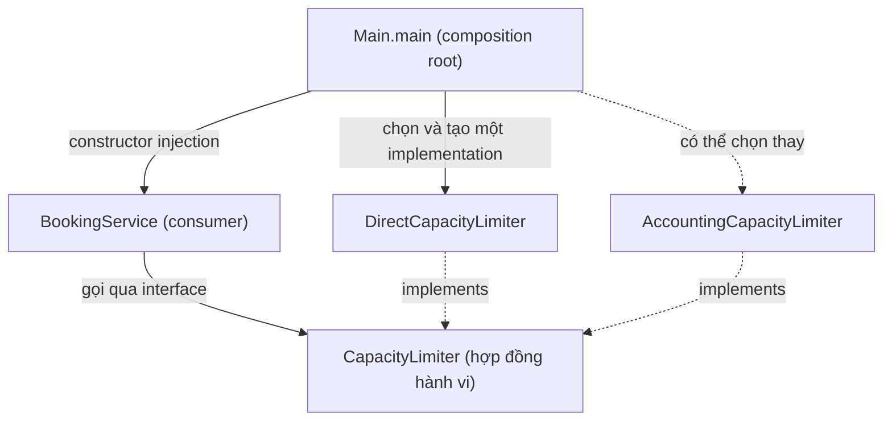

# Tính thay thế giữa các triển khai và giới hạn của kiểm tra kiểu

> **Chương:** Hợp đồng phụ thuộc  
> **Bối cảnh:** Dependency Injection (DI) và Inversion of Control (IoC) trong Java: tách việc sử dụng dependency khỏi việc tạo, lắp ghép đối tượng, kiểm thử được bằng Java thuần trước khi dùng DI container.

## 1. Mục tiêu học tập

Sau bài này, bạn có thể:

1. Phân biệt **tương thích kiểu** với **tính thay thế về hành vi** giữa các triển khai cùng một interface.
2. Diễn giải nguyên tắc thay thế Liskov (Liskov Substitution Principle – LSP) qua tiền điều kiện, hậu điều kiện và bất biến.
3. Nhận biết những điều trình biên dịch Java kiểm tra được và những cam kết phải mô tả, kiểm thử ở mức nghiệp vụ.
4. Thiết kế một **hợp đồng phụ thuộc** đủ rõ để thay adapter mà không sửa service dùng nó.
5. Viết và chạy **contract test** cho nhiều implementation bằng Java thuần, rồi xác định các giới hạn của bộ kiểm thử đó.
6. Đánh giá tác động của scope, vòng đời, side effect và concurrency khi thay implementation tại composition root.

## 2. Cùng một kiểu dữ liệu chưa chắc thay thế được cho nhau

Giả sử một service chỉ biết interface `CapacityLimiter` để giữ chỗ theo số lượng:

```java
interface CapacityLimiter {
    boolean tryReserve(int units);
    int remaining();
}
```

Bất kỳ lớp nào triển khai đúng chữ ký phương thức đều có thể được truyền vào constructor có tham số kiểu `CapacityLimiter`:

```java
final class BookingService {
    private final CapacityLimiter limiter;

    BookingService(CapacityLimiter limiter) {
        this.limiter = java.util.Objects.requireNonNull(limiter);
    }
}
```

Đây là **tương thích kiểu ở thời điểm biên dịch**. Tuy nhiên, chỉ nhìn chữ ký `boolean tryReserve(int units)`, không thể biết:

- `true` có đồng nghĩa đã giữ **đúng số đơn vị yêu cầu** hay không;
- `false` có giữ nguyên số lượng còn lại hay không;
- tham số `0` hoặc số âm được xử lý ra sao;
- `remaining()` có chỉ đọc trạng thái, hay vô tình thay đổi trạng thái;
- hai lời gọi đồng thời có thể đặt vượt quá sức chứa hay không;
- phương thức có tác dụng phụ như ghi log, gọi mạng hoặc bắt đầu transaction không.

Java compiler có thể xác nhận lời gọi **hợp lệ về kiểu**. Nó không tự suy ra các **quy tắc nghiệp vụ** phía sau chữ ký. Vì vậy, muốn dùng Dependency Injection để hoán đổi triển khai một cách an toàn, ta cần một **hợp đồng về hành vi** rõ ràng.

## 3. Hợp đồng phụ thuộc cần mô tả những gì?

Hợp đồng (contract) không chỉ là danh sách phương thức. Nó còn gồm những giả định và cam kết mà **mọi implementation** phải tôn trọng.

| Thành phần hợp đồng | Câu hỏi thiết kế | Ví dụ với `CapacityLimiter` |
| --- | --- | --- |
| **Tiền điều kiện (precondition)** | Caller phải đưa đầu vào hợp lệ như thế nào? | `units > 0`. |
| **Hậu điều kiện (postcondition)** | Sau khi gọi, kết quả và trạng thái phải thế nào? | Trả `true` thì giữ đúng `units`; trả `false` thì không thay đổi số chỗ còn lại. |
| **Bất biến (invariant)** | Điều gì luôn đúng ở trạng thái quan sát được? | Số chỗ còn lại không âm. |
| **Lỗi và ngoại lệ** | Đầu vào sai và lỗi vận hành được báo ra sao? | `units <= 0` ném `IllegalArgumentException`, không đổi trạng thái. |
| **Tác dụng phụ** | Những gì được phép thay đổi ở ngoài đối tượng? | Giữ chỗ có thể làm thay đổi trạng thái; truy vấn `remaining()` chỉ đọc. |
| **Thứ tự và tính nhất quán** | Các thao tác liên tiếp phải liên hệ thế nào? | Giữ chỗ thành công rồi đọc `remaining()` phải thấy kết quả đã trừ trong cùng luồng thực thi tuần tự. |
| **Scope và concurrency** | Đối tượng có được dùng chung nhiều luồng hoặc nhiều request không? | Ở hợp đồng nhập môn này, chỉ cam kết hành vi **tuần tự**; chưa cam kết thread safety. |

Một hợp đồng chỉ có giá trị nếu **consumer dựa vào đúng các cam kết được công bố**. Nếu implementation tình cờ hỗ trợ thêm một đặc tính nhưng interface không hứa hẹn, service không nên mặc nhiên yêu cầu mọi implementation khác cũng có đặc tính ấy.

### 3.1. Nguyên tắc thay thế Liskov (LSP)

Ở mức thực hành, **LSP** yêu cầu một đối tượng của kiểu con/implementation có thể dùng tại những nơi chương trình chờ kiểu cha/interface **mà không phá vỡ những hành vi đã được hợp đồng cam kết**.

Khi hiện thực một contract, cần chú ý:

- **Không siết tiền điều kiện:** nếu contract chấp nhận mọi số nguyên dương, một implementation không được tự ý yêu cầu `units >= 5` mà caller không biết.
- **Không làm yếu hậu điều kiện:** nếu `false` nghĩa là **không giữ được chỗ nào**, implementation không được trừ một phần rồi trả `false`.
- **Giữ bất biến:** không để `remaining()` trả số âm hoặc báo trạng thái bất khả thi sau một chuỗi lời gọi hợp lệ.
- **Giữ cam kết về lỗi và tác dụng phụ:** không âm thầm trả `null` khi contract hứa có kết quả, hoặc phát sinh hành vi phá vỡ giả định của consumer.

LSP thường được thảo luận cùng thừa kế lớp, nhưng tư duy **khả năng thay thế về hành vi** cũng áp dụng trực tiếp cho nhiều implementation của cùng một interface được cung cấp bằng DI.

### 3.2. Một ghi chú hợp đồng rõ ràng hơn chữ ký

Đây là dạng mô tả có thể đặt ngay cạnh interface trong Java:

```java
/**
 * Giữ chỗ theo sức chứa, với ngữ nghĩa sử dụng tuần tự.
 *
 * - units phải dương. Nếu không, ném IllegalArgumentException
 *   và không thay đổi trạng thái.
 * - tryReserve(units) trả true nếu giữ được đúng units;
 *   sau đó remaining() giảm đúng units.
 * - Trả false khi không đủ chỗ; trạng thái giữ nguyên.
 * - remaining() là truy vấn không làm thay đổi trạng thái
 *   và luôn trả giá trị >= 0.
 * - Interface này chưa cam kết an toàn khi gọi đồng thời.
 */
interface CapacityLimiter {
    boolean tryReserve(int units);
    int remaining();
}
```

Hợp đồng này giúp người viết adapter và người viết test có một nguồn quy chiếu chung. Nếu yêu cầu thay đổi theo thời gian, hãy cập nhật contract và các bài test cùng lúc.

## 4. Ví dụ Java thuần: hai triển khai thay thế được

Ví dụ dưới đây có một implementation lưu **số chỗ còn lại** và một implementation lưu **số chỗ đã giữ**. Cách biểu diễn trạng thái khác nhau, nhưng hai lớp tuân theo cùng hợp đồng tuần tự.

Tạo file `Main.java`:

```java
import java.util.Objects;

/**
 * Hợp đồng sử dụng tuần tự:
 * units > 0; thành công trừ đúng units; thất bại không thay đổi
 * trạng thái; remaining() không âm và không có tác dụng phụ.
 */
interface CapacityLimiter {
    boolean tryReserve(int units);
    int remaining();
}

// Cách 1: lưu trực tiếp số chỗ còn lại.
final class DirectCapacityLimiter implements CapacityLimiter {
    private int available;

    DirectCapacityLimiter(int initialCapacity) {
        if (initialCapacity < 0) {
            throw new IllegalArgumentException("initialCapacity < 0");
        }
        this.available = initialCapacity;
    }

    @Override
    public boolean tryReserve(int units) {
        if (units <= 0) {
            throw new IllegalArgumentException("units must be positive");
        }
        if (units > available) {
            return false;
        }
        available -= units;
        return true;
    }

    @Override
    public int remaining() {
        return available;
    }
}

// Cách 2: lưu tổng sức chứa và số chỗ đã giữ.
final class AccountingCapacityLimiter implements CapacityLimiter {
    private final int capacity;
    private int reserved;

    AccountingCapacityLimiter(int initialCapacity) {
        if (initialCapacity < 0) {
            throw new IllegalArgumentException("initialCapacity < 0");
        }
        this.capacity = initialCapacity;
    }

    @Override
    public boolean tryReserve(int units) {
        if (units <= 0) {
            throw new IllegalArgumentException("units must be positive");
        }
        if (units > capacity - reserved) {
            return false;
        }
        reserved += units;
        return true;
    }

    @Override
    public int remaining() {
        return capacity - reserved;
    }
}

// Consumer phụ thuộc vào contract, không tạo adapter bên trong.
final class BookingService {
    private final CapacityLimiter limiter;

    BookingService(CapacityLimiter limiter) {
        this.limiter = Objects.requireNonNull(limiter, "limiter");
    }

    String book(int units) {
        return limiter.tryReserve(units) ? "CONFIRMED" : "REJECTED";
    }

    int remaining() {
        return limiter.remaining();
    }
}

public class Main {
    public static void main(String[] args) {
        // Composition root: thay constructor này để đổi adapter.
        CapacityLimiter limiter = new DirectCapacityLimiter(5);
        // CapacityLimiter limiter = new AccountingCapacityLimiter(5);

        BookingService bookingService = new BookingService(limiter);
        System.out.println(bookingService.book(3));
        System.out.println(bookingService.book(4));
        System.out.println(bookingService.remaining());
    }
}
```

Biên dịch và chạy bằng JDK:

```bash
javac -encoding UTF-8 Main.java
java Main
```

Kết quả với **cả hai** implementation:

```text
CONFIRMED
REJECTED
2
```

`BookingService` không chứa `new DirectCapacityLimiter(...)` hay `new AccountingCapacityLimiter(...)`. Nó chỉ nhận `CapacityLimiter` qua **constructor injection**. Việc chọn triển khai nằm ở **composition root** (`Main.main`). Đây là cách DI và IoC giúp tách nơi sử dụng khỏi nơi tạo, lắp ghép đối tượng. Không cần DI container để đạt được lợi ích này.



Điểm quan trọng: compiler đảm bảo cả hai lớp đều có các phương thức như `CapacityLimiter` yêu cầu, nhưng **chính code triển khai và kiểm thử hợp đồng** mới cho cơ sở tin rằng kết quả, trạng thái và ngoại lệ tuân thủ quy tắc.

## 5. Một triển khai biên dịch được nhưng không thay thế được

Xét adapter sau. Nó có đủ chữ ký phương thức nên **tương thích kiểu**:

```java
// PHẢN VÍ DỤ: không thêm vào Main.java ở mục 4.
final class DrainingCapacityLimiter implements CapacityLimiter {
    private int available;

    DrainingCapacityLimiter(int initialCapacity) {
        if (initialCapacity < 0) {
            throw new IllegalArgumentException("initialCapacity < 0");
        }
        this.available = initialCapacity;
    }

    @Override
    public boolean tryReserve(int units) {
        if (units <= 0) {
            throw new IllegalArgumentException("units must be positive");
        }
        if (units > available) {
            available = 0; // Sai hợp đồng: làm mất chỗ dù trả false.
            return false;
        }
        available -= units;
        return true;
    }

    @Override
    public int remaining() {
        return available;
    }
}
```

Với sức chứa ban đầu bằng 5:

1. `tryReserve(3)` trả `true`; `remaining() == 2`.
2. `tryReserve(4)` trả `false`, nhưng implementation lỗi gán `available = 0`.
3. Caller trông chờ vẫn còn **2 chỗ** vì đặt thất bại không được thay đổi trạng thái; thực tế đã mất 2 chỗ.

Không có lỗi biên dịch: kiểu `boolean` và `int` vẫn đúng. Sai ở **hậu điều kiện** và **tính nhất quán của trạng thái**. Nếu lắp lớp này vào `BookingService`, chương trình có thể chạy nhưng hành vi nghiệp vụ khác đi một cách âm thầm.

Một lỗi khác là **siết tiền điều kiện**: interface chấp nhận `units = 1`, nhưng một implementation mới tự từ chối mọi yêu cầu nhỏ hơn 5. Nó cũng vẫn có thể biên dịch, nhưng không giữ hợp đồng đã công bố.

## 6. Contract test: kiểm cùng bộ quy tắc cho nhiều implementation

Mỗi adapter không nên có một định nghĩa khác nhau về thế nào là “đúng”. Ta có thể viết **một bộ kiểm thử hợp đồng** và chạy nó qua nhiều factory. Trong Java thuần, `java.util.function.IntFunction` đủ để tạo implementation với sức chứa ban đầu.

Giữ `Main.java` ở mục 4 và tạo file `CapacityContractTest.java` trong cùng thư mục:

```java
import java.util.function.IntFunction;

public class CapacityContractTest {
    public static void main(String[] args) {
        verifyContract("Direct", DirectCapacityLimiter::new);
        verifyContract("Accounting", AccountingCapacityLimiter::new);

        // Thử bỏ chú thích và thêm DrainingCapacityLimiter vào
        // Main.java để thấy contract test phát hiện vi phạm:
        // verifyContract("Draining", DrainingCapacityLimiter::new);

        System.out.println("ALL CONTRACT TESTS PASSED");
    }

    private static void verifyContract(
            String name,
            IntFunction<CapacityLimiter> factory) {

        CapacityLimiter limiter = factory.apply(5);
        check(limiter.remaining() == 5, name + ": initial state");
        check(limiter.remaining() == 5, name + ": query must be pure");

        check(limiter.tryReserve(3), name + ": should accept 3");
        check(limiter.remaining() == 2, name + ": should have 2 left");

        check(!limiter.tryReserve(4), name + ": should reject 4");
        check(limiter.remaining() == 2,
                name + ": rejection must not change state");

        check(limiter.tryReserve(2), name + ": should accept exact fit");
        check(limiter.remaining() == 0, name + ": should be empty");
        check(!limiter.tryReserve(1), name + ": should reject when empty");
        check(limiter.remaining() == 0,
                name + ": empty rejection must not change state");

        boolean rejectedInvalidInput = false;
        try {
            limiter.tryReserve(0);
        } catch (IllegalArgumentException expected) {
            rejectedInvalidInput = true;
        }
        check(rejectedInvalidInput, name + ": invalid input must throw");
        check(limiter.remaining() == 0,
                name + ": invalid input must not change state");

        CapacityLimiter empty = factory.apply(0);
        check(empty.remaining() == 0, name + ": zero capacity");
        check(!empty.tryReserve(1), name + ": zero capacity rejects");

        System.out.println("PASS " + name);
    }

    private static void check(boolean condition, String message) {
        if (!condition) {
            throw new AssertionError(message);
        }
    }
}
```

Chạy:

```bash
javac -encoding UTF-8 Main.java CapacityContractTest.java
java CapacityContractTest
```

Kết quả mong đợi:

```text
PASS Direct
PASS Accounting
ALL CONTRACT TESTS PASSED
```

Nếu đưa `DrainingCapacityLimiter` vào cùng bộ test rồi bỏ chú thích lời gọi `verifyContract("Draining", ...)`, lần kiểm `rejection must not change state` sẽ thất bại. Đây là bằng chứng cụ thể rằng “implements interface” và “tuân thủ hợp đồng” là hai mức bảo đảm khác nhau.

### 6.1. Phạm vi mà contract test vừa kiểm chứng

Bộ test trên kiểm các chuỗi thao tác **tuần tự** và một số trường hợp biên: chỗ bằng 0, giữ vừa đủ, giữ vượt sức chứa, đầu vào không hợp lệ, và tính không làm thay đổi trạng thái của truy vấn.

Contract test **không phải chứng minh toán học** rằng implementation đúng với mọi đầu vào và mọi lịch thực thi. Nó chưa thử:

- hàng nghìn chuỗi thao tác ngẫu nhiên, các giá trị số nguyên cực lớn hoặc các lỗi chỉ phát sinh sau thời gian dài;
- nhiều luồng đặt chỗ cùng lúc;
- lỗi mạng, timeout, retry, transaction rollback hoặc tính bền vững dữ liệu nếu adapter dùng cơ sở dữ liệu thật;
- các yêu cầu phi chức năng như giới hạn độ trễ hoặc mức tiêu thụ tài nguyên.

Khi có yêu cầu tương ứng, cần bổ sung **property-based test**, **concurrency test**, **integration test** hoặc kiểm thử tải. Trong một số hệ thống, code review, phân tích tĩnh và đặc tả chính thức cũng góp phần tăng độ tin cậy.

### 6.2. Fake và mock cũng phải tôn trọng hợp đồng

Trong kiểm thử `BookingService`, ta có thể truyền một fake qua constructor mà không cần database hoặc DI container. Nhưng fake **không được tự đặt ra quy tắc khác** chỉ để bài test qua. Ví dụ fake trả `false` rồi vẫn trừ sức chứa có thể khiến consumer test không phát hiện lỗi thiết kế. Chạy cùng contract test cho fake (khi có thể) là một cách giữ test double trung thực với interface.

Contract test đặc biệt hữu ích khi module có nhiều adapter: in-memory để test, JDBC để vận hành, adapter từ API bên ngoài, hoặc phiên bản cache. Chúng phải thỏa các cam kết chung, dù chi tiết lưu trữ và tối ưu hóa khác nhau.

## 7. Giới hạn cụ thể của kiểm tra kiểu trong Java

Java kiểm tra được một phần **cấu trúc chương trình**:

| Java compiler có thể kiểm tra | Java compiler thông thường không tự kiểm tra |
| --- | --- |
| Lớp hiện thực đủ các phương thức trừu tượng của interface. | Phương thức thật sự làm đúng nghiệp vụ đã mô tả. |
| Tham số và kiểu trả về tương thích, theo quy tắc override. | `false` có để nguyên trạng thái hay không. |
| Các ràng buộc generic ở thời điểm biên dịch theo type system của Java. | Dữ liệu trả về có đúng ý nghĩa, thứ tự, đơn vị đo hay nguồn gốc không. |
| Một phương thức override không thêm checked exception rộng hơn khai báo cho phép. | Runtime exception nào sẽ xảy ra trong mọi ngữ cảnh. |
| `final` ngăn gán lại tham chiếu của trường đã khởi tạo. | Đối tượng được tham chiếu có bất biến nội tại, thread-safe hoặc không đổi theo thời gian hay không. |
| Quy tắc truy cập kiểu, phương thức, trường và cú pháp. | Không có rò rỉ tài nguyên, race condition, mất dữ liệu hoặc vi phạm transaction. |

Ví dụ với `Optional`:

```java
interface DisplayNameLookup {
    java.util.Optional<String> find(String accountId);
}

// Sai hợp đồng nếu contract yêu cầu không bao giờ trả null:
final class BrokenNameLookup implements DisplayNameLookup {
    @Override
    public java.util.Optional<String> find(String accountId) {
        return null; // Vẫn có thể biên dịch trong Java thông thường.
    }
}
```

Consumer gọi `find(id).orElse("Unknown")` có thể gặp `NullPointerException`. Kiểu trả về `Optional<String>` tự nó không khiến trình biên dịch từ chối dòng `return null`. Những công cụ kiểm tra nullness có thể hỗ trợ nếu được cấu hình, nhưng không thay thế việc định nghĩa và kiểm thử hành vi.

Một trường `final DeliveryChannel channel` chỉ ngăn gán lại **tham chiếu `channel`**; nó không làm implementation thread-safe, không ngăn trạng thái bên trong thay đổi và không quyết định ai đóng kết nối bên trong.

### 7.1. Giới hạn còn xuất hiện dù method “chạy đúng”

Hai implementation có thể đều trả dữ liệu hợp lệ nhưng khác nhau ở những chiều quan trọng đối với ứng dụng:

- **Thứ tự:** một repository trả danh sách được sắp theo thời gian, adapter khác trả theo thứ tự bất kỳ.
- **Tính nhất quán:** một adapter đọc dữ liệu tức thời, adapter cache có thể trả dữ liệu cũ.
- **Tính nguyên tử:** một adapter ghi giao dịch trọn vẹn, adapter khác có thể ghi một phần.
- **Idempotency:** một lời gọi lặp lại do retry có gây tác dụng phụ lặp không?
- **Lỗi và retry:** lỗi kết nối được ném ra, đóng gói hay nuốt mất?
- **Tài nguyên:** adapter nào cần `close()`, dùng connection pool hoặc sở hữu thread?

Những khác biệt này chỉ là **vi phạm khả năng thay thế** nếu chúng làm hỏng một cam kết đã được hợp đồng nêu hoặc một giả định hợp lệ của consumer. Nếu contract không hứa thứ tự, consumer không nên dựa vào thứ tự. Nếu nhu cầu nghiệp vụ đòi đọc nhất quán, cần ghi rõ mức nhất quán vào contract.

## 8. Scope, vòng đời và concurrency là một phần của khả năng thay thế

Trong ví dụ ở mục 4, cả hai implementation đều hợp lệ cho **các lời gọi tuần tự**. Tuy vậy, chúng dùng trường số nguyên có thể thay đổi mà không đồng bộ; nếu chia sẻ một instance cho nhiều luồng, hai lần `tryReserve` có thể chạy xen kẽ và dẫn tới giữ quá sức chứa.

Khi triển khai Dependency Injection:

1. **Định nghĩa ngữ cảnh sử dụng:** consumer gọi tuần tự, theo request riêng hay gọi đồng thời trên một instance dùng chung?
2. **Chọn scope phù hợp:** transient, per-request hoặc đối tượng dùng chung ở mức ứng dụng tùy trách nhiệm; không giả định cứ inject được là có thể chia sẻ.
3. **Nêu yêu cầu thread safety nếu cần:** hợp đồng tuần tự ở ví dụ này chưa cho phép giả định `tryReserve` nguyên tử trước các lời gọi đồng thời.
4. **Quản lý lifecycle:** nơi tạo adapter sở hữu tài nguyên cần biết khi nào và bằng cách nào đóng stream, HTTP client, connection pool hoặc executor.

Nếu ứng dụng bắt buộc hỗ trợ nhiều request cùng lúc trên **một** limiter, cần mở rộng cam kết hợp đồng để nói rõ các thao tác đặt chỗ phải nguyên tử khi đồng thời. Sau đó tất cả implementation dùng trong ngữ cảnh ấy phải đáp ứng yêu cầu mới, ví dụ bằng đồng bộ hóa đúng, CAS hoặc transaction phù hợp với backend. Chỉ đổi một implementation thành bản thread-safe **không tự làm** các implementation còn lại đáp ứng hợp đồng mở rộng.

Một adapter có thể tuân hợp đồng nghiệp vụ nhưng không phù hợp scope: ví dụ object chứa dữ liệu request được inject vào một service singleton. Tính đúng đắn khi thay thế phụ thuộc vì thế cần xem cả **ngữ cảnh sử dụng thực tế**, không chỉ interface.

## 9. Quy trình đánh giá khi thêm implementation mới

Khi có thêm một `CapacityLimiter` chạy trên database hoặc cache, có thể làm lần lượt:

1. **Đọc và làm rõ contract:** đầu vào hợp lệ, trạng thái, ngoại lệ, tác dụng phụ, độ nhất quán, concurrency, vòng đời.
2. **Đối chiếu hành vi với contract:** xác định adapter có siết tiền điều kiện, trả kết quả sai nghĩa hoặc thay đổi trạng thái trái phép không.
3. **Chạy cùng contract test:** dùng factory của adapter mới; kiểm các tình huống biên và chuỗi thao tác có trạng thái.
4. **Bổ sung kiểm thử tích hợp:** xác minh transaction, timeout, retry, độ bền và tài nguyên trong môi trường gần với adapter thật.
5. **Lắp ở composition root:** thay implementation được inject vào consumer, giữ nguyên code nghiệp vụ khi hợp đồng không đổi.
6. **Kiểm tra scope:** đảm bảo instance được chia sẻ và đóng đúng cách, phù hợp chính sách concurrency của hệ thống.

Nếu adapter không thể giữ contract cũ vì bản chất hệ thống bên ngoài khác đi, hãy **thiết kế adapter thích nghi hoặc cập nhật hợp đồng một cách có chủ đích**. Đừng che giấu khác biệt bằng một class mới chỉ nhằm biên dịch được.

## 10. Bài tập tự luyện

**Bài 1 — Hậu điều kiện:** `tryReserve(4)` trên limiter đang còn 2 chỗ trả `false` nhưng trừ đi 1 chỗ. Chỉ ra cam kết bị vi phạm và mô tả một assertion sẽ phát hiện lỗi này.

**Bài 2 — Tiền điều kiện:** Contract chấp nhận mọi `units > 0`. Một adapter chỉ chấp nhận `units >= 3`. Vì sao lớp này vẫn có thể biên dịch nhưng không thay thế được?

**Bài 3 — Nullability:** Một interface hứa trả `Optional<String>`, implementation trả `null` khi không tìm thấy. Java compiler có ngăn được không? Hãy nêu cách sửa hành vi và một case kiểm thử.

**Bài 4 — Scope:** Cùng một `CapacityLimiter` được giữ trong singleton phục vụ 200 request đồng thời. Contract hiện tại chỉ nói về thực thi tuần tự. Trước khi đưa vào sản xuất, cần bổ sung những cam kết và phép kiểm tra nào?

**Bài 5 — Mở rộng bằng Java thuần:** Thêm implementation thứ ba dùng biểu diễn trạng thái khác, truyền nó vào `BookingService` bằng constructor injection và chạy lại `CapacityContractTest`. Hãy giải thích vì sao chỉ thay dòng wiring chưa đủ để chứng minh tính thay thế về hành vi.

**Gợi ý đối chiếu:** (1) Vi phạm hậu điều kiện “thất bại không đổi trạng thái”; kiểm `remaining()` trước và sau lời gọi thất bại phải bằng nhau. (2) Implementation siết tiền điều kiện hợp lệ của caller. (3) Java thông thường vẫn biên dịch; trả `Optional.empty()` và test không bao giờ trả `null`. (4) Cần quy định tính nguyên tử/linearizability hay mô hình nhất quán mong muốn, kiểm thử đồng thời và quản lý đúng instance/lifecycle. (5) Compiler chỉ xác minh chữ ký; contract test xác minh một tập hữu hạn hành vi, còn các đặc tính ngoài tập test cần kiểm chứng bổ sung.

## 11. Ghi nhớ

**Tương thích kiểu là điều kiện cần, nhưng chưa đủ cho tính thay thế.** Hợp đồng phụ thuộc bao gồm quy tắc đầu vào, kết quả, trạng thái, lỗi và điều kiện sử dụng mà caller được phép dựa vào. DI giúp đổi implementation ở composition root mà không sửa consumer; **LSP và contract test** giúp đánh giá liệu sự thay thế ấy có giữ nguyên hành vi đã hứa hay không. Trong Java, compiler bảo vệ nhiều quy tắc về kiểu và chữ ký, nhưng các cam kết nghiệp vụ, side effect, concurrency, scope và lifecycle vẫn cần đặc tả, thiết kế và kiểm chứng riêng.
