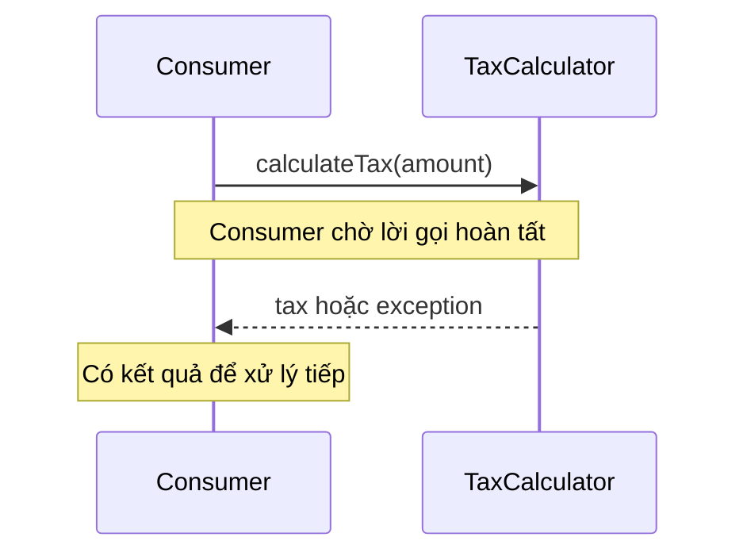
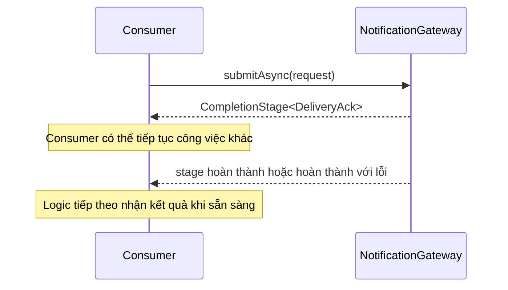
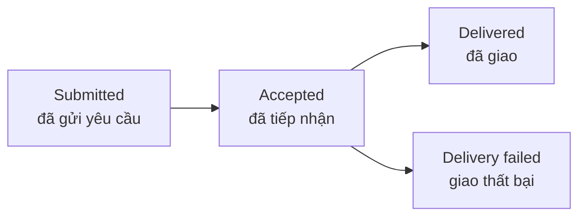

# Đồng bộ, bất đồng bộ và các yêu cầu về thời gian trong hợp đồng

## Mục tiêu học tập

Sau bài này, bạn có thể:

- Đọc chữ ký Java để phân biệt hợp đồng **đồng bộ** và **bất đồng bộ**, đồng thời chỉ ra những bảo đảm về thời gian mà chữ ký chưa thể hiện.
- Nêu rõ ý nghĩa của việc một lời gọi **trả về**, một tác vụ **hoàn thành**, một yêu cầu được **tiếp nhận** và một tác động bên ngoài thực sự **xảy ra**.
- Định nghĩa cách báo lỗi, timeout, deadline, hủy và thử lại trong hợp đồng giữa consumer và dependency.
- Dùng **constructor injection**, **composition root** và Java thuần để thay implementation mà không thay đổi ý nghĩa hợp đồng.
- Viết phép kiểm thử bất đồng bộ có kiểm soát bằng `CompletableFuture`, không dựa vào `Thread.sleep(...)` hay thời điểm chạy ngẫu nhiên.

Bài thuộc chương **Hợp đồng phụ thuộc** trong chủ đề **Dependency Injection (DI)** và **Inversion of Control (IoC)**. DI tách việc *sử dụng* một phụ thuộc khỏi việc *tạo và lắp ghép* nó, nhưng chỉ tách được an toàn khi những implementation có thể thay thế đều tuân thủ **cùng một hợp đồng hành vi và thời gian**.

## 1. Hợp đồng phụ thuộc không chỉ gồm tên phương thức

Một interface xác định tập phương thức mà consumer có thể gọi. Tuy nhiên, những điều consumer cần biết thường rộng hơn kiểu tham số và kiểu trả về:

| Thành phần hợp đồng | Câu hỏi cần trả lời |
| --- | --- |
| **Đầu vào / đầu ra** | Điều kiện hợp lệ của tham số là gì? Kết quả có ý nghĩa gì? |
| **Hoàn thành** | Khi phương thức trả về, tác vụ đã xong hay chỉ mới được lên lịch? Khi future hoàn thành, điều gì đã được bảo đảm? |
| **Thời gian** | Có giới hạn chờ, deadline của nghiệp vụ hoặc cam kết độ trễ nào? |
| **Thất bại** | Lỗi nào xuất hiện ngay khi gọi? Lỗi nào đến qua future? Có kết quả một phần không? |
| **Hủy / timeout** | Dừng chờ có dừng công việc nền không? Công việc có thể vẫn tạo tác dụng phụ không? |
| **Thử lại** | Có an toàn nếu gọi lại? Cần khóa chống trùng hoặc idempotency key không? |
| **Đồng thời / vòng đời** | Có thể gọi từ nhiều luồng không? Dependency có được dùng sau khi consumer trả về không? Ai đóng tài nguyên? |

Ví dụ, cùng một chữ ký `send(String recipient, String message)` có thể có các nghĩa rất khác nhau: gửi xong qua mạng trước khi trả về, chỉ ghi yêu cầu vào hàng đợi, hoặc khởi động một luồng nền rồi trả về. Nếu không nói rõ, consumer có thể hiểu sai trạng thái thực tế của tác vụ.

**Nguyên tắc:** hợp đồng phải mô tả điều gì *đã chắc chắn xảy ra* tại mỗi thời điểm quan sát được. Việc implementation sử dụng thread hay thư viện nào là chi tiết nội bộ, trừ khi nó ảnh hưởng trực tiếp đến cách consumer phải gọi.

## 2. Đồng bộ và bất đồng bộ khác nhau thế nào?

### 2.1. Hợp đồng đồng bộ

```java
interface TaxCalculator {
    long calculateTax(long taxableAmountVnd);
}
```

Một hợp đồng đồng bộ như trên có thể quy định: **trước khi `calculateTax(...)` trả về bình thường, giá trị thuế đã được tính xong**. Nếu đầu vào không hợp lệ, phương thức có thể ném ngoại lệ ngay trong lời gọi. Consumer nhận được kết quả trực tiếp và tiếp tục xử lý.



Không phải mọi hàm đồng bộ đều nhanh. Nó vẫn có thể chặn luồng nếu implementation làm I/O hoặc đợi khóa. Vì vậy, **kiểu trả về trực tiếp không chứng minh lời gọi có độ trễ nhỏ**; cần thêm hợp đồng thời gian khi điều đó quan trọng.

### 2.2. Hợp đồng bất đồng bộ

```java
import java.util.concurrent.CompletionStage;

interface NotificationGateway {
    CompletionStage<DeliveryAck> submitAsync(NotificationRequest request);
}
```

Ở đây, lời gọi trả về một `CompletionStage` biểu diễn **kết quả sẽ có sau**. Consumer có thể đăng ký bước xử lý tiếp theo bằng `thenApply`, `thenCompose` hoặc xử lý lỗi bằng `exceptionally`/`handle`, mà không phải đợi ngay tại điểm gọi.



**Có future chưa đủ để gọi là “không chặn” trong mọi trường hợp.** Implementation vẫn có thể chặn trước khi trả về future; consumer cũng có thể tự chặn nếu gọi `get()` hoặc `join()`. Hợp đồng cần nói rõ phần nào được thực hiện trước khi trả về và liệu phương thức được phép làm I/O chặn ngay trên luồng gọi hay không.

### 2.3. Bảng so sánh

| Tiêu chí | Đồng bộ | Bất đồng bộ |
| --- | --- | --- |
| Giá trị trả về | Kết quả cuối của lời gọi hoặc ngoại lệ | Đối tượng đại diện cho kết quả trong tương lai |
| Sau khi phương thức trả về | Công việc theo hợp đồng đồng bộ đã hoàn tất | Công việc có thể đang chờ hoặc đang chạy |
| Báo lỗi chính | Ném ngoại lệ tại lời gọi | Thường hoàn thành stage với lỗi; lỗi đầu vào có thể xuất hiện ngay |
| Kết hợp nhiều bước | Gọi lần lượt trong cùng luồng điều khiển | `thenApply`, `thenCompose`, `handle`, `allOf`... |
| Chờ kết quả | Người gọi chờ trực tiếp | Có thể không chờ; hoặc chủ động chờ tại ranh giới cần kết quả |
| Quan tâm thêm | Độ trễ chặn luồng | Luồng thực thi, completion, timeout, tác vụ còn chạy, vòng đời tài nguyên |

Không có quy tắc “bất đồng bộ luôn nhanh hơn”. Async có chi phí lên lịch và phối hợp; nó hữu ích khi cần chờ I/O, xử lý đồng thời hoặc không muốn khóa luồng yêu cầu trong thời gian chờ.

## 3. Điều quan trọng nhất: định nghĩa **khi nào là hoàn thành**

Xét thao tác gửi thông báo, có ít nhất ba mốc:

1. **Submitted:** ứng dụng gọi `submitAsync(...)` và nhận future.
2. **Accepted:** gateway xác nhận đã tiếp nhận yêu cầu để xử lý.
3. **Delivered:** hệ thống đích xác nhận thông báo đã được giao theo tiêu chí đã thống nhất.



Nếu interface trả `CompletionStage<DeliveryAck>` và tài liệu quy định **stage hoàn thành khi gateway tiếp nhận**, consumer chỉ được kết luận **Accepted**. Nó chưa thể kết luận **Delivered**, vì việc giao có thể xảy ra sau đó hoặc thất bại.

Đổi implementation từ email sang message queue mà vẫn giữ interface là hợp lệ **chỉ khi cả hai giữ nguyên ý nghĩa của completion**. Ví dụ, nếu implementation cũ hoàn thành sau khi gửi đến người nhận còn implementation mới hoàn thành ngay khi đưa vào queue, consumer có thể báo “đã giao” quá sớm dù chữ ký Java không đổi.

Khi cần theo dõi giao hàng cuối cùng, hãy thiết kế **hợp đồng khác**: event/callback tra cứu trạng thái, status query, hoặc một stage có cam kết chờ đến Delivered. Đừng dùng tên `sendAsync` như lời bảo đảm mặc định rằng thông báo đã tới nơi.

## 4. Đặc tả hợp đồng cho ví dụ gửi xác nhận đơn hàng

Ta chọn phạm vi vừa đủ để học DI bằng Java thuần:

> `NotificationGateway.submitAsync(request)` nhận một yêu cầu hợp lệ và trả về `CompletionStage<DeliveryAck>`. Stage **hoàn thành bình thường khi cổng thông báo đã tiếp nhận yêu cầu** (Accepted); hoàn thành với lỗi nếu không thể tiếp nhận. Phương thức không thực hiện I/O mạng chặn luồng gọi. Việc Delivered không nằm trong phạm vi hợp đồng này.

Quy ước chi tiết:

| Điều kiện | Cam kết của hợp đồng |
| --- | --- |
| `request == null` hoặc các trường bắt buộc không hợp lệ | Có thể từ chối bằng lỗi kiểm tra đầu vào ngay tại lời gọi, trước khi nhận xử lý. |
| Yêu cầu hợp lệ và gateway tiếp nhận thành công | Stage hoàn thành bình thường với `DeliveryAck` mang mã tiếp nhận. |
| Gateway không thể tiếp nhận | Stage hoàn thành *exceptionally* với nguyên nhân lỗi. |
| Caller có giới hạn chờ | Caller có thể timeout khi đợi; **timeout chưa chứng minh gateway đã dừng**. |
| Có gọi lại cùng request | Cần quy định idempotency và xử lý trùng riêng; ví dụ demo **không thực thi chống trùng**. |
| Nhiều lời gọi đồng thời | Implementation phải đáp ứng chính sách đồng thời đã mô tả; đối tượng giả lập trong bài chỉ in console và sử dụng executor do nơi lắp ghép quản lý. |

Phân biệt **quy tắc đầu vào** và **lỗi tác vụ** là cần thiết: một lỗi `IllegalArgumentException` do dữ liệu rỗng xảy ra trước khi có yêu cầu bất đồng bộ; sự cố khi gateway xử lý một yêu cầu hợp lệ thường phải đi qua stage để consumer xử lý thống nhất. Khi thiết kế API cho dự án thật, nên ghi rõ chính xác loại lỗi nào đi theo đường nào.

## 5. Ví dụ Java hoàn chỉnh: constructor injection với gateway bất đồng bộ

Ví dụ sau dùng `ExecutorService` để mô phỏng cổng tiếp nhận thông báo. Không gửi email hay gọi dịch vụ bên ngoài. **`Main` là composition root**, tạo executor, chọn implementation và đưa gateway vào consumer qua constructor.

Lưu toàn bộ vào **`Main.java`** (JDK 8 trở lên):

```java
import java.util.Objects;
import java.util.concurrent.CompletableFuture;
import java.util.concurrent.CompletionStage;
import java.util.concurrent.Executor;
import java.util.concurrent.ExecutorService;
import java.util.concurrent.Executors;
import java.util.concurrent.TimeUnit;

final class NotificationRequest {
    final String orderId;
    final String recipient;
    final String idempotencyKey;

    NotificationRequest(String orderId, String recipient, String idempotencyKey) {
        this.orderId = requiredText(orderId, "orderId");
        this.recipient = requiredText(recipient, "recipient");
        this.idempotencyKey = requiredText(idempotencyKey, "idempotencyKey");
    }

    private static String requiredText(String value, String field) {
        Objects.requireNonNull(value, field);
        if (value.trim().isEmpty()) {
            throw new IllegalArgumentException(field + " must not be empty");
        }
        return value;
    }
}

// Xác nhận gateway đã tiếp nhận; không phải bằng chứng đã giao email.
final class DeliveryAck {
    final String acceptanceId;

    DeliveryAck(String acceptanceId) {
        this.acceptanceId = Objects.requireNonNull(acceptanceId, "acceptanceId");
    }
}

interface NotificationGateway {
    CompletionStage<DeliveryAck> submitAsync(NotificationRequest request);
}

// Implementation giả lập: thực hiện xử lý trên executor được tiêm vào.
final class DemoNotificationGateway implements NotificationGateway {
    private final Executor executor;

    DemoNotificationGateway(Executor executor) {
        this.executor = Objects.requireNonNull(executor, "executor");
    }

    @Override
    public CompletionStage<DeliveryAck> submitAsync(NotificationRequest request) {
        Objects.requireNonNull(request, "request");
        return CompletableFuture.supplyAsync(() -> {
            System.out.println("[DEMO] Tiếp nhận yêu cầu cho " + request.orderId);
            // Mã tiếp nhận chỉ là dữ liệu giả lập.
            return new DeliveryAck("accepted-" + request.orderId);
        }, executor);
    }
}

// Consumer dựa vào hợp đồng; không biết executor hoặc cách gửi thực tế.
final class OrderConfirmationService {
    private final NotificationGateway gateway;

    OrderConfirmationService(NotificationGateway gateway) {
        this.gateway = Objects.requireNonNull(gateway, "gateway");
    }

    CompletionStage<String> confirmAsync(
            String orderId, String recipient, String idempotencyKey) {
        NotificationRequest request =
                new NotificationRequest(orderId, recipient, idempotencyKey);

        // Kết hợp bước bất đồng bộ, không gọi get()/join() tại đây.
        return gateway.submitAsync(request)
                .thenApply(ack -> "Đã tiếp nhận " + orderId
                        + ", mã=" + ack.acceptanceId);
    }
}

public class Main {
    public static void main(String[] args) throws Exception {
        ExecutorService executor = Executors.newFixedThreadPool(2);
        try {
            NotificationGateway gateway = new DemoNotificationGateway(executor);
            OrderConfirmationService service = new OrderConfirmationService(gateway);

            CompletionStage<String> result = service.confirmAsync(
                    "DH-42", "khach@example.com", "notify-DH-42");

            // Chờ có giới hạn chỉ tại ranh giới của ứng dụng demo.
            String accepted = result.toCompletableFuture()
                    .get(2, TimeUnit.SECONDS);
            System.out.println(accepted);
        } finally {
            // Main tạo executor nên Main có trách nhiệm kết thúc nó.
            executor.shutdown();
            if (!executor.awaitTermination(2, TimeUnit.SECONDS)) {
                executor.shutdownNow();
            }
        }
    }
}
```

Chạy:

```bash
javac -encoding UTF-8 Main.java
java Main
```

Đầu ra minh họa:

```text
[DEMO] Tiếp nhận yêu cầu cho DH-42
Đã tiếp nhận DH-42, mã=accepted-DH-42
```

Các trách nhiệm được phân chia như sau:

| Thành phần | Vai trò | Trách nhiệm về thời gian và vòng đời |
| --- | --- | --- |
| `OrderConfirmationService` | **Consumer** của `NotificationGateway` | Trả stage cho caller và kết hợp kết quả bằng `thenApply`; không tự chặn, tạo thread hay đóng executor. |
| `NotificationGateway` | **Hợp đồng phụ thuộc** | Xác định khi nào stage hoàn thành và ý nghĩa `DeliveryAck`. |
| `DemoNotificationGateway` | **Provider / implementation** | Lên lịch công việc bằng executor, hoàn thành stage sau khi giả lập tiếp nhận. |
| `Main` | **Composition root** | Tạo executor và gateway, truyền gateway vào service, chờ ở điểm cuối rồi đóng executor. |

Vì executor được **tiêm vào `DemoNotificationGateway`**, implementation không tự tạo một pool ẩn và cũng không được tự ý `shutdown()` pool đang thuộc quyền sở hữu của `Main`. Đây là lợi ích của DI cả với **đối tượng phục vụ thực thi bất đồng bộ**, không chỉ với repository hay logger.

Một chi tiết của `CompletionStage`: callback như `thenApply` có thể chạy trên luồng hoàn thành stage hoặc luồng đang đăng ký callback, tùy trạng thái và implementation. Nếu callback thực hiện thao tác nặng/chặn, cần cân nhắc `thenApplyAsync(..., executor)` và chính sách executor riêng. Đừng mặc định mọi callback chạy trên một thread mới.

## 6. Yêu cầu về thời gian: latency, timeout, deadline

### 6.1. Phân biệt các thuật ngữ

| Thuật ngữ | Ý nghĩa | Ví dụ |
| --- | --- | --- |
| **Latency** | Thời gian quan sát được để một thao tác đạt mốc hoàn thành đã định nghĩa. | 120 ms từ lúc `submitAsync` đến khi Accepted. |
| **Timeout** | Khoảng chờ tối đa của một người đợi; hết hạn thì người đợi ngừng chờ hoặc báo lỗi. | Caller đợi tối đa 700 ms để có Ack. |
| **Deadline** | Thời điểm hạn chót cho toàn bộ luồng hoặc một bước đã được quy định. | Phải có kết quả trước khi request hết hạn. |
| **SLO** | Mục tiêu đo lường độ trễ/độ tin cậy trong vận hành, không mặc nhiên là bảo đảm tuyệt đối cho mỗi lời gọi. | 99% yêu cầu Accepted trong một ngưỡng đã thỏa thuận. |

**Timeout không phải cơ chế hủy mặc định.** Trong chương trình, `get(2, TimeUnit.SECONDS)` chỉ giới hạn thời gian mà `Main` chờ kết quả. Nếu hết 2 giây, `get` ném `TimeoutException`, nhưng công việc đã giao cho executor có thể vẫn đang chạy và sau đó hoàn thành.

```java
// Minh họa tại điểm chờ kết quả ở caller:
try {
    String result = stage.toCompletableFuture()
            .get(700, java.util.concurrent.TimeUnit.MILLISECONDS);
    System.out.println(result);
} catch (java.util.concurrent.TimeoutException timeout) {
    System.out.println("Hết thời gian chờ kết quả tiếp nhận");
    // Không được kết luận yêu cầu chắc chắn đã bị hủy.
}
```

Trong đoạn minh họa, `stage` là một `CompletionStage<String>` đã có từ trước; các ngoại lệ kiểm tra khác như `InterruptedException` và `ExecutionException` cần được caller xử lý hoặc khai báo `throws` theo ngữ cảnh phương thức chứa đoạn mã.

Nếu cần giới hạn chính **công việc nền**, hợp đồng gateway phải hỗ trợ deadline/cancellation và implementation phải áp dụng giới hạn ở lớp I/O. Chỉ giới hạn thời gian `get(...)` của caller chưa đủ để kiểm soát socket, hàng đợi hoặc thao tác gửi bên ngoài.

### 6.2. Deadline cho nhiều bước

Một luồng xử lý có thể gọi nhiều phụ thuộc:

```text
Người dùng gửi request
    -> kiểm tra tồn kho
    -> tính phí
    -> tiếp nhận thông báo
    -> trả response
```

Giả sử toàn bộ luồng có **ngân sách 1.000 ms**. Sau bước tồn kho hết 400 ms, các bước còn lại chỉ còn khoảng 600 ms, chứ không có thêm 1.000 ms cho *mỗi* bước. Nếu mỗi dependency tự đặt timeout 1.000 ms, tổng thời gian có thể vượt hạn chót nghiệp vụ.

Cách thiết kế thường dùng là truyền một **deadline hoặc ngân sách thời gian còn lại** qua ranh giới lời gọi. Với thời gian trôi qua *trong cùng một tiến trình*, `System.nanoTime()` thích hợp để đo khoảng thời gian đơn điệu; với deadline phải truyền qua mạng, cần mô tả rõ chuẩn thời gian, sai lệch đồng hồ và cách phía nhận tính lại ngân sách.

```java
// Ý tưởng API: deadline là một phần hợp đồng nếu thao tác phải tuân thủ hạn.
interface DeadlineAwareGateway {
    CompletionStage<DeliveryAck> submitAsync(
            NotificationRequest request,
            java.time.Duration remainingBudget);
}
```

Đây chỉ là **phác thảo API**, chưa có implementation. `Duration` được truyền vào phải biểu diễn ngân sách còn lại tại thời điểm gọi; dependency phải định nghĩa hành vi khi ngân sách bằng không hoặc đã hết. Không nên giả định rằng chỉ thêm tham số `Duration` thì mọi triển khai đã biết cách hủy hoặc hoàn tác công việc.

### 6.3. `orTimeout` và giới hạn chờ

Với Java 9+, `CompletableFuture.orTimeout(...)` hoàn thành **chính future đó** với `TimeoutException` nếu quá hạn. Nó hữu ích khi muốn biểu diễn timeout trong chuỗi xử lý bất đồng bộ, nhưng **không tự động dừng I/O hoặc thu hồi tác vụ bên dưới**. Khi dùng future chia sẻ giữa nhiều consumer, cần lưu ý `orTimeout` làm thay đổi trạng thái của future được gọi; không nên vô tình áp thời gian chờ riêng của một consumer lên kết quả chung cho các consumer khác.

## 7. Hợp đồng lỗi, hủy, thử lại và tác động phụ

### 7.1. Hai đường báo lỗi

Trong ví dụ:

- `new NotificationRequest(...)` có thể ném ngoại lệ **ngay** nếu giá trị bắt buộc thiếu hoặc rỗng.
- `gateway.submitAsync(request)` trả một stage; lỗi khi xử lý yêu cầu hợp lệ sẽ được biểu diễn bằng **stage hoàn thành exceptionally**.

Consumer phải xử lý phù hợp với cả hai đường. Nếu gọi `join()` trên stage lỗi, Java có thể ném `CompletionException` chứa nguyên nhân gốc; khi gọi `get()`, lỗi thường được bọc trong `ExecutionException`. Không nên bắt các loại ngoại lệ bọc này rồi bỏ qua nguyên nhân thực.

Ví dụ xử lý kết quả thành một giá trị hiển thị, **không coi lỗi là đã gửi thành công**:

```java
CompletionStage<String> view = service
        .confirmAsync("DH-42", "khach@example.com", "notify-DH-42")
        .exceptionally(error -> "Không thể xác nhận đã tiếp nhận: "
                + error.getMessage());
```

`exceptionally` là cơ chế chuyển lỗi thành giá trị dự phòng khi yêu cầu nghiệp vụ cho phép. Nếu caller cần biết đã thất bại để thử lại, ghi log hoặc cảnh báo, hãy giữ thông tin lỗi ở dạng cấu trúc thay vì thay mọi lỗi bằng một chuỗi thành công giả.

### 7.2. Hủy không đồng nghĩa hoàn tác

Giả sử caller mất kết nối sau khi gửi yêu cầu lên gateway. Tác vụ nền có thể đã ghi vào queue dù caller ngừng chờ. `CompletableFuture.cancel(...)` thể hiện trạng thái hủy của future, nhưng không bảo đảm dừng ngay công việc đang chạy hay hoàn tác tác dụng phụ. Trong nhiều trường hợp, `cancel(true)` **không làm gián đoạn** tác vụ do `CompletableFuture.supplyAsync(...)` đã lên lịch.

Vì thế hợp đồng phải trả lời: hủy có được hỗ trợ không, có nghĩa là *ngừng chờ*, *cố gắng ngừng xử lý*, hay *đảm bảo chưa thực hiện tác động phụ*? Mức bảo đảm cuối là mạnh và thường không thể hứa chỉ dựa trên một cờ hủy.

### 7.3. Retry phải đi với idempotency

Nếu timeout xảy ra **sau khi gateway đã tiếp nhận** nhưng **trước khi caller thấy Ack**, việc gửi lại cùng thông báo có thể tạo bản ghi trùng. Một trường `idempotencyKey` giúp các implementation có khả năng chống trùng nhận ra hai lần yêu cầu cùng một tác vụ logic, nhưng **chỉ có field chưa tự tạo ra tính idempotent**: nhà cung cấp phải thực thi chính sách lưu/tra khóa, thời hạn khóa và kết quả trả lại.

Trong ví dụ Java, `NotificationRequest.idempotencyKey` được truyền đi để minh họa giao diện, còn `DemoNotificationGateway` **không có cơ chế khử trùng**. Không nên gọi lại với giả định nó tự bảo đảm gửi một lần duy nhất.

Khi thiết kế retry thực tế, cần quy định: lỗi nào được thử lại, số lần thử, thời gian giãn cách, deadline còn lại, khóa idempotency và cách xử lý trạng thái **không biết đã thành công hay chưa**. Với thao tác có tác động phụ, “thử lại cho đến khi được” có thể tạo hành vi sai nghiêm trọng.

## 8. Kiểm thử hợp đồng bất đồng bộ bằng Java thuần

Kiểm thử thời gian thường dễ bị không ổn định nếu dùng `Thread.sleep(...)` rồi đoán công việc đã chạy xong. Ta có thể **chủ động điều khiển thời điểm hoàn thành** bằng một `CompletableFuture` chưa được complete. Cách này kiểm tra chính xác consumer không giả định kết quả đã có ngay.

Lưu tệp **`AsyncContractCheck.java`** bên cạnh `Main.java`:

```java
import java.util.concurrent.CompletableFuture;
import java.util.concurrent.CompletionException;
import java.util.concurrent.CompletionStage;

public class AsyncContractCheck {
    static final class ControlledGateway implements NotificationGateway {
        final CompletableFuture<DeliveryAck> pending = new CompletableFuture<>();
        NotificationRequest captured;
        int calls;

        @Override
        public CompletionStage<DeliveryAck> submitAsync(NotificationRequest request) {
            captured = request;
            calls++;
            return pending;
        }
    }

    public static void main(String[] args) {
        // Thành công: quyết định thời điểm Ack xuất hiện.
        ControlledGateway acceptedGateway = new ControlledGateway();
        OrderConfirmationService service =
                new OrderConfirmationService(acceptedGateway);

        CompletionStage<String> result = service.confirmAsync(
                "DH-T1", "test@example.com", "idem-T1");

        if (acceptedGateway.calls != 1
                || !"idem-T1".equals(acceptedGateway.captured.idempotencyKey)
                || result.toCompletableFuture().isDone()) {
            throw new AssertionError("Sai lời gọi hoặc đã hoàn thành quá sớm");
        }

        acceptedGateway.pending.complete(new DeliveryAck("ack-001"));
        if (!"Đã tiếp nhận DH-T1, mã=ack-001"
                .equals(result.toCompletableFuture().join())) {
            throw new AssertionError("Consumer diễn giải Ack sai");
        }

        // Thất bại: lỗi tác vụ đi qua stage.
        ControlledGateway failingGateway = new ControlledGateway();
        OrderConfirmationService failingService =
                new OrderConfirmationService(failingGateway);
        CompletionStage<String> failed = failingService.confirmAsync(
                "DH-T2", "test@example.com", "idem-T2");

        failingGateway.pending.completeExceptionally(
                new IllegalStateException("gateway unavailable"));
        try {
            failed.toCompletableFuture().join();
            throw new AssertionError("Phải hoàn thành với lỗi");
        } catch (CompletionException error) {
            if (!(error.getCause() instanceof IllegalStateException)) {
                throw error;
            }
        }

        System.out.println("PASS: completion và lỗi tuân thủ hợp đồng");
    }
}
```

Chạy:

```bash
javac -encoding UTF-8 Main.java AsyncContractCheck.java
java AsyncContractCheck
```

Trong phép kiểm tra này, `OrderConfirmationService` **không biết** nó đang dùng `DemoNotificationGateway` hay `ControlledGateway`. Nơi lắp ghép chọn implementation, còn consumer chỉ dựa vào `NotificationGateway`. Hai kiểm tra quan trọng:

1. Khi gateway **chưa complete**, kết quả của consumer vẫn **chưa hoàn thành**; chỉ sau khi `pending.complete(...)` mới có Ack.
2. Khi gateway **completeExceptionally(...)**, consumer không biến lỗi thành xác nhận tiếp nhận thành công.

Đây là kiểm thử **ngữ nghĩa completion** có thể lặp lại ổn định. Nó không đo tốc độ mạng, không bảo đảm thời gian thực thi của một executor ngoài đời và không kiểm tra tác vụ thật có được hủy khi timeout; những yêu cầu đó cần kiểm thử riêng ở tầng integration hoặc hệ thống.

## 9. Vòng đời và scope của dependency bất đồng bộ

Một lời gọi trả về trước khi công việc nền hoàn tất làm xuất hiện **quan hệ thời gian dài hơn stack của phương thức**. Vì vậy cần phân biệt:

| Đối tượng | Vòng đời điển hình | Ai chịu trách nhiệm? |
| --- | --- | --- |
| `OrderConfirmationService` | Có thể dùng lại cho nhiều request | Composition root hoặc container tạo và quản lý. |
| `NotificationGateway` | Có thể dùng chung nếu implementation hỗ trợ gọi đồng thời an toàn | Nơi lắp ghép chọn scope; provider bảo đảm thread safety theo hợp đồng. |
| `ExecutorService` | Thường sống đủ lâu để xử lý các tác vụ đã nhận | Nơi **tạo** executor trong ví dụ (`Main`) quản lý shutdown; gateway được tiêm không tự đóng pool dùng chung. |
| `NotificationRequest` | Dữ liệu riêng của một lần gửi | Không giữ dữ liệu request vào field thay đổi của service dùng chung. |
| Kết quả `CompletionStage` | Có thể tiếp tục tồn tại sau khi method đã trả về | Consumer/caller quyết định callback và thời điểm đợi; implementation quyết định cách hoàn thành. |
| Client/connection/stream | Theo hợp đồng tài nguyên: có thể chia sẻ hoặc mở riêng mỗi thao tác | Phải biết bên nào sở hữu và khi nào được `close`. |

Nếu một request bị kết thúc nhưng tác vụ async vẫn đang chạy, **không được giả định mọi dependency scope theo request vẫn còn hợp lệ**. Chẳng hạn, không nên đóng một stream trong `try-with-resources` ngay sau khi lên lịch gửi dữ liệu trên luồng nền, nếu callback sau đó mới sử dụng stream. Cần mở/đóng tài nguyên bên trong phạm vi tác vụ hoặc chuyển dữ liệu cần thiết thành giá trị độc lập trước khi rời request.

Khi truyền correlation ID, thông tin xác thực được phép dùng hoặc context quan sát vào công việc async, nên làm rõ cách chúng được chuyển tiếp. Không nên dựa vào `ThreadLocal` của luồng gọi nếu tác vụ có thể chuyển sang executor khác, trừ khi hạ tầng đã có cơ chế lan truyền context được xác nhận.

Đây cũng là lý do việc quản lý **scope và vòng đời** trong DI container cần được học sau khi hiểu hợp đồng: container có thể tạo đối tượng đúng scope, nhưng **không tự thay thế** các quyết định nghiệp vụ về completion, deadline, cancellation và quyền sở hữu tài nguyên.

## 10. Những sai lầm hay gặp khi viết hợp đồng thời gian

| Nhận định sai | Cách hiểu đúng |
| --- | --- |
| “Phương thức có tên `Async` thì không bao giờ chặn.” | Implementation có thể làm việc chặn trước khi trả future; phải quy định rõ. |
| “Future hoàn thành nghĩa là email đến tay người nhận.” | Phụ thuộc vào **mốc completion được tài liệu hóa**; trong bài này chỉ là Accepted. |
| “Timeout sẽ hủy công việc.” | Timeout có thể chỉ kết thúc việc chờ; tác vụ và tác động phụ vẫn có thể tiếp diễn. |
| “`cancel(true)` chắc chắn dừng tác vụ.” | `CompletableFuture` không bảo đảm ngắt tác vụ đã chạy; hủy phải có hợp đồng riêng. |
| “Retry là an toàn vì request có `idempotencyKey`.” | Implementation phải **thực thi** cơ chế chống trùng, không chỉ nhận một chuỗi khóa. |
| “Có thể gọi `join()` trong mọi method async.” | `join()` chặn caller; nên kết hợp các stage khi muốn giữ luồng bất đồng bộ. |
| “Đã truyền executor qua constructor thì gateway có thể đóng nó.” | Quyền đóng thuộc bên sở hữu theo hợp đồng; trong ví dụ `Main` là nơi tạo và đóng executor. |
| “Thay implementation không đổi chữ ký thì chắc chắn an toàn.” | Còn phải giữ nguyên cam kết completion, lỗi, timeout, đồng thời và tác động phụ. |

## 11. Checklist thiết kế và bài tập vận dụng

Khi thêm một dependency vào consumer, hãy hoàn thành các câu sau **trước khi chọn implementation**:

1. Consumer gọi phương thức này để lấy **kết quả cuối** hay để **gửi một yêu cầu xử lý**?
2. Tại thời điểm phương thức trả về, điều gì được bảo đảm đã xảy ra?
3. Nếu trả future, stage hoàn thành khi **Accepted**, **Processed**, **Delivered** hay một mốc cụ thể khác?
4. Kiểu lỗi nào xuất hiện ngay tại lời gọi, kiểu lỗi nào hoàn thành stage exceptionally?
5. Timeout là giới hạn **chờ** hay giới hạn **thực thi**? Có deadline tổng của nghiệp vụ không?
6. Hủy có nghĩa gì, và có thể vẫn còn tác động phụ sau khi hủy không?
7. Có được retry? Nếu có, implementation xử lý request trùng như thế nào?
8. Có bao nhiêu lời gọi đồng thời? Callback chạy ở đâu? Ai sở hữu và đóng executor hoặc connection?
9. Có thể tạo implementation giả để tự điều khiển completion và lỗi trong kiểm thử bằng Java thuần không?

### Bài tập: đổi cổng thông báo sang hàng đợi

Một đội muốn thay `DemoNotificationGateway` bằng `QueueNotificationGateway`. Implementation mới ghi message vào queue rồi complete stage; một worker khác có thể gửi email sau vài phút. Hãy phân tích:

- **Có thay được interface không?** Có, nếu cả hai implementation giữ hợp đồng stage hoàn thành tại mốc **Accepted**. Không được đổi nghĩa thành Delivered trong thông báo cho người dùng.
- **Nếu timeout lúc ghi queue thì retry ngay có chắc an toàn?** Không. Message có thể đã vào queue trước khi caller mất Ack; cần cơ chế idempotency và xác định lỗi nào cho phép retry.
- **Ai quản lý client kết nối queue?** Composition root/container tạo và quản lý theo scope phù hợp; implementation dùng client theo hợp đồng và không tự đóng một client dùng chung ngoài quyền sở hữu.
- **Nếu nghiệp vụ bắt buộc có email giao thành công trước deadline?** Cần một hợp đồng khác phản ánh mốc **Delivered** và theo dõi trạng thái đến hạn, không chỉ đợi Ack ghi queue.

Khi học mở rộng sang DI container, ta có thể tự động hóa quá trình tạo và nối các thành phần, nhưng **hợp đồng đồng bộ/bất đồng bộ và cam kết về thời gian vẫn phải được thiết kế rõ**. Đó là điều giúp consumer thực sự thay được dependency mà không đổi ý nghĩa nghiệp vụ.
