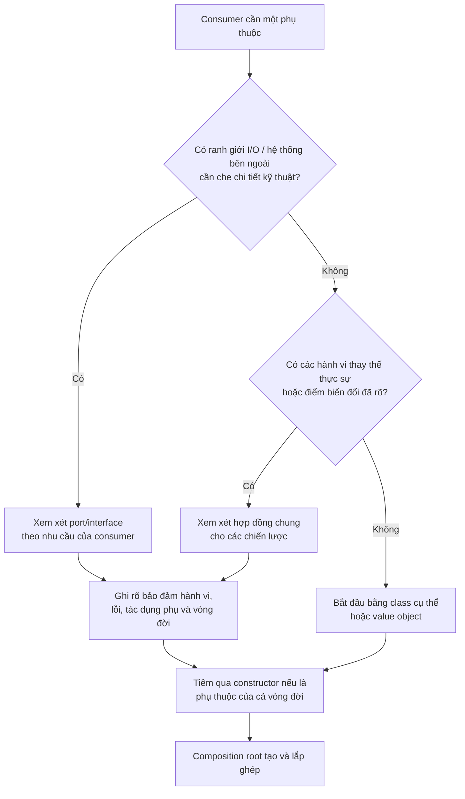
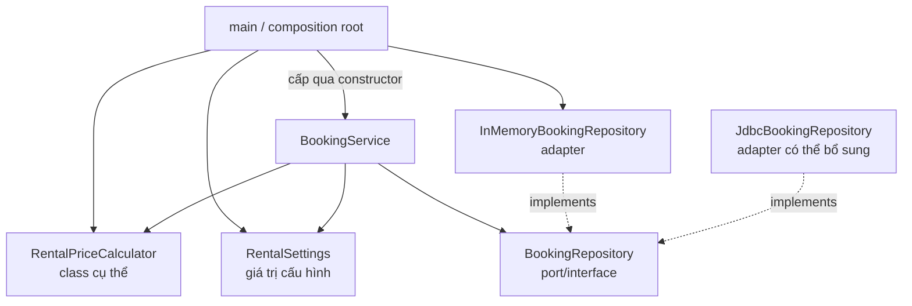

# Tránh tạo interface máy móc cho mọi lớp

Trong chương **Hợp đồng phụ thuộc** của module **Dependency Injection (DI)**, một ngộ nhận phổ biến là: "Muốn áp dụng DI đúng, mỗi class đều phải có một interface tương ứng". Quy tắc đó không tồn tại trong Java hay trong DI. **DI là cách một đối tượng nhận các phụ thuộc từ bên ngoài; interface chỉ là một công cụ để diễn đạt hợp đồng khi có lý do thiết kế phù hợp.**

Mục tiêu của DI và **Inversion of Control (IoC)** là tách **việc sử dụng phụ thuộc** khỏi **việc tạo và lắp ghép đối tượng**. Với **constructor injection** và **composition root**, bạn có thể tiêm một class cụ thể cho thành phần ổn định, đồng thời dùng interface ở những ranh giới cần thay thế triển khai hoặc cô lập hạ tầng. Lựa chọn này ảnh hưởng trực tiếp đến độ rõ ràng của mã, việc kiểm thử bằng Java thuần và khả năng mở rộng sang DI container về sau.

Sau bài học, bạn có thể:

- Giải thích vì sao mỗi class không bắt buộc phải có một interface tương ứng.
- Phân biệt **hợp đồng hành vi** với cú pháp `interface` của Java.
- Quyết định khi nào dùng class cụ thể, interface, factory hoặc một giá trị cấu hình.
- Tiêm class cụ thể và interface qua constructor trong cùng một use case.
- Kiểm thử thành phần nghiệp vụ và adapter hạ tầng bằng Java thuần.
- Đánh giá chi phí của việc trừu tượng hóa quá sớm và cách cải thiện thiết kế khi nhu cầu thực sự xuất hiện.

## 1. Interface là lựa chọn thiết kế, không phải yêu cầu của DI

Xét một hệ thống đặt thuê xe có bộ tính giá đơn giản:

```java
public final class RentalPriceCalculator {
    public long total(long dailyRate, int days) {
        if (dailyRate <= 0 || days <= 0) {
            throw new IllegalArgumentException("Invalid pricing input");
        }
        return Math.multiplyExact(dailyRate, days);
    }
}
```

Nếu hiện tại chỉ có một thuật toán tính giá, không có lý do nghiệp vụ hay ranh giới kỹ thuật nào đòi hỏi biến thể, ta **có thể truyền trực tiếp `RentalPriceCalculator` qua constructor**:

```java
final class RentalQuoteService {
    private final RentalPriceCalculator calculator;

    RentalQuoteService(RentalPriceCalculator calculator) {
        this.calculator = java.util.Objects.requireNonNull(calculator);
    }

    long quote(long dailyRate, int days) {
        return calculator.total(dailyRate, days);
    }
}

// Composition root:
RentalQuoteService quoteService =
        new RentalQuoteService(new RentalPriceCalculator());
```

Đoạn lắp ghép cuối là minh họa đặt trong phương thức khởi động của ứng dụng. `RentalQuoteService` **không tự khởi tạo** `RentalPriceCalculator`; nó nhận một instance từ bên ngoài. Vì thế đây vẫn là **constructor injection**. Việc type của tham số là class cụ thể không làm kỹ thuật DI mất hiệu lực.

Một thiết kế máy móc thường tạo thêm một cặp không có nhu cầu rõ:

```java
interface RentalPriceCalculatorInterface {
    long total(long dailyRate, int days);
}

final class RentalPriceCalculatorImpl implements RentalPriceCalculatorInterface {
    @Override
    public long total(long dailyRate, int days) {
        if (dailyRate <= 0 || days <= 0) {
            throw new IllegalArgumentException("Invalid pricing input");
        }
        return Math.multiplyExact(dailyRate, days);
    }
}
```

Ở đây interface chỉ lặp lại đúng một phương thức của class duy nhất, không mô tả một biến thể hay ranh giới có ý nghĩa. Có thể thêm interface sau khi xuất hiện nhu cầu. Việc có đúng một implementation **không tự động chứng minh interface là thừa**; ngược lại, nếu interface đại diện cho hợp đồng của một hệ thống bên ngoài hoặc API công khai ổn định, một implementation vẫn có thể rất hợp lý. Cần xét **vai trò** của trừu tượng, không đếm số lượng class.

## 2. Hợp đồng phụ thuộc rộng hơn cú pháp `interface`

Một **hợp đồng phụ thuộc** mô tả những điều bên sử dụng có thể trông đợi từ một cộng tác viên: thao tác, điều kiện đầu vào, kết quả, lỗi, tác dụng phụ và đôi khi cả quy tắc về vòng đời hoặc đồng thời.

Java có nhiều cách diễn đạt một phần hợp đồng:

| Cách diễn đạt | Hỗ trợ điều gì? | Khi nào phù hợp? |
| --- | --- | --- |
| `interface` | Khai báo một kiểu hành vi, cho phép nhiều class hiện thực | Ranh giới I/O, chiến lược thay thế, hợp đồng dùng chung giữa các triển khai |
| Class cụ thể | Cung cấp cả API và cách thực hiện | Thành phần ổn định, hành vi thuần hoặc không có nhu cầu hoán đổi |
| `abstract class` | Chia sẻ trạng thái/hành vi chung và điểm mở rộng | Có yêu cầu về một cơ sở triển khai thực sự; không phải lựa chọn mặc định cho DI |
| Đối tượng giá trị bất biến | Chứa dữ liệu và bất biến có ý nghĩa | Cấu hình đã xác thực, tiền, khoảng thời gian, thông tin định danh |
| Functional interface hiện có của JDK | Diễn đạt một chức năng gọn với lambda/method reference | Callback nhỏ khi ngữ nghĩa của kiểu chuẩn đủ rõ, ví dụ `Supplier<T>` |
| Factory hoặc provider | Tạo đối tượng theo nhu cầu và vòng đời | Cần instance mới cho từng thao tác hoặc quyết định triển khai lúc chạy |

**Có interface chưa chắc có hợp đồng tốt.** Ví dụ `BookingRepository.save(...)` cần quy định lưu thành công nghĩa là gì, khi thất bại báo lỗi ra sao và những bảo đảm nào được duy trì. Một class chỉ in log rồi bỏ dữ liệu không thể coi là adapter thay thế hợp lệ chỉ vì nó `implements BookingRepository` nếu hợp đồng yêu cầu lưu dữ liệu.

Ngược lại, một class cụ thể như `RentalPriceCalculator` vẫn có hợp đồng: `dailyRate > 0`, `days > 0`, tổng tiền được tính theo công thức quy định và phép nhân tràn gây `ArithmeticException`. Hợp đồng không tự nhiên xuất hiện hoặc biến mất chỉ vì ta đổi từ class sang interface.

## 3. Chi phí của việc tạo interface theo công thức "một class — một interface"

Với mô hình `OrderService` / `OrderServiceImpl`, `CustomerManager` / `CustomerManagerImpl` hoặc `TaxCalculator` / `TaxCalculatorImpl` cho tất cả class, những chi phí sau dễ tích lũy:

1. **Tăng số điểm điều hướng:** người đọc phải mở cả interface lẫn implementation để hiểu hành vi đơn giản, trong khi interface chưa thêm thông tin hữu ích.
2. **Tăng chi phí đổi API:** một thay đổi nhỏ có thể buộc cập nhật đồng thời nhiều file, khai báo DI và test double không còn cần thiết.
3. **Tạo cảm giác có khả năng thay thế giả:** hai class cùng chữ ký phương thức có thể khác nhau về tiền điều kiện, lỗi, tính nhất quán hoặc tác dụng phụ. Đa hình chỉ an toàn khi tuân thủ hợp đồng hành vi.
4. **Khuyến khích abstraction quá rộng:** interface được định nghĩa trước khi hiểu consumer cần gì có thể trở thành "túi phương thức" khó triển khai đúng.
5. **Dễ hướng test sai:** khi mọi lớp đều được mock, bài test có thể chỉ xác nhận các mock gọi nhau thay vì phát hiện sai thuật toán nghiệp vụ.

Đây không phải lý do bỏ hoàn toàn interface. Chi phí trên chỉ đáng trả khi đổi lại **một ranh giới rõ ràng, khả năng thay đổi độc lập hoặc hợp đồng có chủ sở hữu cụ thể**. Thiết kế tốt tập trung vào những điểm thật sự có khả năng biến động, không tối đa hóa số lượng interface.

## 4. Khi nào nên dùng class cụ thể, khi nào nên dùng interface?

Hãy bắt đầu từ **consumer**: nó thật sự cần hành vi nào, chi tiết nào có thể thay đổi và ai có trách nhiệm cung cấp đối tượng?

| Thành phần trong hệ thống thuê xe | Lựa chọn ban đầu thường hợp lý | Lý do |
| --- | --- | --- |
| `RentalSettings` chứa giá/ngưỡng được xác thực | Class bất biến, tiêm trực tiếp | Là dữ liệu cấu hình, không có hành vi đa hình cần hoán đổi |
| `RentalPriceCalculator` có một công thức ổn định, thuần | Class cụ thể, có thể tiêm trực tiếp | Có thể kiểm thử thuật toán thực, không cần mock |
| `Booking` chứa dữ liệu một lần đặt thuê | Class dữ liệu/value object | Là mô hình dữ liệu, không phải chiến lược |
| `BookingRepository` là nơi use case ghi đặt thuê | Interface do phía sử dụng định nghĩa, nếu cần cô lập cơ chế lưu | Adapter JDBC, in-memory và các cơ chế khác có thể đáp ứng một hợp đồng chung |
| `PaymentGateway` gọi nhà cung cấp thanh toán | Interface/port theo nhu cầu của ứng dụng | Giới hạn tác động của API, lỗi và công nghệ bên ngoài |
| Chính sách tính giá tiêu chuẩn, ngày lễ và doanh nghiệp cùng tồn tại | `PricingPolicy` làm interface strategy | Nhiều thuật toán nghiệp vụ khác nhau cần cùng một điểm gọi và hợp đồng |
| `Clock` cho thao tác phụ thuộc thời gian | Tiêm `java.time.Clock` có sẵn | `Clock.fixed(...)` hỗ trợ kiểm thử xác định; không cần tự tạo interface `IClock` máy móc |
| Mở connection/transaction mới mỗi thao tác | Tiêm factory, provider hoặc adapter phù hợp | Vấn đề cốt lõi là **vòng đời**, không chỉ thay class |

Đặc biệt, **interface có thể đáng giá ngay cả khi chỉ có một adapter production**: một port lưu trữ có thể tách application logic khỏi JDBC, hỗ trợ fake trong test hoặc cho phép nhóm hạ tầng thay implementation độc lập. Việc "có ít nhất hai class triển khai" chỉ là **một dấu hiệu**, không phải điều kiện cần.

### Một quy trình quyết định ngắn



Sơ đồ là **gợi ý xét đoán**, không phải một thuật toán bắt buộc. Ví dụ một thư viện công khai có thể định nghĩa interface để ổn định API hoặc hỗ trợ extension trước khi có nhiều implementation; ngược lại, một thao tác I/O cực kỳ nhỏ có thể chưa cần một port tùy theo mức độ phức tạp và yêu cầu kiểm thử.

## 5. Ví dụ đầy đủ bằng Java thuần: chỉ tạo interface ở ranh giới lưu trữ

Giả sử ứng dụng cần ghi một booking và tính giá cho thuê từ 7 ngày được giảm 10%. Ta chọn:

- `RentalPriceCalculator`: **class cụ thể**, chứa phép tính nghiệp vụ thuần và ổn định.
- `RentalSettings`: **class bất biến**, chứa giá/ngưỡng.
- `BookingRepository`: **interface/port**, mô tả hành vi lưu booking mà use case cần; triển khai chi tiết có thể thay thế.
- `BookingService`: **consumer**, chỉ điều phối và nhận phụ thuộc qua constructor.
- `main`: **composition root**, tạo và nối những instance cụ thể.

Lưu nội dung sau thành `InterfaceDecisionDemo.java` và chạy với **Java 11 trở lên**:

```bash
javac InterfaceDecisionDemo.java
java InterfaceDecisionDemo
```

```java
import java.util.ArrayList;
import java.util.List;
import java.util.Objects;

public final class InterfaceDecisionDemo {
    // Không cần interface chỉ để truyền một giá trị cấu hình.
    static final class RentalSettings {
        private final long dailyRate;
        private final int maxDays;

        RentalSettings(long dailyRate, int maxDays) {
            if (dailyRate <= 0 || maxDays < 1) {
                throw new IllegalArgumentException("Invalid rental settings");
            }
            this.dailyRate = dailyRate;
            this.maxDays = maxDays;
        }

        long dailyRate() {
            return dailyRate;
        }

        int maxDays() {
            return maxDays;
        }
    }

    // Một thuật toán thuần, ổn định: dùng class cụ thể.
    static final class RentalPriceCalculator {
        long total(long dailyRate, int days) {
            if (dailyRate <= 0 || days < 1) {
                throw new IllegalArgumentException("Invalid price input");
            }
            long gross = Math.multiplyExact(dailyRate, days);
            return days >= 7 ? gross - gross / 10 : gross;
        }
    }

    static final class Booking {
        private final String id;
        private final int days;
        private final long totalPrice;

        Booking(String id, int days, long totalPrice) {
            this.id = Objects.requireNonNull(id);
            this.days = days;
            this.totalPrice = totalPrice;
        }

        long totalPrice() {
            return totalPrice;
        }
    }

    // Port hạ tầng: save thành công hoặc báo lỗi, không âm thầm bỏ qua.
    interface BookingRepository {
        void save(Booking booking);
    }

    // Adapter minh họa chạy đơn luồng; chỉ lưu trong tiến trình hiện tại.
    static final class InMemoryBookingRepository implements BookingRepository {
        private final List<Booking> saved = new ArrayList<>();

        @Override
        public void save(Booking booking) {
            saved.add(Objects.requireNonNull(booking));
        }

        int savedCount() {
            return saved.size();
        }

        Booking savedAt(int index) {
            return saved.get(index);
        }
    }

    static final class BookingService {
        private final RentalPriceCalculator calculator; // Class cụ thể
        private final BookingRepository repository;       // Interface
        private final RentalSettings settings;            // Value object

        BookingService(
                RentalPriceCalculator calculator,
                BookingRepository repository,
                RentalSettings settings) {
            this.calculator = Objects.requireNonNull(calculator);
            this.repository = Objects.requireNonNull(repository);
            this.settings = Objects.requireNonNull(settings);
        }

        Booking book(String id, int days) {
            if (id == null || id.isBlank()) {
                throw new IllegalArgumentException("Booking ID is required");
            }
            if (days < 1 || days > settings.maxDays()) {
                throw new IllegalArgumentException("Days out of range");
            }

            long price = calculator.total(settings.dailyRate(), days);
            Booking booking = new Booking(id, days, price);
            repository.save(booking);
            return booking;
        }
    }

    public static void main(String[] args) {
        // Composition root: đối tượng sử dụng không tự new repository.
        RentalSettings settings = new RentalSettings(200_000L, 30);
        RentalPriceCalculator calculator = new RentalPriceCalculator();
        InMemoryBookingRepository repository = new InMemoryBookingRepository();
        BookingService service =
                new BookingService(calculator, repository, settings);

        Booking result = service.book("BK-001", 7);
        if (result.totalPrice() != 1_260_000L || repository.savedCount() != 1) {
            throw new AssertionError("Incorrect rental price or saving");
        }
        System.out.println("Tong tien 7 ngay: " + result.totalPrice() + " VND");

        testWithoutContainer();
    }

    static void testWithoutContainer() {
        // Dùng thuật toán thật vì nó không có I/O và dễ kiểm tra.
        RentalPriceCalculator calculator = new RentalPriceCalculator();
        RentalSettings settings = new RentalSettings(100_000L, 10);
        InMemoryBookingRepository fakeRepository = new InMemoryBookingRepository();
        BookingService service =
                new BookingService(calculator, fakeRepository, settings);

        Booking booking = service.book("TEST-1", 2);
        if (booking.totalPrice() != 200_000L
                || fakeRepository.savedCount() != 1
                || fakeRepository.savedAt(0) != booking) {
            throw new AssertionError("Expected booking to be saved");
        }

        // Đầu vào sai bị từ chối trước khi tạo/lưu booking.
        try {
            service.book("INVALID", 0);
            throw new AssertionError("Expected invalid-day exception");
        } catch (IllegalArgumentException expected) {
            // PASS: không cần mock calculator.
        }
        if (fakeRepository.savedCount() != 1) {
            throw new AssertionError("Invalid booking must not be saved");
        }

        // Adapter giả lỗi làm rõ hành vi khi lưu không thành công.
        BookingRepository failingRepository = b -> {
            throw new IllegalStateException("Storage unavailable");
        };
        BookingService failingService =
                new BookingService(calculator, failingRepository, settings);
        try {
            failingService.book("TEST-ERROR", 2);
            throw new AssertionError("Expected repository failure");
        } catch (IllegalStateException expected) {
            if (!"Storage unavailable".equals(expected.getMessage())) {
                throw expected;
            }
        }

        System.out.println("Java thuan test: PASS");
    }
}
```

Kết quả dự kiến:

```text
Tong tien 7 ngay: 1260000 VND
Java thuan test: PASS
```

Giá gốc 7 ngày là `7 × 200_000 = 1_400_000` VND; giảm 10% còn **1_260_000 VND**. Khi thuê 2 ngày với đơn giá `100_000` VND, kết quả test là **200_000 VND**. Với kết cấu này, không cần tạo `IRentalPriceCalculator`, `IRentalSettings`, `IBooking` hay `IBookingService` chỉ để nói rằng hệ thống "đã dùng DI".

### Vì sao interface `BookingRepository` có lý do tồn tại?

Mã ứng dụng cần **lưu booking**, nhưng không cần biết câu lệnh SQL, connection pool hoặc API của nơi lưu. `BookingRepository` diễn đạt cổng phụ thuộc phù hợp với consumer. Ở môi trường học, ta dùng `InMemoryBookingRepository`; ở hệ thống thực, composition root có thể tiêm một `JdbcBookingRepository` hoặc adapter khác *nếu triển khai đó đáp ứng đúng hợp đồng*.

Adapter in-memory ở đây chỉ giữ dữ liệu trong RAM, không cam kết bền vững qua khởi động lại. Nếu nghiệp vụ yêu cầu một booking "lưu thành công" phải bền vững ngay sau transaction, cần ghi rõ yêu cầu đó trong hợp đồng production và kiểm thử adapter tương ứng. **Một fake phục vụ unit test không thay thế kiểm thử tích hợp của hệ lưu trữ thật.**

### Vì sao không cần interface cho `RentalPriceCalculator`?

Hiện tại thuật toán được xác định rõ, không có I/O và có thể kiểm thử bằng dữ liệu vào/ra. `BookingService` nhận instance calculator qua constructor nên quyền tạo vẫn nằm ở ngoài. Dùng thuật toán thật trong test còn giúp phát hiện lỗi tính toán mà một mock "trả về 200_000" có thể che khuất.

Nếu sau này xuất hiện hai chính sách giá khác nhau cần được **chọn theo ngữ cảnh nghiệp vụ**, ta có lý do để trích xuất một hợp đồng chính sách giá. Đây là thay đổi xuất phát từ nhu cầu thực tế, không phải vì interface được yêu cầu từ ngày đầu.

## 6. Từ một class cụ thể đến Strategy khi có điểm biến đổi thật

Giả sử doanh nghiệp triển khai hai cách tính giá: chính sách thông thường và chính sách dành cho doanh nghiệp. Lúc này, use case cần chọn thuật toán mà không sửa phần điều phối mỗi lần thêm biến thể. Có thể trích xuất:

```java
interface PricingPolicy {
    // Hợp đồng: dailyRate > 0; days > 0;
    // kết quả trong khoảng [0, dailyRate * days] nếu không tràn số.
    long total(long dailyRate, int days);
}

final class StandardPricing implements PricingPolicy {
    @Override
    public long total(long dailyRate, int days) {
        if (dailyRate <= 0 || days <= 0) {
            throw new IllegalArgumentException("Invalid pricing input");
        }
        return Math.multiplyExact(dailyRate, days);
    }
}

final class WeeklyDiscountPricing implements PricingPolicy {
    @Override
    public long total(long dailyRate, int days) {
        if (dailyRate <= 0 || days <= 0) {
            throw new IllegalArgumentException("Invalid pricing input");
        }
        long gross = Math.multiplyExact(dailyRate, days);
        return days >= 7 ? gross - gross / 10 : gross;
    }
}
```

Đây là đoạn minh họa **phần chính sách** khi mở rộng, không phải phần nối thêm vào file `InterfaceDecisionDemo.java`. Khi chuyển thiết kế, thay field/constructor param `RentalPriceCalculator` của `BookingService` bằng `PricingPolicy` rồi cập nhật composition root; phần gọi `total(...)` trong service có thể giữ nguyên.

Lúc này `PricingPolicy` có nhiệm vụ rõ: **thống nhất hợp đồng để chọn một trong nhiều thuật toán hợp lệ**. Các implementation cần tuân thủ cùng tiền điều kiện và bảo đảm đầu ra. Nếu một chính sách chỉ nhận thuê từ 7 ngày còn hợp đồng cho phép từ 1 ngày, đó là vi phạm khả năng thay thế (Liskov Substitution Principle — **LSP**) dù Java biên dịch thành công.

Không nên thiết kế interface với một "phương thức dùng chung" khi các lớp thật ra không có hợp đồng thống nhất. Nếu hai thuật toán có ý nghĩa đầu vào, đầu ra hoặc lỗi khác nhau, trước hết phải làm rõ mô hình nghiệp vụ, thay vì thêm `instanceof` và nhánh đặc biệt trong consumer.

## 7. Phân biệt DI, DIP, IoC và việc tạo interface

Những khái niệm thường bị đánh đồng:

| Khái niệm | Câu hỏi giải quyết | Ví dụ |
| --- | --- | --- |
| **DI** | Làm sao consumer nhận phụ thuộc? | `BookingService` nhận `RentalPriceCalculator`, `BookingRepository` và `RentalSettings` qua constructor |
| **IoC** | Ai quyết định và kiểm soát việc tạo/lắp ghép? | Composition root tạo adapter và nối vào service |
| **DIP (Dependency Inversion Principle)** | Mã nghiệp vụ cấp cao nên phụ thuộc vào loại chi tiết nào? | `BookingService` phụ thuộc port `BookingRepository` thay vì class JDBC cụ thể |
| **Đa hình** | Một điểm gọi có thể dùng các triển khai khác nhau bằng cách nào? | Nhiều class hiện thực `PricingPolicy` |
| **LSP** | Khi nào triển khai mới thực sự thay thế an toàn? | Mọi `PricingPolicy` giữ miền đầu vào và bảo đảm kết quả |
| **Interface** | Công cụ Java nào mô tả một tập thao tác của kiểu? | `BookingRepository` hoặc `PricingPolicy` |

**DIP không có nghĩa "mọi phụ thuộc phải là interface".** DIP giúp phần chính sách cấp cao tránh bị trói vào chi tiết cấp thấp có khả năng thay đổi, đặc biệt là hạ tầng. `RentalPriceCalculator` cụ thể là một khối nghiệp vụ ổn định trong ví dụ, không phải một thư viện JDBC/HTTP bị cài chặt vào consumer. Nếu về sau chính sách giá thay đổi thường xuyên theo biến thể, trích xuất một abstraction có ý nghĩa lúc đó.

**DI container cũng không yêu cầu một interface cho mỗi class.** Container có thể được dùng để tạo và tiêm class cụ thể, giá trị cấu hình hoặc implementation của interface theo cách framework hỗ trợ. Container giúp điều phối việc khởi tạo, cấu hình và quản lý scope; nó không tự xác nhận tính đúng đắn của hợp đồng hoặc quyết định hộ ta chỗ nào đáng trừu tượng hóa.

Sơ đồ phụ thuộc từ ví dụ:



Mũi tên đến `JdbcBookingRepository` biểu thị **khả năng mở rộng**, chưa phải implementation xuất hiện trong mã Java minh họa. Phần đáng chú ý: consumer vừa phụ thuộc vào hai class cụ thể phù hợp, vừa phụ thuộc vào một interface ở ranh giới hạ tầng, mà vẫn thực hiện đầy đủ constructor injection.

## 8. Kiểm thử đúng mục tiêu, không tạo interface chỉ để mock

Một lý do thường gặp để sinh interface là "framework mock cần interface". Cách tiếp cận đó dễ khiến thiết kế production bị điều khiển bởi cơ chế test. Hãy thử xác định cái gì thực sự cần cô lập:

1. **Thuật toán thuần:** truyền dữ liệu trực tiếp cho `RentalPriceCalculator.total(...)` và so sánh kết quả. Thường có thể kiểm thử class thật nhanh, ổn định, không cần mock.
2. **Application service:** đưa repository fake/in-memory qua constructor để kiểm tra điều phối, trường hợp thất bại và dữ liệu được truyền.
3. **Adapter hạ tầng:** dùng integration test với database, API hoặc dịch vụ thực/giả lập phù hợp; test hợp đồng là cần thiết nếu nhiều adapter triển khai cùng port.
4. **Phụ thuộc thời gian/ngẫu nhiên:** ưu tiên abstraction có sẵn như `Clock` hoặc một supplier hợp lý khi đủ ý nghĩa; không nhất thiết tự tạo một interface theo tên mỗi class.

Trong file Java ở phần 5, `testWithoutContainer` dùng **calculator thật** và **repository in-memory/failing fake**. Điều này kiểm thử được cả số tiền, hành vi lưu và lỗi từ hạ tầng. Nếu mock cả calculator rồi lập trình mock trả sẵn giá đúng, bài test không còn phát hiện được lỗi trong phép tính.

Một fake có thể đơn giản là lambda:

```java
BookingRepository rejectingRepository = booking -> {
    throw new IllegalStateException("Storage unavailable");
};
```

Để fake thay thế hợp lệ, nó phải tôn trọng phần hợp đồng có liên quan đến kịch bản kiểm thử. Không nên dùng fake "lưu thành công" nhưng thực tế bỏ qua dữ liệu nếu bài test phụ thuộc vào khả năng đọc lại kết quả sau khi lưu.

### Ranh giới quan trọng: contract test và test của consumer

**Test consumer** kiểm tra `BookingService` gọi repository đúng và phản ứng với lỗi. **Contract test** kiểm tra từng triển khai `BookingRepository` có thực hiện những lời hứa chung hay không; **integration test** xác nhận các bảo đảm khi liên hệ hạ tầng thật (transaction, lỗi mạng, nhất quán dữ liệu). Không loại test nào hoàn toàn thay cho các loại còn lại.

## 9. Scope và vòng đời liên quan thế nào đến quyết định trừu tượng hóa?

Interface nói về kiểu hành vi; **scope/lifecycle nói về instance tồn tại và được chia sẻ ra sao**. Hai vấn đề này độc lập:

| Thành phần | Vòng đời thường hợp lý | Lưu ý |
| --- | --- | --- |
| `RentalSettings` bất biến | Tạo lúc khởi động và chia sẻ nếu cấu hình cố định | Muốn cập nhật động thì cần snapshot/provider rõ ràng |
| `RentalPriceCalculator` không có trạng thái | Có thể tái sử dụng một instance | Phép tính thuần không cần trạng thái theo request |
| `BookingService` không có trạng thái yêu cầu | Có thể tái sử dụng nếu các phụ thuộc an toàn | Trường `final` không tự đảm bảo thread-safety |
| `InMemoryBookingRepository` dùng `ArrayList` | Dành cho ví dụ/test đơn luồng | `ArrayList` không an toàn khi nhiều thread ghi đồng thời |
| JDBC adapter, connection, transaction | Tùy cách cấp tài nguyên và giới hạn transaction | Không chia sẻ bừa một connection giữa nhiều request |

Đừng tạo `ITransaction` hoặc `IConnection` chỉ vì một tài nguyên có vòng đời ngắn. Điều cần thiết có thể là tiêm một factory hay repository quản lý connection đúng scope. Một abstraction chỉ tốt khi mô tả **nhu cầu thực của consumer**, bao gồm cả bảo đảm về lỗi và vòng đời nếu các điều đó ảnh hưởng đến hành vi.

## 10. Nhận biết và sửa thiết kế "interface cho mọi lớp"

Một số dấu hiệu đáng xem xét:

| Dấu hiệu | Câu hỏi nên đặt | Hướng cải thiện có thể phù hợp |
| --- | --- | --- |
| `Foo` / `FooImpl` luôn đi theo cặp 1:1, interface chỉ lặp chữ ký | Có consumer nào cần thay triển khai hoặc che một ranh giới không? | Nếu không, cân nhắc dùng class cụ thể |
| Tạo interface ngay khi viết value object/cấu hình | Có hành vi đa hình thực sự hay chỉ là dữ liệu? | Dùng immutable class hoặc record khi phiên bản Java cho phép |
| Test mock tất cả thành phần nghiệp vụ | Test có còn kiểm tra thuật toán thật? | Dùng class thuần thực, fake ở biên I/O |
| Interface lộ `ResultSet`, HTTP status hoặc kiểu của vendor | Consumer có thật sự cần chi tiết thư viện ngoài? | Chuyển sang hợp đồng bằng khái niệm nghiệp vụ |
| Interface có nhiều phương thức không phải consumer nào cũng dùng | Một hợp đồng có đang ép client phụ thuộc vào chức năng thừa? | Tách interface nhỏ theo nhu cầu (ISP) |
| Dùng `instanceof` liên tục sau khi inject interface | Các implementation có thực sự chung nghĩa và bảo đảm hành vi không? | Xem lại abstraction hoặc tách vai trò |
| Constructor có hàng chục interface | Lớp có đang ôm quá nhiều trách nhiệm? | Xem lại ranh giới và nhóm hành vi hợp lý; tránh service locator để che phụ thuộc |

Khi muốn loại bỏ một interface quá sớm, **kiểm tra các consumer và phạm vi API trước khi thay đổi**. Nếu interface đã là hợp đồng thư viện công khai, plugin extension, hoặc được các module biên dịch độc lập sử dụng, xóa nó có thể gây thay đổi tương thích lớn. Khi đó duy trì interface có thể là quyết định đúng dù hiện chỉ có một implementation.

Tương tự, đừng xóa interface của repository chỉ vì production dùng một database. Ranh giới đó có thể đóng vai trò bảo vệ ứng dụng khỏi chi tiết hạ tầng và cho phép kiểm thử bằng fake.

## 11. Bài tập áp dụng

**Bài 1 — Phân loại hợp đồng.** Cho các thành phần `OrderId`, `TaxSettings`, `TaxCalculator` (một công thức ổn định), `PaymentGateway` (gọi dịch vụ ngoài) và `OrderRepository` (ghi database). Thành phần nào bắt buộc phải có interface?

*Gợi ý:* Không có quy tắc cú pháp nào bắt buộc tất cả phải có interface. `OrderId`/`TaxSettings` là value object/config; `TaxCalculator` có thể là class cụ thể; `PaymentGateway`/`OrderRepository` là ứng viên mạnh cho port vì có biên I/O và nhu cầu cô lập chi tiết ngoài.

**Bài 2 — Một implementation nhưng interface vẫn hợp lý.** Hệ thống chỉ dùng một nhà cung cấp thanh toán. Có nên giữ `PaymentGateway` không?

*Gợi ý:* Có thể nên giữ. Interface đại diện cho nhu cầu thanh toán của ứng dụng, cô lập SDK và lỗi vendor, hỗ trợ fake trong test. Lý do là **ranh giới hạ tầng**, không phải số implementation.

**Bài 3 — Interface vì mock.** Nhóm phát triển tạo `IPriceMath` chỉ để mock phép cộng, nhân trong test. Nên kiểm thử thế nào?

*Gợi ý:* Kiểm thử phép tính thực với trường hợp thường, biên và tràn số. Cân nhắc xóa abstraction nếu không có vai trò thiết kế khác.

**Bài 4 — Thêm chính sách giá mới.** Ngày mai xuất hiện bảng giá doanh nghiệp khác với giá khách lẻ. Bạn sẽ thay những gì?

*Gợi ý:* Đầu tiên xác định hợp đồng chung của các chính sách, ví dụ `PricingPolicy`. Tạo các implementation tuân thủ cùng quy tắc đầu vào/đầu ra; ở composition root hoặc policy selector có trách nhiệm chọn implementation đúng. Tránh đặt `if (policy instanceof ...)` trong consumer.

**Bài 5 — Interface không giải quyết vòng đời.** Một service giữ `BookingRepository` dưới dạng interface và là singleton. Adapter hiện thực lại giữ một `ArrayList` mutable dùng chung giữa nhiều thread. Thiết kế đã an toàn chưa?

*Gợi ý:* Chưa. Interface và constructor injection không bảo đảm thread-safety; cần xem lại scope, dữ liệu chia sẻ và cơ chế đồng bộ/adapter.

## 12. Checklist khi quyết định tạo interface

Trước khi thêm một interface mới, hãy trả lời:

- **Consumer nào** cần hợp đồng này và nó thực sự gọi những hành vi gì?
- Có ranh giới I/O, vendor, module hoặc biến thể nghiệp vụ cần tách không?
- Interface có diễn đạt **bảo đảm hành vi** rõ ràng, không chỉ lặp lại chữ ký của một class?
- Các triển khai dự kiến có thể giữ cùng tiền điều kiện, hậu điều kiện, lỗi và tác dụng phụ quan trọng không?
- Một class cụ thể, value object, functional interface sẵn có hay factory có đủ đơn giản và chính xác hơn không?
- Có đang dùng interface chỉ để mock, để thỏa một naming convention hoặc để né constructor injection không?
- Composition root đã là nơi tạo/lắp ghép phụ thuộc chưa? Scope và vòng đời của instance đã được xác định chưa?

**Tránh tạo interface máy móc** không có nghĩa tránh trừu tượng hóa. Hãy **đặt hợp đồng ở những ranh giới có ý nghĩa**, dùng class cụ thể ở nơi hành vi đủ ổn định, rồi để **constructor injection** và **composition root** giải quyết việc cấp đối tượng. Với cách này, bạn có thể học và kiểm thử DI bằng Java thuần trước khi mở rộng sang DI container mà vẫn giữ mô hình phụ thuộc gọn, rõ và dễ thay đổi khi yêu cầu thực sự xuất hiện.
