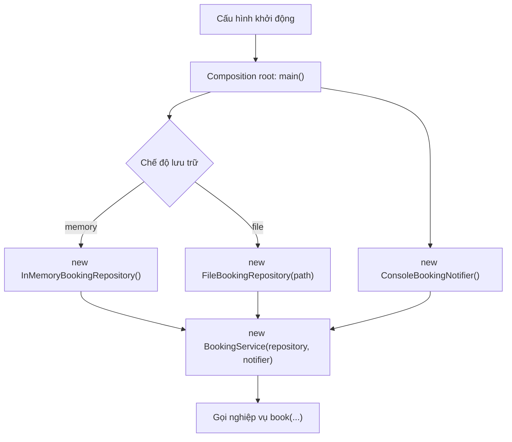
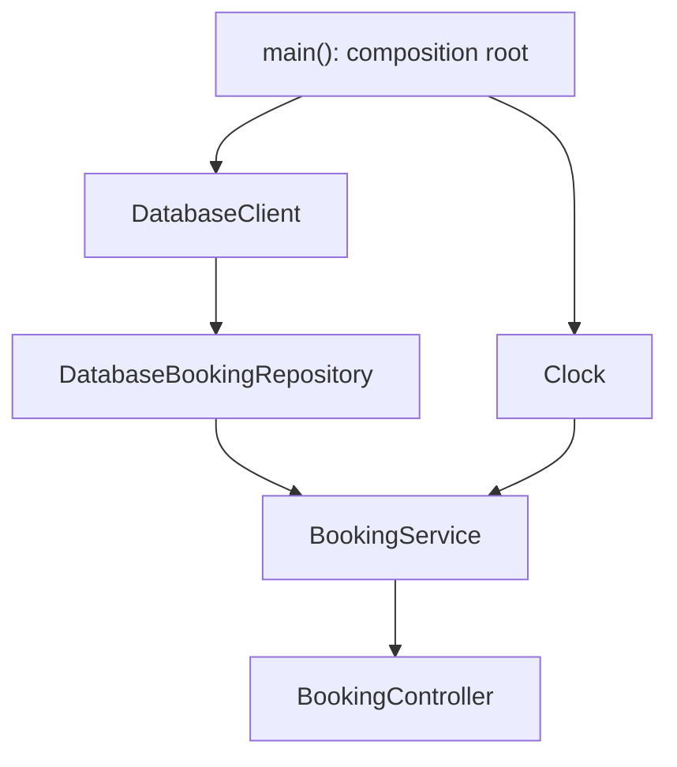

# Chọn triển khai cụ thể tại điểm khởi động ứng dụng

Khi học **Dependency Injection (DI)** bằng Java thuần, có một câu hỏi quan trọng: **ai quyết định dùng triển khai cụ thể nào cho mỗi phụ thuộc?** Giả sử `BookingService` cần lưu booking qua hợp đồng `BookingRepository`. Ở bản chạy thử, ta muốn lưu trong bộ nhớ; ở một bản chạy khác, ta muốn ghi ra tệp. Nếu `BookingService` tự chọn `InMemoryBookingRepository` hoặc `FileBookingRepository`, mỗi lần thay môi trường chạy sẽ phải sửa logic nghiệp vụ.

Cách làm với **DI thủ công (manual dependency injection)** là **chọn implementation ở điểm khởi động ứng dụng**, tạo các đối tượng rồi truyền chúng qua constructor. Điểm tập trung tạo và lắp ghép đối tượng này thường được gọi là **composition root**. Nó có thể là `main(...)` của ứng dụng console, bộ mã khởi tạo của ứng dụng web, hoặc một điểm vào tương đương.

Bài học tập trung vào việc **chọn triển khai cụ thể tại composition root**, tách lựa chọn triển khai khỏi lớp nghiệp vụ, kiểm soát cấu hình và vòng đời, rồi kiểm thử bằng Java thuần. Đây là nền tảng cho **Inversion of Control (IoC)**: thành phần sử dụng phụ thuộc không tự quyết định cách tạo cộng tác viên của mình. Sau khi hiểu cách lắp ghép bằng tay, ta mới cần cân nhắc DI container để tự động hóa công việc tương tự.

## 1. “Chọn implementation” là quyết định của lớp nào?

Giả sử có ba kiểu:

```java
interface BookingRepository {
    void save(Booking booking);
}

final class InMemoryBookingRepository implements BookingRepository {
    // Cài đặt lưu trong bộ nhớ.
}

final class FileBookingRepository implements BookingRepository {
    // Cài đặt ghi ra tệp.
}
```

`BookingService` chỉ cần biết **điều nó yêu cầu**: một đối tượng có thể lưu booking. Service không cần biết dữ liệu đang ở bộ nhớ, tệp hay cơ sở dữ liệu:

```java
final class BookingService {
    private final BookingRepository repository;

    BookingService(BookingRepository repository) {
        this.repository = java.util.Objects.requireNonNull(repository);
    }

    void create(Booking booking) {
        repository.save(booking);
    }
}
```

Phía khởi động ứng dụng quyết định **dùng triển khai nào**:

```java
BookingRepository repository = new InMemoryBookingRepository();
BookingService service = new BookingService(repository);
```

Hoặc, khi thay nơi lưu:

```java
BookingRepository repository =
    new FileBookingRepository(/* đường dẫn tệp */);
BookingService service = new BookingService(repository);
```

Ở hai đoạn mã minh họa này, class `BookingService` giữ nguyên. Cách lắp ghép đối tượng thay đổi tại điểm khởi động; đây là lợi ích trực tiếp của constructor injection và Dependency Inversion: **mã nghiệp vụ dựa vào hợp đồng cần dùng, còn lựa chọn chi tiết thực thi được đưa ra ở rìa ứng dụng**.

Để phân biệt các góc nhìn:

| Câu hỏi | Nơi chịu trách nhiệm | Ví dụ |
| --- | --- | --- |
| Service cần làm gì? | Mã nghiệp vụ và hợp đồng phụ thuộc | `BookingRepository.save(...)` |
| Service nhận phụ thuộc bằng cách nào? | Constructor của service | `new BookingService(repository)` |
| Sử dụng triển khai cụ thể nào? | Composition root và cấu hình khởi động | Chọn `InMemoryBookingRepository` hoặc `FileBookingRepository` |
| Tạo bao nhiêu instance và sống bao lâu? | Nơi lắp ghép hoặc cơ chế quản lý scope | Một repository dùng chung hay một repository cho mỗi phiên |
| Đóng tài nguyên do ai quản lý? | Nơi sở hữu vòng đời/tài nguyên | Composition root đóng resource khi ứng dụng dừng |

Không phải mọi class đều cần interface. Một class cụ thể có thể được truyền qua constructor khi phù hợp. Nhưng khi *một vai trò có nhiều implementation được lựa chọn theo cấu hình*, hợp đồng như `BookingRepository` giúp phần nghiệp vụ không bị phụ thuộc vào từng lựa chọn triển khai.

## 2. Mô hình composition root

**Composition root** là nơi ứng dụng biết đầy đủ cả **những hợp đồng cần nối** và **những implementation cụ thể được phép dùng**. Nó thường nằm gần điểm vào chương trình, nơi có quyền đọc cấu hình khởi động và tạo đối tượng hạ tầng.



Mũi tên trên sơ đồ biểu diễn **luồng chọn và lắp ghép lúc khởi động**. Ở mức phụ thuộc mã nguồn, chiều phụ thuộc lại bắt đầu từ `BookingService` đến **hợp đồng** `BookingRepository` và `BookingNotifier` mà nó sử dụng.

Một nguyên tắc thực hành: **quyết định chọn công nghệ nên tập trung**, không rải rác những câu lệnh dạng `if (storageMode.equals("file"))` trong nhiều service. Các phương thức nghiệp vụ không cần nhận thông tin “đang chạy chế độ file hay memory” nếu cả hai implementation đều đáp ứng cùng hợp đồng.

Composition root cũng có thể tách mã khởi tạo thành các hàm nhỏ, ví dụ `selectRepository(...)` hoặc `buildApplication(...)`. Điều đó không biến mỗi hàm factory thành một composition root độc lập; **điểm điều phối cuối cùng** vẫn chịu trách nhiệm lắp toàn bộ đồ thị đối tượng.

## 3. Vì sao không để service tự chọn theo cấu hình?

Hãy xem ví dụ thiết kế không thuận lợi:

```java
final class CoupledBookingService {
    private final BookingRepository repository;

    CoupledBookingService(String storageMode) {
        if ("file".equals(storageMode)) {
            repository = new FileBookingRepository(
                java.nio.file.Paths.get("data", "bookings.txt"));
        } else {
            repository = new InMemoryBookingRepository();
        }
    }
}
```

Mặc dù service đã có trường kiểu `BookingRepository`, nó **vẫn phụ thuộc mã nguồn vào hai lớp triển khai cụ thể**, biết tên chế độ lưu trữ và tự khởi tạo hạ tầng. Chuyện cấu hình đã lọt vào lớp nghiệp vụ.

Hệ quả:

- Muốn đổi cách lưu hoặc thêm implementation thứ ba phải sửa và kiểm thử lại mã service.
- Trong unit test, rất khó truyền một repository ghi nhận hành vi vì constructor không cho nhận đối tượng từ ngoài.
- Service phải biết đường dẫn tệp và chính sách khởi tạo tài nguyên, dù trách nhiệm thật của nó chỉ là lưu booking.
- Việc chọn cấu hình có thể lặp lại ở nhiều service, dẫn đến ứng dụng chọn các triển khai không nhất quán.

Chuyển lựa chọn về composition root không có nghĩa ứng dụng **không còn phụ thuộc vào lớp triển khai cụ thể**. Phụ thuộc đó vẫn tồn tại, nhưng được giới hạn ở nơi cần biết chi tiết để xây dựng hệ thống. Đây là cách kiểm soát biên kiến trúc, không phải làm biến mất mọi phụ thuộc.

## 4. Ví dụ Java thuần hoàn chỉnh: chọn lưu bộ nhớ hoặc tệp

Chúng ta viết một chương trình console với các thành phần:

1. `BookingService` tạo booking, yêu cầu repository lưu và notifier thông báo.
2. `BookingRepository` là hợp đồng lưu booking.
3. `InMemoryBookingRepository` giữ booking trong bộ nhớ của tiến trình.
4. `FileBookingRepository` ghi mỗi booking thành một dòng vào tệp.
5. `ManualDiApp.main(...)` đọc chế độ lưu trữ, chọn implementation và nối các đối tượng.

Ví dụ cố ý đơn giản để làm rõ **điểm chọn triển khai**; file repository chưa phải giải pháp lưu trữ đủ cho hệ thống nhiều tiến trình hoặc cần transaction.

Tạo file `ManualDiApp.java`:

```java
import java.io.IOException;
import java.io.UncheckedIOException;
import java.nio.charset.StandardCharsets;
import java.nio.file.Files;
import java.nio.file.Path;
import java.nio.file.Paths;
import java.nio.file.StandardOpenOption;
import java.util.HashMap;
import java.util.Map;
import java.util.Objects;

final class Booking {
    private final String id;
    private final int amount;

    Booking(String id, int amount) {
        if (id == null || !id.matches("[A-Za-z0-9-]+")) {
            throw new IllegalArgumentException("id khong hop le");
        }
        if (amount < 0) {
            throw new IllegalArgumentException("amount phai >= 0");
        }
        this.id = id;
        this.amount = amount;
    }

    String id() {
        return id;
    }

    int amount() {
        return amount;
    }
}

interface BookingRepository {
    void save(Booking booking);
}

interface BookingNotifier {
    void onCreated(Booking booking);
}

final class BookingService {
    private final BookingRepository repository;
    private final BookingNotifier notifier;

    BookingService(BookingRepository repository, BookingNotifier notifier) {
        this.repository = Objects.requireNonNull(repository, "repository");
        this.notifier = Objects.requireNonNull(notifier, "notifier");
    }

    Booking book(String id, int amount) {
        Booking booking = new Booking(id, amount);
        repository.save(booking);
        notifier.onCreated(booking);
        return booking;
    }
}

final class InMemoryBookingRepository implements BookingRepository {
    private final Map<String, Booking> bookings = new HashMap<>();

    @Override
    public void save(Booking booking) {
        bookings.put(booking.id(), booking);
    }

    boolean contains(String id) {
        return bookings.containsKey(id);
    }
}

final class FileBookingRepository implements BookingRepository {
    private final Path path;

    FileBookingRepository(Path path) {
        this.path = Objects.requireNonNull(path, "path");
    }

    @Override
    public void save(Booking booking) {
        Objects.requireNonNull(booking, "booking");
        Path parent = path.getParent();
        String line = booking.id() + "," + booking.amount()
            + System.lineSeparator();

        try {
            if (parent != null) {
                Files.createDirectories(parent);
            }
            Files.write(
                path,
                line.getBytes(StandardCharsets.UTF_8),
                StandardOpenOption.CREATE,
                StandardOpenOption.APPEND
            );
        } catch (IOException exception) {
            throw new UncheckedIOException("Khong the luu booking vao tep", exception);
        }
    }
}

final class ConsoleBookingNotifier implements BookingNotifier {
    @Override
    public void onCreated(Booking booking) {
        System.out.println("NOTIFY " + booking.id());
    }
}

public class ManualDiApp {
    public static void main(String[] args) {
        // Composition root: doc cau hinh chi mot lan luc khoi dong.
        String mode = System.getenv("BOOKING_STORAGE");
        if (mode == null || mode.trim().isEmpty()) {
            mode = "memory"; // Gia tri mac dinh chi de tien chay bai hoc.
        }

        Path filePath = Paths.get("data", "bookings.txt");
        BookingRepository repository = selectRepository(mode, filePath);
        BookingNotifier notifier = new ConsoleBookingNotifier();
        BookingService service = new BookingService(repository, notifier);

        // Phan su dung khong can biet repository dang la implementation nao.
        Booking booking = service.book("BK-001", 240);
        System.out.println("CREATED " + booking.id() + " total=" + booking.amount());
    }

    // Factory duoc composition root goi khi lap ghep.
    static BookingRepository selectRepository(String mode, Path filePath) {
        Objects.requireNonNull(mode, "mode");
        if ("memory".equalsIgnoreCase(mode)) {
            return new InMemoryBookingRepository();
        }
        if ("file".equalsIgnoreCase(mode)) {
            return new FileBookingRepository(filePath);
        }
        throw new IllegalArgumentException(
            "BOOKING_STORAGE chi nhan 'memory' hoac 'file': " + mode);
    }
}
```

Biên dịch bằng JDK 8 trở lên:

```bash
javac ManualDiApp.java
java ManualDiApp
```

Không đặt biến môi trường, ứng dụng sử dụng `memory`. Kết quả:

```text
NOTIFY BK-001
CREATED BK-001 total=240
```

Chạy bằng chế độ ghi tệp trên PowerShell:

```powershell
$env:BOOKING_STORAGE = "file"
java ManualDiApp
```

Hoặc trên môi trường shell Unix:

```bash
BOOKING_STORAGE=file java ManualDiApp
```

Ở chế độ `file`, chương trình tạo hoặc ghi nối vào `data/bookings.txt`, có thêm dòng:

```text
BK-001,240
```

Chạy thêm lần nữa sẽ ghi thêm một dòng vì ví dụ sử dụng `APPEND`. Đường dẫn tương đối được tính từ **thư mục làm việc tại lúc chạy**. Trong ứng dụng thực tế, đường dẫn tệp nên là một cấu hình được xác định rõ và xử lý quyền ghi, đồng thời phải xét việc ghi trùng, tính nhất quán và truy cập đồng thời.

Điểm quan trọng của ví dụ là **cùng một `BookingService`** chạy được với hai repository mà không có lệnh `if` hoặc `switch` nào bên trong `book(...)`. Việc lựa chọn diễn ra ở `main(...)`, còn nghiệp vụ chỉ làm việc với hợp đồng `BookingRepository`.

## 5. Đọc cấu hình ở rìa ứng dụng và thất bại sớm

Trong ví dụ, `BOOKING_STORAGE` là biến môi trường để chọn implementation. Đây là **tham số cấu hình triển khai**, không phải dữ liệu booking. Có thể thay nó bằng tham số dòng lệnh, tệp cấu hình hoặc cấu hình triển khai mà vẫn giữ nguyên `BookingService`.

**Cần chọn chính sách khi thiếu cấu hình.** Ví dụ học tập cho phép mặc định `memory` để dễ chạy. Nhưng trong ứng dụng cần lưu dữ liệu bền vững, mặc định chuyển sang bộ nhớ có thể làm mất dữ liệu khi tiến trình dừng. Khi đó nên **yêu cầu cấu hình rõ ràng và từ chối khởi động** nếu thiếu hoặc sai:

```java
String mode = System.getenv("BOOKING_STORAGE");
if (mode == null || mode.trim().isEmpty()) {
    throw new IllegalStateException("Thieu bien BOOKING_STORAGE");
}
BookingRepository repository = selectRepository(mode, filePath);
```

Phương thức `selectRepository(...)` trong ví dụ chỉ chấp nhận hai giá trị được khai báo. Nếu cấu hình ghi `memoryy`, ứng dụng báo lỗi tại khởi động thay vì ngầm chọn implementation khác. **Không nên sử dụng tên lớp từ biến môi trường rồi tùy tiện nạp bằng reflection** chỉ để tránh viết lựa chọn có kiểm soát: như vậy khó kiểm toán danh sách implementation và dễ làm bề mặt cấu hình phình to không cần thiết.

Nên phân biệt ba thời điểm:

| Thời điểm | Việc phù hợp | Không nên đặt ở đây |
| --- | --- | --- |
| Khởi động | Đọc cấu hình, chọn adapter, tạo và kết nối đối tượng, kiểm tra bất biến cấu hình | Quy tắc nghiệp vụ của từng booking |
| Xử lý yêu cầu | Gọi `service.book(...)` với dữ liệu của yêu cầu | Tạo repository chỉ vì cần lựa chọn theo cấu hình cố định |
| Dừng ứng dụng | Đóng các tài nguyên thuộc quyền sở hữu của composition root, nếu có | Bỏ qua việc giải phóng kết nối/file/socket còn mở |

Nếu quyết định thực sự phải thay đổi theo **từng request** (ví dụ mỗi tenant dùng nguồn lưu khác nhau), việc chọn một adapter cố định ở startup có thể không phù hợp. Khi đó hãy mô hình hóa một **bộ định tuyến có hợp đồng rõ ràng** hoặc factory được inject, xác định người sở hữu scope và kiểm thử chính sách định tuyến. Không nên để service rải rác lệnh tạo adapter hoặc đọc biến môi trường trong từng request.

## 6. Khi đồ thị phụ thuộc có nhiều lớp

Ứng dụng thật có thể có các đường phụ thuộc dài hơn:



Chẳng hạn, composition root có thể tạo `DatabaseClient`, đưa nó vào `DatabaseBookingRepository`, đưa repository và `Clock` vào `BookingService`, cuối cùng đưa service vào controller. Các class ở giữa chỉ cần biết **phụ thuộc trực tiếp** qua constructor, không cần biết mình đang nằm ở đường dài bao nhiêu lớp.

Khi một implementation cần thêm cấu hình cụ thể như URL của database, tên bảng hay xác thực, cấu hình đó được cấp cho implementation tại composition root. Nó **không nên lan qua constructor của controller hoặc service** nếu chúng không sử dụng trực tiếp các thông tin đó.

Một dạng mã khởi tạo minh họa:

```java
// Pseudocode, các lớp Database* chưa được định nghĩa trong ví dụ chạy được.
DatabaseClient client = new DatabaseClient(databaseConfig);
BookingRepository repository = new DatabaseBookingRepository(client);
BookingService service = new BookingService(repository, notifier);
BookingController controller = new BookingController(service);
```

Chú ý thứ tự tạo từ các **nút lá** lên đối tượng sử dụng. Với manual DI, người viết composition root phải tự nhìn toàn bộ đồ thị để đảm bảo mọi constructor được cấp đủ cộng tác viên, không có vòng phụ thuộc và không vô tình chia sẻ một object sai vòng đời.

## 7. Scope, chia sẻ instance và trách nhiệm giải phóng tài nguyên

Constructor injection chỉ nói cách một service **nhận** đối tượng. Nó không quy định repository là singleton, được tạo theo request hay được tái sử dụng. Ở manual DI, **composition root quyết định** bằng cách tạo instance ở đâu và truyền nó cho ai.

Ví dụ nếu hai service dùng cùng repository:

```java
BookingRepository sharedRepository = new InMemoryBookingRepository();
BookingService bookingService = new BookingService(sharedRepository, notifier);
// ReportingService reportingService = new ReportingService(sharedRepository);
```

Hai service có thể cùng quan sát trạng thái repository nếu cùng nhận một instance và API của repository cho phép. Nếu mỗi service nhận `new InMemoryBookingRepository()` riêng, chúng giữ hai vùng dữ liệu độc lập. Lựa chọn này phải là chủ ý, không phải tác dụng phụ của việc viết `new` rải rác.

Với adapter sở hữu tài nguyên như kết nối hoặc thread pool, cần xác định rõ:

- **Scope:** một instance dùng suốt ứng dụng, theo request hay theo thao tác?
- **Concurrency:** instance được chia sẻ có an toàn khi nhiều luồng sử dụng không? `HashMap` trong ví dụ chỉ phù hợp với minh họa tuần tự; không được mặc định coi là an toàn cho nhiều luồng.
- **Ownership:** ai tạo và ai đóng tài nguyên? Nếu composition root tạo một client dùng chung, service thường **không tự đóng client** sau mỗi lần gọi nghiệp vụ.
- **Thứ tự dừng:** thành phần sử dụng tài nguyên cần ngừng hoạt động trước khi tài nguyên bị giải phóng.

Một cách quản lý tài nguyên thuộc quyền sở hữu của composition root trong Java thuần là `try-with-resources`:

```java
// Mẫu minh họa: giả sử client implement AutoCloseable.
try (DatabaseClient client = new DatabaseClient(config)) {
    BookingRepository repository = new DatabaseBookingRepository(client);
    BookingService service = new BookingService(repository, notifier);
    runApplication(service);
} // client.close() duoc goi khi thoat khoi khoi try.
```

Đoạn trên là **mẫu thiết kế**, không nằm trong chương trình biên dịch ở phần 4. Với ứng dụng chạy dài hạn, vòng đời có thể do hạ tầng khởi động và shutdown hook hoặc framework quản lý. Trong mọi trường hợp, người viết cần làm rõ ai chịu trách nhiệm đóng tài nguyên, thay vì đặt `close()` ở mỗi service chỉ vì service đang giữ tham chiếu tới nó.

## 8. Kiểm thử: thay implementation mà không sửa nghiệp vụ

Chọn implementation ở composition root tạo hai lớp kiểm thử riêng:

1. **Kiểm thử nghiệp vụ** bằng fake repository và fake notifier: chứng minh `BookingService` phối hợp đúng.
2. **Kiểm thử lắp ghép/cấu hình**: chứng minh chế độ cấu hình chọn đúng implementation và từ chối chế độ không hợp lệ.

Tạo file `ManualDiAppTest.java` cùng thư mục với `ManualDiApp.java`:

```java
import java.nio.file.Paths;

public class ManualDiAppTest {
    static final class RecordingRepository implements BookingRepository {
        Booking saved;
        int saves;

        @Override
        public void save(Booking booking) {
            saved = booking;
            saves++;
        }
    }

    static final class RecordingNotifier implements BookingNotifier {
        Booking notified;
        int notifications;

        @Override
        public void onCreated(Booking booking) {
            notified = booking;
            notifications++;
        }
    }

    public static void main(String[] args) {
        RecordingRepository repository = new RecordingRepository();
        RecordingNotifier notifier = new RecordingNotifier();

        BookingService service = new BookingService(repository, notifier);
        Booking booking = service.book("BK-TEST", 200);

        check(repository.saved == booking, "Sai booking duoc luu");
        check(repository.saves == 1, "Phai luu mot lan");
        check(notifier.notified == booking, "Sai booking duoc thong bao");
        check(notifier.notifications == 1, "Phai thong bao mot lan");

        // Test lua chon o composition root: khong can ghi tep.
        BookingRepository selectedMemory = ManualDiApp.selectRepository(
            "memory", Paths.get("unused.txt"));
        check(selectedMemory instanceof InMemoryBookingRepository,
            "Memory mode phai chon InMemoryBookingRepository");

        BookingRepository selectedFile = ManualDiApp.selectRepository(
            "file", Paths.get("data", "test-bookings.txt"));
        check(selectedFile instanceof FileBookingRepository,
            "File mode phai chon FileBookingRepository");

        boolean rejected = false;
        try {
            ManualDiApp.selectRepository("unknown", Paths.get("unused.txt"));
        } catch (IllegalArgumentException expected) {
            rejected = true;
        }
        check(rejected, "Phai tu choi mode khong hop le");

        System.out.println("ManualDiAppTest PASSED");
    }

    static void check(boolean condition, String message) {
        if (!condition) {
            throw new AssertionError(message);
        }
    }
}
```

Chạy:

```bash
javac ManualDiApp.java ManualDiAppTest.java
java ManualDiAppTest
```

Kết quả mong đợi:

```text
ManualDiAppTest PASSED
```

Kiểm thử ở trên không đụng tới hệ thống tệp vì mới **tạo** `FileBookingRepository`, chưa gọi `save(...)`. Để xác minh việc ghi ra tệp thật, hãy viết **integration test** dùng đường dẫn tạm, gọi `save(...)`, đọc lại nội dung rồi dọn tệp thử nghiệm. Đừng xem kết quả unit test chọn class là bằng chứng rằng adapter lưu tệp vận hành chính xác.

Đối với service, điều cần quan sát là hành vi qua **hợp đồng phụ thuộc**. Unit test không cần xác minh service đang dùng tên class nào; đó là trách nhiệm của kiểm thử lắp ghép ở rìa ứng dụng.

## 9. Khi nào nên tạo factory thay vì viết hết trong `main`?

Ứng dụng nhỏ chỉ có một số ít thành phần có thể khởi tạo trực tiếp trong `main`. Khi đồ thị lớn hơn, việc tách mã hỗ trợ là hợp lý:

```java
// Ví dụ ý tưởng, không phải thêm API bắt buộc cho chương trình ở trên.
static BookingRepository createRepository(AppConfig config) {
    if (config.useFileStorage()) {
        return new FileBookingRepository(config.bookingFile());
    }
    return new InMemoryBookingRepository();
}
```

Factory nằm **gần composition root** và nhận cấu hình cần thiết. Service không nhận `AppConfig` rồi tự đi tìm implementation; cấu hình vẫn nằm ở rìa ứng dụng. Chú ý rằng `AppConfig` là kiểu minh họa chưa định nghĩa trong mã chạy được ở phần 4.

Không nên nhầm một factory tạo adapter với **service locator toàn cục**:

```java
// Anti-pattern minh họa: service giấu nhu cầu trong tra cứu toàn cục.
BookingRepository repository =
    GlobalRegistry.get(BookingRepository.class);
```

Tra cứu toàn cục khiến constructor không nói rõ service cần gì và làm kiểm thử phụ thuộc vào trạng thái cấu hình bên ngoài. Truyền repository qua constructor là cách công khai phụ thuộc rõ ràng hơn.

Factory cũng không tự động thay thế DI container. Manual DI giúp kiểm soát cụ thể việc lắp ghép nhưng người viết phải quản lý số lượng đối tượng, thứ tự tạo, scope và dọn dẹp. Khi quy mô lớn, container có thể tự động hóa một phần mà vẫn giữ nguyên nguyên tắc: **hợp đồng ở lớp sử dụng, lựa chọn implementation ở nơi cấu hình ứng dụng**.

## 10. Những lỗi phổ biến khi chọn implementation ở startup

| Lỗi | Hệ quả | Hướng khắc phục |
| --- | --- | --- |
| Đọc biến môi trường bên trong mỗi service | Mã nghiệp vụ biết cấu hình triển khai, dễ chọn không nhất quán | Đọc và xác thực cấu hình tập trung tại điểm khởi động |
| Chế độ cấu hình không hợp lệ nhưng âm thầm chọn mặc định | Hệ thống có thể lưu nhầm vào bộ nhớ, mất dữ liệu sau khi dừng | Từ chối cấu hình sai; chỉ dùng mặc định khi được chủ ý cho phép |
| Constructor service tự `new` implementation | Khó thay adapter khi kiểm thử và triển khai | Inject hợp đồng qua constructor, tạo tại composition root |
| Đặt mọi cấu hình vào đối tượng `GlobalConfig` mà service phải tra cứu | Phụ thuộc bị che giấu và lan rộng | Chỉ truyền cộng tác viên hoặc tham số thực sự cần |
| Tạo mỗi lần gọi một repository có trạng thái khi cần chia sẻ | Trạng thái bị tách, không thống nhất | Quyết định scope và chia sẻ instance tại nơi lắp ghép |
| Chia sẻ adapter không an toàn cho nhiều luồng | Race condition, dữ liệu sai | Chọn implementation hoặc cơ chế quản lý trạng thái phù hợp |
| Không đóng tài nguyên sau vòng đời | Rò rỉ socket, kết nối, thread | Xác định ownership và cơ chế shutdown rõ ràng |
| Chỉ unit test service, bỏ kiểm thử lựa chọn và adapter | Lỗi cấu hình hoặc lưu thật bị bỏ sót | Bổ sung test cấu hình và integration test cho adapter |

## 11. Quy trình thực hành cho một ứng dụng mới

1. **Định nghĩa hợp đồng cần dùng** trong nghiệp vụ, ví dụ `BookingRepository.save(...)`, và chỉ thêm interface khi có ranh giới rõ.
2. **Viết lớp nghiệp vụ nhận phụ thuộc trực tiếp** qua constructor. Không đọc chế độ môi trường hay tạo adapter trong nghiệp vụ.
3. **Cài đặt các adapter cụ thể** cho môi trường cần hỗ trợ, đảm bảo chúng tuân theo cùng hợp đồng.
4. **Viết composition root** nhận cấu hình, kiểm tra hợp lệ, chọn triển khai cụ thể, tạo các nút lá rồi lắp ghép lên tầng sử dụng.
5. **Quyết định scope và ownership**, nhất là với adapter có trạng thái, kết nối và cơ chế đóng tài nguyên.
6. **Kiểm thử từng ranh giới**: service với fake; hàm chọn adapter với cấu hình; adapter thật với integration test.

## 12. Câu hỏi tự luyện

**Tình huống A.** `EmailService` có constructor `EmailService(String environment)`. Bên trong nó dùng `if` để tạo `SmtpSender` hoặc `ConsoleSender`. Hãy chuyển điều kiện chọn implementation đến `main(...)` và để `EmailService` nhận `MessageSender`. *Gợi ý:* thay đổi chữ ký constructor, tạo các sender ở composition root và kiểm thử service bằng fake sender.

**Tình huống B.** Ứng dụng được kỳ vọng lưu bền vững nhưng biến `BOOKING_STORAGE` bị thiếu. Có nên ngầm dùng bộ nhớ như ví dụ học tập? *Trả lời:* không nên nếu làm vậy trái yêu cầu bền vững; cần thất bại khi khởi động hoặc dùng một mặc định đã được xác định rõ và an toàn cho nghiệp vụ.

**Tình huống C.** Hai service cùng truy cập repository trong bộ nhớ, nhưng `main(...)` tạo hai instance `InMemoryBookingRepository` khác nhau. Kết quả sẽ ra sao? *Trả lời:* mỗi service thấy bộ dữ liệu riêng vì mỗi repository có `Map` riêng. Chỉ tạo một instance chung nếu yêu cầu là chia sẻ dữ liệu và cách truy cập hỗ trợ điều đó.

**Tình huống D.** Cần chọn repository khác nhau theo mỗi tenant. Có nên sử dụng biến môi trường toàn cục để tạo repository mới trong từng `book(...)`? *Gợi ý:* cần mô hình hóa chính sách định tuyến theo tenant, nơi quản lý các adapter và vòng đời của chúng; inject một thành phần định tuyến có hợp đồng rõ ràng vào service khi phù hợp.

**Tình huống E.** Đã kiểm tra `selectRepository("file", path)` trả về `FileBookingRepository`. Có đủ để kết luận file được ghi đúng chưa? *Trả lời:* chưa; phải thực thi `save(...)` với một tệp thử nghiệm và kiểm tra dữ liệu ghi ra, xử lý lỗi và dọn tài nguyên.

**Điểm cần ghi nhớ:** trong manual DI, mã nghiệp vụ **khai báo phụ thuộc** và sử dụng hợp đồng; điểm khởi động ứng dụng **chọn implementation, tạo và nối đối tượng**. Sự phân chia này làm thay đổi môi trường chạy dễ hơn, giúp unit test tập trung vào hành vi và chuẩn bị cho việc dùng DI container khi số lượng phụ thuộc tăng lên.
