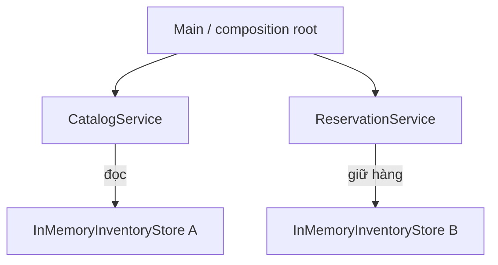
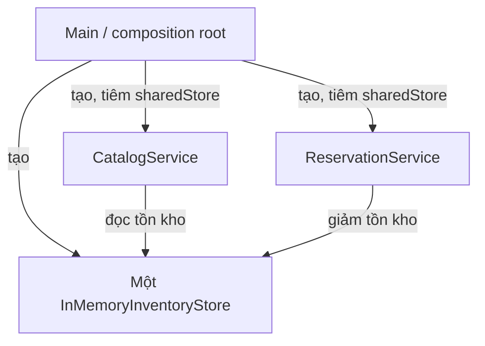
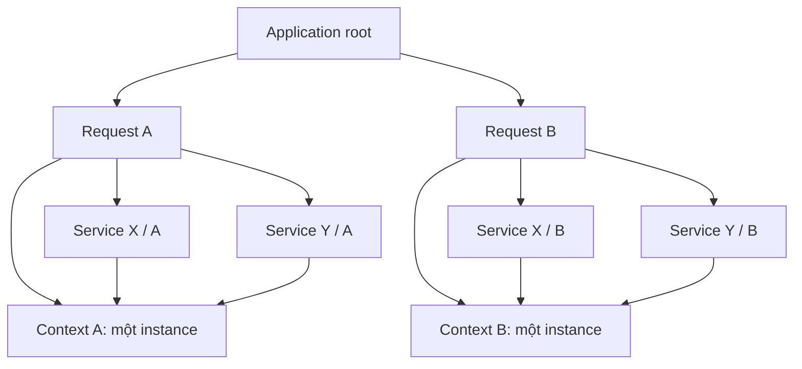

# Tạo phụ thuộc dùng chung và truyền đúng cùng một instance

Trong **Dependency Injection (DI)** thủ công, chúng ta tự tạo các đối tượng và truyền chúng vào constructor của những lớp cần sử dụng. Khi nhiều dịch vụ cần **dùng chung một cộng tác viên**, điều quan trọng không chỉ là truyền đúng *kiểu* phụ thuộc, mà còn phải truyền **đúng cùng một instance**.

Ví dụ, dịch vụ tra cứu tồn kho và dịch vụ đặt giữ hàng cần nhìn thấy cùng một trạng thái tồn kho. Nếu nơi khởi động vô tình tạo hai kho lưu trữ độc lập, mỗi dịch vụ vẫn nhận một đối tượng hợp lệ về kiểu, nhưng hai dịch vụ lại quan sát hai trạng thái khác nhau. Đây là lỗi **lắp ghép đồ thị đối tượng** (*object graph*), không nhất thiết là lỗi bên trong từng dịch vụ.

Bài học thuộc chương **DI thủ công** của module **Dependency Injection**. Ta sẽ tạo một đối tượng dùng chung tại **composition root**, tiêm cùng tham chiếu vào nhiều dịch vụ, kiểm tra bằng Java thuần, rồi xác định ranh giới của scope, vòng đời, quyền sở hữu tài nguyên và an toàn khi dùng đồng thời. Những nguyên tắc này vẫn áp dụng khi sau này chuyển sang DI container.

## 1. Phân biệt cùng kiểu và cùng instance

Trong Java, biểu thức `new` thường tạo ra một đối tượng mới:

```java
InventoryStore a = new InMemoryInventoryStore(/* dữ liệu ban đầu */);
InventoryStore b = new InMemoryInventoryStore(/* dữ liệu ban đầu */);

// a và b có cùng kiểu interface, nhưng là hai đối tượng riêng.
System.out.println(a == b); // false
```

Đoạn mã trên chỉ minh họa; implementation sẽ được định nghĩa đầy đủ ở phần thực hành. Hai đối tượng có thể cùng kiểu, cùng cấu hình và thậm chí chứa dữ liệu giống nhau lúc đầu, nhưng trạng thái nội bộ và vòng đời của chúng **độc lập**.

Ngược lại:

```java
InventoryStore shared = new InMemoryInventoryStore(/* dữ liệu ban đầu */);
InventoryStore firstReference = shared;
InventoryStore secondReference = shared;

System.out.println(firstReference == secondReference); // true
```

Trong ví dụ này, cả hai biến giữ **tham chiếu đến một đối tượng**. Toán tử `==` trên hai biến tham chiếu so sánh **đồng nhất đối tượng** (*identity*). `equals()` có thể so sánh bằng nhau về giá trị nếu kiểu dữ liệu có định nghĩa phù hợp; `equals()` trả về `true` **không chứng minh** hai tham chiếu trỏ tới cùng instance.

| Tình huống | Số đối tượng thực tế | Hai dịch vụ có chia sẻ trạng thái trong đối tượng đó không? |
| --- | ---: | --- |
| `new Store()` hai lần rồi truyền mỗi lần vào một service | 2 | Không, nếu mỗi store giữ trạng thái độc lập |
| `Store shared = new Store()` một lần rồi truyền `shared` vào cả hai | 1 | Có, nếu cả hai dùng chính trạng thái của store ấy |
| Hai instance truy cập cùng cơ sở dữ liệu bên ngoài | 2 | Có thể cùng nhìn dữ liệu trong database, **nhưng không phải cùng instance** |

Vì vậy phải đặt câu hỏi cụ thể: hệ thống cần **cùng một object**, hay chỉ cần **cùng nguồn dữ liệu bên ngoài**? Trong một ứng dụng chạy thử bằng bộ nhớ, dùng đúng một object thường rất quan trọng. Trong ứng dụng dùng database, nhiều repository instance có thể dùng chung một database hoặc pool, và việc có nên chia sẻ repository còn phụ thuộc khả năng dùng đồng thời và scope của nó.

## 2. Lỗi phổ biến: mỗi dịch vụ được cấp một store mới

Giả sử hai dịch vụ có trách nhiệm riêng:

- `CatalogService` hiển thị số lượng hàng còn lại.
- `ReservationService` giữ một đơn vị hàng khi khách đặt mua.

Nếu viết mã lắp ghép như dưới đây, cả hai service đều được tiêm `InventoryStore`, nhưng đó là **hai instance khác nhau**:

```java
// SAI nếu hai dịch vụ phải dùng cùng một trạng thái tồn kho trong bộ nhớ.
CatalogService catalog = new CatalogService(
        new InMemoryInventoryStore(Map.of("BOOK-1", 2)));

ReservationService reservations = new ReservationService(
        new InMemoryInventoryStore(Map.of("BOOK-1", 2)));
```

Sau khi `reservations` giữ một quyển sách, kho do `catalog` sử dụng vẫn có thể báo còn hai quyển, vì dữ liệu trong kho thứ nhất chưa hề thay đổi.

Điểm cần chú ý: **constructor injection đã được sử dụng đúng về cú pháp**. Sai sót nằm ở **composition root**: nó không duy trì quan hệ chia sẻ instance mà nghiệp vụ yêu cầu.

Sơ đồ biểu diễn cách lắp ghép sai:



Các service chỉ biết interface `InventoryStore`. Chính nơi lắp ghép phải quyết định chúng dùng hai store độc lập hay một store chung.

## 3. Cách đúng: tạo một lần và truyền cùng tham chiếu

Trong DI thủ công, **composition root** thường là `main()` hoặc phần khởi tạo ứng dụng. Nơi này tạo từng phụ thuộc, lưu instance vào một biến và chuyển cùng instance ấy cho các đối tượng cần dùng.

```java
// Minh họa wiring; các lớp được định nghĩa ở phần 4.
InventoryStore sharedStore =
        new InMemoryInventoryStore(Map.of("BOOK-1", 2));

CatalogService catalog = new CatalogService(sharedStore);
ReservationService reservations = new ReservationService(sharedStore);
```

Sơ đồ object graph đúng:



Ở đây các dòng quan trọng là **khởi tạo `sharedStore` đúng một lần** và **truyền chính biến đó** cho cả hai constructor. Không cần trường `static`, singleton toàn cục, service locator hay DI container. Từ bên ngoài, người lắp ghép kiểm soát được quan hệ phụ thuộc; bên trong, mỗi service chỉ thực hiện trách nhiệm của mình.

## 4. Ví dụ Java 17 hoàn chỉnh: hai service dùng một kho tồn

Ví dụ này chạy độc lập với JDK 17 trở lên. `InventoryStore` là hợp đồng chung, `InMemoryInventoryStore` là implementation đơn giản lưu trạng thái trong một `Map`, và hai service có constructor nhận `InventoryStore`.

Các thao tác của store được đánh dấu `synchronized` để việc đọc và giảm số lượng trên **cùng instance** không tranh chấp nhau trong ví dụ. Đây chỉ là một lựa chọn hiện thực nhỏ; nó không có nghĩa mọi dependency được chia sẻ đều tự động an toàn đa luồng.

Lưu toàn bộ mã dưới đây vào tệp `Main.java`:

```java
import java.util.HashMap;
import java.util.Map;
import java.util.Objects;

interface InventoryStore {
    int available(String sku);
    boolean reserveOne(String sku);
}

final class InMemoryInventoryStore implements InventoryStore {
    private final Map<String, Integer> quantities;

    InMemoryInventoryStore(Map<String, Integer> initialQuantities) {
        Objects.requireNonNull(initialQuantities, "initialQuantities");
        for (var entry : initialQuantities.entrySet()) {
            Objects.requireNonNull(entry.getKey(), "sku");
            Objects.requireNonNull(entry.getValue(), "quantity");
            if (entry.getKey().isBlank() || entry.getValue() < 0) {
                throw new IllegalArgumentException("Invalid initial quantity");
            }
        }
        // Tạo bản sao để dữ liệu đầu vào bên ngoài không đổi trạng thái nội bộ.
        this.quantities = new HashMap<>(initialQuantities);
    }

    @Override
    public synchronized int available(String sku) {
        Objects.requireNonNull(sku, "sku");
        return quantities.getOrDefault(sku, 0);
    }

    @Override
    public synchronized boolean reserveOne(String sku) {
        Objects.requireNonNull(sku, "sku");
        int current = quantities.getOrDefault(sku, 0);
        if (current == 0) {
            return false;
        }
        quantities.put(sku, current - 1);
        return true;
    }
}

final class CatalogService {
    private final InventoryStore store;

    CatalogService(InventoryStore store) {
        this.store = Objects.requireNonNull(store, "store");
    }

    int available(String sku) {
        return store.available(sku);
    }
}

final class ReservationService {
    private final InventoryStore store;

    ReservationService(InventoryStore store) {
        this.store = Objects.requireNonNull(store, "store");
    }

    boolean reserve(String sku) {
        return store.reserveOne(sku);
    }
}

public class Main {
    public static void main(String[] args) {
        // Composition root: một instance, hai service nhận cùng tham chiếu.
        InventoryStore sharedStore =
                new InMemoryInventoryStore(Map.of("BOOK-1", 2));
        CatalogService catalog = new CatalogService(sharedStore);
        ReservationService reservations = new ReservationService(sharedStore);

        check(catalog.available("BOOK-1") == 2,
                "Ban đầu phải còn 2 quyển");

        check(reservations.reserve("BOOK-1"),
                "Lần giữ thứ nhất phải thành công");
        check(catalog.available("BOOK-1") == 1,
                "Catalog phải thấy trạng thái mới sau lần giữ thứ nhất");

        check(reservations.reserve("BOOK-1"),
                "Lần giữ thứ hai phải thành công");
        check(catalog.available("BOOK-1") == 0,
                "Catalog phải thấy hàng đã hết");

        check(!reservations.reserve("BOOK-1"),
                "Không được giữ quá số lượng ban đầu");

        // Hai biến dưới đây vẫn tham chiếu tới đúng một object.
        InventoryStore anotherReference = sharedStore;
        check(sharedStore == anotherReference,
                "Phải giữ nguyên identity của dependency dùng chung");

        // So sánh lỗi lắp ghép: hai instance giữ hai trạng thái độc lập.
        CatalogService separateCatalog = new CatalogService(
                new InMemoryInventoryStore(Map.of("BOOK-2", 1)));
        ReservationService separateReservations = new ReservationService(
                new InMemoryInventoryStore(Map.of("BOOK-2", 1)));

        check(separateReservations.reserve("BOOK-2"),
                "Kho của ReservationService phải giữ được hàng");
        check(separateCatalog.available("BOOK-2") == 1,
                "Kho độc lập của CatalogService vẫn còn 1 đơn vị");

        System.out.println("PASS");
    }

    private static void check(boolean condition, String message) {
        if (!condition) {
            throw new AssertionError(message);
        }
    }
}
```

Biên dịch và chạy:

```bash
javac -encoding UTF-8 Main.java
java Main
```

Kết quả mong đợi:

```text
PASS
```

Phần đầu xác minh rằng khi `ReservationService` giảm tồn kho, `CatalogService` đọc thấy số lượng thay đổi ngay trên **cùng instance**. Phần cuối cố ý tạo **hai instance khác nhau** để thấy rằng mỗi service có thể hoạt động riêng lẻ mà cả hệ thống vẫn sai về quan hệ chia sẻ trạng thái.

Lưu ý: đoạn kiểm tra `sharedStore == anotherReference` chỉ minh họa **identity của hai biến**. Kiểm chứng đúng wiring giữa *hai service* chủ yếu đến từ cách `sharedStore` được truyền vào hai constructor và hành vi quan sát được qua cả hai service, chứ không phải vì phép kiểm tra alias đơn giản ấy.

## 5. Kiểm thử xem hai service có thực sự nhận chung dependency

Khi không muốn dựa vào trạng thái cụ thể của `InMemoryInventoryStore`, có thể dùng một **test double** để ghi lại lời gọi của các service. Nếu cùng một test double được cung cấp cho cả hai, ta có thể xác minh cả hai cùng tương tác với đối tượng đó.

Đây là ví dụ độc lập về ý tưởng, sử dụng lại interface `InventoryStore`, `CatalogService` và `ReservationService` ở mục 4:

```java
final class RecordingInventoryStore implements InventoryStore {
    int readCalls;
    int reserveCalls;

    @Override
    public int available(String sku) {
        readCalls++;
        return 5;
    }

    @Override
    public boolean reserveOne(String sku) {
        reserveCalls++;
        return true;
    }
}

// Có thể đặt các câu lệnh này trong một phương thức kiểm thử.
RecordingInventoryStore fake = new RecordingInventoryStore();
CatalogService catalog = new CatalogService(fake);
ReservationService reservations = new ReservationService(fake);

int available = catalog.available("BOOK-1");
boolean reserved = reservations.reserve("BOOK-1");

if (available != 5 || !reserved ||
        fake.readCalls != 1 || fake.reserveCalls != 1) {
    throw new AssertionError("Hai service phải gọi cùng test double");
}
```

Đoạn trên **không phải** một tệp Java độc lập vì nó phụ thuộc vào các khai báo ở ví dụ trước. Giá trị của cách kiểm thử là ta đo được cả hành vi tra cứu và hành vi giữ hàng qua **một đối tượng ghi nhận**. Nếu người lắp ghép vô tình cấp hai fake riêng, một fake duy nhất sẽ không quan sát thấy cả hai nhóm lời gọi.

Trong integration test, có thể thay fake bằng một adapter dữ liệu thử nghiệm và xác minh nghiệp vụ liên thông. Unit test của từng service vẫn nên tập trung vào **hợp đồng và cách service dùng cộng tác viên**; test lắp ghép bổ sung trách nhiệm kiểm tra các service được nối với nhau đúng cách.

## 6. Dùng chung một instance liên quan gì đến scope?

**Scope** là phạm vi mà một instance được tạo, giữ và tái sử dụng. Trong Java thuần, scope không cần annotation: nó hình thành từ vị trí tạo đối tượng, phạm vi tham chiếu được truyền đi và thời điểm đối tượng ngừng được sử dụng.

| Scope dự kiến | Cách lắp ghép thủ công | Ví dụ phù hợp |
| --- | --- | --- |
| **Ứng dụng** | Tạo một lần khi khởi động, truyền cho nhiều service dùng trong suốt vòng đời ứng dụng | Client không giữ trạng thái request, cache được thiết kế dùng chung, connection pool |
| **Mỗi request / mỗi tác vụ** | Tạo một instance tại điểm bắt đầu request/tác vụ, truyền cùng instance cho các thành phần trong phạm vi đó | Ngữ cảnh request, đơn vị công việc, thành phần giữ trạng thái tạm theo request |
| **Mỗi lần dùng** | Tạo mới khi thực sự cần và không chia sẻ ngoài thao tác đó | Đối tượng làm việc tạm thời, bộ tích lũy có trạng thái riêng |

Nói **“cùng một instance”** luôn phải đi kèm với câu hỏi **“cùng nhau trong phạm vi nào?”**. Không phải tất cả dependency đều nên dùng chung toàn ứng dụng. Ví dụ, một `RequestContext` chứa thông tin của người dùng hiện tại có thể được **chia sẻ giữa các service trong một request**, nhưng không nên là một instance toàn cục phục vụ đồng thời nhiều người dùng.

### Dùng chung trong một request, tách giữa các request

Mô hình đúng có thể là:



Trong từng request, hai service có thể cần **cùng một `Context`**. Nhưng context của request A và request B phải tách nhau. Khi học DI container, các khái niệm như singleton và request scope thường giúp quản lý quy tắc tương tự một cách tự động; tư duy lắp ghép cần có từ trước khi dùng container.

## 7. Chia sẻ instance không tự làm nó an toàn đa luồng

Ví dụ tồn kho cố ý dùng `synchronized` cho hai phương thức truy cập state để minh họa rằng đọc và giảm lượng tồn kho cần được kiểm soát. Nếu dùng một `HashMap` có thể thay đổi và một phép `quantity = quantity - 1` **không đồng bộ hóa**, hai lời gọi đồng thời có thể cùng đọc giá trị cũ và cập nhật sai lượng tồn kho.

Khi chuẩn bị chia sẻ một instance, hãy xác định:

1. **Nó có trạng thái thay đổi được không?** Đối tượng bất biến hoặc không trạng thái thường dễ dùng chung hơn.
2. **Nhiều luồng có thể gọi cùng lúc không?** Với web server, điều này thường xảy ra khi các request cùng sử dụng dependency application-scoped.
3. **API có hứa hẹn thread safety không?** Không suy đoán chỉ từ việc class là `final` hay các trường tham chiếu là `final`.
4. **Thao tác nhiều bước có cần tính nguyên tử không?** `available()` rồi `reserveOne()` là hai lời gọi riêng; dù từng phương thức có `synchronized`, quyết định dựa trên số lượng đọc trước đó vẫn có thể lỗi thời. Việc đặt giữ phải tự kiểm tra và cập nhật nguyên tử như `reserveOne()` trong ví dụ.

Lưu ý thực tế: một database connection hoặc một persistence context gắn với transaction thường **không phù hợp để chia sẻ tùy ý giữa các request**. Thay vào đó, có thể chia sẻ một pool hoặc factory được thiết kế cho nhiều luồng và tạo connection hay transaction theo phạm vi thao tác. Chia sẻ *điểm cấp tài nguyên* khác với chia sẻ *một tài nguyên đang mang trạng thái phiên làm việc*.

## 8. Ai tạo, ai sở hữu và ai đóng đối tượng dùng chung?

Trong DI thủ công, **nơi tạo dependency** nên có một chính sách rõ ràng về quyền sở hữu và vòng đời. Nếu composition root mở một HTTP client, pool hoặc executor dùng chung, nó cần bảo đảm đối tượng không bị đóng trong khi các service khác còn sử dụng.

Một cấu trúc thường dùng là:

```java
// Sơ đồ mã; SharedClient, ServiceA, ServiceB được giả định đã tồn tại.
try (SharedClient client = new SharedClient(/* cấu hình */)) {
    ServiceA a = new ServiceA(client);
    ServiceB b = new ServiceB(client);

    // Thực hiện các tác vụ cần client trong phạm vi này.
    // Khi rời khối try, composition root đóng client một lần.
}
```

Ví dụ này giả định `SharedClient` thực hiện `AutoCloseable`; nó minh họa **nguyên tắc sở hữu**, không phải đoạn mã độc lập có thể biên dịch. Nếu service A tự `close()` client sau một lời gọi, service B có thể gặp lỗi vì đang dùng chung instance đã đóng.

Cũng không nên hiểu rằng nơi tạo nhất thiết phải luôn là nơi trực tiếp đóng: một ứng dụng có thể giao trách nhiệm dọn dẹp cho lifecycle manager. Điều cần thiết là **quy tắc sở hữu được quy định nhất quán** và chỉ đóng khi không còn consumer sử dụng.

## 9. Vì sao không cần singleton toàn cục hoặc service locator?

Một cách khác để mọi nơi “lấy cùng instance” là tạo singleton có phương thức `getInstance()` hoặc registry toàn cục. Tuy nhiên, cách này làm service **tự tìm phụ thuộc** và che giấu nhu cầu của nó:

```java
// Không cần thiết trong bài toán này:
final class CatalogService {
    private final InventoryStore store = GlobalRegistry.inventoryStore();
}
```

Constructor khi đó không nói cho caller biết service cần kho tồn nào. Unit test khó cấp fake hoặc tách trạng thái giữa các lần chạy. Đôi khi mô hình registry được dùng tại ranh giới framework cụ thể, nhưng nó không phải điều kiện để **dùng chung instance**.

Với constructor injection:

```java
InventoryStore sharedStore = new InMemoryInventoryStore(Map.of("BOOK-1", 2));
CatalogService catalog = new CatalogService(sharedStore);
ReservationService reservations = new ReservationService(sharedStore);
```

Composition root vẫn **kiểm soát được identity** của instance mà không cần trạng thái global. Một class Java cũng không cần biến thành singleton cứng chỉ vì ứng dụng hiện chỉ muốn tạo một instance của class ấy.

## 10. Những lỗi lắp ghép cần tránh

### 10.1. Tạo hai dependency trong hai constructor riêng

```java
new CatalogService(new InMemoryInventoryStore(Map.of("BOOK-1", 2)));
new ReservationService(new InMemoryInventoryStore(Map.of("BOOK-1", 2)));
```

Hai lần `new` tạo hai instance. Khi thực sự cần chia sẻ trạng thái, tạo một biến tại root và truyền lại.

### 10.2. Giữ dependency ở `static` để chia sẻ cho nhanh

Một trường mutable `static` dễ làm các bài test ảnh hưởng lẫn nhau, gây khó khi chạy nhiều tenant hoặc nhiều cấu hình và giấu quan hệ phụ thuộc. Thay vào đó, composition root giữ tham chiếu và tiêm đúng nơi cần dùng.

### 10.3. Chia sẻ một đối tượng có trạng thái request toàn ứng dụng

Một `CurrentUserContext` hoặc một session giao dịch được dùng chung cho mọi request có thể làm lẫn dữ liệu và phá vỡ tính cô lập. Dùng chung **trong scope cần thiết**, sau đó giải phóng đúng thời điểm.

### 10.4. Nhầm cùng cấu hình với cùng instance

Hai đối tượng được tạo bằng cùng tham số constructor vẫn là hai đối tượng độc lập. Với dependency có trạng thái nội bộ, việc quan sát giá trị ban đầu bằng nhau chưa đủ kiểm chứng chúng được chia sẻ.

### 10.5. Đóng tài nguyên dùng chung trong một consumer

Một service đóng connection pool hoặc HTTP client mà service khác cũng dùng có thể khiến thao tác sau thất bại. Tài nguyên dùng chung nên được quản lý vòng đời ở nơi có cái nhìn đầy đủ về mọi consumer.

### 10.6. Chia sẻ vì “tiết kiệm bộ nhớ” mà bỏ qua thread safety

Nếu dependency có mutable state, các lời gọi đồng thời có thể làm hỏng dữ liệu. Đánh giá hợp đồng concurrency của implementation trước khi dùng chung; khi cần, dùng immutable object, đồng bộ hóa thích hợp hoặc scope hẹp hơn.

## 11. Bài tập thực hành

**Bài 1 — Sửa wiring.** Một ứng dụng tạo `AuditRecorder` ở ba nơi khác nhau. Yêu cầu mới là gom mọi sự kiện vào **một bộ ghi nhận trong bộ nhớ cho một phiên chạy thử**. Hãy tạo một recorder tại composition root rồi truyền cùng instance cho cả ba service. Kiểm tra kết quả bằng một danh sách sự kiện.

**Bài 2 — Chọn scope.** Phân loại các dependency sau và giải thích điều kiện cần để chia sẻ: một `HttpClient` không trạng thái theo request, một `RequestContext` chứa thông tin người dùng, một `EntityManager` gắn với transaction và một `Clock` bất biến. Với đối tượng cần đóng, nêu ai quản lý vòng đời.

**Bài 3 — Đọc lỗi liên thông.** `ReservationService` cho biết đã giữ hàng, nhưng `CatalogService` vẫn báo số lượng cũ. Hãy kiểm tra tại composition root trước: liệu cả hai có cùng nhận một `InventoryStore`? Sau đó xem xét khả năng cache, transaction hoặc bản sao dữ liệu khiến trạng thái chưa đồng bộ. Không mặc định rằng mọi sai lệch quan sát đều do wiring.

**Bài 4 — Thử đa luồng.** Thay `InMemoryInventoryStore` bằng một implementation tự tăng/giảm `int` mà không đồng bộ hóa, rồi phân tích nguy cơ khi nhiều luồng cùng `reserveOne`. Đề xuất cách giữ thao tác kiểm tra và giảm lượng tồn kho nguyên tử. Không cần triển khai một test concurrency dài để thấy yêu cầu thiết kế này.

## 12. Tự kiểm tra hiểu bài

**Câu 1.** Hai service nhận hai `new InMemoryInventoryStore(Map.of("A", 2))` có dùng cùng instance không? **Không.** Chúng chỉ nhận hai object cùng kiểu và có dữ liệu ban đầu tương đương.

**Câu 2.** Làm sao bảo đảm hai service nhận đúng một dependency trong DI thủ công? **Tạo một lần tại composition root**, giữ instance trong biến và truyền chính biến đó vào các constructor.

**Câu 3.** Có cần biến class thành singleton để dùng chung không? **Không.** Việc lắp ghép quyết định sẽ tạo bao nhiêu instance; class không cần áp đặt số lượng toàn cục.

**Câu 4.** Hai repository instance kết nối cùng database có phải cùng instance không? **Không.** Chúng có thể thấy cùng dữ liệu bên ngoài, nhưng identity đối tượng vẫn khác nhau.

**Câu 5.** Một object được tiêm vào hai service thì mặc nhiên thread-safe? **Không.** Phải xem trạng thái có thể thay đổi, số luồng sử dụng, hợp đồng của implementation và yêu cầu nguyên tử của thao tác.

**Câu 6.** Tại sao request context thường chỉ chia sẻ trong một request? **Vì** dữ liệu của từng request cần được cô lập; chia sẻ cùng context giữa nhiều request có thể làm lẫn trạng thái.

## Ghi nhớ

- **Dùng chung một dependency** nghĩa là nhiều consumer giữ **tham chiếu tới đúng cùng instance**, không chỉ cùng interface hay cùng cấu hình.
- **Composition root** tạo dependency một lần trong scope đã chọn và truyền cùng biến cho các constructor cần nó; đây là DI thủ công, không cần container.
- Việc quan sát qua hai service và test double giúp phát hiện lỗi **lắp ghép object graph** khi mỗi nơi vô tình được cấp instance khác nhau.
- **Scope** quyết định phạm vi chia sẻ: application-wide, theo request/tác vụ hoặc theo lần dùng. Không phải dependency nào cũng nên được dùng chung toàn ứng dụng.
- Trước khi chia sẻ instance, phải làm rõ **thread safety, quyền sở hữu và thời điểm đóng tài nguyên**. DI container có thể hỗ trợ vòng đời, nhưng không thay thế các quyết định thiết kế đó.
