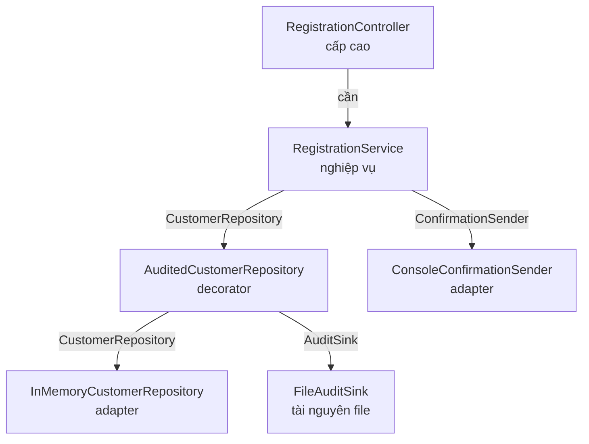
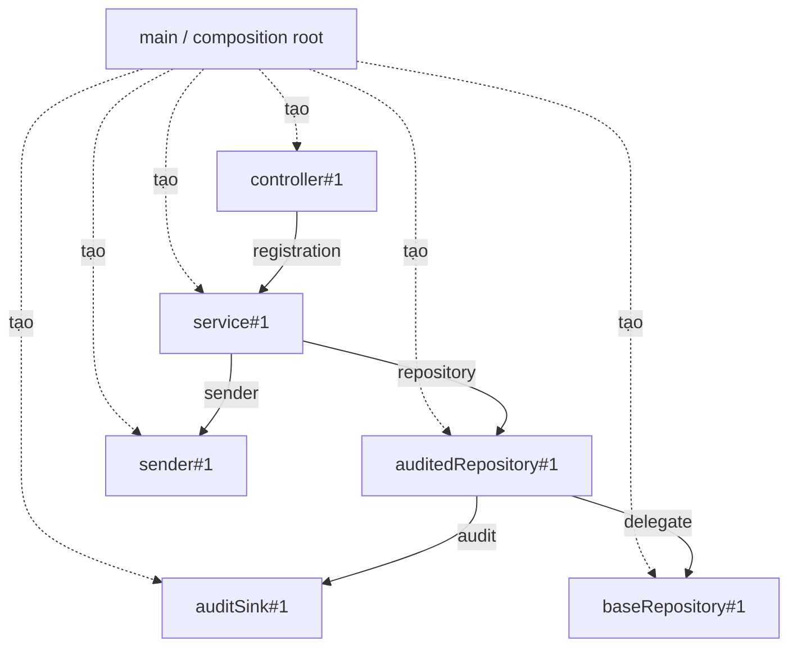

# Xây dựng chuỗi đối tượng từ thành phần nền tới dịch vụ cấp cao

Trong **Dependency Injection (DI) thủ công**, người lập trình tự tạo các đối tượng, lựa chọn implementation, rồi truyền chúng qua constructor hoặc phương thức. Thử thách xuất hiện khi một dịch vụ cấp cao lại cần các dịch vụ khác, và các dịch vụ đó tiếp tục cần tài nguyên hoặc adapter ở tầng thấp hơn. Khi ấy, ứng dụng phải dựng **chuỗi phụ thuộc từ nền lên cao** theo một thứ tự có chủ đích.

Ví dụ, một chức năng đăng ký khách hàng cần:

- Kho lưu trữ khách hàng;
- Bộ ghi nhật ký để ghi nhận thao tác lưu;
- Thành phần gửi thông báo;
- Dịch vụ nghiệp vụ điều phối việc đăng ký;
- Bộ điều khiển nhận yêu cầu và gọi dịch vụ.

Nếu đặt toàn bộ lệnh tạo đối tượng vào từng lớp nghiệp vụ, ta sẽ khó thay implementation, khó kiểm thử, dễ tạo trùng instance và khó xác định nơi đóng tài nguyên. Bài học này dùng **Java thuần** để thực hành **constructor injection**, tổ chức **composition root**, quản lý **scope/vòng đời** và kiểm tra việc lắp ghép trước khi mở rộng sang DI container.

## 1. Hiểu “xây dựng từ nền lên cao” qua đồ thị phụ thuộc

Giả sử các lớp có quan hệ:

- `RegistrationController` cần `RegistrationService`;
- `RegistrationService` cần `CustomerRepository` và `ConfirmationSender`;
- `AuditedCustomerRepository` triển khai `CustomerRepository`, cần một repository lưu dữ liệu và `AuditSink`;
- `InMemoryCustomerRepository`, `ConsoleConfirmationSender` và `FileAuditSink` là các adapter có thể tạo trực tiếp.

Một đồ thị **consumer → dependency** có dạng:



Các mũi tên trong sơ đồ biểu diễn **đối tượng ở đầu mũi tên cần đối tượng ở cuối mũi tên**. Vì vậy, khi dựng graph, thứ tự tạo phù hợp là đi **từ các nút không cần dependency đến những consumer phía trên**:

| Giai đoạn | Đối tượng được tạo | Đã cần có |
| --- | --- | --- |
| 1. Nền tảng | `FileAuditSink`, `InMemoryCustomerRepository`, `ConsoleConfirmationSender` | Cấu hình đường dẫn hoặc dữ liệu khởi tạo |
| 2. Tổ hợp adapter | `AuditedCustomerRepository` | Repository nền và audit sink |
| 3. Nghiệp vụ | `RegistrationService` | Repository đã bọc audit và sender |
| 4. Entry point ứng dụng | `RegistrationController` | Registration service |

Đây là một **đồ thị có hướng**; trong cấu hình constructor injection thông thường, phần dựng đối tượng cần có thứ tự hợp lệ, không được có vòng phụ thuộc constructor chưa được giải quyết. Chuỗi “nền → cao” không nhất thiết là một đường thẳng: nhiều nhánh độc lập có thể được dựng trước rồi cùng nối vào một dịch vụ.

**Tạo đối tượng ở tầng nền trước** chỉ nói về thứ tự lắp ghép. **Luồng gọi khi chạy** thường bắt đầu ngược lại từ controller đến service rồi mới đến adapter.

## 2. Phân biệt ba vai trò trước khi viết lệnh new

| Vai trò | Trách nhiệm | Có nên biết adapter hạ tầng cụ thể? |
| --- | --- | --- |
| **Consumer nghiệp vụ** | Sử dụng khả năng lưu, gửi, ghi audit | Thường không; nhận port/interface |
| **Port/hợp đồng** | Mô tả thao tác mà consumer yêu cầu | Không cần biết implementation |
| **Composition root** | Chọn implementation, tạo instance, nối dependency, quản lý vòng đời | Có; đây là nơi cần biết các lớp cụ thể |

Trong ví dụ, `RegistrationService` chỉ nhận:

```java
RegistrationService(CustomerRepository repository,
                    ConfirmationSender sender) {
    this.repository = java.util.Objects.requireNonNull(repository);
    this.sender = java.util.Objects.requireNonNull(sender);
}
```

Điều này cho thấy **service cần những khả năng gì** để hoạt động. Nó không phải biết repository được lưu vào RAM, file hay database. Thành phần lắp ghép quyết định dùng implementation nào.

Sự khác biệt trong tư duy:

```java
// Cách gắn chặt: service tự khởi tạo dependency cụ thể.
final class CoupledRegistrationService {
    private final CustomerRepository repository =
            new InMemoryCustomerRepository();
}
```

```java
// Cách tách biệt: dependency được cấp từ ngoài.
final class RegistrationService {
    private final CustomerRepository repository;

    RegistrationService(CustomerRepository repository) {
        this.repository = java.util.Objects.requireNonNull(repository);
    }
}
```

*Hai đoạn trên minh họa cách tổ chức constructor, chưa phải chương trình đầy đủ; ví dụ biên dịch độc lập nằm ở mục 3.*

Với DI thủ công, vẫn cần `new` ở đâu đó. **Composition root** chính là nơi chủ động gọi `new` và truyền instance, để lớp nghiệp vụ tập trung vào hành vi của mình.

## 3. Ví dụ Java thuần: dựng chuỗi adapter → service → controller

Bài toán: nhận yêu cầu đăng ký khách hàng, lưu dữ liệu, ghi sự kiện audit rồi gửi thông báo. Ta viết tất cả thành một file để tự chạy. Hệ thống sử dụng repository bộ nhớ để tránh cài database; audit sink ghi ra file để minh họa rõ vấn đề **sở hữu và đóng tài nguyên**.

Tạo file `ManualObjectChainDemo.java`:

```java
import java.io.BufferedWriter;
import java.io.IOException;
import java.io.UncheckedIOException;
import java.nio.charset.StandardCharsets;
import java.nio.file.Files;
import java.nio.file.Path;
import java.nio.file.StandardOpenOption;
import java.util.HashMap;
import java.util.Map;
import java.util.Objects;

public class ManualObjectChainDemo {

    // Kiểu dữ liệu nghiệp vụ.
    static final class Customer {
        private final String id;
        private final String email;

        Customer(String id, String email) {
            if (id == null || id.isBlank()
                    || email == null || email.isBlank()) {
                throw new IllegalArgumentException(
                        "id and email must not be blank");
            }
            this.id = id;
            this.email = email;
        }

        String id() {
            return id;
        }

        String email() {
            return email;
        }
    }

    // Các hợp đồng mà tầng sử dụng cần.
    interface CustomerRepository {
        void save(Customer customer);
    }

    interface AuditSink {
        void append(String event);
    }

    interface ConfirmationSender {
        void sendWelcome(Customer customer);
    }

    // Tầng nền 1: adapter lưu dữ liệu trong bộ nhớ.
    static final class InMemoryCustomerRepository
            implements CustomerRepository {
        private final Map<String, Customer> customers = new HashMap<>();

        @Override
        public void save(Customer customer) {
            Objects.requireNonNull(customer, "customer");
            if (customers.putIfAbsent(customer.id(), customer) != null) {
                throw new IllegalArgumentException(
                        "Customer ID already exists: " + customer.id());
            }
        }

        int count() {
            return customers.size();
        }
    }

    // Tầng nền 2: adapter ghi audit ra file.
    static final class FileAuditSink implements AuditSink, AutoCloseable {
        private final BufferedWriter writer;

        FileAuditSink(Path path) throws IOException {
            writer = Files.newBufferedWriter(
                    path,
                    StandardCharsets.UTF_8,
                    StandardOpenOption.CREATE,
                    StandardOpenOption.APPEND);
        }

        @Override
        public void append(String event) {
            try {
                writer.write(event);
                writer.newLine();
                writer.flush();
            } catch (IOException error) {
                throw new UncheckedIOException(error);
            }
        }

        @Override
        public void close() throws IOException {
            writer.close();
        }
    }

    // Tầng nền 3: adapter thông báo.
    static final class ConsoleConfirmationSender
            implements ConfirmationSender {
        @Override
        public void sendWelcome(Customer customer) {
            System.out.println(
                    "Gui xac nhan den " + customer.email());
        }
    }

    // Tầng giữa: decorator dựa trên hai dependency đã dựng.
    static final class AuditedCustomerRepository
            implements CustomerRepository {
        private final CustomerRepository delegate;
        private final AuditSink audit;

        AuditedCustomerRepository(CustomerRepository delegate,
                                  AuditSink audit) {
            this.delegate =
                    Objects.requireNonNull(delegate, "delegate");
            this.audit = Objects.requireNonNull(audit, "audit");
        }

        @Override
        public void save(Customer customer) {
            delegate.save(customer);
            audit.append("CUSTOMER_CREATED " + customer.id());
        }
    }

    // Tầng nghiệp vụ chỉ dùng port, không biết file/console/HashMap.
    static final class RegistrationService {
        private final CustomerRepository repository;
        private final ConfirmationSender sender;

        RegistrationService(CustomerRepository repository,
                            ConfirmationSender sender) {
            this.repository =
                    Objects.requireNonNull(repository, "repository");
            this.sender = Objects.requireNonNull(sender, "sender");
        }

        Customer register(String id, String email) {
            Customer customer = new Customer(id, email);
            repository.save(customer);
            sender.sendWelcome(customer);
            return customer;
        }
    }

    // Tầng cấp cao nhận request ở dạng tham số của ví dụ.
    static final class RegistrationController {
        private final RegistrationService registration;

        RegistrationController(RegistrationService registration) {
            this.registration =
                    Objects.requireNonNull(registration, "registration");
        }

        String handle(String id, String email) {
            Customer customer = registration.register(id, email);
            return "CREATED:" + customer.id();
        }
    }

    public static void main(String[] args) throws IOException {
        // COMPOSITION ROOT: cấu hình và tạo dependency từ nền lên cao.
        Path auditPath = Path.of("registration-audit.log");

        // Root sở hữu sink và đóng khi không còn consumer sử dụng.
        try (FileAuditSink auditSink = new FileAuditSink(auditPath)) {
            CustomerRepository baseRepository =
                    new InMemoryCustomerRepository();

            ConfirmationSender sender =
                    new ConsoleConfirmationSender();

            CustomerRepository auditedRepository =
                    new AuditedCustomerRepository(
                            baseRepository, auditSink);

            RegistrationService service =
                    new RegistrationService(auditedRepository, sender);

            RegistrationController controller =
                    new RegistrationController(service);

            System.out.println(
                    controller.handle("C-001", "learner@example.test"));
        }
    }
}
```

Chạy bằng **JDK 11 trở lên**:

```bash
javac ManualObjectChainDemo.java
java ManualObjectChainDemo
```

Kết quả console:

```text
Gui xac nhan den learner@example.test
CREATED:C-001
```

File `registration-audit.log` có thêm dòng sau trong thư mục hiện hành:

```text
CUSTOMER_CREATED C-001
```

Ví dụ dùng `StandardOpenOption.APPEND` nên chạy nhiều lần sẽ thêm các dòng audit. `InMemoryCustomerRepository` chỉ sống trong một lần chạy chương trình; dữ liệu khách hàng **không được lưu bền vững**.

### 3.1. Đọc từng bước trong composition root

Năm nhóm thao tác ở `main` lần lượt là:

1. **Chuẩn bị cấu hình:** xác định `auditPath`.
2. **Tạo adapter nền:** mở `FileAuditSink`, tạo `InMemoryCustomerRepository` và `ConsoleConfirmationSender`.
3. **Tạo thành phần kết hợp:** cấp repository nền và audit sink cho `AuditedCustomerRepository`.
4. **Tạo service nghiệp vụ:** truyền repository đã bọc và sender cho `RegistrationService`.
5. **Tạo entry point cấp cao:** truyền service cho `RegistrationController`; sau đó mới xử lý yêu cầu.

Không một constructor nào phải “đi tìm” dependency thông qua biến global hoặc service locator. Mỗi constructor nhận đúng các đối tượng mà mã lắp ghép **đã tạo sẵn**.

### 3.2. Cùng một object có thể được tham chiếu qua nhiều kiểu

Trong `main`:

```java
CustomerRepository baseRepository =
        new InMemoryCustomerRepository();

CustomerRepository auditedRepository =
        new AuditedCustomerRepository(baseRepository, auditSink);
```

`baseRepository` và `auditedRepository` đều có kiểu khai báo `CustomerRepository`, nhưng là **hai instance khác nhau**. Repository được đưa vào `RegistrationService` là **decorator**, còn bên trong decorator giữ tham chiếu đến repository nền.

Cách dựng này không tạo một “bản sao” của repository nền khi truyền vào constructor. Java sao chép **giá trị tham chiếu**, nên các đối tượng được nối với nhau thành một đồ thị rõ ràng.

Đồ thị instance sau khi lắp ghép:



**Phân biệt hai loại cạnh trên sơ đồ:** nét đứt từ root biểu diễn **trách nhiệm tạo/lắp ghép**; nét liền giữa các object biểu diễn **tham chiếu được giữ trong field**. Root không nhất thiết là một object heap riêng có trường trỏ đến tất cả dependency; trong ví dụ nó là khối mã `main` đang giữ các biến cục bộ.

## 4. Vì sao thứ tự dựng graph quan trọng?

Java bắt buộc một biến cục bộ phải được gán hợp lệ trước khi được dùng. Điều đó dễ phát hiện các lỗi thứ tự đơn giản:

```java
// Ví dụ KHÔNG BIÊN DỊCH vì service chưa được khai báo.
RegistrationController controller =
        new RegistrationController(service);

RegistrationService service = /* tạo ở phía sau */;
```

Nhưng lỗi wiring phức tạp hơn thường **vẫn biên dịch**. Ví dụ:

```java
// Vẫn đúng kiểu Java nhưng vô tình bỏ qua decorator ghi audit.
CustomerRepository baseRepository =
        new InMemoryCustomerRepository();
CustomerRepository auditedRepository =
        new AuditedCustomerRepository(baseRepository, auditSink);

// SAI về yêu cầu nghiệp vụ: truyền base thay vì audited.
RegistrationService service =
        new RegistrationService(baseRepository, sender);
```

Đoạn minh họa sử dụng các biến `auditSink` và `sender` đã có trong scope. Constructor nhận `CustomerRepository` nên cả `baseRepository` lẫn `auditedRepository` đều hợp lệ về kiểu. Trình biên dịch không thể biết yêu cầu nghiệp vụ là **mọi thao tác lưu cần đi qua audit decorator**.

Đó là lý do sau khi dựng chuỗi đối tượng, cần kiểm tra cả:

- **Cấu trúc graph:** đúng instance được truyền vào đúng consumer hay chưa.
- **Hành vi:** thao tác có đi qua đủ các adapter yêu cầu hay không.
- **Vòng đời:** object có còn hợp lệ khi consumer sử dụng hay không.

## 5. Composition root không phải một container DI

DI thủ công có thể chỉ là vài dòng `new` trong `main`. Với ứng dụng lớn hơn, root có thể gồm các phương thức khởi tạo hoặc factory nhỏ để giữ `main` dễ đọc:

```java
// Ví dụ ý tưởng tổ chức bootstrap, không thuộc file chạy ở mục 3.
static RegistrationController buildController(
        CustomerRepository repository,
        ConfirmationSender sender) {

    RegistrationService service =
            new RegistrationService(repository, sender);

    return new RegistrationController(service);
}
```

Hàm này chỉ **lắp ghép các lớp cấp cao** từ dependency đã chuẩn bị. Nó không đòi framework, annotation hay cấu hình tự động.

**IoC** trong bối cảnh này có nghĩa: `RegistrationService` không tự điều khiển quá trình chọn và tạo repository/sender; quyền đó nằm ở root. **DI** là hành động cấp những đối tượng ấy qua constructor.

Một DI container về sau có thể tự:

- Xác định dependency của constructor;
- Chọn binding giữa interface và implementation;
- Tạo object theo scope;
- Theo dõi tài nguyên phù hợp với cơ chế quản lý vòng đời.

Tuy nhiên, container không tự sửa được **hợp đồng sai, scope sai hoặc việc chọn nhầm implementation**. Hiểu DI thủ công giúp đọc và kiểm chứng những quyết định này khi dùng framework.

## 6. Xây từ các nhánh độc lập, không nhầm đồ thị với một danh sách thẳng

Composition root của ví dụ có nhiều nhánh:

```text
FileAuditSink ───────┐
                     v
InMemoryRepository -> AuditedRepository ──┐
                                         v
ConsoleConfirmationSender ─────────────> RegistrationService
                                         |
                                         v
                                RegistrationController
```

Có thể khởi tạo `InMemoryCustomerRepository` và `ConsoleConfirmationSender` theo thứ tự bất kỳ vì chúng **không phụ thuộc vào nhau**. `AuditedCustomerRepository` phải chờ cả repository nền và audit sink, còn `RegistrationService` phải chờ decorator và sender.

Trong lý thuyết đồ thị, thứ tự khởi tạo hợp lệ tương ứng với một **thứ tự tô-pô** (*topological order*) của đồ thị phụ thuộc không có chu trình. Không cần triển khai thuật toán sắp xếp khi viết vài lệnh `new` thủ công; chỉ cần hiểu quy tắc: **tạo các dependency trước consumer**.

Nếu graph có chu trình constructor:

```text
A cần B để dựng
B cần A để dựng
```

ta không thể đơn giản tạo đầy đủ A trước B và đồng thời tạo đầy đủ B trước A. Đây thường là dấu hiệu cần xem lại ranh giới trách nhiệm, tách một interface thứ ba, phát hành sự kiện hoặc thay đổi cách hợp tác. Một số framework hỗ trợ kỹ thuật lazy/provider để xử lý những trường hợp cụ thể, nhưng **che chu trình bằng cơ chế tạo trễ không tự chứng minh thiết kế tốt**.

## 7. Quyết định dùng chung hay tạo mới: scope nằm trong graph

Hãy xét hai cách lắp ghép cùng kiểu:

```java
CustomerRepository shared = new InMemoryCustomerRepository();

RegistrationService first =
        new RegistrationService(shared, sender);
RegistrationService second =
        new RegistrationService(shared, sender);
```

Hai service **giữ cùng một instance repository**: `firstRepository == secondRepository` là `true` nếu ta có thể đọc hai field tương ứng. Nếu tạo một `new InMemoryCustomerRepository()` cho mỗi constructor, chúng **khác instance** và dữ liệu lưu vào mỗi nơi không tự xuất hiện ở nơi còn lại.

| Cách dựng | Đặc điểm | Hệ quả |
| --- | --- | --- |
| Tạo một instance, inject cho nhiều consumer | Dùng chung | Chia sẻ trạng thái, tài nguyên và chi phí khởi tạo |
| Mỗi consumer nhận `new` khác nhau | Riêng biệt | Cách ly trạng thái nhưng tăng số instance |
| Tạo theo mỗi request/operation | Scope ngắn | Cần điểm tạo và điểm kết thúc của scope |
| Root tạo service sống dài, giữ dependency sống ngắn | Dễ thành **captive dependency** | Consumer có thể giữ tài nguyên hết hiệu lực |

“Singleton” trong ngữ cảnh container thường có nghĩa là một instance được chia sẻ **trong phạm vi quản lý xác định của container**; nó không tự bảo đảm an toàn luồng. `InMemoryCustomerRepository` trong bài dùng `HashMap` và **không được thiết kế cho nhiều luồng ghi đồng thời**. Nếu đưa vào web server có request chạy song song, cần chọn adapter hoặc cơ chế đồng bộ phù hợp.

Trong DI thủ công, **người viết composition root chính là người quy định scope bằng cách đặt lệnh tạo và tái sử dụng object ở đâu**.

## 8. Ownership và thứ tự đóng tài nguyên

Trong ví dụ, `FileAuditSink` sở hữu `BufferedWriter` và thực thi `AutoCloseable`. Các lớp phía trên chỉ nhìn thấy hợp đồng `AuditSink.append` nên không có lý do hoặc API để tự đóng writer.

```java
try (FileAuditSink auditSink =
        new FileAuditSink(Path.of("registration-audit.log"))) {

    CustomerRepository base = new InMemoryCustomerRepository();
    CustomerRepository audited =
            new AuditedCustomerRepository(base, auditSink);

    RegistrationService service =
            new RegistrationService(
                    audited, new ConsoleConfirmationSender());

    service.register("C-002", "reader@example.test");
} // Root đóng auditSink sau khi consumer ngừng sử dụng.
```

Quy ước tốt là: **thành phần nhận một dependency để sử dụng không mặc nhiên trở thành owner của tài nguyên đó**. Với adapter dùng chung, root hoặc một scope owner phải kiểm soát khi nào đóng.

`try-with-resources` đặc biệt hữu ích khi bootstrap xảy ra lỗi giữa chừng: nếu `auditSink` đã mở thành công nhưng một constructor hoặc thao tác sau đó ném ngoại lệ trong khối, Java vẫn cố đóng `auditSink` khi thoát khối.

Khi root sở hữu **nhiều resource** cần đóng, có thể khai báo nhiều resource trong cùng `try-with-resources`; Java đóng theo **thứ tự ngược với thứ tự khai báo**:

```java
try (ResourceA first = openA();
     ResourceB second = openB(first)) {
    // Sử dụng cả hai.
} // second.close() rồi first.close().
```

*`ResourceA`, `ResourceB` và `openA/openB` là ký hiệu minh họa; cần định nghĩa trong ứng dụng thực tế.* Thứ tự ngược thường phù hợp khi resource cấp cao phụ thuộc vào resource nền, nhưng vẫn phải kiểm tra hợp đồng đóng của từng adapter.

**Lưu ý về lỗi đa bước:** trong ví dụ, việc lưu vào bộ nhớ hoàn tất trước khi ghi audit và gửi thông báo. Nếu ghi audit hoặc gửi thông báo thất bại, thao tác không tự rollback `save`. Trong hệ thống thật có yêu cầu nhất quán, cần xác định transaction, retry, idempotency hoặc outbox theo thiết kế. DI giải quyết **cách nối các cộng tác viên**, không tự đảm bảo tính nguyên tử của nghiệp vụ.

## 9. Kiểm thử chuỗi đối tượng bằng Java thuần

Vì `RegistrationService` nhận `CustomerRepository` và `ConfirmationSender` qua constructor, test có thể lắp một **graph nhỏ** với fake theo đúng hợp đồng. Không cần khởi tạo file hoặc console adapter.

Tạo file `ManualObjectChainTest.java` cùng thư mục với `ManualObjectChainDemo.java`:

```java
import java.util.ArrayList;
import java.util.List;

public class ManualObjectChainTest {

    static final class RecordingRepository
            implements ManualObjectChainDemo.CustomerRepository {

        private final List<String> calls;
        private final boolean fail;

        RecordingRepository(List<String> calls, boolean fail) {
            this.calls = calls;
            this.fail = fail;
        }

        @Override
        public void save(ManualObjectChainDemo.Customer customer) {
            calls.add("save:" + customer.id());
            if (fail) {
                throw new IllegalStateException("Simulated save failure");
            }
        }
    }

    static final class RecordingSender
            implements ManualObjectChainDemo.ConfirmationSender {

        private final List<String> calls;

        RecordingSender(List<String> calls) {
            this.calls = calls;
        }

        @Override
        public void sendWelcome(ManualObjectChainDemo.Customer customer) {
            calls.add("notify:" + customer.id());
        }
    }

    public static void main(String[] args) {
        List<String> calls = new ArrayList<>();

        // Dựng graph dành riêng cho bài test.
        var repository = new RecordingRepository(calls, false);
        var sender = new RecordingSender(calls);
        var service = new ManualObjectChainDemo.RegistrationService(
                repository, sender);
        var controller = new ManualObjectChainDemo.RegistrationController(
                service);

        String result = controller.handle("C-101", "test@example.test");

        if (!"CREATED:C-101".equals(result)
                || !List.of("save:C-101", "notify:C-101").equals(calls)) {
            throw new AssertionError("Unexpected registration behavior");
        }

        // Nếu lưu thất bại, sender không được gọi.
        List<String> failureCalls = new ArrayList<>();
        var failingService = new ManualObjectChainDemo.RegistrationService(
                new RecordingRepository(failureCalls, true),
                new RecordingSender(failureCalls));
        var failingController =
                new ManualObjectChainDemo.RegistrationController(
                        failingService);

        boolean failed = false;
        try {
            failingController.handle("C-102", "test@example.test");
        } catch (IllegalStateException expected) {
            failed = true;
        }

        if (!failed
                || !List.of("save:C-102").equals(failureCalls)) {
            throw new AssertionError(
                    "Notification must not run after save failure");
        }

        System.out.println("PASS");
    }
}
```

Chạy với JDK 11 trở lên:

```bash
javac ManualObjectChainDemo.java ManualObjectChainTest.java
java ManualObjectChainTest
```

Kết quả mong đợi:

```text
PASS
```

Test này kiểm tra **thứ tự gọi** và **đường đi của lỗi** qua service/controller. Nó không mở file vì graph test không dùng `FileAuditSink`. Đây chính là lợi ích của việc tách logic nghiệp vụ khỏi lựa chọn adapter ở composition root.

Để kiểm thử **wiring của graph thực tế** (khác với unit test service), có thể kiểm tra ngay trong một phương thức bootstrap rằng `RegistrationService` nhận `AuditedCustomerRepository` thay vì repository nền. Khi field được giữ `private`, nên ưu tiên giữ các reference ở bootstrap và dùng fake/spy để quan sát hành vi; không nên mở toàn bộ trạng thái nội bộ của service chỉ phục vụ một bài test.

### 9.1. Cách xác minh đúng graph chứ không chỉ đúng kiểu

Một phương án kiểm tra tích hợp với giả lập audit là:

```java
// Mã minh họa: dùng các interface/lớp của ví dụ chính.
List<String> events = new ArrayList<>();

AuditSink fakeAudit = events::add;
CustomerRepository base = new InMemoryCustomerRepository();
CustomerRepository audited =
        new AuditedCustomerRepository(base, fakeAudit);

RegistrationService service = new RegistrationService(
        audited, customer -> { /* không gửi thông báo thật */ });

service.register("C-201", "test@example.test");

if (!events.equals(List.of("CUSTOMER_CREATED C-201"))) {
    throw new AssertionError("Audit decorator was bypassed");
}
```

*Đoạn này minh họa khi đặt trong ngữ cảnh có thể truy cập các kiểu lồng nhau `ManualObjectChainDemo` (hoặc viết tên đầy đủ cho chúng), có import `java.util.List` và `java.util.ArrayList`.* Kiểm tra audit phát hiện lỗi wiring bị bỏ qua decorator dù constructor vẫn nhận đúng kiểu `CustomerRepository`.

Hai lớp kiểm tra bổ sung cho nhau:

- **Unit test nghiệp vụ** sử dụng fake port để kiểm tra logic theo hợp đồng.
- **Wiring/integration test** kiểm tra cách root chọn adapter, lớp bọc và thứ tự gọi trong graph được lắp thực tế.

## 10. Chuyển từ một chain cố định sang lựa chọn theo cấu hình

Khi có nhiều môi trường, composition root có thể chọn adapter theo cấu hình; lớp nghiệp vụ tiếp tục nhận **cùng một port**:

```java
// Mô hình minh họa ở bootstrap; lớp JDBC và config chưa được định nghĩa.
CustomerRepository baseRepository;

if (config.useInMemory()) {
    baseRepository = new InMemoryCustomerRepository();
} else {
    baseRepository = new JdbcCustomerRepository(config.dataSource());
}

CustomerRepository auditedRepository =
        new AuditedCustomerRepository(baseRepository, auditSink);

RegistrationService service =
        new RegistrationService(auditedRepository, sender);
```

Điều cần giữ khi mở rộng:

1. **Mọi nhánh cấu hình tạo ra dependency hợp lệ** và thỏa cùng hợp đồng.
2. **Mỗi tài nguyên có owner rõ ràng**; đặc biệt là data source, HTTP client hoặc connection pool.
3. **Không rải điều kiện môi trường vào service nghiệp vụ.** Service không cần kiểm tra `useInMemory()` để biết cách lưu.
4. **Không bỏ qua lớp decorator/policy cần thiết** trên một nhánh cấu hình.
5. **Khởi tạo lỗi phải báo rõ** tại bootstrap; không chạy tiếp với dependency chưa cấu hình hoặc `null`.

Cách tách bootstrap thành factory nhỏ có thể giúp composition root ngắn hơn. Nhưng nếu mỗi factory tự âm thầm lấy dependency từ biến tĩnh hoặc một registry toàn cục, quan hệ phụ thuộc lại bị ẩn. Nên truyền các dependency bắt buộc tường minh qua constructor/tham số.

## 11. Những lỗi thường gặp khi dựng chuỗi thủ công

| Dấu hiệu | Vấn đề thực tế | Hướng xử lý |
| --- | --- | --- |
| Mỗi consumer tự `new` repository | Nhiều instance ngoài ý muốn, trạng thái tách biệt | Root tạo và inject đúng scope |
| Service gọi `GlobalRegistry.get(...)` | Phụ thuộc và cấu hình bị ẩn | Constructor injection |
| Truyền repository nền thay vì decorator | Bỏ qua audit/policy dù đúng kiểu | Kiểm tra graph và hành vi |
| Tạo service trước khi có dependency | Thứ tự lắp ghép sai | Dựng theo thứ tự từ nền lên cao |
| Constructor A cần B, B lại cần A | Vòng phụ thuộc | Xem lại trách nhiệm và hợp đồng |
| Đóng client/file trong consumer mượn dependency | Resource bị đóng sớm | Chỉ owner/scope đóng |
| Root quên đóng resource | Giữ tài nguyên sau khi dùng xong | `try-with-resources` hoặc cơ chế shutdown rõ |
| Singleton giữ dependency theo request | Captive dependency, dùng state cũ | Tạo theo scope hoặc inject factory |
| Chỉ test bằng fake nhưng không kiểm tra adapter | Có thể sai chuyển đổi dữ liệu/lỗi khi chạy thật | Contract test và integration test |
| Cùng adapter được dùng đồng thời nhưng không an toàn luồng | Race condition, dữ liệu sai | Chọn scope hoặc implementation phù hợp |

Một dấu hiệu của graph quá phức tạp là composition root phải biết quá nhiều chi tiết và liên tục xử lý vòng phụ thuộc. Đây có thể là cơ hội xem lại **ranh giới trách nhiệm giữa các thành phần**, không nhất thiết là lý do phải chuyển ngay sang container.

## 12. Quy trình thực hành cho một chuỗi phụ thuộc mới

Khi thêm chức năng vào dự án Java:

1. **Liệt kê các thành phần cấp cao cần hoạt động.** Chẳng hạn controller, application service hoặc scheduled job.
2. **Đi ngược xuống dependency.** Với từng constructor, hỏi nó cần những port nào và port được thực hiện bởi adapter nào.
3. **Vẽ graph consumer → dependency.** Nhận diện tài nguyên nền, thành phần dùng chung, decorator và scope riêng theo request.
4. **Xác định owner và vòng đời.** Thành phần nào đóng file/client/pool; object nào được chia sẻ; có dependency sống ngắn bị giữ quá lâu không?
5. **Tạo từ lá lên gốc tại composition root.** Dựng nền tảng trước, sau đó decorator, service và entry point.
6. **Kiểm tra lựa chọn implementation và cạnh nối.** Dùng fake/spy để phát hiện truyền nhầm đối tượng cùng interface.
7. **Kiểm thử bằng Java thuần.** Kiểm tra hành vi, lỗi và các bất biến quan trọng. Sau đó mới thêm integration test cho hạ tầng thật.
8. **Chỉ dùng DI container khi có lợi ích rõ ràng.** Container có thể giảm công việc wiring, nhưng các quyết định về contract, scope và ownership vẫn phải đúng.

### Bài tập

**Bài 1 — Vẽ graph.** Vẽ lại sơ đồ `RegistrationController → RegistrationService → AuditedCustomerRepository`, kèm hai nhánh `InMemoryCustomerRepository` và `FileAuditSink`. Đánh dấu thành phần nào giữ reference, thành phần nào sở hữu tài nguyên file.

**Bài 2 — Bỏ qua decorator.** Thay tham số đầu tiên của `RegistrationService` thành `baseRepository` thay vì `auditedRepository`. Dự đoán console và file audit thay đổi thế nào. Đề xuất một test giúp ngăn lỗi này.

**Bài 3 — Scope và trạng thái.** Tạo hai `RegistrationService` với hai `InMemoryCustomerRepository` khác nhau. Đăng ký cùng một ID ở mỗi service. So sánh hành vi với trường hợp cả hai service dùng cùng một repository.

**Bài 4 — Thêm dependency nền.** Tạo interface `ClockPort` với `Instant now()`; inject vào `RegistrationService` để ghi thời điểm đăng ký. Composition root phải tạo thêm đối tượng ở giai đoạn nào? Khi test, làm thế nào cấp một thời điểm cố định?

**Bài 5 — Vòng đời.** Đổi `FileAuditSink` thành fake `AutoCloseable` đếm số lần đóng. Kiểm tra owner đóng sau khi service dùng xong và không đóng hai lần. Thử tạo lỗi bên trong khối `try-with-resources` và xác định thời điểm `close` được gọi.

## 13. Ghi nhớ

**DI thủ công là quá trình xây dựng một đồ thị đối tượng bằng mã Java rõ ràng.** Từ cấu hình và adapter nền, ta tạo các thành phần kết hợp, rồi truyền chúng lên service và entry point bằng constructor injection. Thứ tự tạo phải tôn trọng các cạnh phụ thuộc, còn cách tạo mới hay dùng chung quyết định scope và trạng thái của từng instance.

**Composition root** giữ quyền lựa chọn implementation và quản lý các tài nguyên mà nó sở hữu. **Inversion of Control** giúp lớp nghiệp vụ tập trung sử dụng hợp đồng thay vì tự tạo, tìm kiếm hoặc đóng các dependency ở bên ngoài. Khi kiểm thử được chuỗi đối tượng bằng Java thuần, việc chuyển sang DI container về sau chủ yếu là thay cách tự động hóa quá trình lắp ghép, trong khi nguyên tắc về hướng phụ thuộc, vòng đời và hành vi vẫn giữ nguyên.
