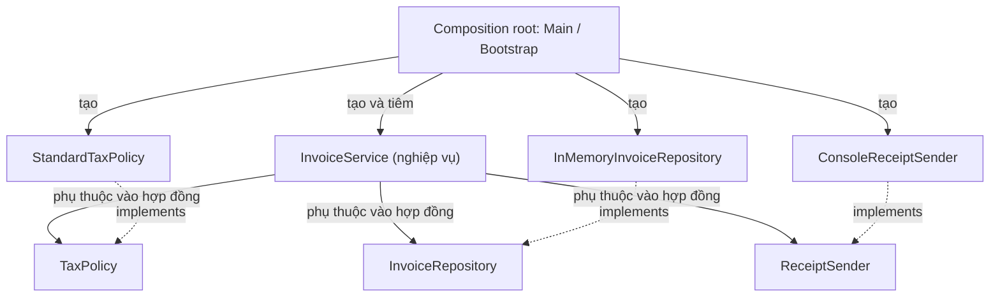

# Tách lớp nghiệp vụ khỏi lớp cấu hình lắp ghép

Một ứng dụng Java phải làm hai việc khác nhau: **thực hiện nghiệp vụ** (đăng ký, tính tiền, xuất hóa đơn...) và **quyết định các đối tượng cụ thể nào sẽ được tạo, kết nối và sử dụng**. Nếu một lớp nghiệp vụ vừa xử lý quy tắc tính tiền vừa tự tạo kết nối lưu trữ, đọc biến môi trường và chọn dịch vụ gửi email, lớp đó gắn chặt với cách triển khai ứng dụng. Thay đổi hạ tầng dễ kéo theo thay đổi nghiệp vụ; kiểm thử một quy tắc nhỏ cũng phải dựng phần còn lại của hệ thống.

Trong **Dependency Injection (DI) thủ công**, ta đưa các phụ thuộc cần thiết vào constructor của lớp sử dụng và tập trung việc tạo, chọn, nối đối tượng ở **composition root**. Đây là cách thực hành **Inversion of Control (IoC)** trong Java thuần: lớp nghiệp vụ được cung cấp cộng tác viên, thay vì tự điều khiển quá trình tìm kiếm và khởi tạo chúng.

Bài học thuộc chương **DI thủ công** của module **DEPENDENCY_INJECTION**. Trọng tâm là **tách lớp nghiệp vụ khỏi lớp cấu hình lắp ghép**, đồng thời thiết lập nền tảng cho constructor injection, object graph, quản lý scope/vòng đời và kiểm thử trước khi dùng DI container.

## 1. Kết quả cần đạt

Sau bài học, bạn có thể:

- Chỉ ra phần nào là **quy tắc nghiệp vụ**, phần nào là **quyết định cấu hình/lắp ghép** trong một đoạn mã Java.
- Giải thích tác hại khi service tự chọn adapter, truy cập cấu hình môi trường hoặc tra cứu dependency từ container toàn cục.
- Thiết kế các **hợp đồng (port)** theo nhu cầu của lớp sử dụng, tiêm chúng qua constructor và lắp ghép các triển khai tại composition root.
- Tạo một object graph bằng Java thuần, chủ động quyết định instance nào được chia sẻ, instance nào phải tạo mới và ai đóng tài nguyên.
- Kiểm thử service mà không khởi động ứng dụng, mở kết nối thật hoặc sử dụng DI container.
- Biết ranh giới của việc tách lớp: DI làm rõ cấu trúc, nhưng không tự đảm bảo tính đúng đắn nghiệp vụ, transaction hay vòng đời.

## 2. Hai loại quyết định cần phân biệt

Hãy hình dung một ca sử dụng phát hành hóa đơn sau khi nhận giá trị hàng hóa:

| Quyết định | Ví dụ | Nơi thường nên chịu trách nhiệm |
| --- | --- | --- |
| **Quy tắc nghiệp vụ** | Không chấp nhận giá trị hàng hóa âm; tính thuế; xác định tổng phải thu | Lớp nghiệp vụ và chính sách nghiệp vụ |
| **Cộng tác cần thiết** | Cần một nơi lưu hóa đơn và một cách gửi thông báo | Lớp nghiệp vụ tuyên bố qua hợp đồng và constructor |
| **Chọn triển khai** | Dùng kho dữ liệu trong bộ nhớ hay adapter cơ sở dữ liệu; gửi thông báo ra console hay qua dịch vụ bên ngoài | Composition root / lớp cấu hình lắp ghép |
| **Thông số vận hành** | Endpoint, credential, timeout, chế độ chạy thử | Tầng cấu hình và khởi tạo adapter |
| **Vòng đời đối tượng** | Dùng chung repository giữa các service hay tạo client riêng cho mỗi công việc | Nơi sở hữu object graph, factory và cơ chế scope |
| **Điều phối use case** | Tính tiền, lưu hóa đơn, sau đó thông báo | Lớp nghiệp vụ/application service theo hợp đồng đã chọn |

**Phân biệt tinh tế:** lớp nghiệp vụ *được phép* quyết định **khi nào gọi** `InvoiceRepository.save(...)` và **khi nào gửi** `ReceiptSender.send(...)`. Điều cần tách ra là quyết định **repository nào, sender nào, tạo bằng cách nào, kết nối đến đâu**.

Composition root cũng không nên trở thành nơi chứa toàn bộ quy tắc thuế, chính sách giảm giá hay điều kiện phát hành hóa đơn. Nó **chọn và nối những thành phần** thực hiện các quy tắc đó, còn nội dung quy tắc thuộc về nghiệp vụ.

## 3. Trước khi tách: nghiệp vụ tự lắp ghép chính mình

Xét mã minh họa sau; các lớp `JdbcInvoiceRepository` và `SmtpReceiptSender` đại diện adapter hạ tầng giả định:

```java
final class InvoiceService {
    private final InvoiceRepository repository;
    private final ReceiptSender sender;

    InvoiceService() {
        // Service tự đọc cấu hình và chọn triển khai.
        String dbUrl = System.getenv("INVOICE_DB_URL");
        String smtpHost = System.getenv("SMTP_HOST");
        this.repository = new JdbcInvoiceRepository(dbUrl);
        this.sender = new SmtpReceiptSender(smtpHost);
    }

    Invoice issue(String id, long subtotalCents, String email) {
        // Quy tắc nghiệp vụ phát hành hóa đơn...
        // repository.save(invoice);
        // sender.send(email, invoice);
        throw new UnsupportedOperationException("minh họa thiết kế");
    }
}
```

Đây là **mã phác họa để phân tích kiến trúc**, không phải ví dụ biên dịch độc lập. Vấn đề không nằm ở việc gọi `new` nói chung, mà ở **loại đối tượng được tạo và nơi quyết định được đưa ra**:

1. `InvoiceService` phải biết tên adapter JDBC và SMTP. Đổi cách lưu hay gửi có thể buộc sửa lớp nghiệp vụ.
2. Service đọc trực tiếp biến môi trường, khiến chính sách khởi tạo phụ thuộc môi trường thực thi. Một unit test có thể phải cấu hình biến môi trường hoặc đưa cơ sở dữ liệu và SMTP giả vào hệ thống.
3. Tạo `new InvoiceService()` không cho người gọi lựa chọn dependency; trách nhiệm xử lý nghiệp vụ và trách nhiệm dựng hạ tầng bị trộn lẫn.
4. Mỗi lần tạo service có thể mở tài nguyên mới mà không rõ ai quản lý và đóng, đặc biệt nếu adapter khởi tạo kết nối lâu sống.

Hãy đưa phần **sử dụng** trở lại service, và chuyển phần **tạo, chọn, lắp ghép** ra một điểm khởi động của ứng dụng.

## 4. Thiết kế sau khi tách: hợp đồng ở phía nghiệp vụ

Giả sử ca sử dụng cần ba khả năng:

- `TaxPolicy` tính thuế theo một quy tắc được định nghĩa rõ.
- `InvoiceRepository` lưu và tra cứu hóa đơn.
- `ReceiptSender` yêu cầu gửi thông báo cho người nhận.

Service nhận ba hợp đồng ấy qua constructor:

```java
final class InvoiceService {
    private final TaxPolicy taxPolicy;
    private final InvoiceRepository repository;
    private final ReceiptSender sender;

    InvoiceService(
            TaxPolicy taxPolicy,
            InvoiceRepository repository,
            ReceiptSender sender) {
        this.taxPolicy = java.util.Objects.requireNonNull(taxPolicy);
        this.repository = java.util.Objects.requireNonNull(repository);
        this.sender = java.util.Objects.requireNonNull(sender);
    }

    // issue(...) dùng hợp đồng được cung cấp.
}
```

Mọi dependency **bắt buộc** được khai báo ngay ở constructor. Không cần annotation hay container để tiêm một đối tượng; một lời gọi `new InvoiceService(policy, repository, sender)` đã là **constructor injection**.

Sơ đồ phân biệt hai hướng:



Các mũi tên từ `InvoiceService` đến hợp đồng mô tả **phụ thuộc mã nguồn**. Composition root biết cả contract lẫn implementation để quyết định **đối tượng thực tế** chạy trong ứng dụng. Việc sử dụng interface giúp tách chi tiết, nhưng chỉ có ích khi hợp đồng thực sự mô tả nhu cầu và bảo đảm hành vi của service.

## 5. Ví dụ Java thuần hoàn chỉnh

Ví dụ này phát hành hóa đơn bằng chính sách thuế 10% để minh họa. Nó lưu hóa đơn **trong bộ nhớ** và có hai cách thông báo: in ra console hoặc không xuất thông báo. **Không sử dụng database, không gửi email thật và không cần DI container.**

Toàn bộ mã nằm trong một tệp `Main.java`. Các lớp lồng nhau chỉ giúp giữ bài thực hành tự chứa; phần sau sẽ mô tả cách tách tệp và package trong ứng dụng thực tế.

### 5.1. Hợp đồng, logic nghiệp vụ và adapter

```java
import java.util.ArrayList;
import java.util.LinkedHashMap;
import java.util.List;
import java.util.Map;
import java.util.Objects;
import java.util.Optional;

public class Main {
    // HỢP ĐỒNG MÀ NGHIỆP VỤ CẦN
    interface TaxPolicy {
        long taxCents(long subtotalCents);
    }

    interface InvoiceRepository {
        void saveNew(Invoice invoice);
        Optional<Invoice> find(String id);
    }

    interface ReceiptSender {
        void send(String email, Invoice invoice);
    }

    // GIÁ TRỊ NGHIỆP VỤ: trạng thái hóa đơn bất biến.
    static final class Invoice {
        final String id;
        final long subtotalCents;
        final long taxCents;
        final long totalCents;

        Invoice(String id, long subtotalCents, long taxCents) {
            this.id = Objects.requireNonNull(id, "id");
            if (id.isBlank() || subtotalCents < 0 || taxCents < 0) {
                throw new IllegalArgumentException("invalid invoice");
            }
            this.subtotalCents = subtotalCents;
            this.taxCents = taxCents;
            this.totalCents = Math.addExact(subtotalCents, taxCents);
        }
    }

    // CHÍNH SÁCH NGHIỆP VỤ: ví dụ thuế 10%, làm tròn xuống cent.
    static final class StandardTaxPolicy implements TaxPolicy {
        @Override
        public long taxCents(long subtotalCents) {
            if (subtotalCents < 0) {
                throw new IllegalArgumentException("negative subtotal");
            }
            return Math.multiplyExact(subtotalCents, 10) / 100;
        }
    }

    // SERVICE NGHIỆP VỤ: chỉ sử dụng các hợp đồng đã được tiêm.
    static final class InvoiceService {
        private final TaxPolicy taxPolicy;
        private final InvoiceRepository repository;
        private final ReceiptSender sender;

        InvoiceService(
                TaxPolicy taxPolicy,
                InvoiceRepository repository,
                ReceiptSender sender) {
            this.taxPolicy = Objects.requireNonNull(taxPolicy, "taxPolicy");
            this.repository = Objects.requireNonNull(repository, "repository");
            this.sender = Objects.requireNonNull(sender, "sender");
        }

        Invoice issue(String id, long subtotalCents, String email) {
            Objects.requireNonNull(email, "email");
            if (email.isBlank()) {
                throw new IllegalArgumentException("email is blank");
            }
            if (subtotalCents < 0) {
                throw new IllegalArgumentException("negative subtotal");
            }

            long tax = taxPolicy.taxCents(subtotalCents);
            Invoice invoice = new Invoice(id, subtotalCents, tax);
            repository.saveNew(invoice);
            sender.send(email, invoice);
            return invoice;
        }
    }

    // Một service khác dùng CÙNG repository đã được lắp ghép.
    static final class InvoiceQueryService {
        private final InvoiceRepository repository;

        InvoiceQueryService(InvoiceRepository repository) {
            this.repository = Objects.requireNonNull(repository);
        }

        Optional<Invoice> findById(String id) {
            return repository.find(id);
        }
    }

    // ADAPTER HẠ TẦNG: kho trong bộ nhớ để minh họa.
    static final class InMemoryInvoiceRepository implements InvoiceRepository {
        private final Map<String, Invoice> invoices = new LinkedHashMap<>();

        @Override
        public void saveNew(Invoice invoice) {
            Objects.requireNonNull(invoice, "invoice");
            if (invoices.putIfAbsent(invoice.id, invoice) != null) {
                throw new IllegalArgumentException("duplicate invoice id");
            }
        }

        @Override
        public Optional<Invoice> find(String id) {
            return Optional.ofNullable(invoices.get(id));
        }
    }

    static final class ConsoleReceiptSender implements ReceiptSender {
        @Override
        public void send(String email, Invoice invoice) {
            System.out.println("Receipt requested for " + email);
        }
    }

    static final class SilentReceiptSender implements ReceiptSender {
        @Override
        public void send(String email, Invoice invoice) {
            // Bài thực hành: cố ý không tạo hiệu ứng phụ bên ngoài.
        }
    }

    // Test double ghi nhận lời gọi, tách khỏi nơi gửi thực tế.
    static final class RecordingReceiptSender implements ReceiptSender {
        final List<String> calls = new ArrayList<>();

        @Override
        public void send(String email, Invoice invoice) {
            calls.add(email + ":" + invoice.id);
        }
    }

    // KẾT QUẢ LẮP GHÉP: nhóm các điểm vào cần dùng cùng object graph.
    static final class Application {
        final InvoiceService invoices;
        final InvoiceQueryService queries;

        Application(InvoiceService invoices, InvoiceQueryService queries) {
            this.invoices = Objects.requireNonNull(invoices);
            this.queries = Objects.requireNonNull(queries);
        }
    }

    // COMPOSITION ROOT: duy nhất nơi chọn adapter theo chế độ khởi động.
    static Application compose(String[] args) {
        if (args.length > 1 ||
                (args.length == 1 && !"--silent".equals(args[0]))) {
            throw new IllegalArgumentException("Usage: java Main [--silent]");
        }
        boolean silent = args.length == 1;

        InvoiceRepository repository = new InMemoryInvoiceRepository();
        TaxPolicy taxPolicy = new StandardTaxPolicy();
        ReceiptSender sender = silent
                ? new SilentReceiptSender()
                : new ConsoleReceiptSender();

        // Chia sẻ chính instance repository giữa hai service.
        InvoiceService invoices = new InvoiceService(
                taxPolicy, repository, sender);
        InvoiceQueryService queries = new InvoiceQueryService(repository);
        return new Application(invoices, queries);
    }

    public static void main(String[] args) {
        Application app = compose(args);
        Invoice issued = app.invoices.issue(
                "INV-001", 12_000, "lan@example.com");
        boolean stored = app.queries.findById(issued.id).isPresent();

        System.out.println("Invoice: " + issued.id
                + ", total=" + issued.totalCents + " cents");
        System.out.println("Shared repository works: " + stored);

        // Kiểm thử service với dependency thay thế, không khởi động app.
        InMemoryInvoiceRepository testRepository =
                new InMemoryInvoiceRepository();
        RecordingReceiptSender recorder = new RecordingReceiptSender();
        InvoiceService underTest = new InvoiceService(
                new StandardTaxPolicy(), testRepository, recorder);

        Invoice tested = underTest.issue(
                "T-001", 10_000, "test@example.com");
        if (tested.totalCents != 11_000
                || testRepository.find("T-001").isEmpty()
                || !recorder.calls.equals(List.of("test@example.com:T-001"))) {
            throw new AssertionError("incorrect invoice behavior");
        }
        System.out.println("Plain Java verification: PASS");
    }
}
```

Ví dụ dùng các tính năng của **JDK 11 trở lên**, như `String.isBlank()` và `Optional.isEmpty()`. Đặt mã vào `Main.java` rồi chạy:

```bash
javac -encoding UTF-8 Main.java
java Main
```

Kết quả dự kiến ở chế độ mặc định:

```text
Receipt requested for lan@example.com
Invoice: INV-001, total=13200 cents
Shared repository works: true
Plain Java verification: PASS
```

Muốn thay adapter thông báo mà không sửa `InvoiceService`:

```bash
java Main --silent
```

Kết quả:

```text
Invoice: INV-001, total=13200 cents
Shared repository works: true
Plain Java verification: PASS
```

**Điều cần quan sát:**

1. `InvoiceService` không có `new InMemoryInvoiceRepository()`, `new ConsoleReceiptSender()` hoặc đọc `args`; nó biết ba hợp đồng, tạo đối tượng giá trị `Invoice` để phục vụ nghiệp vụ và thực hiện chuỗi thao tác phát hành.
2. `compose(args)` là nơi **đọc lựa chọn vận hành**, chọn adapter, tạo service và liên kết các phụ thuộc. Chỉ đổi `ConsoleReceiptSender` thành `SilentReceiptSender` ở đây đã thay đổi hiệu ứng thông báo.
3. Hai service nhận **cùng một instance** `repository`. Vì thế dữ liệu được `InvoiceService` lưu có thể được `InvoiceQueryService` tra cứu. Nếu mỗi service tự tạo repository trong bộ nhớ riêng, dữ liệu sẽ nằm ở hai kho khác nhau.
4. Unit test tạo service trực tiếp với `RecordingReceiptSender`; không cần thực thi `compose`, thiết lập biến môi trường hay khởi động framework.
5. `StandardTaxPolicy` định nghĩa phép tính thuế như một **quy tắc nghiệp vụ minh họa**. Composition root chọn instance của chính sách ấy, không chứa công thức tính thuế.

Ví dụ cố tình nhỏ: `ConsoleReceiptSender` chỉ in dòng thông báo, `SilentReceiptSender` không gửi gì, `InMemoryInvoiceRepository` dùng `LinkedHashMap` và **không được thiết kế cho truy cập đồng thời**. Không nên mặc định dùng các adapter này trong môi trường production. Chúng chỉ phục vụ quan sát ranh giới giữa nghiệp vụ và lắp ghép.

## 6. Nên tách các tệp và package như thế nào?

Trong dự án thực tế, có thể tổ chức các khái niệm của ví dụ thành:

```text
src/main/java/example/invoicing/
  domain/
    Invoice.java
    TaxPolicy.java
    StandardTaxPolicy.java
  application/
    InvoiceService.java
    InvoiceQueryService.java
    InvoiceRepository.java
    ReceiptSender.java
  infrastructure/
    persistence/
      InMemoryInvoiceRepository.java
      JdbcInvoiceRepository.java
    messaging/
      ConsoleReceiptSender.java
      SmtpReceiptSender.java
  bootstrap/
    Main.java
    Application.java
```

Đây là **một cách sắp xếp tham khảo**, không phải cấu trúc Java bắt buộc. Hợp đồng được đặt gần **bên cần sử dụng khả năng** đó; trong ví dụ, `InvoiceRepository` là nhu cầu của application service, còn adapter nằm tại hạ tầng. Một hệ thống nhỏ có thể dùng ít package hơn; một hệ thống lớn có thể có module Java riêng cho các ranh giới.

Nguyên tắc về hướng phụ thuộc:

- `InvoiceService` có thể import `InvoiceRepository`, `ReceiptSender`, `Invoice` và `TaxPolicy`.
- Adapter `JdbcInvoiceRepository` có thể implement `InvoiceRepository` và dùng JDBC/SDK.
- `Main` biết cả service và adapter để nối chúng.
- **Lớp nghiệp vụ không cần import `JdbcInvoiceRepository`, `SmtpReceiptSender` hoặc container API** chỉ để phát hành một hóa đơn.

Lưu ý rằng ranh giới không chỉ nằm ở vị trí thư mục. Nếu `InvoiceRepository` trả về kiểu riêng của một JDBC driver, lớp nghiệp vụ vẫn bị phụ thuộc vào hạ tầng dù interface nằm trong package `application`. Hợp đồng cần mô tả dữ liệu và hành vi phù hợp với người sử dụng.

## 7. Composition root là gì, nằm ở đâu?

**Composition root** là điểm gần đầu vào ứng dụng nơi phần lớn object graph được **tạo và lắp ghép**. Trong chương trình console thuần Java, nó thường nằm trong `main` hoặc một hàm được `main` gọi, như `compose(args)`. Trong ứng dụng web, composition root có thể nằm tại mã bootstrap/configuration mà framework dùng khi khởi động.

Nó có nhiệm vụ:

- Đọc và kiểm tra **cấu hình vận hành** cần cho việc khởi động.
- Chọn implementation phù hợp, tạo dependency và truyền qua constructor.
- Tái sử dụng hoặc tạo mới đối tượng theo **vòng đời mong muốn**.
- Tập trung việc quản lý tài nguyên cần đóng hoặc đăng ký cơ chế shutdown khi có yêu cầu.
- Trả về các **điểm vào của ứng dụng** (use case handler, controller hoặc application facade) đã được lắp ghép hợp lệ.

### 7.1. Tại sao root được phép biết các lớp cụ thể?

Một ứng dụng rốt cuộc phải chọn **ít nhất một triển khai thực** cho các hợp đồng cần dùng. Nếu đặt trách nhiệm này trong từng service, cùng một quyết định sẽ nằm rải rác khắp hệ thống. Composition root tập trung chúng ở một nơi, để service có thể giữ các hợp đồng ổn định.

Root *không cần* tránh `new`. Ngược lại, khởi tạo trực tiếp là công việc bình thường của root:

```java
InvoiceRepository repository = new InMemoryInvoiceRepository();
ReceiptSender sender = new ConsoleReceiptSender();
InvoiceService service = new InvoiceService(
        new StandardTaxPolicy(), repository, sender);
```

Các đối tượng **giá trị miền** như `Invoice` có thể vẫn được tạo bên trong logic nghiệp vụ. Nguyên tắc cần giữ là *nơi sử dụng một dependency không tự quyết định và sở hữu cách tạo dependency hạ tầng đó*; không có lệnh cấm mọi từ khóa `new` trong nghiệp vụ.

### 7.2. Lựa chọn cấu hình không đồng nghĩa với lựa chọn chính sách nghiệp vụ

Trong ví dụ, tham số `--silent` chỉ chọn adapter thông báo; `InvoiceService` không biết cờ ấy. Nếu doanh nghiệp có chính sách thuế thay đổi theo quốc gia, loại hàng hoặc thời điểm, cách chọn quy tắc có thể là **một chính sách nghiệp vụ lúc chạy**. Không nên đưa toàn bộ logic ấy vào điều kiện `if` ở `Main` chỉ vì tên gọi “configuration”.

Composition root có thể cung cấp `TaxPolicy` cho service; bản thân chính sách có thể dùng dữ liệu của hóa đơn và quy tắc miền để tính thuế. Phân biệt **chọn đối tượng lúc khởi động** với **ra quyết định nghiệp vụ cho từng request** giúp giữ ranh giới chính xác.

### 7.3. Có nhất thiết một root vật lý cho mọi chương trình?

Một ứng dụng có thể có nhiều entry point: web server, batch job, command-line tool hoặc worker. Mỗi **đường khởi động** có thể có composition root riêng hoặc gọi chung một hàm bootstrap. Điều quan trọng là **mỗi đường khởi động có một nơi chịu trách nhiệm tạo graph**, chứ không yêu cầu toàn bộ hệ sinh thái nằm trong một tệp `Main.java`.

## 8. Vòng đời, scope và quyền sở hữu tài nguyên khi lắp ghép thủ công

DI thủ công khiến quyết định chia sẻ đối tượng **lộ rõ bằng câu lệnh tạo và truyền instance**. Ví dụ:

```java
InvoiceRepository shared = new InMemoryInvoiceRepository();
InvoiceService invoices = new InvoiceService(policy, shared, sender);
InvoiceQueryService queries = new InvoiceQueryService(shared);
```

Hai service dùng cùng một `shared`. Nếu ứng dụng muốn một repository mới cho từng yêu cầu, nơi lắp ghép hoặc factory phải cố ý tạo instance mới. Không có phép màu nào tự quyết định **singleton**, **per-request**, **transient** hoặc vòng đời của đối tượng.

| Cách dùng | Hành vi trong Java thuần | Cần chú ý |
| --- | --- | --- |
| Chia sẻ một instance | Root tạo một lần, truyền cho nhiều nơi | Thread-safety, mutable state, thời gian tồn tại |
| Tạo mỗi lần thao tác | Factory tạo dependency theo từng lượt gọi | Chi phí khởi tạo, ai đóng và quản lý lỗi |
| Giữ tài nguyên sống lâu | Root tạo client/pool rồi dùng chung | Shutdown, timeout, kết nối rò rỉ |
| Phụ thuộc có vòng đời ngắn hơn consumer | Sử dụng factory/provider hoặc thiết kế lại luồng cung cấp | Không giữ tham chiếu đã hết hạn, không trộn dữ liệu giữa request |

**Ví dụ quyền sở hữu tài nguyên:** nếu root tạo một adapter implement `AutoCloseable` (chẳng hạn client tự quản lý socket), root cần có cơ chế đóng nó khi ứng dụng dừng. Không phải mọi adapter hay `DataSource` đều mặc nhiên có cùng API đóng; hãy dùng đúng hợp đồng vòng đời của thư viện cụ thể. Với `try-with-resources`, tài nguyên sẽ được đóng khi thoát khối:

```java
// Mã khái niệm: MyCloseableClient là loại AutoCloseable do ta chọn.
try (MyCloseableClient client = new MyCloseableClient(config)) {
    // Root lắp adapter dựa vào client và chạy công việc.
}
```

Trong ứng dụng dài hạn, scope phải khớp với thời điểm shutdown thực tế, không thể kết thúc ngay sau khi tạo graph. DI container sau này có thể hỗ trợ scope và lifecycle hook, nhưng **chính sách chia sẻ và quyền sở hữu** vẫn là quyết định kiến trúc cần xem xét.

## 9. Testability: kiểm tra nghiệp vụ mà không khởi động hệ thống

Vì service chỉ cần các hợp đồng qua constructor, có thể kiểm thử độc lập với mã bootstrap:

```java
// Các lớp dưới đây lấy từ ví dụ Main.java ở mục 5.
Main.RecordingReceiptSender recorder = new Main.RecordingReceiptSender();
Main.InMemoryInvoiceRepository repository =
        new Main.InMemoryInvoiceRepository();
Main.InvoiceService service = new Main.InvoiceService(
        new Main.StandardTaxPolicy(), repository, recorder);

Main.Invoice invoice =
        service.issue("TEST-123", 20_000, "test@example.com");

if (invoice.totalCents != 22_000) {
    throw new AssertionError("wrong amount");
}
if (!recorder.calls.equals(java.util.List.of(
        "test@example.com:TEST-123"))) {
    throw new AssertionError("receipt not requested");
}
```

Ở đây, ta kiểm tra phép tính và tương tác gửi biên nhận **không cần** SMTP, cơ sở dữ liệu hay container. Nếu muốn kiểm tra riêng `InvoiceService` mà không phụ thuộc behavior của in-memory adapter, ta còn có thể dùng một fake repository chỉ ghi nhận đối tượng đã lưu.

Nhưng một fake có thể không giữ mọi đặc tính của adapter thật (transaction, cạnh tranh dữ liệu, lỗi mạng...). Vì vậy:

- **Unit test** tập trung kiểm tra quy tắc và tương tác của lớp nghiệp vụ.
- **Contract test** (khi có nhiều adapter) kiểm tra mỗi adapter tuân cùng quy tắc, chẳng hạn `saveNew` phải báo lỗi khi ID đã tồn tại.
- **Integration test** xác nhận kết nối, mapping, giao dịch và điều kiện vận hành của adapter thật khi cần.

Cần đặc biệt lưu ý đường lỗi: `issue` lưu hóa đơn **trước** khi gọi `sender.send`. Nếu sender ném exception, hóa đơn có thể đã tồn tại dù caller nhận lỗi. DI giúp tách trách nhiệm, **không tự tạo transaction xuyên qua database và hệ thống thông báo**. Trong ứng dụng thật cần quyết định trạng thái, retry, outbox hoặc chiến lược xử lý phù hợp theo yêu cầu.

## 10. Những cách lắp ghép dễ làm mất ranh giới

| Cách làm | Vì sao gây vấn đề | Hướng thiết kế |
| --- | --- | --- |
| Service gọi `new JdbcInvoiceRepository(...)` | Nghiệp vụ phải biết adapter và cấu hình | Root tạo adapter và tiêm `InvoiceRepository` |
| Service gọi `System.getenv(...)` để chọn SMTP hay console | Logic môi trường lọt vào use case | Root đọc cấu hình, tạo sender phù hợp |
| Service gọi `GlobalContainer.get(ReceiptSender.class)` | Phụ thuộc thực bị ẩn; test phải cấu hình trạng thái toàn cục | Khai báo sender ở constructor |
| Dồn toàn bộ dependency vào `AppDependencies` chỉ để constructor còn một tham số | Service vẫn có quyền truy cập rộng; ranh giới trách nhiệm không đổi | Tiêm đúng những hợp đồng cần thiết |
| Root chứa logic tính thuế/giảm giá theo từng đơn hàng | Chính sách nghiệp vụ bị chuyển nhầm vào bootstrap | Root chọn `TaxPolicy`, còn policy xử lý quy tắc |
| Tạo repository riêng biệt cho hai service cần chia sẻ trạng thái | Dữ liệu tách thành hai kho ngoài ý muốn | Root chia sẻ instance đúng nhu cầu |
| Giữ dữ liệu của request trong singleton mutable | Request khác có thể đọc/ghi nhầm trạng thái | Truyền dữ liệu theo lần gọi hoặc chọn scope hợp lý |
| Dùng test double không có trong graph production nhưng coi như kiểm thử đầy đủ | Bỏ sót lỗi adapter thật và wiring thực | Bổ sung kiểm thử khởi tạo/cấu hình và tích hợp khi cần |

### Service locator khác gì một composition root?

Cả hai đều có thể biết cách tìm hoặc tạo đối tượng, nhưng **vị trí sử dụng** khác nhau. Composition root cung cấp toàn bộ dependency khi tạo service. Service locator được gọi **từ bên trong code nghiệp vụ** khi service đang làm việc, khiến chữ ký constructor không còn phản ánh đầy đủ những gì nó cần.

```java
// Minh họa anti-pattern; GlobalContainer không thuộc thư viện Java chuẩn.
void issue(...) {
    ReceiptSender sender = GlobalContainer.get(ReceiptSender.class);
    // ...
}
```

Việc có một registry phục vụ bootstrap không tự động gây vấn đề; vấn đề nảy sinh khi **lớp nghiệp vụ phụ thuộc vào cơ chế tra cứu toàn cục** thay vì được cung cấp collaborator rõ ràng.

### Có nên đưa annotation của framework vào service?

Một số framework nhận biết `@Inject`, `@Autowired` hoặc tương đương để tạo graph. Chúng là **metadata/cơ chế runtime**, không phải điều kiện để có DI tốt. Khi dùng container, ta vẫn cần quyết định contract, adapter, scope và điểm cấu hình. Constructor injection không annotation trong Java thuần là nền tảng giúp hiểu rõ những quyết định ấy trước khi giao việc lắp ghép cho framework.

## 11. Chuyển một ứng dụng đang tự tạo dependency sang DI thủ công

Có thể thực hiện dần từng ca sử dụng:

1. **Khoanh vùng một lớp nghiệp vụ đang gắn với hạ tầng.** Đánh dấu các lệnh `new` adapter, truy cập biến môi trường, đọc file cấu hình và gọi service locator.
2. **Xác định nhu cầu của bên sử dụng.** Thay vì sao chép mọi phương thức SDK, định nghĩa hợp đồng vừa đủ cho logic nghiệp vụ, với đầu vào, đầu ra và quy tắc lỗi rõ ràng.
3. **Di chuyển việc chọn triển khai ra ngoài.** Tạo một composition root cho đường khởi động hiện tại. Root đọc cấu hình và khởi tạo adapter.
4. **Thay khởi tạo nội bộ bằng constructor injection.** Service nhận các dependency bắt buộc và kiểm tra giá trị `null`/bất biến khi tạo.
5. **Lắp graph bằng thứ tự từ dependency lên consumer.** Tạo repository/sender/policy trước, sau đó tạo service và handler sử dụng chúng. Tránh đối tượng vừa khởi tạo đã bị đưa ra ngoài khi chưa hợp lệ.
6. **Xác định rõ sharing và vòng đời.** Instance nào được dùng chung, instance nào theo request, tài nguyên nào cần đóng? Ghi quyết định vào bootstrap hoặc factory phù hợp.
7. **Kiểm thử lại logic nghiệp vụ với fake.** Chạy riêng các tình huống thành công, từ chối dữ liệu không hợp lệ và lỗi từ dependency.
8. **Kiểm tra đường khởi động thực.** Xác nhận bootstrap cung cấp đủ dependency, chọn đúng adapter theo môi trường và cấu hình lỗi gây thất bại sớm, dễ chẩn đoán.
9. **Chuyển tiếp sang DI container nếu thật sự cần.** Khi graph lớn, container có thể giảm mã lắp ghép lặp lại. Cấu trúc hợp đồng và ranh giới đã thiết kế vẫn giữ nguyên giá trị.

Trong quá trình chuyển đổi, **không cần cấm mọi lời gọi `new` trong nghiệp vụ**: tạo entity hoặc value object là bình thường. Nên ưu tiên tách các dependency kết nối hạ tầng, có trạng thái sống lâu hoặc cần thay thế để kiểm thử.

## 12. Tự kiểm tra

**Tình huống A.** `OrderService` nhận `OrderRepository` qua constructor, nhưng trong `placeOrder` nó gọi `new SmtpNotifier(System.getenv("SMTP_HOST"))`. Lớp này đã tách hoàn toàn phần lắp ghép chưa?

**Gợi ý:** Chưa. Repository đã được tiêm, còn notifier vẫn được chọn và tạo bên trong service. Nên định nghĩa một hợp đồng thông báo thích hợp, tiêm qua constructor và khởi tạo SMTP adapter ở root.

**Tình huống B.** `InvoiceService` và `InvoiceQueryService` đều nhận `InvoiceRepository`. Root tạo **hai** `InMemoryInvoiceRepository` khác nhau rồi truyền lần lượt. Một hóa đơn vừa tạo không tìm thấy ở service truy vấn. Lỗi nằm ở đâu?

**Gợi ý:** Mỗi repository có bản đồ dữ liệu riêng. Nếu hai service phải dùng chung trạng thái, root cần tạo một instance và truyền cùng instance ấy cho cả hai. Cần phân biệt với các repository trỏ đến **cùng cơ sở dữ liệu thật**, nơi việc dùng hai đối tượng adapter khác nhau không nhất thiết tạo hai nguồn dữ liệu khác nhau.

**Tình huống C.** Nhóm chuyển công thức tính thuế vào `Main` để `InvoiceService` chỉ còn gọi repository. Đây có phải cách tách nghiệp vụ khỏi cấu hình đúng không?

**Gợi ý:** Không. Công thức và chính sách thuế là quyết định nghiệp vụ. Root có thể chọn hoặc tạo `TaxPolicy` theo cấu hình hợp lệ, nhưng nội dung quy tắc cần ở thành phần nghiệp vụ thích hợp.

**Tình huống D.** Một component không có annotation nhưng nhận tất cả collaborator qua constructor; `Main` lắp chúng bằng `new`. Có phải là DI không?

**Gợi ý:** Có. Đây là **DI thủ công**, không cần container. Có thể đánh giá qua cách hợp đồng được thiết kế, nơi chọn implementation và việc dependency có hiện rõ hay không.

**Tình huống E.** `issue` lưu hóa đơn rồi gửi biên nhận; gửi biên nhận thất bại. Chỉ cần đưa sender ra composition root thì có hết bất nhất không?

**Gợi ý:** Không. Đó là bài toán nhất quán của quy trình nhiều hiệu ứng phụ. Cần chính sách lỗi, trạng thái và cơ chế giao nhận phù hợp; DI không tự thực hiện rollback hoặc retry.

## 13. Ghi nhớ

- **Lớp nghiệp vụ quyết định phải làm gì và theo quy tắc nào; composition root quyết định dùng đối tượng nào và tạo/lắp ghép chúng ra sao.**
- **Constructor injection** bộc lộ cộng tác viên bắt buộc, cho phép thay adapter mà không phải sửa code nghiệp vụ và hỗ trợ kiểm thử bằng Java thuần.
- **Hợp đồng tốt** mô tả nhu cầu và quy tắc hành vi của bên sử dụng; interface chỉ là công cụ biểu diễn nó trong Java.
- **Composition root được phép biết lớp cụ thể và gọi `new`.** Điểm quan trọng là quyết định chọn hạ tầng không bị phân tán vào service.
- **Đối tượng được tạo và chia sẻ như thế nào là quyết định về vòng đời.** Scope, thread-safety, trạng thái theo request và quyền sở hữu tài nguyên phải được xác định rõ.
- **DI container tự động hóa lắp ghép, không thay thế thiết kế.** Nắm vững DI thủ công giúp hiểu và chẩn đoán container về sau.

Khi thêm một dependency mới, hãy tự hỏi: **“Đây là khả năng lớp nghiệp vụ cần sử dụng, hay là một quyết định về cách ứng dụng khởi tạo và cung cấp khả năng đó?”** Trả lời được câu hỏi này là bước đầu để giữ ranh giới giữa nghiệp vụ và cấu hình lắp ghép rõ ràng.
