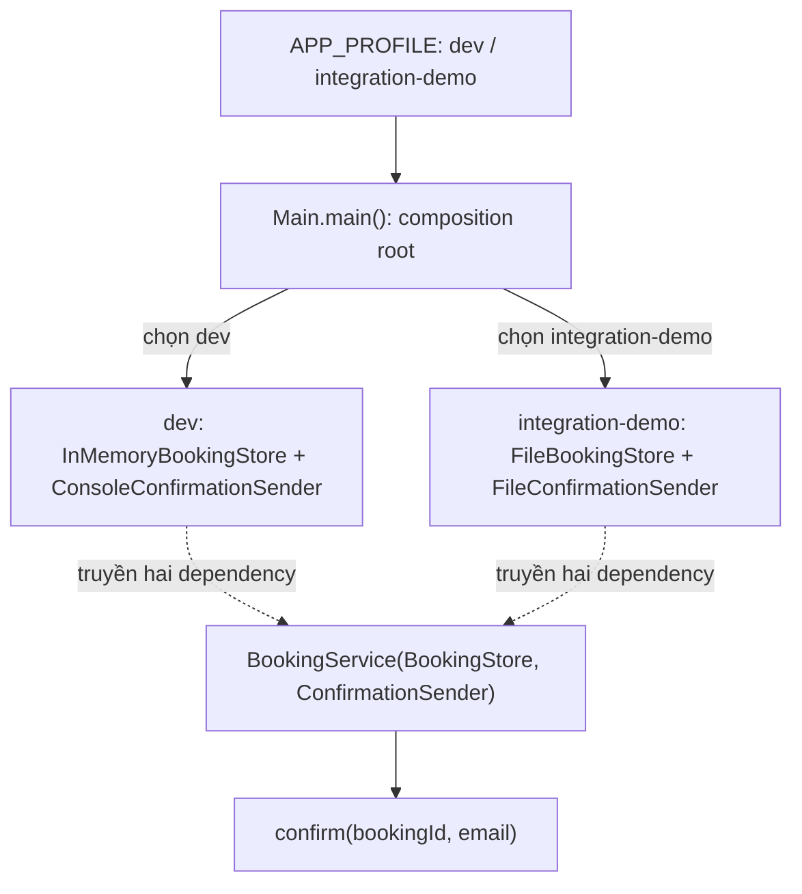

# Thay thế triển khai theo môi trường mà không sửa mã nghiệp vụ

## 1. Mục tiêu của DI thủ công khi ứng dụng có nhiều môi trường

Một ứng dụng có thể chạy ở nhiều môi trường: máy phát triển (*development*), môi trường kiểm thử tích hợp (*integration/staging*) và production. **Quy tắc nghiệp vụ** xác nhận đặt chỗ vẫn là “ghi nhận xác nhận và yêu cầu gửi thông báo”, nhưng **cách thực hiện** hai công việc đó có thể thay đổi:

| Môi trường | Nơi lưu xác nhận | Cách gửi thông báo | Mục tiêu |
| --- | --- | --- | --- |
| Phát triển cục bộ | `InMemoryBookingStore` | `ConsoleConfirmationSender` | Chạy nhanh, quan sát hành vi, không cần dịch vụ bên ngoài. |
| Kiểm thử tích hợp mô phỏng | `FileBookingStore` | `FileConfirmationSender` | Quan sát dữ liệu ghi ra tệp bằng Java thuần, thử các bước triển khai. |
| Production (định hướng thiết kế) | Adapter database có quản lý kết nối/giao dịch | Adapter email, queue hoặc API thật | Làm việc với hạ tầng thật và các yêu cầu vận hành. |

Hai hàng đầu sẽ có **mã chạy được** trong bài. Hàng production là **định hướng thay adapter**, không hàm ý adapter ghi file là lựa chọn an toàn cho production.

Trong module **DEPENDENCY_INJECTION**, ta học **Dependency Injection (DI)** và **Inversion of Control (IoC)** để tách *việc sử dụng phụ thuộc* khỏi *việc tạo, chọn và lắp ghép phụ thuộc*. Bài này thuộc nhóm **DI thủ công**: ta thực hiện việc đó bằng Java thuần, không cần Spring hoặc DI container.

**Kết quả mong muốn:** lớp `BookingService` thực hiện cùng một quy trình nghiệp vụ ở mọi môi trường. Việc chọn repository và notifier được thực hiện ở **composition root**, nơi khởi động và lắp ghép đồ thị đối tượng.

## 2. Vì sao chọn triển khai bên trong service gây vấn đề?

Xét cách viết thường gặp sau (các class như `JdbcBookingStore` chỉ là tên minh họa):

```java
class BookingService {
    private final BookingStore store;
    private final ConfirmationSender sender;

    BookingService() {
        if ("prod".equals(System.getenv("APP_PROFILE"))) {
            store = new JdbcBookingStore(/* cấu hình database */);
            sender = new ApiConfirmationSender(/* cấu hình API */);
        } else {
            store = new InMemoryBookingStore();
            sender = new ConsoleConfirmationSender();
        }
    }

    // ...
}
```

Đoạn trên có nhiều vấn đề:

1. **Nghiệp vụ biết chi tiết triển khai.** Muốn đổi email provider hoặc database phải sửa `BookingService`.
2. **Phụ thuộc bắt buộc bị giấu.** Chữ ký constructor rỗng không cho người đọc biết service cần `BookingStore` và `ConfirmationSender`.
3. **Khó kiểm thử độc lập.** Test phải thao tác với biến môi trường hoặc can thiệp vào cách service tự tạo object.
4. **Khó phát hiện cấu hình sai.** Nhánh `else` có thể vô tình đưa môi trường chưa cấu hình sang adapter in-memory. Ứng dụng vẫn chạy nhưng dữ liệu cần lưu thật có thể không được ghi.
5. **Vòng đời hạ tầng bị lẫn với nghiệp vụ.** Nếu repository giữ connection pool, ai đóng nó và khi nào?

Thêm interface mà giữ nguyên câu lệnh `new` trong service **chưa đạt mục đích thay thế triển khai bằng injection**. Ta cần thay đổi **vị trí đưa ra quyết định**.

### Thiết kế đúng vai trò

- **`BookingService`:** sử dụng các hợp đồng `BookingStore` và `ConfirmationSender`, không đọc `APP_PROFILE`.
- **Các adapter:** triển khai hợp đồng bằng bộ nhớ, file, database hoặc API.
- **Composition root:** đọc/cấp profile, chọn adapter, tạo object, truyền vào constructor, quản lý tài nguyên.

Điều thay đổi theo môi trường là **đồ thị đối tượng được lắp ghép**, còn quy tắc nghiệp vụ vẫn được biểu diễn ở một nơi.

## 3. Chỉ thay đồ thị đối tượng tại composition root

Một cách đọc sơ đồ:



**Cùng một bản build** có thể chạy với profile khác nhau nếu mọi implementation cần thiết đều có sẵn. Không cần sửa hoặc biên dịch lại `BookingService` khi chuyển profile. Ở môi trường thực tế, cấu hình triển khai có thể đến từ biến môi trường, tham số CLI, file cấu hình hoặc hệ thống triển khai; nguồn cấu hình cụ thể là quyết định của tầng khởi động.

Một số thuật ngữ cần phân biệt:

| Thuật ngữ | Trong bài này có nghĩa gì? |
| --- | --- |
| **Dependency Injection** | `BookingService` nhận `BookingStore` và `ConfirmationSender` qua constructor. |
| **Inversion of Control** | Service không tự chọn và tạo cộng tác viên; mã khởi động cấp chúng. |
| **Composition root** | `Main.main()` và hàm hỗ trợ `wire(...)` là nơi tập trung việc chọn, tạo và nối object. |
| **Abstraction / contract** | Interface mô tả điều service cần, không chứa thông tin nó chạy ở môi trường nào. |
| **Environment configuration** | Giá trị `APP_PROFILE` điều khiển **lắp ghép**, không điều khiển quy tắc xác nhận bên trong service. |

## 4. Ví dụ đầy đủ: hai profile, một BookingService

Ví dụ sau sử dụng **JDK 11 trở lên**. Hai profile đều thực sự hoạt động: `dev` giữ trạng thái trong bộ nhớ và in thông báo ra console; `integration-demo` ghi xác nhận và “thông báo cần gửi” vào hai file riêng. Các file chỉ là mô phỏng có thể kiểm tra bằng mắt, không phải hệ thống gửi email thực tế.

Lưu toàn bộ đoạn mã thành `Main.java`:

```java
import java.io.IOException;
import java.nio.charset.StandardCharsets;
import java.nio.file.Files;
import java.nio.file.Path;
import java.nio.file.StandardOpenOption;
import java.util.HashSet;
import java.util.Objects;
import java.util.Set;

public class Main {
    // Abstraction mang ý nghĩa của ca sử dụng, không lộ công nghệ.
    interface BookingStore {
        void markConfirmed(String bookingId);
    }

    interface ConfirmationSender {
        void sendConfirmed(String bookingId, String customerEmail);
    }

    // Mã nghiệp vụ giống nhau ở mọi profile.
    static final class BookingService {
        private final BookingStore store;
        private final ConfirmationSender sender;

        BookingService(BookingStore store, ConfirmationSender sender) {
            this.store = Objects.requireNonNull(store, "store");
            this.sender = Objects.requireNonNull(sender, "sender");
        }

        void confirm(String bookingId, String customerEmail) {
            if (bookingId == null || bookingId.isBlank()) {
                throw new IllegalArgumentException("bookingId không được rỗng");
            }
            if (customerEmail == null || customerEmail.isBlank()) {
                throw new IllegalArgumentException(
                        "customerEmail không được rỗng");
            }

            store.markConfirmed(bookingId);
            sender.sendConfirmed(bookingId, customerEmail);
        }
    }

    // Adapter dành cho môi trường phát triển.
    static final class InMemoryBookingStore implements BookingStore {
        private final Set<String> confirmed = new HashSet<>();

        @Override
        public void markConfirmed(String bookingId) {
            confirmed.add(bookingId);
        }

        boolean isConfirmed(String bookingId) {
            return confirmed.contains(bookingId);
        }
    }

    static final class ConsoleConfirmationSender
            implements ConfirmationSender {
        @Override
        public void sendConfirmed(String bookingId, String customerEmail) {
            System.out.println(
                    "Console: xác nhận " + bookingId + " cho " + customerEmail);
        }
    }

    // Adapter mô phỏng môi trường tích hợp bằng tệp.
    static final class FileBookingStore implements BookingStore {
        private final Path outputFile;

        FileBookingStore(Path outputFile) {
            this.outputFile = Objects.requireNonNull(outputFile, "outputFile");
        }

        @Override
        public void markConfirmed(String bookingId) {
            appendLine(outputFile, "CONFIRMED: " + bookingId);
        }
    }

    static final class FileConfirmationSender
            implements ConfirmationSender {
        private final Path outboxFile;

        FileConfirmationSender(Path outboxFile) {
            this.outboxFile = Objects.requireNonNull(outboxFile, "outboxFile");
        }

        @Override
        public void sendConfirmed(String bookingId, String customerEmail) {
            appendLine(outboxFile,
                    "TO: " + customerEmail + " | BOOKING: " + bookingId);
        }
    }

    // Hàm hỗ trợ adapter; service nghiệp vụ không gọi hàm này.
    private static void appendLine(Path file, String line) {
        try {
            Files.writeString(
                    file,
                    line + System.lineSeparator(),
                    StandardCharsets.UTF_8,
                    StandardOpenOption.CREATE,
                    StandardOpenOption.APPEND);
        } catch (IOException exception) {
            throw new IllegalStateException(
                    "Không thể ghi tệp mô phỏng: " + file, exception);
        }
    }

    // Composition root có thể tách một phần logic lắp ghép ra hàm.
    static BookingService wire(String profile, Path outputDirectory)
            throws IOException {
        BookingStore store;
        ConfirmationSender sender;

        switch (profile) {
            case "dev":
                store = new InMemoryBookingStore();
                sender = new ConsoleConfirmationSender();
                break;

            case "integration-demo":
                Files.createDirectories(outputDirectory);
                store = new FileBookingStore(
                        outputDirectory.resolve("bookings.log"));
                sender = new FileConfirmationSender(
                        outputDirectory.resolve("notifications.log"));
                break;

            default:
                throw new IllegalArgumentException(
                        "APP_PROFILE không hỗ trợ: " + profile);
        }

        return new BookingService(store, sender);
    }

    public static void main(String[] args) throws IOException {
        String profile = System.getenv("APP_PROFILE");

        if (profile == null || profile.isBlank()) {
            throw new IllegalStateException(
                    "Thiếu APP_PROFILE. Chọn dev hoặc integration-demo.");
        }

        BookingService service = wire(profile, Path.of("demo-output"));
        service.confirm("B-101", "khach@example.com");

        System.out.println("Đã xử lý với APP_PROFILE=" + profile);
    }
}
```

### Vì sao ví dụ đạt mục tiêu?

**Toàn bộ `BookingService` không có** `System.getenv`, `switch(profile)`, `new InMemoryBookingStore` hoặc `new FileBookingStore`. Nó chỉ nhìn thấy hai hợp đồng. Khi lựa chọn triển khai thay đổi, mã nghiệp vụ vẫn được dùng nguyên vẹn.

`wire(...)` vẫn dùng `new`; điều đó hoàn toàn bình thường vì **composition root chính là nơi chịu trách nhiệm khởi tạo**. DI thủ công không có nghĩa là cấm `new` trong toàn ứng dụng.

### Chạy hai môi trường trên Windows PowerShell

Biên dịch một lần:

```powershell
javac -encoding UTF-8 Main.java
```

Chạy chế độ phát triển:

```powershell
$env:APP_PROFILE = "dev"
java Main
```

Kết quả dự kiến:

```text
Console: xác nhận B-101 cho khach@example.com
Đã xử lý với APP_PROFILE=dev
```

Chuyển sang mô phỏng tích hợp **mà không sửa hoặc biên dịch lại service**:

```powershell
$env:APP_PROFILE = "integration-demo"
java Main
```

Kết quả console:

```text
Đã xử lý với APP_PROFILE=integration-demo
```

Chương trình tạo thư mục `demo-output` cạnh nơi chạy lệnh, chứa:

```text
demo-output/
  bookings.log       # CONFIRMED: B-101
  notifications.log   # TO: khach@example.com | BOOKING: B-101
```

Mỗi lần chạy `integration-demo` sẽ **nối thêm dòng** vào hai file, thay vì ghi đè. Điều này chỉ giúp quan sát được khác biệt giữa adapter. File demo **không** cung cấp giao dịch, khả năng gửi thực, cơ chế chống trùng hay an toàn khi có nhiều tiến trình cùng ghi.

Nếu chạy trên shell kiểu Bash, có thể truyền profile như sau:

```bash
APP_PROFILE=dev java Main
APP_PROFILE=integration-demo java Main
```

### Vì sao không tự mặc định sang dev?

`APP_PROFILE` bị thiếu hoặc nhập sai phải được xử lý ở **biên cấu hình**. Ví dụ chủ động báo lỗi, thay vì âm thầm chuyển sang `dev`. Với hệ thống thật, một cấu hình production sai không được làm ứng dụng chuyển sang repository lưu bộ nhớ khiến dữ liệu biến mất sau khi tắt chương trình.

Tương tự, không nên đặt mật khẩu database, API token hoặc thông tin xác thực trực tiếp trong mã nguồn. Composition root hoặc hệ thống cấu hình của adapter chịu trách nhiệm lấy, kiểm tra và cấp chúng bằng cách phù hợp với môi trường triển khai.

## 5. Thay thế nhiều dependency đồng thời hay từng dependency một?

Trong `wire`, profile chọn **một cặp** `BookingStore` và `ConfirmationSender`. Tuy nhiên, các lựa chọn này **không bắt buộc phụ thuộc lẫn nhau**. Có những tình huống hợp lý như:

| Tình huống | Store | Sender |
| --- | --- | --- |
| Kiểm tra nghiệp vụ cục bộ | In-memory | Console |
| Kiểm tra ghi dữ liệu | File demo | Console |
| Kiểm tra nội dung thông báo | In-memory | Recording fake |
| Tích hợp thật có kiểm soát | Database test riêng | Sandbox notification adapter |
| Production | Database adapter thật | Email/API/queue adapter thật |

Ở ứng dụng lớn, có thể tách việc lắp ghép thành các hàm nhỏ:

```java
// Minh họa khi cấu hình phức tạp hơn (không nằm trong ví dụ chạy ở mục 4).
BookingStore chooseStore(AppConfig config) { /* ... */ }
ConfirmationSender chooseSender(AppConfig config) { /* ... */ }
BookingService wire(AppConfig config) {
    return new BookingService(
            chooseStore(config),
            chooseSender(config));
}
```

Ở đây `AppConfig` là kiểu cấu hình **giả định**. Lợi ích của cách tổ chức này xuất hiện khi số lựa chọn lớn dần, nhưng không nên tách thêm factory/registry chỉ để giải quyết một `switch` nhỏ.

Cần tránh tổ hợp cấu hình không hợp lệ: ví dụ, profile chỉ cho phép sender thật nếu môi trường đã cấp khóa API và hệ thống có chính sách xử lý lỗi. **Quy tắc chọn adapter** thuộc bootstrap/cấu hình; **quy tắc xác nhận đặt chỗ** thuộc service.

## 6. Kiểm thử bằng Java thuần: thay adapter bằng fake

Việc đổi triển khai chỉ thực sự có giá trị khi consumer không buộc phải khởi chạy công nghệ bên ngoài để kiểm tra. Constructor injection cho phép test tự tạo **composition root nhỏ** với fake.

Thêm class sau **ngoài `Main`**, ở cuối cùng tệp `Main.java` trong mục 4:

```java
class BookingServiceTest {
    static final class RecordingStore implements Main.BookingStore {
        String bookingId;
        int calls;

        @Override
        public void markConfirmed(String bookingId) {
            this.bookingId = bookingId;
            calls++;
        }
    }

    static final class RecordingSender implements Main.ConfirmationSender {
        String bookingId;
        String email;
        int calls;

        @Override
        public void sendConfirmed(String bookingId, String customerEmail) {
            this.bookingId = bookingId;
            email = customerEmail;
            calls++;
        }
    }

    public static void main(String[] args) {
        RecordingStore store = new RecordingStore();
        RecordingSender sender = new RecordingSender();

        Main.BookingService service = new Main.BookingService(store, sender);
        service.confirm("B-202", "test@example.com");

        if (!"B-202".equals(store.bookingId) || store.calls != 1) {
            throw new AssertionError("Store không được gọi đúng");
        }
        if (!"B-202".equals(sender.bookingId)
                || !"test@example.com".equals(sender.email)
                || sender.calls != 1) {
            throw new AssertionError("Sender không được gọi đúng");
        }

        System.out.println("PASS: service hoạt động với fake dependencies");
    }
}
```

Chạy:

```powershell
javac -encoding UTF-8 Main.java
java BookingServiceTest
```

Kết quả dự kiến:

```text
PASS: service hoạt động với fake dependencies
```

**Điểm quan trọng:** test này không gọi `Main.main()` và không cần `APP_PROFILE`. Khi kiểm thử đơn vị, ta cấp trực tiếp fake vào `BookingService`. Nếu cần kiểm tra mapping `APP_PROFILE` sang đúng adapter, đó là **kiểm thử riêng của phần lắp ghép**; nếu cần kiểm tra ghi file hoặc database, đó là **kiểm thử adapter/integration**.

Bài test trên chứng minh đường đi thành công và dữ liệu truyền qua dependency. Nó không chứng minh tính đúng đắn của storage thật, thông báo thật, giao dịch hoặc hành vi retry.

## 7. Môi trường không nên quyết định quy tắc nghiệp vụ

Một ranh giới thực tế là phân biệt **chính sách nghiệp vụ** với **cơ chế hạ tầng**.

Ví dụ cần tránh:

```java
void confirm(String bookingId, String email) {
    if ("prod".equals(System.getenv("APP_PROFILE"))) {
        // Áp dụng điều kiện xác nhận khác.
    } else {
        // Bỏ qua điều kiện nghiệp vụ trong dev.
    }
}
```

Nếu một điều kiện là bất biến của nghiệp vụ, test và môi trường phát triển cũng nên kiểm tra điều kiện đó. Nếu yêu cầu thật sự có các chính sách khác nhau theo thị trường, gói dịch vụ hoặc loại khách hàng, hãy mô hình hóa **chính sách nghiệp vụ có tên và hợp đồng rõ ràng** (ví dụ `ConfirmationPolicy`), sau đó quyết định chính sách được chọn bằng cấu hình hợp lệ. Không nên nhét các nhánh kiểm tra môi trường vào mọi phương thức nghiệp vụ.

Ví dụ nhận chính sách qua constructor:

```java
// Minh họa ý tưởng, không thuộc ví dụ độc lập ở mục 4.
interface ConfirmationPolicy {
    void validate(Booking booking);
}

class BookingServiceWithPolicy {
    private final ConfirmationPolicy policy;

    BookingServiceWithPolicy(ConfirmationPolicy policy) {
        this.policy = java.util.Objects.requireNonNull(policy);
    }
}
```

`Booking` là kiểu domain giả định. Mục đích ở đây là chỉ ra: **quyết định một chính sách nào được dùng** có thể được lắp ghép từ bên ngoài, nhưng **ý nghĩa của chính sách** vẫn cần được thiết kế trong miền nghiệp vụ.

Không nên “giảm chất lượng” nghiệp vụ chỉ vì profile là dev hoặc test. Chỉ những phụ thuộc/hành vi ngoại vi vốn hợp lệ để mô phỏng mới nên được đổi.

## 8. Vòng đời và scope khi chuyển môi trường

Hai adapter có cùng interface có thể có **đặc điểm vòng đời rất khác nhau**:

- `InMemoryBookingStore` trong ví dụ giữ một `HashSet`. Khi tiến trình kết thúc, trạng thái mất; `HashSet` không tự an toàn khi nhiều thread truy cập đồng thời.
- `FileBookingStore` lưu dữ liệu vào file, mở và đóng file khi ghi bằng `Files.writeString(...)`. Cách này không tự giải quyết ghi đồng thời, cập nhật nguyên tử, trùng lặp hay nhất quán giữa nhiều file.
- Repository database thật thường dựa vào connection pool, transaction manager hoặc client được cấp từ ngoài. Composition root (hoặc hệ thống quản lý lifecycle) cần quyết định ai tạo, chia sẻ và đóng các tài nguyên đó.
- Notification adapter dùng HTTP client/queue có thể cần timeout, retry, cấu hình bảo mật và quy tắc xử lý lỗi. Chỉ thay class không tự cung cấp các đặc tính vận hành này.

Với **DI thủ công**, lập trình viên tự quản lý scope. Nếu tạo một service lúc khởi động và chia sẻ nó, mọi dependency bên trong phải phù hợp với việc dùng chung. `private final` chỉ giữ tham chiếu ổn định, **không** biến `HashSet`, HTTP client hay trạng thái request thành đối tượng an toàn luồng.

Khi adapter sở hữu tài nguyên `AutoCloseable`, có thể xây dựng logic bootstrap dạng:

```java
// Minh họa mô hình quản lý tài nguyên, không thuộc ví dụ chạy độc lập.
try (DatabaseClient client = createDatabaseClient(config)) {
    BookingStore store = new JdbcBookingStore(client);
    BookingService service = new BookingService(store, sender);
    runServer(service);
}
```

Các tên `DatabaseClient`, `JdbcBookingStore`, `config`, `sender` và `runServer` là **giả định**. Điểm cần nhớ: tài nguyên dùng chung được đóng ở **ranh giới sở hữu thích hợp**, không phải service đóng mỗi lần xử lý yêu cầu.

## 9. Các lỗi phổ biến khi thay triển khai theo môi trường

| Lỗi | Hệ quả | Cách cải thiện |
| --- | --- | --- |
| `BookingService` tự đọc profile và tự gọi `new` adapter. | Service bị coupling với triển khai và cấu hình. | Chọn adapter tại composition root; consumer chỉ nhận interface. |
| `if (prod)` xuất hiện trong nhiều service. | Phân tán logic chọn môi trường, khó kiểm soát cấu hình nhất quán. | Dồn việc chọn implementation về biên khởi động. |
| Thiếu profile thì tự rơi về `dev`. | Có thể vô tình dùng lưu trữ in-memory trong môi trường cần dữ liệu bền vững. | Kiểm tra profile bắt buộc và từ chối giá trị lạ. |
| Môi trường test sử dụng luật nghiệp vụ khác production. | Test không phát hiện lỗi thật. | Giữ cùng logic nghiệp vụ; chỉ thay adapter/chính sách được thiết kế rõ. |
| Adapter giả không diễn đạt đúng hợp đồng. | Test vượt qua nhưng implementation thật có điều kiện lỗi khác. | Định nghĩa ngữ nghĩa rõ; có contract/integration test cho từng adapter quan trọng. |
| Dùng file log đơn giản như storage production. | Không có transaction, điều khiển đồng thời, phục hồi lỗi đầy đủ. | Dùng hạ tầng phù hợp và adapter production riêng. |
| Test phụ thuộc vào biến môi trường toàn cục. | Test khó chạy song song và khó cô lập. | Truyền fake trực tiếp cho consumer; test wiring riêng. |
| Đổi profile trong lúc ứng dụng đang chạy bằng trạng thái toàn cục. | Đồ thị đối tượng có thể không đồng nhất, khó kiểm soát vòng đời. | Chọn cấu hình lúc bootstrap; nếu cần đổi động, thiết kế cơ chế riêng có quản lý đồng bộ và tài nguyên. |
| Adapter trả dữ liệu hạ tầng như `ResultSet` qua interface. | Nghiệp vụ vẫn phụ thuộc công nghệ dù sử dụng DI. | Thiết kế hợp đồng theo nhu cầu consumer và domain type phù hợp. |

Đặc biệt, **DI không làm hai tác dụng phụ trở nên nguyên tử**. Trong `BookingService.confirm`, store được gọi trước sender. Nếu lưu thành công nhưng gửi thất bại, hệ thống có thể tồn tại trạng thái “đã xác nhận nhưng chưa thông báo”. Với yêu cầu production, có thể cần giao dịch, outbox, retry, idempotency hoặc chính sách bù trừ. Đây là quyết định độ tin cậy cần thiết kế riêng, không tự động có khi thay adapter.

## 10. Từ DI thủ công đến DI container

Khi ứng dụng có vài dependency, `Main.main()` và vài hàm `wire(...)` có thể đủ dễ đọc. Khi số lớp, scope và cấu hình tăng, việc tự lắp ghép có thể dài và dễ sai. Một DI container có thể giúp:

- Đăng ký/ràng buộc hợp đồng với implementation theo cấu hình.
- Tạo đồ thị dependency từ constructor và phát hiện thiếu cấu hình.
- Quản lý scope, lifecycle, hook khởi động/đóng tài nguyên theo khả năng của container.
- Thay lựa chọn implementation theo profile hoặc cấu hình container.

Tuy nhiên, container **không thay thế quyết định thiết kế**: interface phải diễn đạt hợp đồng đúng; service vẫn cần rõ dependency bắt buộc; lựa chọn profile phải hợp lệ; scope phải phù hợp; lỗi hạ tầng và giao dịch phải được xử lý.

Có thể chuyển ví dụ này sang container sau: thay `wire(...)` bằng cấu hình container, giữ `BookingService` và các interface như cũ. **Lợi ích kiến trúc chính đã tồn tại ngay ở bản Java thuần.**

## 11. Bài thực hành và tự đối chiếu

**Bài 1 — Thêm một profile.** Thêm `record-demo` vào `wire(...)` bằng cách dùng `InMemoryBookingStore` và `FileConfirmationSender`. Mục tiêu là ghi thông báo ra file nhưng vẫn giữ dữ liệu đặt chỗ trong bộ nhớ. Xác nhận không cần thay dòng nào trong `BookingService`.

**Bài 2 — Phát hiện cấu hình sai.** Chạy chương trình khi `APP_PROFILE` chưa được khai báo và khi giá trị là `production` (chưa được hỗ trợ). Mô tả lỗi ở thời điểm nào, vì sao việc từ chối ngay khi bootstrap an toàn hơn một nhánh mặc định `dev`.

**Bài 3 — Đổi adapter trong unit test.** Viết `FailingSender implements ConfirmationSender` ném `IllegalStateException` từ `sendConfirmed(...)`. Truyền vào service qua constructor cùng `RecordingStore` và quan sát thứ tự gọi. Xác định vì sao kết quả này không chứng minh tính nguyên tử của hai tác vụ.

**Bài 4 — Thiết kế adapter thật.** Vẽ sơ đồ lắp ghép production dùng `JdbcBookingStore`, `EmailConfirmationSender` và một `DatabaseClient` hoặc HTTP client có lifecycle riêng. Nêu vị trí lấy cấu hình, kiểm tra biến môi trường, tạo connection pool và đóng tài nguyên. Không cần viết driver/database thật.

**Bài 5 — Chọn scope.** Nếu chạy server nhiều luồng, `InMemoryBookingStore` có `HashSet` dùng chung có đáp ứng không? Có nên tạo repository mới cho mỗi request nếu mục tiêu lưu xác nhận qua nhiều request? Đề xuất cách lưu trữ và đồng bộ phù hợp.

### Gợi ý tự đối chiếu

- **Bài 1:** tạo cặp adapter mới trong nhánh `record-demo` của bootstrap; business service giữ nguyên constructor và `confirm(...)`.
- **Bài 2:** thiếu profile gây `IllegalStateException`; profile lạ gây `IllegalArgumentException`. Cả hai được phát hiện ở biên khởi động, tránh cấu hình ngầm sai.
- **Bài 3:** `RecordingStore` được gọi trước sender; khi sender ném lỗi, store có thể đã ghi. Cần xác định chính sách transaction/outbox/retry tùy nghiệp vụ; DI chỉ giúp cô lập việc cấp cộng tác viên.
- **Bài 4:** bootstrap cấp client, cấu hình và adapter vào service; adapter biết SQL/email API, còn `BookingService` chỉ biết hai hợp đồng. Tài nguyên được quản lý ở scope phù hợp.
- **Bài 5:** `HashSet` không an toàn cho cập nhật đồng thời không được đồng bộ. Tạo repository in-memory mới cho từng request còn có thể làm mất trạng thái xuyên request. Cần cân nhắc kho dữ liệu bền vững có giao dịch hoặc cơ chế đồng bộ/thống nhất dữ liệu phù hợp.

**Điều cốt lõi:** thay thế triển khai theo môi trường trong DI thủ công là **thay cách composition root lắp ghép các phụ thuộc**, không buộc service nghiệp vụ sửa mã để biết nó đang chạy ở môi trường nào. Mô hình này giúp áp dụng constructor injection, kiểm thử bằng Java thuần và suy nghĩ rõ về scope/vòng đời trước khi chuyển sang DI container.
