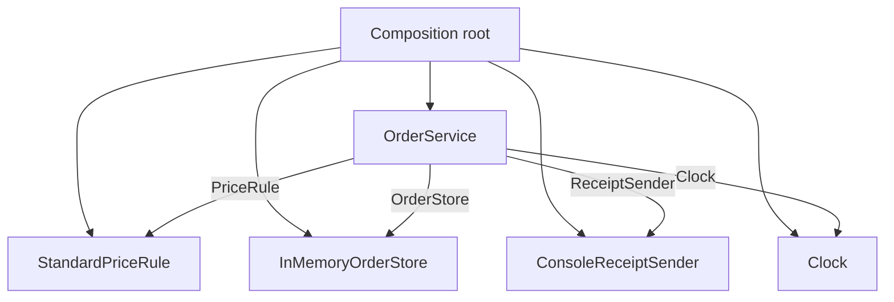

# Kiểm tra một đồ thị nhỏ mà không khởi động framework

Khi học **Dependency Injection (DI)**, ta thường thấy ví dụ một service nhận repository qua constructor. Nhưng làm sao biết **cả nhóm đối tượng** đã được lắp ghép đúng? Có cần chạy ứng dụng web, khởi động Spring hoặc kết nối cơ sở dữ liệu mới kiểm tra được không? Với một đồ thị nhỏ, câu trả lời là **không**: ta có thể tạo đồ thị bằng Java thuần, thay các phụ thuộc ở ranh giới bằng đối tượng thử nghiệm và chạy những phép kiểm tra nhanh qua `main()`.

Bài này thuộc chương **DI thủ công** của module **DEPENDENCY_INJECTION**. Mục tiêu là thực hành constructor injection và **composition root**, hiểu vai trò của **Inversion of Control (IoC)**, kiểm tra việc nối các đối tượng và quan sát quyết định về scope/vòng đời trước khi cân nhắc một DI container. Ví dụ dùng Java 11 trở lên và không cần thư viện kiểm thử.

## 1. “Kiểm tra đồ thị” nghĩa là kiểm tra điều gì?

**Đồ thị phụ thuộc** gồm các nút là đối tượng và các cạnh là quan hệ một đối tượng cần đối tượng khác. Xét một chức năng tạo đơn hàng:



`OrderService` cần bốn cộng tác viên trực tiếp: chính sách tính tiền, nơi lưu đơn, nơi gửi biên nhận và nguồn thời gian. Nó không cần biết người gọi sẽ sử dụng bộ nhớ, cơ sở dữ liệu hay API thông báo. **Composition root** là nơi tạo các đối tượng thật và nối chúng lại.

Có nhiều câu hỏi kiểm tra khác nhau, cần phân biệt rõ:

| Kiểm tra | Câu hỏi cần trả lời | Cách quan sát |
| --- | --- | --- |
| **Khởi tạo hợp lệ** | Mọi phụ thuộc bắt buộc đã được cung cấp? | Tạo service; constructor từ chối `null` |
| **Nối đúng cộng tác viên** | Service có sử dụng đúng store, sender, clock mà ta lắp vào? | Đặt đơn rồi quan sát fake/in-memory adapter và đồng hồ cố định |
| **Tương tác nghiệp vụ** | Ghi đơn trước khi thông báo? Gặp lỗi ghi thì dừng? | Test double ghi nhận các lời gọi hoặc chủ động ném lỗi |
| **Scope và chia sẻ** | Hai đồ thị có vô tình dùng chung trạng thái không? | Tạo hai graph, đối chiếu instance và dữ liệu |
| **Tích hợp thực tế** | DB, HTTP, cấu hình và quyền truy cập có thật sự hoạt động? | Kiểm thử tích hợp riêng với tài nguyên thật hoặc môi trường thử nghiệm |

Ba nhóm đầu và phần lớn kiểm tra scope có thể thực hiện **không cần khởi động framework**. Chúng không thay thế kiểm thử tích hợp, vì một fake không chứng minh kết nối DB hay việc gửi tin thật thành công.

## 2. Chọn phạm vi một đồ thị nhỏ

Ta dùng quy trình đơn giản: `OrderService.place(orderId, unitPriceCents, quantity)` tính tổng tiền, lấy thời điểm, lưu đơn rồi yêu cầu gửi biên nhận. Để tránh sai lệch số thực trong ví dụ tiền tệ, số tiền được biểu diễn bằng **đơn vị nhỏ nhất (`cents`)** và dùng `int` trong phạm vi bài tập; hệ thống tài chính thực tế còn cần quy định đồng tiền, làm tròn và giới hạn số.

Hợp đồng của service gồm:

```java
interface PriceRule {
    int totalCents(int unitPriceCents, int quantity);
}

interface OrderStore {
    void save(Order order);
}

interface ReceiptSender {
    void send(Order order);
}
```

`Order` là kiểu dữ liệu của ứng dụng. `Clock` là abstraction có sẵn trong `java.time`. Ba interface minh họa chỉ diễn tả khả năng service sử dụng. Chúng không lộ ra SQL, thư viện email hoặc giao thức HTTP.

Các quan hệ này cho thấy ý nghĩa của IoC: **service mô tả nó cần gì**, còn **nơi lắp ghép quyết định tạo cái gì và sử dụng instance nào**. DI là thao tác cấp instance qua constructor; không cần container để thực hiện việc đó.

## 3. Tạo đồ thị bằng Java thuần

Tạo tệp `SmallGraphApp.java` với nội dung hoàn chỉnh:

```java
import java.time.Clock;
import java.time.Instant;
import java.util.HashMap;
import java.util.Map;
import java.util.Objects;

public final class SmallGraphApp {
    private SmallGraphApp() {}

    public interface PriceRule {
        int totalCents(int unitPriceCents, int quantity);
    }

    public interface OrderStore {
        void save(Order order);
    }

    public interface ReceiptSender {
        void send(Order order);
    }

    public static final class Order {
        private final String id;
        private final int totalCents;
        private final Instant createdAt;

        public Order(String id, int totalCents, Instant createdAt) {
            this.id = Objects.requireNonNull(id, "id");
            this.totalCents = totalCents;
            this.createdAt = Objects.requireNonNull(createdAt, "createdAt");
        }

        public String id() { return id; }
        public int totalCents() { return totalCents; }
        public Instant createdAt() { return createdAt; }
    }

    public static final class OrderService {
        private final PriceRule priceRule;
        private final OrderStore store;
        private final ReceiptSender sender;
        private final Clock clock;

        public OrderService(
                PriceRule priceRule, OrderStore store,
                ReceiptSender sender, Clock clock) {
            this.priceRule = Objects.requireNonNull(priceRule, "priceRule");
            this.store = Objects.requireNonNull(store, "store");
            this.sender = Objects.requireNonNull(sender, "sender");
            this.clock = Objects.requireNonNull(clock, "clock");
        }

        public Order place(String orderId, int unitPriceCents, int quantity) {
            if (orderId == null || orderId.trim().isEmpty()) {
                throw new IllegalArgumentException("orderId must not be blank");
            }
            if (unitPriceCents <= 0 || quantity <= 0) {
                throw new IllegalArgumentException("price and quantity must be positive");
            }

            int total = priceRule.totalCents(unitPriceCents, quantity);
            Order order = new Order(orderId, total, clock.instant());
            store.save(order);
            sender.send(order);
            return order;
        }
    }

    public static final class StandardPriceRule implements PriceRule {
        @Override
        public int totalCents(int unitPriceCents, int quantity) {
            return Math.multiplyExact(unitPriceCents, quantity);
        }
    }

    public static final class InMemoryOrderStore implements OrderStore {
        private final Map<String, Order> data = new HashMap<>();

        @Override
        public void save(Order order) {
            data.put(order.id(), order);
        }

        public Order find(String orderId) {
            return data.get(orderId);
        }
    }

    public static final class ConsoleReceiptSender implements ReceiptSender {
        @Override
        public void send(Order order) {
            System.out.println("Receipt requested for " + order.id());
        }
    }

    // Một đồ thị ứng dụng nhỏ và hai điểm truy cập để kiểm tra.
    public static final class DemoGraph {
        public final OrderService service;
        public final InMemoryOrderStore store;

        private DemoGraph(OrderService service, InMemoryOrderStore store) {
            this.service = service;
            this.store = store;
        }
    }

    // Lắp ghép tập trung; có thể cấp sender/clock thử nghiệm khi cần.
    public static DemoGraph composeGraph(ReceiptSender sender, Clock clock) {
        Objects.requireNonNull(sender, "sender");
        Objects.requireNonNull(clock, "clock");

        PriceRule priceRule = new StandardPriceRule();
        InMemoryOrderStore store = new InMemoryOrderStore();
        OrderService service = new OrderService(priceRule, store, sender, clock);
        return new DemoGraph(service, store);
    }

    public static void main(String[] args) {
        // Composition root chọn các adapter cho lần chạy minh họa.
        DemoGraph graph = composeGraph(
            new ConsoleReceiptSender(), Clock.systemUTC());
        Order created = graph.service.place("OD-001", 1500, 2);
        System.out.println("Saved amount (cents): "
            + graph.store.find(created.id()).totalCents());
    }
}
```

Biên dịch và chạy trong thư mục chứa tệp:

```bash
javac SmallGraphApp.java
java SmallGraphApp
```

Kết quả ví dụ:

```text
Receipt requested for OD-001
Saved amount (cents): 3000
```

Ở `main()`, ta tạo `ConsoleReceiptSender` và `Clock.systemUTC()`; `composeGraph(...)` tạo price rule, store và service. Đây là lắp ghép **thủ công tại một điểm tập trung**. `OrderService` không gọi `new InMemoryOrderStore()` hoặc `new ConsoleReceiptSender()` bên trong nghiệp vụ.

`DemoGraph` đưa ra `service` và `store` để bài thực hành dễ quan sát kết quả. Trong ứng dụng thật, không nhất thiết phải công khai toàn bộ graph: composition root có thể chỉ trả về đối tượng đầu vào hoặc cấu hình nó vào tầng chạy ứng dụng.

**Lưu ý:** đây là bản mô phỏng. `InMemoryOrderStore` mất dữ liệu khi kết thúc chương trình, `HashMap` chưa an toàn cho nhiều luồng ghi và `ConsoleReceiptSender` chỉ in thông báo. `Math.multiplyExact` cố ý báo `ArithmeticException` nếu phép nhân số nguyên bị tràn.

## 4. Kiểm tra đồ thị qua hành vi, không cần reflection

Để phát hiện nối sai một cạnh, đôi khi người viết test cố đọc các trường riêng bằng reflection rồi so sánh instance. Cách đó dễ khiến bài test phụ thuộc cấu trúc nội bộ. Với một graph nhỏ, **quan sát hành vi ở ranh giới** thường rõ ràng hơn: lưu đơn vào store được cấp, gửi qua sender được cấp và ghi thời điểm từ clock được cấp.

Tạo tệp thứ hai `SmallGraphCheck.java` cùng thư mục với `SmallGraphApp.java`:

```java
import java.time.Clock;
import java.time.Instant;
import java.time.ZoneOffset;
import java.util.ArrayList;
import java.util.Arrays;
import java.util.List;
import java.util.concurrent.atomic.AtomicInteger;

public final class SmallGraphCheck {
    private static final Instant FIXED_TIME =
        Instant.parse("2026-01-10T10:15:30Z");

    private static Clock fixedClock() {
        return Clock.fixed(FIXED_TIME, ZoneOffset.UTC);
    }

    public static void main(String[] args) {
        testGraphWiring();
        testCallOrder();
        testMissingDependency();
        testInvalidInputDoesNotCallAdapters();
        testSaveFailureStopsNotification();
        testSeparateGraphScopes();
        System.out.println("PASS: 6 checks for the small dependency graph");
    }

    private static void testGraphWiring() {
        List<String> sentIds = new ArrayList<>();
        SmallGraphApp.ReceiptSender sender =
            order -> sentIds.add(order.id());

        SmallGraphApp.DemoGraph graph =
            SmallGraphApp.composeGraph(sender, fixedClock());
        SmallGraphApp.Order order = graph.service.place("OD-101", 1200, 3);

        check(graph.store.find("OD-101") == order,
              "Service must use the store created for this graph");
        check(order.totalCents() == 3600, "Wrong amount");
        check(FIXED_TIME.equals(order.createdAt()), "Wrong clock");
        check(sentIds.equals(Arrays.asList("OD-101")), "Wrong sender");
    }

    private static void testCallOrder() {
        List<String> events = new ArrayList<>();
        SmallGraphApp.OrderStore store = order -> events.add("save");
        SmallGraphApp.ReceiptSender sender = order -> events.add("send");

        SmallGraphApp.OrderService service = new SmallGraphApp.OrderService(
            new SmallGraphApp.StandardPriceRule(), store, sender, fixedClock());
        service.place("OD-102", 900, 1);

        check(events.equals(Arrays.asList("save", "send")),
              "Expected save before send");
    }

    private static void testMissingDependency() {
        boolean rejected = false;
        try {
            new SmallGraphApp.OrderService(
                new SmallGraphApp.StandardPriceRule(),
                null, order -> {}, fixedClock());
        } catch (NullPointerException expected) {
            rejected = "store".equals(expected.getMessage());
        }
        check(rejected, "Constructor must reject missing store immediately");
    }

    private static void testInvalidInputDoesNotCallAdapters() {
        AtomicInteger calls = new AtomicInteger();
        SmallGraphApp.OrderStore store = order -> calls.incrementAndGet();
        SmallGraphApp.ReceiptSender sender = order -> calls.incrementAndGet();
        SmallGraphApp.OrderService service = new SmallGraphApp.OrderService(
            new SmallGraphApp.StandardPriceRule(), store, sender, fixedClock());

        boolean rejected = false;
        try {
            service.place("OD-103", 100, 0);
        } catch (IllegalArgumentException expected) {
            rejected = true;
        }
        check(rejected && calls.get() == 0,
              "Invalid request must not touch store or sender");
    }

    private static void testSaveFailureStopsNotification() {
        AtomicInteger sends = new AtomicInteger();
        SmallGraphApp.OrderStore failingStore = order -> {
            throw new IllegalStateException("Storage unavailable");
        };
        SmallGraphApp.ReceiptSender sender = order -> sends.incrementAndGet();
        SmallGraphApp.OrderService service = new SmallGraphApp.OrderService(
            new SmallGraphApp.StandardPriceRule(),
            failingStore, sender, fixedClock());

        boolean failed = false;
        try {
            service.place("OD-104", 200, 2);
        } catch (IllegalStateException expected) {
            failed = true;
        }
        check(failed && sends.get() == 0,
              "Notification must not be attempted after save failure");
    }

    private static void testSeparateGraphScopes() {
        SmallGraphApp.ReceiptSender silentSender = order -> {};
        SmallGraphApp.DemoGraph first =
            SmallGraphApp.composeGraph(silentSender, fixedClock());
        SmallGraphApp.DemoGraph second =
            SmallGraphApp.composeGraph(silentSender, fixedClock());

        check(first.service != second.service, "Services must differ");
        check(first.store != second.store, "Stores must differ");
        first.service.place("OD-105", 100, 1);
        check(first.store.find("OD-105") != null, "First graph lost order");
        check(second.store.find("OD-105") == null,
              "Second graph unexpectedly shares the first store");
    }

    private static void check(boolean condition, String message) {
        if (!condition) {
            throw new AssertionError(message);
        }
    }
}
```

Chạy hai tệp:

```bash
javac SmallGraphApp.java SmallGraphCheck.java
java SmallGraphCheck
```

Nếu mọi phép kiểm tra đạt, chương trình in:

```text
PASS: 6 checks for the small dependency graph
```

Các phương thức `check(...)` ném `AssertionError` khi điều kiện sai, nên phép kiểm tra vẫn có hiệu lực khi không bật cờ `-ea`. Nếu một trong sáu trường hợp thất bại, chương trình dừng với thông tin về điều kiện vi phạm. Test không cần database, máy chủ HTTP, annotation hay Spring context.

### 4.1. Mỗi phép kiểm tra phát hiện điều gì?

| Phép kiểm tra | Mối nối/hành vi được kiểm tra | Giới hạn của kết luận |
| --- | --- | --- |
| `testGraphWiring` | `service → store`, `service → sender`, `service → clock`, và chính sách tính tiền | Không xác nhận adapter DB thật có đúng cấu hình |
| `testCallOrder` | Gọi `save` trước `send` | Không xác nhận giao nhận thông báo đáng tin cậy |
| `testMissingDependency` | Constructor từ chối thiếu store ngay khi lắp ghép | Không tự phát hiện mọi cấu hình sai bên trong adapter |
| `testInvalidInputDoesNotCallAdapters` | Dữ liệu đầu vào sai không gây tác dụng phụ | Chỉ kiểm tra tình huống đầu vào được chọn |
| `testSaveFailureStopsNotification` | Lỗi lưu được truyền ra và không yêu cầu gửi tiếp | Không kiểm tra lỗi phát sinh sau khi lưu thành công |
| `testSeparateGraphScopes` | Hai lần compose tạo hai store/service độc lập | Không bảo đảm an toàn luồng khi chia sẻ một graph |

Trong `testGraphWiring`, ta tạo sender ghi nhận mã đơn và dùng `Clock.fixed(...)` để chủ động kiểm soát kết quả. Sau khi gọi `service.place(...)`, các quan sát ở store, sender và `Order` chứng tỏ service đã sử dụng những instance test mong đợi. Đây là cách kiểm tra **đường phụ thuộc đã lắp ghép** thông qua một luồng thực thi cụ thể.

Trong `testCallOrder` và `testSaveFailureStopsNotification`, ta tạo **test double** trực tiếp bằng lambda. Chúng chỉ triển khai một phương thức của interface, không cần khởi tạo adapter thật. Nhờ constructor injection, test có thể thay một cạnh trong graph mà không sửa `OrderService`.

## 5. Kiểm tra đủ sâu nhưng không biến mọi test thành kiểm thử toàn hệ thống

Khi kiểm tra DI thủ công, nên phân biệt **unit test của consumer** và **smoke test của composition root**:

- **Unit test consumer:** trực tiếp tạo `OrderService` với test double nhằm xác minh quy tắc xử lý. `testCallOrder` và `testSaveFailureStopsNotification` thuộc loại này.
- **Smoke test graph:** chạy đúng hàm lắp ghép `composeGraph(...)`, sau đó quan sát một kết quả đặc trưng qua các cộng tác viên được đưa vào. `testGraphWiring` và `testSeparateGraphScopes` thuộc loại này.
- **Integration test:** dùng adapter thật với tài nguyên thử nghiệm để xác minh kết nối, query, giao thức, transaction và cấu hình. Bài này chưa thực hiện loại kiểm tra đó.

Chỉ gọi `new OrderService(...)` thành công **chưa đủ** chứng minh wiring đúng. Ví dụ, composition root có thể tạo `storeA` để quan sát nhưng lại truyền `storeB` cho service; cả hai đều khác `null`, và ứng dụng vẫn khởi chạy được. Kiểm tra hành vi như `graph.store.find("OD-101") == order` giúp phát hiện nhầm instance trong phạm vi luồng đang thử.

Ngược lại, không cần test từng lệnh `new` bằng reflection hoặc viết test chỉ lặp lại biểu thức khởi tạo. Hãy chọn những mối nối dễ sai, nhánh rẽ và quyết định vòng đời có ảnh hưởng thực tế.

## 6. Lỗi lắp ghép phổ biến và cách phát hiện

### 6.1. Thiếu phụ thuộc bắt buộc

```java
new SmallGraphApp.OrderService(priceRule, null, sender, clock);
```

Constructor dùng `Objects.requireNonNull` nên lỗi xuất hiện **ngay tại điểm tạo đối tượng**, với tên phụ thuộc `store`. Một service có thể được khởi tạo với các giá trị đầu vào bất hợp lệ khác `null`, vì vậy ngoài kiểm tra null còn cần xác minh cấu hình mà adapter thực sự sử dụng.

### 6.2. Tạo nhầm hai instance của thành phần có trạng thái

```java
SmallGraphApp.InMemoryOrderStore observed =
    new SmallGraphApp.InMemoryOrderStore();
SmallGraphApp.InMemoryOrderStore injected =
    new SmallGraphApp.InMemoryOrderStore();

SmallGraphApp.OrderService service = new SmallGraphApp.OrderService(
    priceRule, injected, sender, clock);
```

`observed.find(id)` vẫn trả về `null` sau khi `service.place(...)` vì dữ liệu được ghi vào `injected`. `testGraphWiring` sẽ bắt được dạng sai lầm này khi cửa sổ quan sát dùng khác instance với service. Không phải mọi đối tượng đều cần dùng chung: quy tắc tính tiền không giữ trạng thái có thể được tạo riêng mà không ảnh hưởng; store trong ví dụ lại có trạng thái cần theo dõi.

### 6.3. Che việc tạo phụ thuộc vào bên trong service

```java
final class BadOrderService {
    private final SmallGraphApp.OrderStore store =
        new SmallGraphApp.InMemoryOrderStore();
}
```

Ở đây không thể chọn store từ composition root, do đó unit test khó thay riêng nhánh lưu trữ. Trường hợp này nhắc lại lý do dùng constructor injection: việc tạo phụ thuộc phải nằm ở nơi lắp ghép, còn service chỉ sử dụng hợp đồng đã nhận.

### 6.4. Vòng phụ thuộc qua constructor

Một đồ thị `A → B → A` mà `A` và `B` đều bắt buộc nhận instance còn lại ngay trong constructor không thể lắp ghép bằng chuỗi `new` thông thường mà không phá hợp đồng khởi tạo. Việc cố truyền `null`, tạo đối tượng chưa hoàn chỉnh hoặc thêm service locator để lách vấn đề thường che một thiết kế có trách nhiệm đan xen.

Hãy xem có thể tách trách nhiệm, biến một chiều tương tác thành sự kiện hoặc đặt một hợp đồng độc lập cho vai trò chung hay không. DI container cũng không tự biến một vòng phụ thuộc thiết kế thành hợp lý.

### 6.5. Constructor hoặc factory gây tác dụng phụ sớm

Một graph thuần Java có thể nhanh chóng khởi tạo nếu constructor chỉ nhận và kiểm tra phụ thuộc. Nếu một adapter **mở kết nối mạng, khởi chạy thread hoặc ghi tệp ngay khi được tạo**, smoke test có thể kích hoạt tác dụng phụ dù chưa gọi nghiệp vụ. Có thể tách phần cấu hình khỏi lúc mở tài nguyên, hoặc cấp adapter test thay thế tại ranh giới thích hợp. Không nên kết luận việc `new` luôn rẻ hay an toàn với mọi adapter.

## 7. Scope và vòng đời trong đồ thị thủ công

Trong ví dụ, mỗi lần gọi `composeGraph(...)` tạo một `InMemoryOrderStore`, `StandardPriceRule` và `OrderService` mới. `ReceiptSender` và `Clock` được truyền từ bên ngoài nên **có thể** được tái sử dụng giữa các graph tùy quyết định của caller. `testSeparateGraphScopes` xác minh điều này đối với store và service.

| Thành phần | Vòng đời trong ví dụ | Cần chú ý khi mở rộng |
| --- | --- | --- |
| `OrderService` | Một instance mỗi lần compose | Nếu chia sẻ cho nhiều luồng, các cộng tác viên cũng phải phù hợp |
| `InMemoryOrderStore` | Một store riêng mỗi graph | `HashMap` không thread-safe; không phù hợp để lưu dữ liệu bền vững |
| `StandardPriceRule` | Một instance mỗi graph | Không giữ trạng thái; có thể chia sẻ nếu thiết kế vẫn bất biến |
| `ReceiptSender` | Caller cung cấp | Adapter thật có thể cần quản lý connection/client/pool |
| `Clock` | Caller cung cấp | `Clock.fixed` trong test; `Clock.systemUTC` trong demo |

**Constructor injection không tự động quản lý scope.** Nó chỉ giúp nhận rõ instance nào được cấp. Composition root phải quyết định tạo mới, dùng chung, tạo theo request/job hoặc đóng tài nguyên lúc kết thúc vòng đời.

Nếu adapter thật quản lý tài nguyên, có thể đưa quy tắc đóng vào điểm lắp ghép. Ví dụ minh họa với một tài nguyên triển khai `AutoCloseable`:

```java
// resource được tạo tại composition root, ví dụ một adapter có close().
try (SomeCloseableResource resource = createResource()) {
    // Tạo các thành phần dùng resource và thực hiện công việc tại đây.
}
// close() được gọi khi ra khỏi khối try.
```

`SomeCloseableResource` và `createResource()` là tên giả định để minh họa nguyên tắc, **không thuộc mã chạy ở phần 3**. Cách hiện thực thực tế phụ thuộc thư viện, khả năng dùng chung tài nguyên và vòng đời ứng dụng. Một ứng dụng server sống lâu thường có giai đoạn shutdown rõ ràng, thay vì đóng kết nối sau mỗi lời gọi nghiệp vụ.

## 8. Quy trình kiểm tra graph nhỏ trước khi thêm DI container

1. **Vẽ các cạnh quan trọng.** Bắt đầu từ service/entry point, liệt kê constructor bắt buộc và những nhánh có tài nguyên ngoài.
2. **Tập trung chỗ `new`.** Đặt việc khởi tạo trong `main()`, bootstrap hoặc hàm composition root nhỏ và đặt tên rõ.
3. **Làm lỗi lộ sớm.** Constructor kiểm tra các cộng tác viên bắt buộc; cấu hình adapter được kiểm tra tại ranh giới phù hợp.
4. **Dùng adapter an toàn cho smoke test.** Thay network/DB bằng bộ nhớ hoặc fake; truyền `Clock.fixed` nếu thời gian ảnh hưởng kết quả.
5. **Chạy một luồng hành vi đại diện.** Kiểm tra đúng nơi lưu, nơi gửi, thời gian, thứ tự lời gọi và xử lý lỗi.
6. **Kiểm tra chia sẻ và vòng đời.** Tạo hai graph hoặc hai scope để phát hiện trạng thái dùng chung ngoài ý muốn; xem tài nguyên nào cần đóng.
7. **Giữ riêng kiểm thử tích hợp.** Sau khi graph thuần Java ổn định, kiểm thử adapter thật với môi trường phù hợp. Container chỉ tự động hóa lắp ghép; các kiểm tra hành vi vẫn hữu ích.

Với chương trình nhỏ, các bước trên có thể nằm trong một tệp test dùng `main()` và `AssertionError`. Khi chuyển sang JUnit, cùng các trường hợp kiểm tra có thể trở thành các test method độc lập. Khi chuyển sang Spring hoặc một DI container, các interface, constructor và phần lớn unit test vẫn được giữ; thay đổi chủ yếu nằm ở cách composition root khai báo và tạo instance.

### Bài tập tự thực hành

Giả sử bạn thêm `InventoryGateway` vào `OrderService` để kiểm tra số lượng tồn kho trước khi lưu. Hãy thử thực hiện ba thay đổi có chủ đích:

1. Định nghĩa khả năng tối thiểu `boolean hasStock(String productId, int quantity)` và truyền vào constructor; cập nhật `composeGraph(...)` để cấp một adapter in-memory.
2. Viết kiểm tra rằng khi `hasStock(...)` trả `false`, chương trình không gọi `OrderStore.save(...)` và `ReceiptSender.send(...)`.
3. Tạo hai graph với hai bộ dữ liệu tồn kho khác nhau và xác minh kết quả đặt hàng không bị rò trạng thái giữa các graph.

Sau đó tự trả lời: một test vừa được tạo có đang kiểm tra **quy tắc nghiệp vụ**, **wiring** hay **scope**? Nếu mục tiêu là kiểm tra database thật, cần thay đổi môi trường và cấp kiểm thử nào?

**Ghi nhớ:** Với đồ thị phụ thuộc nhỏ, **kiểm tra bằng Java thuần là đủ để phát hiện nhiều sai sót lắp ghép quan trọng**: thiếu cộng tác viên, cấp sai instance, thứ tự lời gọi, ranh giới lỗi và chia sẻ trạng thái. DI thủ công cho thấy rõ cách constructor injection, composition root và IoC phối hợp trước khi một DI container tự động hóa việc tạo và quản lý các đối tượng.
