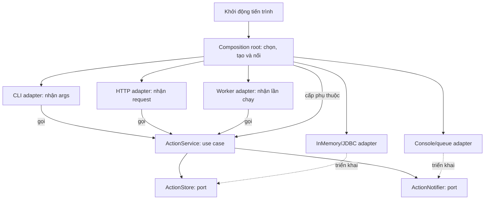

# Ứng dụng CLI, web, xử lý nền và điểm vào tương ứng

Trong chương **Điểm lắp ghép** của module **Dependency Injection (DI)**, ta đã có một ý tưởng trung tâm: đối tượng nghiệp vụ nên **nhận** phụ thuộc thay vì tự quyết định tạo và kết nối chúng. Nhưng ai sẽ tạo toàn bộ đối tượng khi chương trình thực sự chạy? Câu trả lời phụ thuộc vào cách ứng dụng bắt đầu: lệnh CLI, máy chủ web hay tiến trình xử lý nền.

Nơi tập trung việc chọn triển khai, tạo và kết nối các thành phần được gọi là **composition root**. Nó giúp thực hiện **Inversion of Control (IoC)**: mã xử lý nghiệp vụ dùng các collaborator được cung cấp sẵn, còn mã khởi động chịu trách nhiệm lắp ghép. Ta có thể thực hiện điều này hoàn toàn bằng Java thuần, trước khi nhờ DI container tự động hóa.

Điểm dễ nhầm là từ **“điểm vào” (entry point)** có hai ý nghĩa: **điểm khởi động ứng dụng** và **điểm tiếp nhận một yêu cầu/tác vụ**. Trong CLI ngắn hạn, hai điểm này có thể gần như trùng nhau. Trong web và worker chạy lâu dài, chúng thường cách nhau rất xa về thời gian.

Sau bài này, bạn có thể:

- Xác định composition root và điểm tiếp nhận tác vụ của ứng dụng CLI, web và background worker.
- Giải thích vì sao tạo đồ thị đối tượng khi khởi động khác với tạo dữ liệu theo từng request hoặc job.
- Lắp cùng một use case bằng **constructor injection** cho ba loại entry point, dùng Java thuần không có DI container.
- Quyết định vị trí tạo, tái sử dụng và đóng tài nguyên theo **scope** và **vòng đời** của tiến trình, request, job.
- Kiểm thử nghiệp vụ mà không cần chạy HTTP server, scheduler hoặc cơ sở dữ liệu.

## 1. Phân biệt ba khái niệm trước khi viết mã

### 1.1. Điểm khởi động tiến trình

Đây là nơi môi trường chạy bắt đầu chương trình hoặc thành phần ứng dụng. Trong Java độc lập, điểm này thường là `public static void main(String[] args)`. Với web servlet, container có thể gọi callback khởi tạo; trong framework, một hàm bootstrap hoặc cấu hình container đảm nhiệm việc khởi động.

Tại vùng khởi động, chương trình thường đọc và kiểm tra cấu hình, tạo adapter hạ tầng, chọn triển khai cho các interface, ghép các use case và khởi động thành phần tiếp nhận tác vụ.

### 1.2. Composition root

Đây là **ranh giới tổ chức việc lắp ghép đồ thị đối tượng** (*object graph*). Nó thường nằm trong hoặc gần mã khởi động; nó có thể là một hàm, một lớp cấu hình, hoặc một tập cấu hình container. Tên “root” nói về **trách nhiệm**, không buộc mỗi hệ thống chỉ có đúng một phương thức `new`.

Composition root cần biết cả interface lẫn các lớp triển khai. Ví dụ:

```java
ActionStore store = new InMemoryActionStore();
ActionNotifier notifier = new ConsoleActionNotifier();
ActionService service = new ActionService(store, notifier);
```

Ngược lại, `ActionService` chỉ khai báo những gì nó cần để thực hiện nghiệp vụ; nó không tự tạo `InMemoryActionStore` hoặc tìm `ActionNotifier` từ một biến toàn cục.

### 1.3. Điểm tiếp nhận tác vụ

Đây là nơi nhận **dữ liệu của một lần làm việc** rồi gọi use case:

- CLI: hàm xử lý đối số của một lần chạy lệnh.
- Web: HTTP handler/controller được gọi khi có request.
- Worker: callback xử lý một lịch chạy, thông điệp từ queue, hoặc một job cụ thể.

Một HTTP handler được gọi hàng nghìn lần **không có nghĩa** composition root phải chạy hàng nghìn lần. Handler có thể được tạo một lần, nhận `ActionService` qua constructor, rồi dùng nó cho mỗi request nếu các thành phần có scope phù hợp.

## 2. So sánh CLI, web và background worker

| Khía cạnh | CLI | Web | Xử lý nền |
| --- | --- | --- | --- |
| **Đầu vào thực thi** | Đối số dòng lệnh, stdin, file | HTTP request, headers, body, route | Lịch chạy, thông điệp queue, event, job payload |
| **Điểm khởi động** | `main(args)` | `main`/bootstrap web server hoặc callback khởi động của container | `main`/bootstrap worker hoặc callback khởi động của hệ thống job |
| **Điểm vào từng tác vụ** | `CliCommand.run(...)` | `HttpHandler.handle(...)` / controller method | `Runnable.run()`, message handler, job executor |
| **Composition root** | Gần `main`; ghép graph trước khi xử lý lệnh | Trong bootstrap server hoặc cấu hình DI container | Trong bootstrap worker hoặc cấu hình DI container |
| **Vòng đời thông thường** | Một lệnh, rồi tiến trình kết thúc | Tiến trình tiếp nhận nhiều request | Tiến trình tiếp nhận nhiều lần chạy hoặc nhiều thông điệp |
| **Trạng thái ngắn hạn** | Đối số của lệnh, tài nguyên mở cho lần chạy | Request ID, user context, transaction, request body | Payload, retry count, deadline, transaction của một job |
| **Tài nguyên dài hạn** | Có thể chỉ cần tạo trong một lần lệnh | HTTP client, pool, service có trạng thái an toàn cho nhiều request | Connection pool, consumer/scheduler, service chia sẻ |
| **Đóng tài nguyên** | Khi lệnh hoàn tất, kể cả có lỗi | Khi server dừng; tài nguyên theo request đóng sớm hơn | Khi worker dừng; tài nguyên theo job đóng sau mỗi job |

**Điểm chung:** Dù đầu vào khác nhau, application service vẫn có thể giữ **một API nghiệp vụ độc lập với giao thức**. Adapter ở ranh giới chuyển từ đối số CLI, HTTP hoặc payload job sang dữ liệu mà use case cần, rồi chuyển kết quả/lỗi trở lại định dạng tương ứng.

## 3. Cùng một use case, ba adapter đầu vào

Giả sử ta cần xử lý một hành động bằng cách ghi sự kiện và phát thông báo. Phần nghiệp vụ sử dụng hai hợp đồng:

```java
interface ActionStore {
    void append(Action action);
}

interface ActionNotifier {
    void published(Action action);
}
```

`ActionService` sẽ nhận cả hai qua constructor. Ta gắn vào nó ba adapter đầu vào:



Ở đây, **CLI, web và worker là các adapter đầu vào**: chúng biết giao thức mà mình tiếp nhận và được phép gọi use case. `ActionStore` và `ActionNotifier` là **port đầu ra**: use case biết hành vi cần dùng nhưng không biết cách lưu hoặc gửi cụ thể. Composition root biết cả các adapter và quyết định ghép instance nào.

Trong một triển khai thực tế, mỗi chế độ chạy có thể là **một tiến trình triển khai riêng**, với đồ thị đối tượng riêng. Sơ đồ thể hiện cấu trúc có thể dùng chung và không hàm ý một JVM đang đồng thời chạy cả ba chế độ.

## 4. Ví dụ Java thuần chạy được ở ba chế độ

Ví dụ sau dùng **Java 17 trở lên** và HTTP server có sẵn trong JDK (`com.sun.net.httpserver.HttpServer`). Không cần Spring, CDI hay thư viện DI. Chương trình nhận `cli`, `web` hoặc `worker` làm chế độ chạy; mỗi lần chạy xây một object graph rồi khởi động adapter tương ứng.

Đặt vào file `EntryPointsDemo.java`:

```java
import com.sun.net.httpserver.HttpExchange;
import com.sun.net.httpserver.HttpHandler;
import com.sun.net.httpserver.HttpServer;

import java.io.IOException;
import java.io.OutputStream;
import java.net.InetSocketAddress;
import java.nio.charset.StandardCharsets;
import java.time.Clock;
import java.util.Objects;
import java.util.Queue;
import java.util.concurrent.ConcurrentLinkedQueue;
import java.util.concurrent.ExecutorService;
import java.util.concurrent.Executors;
import java.util.concurrent.ScheduledExecutorService;
import java.util.concurrent.TimeUnit;

public class EntryPointsDemo {
    record Action(String source, String id) { }

    @FunctionalInterface
    interface ActionStore {
        void append(Action action);
    }

    @FunctionalInterface
    interface ActionNotifier {
        void published(Action action);
    }

    static final class InMemoryActionStore implements ActionStore {
        // Demo có thể nhận nhiều HTTP request từ các luồng khác nhau.
        private final Queue<Action> entries = new ConcurrentLinkedQueue<>();

        @Override
        public void append(Action action) {
            entries.add(action);
        }
    }

    static final class ConsoleActionNotifier implements ActionNotifier {
        @Override
        public void published(Action action) {
            System.out.println(
                    "Saved " + action.source() + ":" + action.id());
        }
    }

    // Use case không biết CLI, HTTP, scheduler hoặc lớp triển khai cụ thể.
    static final class ActionService {
        private final ActionStore store;
        private final ActionNotifier notifier;

        ActionService(ActionStore store, ActionNotifier notifier) {
            this.store = Objects.requireNonNull(store, "store");
            this.notifier = Objects.requireNonNull(notifier, "notifier");
        }

        Action execute(String source, String id) {
            if (id == null || !id.matches("[A-Za-z0-9_-]{1,40}")) {
                throw new IllegalArgumentException("Invalid action id");
            }
            Action action = new Action(source, id);
            store.append(action);
            notifier.published(action);
            return action;
        }
    }

    // Đầu vào CLI: chuyển tham số dòng lệnh thành lời gọi use case.
    static final class CliEntry {
        private final ActionService service;

        CliEntry(ActionService service) {
            this.service = Objects.requireNonNull(service);
        }

        void run(String[] args) {
            if (args.length < 2) {
                throw new IllegalArgumentException(
                        "Usage: java EntryPointsDemo cli ACTION_ID");
            }
            service.execute("cli", args[1]);
        }
    }

    // Đầu vào HTTP: POST /actions/A-1.
    static final class WebEntry implements HttpHandler {
        private final ActionService service;

        WebEntry(ActionService service) {
            this.service = Objects.requireNonNull(service);
        }

        @Override
        public void handle(HttpExchange exchange) throws IOException {
            try {
                if (!"POST".equals(exchange.getRequestMethod())) {
                    respond(exchange, 405, "Method not allowed");
                    return;
                }
                String path = exchange.getRequestURI().getPath();
                String prefix = "/actions/";
                if (!path.startsWith(prefix)) {
                    respond(exchange, 404, "Not found");
                    return;
                }
                String actionId = path.substring(prefix.length());
                try {
                    service.execute("web", actionId);
                    respond(exchange, 200, "Processed: " + actionId);
                } catch (IllegalArgumentException invalid) {
                    respond(exchange, 400, "Invalid action id");
                } catch (RuntimeException unexpected) {
                    // Không đưa chi tiết lỗi nội bộ vào HTTP response.
                    respond(exchange, 500, "Internal error");
                }
            } finally {
                exchange.close();
            }
        }

        private static void respond(
                HttpExchange exchange, int status, String message)
                throws IOException {
            byte[] content = message.getBytes(StandardCharsets.UTF_8);
            exchange.getResponseHeaders().set(
                    "Content-Type", "text/plain; charset=utf-8");
            exchange.sendResponseHeaders(status, content.length);
            try (OutputStream body = exchange.getResponseBody()) {
                body.write(content);
            }
        }
    }

    // Đầu vào background: scheduler gọi lại mỗi chu kỳ.
    static final class WorkerEntry implements Runnable {
        private final ActionService service;
        private final Clock clock;

        WorkerEntry(ActionService service, Clock clock) {
            this.service = Objects.requireNonNull(service);
            this.clock = Objects.requireNonNull(clock);
        }

        @Override
        public void run() {
            service.execute("worker", "tick_" + clock.millis());
        }
    }

    record Graph(CliEntry cli, WebEntry web, WorkerEntry worker) { }

    // Composition root: tạo một object graph cho tiến trình.
    static Graph compose(Clock clock) {
        ActionStore store = new InMemoryActionStore();
        ActionNotifier notifier = new ConsoleActionNotifier();
        ActionService service = new ActionService(store, notifier);

        return new Graph(
                new CliEntry(service),
                new WebEntry(service),
                new WorkerEntry(service, clock));
    }

    public static void main(String[] args) throws Exception {
        if (args.length == 0) {
            System.out.println("Usage: cli ACTION_ID | web | worker");
            return;
        }

        Graph graph = compose(Clock.systemUTC());
        switch (args[0]) {
            case "cli" -> graph.cli().run(args);
            case "web" -> serveHttp(graph.web());
            case "worker" -> schedule(graph.worker());
            default -> System.out.println("Unknown mode: " + args[0]);
        }
    }

    static void serveHttp(WebEntry endpoint) throws Exception {
        HttpServer server = HttpServer.create(
                new InetSocketAddress("127.0.0.1", 8080), 0);
        ExecutorService executor = Executors.newFixedThreadPool(4);
        server.createContext("/actions/", endpoint);
        server.setExecutor(executor);
        server.start();
        System.out.println(
                "POST http://127.0.0.1:8080/actions/A-1");
        System.out.println("Press Enter to stop");
        try {
            System.in.read();
        } finally {
            server.stop(1);
            executor.shutdown();
            if (!executor.awaitTermination(5, TimeUnit.SECONDS)) {
                executor.shutdownNow();
            }
        }
    }

    static void schedule(WorkerEntry worker) throws Exception {
        ScheduledExecutorService scheduler =
                Executors.newSingleThreadScheduledExecutor();
        scheduler.scheduleWithFixedDelay(() -> {
            try {
                worker.run();
            } catch (RuntimeException error) {
                // Tránh để exception hủy các lượt lập lịch tiếp theo.
                System.err.println(
                        "Worker failed: " + error.getClass().getSimpleName());
            }
        }, 0, 5, TimeUnit.SECONDS);

        System.out.println("Worker runs every 5 seconds.");
        System.out.println("Press Enter to stop");
        try {
            System.in.read();
        } finally {
            scheduler.shutdown();
            if (!scheduler.awaitTermination(5, TimeUnit.SECONDS)) {
                scheduler.shutdownNow();
            }
        }
    }
}
```

Biên dịch:

```bash
javac EntryPointsDemo.java
```

Ba cách chạy độc lập:

```bash
# Một lệnh CLI:
java EntryPointsDemo cli A-1

# Khởi động máy chủ web tại 127.0.0.1:8080:
java EntryPointsDemo web

# Khởi động worker xử lý mỗi 5 giây:
java EntryPointsDemo worker
```

Với chế độ web, mở một terminal khác để gửi yêu cầu:

```bash
curl -X POST http://127.0.0.1:8080/actions/A-1
```

Trong PowerShell trên Windows, có thể dùng `curl.exe -X POST http://127.0.0.1:8080/actions/A-1` để gọi chính xác công cụ curl. Trong ví dụ tương tác, nhấn **Enter** tại terminal chạy web hoặc worker để dừng. Khi stdin đã đóng, chương trình có thể dừng ngay; đây là cơ chế dừng đơn giản cho mục đích học tập, không phải cách vận hành một dịch vụ production.

Kết quả CLI dự kiến:

```text
Saved cli:A-1
```

Với HTTP POST hợp lệ, console của server in `Saved web:A-1` và HTTP response là `Processed: A-1`. Worker in các dòng như `Saved worker:tick_...`, trong đó hậu tố phụ thuộc thời điểm chạy.

Ví dụ **không lưu dữ liệu bền vững**: mỗi tiến trình tạo một `InMemoryActionStore` riêng. Nếu chạy ba chế độ ở ba terminal, chúng **không chia sẻ** kho dữ liệu in-memory; trong hệ thống thật, các tiến trình cần kết nối tới cùng một hệ thống lưu trữ bền vững hoặc cơ chế trao đổi thông điệp phù hợp.

## 5. Đọc ví dụ theo vòng đời khởi động và thực thi

### 5.1. CLI: chạy một lệnh rồi kết thúc

```text
main(args)
  -> compose(clock)
     -> new store, notifier, ActionService, CliEntry
  -> CliEntry.run(args)
     -> ActionService.execute("cli", actionId)
  -> kết thúc tiến trình
```

Một CLI xử lý một lệnh thường không cần giữ dịch vụ qua nhiều yêu cầu. Vì vậy, `main` vừa là điểm khởi động, vừa là nơi bắt đầu luồng chạy lệnh. Tuy nhiên, việc tách `CliEntry` khỏi `ActionService` vẫn hữu ích: việc parse args/hiển thị lỗi thuộc adapter CLI, còn logic nghiệp vụ không nhận `String[] args` hay tự gọi `System.exit`.

Nếu CLI xử lý hàng nghìn dòng trong một batch, hãy tạo đồ thị ổn định **một lần** khi bắt đầu batch, rồi cấp dữ liệu từng dòng cho use case. Nếu mỗi dòng cần transaction/connection riêng thì chỉ những tài nguyên ngắn hạn đó mới phải được tạo trong phạm vi từng dòng.

### 5.2. Web: bootstrap một lần, xử lý nhiều request

```text
main("web")
  -> compose(clock)
  -> tạo HttpServer, executor
  -> đăng ký một WebEntry đã nhận ActionService
  -> server.start()

request 1 -> WebEntry.handle(...) -> ActionService.execute(...)
request 2 -> WebEntry.handle(...) -> ActionService.execute(...)
request N -> WebEntry.handle(...) -> ActionService.execute(...)

dừng server -> stop server, shutdown executor
```

`WebEntry` là **điểm vào từng request**, không phải composition root. Nó nhận `ActionService` qua constructor lúc bootstrap và chuyển request thành lời gọi use case. Nếu service không giữ trạng thái riêng của người dùng và các phụ thuộc phù hợp để chia sẻ, nhiều request có thể dùng chung một instance. Dữ liệu như action ID được truyền theo **tham số phương thức**, không lưu vào field chung trên handler.

Ở ví dụ, `ConcurrentLinkedQueue` giúp adapter in-memory hỗ trợ ghi từ nhiều thread. Nhưng queue thread-safe không có nghĩa **toàn bộ workflow** là nguyên tử hay đáp ứng các yêu cầu về giao dịch; khi thay bằng database cần thiết kế transaction, constraint và hành vi khi lỗi.

Trong web framework, điểm bootstrap có thể là `main` khởi tạo Spring Boot, module cấu hình dependency hoặc callback do servlet container gọi. **Controller/handler** vẫn là nơi nhận request. Dù framework tự tạo controller, container configuration vẫn đóng vai trò composition root; không nên để controller gọi `new JdbcActionStore(...)` hoặc `container.get(...)` cho mỗi request chỉ để tự tìm dependency.

### 5.3. Worker: bootstrap một lần, xử lý nhiều lần chạy

```text
main("worker")
  -> compose(clock)
  -> tạo ScheduledExecutorService
  -> đăng ký WorkerEntry
  -> scheduler đánh thức mỗi chu kỳ

tick 1 -> WorkerEntry.run() -> ActionService.execute(...)
tick 2 -> WorkerEntry.run() -> ActionService.execute(...)
...

dừng worker -> scheduler.shutdown(), chờ tác vụ hoàn tất
```

`WorkerEntry` là **điểm vào của một lần chạy**, còn `schedule` chịu trách nhiệm lập lịch và quản lý scheduler. `Clock` là một phụ thuộc được cấp ở composition root; nhờ vậy có thể dùng `Clock.fixed(...)` trong kiểm thử để không phụ thuộc thời gian hệ thống.

Trong thực tế, worker có thể được gọi bởi message broker, cron, tác vụ trong queue hoặc nền tảng chạy batch. Khi đó adapter đầu vào có trách nhiệm **đọc payload, xác nhận/ack, retry theo quy định và gọi use case**. Use case không nên phụ thuộc trực tiếp vào các khái niệm như offset của Kafka hoặc receipt handle của queue nếu chính sách nghiệp vụ không cần chúng.

`scheduleWithFixedDelay` đặt khoảng nghỉ giữa **lúc một lần chạy kết thúc** và **lúc lần sau bắt đầu**; nó không đảm bảo lịch cố định theo giờ thực. Nếu tác vụ ném exception không được xử lý, những lần chạy tiếp theo của cùng tác vụ định kỳ có thể bị ngừng. Ví dụ bắt `RuntimeException` tại biên scheduler để minh họa việc nhận diện lỗi, nhưng hệ thống thật còn cần log đầy đủ, cảnh báo, retry có giới hạn và khả năng dừng an toàn.

## 6. Composition root có một hay nhiều?

Câu hỏi “mỗi ứng dụng có đúng một composition root không?” cần xét **ranh giới tiến trình/host**.

- **Một tiến trình CLI:** thường có một root tại khởi động lệnh.
- **Một web server:** thường có một root cho host/server process, từ đó tạo graph và cung cấp dependency cho handler/controller. Các scope nhỏ hơn có thể được tạo bên dưới root khi request đến.
- **Một worker riêng:** có root cho tiến trình worker, bất kể nó dùng chung mã nghiệp vụ với web.
- **Một hệ thống gồm web + nhiều worker:** có thể có nhiều root độc lập, mỗi root tạo graph cho tiến trình của mình. Chúng có thể chia sẻ hàm/lớp cấu hình nhưng **không chia sẻ cùng object instance qua ranh giới tiến trình**.

Không nên biến “composition root” thành một **service locator toàn cục** mà mọi lớp đều gọi để lấy dependency. Nếu `ActionService` phải tự truy vấn một registry/DI container bên trong `execute`, phụ thuộc thật của nó bị giấu và kiểm thử Java thuần khó hơn.

Cũng không nhất thiết mọi lệnh `new` đều nằm đúng một dòng `main`. Việc tạo một `Action` mới theo dữ liệu từng request là một **thao tác nghiệp vụ bình thường**. Việc tạo một HTTP client, repository adapter hay lựa chọn chính sách triển khai thuộc phần lắp ghép. Với đối tượng có vòng đời ngắn hoặc chỉ biết tham số ở lúc chạy, root có thể inject **factory/provider** vào consumer rồi để factory tạo đối tượng khi cần.

## 7. Chọn scope và quyền sở hữu tài nguyên

Một object graph hợp lệ về kiểu dữ liệu chưa đủ. Composition root còn phải quyết định đối tượng **được dùng lại hay tạo mới**, ai đóng tài nguyên và điều gì xảy ra nếu nhiều luồng cùng dùng.

| Loại đối tượng | Scope thường gặp | Ai nên chịu trách nhiệm? | Rủi ro cần tránh |
| --- | --- | --- | --- |
| Application service không lưu trạng thái request | Dùng chung trong một tiến trình nếu dependency an toàn | Composition root tạo/cấp | Giữ user ID, request body hoặc transaction trong field chia sẻ |
| Adapter HTTP handler | Theo server hoặc theo request tùy framework | Web bootstrap/container | Coi constructor là nơi xử lý dữ liệu request |
| CLI command adapter | Theo lần chạy CLI hoặc theo batch | CLI bootstrap | Mỗi dòng nhập lại xây lại các client đắt đỏ một cách không cần thiết |
| Scheduler/consumer và thread pool | Theo vòng đời tiến trình worker | Worker bootstrap | Không shutdown, để tác vụ bị bỏ dở hoặc thread giữ JVM sống |
| Connection/transaction | Theo thao tác, request hoặc đơn vị công việc | Adapter / transaction manager theo quy ước | Chia sẻ cùng một JDBC `Connection` giữa request hoặc dùng sau khi đóng |
| HTTP client / connection pool | Thường sống lâu và tái sử dụng được nếu thiết kế cho phép | Composition root hoặc container | Tạo lại client cho từng request gây lãng phí, không đóng khi dừng |
| Dữ liệu request/job | Theo từng lời gọi | Caller/adapter và use case | Rò rỉ dữ liệu giữa người dùng hoặc các lần chạy |

Ví dụ `ActionService` dùng hai field `final`: đây là **tham chiếu ổn định**, không chứng minh hai dependency bất biến hay thread-safe. `InMemoryActionStore` dùng queue phù hợp ví dụ nhiều request, nhưng một adapter dùng `ArrayList` không đồng bộ hoặc giữ một `Connection` đơn lẻ có thể không phù hợp khi được chia sẻ.

Nếu root tạo một tài nguyên `AutoCloseable` như client, pool hoặc file, root/container nên quản lý việc đóng khi tiến trình dừng. Nếu adapter tạo tài nguyên chỉ cho một thao tác, adapter thường đóng trong `try-with-resources`. Nếu caller truyền vào một `Writer` chỉ dùng cho một lần xuất, hợp đồng cần nêu rõ caller hay callee sở hữu và đóng writer đó.

Khi bắt lỗi ở adapter, đừng làm mất ngữ nghĩa nghiệp vụ. Ví dụ, adapter HTTP ánh xạ lỗi đầu vào sang `400`; lỗi hạ tầng sang `500`. Adapter worker có thể retry, nhưng **retry có thể chạy lại cùng tác vụ**; use case cần idempotency hoặc định danh tác vụ ổn định nếu tác vụ lặp lại gây hậu quả. DI không tự đảm bảo idempotency, transaction hay “exactly once”.

## 8. Kiểm thử độc lập với entry point và DI container

Vì `ActionService` chỉ biết `ActionStore` và `ActionNotifier`, ta kiểm thử bằng Java thuần mà không cần khởi động server hoặc scheduler. Trong cùng thư mục với `EntryPointsDemo.java`, tạo file ví dụ `EntryPointsDemoTest.java`:

```java
import java.util.ArrayList;
import java.util.List;

public class EntryPointsDemoTest {
    public static void main(String[] args) {
        List<EntryPointsDemo.Action> stored = new ArrayList<>();
        List<EntryPointsDemo.Action> published = new ArrayList<>();

        EntryPointsDemo.ActionService service =
                new EntryPointsDemo.ActionService(
                        stored::add,
                        published::add);

        EntryPointsDemo.Action result =
                service.execute("test", "A-9");

        if (!stored.equals(List.of(result))
                || !published.equals(List.of(result))) {
            throw new AssertionError("Use case did not invoke ports");
        }

        boolean rejected = false;
        try {
            service.execute("test", "bad/id");
        } catch (IllegalArgumentException expected) {
            rejected = true;
        }
        if (!rejected || stored.size() != 1 || published.size() != 1) {
            throw new AssertionError("Invalid input was not rejected");
        }

        System.out.println("Pure Java test: PASS");
    }
}
```

```bash
javac EntryPointsDemo.java EntryPointsDemoTest.java
java EntryPointsDemoTest
```

Kết quả dự kiến: `Pure Java test: PASS`.

Để kiểm tra adapter, có thể viết thêm test chuyển đổi CLI args, HTTP method/path/status và payload job. Những test đó nằm ở **ranh giới giao thức**; không cần lặp lại toàn bộ test nghiệp vụ cho từng entry point. Trong ứng dụng lớn, ta có thể dùng JUnit, fake adapter hoặc integration test với DB/server thật khi cần xác minh hợp đồng hạ tầng.

### Kiểm thử thời gian của worker

`WorkerEntry` nhận `Clock` qua constructor, nên có thể tạo nó với `Clock.fixed(...)` và fake store/notifier. Khi gọi trực tiếp `worker.run()`, test xác nhận đúng mã `tick_...` và các lời gọi port mà không phải đợi 5 giây hay chạy scheduler. **Scheduler** có vòng kiểm thử riêng cho tần suất, xử lý lỗi và dừng; **use case** vẫn không cần biết clock được cung cấp thế nào.

## 9. Những lỗi thiết kế phổ biến

| Lỗi | Vì sao có vấn đề | Cách sửa |
| --- | --- | --- |
| Tạo `new JdbcRepository(...)` ở mỗi HTTP handler method | Gắn việc chọn hạ tầng vào request, khó test, dễ mở quá nhiều tài nguyên | Tạo/cấp adapter có scope phù hợp từ web bootstrap hoặc container |
| Coi mỗi HTTP request là một composition root | Lặp cấu hình toàn ứng dụng, không rõ ownership | Phân biệt root tại startup và đối tượng request tạo dưới root |
| Đặt `static ApplicationContext.get(...)` trong use case | Dependency bị ẩn, mã nghiệp vụ phụ thuộc container | Constructor injection các port thực sự cần |
| Đưa request ID hoặc trạng thái user vào field của singleton service | Request đồng thời có thể ghi đè dữ liệu của nhau | Truyền dữ liệu theo tham số/kiểu request, scope ngắn |
| Worker tự tạo scheduler và client bên trong `run()` | Tài nguyên bị tạo lại theo mỗi tick; khó đóng và đo lường | Scheduler và client được tạo ở bootstrap, worker adapter chỉ nhận payload và gọi use case |
| Root không quản lý `close()/shutdown()` | Rò tài nguyên, không dừng sạch tiến trình | Thiết kế quyền sở hữu và đóng theo vòng đời |
| Dùng `Clock.systemUTC()` hoặc đọc environment ở khắp mã nghiệp vụ | Test phụ thuộc môi trường và thời gian hệ thống | Đọc cấu hình, tạo clock tại composition root rồi inject |
| Một worker retry nhiều lần nhưng use case không chống lặp | Có thể ghi hoặc gửi trùng | Thiết kế idempotency, định danh tác vụ và cơ chế giao dịch phù hợp |

## 10. Bài thực hành theo thứ tự

1. **Truy dấu entry point:** Với `EntryPointsDemo.java`, chỉ ra điểm khởi động cho mỗi chế độ, nơi `ActionService` được tạo, và phương thức nhận **một yêu cầu/tác vụ**. Giải thích vì sao `WebEntry.handle` không phải composition root.
2. **Thay adapter:** Tạo `RecordingActionNotifier` lưu thông báo vào một collection. Đổi đúng cách lắp ghép trong `compose` và kiểm tra `ActionService` không cần sửa.
3. **Kiểm thử CLI và web riêng:** Chạy chế độ CLI với `A-1`, sau đó web với HTTP `POST /actions/A-1` và thử `GET` cùng ID không hợp lệ. Xác định mỗi lỗi phải được chuyển thành mã thoát CLI hoặc HTTP status ở lớp nào.
4. **Kiểm thử background bằng clock cố định:** Tạo `WorkerEntry` nhận `Clock.fixed(...)` và fake ports, gọi `run()` trực tiếp. Kiểm tra ID tác vụ và nội dung được ghi; không dùng `Thread.sleep`.
5. **Thiết kế scope:** Giả sử dùng JDBC database và request có thông tin khách hàng. Viết sơ đồ thành phần sống theo ứng dụng, theo request và theo transaction. Chỉ rõ ai đóng pool, ai đóng connection và vì sao không lưu thông tin khách hàng trong singleton service.
6. **Tách tiến trình:** Giả sử web và worker được deploy riêng nhưng cần xem cùng dữ liệu. Giải thích vì sao `InMemoryActionStore` trong hai JVM không chia sẻ trạng thái và thành phần nào cần thay bằng adapter bền vững.

### Câu hỏi tự kiểm tra

- Một HTTP request có phải luôn chạy lại toàn bộ composition root không? Vì sao?
- Khi chạy `java EntryPointsDemo cli A-1`, những đối tượng nào được tạo tại bootstrap và dữ liệu nào chỉ thuộc lần gọi CLI?
- Tại sao worker cần xử lý lỗi tại biên scheduler thay vì để mọi exception phá vỡ lịch chạy định kỳ?
- Một service có field `final ActionStore` có tự động an toàn khi nhiều HTTP request gọi cùng lúc không?
- Nếu dùng Spring hoặc CDI để tạo bean, trách nhiệm thiết kế scope, hợp đồng và vòng đời có biến mất không?

Khi chuyển từ CLI sang web hoặc xử lý nền, phần **đầu vào và vòng đời host** thay đổi; mã use case vẫn có thể giữ nguyên nhờ constructor injection và các port rõ ràng. Composition root giữ việc tạo và lắp ghép ở ranh giới ứng dụng, adapter đầu vào chuyển dữ liệu từ môi trường chạy thành lời gọi nghiệp vụ, còn scope và quyền sở hữu tài nguyên quyết định graph ấy hoạt động an toàn trong bao lâu. Nắm được các bước này bằng Java thuần là cơ sở để dùng DI container hiệu quả thay vì để framework che khuất cách ứng dụng được kết nối.
