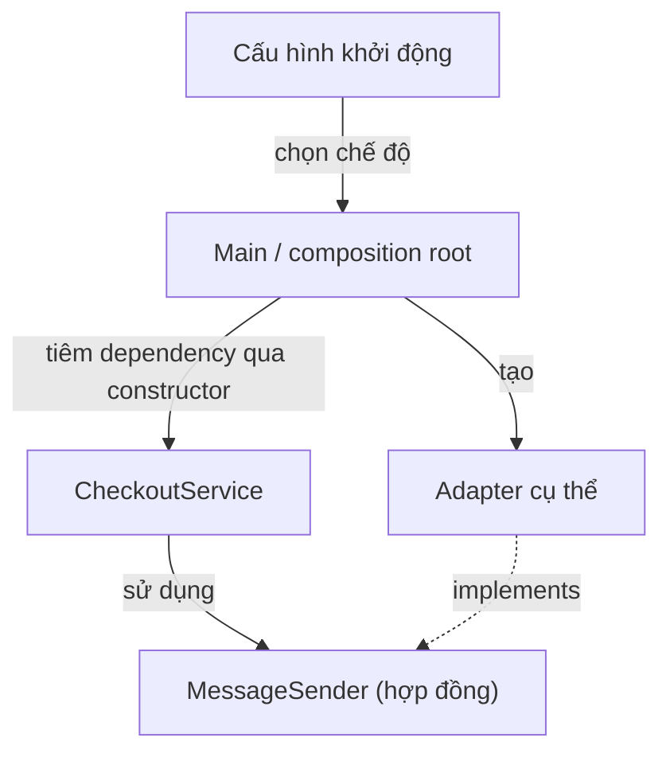

# Giữ việc chọn lớp cụ thể gần ranh giới khởi động

> **Chương:** Điểm lắp ghép (Composition Root)  
> **Phạm vi:** Dependency Injection (DI), Inversion of Control (IoC) và cách chọn, tạo, kết nối các phụ thuộc trong Java thuần trước khi dùng DI container.

## 1. Mục tiêu học tập

Sau bài này, bạn có thể:

1. Giải thích vì sao quyết định sử dụng `ConsoleSender`, `EmailSender` hay một adapter khác nên được đưa đến **ranh giới khởi động** thay vì rải trong các lớp nghiệp vụ.
2. Xác định **composition root** của ứng dụng Java và trách nhiệm của nó trong việc chọn implementation, tạo đối tượng, truyền dependency.
3. Viết một ví dụ Java thuần sử dụng **constructor injection**, chọn implementation từ cấu hình khởi động và kiểm thử nghiệp vụ bằng một fake.
4. Phân biệt quyết định chọn adapter **theo môi trường triển khai** với quyết định nghiệp vụ **theo từng request**.
5. Nhận diện giới hạn về scope, vòng đời tài nguyên, vòng phụ thuộc và lỗi khởi tạo khi tổ chức composition root.

## 2. Bài toán: ai quyết định dùng lớp cụ thể nào?

Giả sử `CheckoutService` xác nhận đơn hàng và cần gửi thông báo. Có thể có nhiều cách thực hiện việc gửi: in thông báo trong ứng dụng mẫu, gửi qua một API bên ngoài hoặc gửi qua dịch vụ email. **Lớp nghiệp vụ cần khả năng gửi thông báo, nhưng không cần biết adapter nào sẽ được sử dụng trong môi trường hiện tại.**

Một cách triển khai dễ gặp là tự chọn adapter ngay bên trong service:

```java
// PHẢN VÍ DỤ minh họa: các lớp Sender ở đây là tên giả định.
final class CheckoutService {
    private final MessageSender sender;

    CheckoutService() {
        String mode = System.getenv("DELIVERY_MODE");
        if ("api".equals(mode)) {
            this.sender = new ApiMessageSender();
        } else {
            this.sender = new ConsoleMessageSender();
        }
    }

    void confirm(String email) {
        sender.send(email, "Đơn hàng đã được xác nhận");
    }
}
```

Đoạn này đặt **hai trách nhiệm khác nhau** vào một nơi:

- `CheckoutService` thực hiện quy tắc xác nhận đơn hàng và yêu cầu gửi thông báo.
- `CheckoutService` đồng thời đọc biến môi trường, chọn và khởi tạo adapter hạ tầng.

Hệ quả là thay một phương thức gửi có thể yêu cầu sửa service; bài kiểm thử khó truyền fake để quan sát lời gọi; lỗi cấu hình chỉ xuất hiện khi đối tượng nghiệp vụ được tạo; nhiều service có thể sao chép cùng logic chọn môi trường. Khi adapter cần URL, khóa xác thực, connection pool hoặc tài nguyên phải đóng, phần tạo đối tượng càng trở nên rối.

**Nguyên tắc thiết kế:** Giữ các câu lệnh quyết định *dùng implementation cụ thể nào* ở gần **entry point/bootstrap**. Lớp sử dụng dependency nhận một hợp đồng rõ ràng (thường qua constructor), không tự biết cách chọn hay xây dựng toàn bộ object graph.

> Từ khóa `new` không phải vấn đề tự thân. `new Order(...)` để tạo một đối tượng dữ liệu trong nghiệp vụ thường hợp lý. Điều cần chuyển ra ranh giới khởi động là quyết định tạo, cấu hình và sở hữu những **collaborator** hoặc **adapter hạ tầng** mà nghiệp vụ sử dụng.

## 3. Composition root là gì?

**Composition root** là nơi ứng dụng **lắp ghép object graph**: tạo các đối tượng cụ thể, kết nối dependency và đưa đối tượng đã sẵn sàng vào hoạt động.

Trong Java thuần, đó thường là `main(String[] args)` hoặc một lớp/factory khởi động được `main` gọi. Với ứng dụng web, điểm lắp ghép có thể nằm trong quy trình khởi tạo ứng dụng của web server hoặc container. Với một job chạy theo lịch, nó thường nằm ở phần bootstrap của tiến trình/job.

Composition root chịu trách nhiệm:

1. Đọc và kiểm tra cấu hình cần thiết **trước khi** chạy nghiệp vụ.
2. Quyết định dùng các implementation cụ thể và tạo các adapter.
3. Lắp ghép constructor arguments theo đúng hướng phụ thuộc.
4. Xác định chính sách chia sẻ đối tượng và thứ tự quản lý vòng đời.
5. Đưa service đã được lắp ghép cho entry point điều phối công việc.

Nó **không** nên gánh các quy tắc nghiệp vụ, ví dụ tính giá đơn hàng, áp dụng khuyến mãi hay ra quyết định xét duyệt thanh toán.



**“Gần ranh giới khởi động” là một ranh giới trách nhiệm, không nhất thiết là một file Java duy nhất.** Khi object graph lớn, có thể tách hàm `createInfrastructure(...)`, `createApplication(...)` hoặc factory thuộc tầng bootstrap. Các factory này vẫn do composition root điều phối, không bị gọi từ code nghiệp vụ mỗi khi cần dependency.

## 4. Ví dụ đầy đủ: chọn implementation trong `Main`

Ví dụ sau mô phỏng việc gửi thông báo bằng console. Có hai chế độ:

- `standard`: in thông báo.
- `audited`: vẫn in thông báo, đồng thời ghi thêm một dòng minh họa dấu vết kiểm toán.

Đây là adapter học tập, **không gửi email hoặc gọi mạng thật**. Cả hai chế độ có cùng chức năng mà `CheckoutService` cần: thực hiện `MessageSender.send(...)`.

Tạo file `Main.java`:

```java
import java.util.Objects;

// Hợp đồng mà nghiệp vụ sử dụng.
interface MessageSender {
    void send(String recipient, String message);
}

// Adapter cụ thể cho ứng dụng mẫu.
final class ConsoleMessageSender implements MessageSender {
    @Override
    public void send(String recipient, String message) {
        System.out.println("SEND " + recipient + ": " + message);
    }
}

// Decorator: giữ hành vi gửi, bổ sung ghi dấu vết.
final class AuditedMessageSender implements MessageSender {
    private final MessageSender delegate;

    AuditedMessageSender(MessageSender delegate) {
        this.delegate = Objects.requireNonNull(delegate, "delegate");
    }

    @Override
    public void send(String recipient, String message) {
        delegate.send(recipient, message);
        System.out.println("AUDIT sent to " + recipient);
    }
}

// Nghiệp vụ chỉ phụ thuộc vào hợp đồng, không biết mode.
final class CheckoutService {
    private final MessageSender sender;

    CheckoutService(MessageSender sender) {
        this.sender = Objects.requireNonNull(sender, "sender");
    }

    void confirm(String email) {
        if (email == null || email.trim().isEmpty()) {
            throw new IllegalArgumentException("email is required");
        }
        sender.send(email, "Đơn hàng đã được xác nhận");
    }
}

public class Main {
    public static void main(String[] args) {
        // 1. Đọc cấu hình tại ranh giới khởi động.
        String mode = args.length == 0 ? "standard" : args[0];

        // 2. Chọn và tạo implementation cụ thể.
        MessageSender sender = createSender(mode);

        // 3. Lắp ghép các đối tượng bằng constructor injection.
        CheckoutService checkout = new CheckoutService(sender);

        // 4. Bắt đầu thực thi công việc của ứng dụng.
        checkout.confirm("customer@example.test");
    }

    private static MessageSender createSender(String mode) {
        switch (mode) {
            case "standard":
                return new ConsoleMessageSender();
            case "audited":
                return new AuditedMessageSender(
                        new ConsoleMessageSender());
            default:
                throw new IllegalArgumentException(
                        "Unsupported delivery mode: " + mode);
        }
    }
}
```

Chạy bằng JDK; không cần Spring hoặc thư viện DI:

```bash
javac -encoding UTF-8 Main.java
java Main standard
```

Kết quả:

```text
SEND customer@example.test: Đơn hàng đã được xác nhận
```

Thử cấu hình khác mà không sửa `CheckoutService`:

```bash
java Main audited
```

Kết quả:

```text
SEND customer@example.test: Đơn hàng đã được xác nhận
AUDIT sent to customer@example.test
```

Thử `java Main unknown` sẽ thất bại với `IllegalArgumentException` nêu chế độ không được hỗ trợ. **Phát hiện cấu hình sai khi khởi động** thường dễ chẩn đoán hơn âm thầm chọn một adapter mặc định không mong muốn.

### 4.1. Tại sao đây là DI và IoC?

`Main` quyết định `new ConsoleMessageSender()` hoặc `new AuditedMessageSender(...)`, sau đó gọi `new CheckoutService(sender)`. `CheckoutService` nhận đối tượng qua **constructor injection** và chỉ giao tiếp qua interface `MessageSender`.

Ở đây:

- **Dependency Injection:** dependency được cung cấp từ bên ngoài thay vì do `CheckoutService` tự tạo.
- **Inversion of Control:** quyền quyết định lắp ghép được chuyển về bootstrap; service tập trung thực hiện nghiệp vụ.
- **Dependency Inversion Principle (DIP):** service cấp cao phụ thuộc vào hợp đồng `MessageSender`; các adapter cụ thể triển khai hợp đồng đó.

DI là một kỹ thuật; IoC là ý tưởng rộng hơn, còn DIP là nguyên lý thiết kế về hướng phụ thuộc. **Không cần DI container** để áp dụng ba khái niệm này ở mức cơ bản.

### 4.2. Nếu thêm adapter thật thì thay gì?

Khi cần một `SmtpMessageSender` hoặc `HttpMessageSender` thật, mã tạo adapter (đọc cấu hình, tạo HTTP client, truyền thông tin kết nối) thuộc phần bootstrap/hạ tầng. `CheckoutService` vẫn nhận `MessageSender` qua constructor.

Việc thêm adapter mới cần xem lại **hợp đồng hành vi** (ví dụ thông báo lỗi gửi, retry, idempotency), chứ không chỉ bảo đảm cùng chữ ký Java. Thay implementation ở composition root giúp khoanh vùng điểm thay đổi; nó không tự đảm bảo hai adapter có hành vi giống hệt nhau trong mọi tình huống.

## 5. Cách nhận diện ranh giới khởi động

Một câu hỏi thực dụng: **đoạn code này chạy vì ứng dụng đang được dựng lên, hay vì một yêu cầu nghiệp vụ đang được xử lý?**

| Thành phần | Nên làm | Không nên làm |
| --- | --- | --- |
| `Main` / application bootstrap | Đọc cấu hình, chọn adapter, tạo service, kết nối object graph. | Tính giảm giá, xác minh quy tắc đặt hàng. |
| Factory thuộc bootstrap | Biết các lớp cụ thể, tạo và cấu hình adapter. | Được gọi ngầm từ service nghiệp vụ để tự chọn môi trường. |
| `CheckoutService` | Gọi `MessageSender.send(...)` theo quy tắc nghiệp vụ. | Đọc `System.getenv(...)` để chọn `SmtpMessageSender` hay `HttpMessageSender`. |
| Controller / job handler | Nhận đầu vào, gọi service đã được inject. | Tạo lại connection pool, repository hoặc service cho mỗi lời gọi nếu không có thiết kế scope rõ ràng. |
| Adapter hạ tầng | Biết API/SDK, kết nối, serialization và lỗi dịch vụ ngoài. | Quyết định chính sách nghiệp vụ mà hợp đồng không giao cho adapter. |

Khi đọc code, nếu nhiều service đều có nhánh `if (environment...) new ConcreteAdapter(...)`, khả năng cao quyết định chọn implementation đang bị phân tán. Có thể chuyển các lựa chọn này về composition root hoặc các hàm tạo chuyên trách tại biên khởi động.

### 5.1. Không biến `main` thành “siêu lớp”

Nếu tất cả lệnh tạo đối tượng nằm trong một `main` hàng trăm dòng, code sẽ khó đọc. Vẫn có thể giữ đúng nguyên tắc bằng cách tách **chi tiết lắp ghép**:

```java
// Minh họa cấu trúc: phương thức thuộc mã bootstrap.
static MessageSender createNotificationAdapter(AppConfig config) {
    // Chọn adapter cụ thể dựa trên cấu hình đã kiểm tra.
    // ...
}

static CheckoutService createCheckoutService(MessageSender sender) {
    return new CheckoutService(sender);
}
```

Đây là đoạn *minh họa tổ chức*, trong đó `AppConfig` là kiểu cấu hình giả định; dùng ví dụ hoàn chỉnh ở mục 4 để chạy trực tiếp. Điểm cốt lõi là các factory trên thuộc vùng **bootstrap**, được gọi khi lắp ghép ứng dụng. Chúng không trở thành một registry toàn cục mà business service phải truy cập.

### 5.2. Tránh service locator

Một đoạn mã kiểu:

```java
// PHẢN VÍ DỤ; GlobalServices là registry giả định.
final class CheckoutService {
    private final MessageSender sender =
            GlobalServices.get(MessageSender.class);
}
```

vẫn khiến service **tự tra cứu** dependency, dù registry đã được cấu hình ở startup. Constructor không thể hiện thứ lớp cần, test phụ thuộc vào trạng thái toàn cục và nguồn tạo phụ thuộc khó lần theo.

Nếu một framework/registry được dùng nội bộ trong bootstrap để hoàn thiện wiring, điều đó khác với việc service nghiệp vụ gọi nó ở runtime. Ranh giới quan trọng là **ai biết cơ chế cung cấp dependency**.

## 6. Phân biệt chọn adapter lúc khởi động và chọn hành vi theo từng request

“Giữ việc chọn lớp cụ thể gần ranh giới khởi động” **không có nghĩa** mọi quyết định trong suốt vòng đời ứng dụng đều phải được đưa vào `main`.

Có hai loại quyết định cần phân biệt:

| Tình huống | Ví dụ | Vị trí phù hợp |
| --- | --- | --- |
| **Chọn hạ tầng theo môi trường** | Dev dùng adapter console, môi trường vận hành dùng adapter HTTP. | Bootstrap/composition root. |
| **Chọn chính sách nghiệp vụ theo yêu cầu** | Đơn nội địa và quốc tế dùng chính sách tính phí khác nhau. | Service/policy được inject và nhận dữ liệu từng yêu cầu. |
| **Chọn kênh theo tenant/request** | Một tenant dùng email, tenant khác dùng SMS trong cùng ứng dụng. | Một router/factory có hợp đồng rõ ràng nhận ngữ cảnh request; các adapter cụ thể do bootstrap tạo/lắp ghép. |
| **Tạo dependency có scope ngắn** | Unit of work hoặc transaction context chỉ tồn tại trong một request. | Một factory/scope manager được inject, với quyền tạo và đóng tài nguyên được thiết kế rõ. |

Ví dụ, nếu `CheckoutService` phải gửi thông báo qua các kênh khác nhau theo ngữ cảnh khách hàng, có thể inject một `MessageSenderRouter` để chọn kênh. Composition root xây dựng router và cung cấp các adapter; service xử lý **quy tắc cần kênh nào** thông qua hợp đồng thích hợp. Điều cần tránh là nghiệp vụ tự gọi `new SmtpClient(...)` hoặc tra cứu bean theo tên môi trường.

**Điểm tinh tế:** quyết định **nên gửi cho ai/khi nào** là logic nghiệp vụ; quyết định **dùng thư viện/SDK/lớp triển khai nào để gửi** thuộc lắp ghép hoặc hạ tầng. Khi có biến thể theo request, hãy tách hai quyết định này bằng abstraction phù hợp, không cố định mọi lựa chọn quá sớm.

## 7. Scope và vòng đời cũng được quyết định từ điểm lắp ghép

Đưa việc tạo đối tượng ra ranh giới khởi động giúp xác định **ai sở hữu instance**, **bao lâu dùng lại** và **ai giải phóng tài nguyên**.

Ba tình huống thường gặp:

1. **Dùng chung lâu dài:** một adapter stateless hoặc HTTP client được thiết kế an toàn cho nhiều luồng có thể được tạo một lần và truyền cho nhiều service.
2. **Tạo mới theo yêu cầu:** transaction, request context và một số trạng thái ngắn hạn nên được tạo, sử dụng, đóng trong scope phù hợp; không lưu trực tiếp một request-scoped object vào singleton.
3. **Tài nguyên cần đóng:** connection pool, file handle, executor hoặc adapter dùng socket phải có chủ sở hữu vòng đời rõ ràng.

Ở ví dụ mục 4, `ConsoleMessageSender` không sở hữu kết nối mạng hay file, nên mã chưa cần gọi `close()`. Nếu thay bằng adapter dùng tài nguyên, root có thể tạo và đóng một đối tượng `AutoCloseable` theo vòng đời ứng dụng hoặc truyền một factory/scope manager chịu trách nhiệm tạo và đóng tài nguyên theo request. **DI không tự động đóng dependency**.

Đừng inject một repository có trạng thái transaction đang mở vào singleton sống suốt ứng dụng chỉ vì có thể truyền nó qua constructor. Phải xét ranh giới vòng đời và thread safety của đối tượng được tiêm.

### 7.1. Thứ tự khởi tạo và xử lý lỗi

Một object graph không thể sử dụng an toàn nếu phụ thuộc bắt buộc chưa được tạo. Composition root nên:

- Kiểm tra cấu hình không hợp lệ và thiếu giá trị bắt buộc trước khi phục vụ request.
- Tạo các adapter cần thiết trước, sau đó tạo service phụ thuộc vào chúng.
- Công bố/khởi chạy ứng dụng **sau** khi lắp ghép thành công.
- Nếu khởi tạo một phần rồi thất bại, đóng những tài nguyên đã được tạo mà root sở hữu.
- Tránh dependency cycle kiểu `A` cần `B` đồng thời `B` cần `A`; thường nên xem lại phân chia trách nhiệm trước khi dùng thủ thuật khởi tạo vòng.

Một DI container có thể tự động hóa wiring, scope và một phần lifecycle khi được cấu hình đúng, nhưng trách nhiệm về cấu trúc phụ thuộc và tính phù hợp của scope vẫn thuộc về thiết kế ứng dụng.

## 8. Kiểm thử bằng Java thuần: không khởi động cả hạ tầng

Khi `CheckoutService` nhận `MessageSender` qua constructor, test không cần tạo adapter thật, đọc biến môi trường hay dựng toàn bộ composition root. Ta chỉ cần **fake** ghi lại những lần gọi.

Giữ `Main.java` ở mục 4 và tạo file `CheckoutServiceTest.java` cùng thư mục:

```java
final class RecordingSender implements MessageSender {
    int callCount;
    String lastRecipient;
    String lastMessage;

    @Override
    public void send(String recipient, String message) {
        callCount++;
        lastRecipient = recipient;
        lastMessage = message;
    }
}

public class CheckoutServiceTest {
    public static void main(String[] args) {
        RecordingSender fake = new RecordingSender();
        CheckoutService service = new CheckoutService(fake);

        service.confirm("customer@example.test");

        check(fake.callCount == 1, "Phải gọi sender đúng một lần");
        check("customer@example.test".equals(fake.lastRecipient),
                "Sai người nhận");
        check("Đơn hàng đã được xác nhận".equals(fake.lastMessage),
                "Sai nội dung");

        boolean invalidEmailRejected = false;
        try {
            service.confirm(" ");
        } catch (IllegalArgumentException expected) {
            invalidEmailRejected = true;
        }
        check(invalidEmailRejected, "Email rỗng phải bị từ chối");
        check(fake.callCount == 1, "Không gửi khi dữ liệu không hợp lệ");

        boolean nullDependencyRejected = false;
        try {
            new CheckoutService(null);
        } catch (NullPointerException expected) {
            nullDependencyRejected = true;
        }
        check(nullDependencyRejected, "Không được thiếu sender bắt buộc");

        System.out.println("PASS");
    }

    private static void check(boolean ok, String message) {
        if (!ok) {
            throw new AssertionError(message);
        }
    }
}
```

Chạy:

```bash
javac -encoding UTF-8 Main.java CheckoutServiceTest.java
java CheckoutServiceTest
```

Kết quả mong đợi:

```text
PASS
```

**Bài kiểm thử này chứng minh** `CheckoutService` gọi đúng dependency được inject, xử lý đầu vào không hợp lệ và từ chối thiếu dependency bắt buộc. Nó **chưa chứng minh** adapter email/API thực sự gửi thành công; để kiểm tra điều đó cần integration test phù hợp.

Nên tách hai nhóm kiểm thử:

| Mục tiêu | Cách kiểm thử |
| --- | --- |
| Quy tắc nghiệp vụ của service | Inject fake vào service và xác minh lời gọi/kết quả. |
| Cấu hình và wiring của ứng dụng | Smoke test khởi động với cấu hình `standard`, `audited` và cấu hình sai. |
| Hợp đồng của mỗi adapter | Contract test dùng chung những cam kết mọi implementation phải tuân thủ. |
| Kết nối với dịch vụ ngoài | Integration test trong môi trường kiểm soát được, chú ý timeout, xác thực và xử lý lỗi. |

Nhờ vị trí lắp ghép rõ ràng, bài test nghiệp vụ có thể chạy nhanh và độc lập với chi tiết bootstrap.

## 9. Sai lầm thường gặp khi áp dụng nguyên tắc

### 9.1. Chỉ chuyển `new` vào một factory toàn cục

Nếu `CheckoutService` chuyển từ `new SmtpSender()` sang `SenderFactory.global().get()`, nó vẫn phải tự **tìm và chọn** dependency. Việc giấu constructor sau một singleton global không đem lại cùng tính tường minh của constructor injection.

### 9.2. Đọc cấu hình môi trường từ sâu trong nghiệp vụ

`if ("production".equals(System.getenv("ENV"))) ...` ở nhiều service khiến test khó kiểm soát và có thể tạo ra hành vi không nhất quán. Hãy đọc cấu hình ở startup, xác thực, chuyển thành đối tượng cấu hình phù hợp và chọn adapter tại ranh giới.

### 9.3. Luôn tạo interface dù không có nhu cầu

DI mô tả **cách truyền dependency**, không bắt buộc mọi tham số constructor phải là interface. Với một lớp đơn giản và ổn định, inject class cụ thể vẫn là DI. Interface hữu ích khi có ranh giới hạ tầng/nghiệp vụ, cần thay implementation hoặc cần một hợp đồng hành vi độc lập.

### 9.4. Lắp ghép đúng nhưng không xét hành vi và vòng đời

Hai class cùng `implements MessageSender` có thể khác về retry, lỗi, tác dụng phụ và tính thread-safe. Compiler chỉ kiểm tra tính tương thích kiểu; việc hoán đổi an toàn còn đòi tuân thủ hợp đồng hành vi và quản lý lifecycle. Đừng chia sẻ đối tượng có trạng thái không an toàn trên nhiều request chỉ vì root tạo nó một lần.

### 9.5. Nhồi mọi quyết định runtime vào lúc khởi động

Nếu quy tắc lựa chọn thực sự thay đổi theo **mỗi yêu cầu**, chọn cứng một chiến lược trong `main` có thể làm mất thông tin ngữ cảnh. Composition root tạo các chiến lược và inject router/factory phù hợp; thành phần xử lý request vẫn chịu trách nhiệm áp dụng quy tắc nghiệp vụ thông qua hợp đồng đó.

### 9.6. Đưa logic nghiệp vụ vào composition root

Root có thể biết `new CheckoutService(sender)`, nhưng không nên trở thành nơi quyết định “đơn hàng từ 500.000đ thì miễn phí vận chuyển”. Quy tắc này thuộc service/policy nghiệp vụ, để có thể kiểm thử độc lập và tái sử dụng.

## 10. Quy trình áp dụng trong dự án Java thuần

Khi tách một ứng dụng đang có nhiều lệnh tạo adapter bên trong service, có thể triển khai theo thứ tự:

1. **Xác định entry point:** `main`, bootstrap web app hoặc điểm bắt đầu job.
2. **Liệt kê dependency cần lắp ghép:** database/repository, HTTP client, clock, message sender, transaction manager, configuration.
3. **Tìm chỗ chọn implementation hiện tại:** nhánh môi trường, registry, singleton hoặc constructor adapter nằm trong nghiệp vụ.
4. **Tách hợp đồng phù hợp:** ưu tiên các ranh giới hạ tầng mà nghiệp vụ thật sự cần.
5. **Chuyển dependency bắt buộc vào constructor:** kiểm tra đầu vào constructor, dùng `final` khi phù hợp.
6. **Đặt việc đọc cấu hình, tạo adapter và wiring ở bootstrap:** có thể chia hàm tạo nhỏ nếu object graph lớn.
7. **Quy định scope và nơi đóng tài nguyên:** không trộn request-scoped state vào đối tượng sống lâu.
8. **Kiểm thử nghiệp vụ bằng fake**, sau đó thử các đường cấu hình và kiểm thử tích hợp cho adapter quan trọng.

Việc tách này cũng làm rõ hướng mở rộng lên DI container: thay cho `new` thủ công, container sẽ dựng object graph dựa trên cấu hình được cung cấp tại bootstrap. **Service nghiệp vụ vẫn giữ hợp đồng constructor và không cần gọi API của container**.

## 11. Tự kiểm tra

**Câu 1.** `OrderService` đang gọi `System.getenv("PAYMENT_MODE")`, sau đó `new MockPaymentGateway()` hoặc `new StripePaymentGateway()`. Hãy chỉ ra hai trách nhiệm đang bị trộn và nơi phù hợp để chuyển việc chọn gateway.

**Câu 2.** Ứng dụng có hai cấu hình triển khai: dev gửi thông báo qua console, production gửi qua API. Một `OrderService` chỉ cần `Notifier.send(...)`. Hãy phác thảo constructor của service và ba bước lắp ghép tại `main`.

**Câu 3.** Một hệ thống cần chọn kênh thông báo khác nhau theo từng tenant trong cùng tiến trình. Có nên đưa toàn bộ logic chọn tenant vào `main` không? Đâu là vai trò của router và cách tiêm dependency?

**Câu 4.** Một adapter gửi thông báo tạo thread pool trong constructor. Root tạo adapter và inject vào service. Ai nên có trách nhiệm đóng thread pool khi ứng dụng dừng? Nếu lắp ghép thất bại giữa chừng, cần làm gì?

**Câu 5.** Một service gọi `ServiceLocator.get(PaymentGateway.class)` trong method xử lý. Tại sao vị trí này chưa đạt nguyên tắc chọn dependency ở ranh giới khởi động, dù service locator được đăng ký ở `main`?

**Gợi ý đối chiếu:**

1. Service đang xử lý nghiệp vụ và biết chi tiết môi trường/hạ tầng; đọc cấu hình và chọn adapter tại bootstrap, truyền gateway vào constructor.
2. Constructor nhận `Notifier`; `main` đọc/kiểm tra mode, tạo implementation tương ứng, inject vào `OrderService` và bắt đầu xử lý.
3. Không nên chọn cứng theo một tenant ở startup; root có thể tạo các adapter và inject router, còn router chọn theo request dựa trên contract và ngữ cảnh hợp lệ.
4. Thành phần sở hữu vòng đời adapter (thường là bootstrap/lifecycle manager) có trách nhiệm đóng tài nguyên, kể cả dọn dẹp khi khởi tạo lỗi.
5. Service vẫn tự tra cứu dependency và phụ thuộc vào registry; inject trực tiếp gateway hoặc abstraction phù hợp giúp nguồn phụ thuộc rõ ràng, dễ test.

## 12. Ghi nhớ

**Chọn lớp cụ thể gần ranh giới khởi động** giúp mỗi phần của chương trình tập trung vào trách nhiệm chính: bootstrap lựa chọn và lắp ghép adapter, còn service dùng các hợp đồng đã được cung cấp. Với constructor injection và composition root rõ ràng, việc thay adapter theo môi trường, viết unit test Java thuần và quản lý scope/vòng đời đều dễ kiểm soát hơn. Khi mở rộng sang DI container, nguyên tắc giữ nguyên: container hỗ trợ việc **tạo và lắp ghép**, không thay thế nhu cầu thiết kế hợp đồng và ranh giới trách nhiệm.
