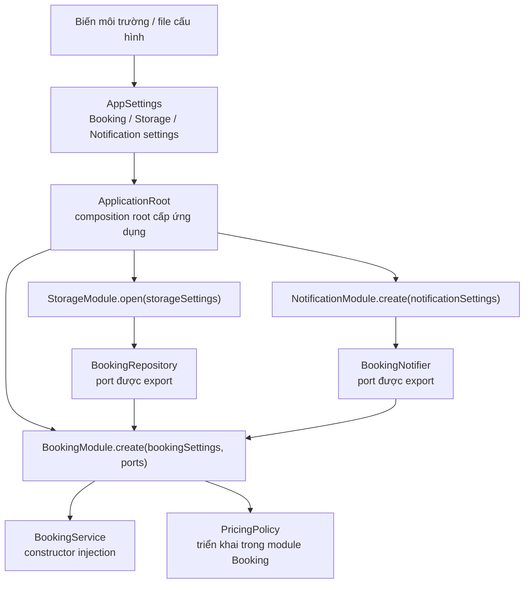

# Phân tách cấu hình theo module mà vẫn có nơi điều phối rõ ràng

Trong chương **Điểm lắp ghép** của module **Dependency Injection**, câu hỏi thường gặp khi ứng dụng phát triển là: *Mỗi module có hàng chục phụ thuộc riêng, liệu có nên đặt tất cả câu lệnh khởi tạo vào một phương thức `main` khổng lồ?* Câu trả lời là **có thể phân tách cách cấu hình và lắp ghép nội bộ theo module, nhưng vẫn phải có một điểm điều phối cấp ứng dụng chịu trách nhiệm chọn và nối các module**.

**Composition root** là vùng khởi động nơi ứng dụng quyết định dùng những implementation nào, tạo các đối tượng cần thiết, nối các phụ thuộc và tổ chức vòng đời của chúng. Composition root có thể gồm nhiều hàm hoặc file hỗ trợ; tính chất "một" ở đây là **một nơi có trách nhiệm điều phối rõ ràng**, không phải một class chứa toàn bộ mọi dòng `new`.

Điều này phù hợp với mục tiêu của **Dependency Injection (DI)** và **Inversion of Control (IoC)**: tách mã **sử dụng** cộng tác viên khỏi mã **tạo và lắp ghép** đối tượng. Bài học dùng **constructor injection**, Java thuần, các đối tượng cấu hình theo module và các hàm lắp ghép nhỏ trước khi mở rộng sang DI container.

Sau bài học, bạn có thể:

- Phân biệt **cấu hình của module**, **lắp ghép nội bộ module** và **điều phối liên module**.
- Thiết kế mỗi module nhận những đầu vào tối thiểu và công bố các port/service cần dùng.
- Đặt việc chọn implementation và nối các module ở composition root cấp ứng dụng.
- Xác thực cấu hình tại khởi động, quản lý scope và đóng tài nguyên theo đúng vòng đời.
- Dùng Java thuần để thử thay adapter, kiểm tra luồng xử lý và phát hiện lỗi lắp ghép.
- Nhận biết các lỗi như service locator ẩn, khởi tạo vòng tròn, đọc biến môi trường rải rác và nhiều composition root cạnh tranh.

## 1. Vấn đề khi ứng dụng có nhiều module

Giả sử ứng dụng thuê xe gồm ba phần:

1. **Booking**: kiểm tra yêu cầu thuê, tính giá và điều phối đặt xe.
2. **Storage**: cung cấp adapter lưu booking, có cấu hình về nơi lưu hoặc tài nguyên lưu trữ.
3. **Notification**: gửi xác nhận, có cấu hình kênh gửi và định dạng thông báo.

Một cách lắp ghép đơn giản lúc đầu:

```java
public static void main(String[] args) {
    // Minh họa ý tưởng; các kiểu được định nghĩa trong ứng dụng.
    BookingRepository repository = new JdbcBookingRepository(/* ... */);
    BookingNotifier notifier = new EmailBookingNotifier(/* ... */);
    PricingPolicy policy = new WeeklyPricing(/* ... */);
    BookingService booking = new BookingService(policy, repository, notifier);
    // Khởi động ứng dụng...
}
```

Khi thêm database pool, API client, retry policy, metrics, cache và hàng chục service, nếu mọi khâu tạo adapter đều nằm trực tiếp trong `main` thì khó đọc, khó thay thế và khó xác định ai chịu trách nhiệm đóng tài nguyên.

Một phản ứng khác cũng có vấn đề là cho từng module **tự tìm mọi thứ nó cần**:

```java
class BookingService {
    // Ví dụ thiết kế nên tránh.
    // private final BookingRepository repository =
    //     GlobalContainer.get(BookingRepository.class);
    // private final BookingNotifier notifier =
    //     NotificationModule.getSingleton();
}
```

Lúc này phụ thuộc thật bị giấu. Module Booking ngầm biết cơ chế tạo Storage/Notification, khó chạy riêng với fake và khó kiểm soát thứ tự khởi động. Giải pháp nằm ở **phân quyền lắp ghép theo cấp**:

| Cấp | Chịu trách nhiệm | Không nên chịu trách nhiệm |
| --- | --- | --- |
| **Lớp nghiệp vụ** | Dùng các hợp đồng qua constructor; thực hiện use case | Đọc `System.getenv`, `new` JDBC/email adapter, truy vấn container |
| **Module assembler / factory** | Tạo và nối những thành phần *nội bộ* module; công bố đầu ra rõ ràng | Tự quyết định toàn bộ cấu hình ứng dụng, tự khởi động các module không thuộc mình |
| **Application composition root** | Chọn cấu hình, nối các module, cấp port liên module, quyết định scope và vòng đời | Chứa thuật toán nghiệp vụ chi tiết hoặc tái triển khai logic của từng module |

Vậy ta vừa tránh "`main` khổng lồ", vừa tránh biến mỗi module thành một "ứng dụng nhỏ" tự động định vị phụ thuộc.

## 2. Một composition root logic, nhiều hàm lắp ghép cục bộ

Ví dụ cách phân quyền:



Ở đây:

- `ApplicationRoot` biết **thứ tự kết nối**: khởi tạo Storage, tạo Notification rồi lắp ghép Booking bằng các port được cấp.
- `StorageModule` biết **cách tạo adapter lưu trữ** từ `StorageSettings`, nhưng không phải biết lớp `BookingService`.
- `NotificationModule` biết **cách tạo notifier** từ `NotificationSettings`, nhưng không tự tạo hoặc truy vấn Storage.
- `BookingModule` biết **cách tạo chính sách giá và service nội bộ** từ `BookingSettings` và các port được đưa vào; nó không tự quyết định dùng JDBC hay email.

**Một module assembler không phải composition root độc lập của toàn ứng dụng.** Nó là phần trợ giúp được composition root chính gọi với đầu vào xác định. Vị trí đặt mã có thể là các package/file khác nhau, nhưng trách nhiệm điều phối liên module vẫn tập trung.

## 3. Phân tách cấu hình: mỗi module nhận giá trị của chính nó

Cấu hình ứng dụng có thể đến từ biến môi trường, file, tham số dòng lệnh hoặc hệ thống quản lý bí mật. Nguồn dữ liệu ở lớp ngoài cùng có thể rất khác nhau, nhưng các module nên nhận **kiểu cấu hình đã được chuyển đổi và xác thực**, thay vì tự đọc nguồn cấu hình.

Ví dụ:

```java
final class BookingSettings {
    final long dailyRate;
    final int maxDays;

    BookingSettings(long dailyRate, int maxDays) {
        if (dailyRate <= 0 || maxDays <= 0) {
            throw new IllegalArgumentException("Invalid booking settings");
        }
        this.dailyRate = dailyRate;
        this.maxDays = maxDays;
    }
}

final class StorageSettings {
    final int maxEntries;

    StorageSettings(int maxEntries) {
        if (maxEntries <= 0) {
            throw new IllegalArgumentException("Invalid storage settings");
        }
        this.maxEntries = maxEntries;
    }
}
```

Trong ví dụ này, `BookingSettings` không chứa thông tin kết nối database, còn `StorageSettings` không chứa giá thuê. Giá trị nhập sai được phát hiện khi khởi động. Tên cấu hình nên phản ánh phạm vi module, chẳng hạn `BOOKING_MAX_DAYS`, `STORAGE_MEMORY_LIMIT` và `NOTICE_PREFIX`.

**Tránh truyền một cấu trúc `GlobalConfig` chứa mọi bí mật và mọi tùy chọn cho tất cả service.** Điều đó tạo phụ thuộc không cần thiết, khiến module phải biết chi tiết của module khác và mở rộng phạm vi tiếp xúc với dữ liệu nhạy cảm. Composition root có thể sở hữu cấu hình tổng để phân phối; từng module chỉ nhận phần của mình.

Nếu một giá trị nghiệp vụ thay đổi theo từng khách hàng hoặc từng lượt thuê, đó có thể là **dữ liệu nghiệp vụ cần truy vấn** chứ không phải cấu hình cố định tại khởi động. Phân loại theo nguồn gốc và vòng đời, không theo việc giá trị có kiểu `String` hay `int`.

## 4. Ví dụ Java 11 thuần: module lắp ghép cục bộ, root điều phối tập trung

Ví dụ dưới đây dùng một file `ModularCompositionRootDemo.java`, tương thích **Java 11 trở lên**. Trong hệ thống thực tế, các kiểu `BookingModule`, `StorageModule` và `NotificationModule` thường nằm ở package riêng; dùng nested class tại đây để bài học tự chứa và dễ chạy.

```bash
javac ModularCompositionRootDemo.java
java ModularCompositionRootDemo
```

```java
import java.util.ArrayList;
import java.util.List;
import java.util.Map;
import java.util.Objects;

public final class ModularCompositionRootDemo {
    // 1. Cấu hình: chia theo module, xác thực ngay lúc tạo.
    static final class BookingSettings {
        final long dailyRate;
        final int maxDays;

        BookingSettings(long dailyRate, int maxDays) {
            if (dailyRate <= 0 || maxDays <= 0) {
                throw new IllegalArgumentException("Invalid booking settings");
            }
            this.dailyRate = dailyRate;
            this.maxDays = maxDays;
        }
    }

    static final class StorageSettings {
        final int maxEntries;

        StorageSettings(int maxEntries) {
            if (maxEntries <= 0) {
                throw new IllegalArgumentException("Invalid storage settings");
            }
            this.maxEntries = maxEntries;
        }
    }

    static final class NotificationSettings {
        final String prefix;

        NotificationSettings(String prefix) {
            if (prefix == null || prefix.isBlank()) {
                throw new IllegalArgumentException("Invalid notification prefix");
            }
            this.prefix = prefix;
        }
    }

    static final class AppSettings {
        final BookingSettings booking;
        final StorageSettings storage;
        final NotificationSettings notification;

        AppSettings(
                BookingSettings booking,
                StorageSettings storage,
                NotificationSettings notification) {
            this.booking = Objects.requireNonNull(booking);
            this.storage = Objects.requireNonNull(storage);
            this.notification = Objects.requireNonNull(notification);
        }

        // Chỉ lớp ngoài cùng chuyển đổi dữ liệu cấu hình thô.
        static AppSettings from(Map<String, String> source) {
            Objects.requireNonNull(source);
            BookingSettings booking = new BookingSettings(
                    Long.parseLong(source.getOrDefault(
                            "BOOKING_DAILY_RATE", "200000")),
                    Integer.parseInt(source.getOrDefault(
                            "BOOKING_MAX_DAYS", "30")));
            StorageSettings storage = new StorageSettings(
                    Integer.parseInt(source.getOrDefault(
                            "STORAGE_MEMORY_LIMIT", "100")));
            NotificationSettings notification = new NotificationSettings(
                    source.getOrDefault("NOTICE_PREFIX", "Xac nhan"));
            return new AppSettings(booking, storage, notification);
        }
    }

    // 2. Mô hình và các hợp đồng mà use case cần.
    static final class Booking {
        final String customerId;
        final int days;
        final long totalPrice;

        Booking(String customerId, int days, long totalPrice) {
            this.customerId = Objects.requireNonNull(customerId);
            this.days = days;
            this.totalPrice = totalPrice;
        }
    }

    interface PricingPolicy {
        long quote(int days);
    }

    interface BookingRepository {
        void save(Booking booking);
    }

    interface BookingNotifier {
        void confirmed(Booking booking);
    }

    // 3. Các thành phần nội bộ, không tự truy vấn cấu hình toàn cục.
    static final class WeeklyPricing implements PricingPolicy {
        private final long dailyRate;

        WeeklyPricing(long dailyRate) {
            if (dailyRate <= 0) {
                throw new IllegalArgumentException("dailyRate must be positive");
            }
            this.dailyRate = dailyRate;
        }

        @Override
        public long quote(int days) {
            if (days < 1) {
                throw new IllegalArgumentException("days must be positive");
            }
            long gross = Math.multiplyExact(dailyRate, days);
            return days >= 7 ? gross - gross / 10 : gross;
        }
    }

    static final class BookingService {
        private final BookingSettings settings;
        private final PricingPolicy pricing;
        private final BookingRepository repository;
        private final BookingNotifier notifier;

        BookingService(
                BookingSettings settings,
                PricingPolicy pricing,
                BookingRepository repository,
                BookingNotifier notifier) {
            this.settings = Objects.requireNonNull(settings);
            this.pricing = Objects.requireNonNull(pricing);
            this.repository = Objects.requireNonNull(repository);
            this.notifier = Objects.requireNonNull(notifier);
        }

        Booking book(String customerId, int days) {
            if (customerId == null || customerId.isBlank()) {
                throw new IllegalArgumentException("Customer ID is required");
            }
            if (days < 1 || days > settings.maxDays) {
                throw new IllegalArgumentException("Days out of range");
            }

            Booking booking = new Booking(customerId, days, pricing.quote(days));
            repository.save(booking);
            notifier.confirmed(booking);
            return booking;
        }
    }

    static final class MemoryBookingRepository
            implements BookingRepository, AutoCloseable {
        private final List<Booking> data = new ArrayList<>();
        private final int maxEntries;
        private boolean closed;

        MemoryBookingRepository(int maxEntries) {
            this.maxEntries = maxEntries;
        }

        @Override
        public void save(Booking booking) {
            if (closed) {
                throw new IllegalStateException("Storage already closed");
            }
            if (data.size() >= maxEntries) {
                throw new IllegalStateException("Storage full");
            }
            data.add(Objects.requireNonNull(booking));
        }

        int savedCount() {
            return data.size();
        }

        @Override
        public void close() {
            // Mô phỏng vòng đời một tài nguyên; không phải database thật.
            closed = true;
        }
    }

    static final class ConsoleBookingNotifier implements BookingNotifier {
        private final String prefix;

        ConsoleBookingNotifier(String prefix) {
            this.prefix = Objects.requireNonNull(prefix);
        }

        @Override
        public void confirmed(Booking booking) {
            System.out.println(prefix + ": " + booking.customerId);
        }
    }

    // 4. Mỗi module chỉ lắp ghép phần do mình sở hữu.
    static final class StorageHandle implements AutoCloseable {
        private final MemoryBookingRepository repository;

        StorageHandle(StorageSettings settings) {
            this.repository = new MemoryBookingRepository(settings.maxEntries);
        }

        BookingRepository bookings() {
            return repository;
        }

        int savedCount() {
            return repository.savedCount();
        }

        @Override
        public void close() {
            repository.close();
        }
    }

    static final class StorageModule {
        static StorageHandle open(StorageSettings settings) {
            return new StorageHandle(Objects.requireNonNull(settings));
        }
    }

    static final class NotificationModule {
        static BookingNotifier create(NotificationSettings settings) {
            Objects.requireNonNull(settings);
            return new ConsoleBookingNotifier(settings.prefix);
        }
    }

    static final class BookingModule {
        static BookingService create(
                BookingSettings settings,
                BookingRepository repository,
                BookingNotifier notifier) {
            Objects.requireNonNull(settings);
            PricingPolicy pricing = new WeeklyPricing(settings.dailyRate);
            return new BookingService(settings, pricing, repository, notifier);
        }
    }

    // 5. Runtime cấp ứng dụng sở hữu tài nguyên cần đóng.
    static final class AppRuntime implements AutoCloseable {
        private final BookingService booking;
        private final StorageHandle storage;

        AppRuntime(BookingService booking, StorageHandle storage) {
            this.booking = Objects.requireNonNull(booking);
            this.storage = Objects.requireNonNull(storage);
        }

        Booking book(String customerId, int days) {
            return booking.book(customerId, days);
        }

        int savedCount() {
            return storage.savedCount();
        }

        @Override
        public void close() {
            storage.close();
        }
    }

    // 6. Composition root chính: nối module, chọn scope và quản lý lỗi.
    static final class ApplicationRoot {
        static AppRuntime start(AppSettings settings) {
            Objects.requireNonNull(settings);
            StorageHandle storage = StorageModule.open(settings.storage);
            try {
                BookingNotifier notifier =
                        NotificationModule.create(settings.notification);
                BookingService booking = BookingModule.create(
                        settings.booking, storage.bookings(), notifier);
                return new AppRuntime(booking, storage);
            } catch (RuntimeException | Error failure) {
                storage.close(); // Dọn tài nguyên nếu startup thất bại.
                throw failure;
            }
        }
    }

    public static void main(String[] args) {
        // Khi triển khai thực tế: AppSettings.from(System.getenv()).
        // Ví dụ dùng Map cố định để kết quả chạy có thể lặp lại.
        AppSettings settings = AppSettings.from(Map.of(
                "BOOKING_DAILY_RATE", "200000",
                "BOOKING_MAX_DAYS", "30",
                "STORAGE_MEMORY_LIMIT", "100",
                "NOTICE_PREFIX", "Xac nhan"));

        try (AppRuntime app = ApplicationRoot.start(settings)) {
            Booking booking = app.book("KH-001", 7);
            if (booking.totalPrice != 1_260_000L || app.savedCount() != 1) {
                throw new AssertionError("Incorrect booking result");
            }
            System.out.println("Tong tien: " + booking.totalPrice + " VND");
        }

        checkWithoutContainer();
    }

    static void checkWithoutContainer() {
        List<Booking> stored = new ArrayList<>();
        List<Booking> notified = new ArrayList<>();

        // Lắp BookingModule độc lập bằng fake ở ranh giới module.
        BookingRepository fakeRepository = stored::add;
        BookingNotifier fakeNotifier = notified::add;
        BookingService service = BookingModule.create(
                new BookingSettings(100_000L, 10),
                fakeRepository,
                fakeNotifier);

        Booking result = service.book("TEST-01", 2);
        if (result.totalPrice != 200_000L
                || stored.size() != 1 || notified.size() != 1
                || stored.get(0) != result || notified.get(0) != result) {
            throw new AssertionError("Incorrect module wiring");
        }
        try {
            service.book("INVALID", 11);
            throw new AssertionError("Expected invalid-day exception");
        } catch (IllegalArgumentException expected) {
            // Yêu cầu sai không được lưu và không được thông báo.
        }
        if (stored.size() != 1 || notified.size() != 1) {
            throw new AssertionError("Invalid request caused side effect");
        }
        System.out.println("Kiem thu Java thuan: PASS");
    }
}
```

Kết quả mong đợi:

```text
Xac nhan: KH-001
Tong tien: 1260000 VND
Kiem thu Java thuan: PASS
```

Với 7 ngày, giá `200_000` VND/ngày và mức giảm 10%, tổng tiền là `1_400_000 − 140_000 = 1_260_000` VND. Trong kiểm tra, giá `100_000` VND/ngày cho 2 ngày là `200_000` VND. Ví dụ dùng bộ nhớ và console để dễ thấy nguyên tắc lắp ghép; nó **không mô phỏng tính bền vững của database, transaction hay gửi thông báo đáng tin cậy**.

### Tại sao ví dụ vẫn có một nơi điều phối rõ ràng?

Hãy nhìn điểm vào của ứng dụng: chỉ có `ApplicationRoot.start(settings)` quyết định **thứ tự mở module** và **đầu ra module nào được đưa vào module nào**. Các hàm `StorageModule.open`, `NotificationModule.create` và `BookingModule.create` sở hữu việc tạo các class nội bộ. Chúng được gọi từ root với những tham số hiện ra rõ trong chữ ký.

`BookingModule.create(...)` không có câu lệnh `new MemoryBookingRepository(...)`, không đọc `System.getenv` và không gọi một `GlobalRegistry.get(...)`. Do đó ta có thể kiểm tra riêng Booking bằng fake mà **không khởi động Storage hay Notification**. Đây là dấu hiệu ranh giới module đã được đặt có ích.

## 5. Thiết kế API lắp ghép module

Hàm lắp ghép module nên thể hiện **đầu vào** và **đầu ra** cụ thể. Một số lựa chọn:

| Hình thức | Phù hợp khi | Điểm cần chú ý |
| --- | --- | --- |
| `BookingModule.create(config, repository, notifier)` | Module tạo một service chính, các port đầu vào ít và rõ | Đừng âm thầm truy vấn service locator |
| `NotificationModule.create(config)` | Module có một adapter đơn giản, không cần tài nguyên riêng | Nếu có tài nguyên mở lâu dài, cần khai báo cách đóng |
| `StorageModule.open(config)` trả về `StorageHandle` | Module khởi tạo tài nguyên dài hạn, cung cấp port và cần đóng | Handle nên che class hạ tầng và có quyền sở hữu lifecycle rõ |
| `ModuleExports` chứa một số port được module công bố | Module có nhiều service dùng chung | Chỉ công bố những thành phần module khác thật sự cần |
| `RequestFactory.create(context)` | Đối tượng có scope theo request hoặc transaction | Không tạo request state thành singleton dùng chung |

Đừng trả một `Map<Class<?>, Object>` vô kiểu cho mọi module rồi để consumer tự tìm service. Cách đó có xu hướng biến composition root thành **service locator** ẩn và khiến hợp đồng phụ thuộc khó đọc. Với nhiều đầu vào, có thể định nghĩa một kiểu `BookingDependencies` có tên rõ ràng, nhưng chỉ làm khi nó tăng khả năng hiểu cấu trúc, không dùng để che một lớp đang ôm quá nhiều trách nhiệm.

## 6. Hướng phụ thuộc và nguy cơ vòng lặp giữa module

Khi Booking cần Notification và Storage, nghĩa là **Booking phụ thuộc vào các port mô tả những hành vi đó**. Điều này không đồng nghĩa Booking phải import class triển khai database hay email.

```text
                   ApplicationRoot
                  /       |        \
          StorageModule   |   NotificationModule
             |            |         |
       BookingRepository  |   BookingNotifier
                \         |        /
                  BookingModule
                       |
                 BookingService
```

Trong Java thuần, có thể đặt các port trong package ứng dụng hoặc một module hợp đồng phù hợp. Module hạ tầng triển khai port; application root nhìn thấy cả hai phía để nối chúng. Tránh chu trình kiểu `BookingModule.create(...)` tự gọi `PaymentModule.create(...)`, trong khi `PaymentModule.create(...)` lại tạo `BookingModule`. Chu trình này khiến thứ tự khởi tạo không rõ, dễ tạo đối tượng chưa sẵn sàng hoặc khuyến khích singleton toàn cục.

Nếu hai module thật sự cần giao tiếp hai chiều, hãy xem lại trách nhiệm, tách phần điều phối thành use case cấp cao hơn hoặc dùng một port/event thích hợp với hợp đồng và vòng đời rõ ràng. Không dùng callback hoặc khởi tạo lười (*lazy init*) để chỉ che một vòng phụ thuộc chưa được hiểu.

**Lưu ý phạm vi:** "module" trong bài có thể là package, phân hệ nghiệp vụ hoặc module của một ứng dụng lớn; không mặc định là `module-info.java` của Java Platform Module System (JPMS). Nếu dự án sử dụng JPMS, vẫn cần cấu hình `exports` và `requires` phù hợp với hướng phụ thuộc; các nguyên tắc composition root không thay đổi.

## 7. Ai đọc cấu hình và khi nào cần làm mới?

Mô hình dễ kiểm soát là:

1. **Đọc dữ liệu thô tại boundary khởi động** (ví dụ `System.getenv()`).
2. **Chuyển kiểu và xác thực** thành `BookingSettings`, `StorageSettings`, `NotificationSettings`.
3. **Composition root chọn implementation**, lấy các port và xây dựng application runtime.
4. **Module và service chỉ nhận giá trị/hợp đồng chúng cần**; không đọc lại biến môi trường trong mỗi request.

Ưu điểm của mô hình này là lỗi cấu hình (`BOOKING_DAILY_RATE` không phải số, `BOOKING_MAX_DAYS <= 0`, prefix rỗng...) được phát hiện gần lúc khởi động. Những giá trị nhạy cảm như token hoặc thông tin truy cập database nên được chuyển đến đúng adapter có trách nhiệm sử dụng, không phân phối cho mọi module.

Với **cấu hình động** (ví dụ bật chương trình giảm giá mới trong thời gian chạy), có thể dùng provider hoặc nguồn snapshot:

```java
interface PricingSettingsProvider {
    // Cung cấp một snapshot giá trị nhất quán cho lần xử lý.
    PricingSettings current();
}

// PricingSettings là một kiểu bất biến phù hợp với ứng dụng thực tế.
```

Đây là ví dụ giao diện mở rộng, không thuộc file Java tự chạy ở phần 4. Khi dùng provider, cần nói rõ cách cache, thời điểm làm mới, tính nhất quán giữa các bước của một giao dịch và hành vi khi nguồn cấu hình không sẵn sàng. **Không nên tự động biến mọi cấu hình cố định thành provider** vì điều đó tăng độ phức tạp và ẩn trạng thái biến đổi.

## 8. Scope và vòng đời vẫn do nơi điều phối quyết định

Tách assembler theo module không có nghĩa mỗi module tự chọn singleton tùy ý. Root cần biết những tài nguyên nào tồn tại lâu và ai có quyền đóng chúng.

| Thành phần | Vòng đời gợi ý | Trách nhiệm quản lý |
| --- | --- | --- |
| `BookingSettings` và các settings bất biến | Một snapshot lúc khởi động, dùng chung nếu không thay đổi | Lớp đọc cấu hình và application root |
| `WeeklyPricing` không có trạng thái theo request | Có thể tái sử dụng | `BookingModule` tạo; root quyết định vòng đời module/service |
| `BookingService` không giữ dữ liệu khách trong field | Có thể tái sử dụng nếu phụ thuộc đều an toàn | Application runtime |
| Connection pool / HTTP client | Sống theo runtime ứng dụng, đóng khi shutdown | Module tạo và xuất handle; root gọi close |
| Transaction / request context | Theo một request hoặc transaction | Factory/scoped manager; giải phóng khi thao tác kết thúc |
| `Booking` của từng yêu cầu | Tạo riêng cho mỗi lần gọi `book` | Use case tạo dữ liệu, không dùng chung mutable state |

Trong mã ví dụ, `StorageHandle` cho phép root sở hữu một tài nguyên đóng được; `AppRuntime implements AutoCloseable` bảo đảm có đường đóng tập trung qua `try-with-resources`. `MemoryBookingRepository.close()` chỉ **mô phỏng lifecycle** của một tài nguyên dài hạn. Hệ thống thực tế có thể có connection pool, message producer, file descriptor hoặc executor cần đóng theo thứ tự ngược lúc tạo và xử lý lỗi shutdown cẩn thận.

Một trường `private final BookingRepository repository` trong service **không bảo đảm adapter thread-safe**. `ArrayList` của ví dụ chỉ phù hợp cho tình huống học/kiểm tra đơn luồng. Nếu service dùng chung giữa nhiều thread, phải kiểm tra trạng thái chia sẻ của adapter và lựa chọn scope, đồng bộ hoặc cấu trúc dữ liệu phù hợp.

### Khởi động lỗi giữa chừng và thu hồi tài nguyên

Giả sử Storage khởi động thành công nhưng Notification không tạo được. Nếu không có nơi điều phối, tài nguyên Storage dễ bị bỏ quên. Trong `ApplicationRoot.start`, nhánh `catch` đóng `storage` trước khi báo lại lỗi. Với nhiều tài nguyên, root nên đóng theo thứ tự ngược lại với thứ tự mở và không để lỗi đóng tài nguyên che lỗi khởi động gốc (ví dụ ghi nhận bằng `addSuppressed`).

Khi root đã trả `AppRuntime`, **quyền đóng** chuyển vào runtime đó. Consumer không tự đóng repository vì có thể còn request khác sử dụng. Với DI container, có thể khai báo hook quản lý lifecycle tương đương, nhưng trách nhiệm lựa chọn scope và ownership vẫn thuộc thiết kế hệ thống.

## 9. Kiểm thử từng module và kiểm thử quá trình lắp ghép

Phân tách lắp ghép theo module còn giúp phân chia các lớp kiểm thử:

| Phạm vi | Khởi tạo những gì? | Điều cần kiểm tra |
| --- | --- | --- |
| **Logic nội bộ Booking** | `BookingModule.create` với fake repository và notifier | Kiểm tra giá, điều kiện ngày thuê, số lần lưu/thông báo, lỗi |
| **Storage adapter** | `StorageModule.open` với settings kiểm thử | Adapter lưu đúng, xử lý giới hạn, từ chối thao tác khi đã đóng |
| **Notification adapter** | `NotificationModule.create` | Thông báo đúng thông tin, lỗi và timeout nếu có tích hợp ngoài |
| **Application wiring** | `ApplicationRoot.start` với cấu hình kiểm soát được | Các port nối đúng, thiếu cấu hình bị từ chối, tài nguyên được đóng |
| **Integration test** | Adapter thật + hệ thống liên quan | Kết nối, transaction, retry, shutdown, khả năng hoạt động khi có lỗi I/O |

Kiểm tra `checkWithoutContainer` trong ví dụ **không cần chạy StorageModule hay NotificationModule**. Điều này chứng minh BookingModule nhận dependency từ ngoài và có thể hoạt động với fake được cấp qua constructor.

Đối với root, có thể thêm kiểm tra khởi động bằng cấu hình độc lập; kiểm thử hiệu ứng thực tế quan trọng hơn việc mock từng lệnh `new`. Nếu hệ thống sử dụng một DI container về sau, hãy dành thêm integration test cho cấu hình container và các scope, bởi container vẫn có thể cấu hình sai dù từng service kiểm thử đúng.

## 10. Khi nào cần cấu hình module nhiều hơn một class?

Không nhất thiết mọi module đều cần file `*Module` riêng. Nếu module chỉ gồm một class thuần với một constructor, composition root có thể gọi trực tiếp `new`. Hàm lắp ghép riêng bắt đầu có ích khi module có:

- **Nhiều đối tượng nội bộ** phải được tạo theo thứ tự hoặc có cấu hình riêng.
- **Nhiều lựa chọn adapter/chiến lược** nhưng chỉ muốn công bố một số port ổn định.
- **Tài nguyên dài hạn** cần khởi động và thu hồi có kiểm soát.
- **Ranh giới sở hữu rõ ràng**: team/module khác không nên cần biết cấu trúc nội bộ.

Một module assembler tốt không phải "mini-container" đa năng. Nó nên là một hàm hoặc đối tượng có chữ ký rõ, dễ dùng trong Java thuần, với đầu vào/đầu ra được kiểm tra và không chứa phép tra cứu dependency toàn cục. Khi thêm DI container như Spring/CDI, có thể chuyển các hàm này thành module configuration/provider tương ứng mà vẫn giữ nguyên các port và hướng phụ thuộc.

## 11. Những lỗi thường gặp và cách sửa

| Lỗi thiết kế | Vì sao có vấn đề | Cách cải thiện |
| --- | --- | --- |
| Mọi adapter và policy đều tạo trong một `main` dài hàng trăm dòng | Khó đọc, khó quản lý tài nguyên và kiểm tra từng khu vực | Đưa lắp ghép nội bộ vào module assembler, để root điều phối |
| Mỗi module tự gọi `System.getenv` hoặc đọc file riêng rải rác | Cấu hình khó xác thực nhất quán, lỗi xuất hiện muộn | Đọc ở boundary, chuyển thành settings có kiểu và phân phối theo module |
| `BookingModule` tự `new JdbcRepository`, `new EmailClient` | Module nghiệp vụ bị trói vào hạ tầng | Nhận `BookingRepository` và `BookingNotifier` như port đầu vào |
| Nhiều "root" tự tạo toàn bộ đồ thị ở các module | Không rõ quyền sở hữu và có thể tạo nhiều singleton không mong muốn | Một root cấp ứng dụng quyết định đồ thị cuối cùng |
| Truyền toàn bộ `GlobalConfig` vào mọi service | Phụ thuộc thừa và lộ cấu hình không cần thiết | Config theo module hoặc theo trách nhiệm |
| Đưa `Container.get(...)` vào logic nghiệp vụ | Phụ thuộc bị giấu, test phải dựng container | Constructor injection và assembler hiện rõ dependency |
| Sử dụng `static` singleton để chia sẻ kết nối | Khó kiểm soát môi trường, tài nguyên và test độc lập | Root sở hữu instance và đóng theo lifecycle |
| Bắt lỗi lắp ghép rồi trả về object thiếu dependency | Lỗi chạy muộn, tạo trạng thái không hợp lệ | Fail fast khi startup, thu hồi tài nguyên đã mở |
| Cho rằng module assembler tạo instance là đủ an toàn khi dùng nhiều thread | Thiếu kiểm tra trạng thái và scope | Thiết kế scope, transaction và thread-safety riêng |

## 12. Bài tập tự đánh giá

**Tình huống 1 — Phân tách cấu hình.** `BookingService` đang nhận `GlobalSettings` có cả `dbPassword`, `smtpToken`, `dailyRate` và `maxDays`. Dịch vụ chỉ dùng hai giá trị cuối. Hãy cải thiện.

*Gợi ý:* Tạo `BookingSettings` chứa `dailyRate` và `maxDays`; root đọc cấu hình tổng, tạo settings con và truyền qua constructor. Thông tin kết nối lưu trữ, thông báo chỉ đến đúng module hạ tầng có nhiệm vụ sử dụng.

**Tình huống 2 — Root hay module?** Ai nên quyết định rằng môi trường test dùng `InMemoryBookingRepository`, còn production dùng `JdbcBookingRepository`?

*Gợi ý:* Composition root hoặc cơ chế cấu hình cấp ứng dụng quyết định lựa chọn implementation. StorageModule có thể chứa factory tạo adapter được chọn, nhưng module Booking chỉ biết `BookingRepository`.

**Tình huống 3 — Nhiều helper nhưng một root.** Một ứng dụng có `StorageModule.open`, `NotificationModule.create`, `BookingModule.create`. Điều này có vi phạm nguyên tắc "một composition root" không?

*Gợi ý:* Không, nếu các helper chỉ lắp ghép cục bộ theo đầu vào công khai và một application root duy nhất điều phối thứ tự, port liên module và vòng đời toàn hệ thống.

**Tình huống 4 — Scope của connection.** Một repository giữ một JDBC `Connection` trong trường `final` của service singleton và chia sẻ cho nhiều request. Điều gì cần xem xét?

*Gợi ý:* `final` chỉ ổn định tham chiếu, không đảm bảo connection thread-safe. Cần phân định pool, transaction, scope request và quyền đóng connection; có thể tiêm `DataSource` hoặc repository quản lý tài nguyên phù hợp.

**Tình huống 5 — Startup thất bại.** Storage đã mở pool nhưng khi tạo Notification thì thiếu token. Ai chịu trách nhiệm đóng pool và báo lỗi?

*Gợi ý:* Application root vì nó điều phối startup và sở hữu tài nguyên đã mở; nên fail fast và thu hồi theo thứ tự ngược, giữ nguyên lỗi gốc.

**Tình huống 6 — Kiểm thử độc lập.** Làm sao kiểm thử `BookingModule` nếu database và dịch vụ gửi email chưa sẵn sàng?

*Gợi ý:* Tạo `BookingModule.create(settings, fakeRepository, fakeNotifier)` trong Java thuần; kiểm tra kết quả, tương tác và trường hợp lỗi. Sau đó kiểm thử riêng adapter thật ở tầng tích hợp.

## 13. Checklist khi tổ chức composition root theo module

- Có **một thành phần điều phối cấp ứng dụng** quyết định các kết nối giữa module và thứ tự khởi động chưa?
- Từng module có hàm lắp ghép với **đầu vào/đầu ra rõ ràng** thay vì lookup toàn cục chưa?
- Cấu hình thô được đọc, chuyển kiểu và xác thực ở boundary chưa?
- Mỗi module chỉ nhận giá trị cấu hình và port nó thực sự cần chưa?
- Các service nghiệp vụ chỉ nhận phụ thuộc qua constructor, không tự tạo adapter hạ tầng chưa?
- Có chu trình phụ thuộc nào giữa các module hoặc chu trình khởi tạo cần giải quyết không?
- Root đã xác định scope, quyền sở hữu tài nguyên và đường shutdown, kể cả khi startup lỗi chưa?
- Có thể kiểm thử module quan trọng bằng Java thuần với fake/in-memory adapter mà không cần DI container chưa?

**Phân tách cấu hình theo module** là phân chia **trách nhiệm tạo các thành phần nội bộ** và **phạm vi giá trị cấu hình**, trong khi **composition root cấp ứng dụng** vẫn nắm quyền lựa chọn implementation, nối port liên module và quản lý vòng đời. Cách tổ chức này giữ nguyên lợi ích của constructor injection và IoC, giúp kiểm thử Java thuần dễ dàng, đồng thời tạo nền tảng rõ ràng khi chuyển sang DI container ở giai đoạn sau.
