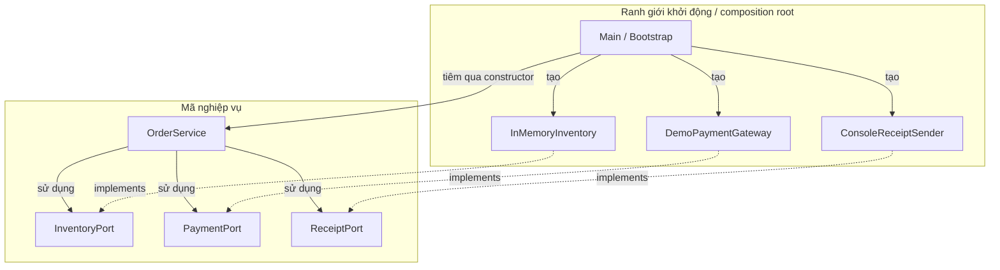
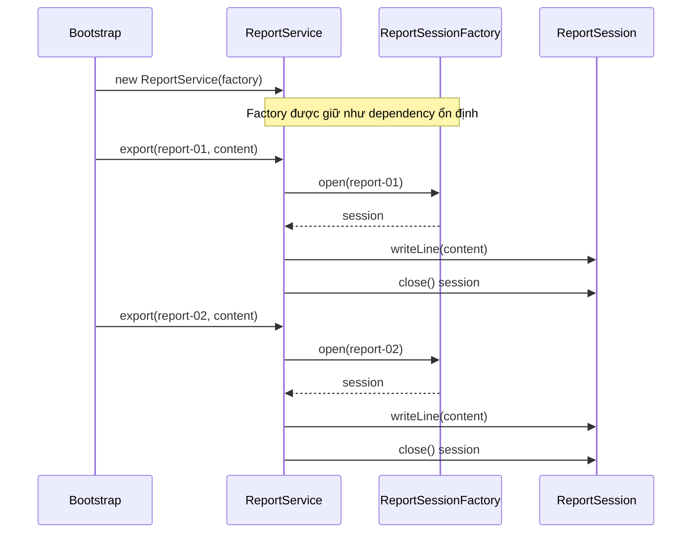

# Không truyền container hoặc nơi lắp ghép xuống lớp nghiệp vụ

## Mục tiêu học tập

Sau bài này, bạn có thể:

- Giải thích vì sao **composition root** là nơi chọn, tạo và lắp ghép dependency, còn lớp nghiệp vụ tập trung **sử dụng** các dependency đã được cung cấp.
- Nhận diện việc truyền `Container`, `ServiceProvider`, `ApplicationContext`, `DependencyRegistry` hoặc một đối tượng `Bootstrap` đa năng vào service như dấu hiệu của **Service Locator** và phụ thuộc bị che giấu.
- Viết lại một service từ kiểu tự tra cứu dependency sang **constructor injection** qua các interface hẹp bằng Java thuần.
- Phân biệt một **factory có mục đích rõ ràng** với một container tổng quát; biết khi nào cần factory để tạo dependency theo từng thao tác.
- Xác định ranh giới quản lý **scope và vòng đời**, và kiểm thử service bằng đối tượng giả trước khi mở rộng sang DI container.

Đây là nội dung của chương **Điểm lắp ghép** trong mô-đun **Dependency Injection (DI)** và **Inversion of Control (IoC)**. Ta tập trung vào một quy tắc kiến trúc có thể áp dụng ngay cả khi chương trình chỉ dùng `new` trong Java thuần: **nơi lắp ghép biết cách tạo đối tượng; lớp nghiệp vụ chỉ biết hợp đồng của những đối tượng mà nó sử dụng**.

## 1. Composition root có trách nhiệm gì?

**Composition root** là vị trí ở gần điểm khởi động của một ứng dụng hoặc một luồng thực thi, nơi mã quyết định implementation nào được dùng, tạo các instance và kết nối chúng thành **đồ thị đối tượng** hoàn chỉnh. Trong một ứng dụng dòng lệnh nhỏ, nơi này thường là `main`. Trong web app, worker hoặc chương trình chạy theo lịch, mã lắp ghép có thể nằm trong cấu hình khởi động và các adapter ở ranh giới hệ thống.

Composition root thường làm các việc sau:

1. Đọc cấu hình cần thiết để chọn implementation cho môi trường chạy.
2. Tạo các dependency ở tầng thấp: client, repository, gateway, logger, factory.
3. Truyền chúng vào consumer qua constructor hoặc cách injection phù hợp.
4. Khởi động điểm vào của ứng dụng, đồng thời quy định bên nào có trách nhiệm đóng tài nguyên do nó sở hữu.

Ví dụ, khi xử lý đơn hàng, `OrderService` cần một cổng kiểm tra kho, một cổng thanh toán và một cổng gửi xác nhận. Nó không cần biết cổng thanh toán được tạo bằng cấu hình sandbox hay production, hoặc kho lưu trong bộ nhớ hay cơ sở dữ liệu.



Trong hình, mũi tên **sử dụng** đi từ consumer đến hợp đồng phụ thuộc. Mũi tên **tạo** chỉ xuất phát từ `Main`, và mũi tên nét đứt biểu diễn việc một implementation thực thi interface. `OrderService` **không giữ** một tham chiếu đến `Main`.

**IoC** xuất hiện ở đây vì `OrderService` không còn tự quyết định cách tạo và lựa chọn collaborator. **DI** là cách truyền các collaborator đã tạo vào service. Hai khái niệm liên quan nhưng không đồng nghĩa; việc dùng DI không bắt buộc phải có framework.

## 2. Sai lầm thường gặp: truyền cả container xuống consumer

Giả sử chương trình có một đối tượng tổng quát cho phép tìm bất cứ dịch vụ nào:

```java
interface Container {
    <T> T resolve(Class<T> type);
}
```

Thiết kế đáng nghi là cho chính `OrderService` nhận container rồi tự tra cứu thứ mình cần:

```java
// Anti-pattern: ví dụ rút gọn, dùng các kiểu OrderRequest và
// InventoryPort, PaymentPort, ReceiptPort được định nghĩa ở phần sau.
final class LocatorOrderService {
    private final Container container;

    LocatorOrderService(Container container) {
        this.container = container;
    }

    String place(OrderRequest order) {
        InventoryPort inventory = container.resolve(InventoryPort.class);
        PaymentPort payment = container.resolve(PaymentPort.class);
        ReceiptPort receipt = container.resolve(ReceiptPort.class);

        if (!inventory.reserve(order.sku, order.quantity)) {
            throw new IllegalStateException("Không đủ tồn kho");
        }
        String transactionId = payment.charge(order.orderId, order.totalVnd);
        receipt.send(order.recipient, order.orderId, transactionId);
        return transactionId;
    }
}
```

Đoạn mã có vẻ vẫn dùng constructor injection vì `Container` được truyền vào constructor. Nhưng **đó chỉ là tiêm một service locator**: các dependency nghiệp vụ thật (`InventoryPort`, `PaymentPort`, `ReceiptPort`) vẫn bị tra cứu từ bên trong consumer.

### Vì sao thiết kế này gây khó khăn?

| Vấn đề | Điều xảy ra với `LocatorOrderService` |
| --- | --- |
| **Phụ thuộc bị ẩn** | Constructor chỉ liệt kê `Container`; người đọc phải mở thân phương thức mới biết service cần ba cổng nghiệp vụ. |
| **Lỗi muộn** | Thiếu đăng ký `PaymentPort` có thể chỉ bộc lộ khi `place(...)` chạy, thay vì khi tạo service. |
| **Khó kiểm thử cô lập** | Muốn kiểm thử `place`, phải dựng một container giả hoặc đăng ký kiểu vào registry, dù bài kiểm tra chỉ cần ba đối tượng giả. |
| **Coupling với hạ tầng lắp ghép** | Service biết API `resolve`, scope và cách tra cứu của container; khó sử dụng lại ngoài môi trường đó. |
| **Quyết định scope thiếu minh bạch** | Mỗi lần `resolve(...)` có thể trả instance mới hoặc cũ theo cấu hình ẩn; consumer dễ giữ nhầm đối tượng có vòng đời ngắn. |
| **Hợp đồng khó kiểm tra** | Chữ ký constructor không nói đủ các collaborator bắt buộc và không buộc caller cung cấp chúng. |

Việc đổi tên `Container` thành `AppContext`, `ServiceProvider`, `Application`, `Bootstrap` hoặc `Dependencies` **không giải quyết vấn đề** nếu API của nó vẫn cho consumer tùy ý tìm mọi dịch vụ. Singleton tĩnh như `GlobalServices.get(PaymentPort.class)` cũng có cùng hiện tượng phụ thuộc bị ẩn, dù không có tham số constructor.

**Điều cần tránh là đặt hành vi tra cứu tổng quát trong mã nghiệp vụ.** Một container được sử dụng *bên trong composition root* để tạo và nối đối tượng là phù hợp; vấn đề phát sinh khi chính consumer phải biết và thao tác với nó.

## 3. Thiết kế lại: constructor ghi rõ tất cả phụ thuộc bắt buộc

Thay vì `OrderService(Container container)`, hãy để constructor khai báo các **khả năng nghiệp vụ** cần dùng:

```java
OrderService(InventoryPort inventory, PaymentPort payment, ReceiptPort receipt)
```

Nhờ đó, người tạo service có thể thấy ngay cần cung cấp những gì, còn implementation cụ thể được lựa chọn tại composition root.

### Ví dụ Java thuần hoàn chỉnh

Lưu toàn bộ đoạn sau vào **`Main.java`** (JDK 8 trở lên):

```java
import java.util.HashMap;
import java.util.Map;
import java.util.Objects;

// Ba hợp đồng mà nghiệp vụ cần; không chứa API của container.
interface InventoryPort {
    boolean reserve(String sku, int quantity);
}

interface PaymentPort {
    String charge(String orderId, long totalVnd);
}

interface ReceiptPort {
    void send(String recipient, String orderId, String transactionId);
}

// Dữ liệu cho đúng một thao tác đặt hàng.
final class OrderRequest {
    final String orderId;
    final String sku;
    final int quantity;
    final long totalVnd;
    final String recipient;

    OrderRequest(String orderId, String sku, int quantity,
                 long totalVnd, String recipient) {
        this.orderId = Objects.requireNonNull(orderId, "orderId");
        this.sku = Objects.requireNonNull(sku, "sku");
        this.recipient = Objects.requireNonNull(recipient, "recipient");
        if (quantity <= 0 || totalVnd <= 0) {
            throw new IllegalArgumentException("Số lượng và tổng tiền phải dương");
        }
        this.quantity = quantity;
        this.totalVnd = totalVnd;
    }
}

// Consumer: chỉ biết cách sử dụng ba cổng được tiêm vào.
final class OrderService {
    private final InventoryPort inventory;
    private final PaymentPort payment;
    private final ReceiptPort receipt;

    OrderService(InventoryPort inventory, PaymentPort payment,
                 ReceiptPort receipt) {
        this.inventory = Objects.requireNonNull(inventory, "inventory");
        this.payment = Objects.requireNonNull(payment, "payment");
        this.receipt = Objects.requireNonNull(receipt, "receipt");
    }

    String place(OrderRequest order) {
        Objects.requireNonNull(order, "order");
        if (!inventory.reserve(order.sku, order.quantity)) {
            throw new IllegalStateException("Không đủ tồn kho");
        }

        String transactionId = payment.charge(order.orderId, order.totalVnd);
        receipt.send(order.recipient, order.orderId, transactionId);
        return transactionId;
    }
}

// Implementation mô phỏng kho, không sử dụng database.
final class InMemoryInventory implements InventoryPort {
    private final Map<String, Integer> remaining;

    InMemoryInventory(Map<String, Integer> initialStock) {
        this.remaining = new HashMap<>(
                Objects.requireNonNull(initialStock, "initialStock"));
    }

    @Override
    public synchronized boolean reserve(String sku, int quantity) {
        if (quantity <= 0) {
            throw new IllegalArgumentException("quantity must be positive");
        }
        int available = remaining.getOrDefault(sku, 0);
        if (available < quantity) {
            return false;
        }
        remaining.put(sku, available - quantity);
        return true;
    }
}

// Implementation giả lập, không thanh toán tiền thật.
final class DemoPaymentGateway implements PaymentPort {
    @Override
    public String charge(String orderId, long totalVnd) {
        System.out.println("[DEMO] Thanh toán " + totalVnd + " VND");
        return "TX-" + orderId;
    }
}

// Implementation giả lập, chỉ in thông báo ra console.
final class ConsoleReceiptSender implements ReceiptPort {
    @Override
    public void send(String recipient, String orderId, String transactionId) {
        System.out.println("[DEMO] Xác nhận " + orderId
                + " cho " + recipient + " với mã " + transactionId);
    }
}

// Composition root: tạo implementation, lắp ghép, rồi gọi nghiệp vụ.
public class Main {
    public static void main(String[] args) {
        Map<String, Integer> initialStock = new HashMap<>();
        initialStock.put("BOOK-1", 5);

        InventoryPort inventory = new InMemoryInventory(initialStock);
        PaymentPort payment = new DemoPaymentGateway();
        ReceiptPort receipt = new ConsoleReceiptSender();

        OrderService service = new OrderService(inventory, payment, receipt);
        OrderRequest order = new OrderRequest(
                "DH-01", "BOOK-1", 2, 150_000L, "khach@example.com");

        String transactionId = service.place(order);
        System.out.println("Đặt hàng thành công: " + transactionId);
    }
}
```

Chạy:

```bash
javac -encoding UTF-8 Main.java
java Main
```

Kết quả dự kiến:

```text
[DEMO] Thanh toán 150000 VND
[DEMO] Xác nhận DH-01 cho khach@example.com với mã TX-DH-01
Đặt hàng thành công: TX-DH-01
```

Ví dụ cố tình không xử lý bù trừ khi thanh toán hoặc gửi xác nhận thất bại; chương trình chỉ nhằm minh họa **ranh giới phụ thuộc và nơi tạo đối tượng**. Trong nghiệp vụ thật, cần thiết kế giao dịch, idempotency và cách khôi phục riêng, thay vì mặc định ba thao tác sẽ hoàn thành cùng nhau.

### Ai tạo, ai sử dụng?

| Đối tượng | Nơi tạo trong ví dụ | Nơi sử dụng qua hợp đồng |
| --- | --- | --- |
| `InMemoryInventory` | `Main` | `OrderService` gọi `InventoryPort.reserve(...)` |
| `DemoPaymentGateway` | `Main` | `OrderService` gọi `PaymentPort.charge(...)` |
| `ConsoleReceiptSender` | `Main` | `OrderService` gọi `ReceiptPort.send(...)` |
| `OrderService` | `Main` | `Main` gọi `service.place(...)` |
| `OrderRequest` | `Main` cho lần đặt hàng này | `OrderService` nhận dữ liệu khi gọi `place(...)` |

`OrderService` chỉ nhận **ba phụ thuộc bắt buộc** trong constructor. `OrderRequest` là **dữ liệu theo lần gọi**, không phải đối tượng service được lắp ghép và dùng chung. Constructor có `Objects.requireNonNull(...)` giúp phát hiện việc thiếu tham chiếu ngay lúc tạo service; tính đúng đắn của implementation vẫn cần kiểm thử riêng.

## 4. Thử thay implementation mà không dùng container

Điểm mạnh của cấu trúc trên là có thể kiểm thử `OrderService` bằng ba đối tượng giả đơn giản. Không phải khởi động framework hoặc dựng registry cho các lớp không liên quan.

Tạo **`OrderServiceCheck.java`** cạnh `Main.java`:

```java
public class OrderServiceCheck {
    static final class FakeInventory implements InventoryPort {
        boolean available = true;
        int calls;

        @Override
        public boolean reserve(String sku, int quantity) {
            calls++;
            return available;
        }
    }

    static final class FakePayment implements PaymentPort {
        int calls;
        long lastAmount;

        @Override
        public String charge(String orderId, long totalVnd) {
            calls++;
            lastAmount = totalVnd;
            return "TEST-TX";
        }
    }

    static final class FakeReceipt implements ReceiptPort {
        int calls;
        String lastTransactionId;

        @Override
        public void send(String recipient, String orderId, String transactionId) {
            calls++;
            lastTransactionId = transactionId;
        }
    }

    public static void main(String[] args) {
        FakeInventory inventory = new FakeInventory();
        FakePayment payment = new FakePayment();
        FakeReceipt receipt = new FakeReceipt();
        OrderService service = new OrderService(inventory, payment, receipt);

        OrderRequest order = new OrderRequest(
                "DH-TEST", "BOOK-1", 1, 99_000L, "test@example.com");
        String tx = service.place(order);

        if (!"TEST-TX".equals(tx) || inventory.calls != 1
                || payment.calls != 1 || payment.lastAmount != 99_000L
                || receipt.calls != 1
                || !"TEST-TX".equals(receipt.lastTransactionId)) {
            throw new AssertionError("Service sử dụng dependency chưa đúng");
        }

        // Khi tồn kho từ chối, không được gọi thanh toán hay gửi xác nhận.
        inventory.available = false;
        try {
            service.place(order);
            throw new AssertionError("Phải từ chối khi hết tồn kho");
        } catch (IllegalStateException expected) {
            // Đúng nhánh kiểm thử.
        }

        if (inventory.calls != 2 || payment.calls != 1 || receipt.calls != 1) {
            throw new AssertionError("Đã gọi dependency sau khi hết tồn kho");
        }
        System.out.println("PASS: OrderService dùng đúng hợp đồng đã tiêm");
    }
}
```

Chạy:

```bash
javac -encoding UTF-8 Main.java OrderServiceCheck.java
java OrderServiceCheck
```

Những phép kiểm tra này chỉ thay **implementation ở nơi tạo**, giữ nguyên mã `OrderService`. Đây là ví dụ cụ thể của DI: consumer không chịu trách nhiệm tự giải quyết cấu hình và khởi tạo dependency.

## 5. Khi nào cần tạo dependency mới trong lúc nghiệp vụ chạy?

Một lý do thường được đưa ra để truyền container xuống service là: “Tôi phải `resolve()` một đối tượng mới cho mỗi lần xử lý; constructor injection không làm được.” Thực ra cần phân biệt **một dependency ổn định để tạo tài nguyên** với **tài nguyên ngắn hạn được tạo theo thao tác**.

Chẳng hạn, mỗi lần xuất báo cáo cần một phiên ghi tệp, sau khi xuất phải đóng. Có thể định nghĩa một **factory hẹp**:

```java
interface ReportSession extends AutoCloseable {
    void writeLine(String line);

    @Override
    void close();
}

interface ReportSessionFactory {
    ReportSession open(String reportId);
}

final class ReportService {
    private final ReportSessionFactory factory;

    ReportService(ReportSessionFactory factory) {
        this.factory = java.util.Objects.requireNonNull(factory, "factory");
    }

    void export(String reportId, String content) {
        try (ReportSession session = factory.open(reportId)) {
            session.writeLine(content);
        }
    }
}
```

Ở đây, `ReportService` không hỏi container “cho tôi một đối tượng bất kỳ có kiểu X”. Nó được tiêm **một khả năng có nghĩa trong nghiệp vụ**: `ReportSessionFactory.open(reportId)`. Factory có thể chọn cách mở tài nguyên khác nhau, nhưng hợp đồng vẫn nói rõ **trả về cái gì**, **dùng trong phạm vi nào** và **ai phải đóng**.

### Factory hẹp khác Service Locator ra sao?

| Factory có mục đích | Locator hoặc container tổng quát |
| --- | --- |
| `ReportSession open(String reportId)` | `<T> T resolve(Class<T> type)` |
| Trả về một loại tài nguyên/hành vi được mô tả cụ thể | Có thể lấy bất kỳ service nào trong ứng dụng |
| Constructor của consumer khai báo rõ `ReportSessionFactory` | Constructor chỉ bộc lộ `Container` dù consumer còn cần nhiều service |
| Có hợp đồng cụ thể cho việc `open`, `close`, lỗi và vòng đời | Cơ chế khởi tạo/scope thường phụ thuộc vào registry được cấu hình bên ngoài |
| Có thể fake bằng một implementation nhỏ trong kiểm thử | Thường phải mô phỏng một phần hệ thống đăng ký/phân giải dịch vụ |

**Không phải cứ có chữ `Factory` là tốt.** Nếu tạo `UniversalFactory.create(Class<T> type)` để tất cả service tự truy cập mọi dependency, ta chỉ đổi tên service locator. Factory phù hợp nên có một mục đích rõ, kiểu trả về rõ và hợp đồng vòng đời rõ.

Khi container xuất hiện ở một dự án lớn, một **adapter hạ tầng** có thể dùng container hoặc cơ chế scope ở bên trong để hiện thực `ReportSessionFactory`. Phụ thuộc đó được giữ **phía sau interface hẹp** và không rò vào mã nghiệp vụ. Adapter cần được kiểm tra riêng để chắc rằng nó tạo đúng scope và đóng đúng tài nguyên.

## 6. Scope và vòng đời: ranh giới này bảo vệ điều gì?

Trong ví dụ đặt hàng, `OrderService` có thể dùng lại qua nhiều lượt đặt hàng nếu các implementation được tiêm cho phép. Tuy vậy, **constructor injection không tự tạo singleton**: nếu `Main` gọi `new OrderService(...)` hai lần, đó là hai instance. Nếu truyền chung một `InventoryPort`, hai service giữ tham chiếu tới cùng instance inventory.

Với container, các phạm vi thường gặp gồm singleton, scoped/request và transient/prototype, nhưng tên gọi hoặc quy tắc cụ thể thay đổi theo framework. Quy tắc thiết kế cần giữ là:

- **Phụ thuộc dùng chung, sống lâu:** thường được tạo tại vùng khởi động hoặc scope tương ứng; phải xem xét trạng thái mutable và thread safety.
- **Dữ liệu của một request:** thường truyền qua tham số method hoặc tạo DTO riêng; không nhét `currentUser`, `requestId` vào field của service dùng chung.
- **Đối tượng ngắn hạn có tài nguyên:** cần một cơ chế tạo theo thao tác và một hợp đồng sở hữu/đóng rõ ràng.
- **Consumer sống lâu hơn dependency:** không nên giữ tham chiếu tới đối tượng đã hết scope; cân nhắc factory hoặc thay đổi ranh giới vòng đời.

Sơ đồ thời gian cho trường hợp dùng factory:



Sơ đồ mô tả **một factory ổn định** và **hai phiên ngắn hạn**. Việc factory thực sự trả instance khác nhau phải là một phần hợp đồng; không thể suy từ tên `open` hoặc việc dùng interface.

Nếu composition root tạo một `ExecutorService`, database pool hoặc client dùng chung, nơi đó cũng cần quy định ai đóng chúng khi ứng dụng dừng. Consumer **không được tự đóng tài nguyên dùng chung chỉ vì nó đang giữ tham chiếu**; quyền sở hữu phải được nói rõ. Ngược lại, khi factory trả một session mà consumer được giao sở hữu như trong ví dụ, `try-with-resources` là cách diễn đạt thời điểm đóng đơn giản.

## 7. Composition root có thể dùng container không?

**Có.** Quy tắc của bài không cấm DI container; nó chỉ giới hạn nơi tầng nghiệp vụ nhìn thấy container. Hai kiểu lắp ghép bên dưới có cùng mục tiêu:

```java
// Java thuần: Main trực tiếp new rồi nối các dependency.
OrderService service = new OrderService(inventory, payment, receipt);
```

```java
// Pseudocode tại bootstrap khi dùng DI container sau này:
// container.register(InventoryPort.class, ...);
// container.register(PaymentPort.class, ...);
// container.register(ReceiptPort.class, ...);
// OrderService service = container.resolve(OrderService.class);
// service.place(order);
```

Khối thứ hai là **pseudocode**, vì mỗi DI container có API đăng ký và tạo đối tượng khác nhau. Điểm không thay đổi là **constructor của `OrderService` vẫn nhận ba cổng nghiệp vụ**. Lúc sử dụng container, việc `resolve(OrderService.class)` nằm tại **ranh giới khởi động**, không nằm trong `OrderService.place(...)`.

Trong ứng dụng nhiều entry point, có thể có cấu hình khởi động cho web request, background job, CLI và kiểm thử; không nhất thiết chỉ có đúng một file `Main.java` cho mọi trường hợp. Mỗi điểm lắp ghép chịu trách nhiệm xây dựng đồ thị phù hợp với luồng đó. Controller, listener, scheduled job và các adapter ở biên có thể nhận dependency do framework tạo, sau đó gọi **service được tiêm sẵn**. Phần xử lý quy tắc nghiệp vụ vẫn không cần biết container.

### Có ngoại lệ nào hợp lý?

Đôi khi hạ tầng phải dùng container để mở **scope mới** cho request hoặc job, hoặc một adapter framework cần tra cứu dịch vụ để điều phối. Đó là công việc ở **tầng hạ tầng/biên tích hợp**, không phải lý do để cho `OrderService` cầm một `ServiceProvider` và gọi `resolve(...)` theo nhánh nghiệp vụ. Nếu nghiệp vụ thực sự cần chọn một công cụ vào thời điểm chạy, hãy xem xét interface chiến lược, factory hẹp hoặc ánh xạ implementation trong một adapter chuyên trách.

Ngược lại, không cần tạo interface cho **mọi** class chỉ để tránh `new`: một entity hoặc value object đơn giản được tạo trong phương thức nghiệp vụ không phải vấn đề giống như việc tự khởi tạo repository, payment client hoặc transaction/session manager. Ranh giới cần quản lý là **collaborator cung cấp hành vi và tài nguyên có vòng đời đáng kể**.

## 8. Quy trình sửa một lớp đang phụ thuộc container

Giả sử gặp constructor `CheckoutService(Container container)`. Có thể cải tiến theo các bước sau:

1. **Tìm mọi lời gọi tra cứu:** liệt kê `container.resolve(...)`, `serviceProvider.getService(...)`, static registry và các phương thức tương đương trong lớp.
2. **Xác định nhu cầu thật:** với mỗi kết quả tra cứu, ghi rõ hành vi nào được dùng (`reserve`, `charge`, `send`...), có bắt buộc không, và scope mong muốn là gì.
3. **Đưa dependency ổn định vào constructor:** khai báo các interface hẹp và giữ bằng `private final` khi thích hợp; fail fast nếu thiếu phụ thuộc bắt buộc.
4. **Giải quyết dependency ngắn hạn:** nếu mỗi lần chạy cần đối tượng mới, tiêm một factory có API cụ thể; làm rõ contract `open/close` và trách nhiệm vòng đời.
5. **Dời việc chọn implementation:** chuyển các lệnh tạo và nối sang composition root hoặc adapter hạ tầng. Xóa logic tra cứu và field container khỏi lớp nghiệp vụ.
6. **Kiểm thử bằng Java thuần:** tạo service trực tiếp từ fake, xác nhận đường thành công, đường lỗi và rằng không có tác động ngoài ý muốn.
7. **Xem lại scope:** kiểm tra object nào được dùng chung, trường hợp phụ thuộc ngắn hạn bị giữ trong service sống lâu, và quyền đóng resource.

### Dấu hiệu nên dừng lại và xem xét thiết kế

| Dấu hiệu | Câu hỏi cần đặt |
| --- | --- |
| Constructor chỉ có `ApplicationContext context` | Những dependency nghiệp vụ thực sự nào đang bị giấu? |
| Phương thức nghiệp vụ gọi `resolve(...)` nhiều lần | Vì sao các collaborator không được đưa vào từ bên ngoài? |
| Service tự mở một scope của container mỗi khi xử lý | Có thể dùng factory hoặc adapter ở biên để quản lý scope không? |
| Phải khởi động cả container chỉ để kiểm thử một `if` | Có thể tạo consumer bằng fake trực tiếp qua constructor không? |
| Một class cần quá nhiều tham số constructor | Có đang gánh quá nhiều trách nhiệm? Tránh gói chúng vào container hoặc một `Dependencies` vô hạn chỉ để che số lượng. |
| Một dependency sống theo request bị giữ trong singleton | Scope có đang bị kéo dài sai, làm lẫn dữ liệu hoặc dùng đối tượng đã hết hạn không? |

## 9. Bài tập tự kiểm tra

Cho lớp sau:

```java
class ShippingService {
    private final Container container;

    ShippingService(Container container) {
        this.container = container;
    }

    void ship(String orderId) {
        LabelPrinter printer = container.resolve(LabelPrinter.class);
        TrackingGateway tracking = container.resolve(TrackingGateway.class);
        printer.print(orderId);
        tracking.register(orderId);
    }
}
```

Giả sử `LabelPrinter` và `TrackingGateway` là hai interface đã có. Hãy trả lời:

1. Hai dependency nghiệp vụ thật là gì? Vì sao `Container` không phải là một mô tả đủ tốt của hợp đồng `ShippingService`?
2. Nếu hai implementation ổn định trong suốt đời service, constructor mới nên có dạng nào?
3. Nếu `LabelPrinter` phải mở một phiên kết nối riêng cho mỗi lần in, còn `TrackingGateway` có thể chia sẻ, nên thay thiết kế như thế nào?
4. Muốn kiểm thử nhánh `ship(...)` không gọi thiết bị in thật, cần khởi động container không?

**Gợi ý đáp án:**

1. Hai collaborator là `LabelPrinter` và `TrackingGateway`. `Container` chỉ phơi bày cơ chế tìm đối tượng, không diễn đạt rõ hai năng lực mà service cần.
2. Có thể dùng `ShippingService(LabelPrinter printer, TrackingGateway tracking)` và tạo chúng ở composition root.
3. Có thể tiêm một `LabelPrintSessionFactory` để lấy session dùng và đóng trong từng lần gọi, trong khi `TrackingGateway` được tiêm trực tiếp. Hợp đồng factory phải nói rõ ai đóng session; không đưa container trở lại service.
4. Không. Chỉ cần fake các interface cần dùng, tạo `ShippingService` trực tiếp rồi kiểm tra số lần gọi và dữ liệu nhận được.

## 10. Ghi nhớ khi chuyển sang DI container

Một DI container giúp tự động **đăng ký, tạo, lắp ghép và quản lý scope** của các đối tượng. Nhưng container không thay thế trách nhiệm thiết kế của lập trình viên: consumer vẫn cần khai báo phụ thuộc rõ ràng, các hợp đồng phải đủ hẹp, và việc dùng chung hay đóng tài nguyên phải có quy tắc nhất quán.

Khi nhìn vào bất kỳ lớp nghiệp vụ nào, hãy tự hỏi: **"Có thể tạo lớp này trong một bài kiểm thử chỉ bằng cách truyền các fake có ý nghĩa nghiệp vụ, mà không cần biết ứng dụng được khởi động bằng framework nào không?"** Nếu có, ranh giới giữa **nơi tạo và lắp ghép** với **nơi sử dụng** nhiều khả năng đã được giữ đúng. Đó là nền tảng để áp dụng DI và IoC bền vững khi hệ thống mở rộng.
