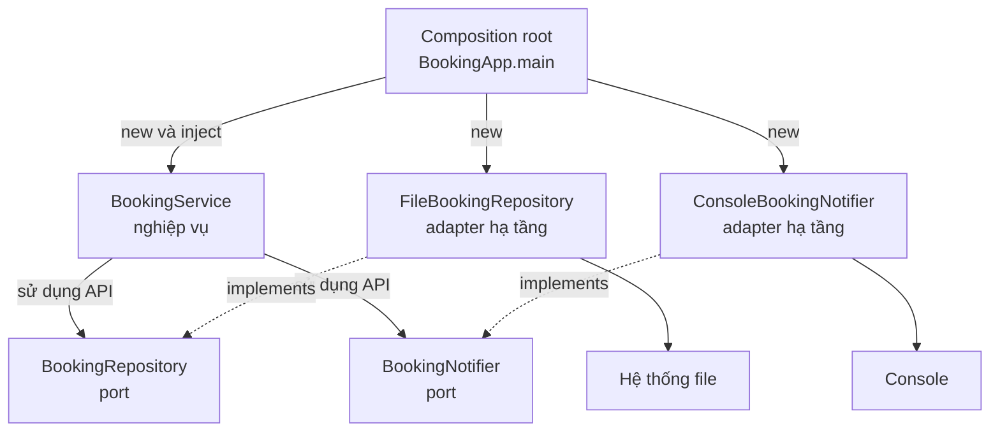
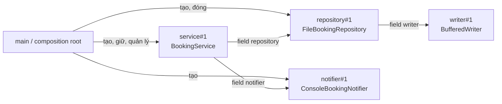

# Đưa adapter hạ tầng vào các cổng giao tiếp của nghiệp vụ

Một ứng dụng có thể lưu dữ liệu bằng file hôm nay, chuyển sang cơ sở dữ liệu ngày mai, hoặc gọi một API bên ngoài khi triển khai ở môi trường khác. Nếu lớp nghiệp vụ tự tạo `FileWriter`, `DataSource` hay HTTP client, mỗi thay đổi hạ tầng sẽ kéo theo thay đổi trong lớp nghiệp vụ.

Trong **Dependency Injection (DI)**, ta định nghĩa **cổng giao tiếp (port)** theo nhu cầu của nghiệp vụ, viết **adapter hạ tầng** để thực hiện cổng đó, rồi **lắp ghép** đối tượng tại một điểm khởi tạo tập trung gọi là **composition root**. Cách tổ chức này thể hiện **Inversion of Control (IoC)**: nghiệp vụ quyết định cần khả năng gì, còn bên ngoài quyết định cung cấp khả năng ấy bằng đối tượng cụ thể nào.

Bài học thuộc chương **Điểm lắp ghép** của module **DEPENDENCY_INJECTION**. Ta sẽ thực hành bằng Java thuần, dùng constructor injection, xác định quyền sở hữu và vòng đời dependency, kiểm thử với fake trước khi cân nhắc dùng DI container.

## 1. Port, adapter và composition root làm những việc gì?

Giả sử ứng dụng đặt lịch có tác vụ **tạo đặt chỗ và gửi thông báo**. Nghiệp vụ chỉ cần hai năng lực:

- Lưu một đặt chỗ đã được tạo.
- Gửi thông báo khi đặt chỗ được tạo thành công ở lớp lưu trữ.

Nghiệp vụ không cần biết dữ liệu được lưu vào file, database hay dịch vụ đám mây. Cũng không cần biết thông báo đi qua console, email hay message queue.

| Thành phần | Trách nhiệm | Ví dụ |
| --- | --- | --- |
| **Port** | Mô tả thao tác và hợp đồng mà nghiệp vụ cần | `BookingRepository.save(...)`, `BookingNotifier.bookingCreated(...)` |
| **Lớp nghiệp vụ** | Điều phối quy tắc và gọi các port | `BookingService.create(...)` |
| **Adapter hạ tầng** | Thực hiện port bằng công nghệ cụ thể | `FileBookingRepository`, `ConsoleBookingNotifier` |
| **Composition root** | Chọn adapter, tạo instance, truyền vào service và sắp xếp vòng đời | `BookingApp.main(...)` |

Sơ đồ phụ thuộc giữa các **kiểu trong mã nguồn**:



**Hướng phụ thuộc quan trọng:** mã của `BookingService` biết các port, nhưng **không import hay gọi constructor của adapter**. Mã adapter có thể biết kiểu port để triển khai nó. Composition root được phép biết cả service và adapter vì nhiệm vụ của nó chính là nối những thành phần này.

Không có mâu thuẫn giữa hai điều:

- **Ở mức kiểu:** `BookingService` phụ thuộc vào interface `BookingRepository`.
- **Ở lúc chạy:** một đối tượng `BookingService` giữ tham chiếu đến một instance `FileBookingRepository` đã được tạo ở bên ngoài.

Port không tự tạo adapter. Việc adapter viết `implements BookingRepository` cũng không tự làm dependency được inject. Phải có mã hoặc container thực hiện **lắp ghép thực tế**.

## 2. Bắt đầu từ cổng do nghiệp vụ cần

Một lỗi thiết kế thường gặp là tạo interface chỉ bằng cách sao chép API kỹ thuật của thư viện đang dùng:

```java
// Không lý tưởng cho một port của nghiệp vụ:
interface BookingRepository {
    java.sql.ResultSet executeQuery(String sql)
            throws java.sql.SQLException;
}
```

Interface này vẫn buộc service hiểu JDBC và SQL. Dù lớp nghiệp vụ không tự `new` database client, nó vẫn bị gắn với hạ tầng qua **kiểu dữ liệu và lỗi**.

Thiết kế port theo cách nghiệp vụ nói về công việc:

```java
interface BookingRepository {
    void save(Booking booking);
}

interface BookingNotifier {
    void bookingCreated(Booking booking);
}
```

Hai hợp đồng trên tách những quyết định:

- `save(Booking)` mô tả việc **lưu** đặt chỗ; không hứa rằng dữ liệu nằm ở file, trong RAM hay database.
- `bookingCreated(Booking)` mô tả việc **gửi thông báo**; không nhắc đến SMTP hay HTTP client.
- Kiểu `Booking` thuộc mô hình ứng dụng, không phải `ResultSet` hoặc DTO của nhà cung cấp ngoài.
- Hợp đồng cần giải thích khi nào `save` báo lỗi, khi nào `bookingCreated` có thể thất bại, và tính chất của tác dụng phụ.

Trong ứng dụng lớn, port thường được định nghĩa ở module/lớp gần **consumer** hoặc tầng nghiệp vụ cần nó, để hạ tầng phụ thuộc ngược vào abstraction. Không nhất thiết tất cả port phải đặt trong một package tên `port`; điều cốt lõi là **quyền sở hữu hợp đồng và hướng phụ thuộc**.

## 3. Ví dụ Java thuần hoàn chỉnh: lưu file và gửi thông báo

Để dễ sao chép và chạy, ví dụ đặt các lớp làm kiểu lồng nhau trong một file. Khi xây dựng dự án thực, nên tách service, port, adapter và composition root thành các package/module theo trách nhiệm.

Tạo file `BookingApp.java`:

```java
import java.io.BufferedWriter;
import java.io.IOException;
import java.io.UncheckedIOException;
import java.nio.charset.StandardCharsets;
import java.nio.file.Files;
import java.nio.file.Path;
import java.nio.file.StandardOpenOption;
import java.util.Objects;

public class BookingApp {

    // Dữ liệu nghiệp vụ, độc lập với cơ chế lưu trữ.
    static final class Booking {
        private final String id;
        private final String email;

        Booking(String id, String email) {
            this.id = Objects.requireNonNull(id, "id");
            this.email = Objects.requireNonNull(email, "email");
        }

        String getId() {
            return id;
        }

        String getEmail() {
            return email;
        }
    }

    // Các port mà nghiệp vụ cần.
    interface BookingRepository {
        void save(Booking booking);
    }

    interface BookingNotifier {
        void bookingCreated(Booking booking);
    }

    // Loại lỗi ổn định ở ranh giới lưu trữ.
    static final class BookingStorageException extends RuntimeException {
        BookingStorageException(String message, Throwable cause) {
            super(message, cause);
        }
    }

    // Lớp nghiệp vụ: không biết File, Path, JDBC hoặc console.
    static final class BookingService {
        private final BookingRepository repository;
        private final BookingNotifier notifier;

        BookingService(BookingRepository repository, BookingNotifier notifier) {
            this.repository =
                    Objects.requireNonNull(repository, "repository");
            this.notifier = Objects.requireNonNull(notifier, "notifier");
        }

        Booking create(String id, String email) {
            // Ràng buộc đơn giản để định dạng lưu demo theo tab an toàn.
            if (invalid(id) || invalid(email)) {
                throw new IllegalArgumentException(
                        "id and email must be nonblank without tabs/newlines");
            }

            Booking booking = new Booking(id, email);
            repository.save(booking);
            notifier.bookingCreated(booking);
            return booking;
        }

        private static boolean invalid(String value) {
            return value == null || value.isBlank()
                    || value.indexOf('\t') >= 0
                    || value.indexOf('\r') >= 0
                    || value.indexOf('\n') >= 0;
        }
    }

    // Adapter hạ tầng 1: lưu file UTF-8, mỗi dòng gồm ID + TAB + email.
    static final class FileBookingRepository
            implements BookingRepository, AutoCloseable {

        private final BufferedWriter writer;

        FileBookingRepository(Path file) throws IOException {
            writer = Files.newBufferedWriter(
                    file,
                    StandardCharsets.UTF_8,
                    StandardOpenOption.CREATE,
                    StandardOpenOption.APPEND
            );
        }

        @Override
        public void save(Booking booking) {
            try {
                writer.write(booking.getId());
                writer.write('\t');
                writer.write(booking.getEmail());
                writer.newLine();
                writer.flush();
            } catch (IOException cause) {
                throw new BookingStorageException(
                        "Could not save booking", cause);
            }
        }

        @Override
        public void close() throws IOException {
            writer.close();
        }
    }

    // Adapter hạ tầng 2: in thông báo vào console.
    static final class ConsoleBookingNotifier implements BookingNotifier {
        @Override
        public void bookingCreated(Booking booking) {
            System.out.println(
                    "Thong bao dat cho: " + booking.getId()
                            + " -> " + booking.getEmail());
        }
    }

    public static void main(String[] args) throws IOException {
        // COMPOSITION ROOT: chọn các adapter và quản lý vòng đời.
        Path storage = Path.of("bookings.tsv");

        try (FileBookingRepository repository =
                new FileBookingRepository(storage)) {
            BookingNotifier notifier = new ConsoleBookingNotifier();

            // Constructor injection: service chỉ nhận các port.
            BookingService service = new BookingService(repository, notifier);

            service.create("B-001", "reader@example.test");
        } // Repository được đóng sau khi service đã dùng xong.
    }
}
```

Chạy với **JDK 11 trở lên**:

```bash
javac BookingApp.java
java BookingApp
```

Console hiển thị:

```text
Thong bao dat cho: B-001 -> reader@example.test
```

File `bookings.tsv` được tạo trong thư mục chạy (nếu chưa có) và nhận một dòng dạng:

```text
B-001	reader@example.test
```

Chạy nhiều lần sẽ thêm dòng vì adapter mở file với `CREATE` và `APPEND`. Đây là ví dụ học cách lắp ghép, **chưa phải kho lưu trữ production**: chưa có kiểm tra ID trùng, cơ chế transaction, chống ghi đồng thời, phục hồi sau ghi dở hoặc hệ thống gửi thông báo đáng tin cậy.

### 3.1. Vai trò của từng đoạn mã

**`BookingRepository` và `BookingNotifier` là các port.** Chúng thể hiện hai khả năng mà nghiệp vụ cần. Không có import `java.nio.file` hoặc phụ thuộc vào thư viện gửi email trong các port.

**`BookingService` là consumer.** Hai dependency được khai báo trong constructor; service không có câu lệnh `new FileBookingRepository(...)` hay gọi `BookingRegistry.getInstance()`. Vì vậy, có thể thay adapter mà không sửa phương thức `create`.

**`FileBookingRepository` là adapter.** Nó biến lời gọi `save(Booking)` của port thành ghi file qua `BufferedWriter`. Nếu gặp `IOException`, adapter chuyển thành `BookingStorageException` và giữ nguyên `cause`. Logic sử dụng không cần biết lỗi API file.

**`ConsoleBookingNotifier` là adapter khác.** Cùng port `BookingNotifier` có thể được triển khai bằng email, HTTP hoặc message queue trong ứng dụng thật.

**`BookingApp.main` là composition root.** Nó chọn `FileBookingRepository` và `ConsoleBookingNotifier`, tạo một instance mỗi adapter, truyền qua constructor và quản lý thời điểm đóng file.

### 3.2. Đồ thị các đối tượng lúc chạy

Sau bước lắp ghép, các tham chiếu quan trọng là:



`BookingService` giữ tham chiếu đến một **đối tượng cụ thể** nhưng vẫn được biên dịch theo **kiểu interface**. `FileBookingRepository` sở hữu writer và cung cấp thao tác `close()` để root đóng đúng lúc. Service chỉ thấy `BookingRepository.save`, không có trách nhiệm tự đóng repository.

## 4. “Đưa adapter vào port” nghĩa là wiring tại composition root

Trọng tâm của DI nằm ở đoạn mã sau:

```java
FileBookingRepository repository = new FileBookingRepository(storage);
BookingNotifier notifier = new ConsoleBookingNotifier();
BookingService service = new BookingService(repository, notifier);
```

- Dòng đầu **tạo implementation hạ tầng cụ thể**.
- Dòng tiếp theo tạo adapter thông báo.
- Dòng cuối **truyền các đối tượng cụ thể vào tham số kiểu port** của constructor.

Không có thao tác đăng ký “ma thuật” trong interface. Java cho phép dùng `FileBookingRepository` tại tham số kiểu `BookingRepository` vì adapter **implements** port. Tuy nhiên, **không có instance nào được tự động khởi tạo chỉ nhờ `implements`**.

Trong một hệ thống có nhiều lớp, composition root sẽ nối một **đồ thị đối tượng**. Ví dụ:

```java
// Minh họa khi ứng dụng phát triển thêm tầng điều phối.
BookingRepository repository = createRepository(config);
BookingNotifier notifier = createNotifier(config);

BookingService service = new BookingService(repository, notifier);
BookingController controller = new BookingController(service);
ApplicationServer server = new ApplicationServer(controller);
```

*Đây là sơ đồ bằng mã, không thuộc file `BookingApp.java` chạy ở trên; `config` và các lớp controller/server là những thành phần minh họa.*

Composition root thường đặt gần **entry point** của ứng dụng: `main`, bootstrap của web server, điểm khởi tạo CLI hoặc nơi bắt đầu một request/scope. Trong một ứng dụng lớn có thể có root chính và các ranh giới tạo đối tượng con. Điều nên giữ là **quyết định chọn implementation được tập trung có chủ đích**, thay vì rải khắp các lớp nghiệp vụ.

### Tránh tạo adapter trong lớp nghiệp vụ

Đoạn sau gắn implementation hạ tầng vào mã nghiệp vụ:

```java
final class TightlyCoupledBookingService {
    void create(/* ... */) throws java.io.IOException {
        // Service tự quyết định công nghệ và thời điểm mở tài nguyên:
        var repository = new FileBookingRepository(
                java.nio.file.Path.of("bookings.tsv"));
        // ...
    }
}
```

Ở đây, service phải biết tên lớp hạ tầng, vị trí file và cách tạo tài nguyên. Nó cũng phải xử lý việc đóng tài nguyên đúng lúc, hoặc dễ gây rò rỉ nếu quên `close()`. Thay repository thành JDBC hoặc fake sẽ cần can thiệp vào chính service. Đoạn minh họa trên cũng cố ý **chưa hoàn chỉnh** phần đóng; nó cho thấy vấn đề trách nhiệm khi tự tạo resource trong consumer.

Cách sửa là để service **nhận interface** và composition root **cấp implementation** như ví dụ đầy đủ ở mục 3.

## 5. Tổ chức package/module để thực thi hướng phụ thuộc

Trong file học tập, mọi lớp được đặt chung để biên dịch đơn giản. Dự án thực nên biểu diễn ranh giới ngay trong cấu trúc mã. Một cách tổ chức có thể là:

```text
src/main/java/com/example/booking/
├── app/
│   ├── Booking.java
│   ├── BookingService.java
│   └── port/
│       ├── BookingRepository.java
│       └── BookingNotifier.java
├── infrastructure/
│   ├── file/FileBookingRepository.java
│   └── notification/ConsoleBookingNotifier.java
└── bootstrap/
    └── Main.java
```

Quy tắc phụ thuộc mong muốn:

- `app.BookingService` dùng `app.port.BookingRepository` và `app.port.BookingNotifier`.
- Adapter trong `infrastructure` import các port và kiểu nghiệp vụ cần thiết để triển khai chúng.
- `bootstrap.Main` biết cả service lẫn adapter để khởi tạo.
- Package `app` không import từ `infrastructure`.

Không bắt buộc tạo module Java riêng cho từng package. Nhưng khi dự án lớn, tách module build và quy tắc dependency có thể ngăn việc import ngược một cách hiệu quả hơn so với chỉ ghi quy ước trong tài liệu.

**Hướng phụ thuộc trong mã nguồn** khác với **hướng gọi khi chạy**. Khi chạy, `BookingService` gọi phương thức trên instance `FileBookingRepository`; điều này không làm mã `BookingService` cần import tên lớp cụ thể.

## 6. Đổi adapter chỉ bằng cách đổi lắp ghép

Giả sử muốn lưu đặt chỗ trong bộ nhớ khi chạy thử, ta có thể cung cấp một adapter khác:

```java
// Ví dụ thêm vào bên trong BookingApp cho mục đích học tập.
static final class InMemoryBookingRepository implements BookingRepository {
    private final java.util.List<Booking> saved =
            new java.util.ArrayList<>();

    @Override
    public void save(Booking booking) {
        saved.add(booking);
    }

    java.util.List<Booking> snapshot() {
        return java.util.List.copyOf(saved);
    }
}
```

Composition root chuyển sang:

```java
BookingRepository repository = new InMemoryBookingRepository();
BookingNotifier notifier = new ConsoleBookingNotifier();
BookingService service = new BookingService(repository, notifier);

service.create("B-002", "reader@example.test");
```

**Mã `BookingService` không đổi.** Adapter mới đáp ứng `BookingRepository` nên có thể đứng vào vị trí mà constructor yêu cầu. Đây là lợi ích của thiết kế **port do consumer xác định, adapter đáp ứng hợp đồng, composition root chọn instance**.

Điều này không có nghĩa các adapter có thể tùy ý hành xử khác nhau. Nếu port hứa rằng `save` thất bại thì phải báo lỗi thay vì âm thầm bỏ dữ liệu, mọi adapter phải tuân thủ. Nếu adapter bộ nhớ bỏ qua quy tắc phát hiện trùng ID trong khi database cưỡng chế, những test chỉ dùng fake có thể tạo cảm giác an toàn sai. Cần có kiểm thử hợp đồng hoặc integration test để xác minh adapter thật.

### Chọn implementation dựa trên cấu hình

Khi có nhiều adapter, có thể tạo một phương thức ở vùng bootstrap:

```java
// Mã minh họa tại bootstrap, không thuộc ví dụ chạy ở mục 3.
BookingRepository createRepository(AppConfig config) {
    if (config.isLocalDemo()) {
        return new InMemoryBookingRepository();
    }
    return new JdbcBookingRepository(config.dataSource());
}
```

Hai lớp `AppConfig` và `JdbcBookingRepository` là ví dụ về hướng mở rộng, chưa được định nghĩa trong file chạy độc lập. Cần đảm bảo nguồn cấu hình được kiểm tra sớm; nếu cấu hình sai, ứng dụng nên thất bại rõ ràng ở **giai đoạn khởi động** thay vì đợi đến lúc xử lý một yêu cầu.

Nếu implementation cần tài nguyên có thể đóng, kiểu trả về `BookingRepository` **không tự biểu diễn ownership**. Root phải lưu riêng handle/đối tượng quản lý vòng đời, hoặc thiết kế một cấu trúc bootstrap giữ cả service lẫn resource để đóng sau. Không nên ép mọi port nghiệp vụ kế thừa `AutoCloseable` chỉ vì một adapter cụ thể có tài nguyên.

## 7. Kiểm thử service với fake qua cùng các port

Không cần mở file hay gửi thông báo thật để kiểm tra thứ tự xử lý của `BookingService`. Ta cung cấp fake triển khai các port qua constructor.

Tạo file `BookingAppTest.java` trong cùng thư mục với `BookingApp.java`:

```java
import java.util.ArrayList;
import java.util.List;

public class BookingAppTest {

    static final class RecordingRepository
            implements BookingApp.BookingRepository {
        private final List<String> calls;
        BookingApp.Booking saved;

        RecordingRepository(List<String> calls) {
            this.calls = calls;
        }

        @Override
        public void save(BookingApp.Booking booking) {
            calls.add("save");
            saved = booking;
        }
    }

    static final class RecordingNotifier
            implements BookingApp.BookingNotifier {
        private final List<String> calls;
        BookingApp.Booking notified;

        RecordingNotifier(List<String> calls) {
            this.calls = calls;
        }

        @Override
        public void bookingCreated(BookingApp.Booking booking) {
            calls.add("notify");
            notified = booking;
        }
    }

    public static void main(String[] args) {
        List<String> calls = new ArrayList<>();
        RecordingRepository repository = new RecordingRepository(calls);
        RecordingNotifier notifier = new RecordingNotifier(calls);

        BookingApp.BookingService service =
                new BookingApp.BookingService(repository, notifier);

        BookingApp.Booking created =
                service.create("B-200", "test@example.test");

        if (!List.of("save", "notify").equals(calls)
                || repository.saved != created
                || notifier.notified != created
                || !"B-200".equals(created.getId())) {
            throw new AssertionError("Incorrect service/port interaction");
        }

        // Nếu lưu thất bại, thông báo không được gửi tiếp.
        List<String> failedCalls = new ArrayList<>();
        BookingApp.BookingRepository failingRepository = booking -> {
            failedCalls.add("save-failed");
            throw new BookingApp.BookingStorageException(
                    "storage unavailable",
                    new java.io.IOException("simulated I/O error"));
        };
        BookingApp.BookingNotifier accidentalNotifier =
                booking -> failedCalls.add("unexpected-notify");

        try {
            new BookingApp.BookingService(
                    failingRepository, accidentalNotifier)
                    .create("B-201", "test@example.test");
            throw new AssertionError("Expected storage failure");
        } catch (BookingApp.BookingStorageException expected) {
            if (!List.of("save-failed").equals(failedCalls)) {
                throw new AssertionError("Notifier ran after storage failure");
            }
        }

        System.out.println("PASS");
    }
}
```

Chạy:

```bash
javac BookingApp.java BookingAppTest.java
java BookingAppTest
```

Kết quả mong đợi:

```text
PASS
```

Bài test xác minh **hành vi ở ranh giới**: service gọi repository trước notifier, truyền cùng đối tượng `Booking` và dừng việc thông báo nếu lưu ném lỗi. Vì service chỉ dùng port, fake không phải kế thừa hoặc can thiệp vào `FileBookingRepository`.

Đây là unit test lớp nghiệp vụ, chưa xác nhận adapter file ghi đúng dữ liệu trong mọi tình huống. Một ứng dụng thật vẫn cần integration test cho adapter file/JDBC/HTTP, hợp đồng lỗi, khả năng đóng tài nguyên và đặc tính khi chạy đồng thời.

## 8. Composition root quản lý scope và vòng đời adapter

Câu hỏi “đưa adapter nào vào port?” cần đi kèm “**đối tượng ấy sống bao lâu?**”. Không có DI container, composition root vẫn phải quyết định khi nào tạo mới, dùng chung và đóng.

| Đặc điểm adapter | Cách lắp ghép thường phù hợp | Điểm cần bảo vệ |
| --- | --- | --- |
| Cấu hình bất biến, service không có trạng thái mutable | Có thể dùng chung trong vòng đời ứng dụng | Xác minh thread safety nếu dùng đa luồng |
| HTTP client hoặc connection pool dùng chung | Root tạo một instance và quản lý đóng khi ứng dụng dừng | Không đóng khi còn request đang dùng |
| Đối tượng chứa trạng thái riêng của mỗi request | Tạo trong scope request và truyền vào consumer trong scope | Tránh để singleton giữ dependency sống ngắn |
| Transaction hoặc stream dùng cho một thao tác | Factory/operation tạo và đóng trong phạm vi thao tác | Không tái sử dụng sau khi đã đóng |
| Fake trong unit test | Tạo mới theo mỗi test khi cần cách ly trạng thái | Test không ảnh hưởng lẫn nhau |

Ví dụ chính dùng:

```java
try (FileBookingRepository repository =
        new FileBookingRepository(Path.of("bookings.tsv"))) {
    BookingService service = new BookingService(
            repository, new ConsoleBookingNotifier());
    service.create("B-001", "reader@example.test");
}
```

Composition root **sở hữu** `FileBookingRepository` và đóng nó bằng `try-with-resources`. `BookingService` chỉ mượn giao diện `BookingRepository` để gọi `save`. Việc truyền object qua constructor không tự chuyển quyền sở hữu sang service.

Khi dùng một adapter lâu dài cho nhiều service, phải bảo đảm adapter có thể được sử dụng đồng thời nếu chương trình có nhiều luồng. `BufferedWriter` trong ví dụ **không được cung cấp cơ chế khóa hoặc transaction phù hợp cho nhiều luồng**; không nên dùng adapter demo này như một kho ghi đồng thời trong server thực.

### Khi dependency cần được tạo theo thao tác

Không phải tài nguyên nào cũng tạo ngay lúc khởi động. Một service có thể nhận một **factory port** đã được inject rồi yêu cầu tạo resource trong từng thao tác:

```java
interface ExportTargetFactory {
    java.io.OutputStream open(String name) throws java.io.IOException;
}

final class ExportService {
    private final ExportTargetFactory targets;

    ExportService(ExportTargetFactory targets) {
        this.targets = java.util.Objects.requireNonNull(targets);
    }

    void write(String name, byte[] data) throws java.io.IOException {
        // Hợp đồng: bên gọi sở hữu stream được trả về và phải đóng.
        try (java.io.OutputStream out = targets.open(name)) {
            out.write(data);
        }
    }
}
```

Composition root quyết định implementation của `ExportTargetFactory`; service chỉ biết hợp đồng. Service gọi `open` trong phương thức không làm mất DI, vì **quyết định chọn cách mở stream** vẫn nằm ở adapter được cấp. Trong hợp đồng factory cần ghi rõ ai sở hữu stream trả về.

Đây là cách tránh tình huống một singleton giữ một dependency chỉ hợp lệ trong một request (**captive dependency**) hoặc phải mở sẵn hàng loạt tài nguyên khi chưa cần.

## 9. Phân biệt lỗi adapter với kết quả nghiệp vụ

Port tốt phải bao gồm ngữ nghĩa của lỗi, không chỉ chữ ký Java.

Ở ví dụ chính, `BookingRepository.save` có thể ném `BookingStorageException` khi không thể ghi file. Adapter giữ `IOException` làm `cause` để chẩn đoán, còn service không phụ thuộc trực tiếp vào kiểu ngoại lệ file.

Cần xem xét một tình huống phức tạp hơn:

1. `repository.save(booking)` thành công.
2. `notifier.bookingCreated(booking)` thất bại.

Lúc ấy, **dữ liệu đã được lưu nhưng thông báo chưa được gửi**. Hai lời gọi trên không tự tạo thành một transaction duy nhất chỉ vì chúng được thực thi liên tiếp. Nếu service thử lại từ đầu, có thể lưu trùng; nếu caller tin rằng toàn bộ thao tác đã hoàn thành, có thể mất thông báo.

Với hệ thống thật, phải xác định hợp đồng và chính sách nhất quán:

- Có cần đảm bảo đặt chỗ chỉ được lưu một lần theo ID/idempotency key?
- Thông báo có bắt buộc đồng bộ với thao tác tạo đặt chỗ hay có thể gửi sau?
- Nếu gửi lỗi, có cơ chế retry, hàng đợi hoặc **transactional outbox** để phát lại an toàn không?
- Adapter có thể khẳng định thao tác lưu đã thất bại hay kết quả chưa xác định do timeout?

Không nên bắt mọi ngoại lệ rồi trả “thành công” hoặc chuyển lỗi hạ tầng thành “không tìm thấy”. **Composition root quyết định implementation**, còn **hợp đồng port và nghiệp vụ quyết định ý nghĩa của kết quả và thất bại**.

## 10. Những lỗi lắp ghép dễ gặp

| Dấu hiệu | Vấn đề | Hướng chỉnh |
| --- | --- | --- |
| `BookingService` gọi `new FileBookingRepository(...)` | Nghiệp vụ bị gắn với hạ tầng và quyền sở hữu tài nguyên | Chuyển `new` về composition root, inject `BookingRepository` |
| Port trả `ResultSet` hoặc nhận SQL | Port lộ API hạ tầng, consumer khó thay adapter | Dùng kiểu domain và thao tác theo nhu cầu consumer |
| Adapter có `implements` nhưng chưa có nơi tạo | Không có instance thực để service sử dụng | Viết wiring rõ trong bootstrap/root |
| Root tạo repository nhưng không đóng pool/writer | Rò rỉ tài nguyên hoặc kết thúc không đúng thứ tự | Xác định owner, dùng `try-with-resources` hoặc hook shutdown |
| Root đóng adapter khi service vẫn chạy | Service giữ tham chiếu đến tài nguyên đã hết vòng đời | Căn scope của owner với mọi consumer |
| Mỗi lần xử lý lại tạo HTTP client/pool tốn kém | Chi phí tạo lớn, khó quản lý kết nối | Cân nhắc dùng chung client ở scope thích hợp |
| Singleton giữ adapter theo request | Giữ trạng thái request cũ hoặc tài nguyên đã hết hạn | Inject factory/provider hoặc truyền dependency theo thao tác |
| Dùng singleton tĩnh/service locator trong nghiệp vụ | Dependency và cấu hình bị ẩn khỏi constructor | Constructor/method injection tường minh |
| Adapter fake bỏ qua các quy tắc của port | Test qua fake thành công nhưng adapter thật sai | Dùng contract test và integration test |
| Root biết mọi nghiệp vụ nhưng chứa cả business rules | Bootstrap phình to, khó thay đổi và kiểm thử | Root chỉ cấu hình/lắp ghép; quy tắc ở service/domain |

Một sai lầm ngược lại là đưa **mọi** lệnh `new` về composition root. Các đối tượng dữ liệu hoặc bộ đệm nhỏ như `new ArrayList<>()` bên trong phương thức thường là chi tiết triển khai bình thường. Những đối tượng nên được đưa vào cấu hình/lắp ghép là các **cộng tác viên** mà nghiệp vụ cần thay thế, chia sẻ, kiểm soát vòng đời hoặc kiểm thử độc lập.

## 11. Quy trình thiết kế một port và đưa adapter vào

Khi tích hợp một phụ thuộc mới, có thể làm theo thứ tự:

1. **Xác định nhu cầu nghiệp vụ.** Service muốn “lưu đặt chỗ”, “tìm khách hàng”, “gửi thông báo” hay “lấy thời gian hiện tại”? Đặt tên thao tác theo nhu cầu đó.
2. **Định nghĩa port ở phía consumer.** Chọn tham số và kiểu trả về có ý nghĩa nghiệp vụ; viết rõ dữ liệu thiếu, lỗi và trách nhiệm tài nguyên.
3. **Đưa port vào constructor.** Service nhận abstraction và không tự tra implementation.
4. **Viết adapter.** Adapter map thao tác port sang file/DB/HTTP, chuyển dữ liệu và lỗi hạ tầng phù hợp.
5. **Lắp ghép tại composition root.** Tạo adapter với cấu hình đúng môi trường, truyền instance qua constructor, quyết định scope và nơi đóng tài nguyên.
6. **Thử nghiệm bằng Java thuần.** Fake port để kiểm thử logic service; test adapter riêng để xác minh hợp đồng và tương tác với hạ tầng.
7. **Mở rộng khi cần.** Khi dùng DI container, chuyển logic tạo/đăng ký và quản lý scope vào cấu hình container; giữ nguyên hướng phụ thuộc và hợp đồng của nghiệp vụ.

### Bài tập 1 — Thay hạ tầng không sửa nghiệp vụ

Viết `NoOpBookingNotifier` triển khai `BookingNotifier` nhưng không in thông báo. Thay `ConsoleBookingNotifier` bằng adapter mới tại `main`. Kiểm tra rằng `BookingService` vẫn không thay đổi.

**Điểm cần quan sát:** root thay implementation, còn phương thức `create` chỉ cần port.

### Bài tập 2 — Xác định quyền sở hữu

Giả sử `FileBookingRepository` được inject vào cả `BookingService` và một `ReportingService`. Nếu `BookingService` tự gọi `close()` sau mỗi lệnh `create`, rủi ro gì xảy ra?

**Gợi ý:** service không phải owner của tài nguyên dùng chung. Root cần đóng sau khi **tất cả consumer** không còn sử dụng repository.

### Bài tập 3 — Xử lý lỗi của hai port

Tạo một `BookingNotifier` luôn ném ngoại lệ. Chạy `BookingService.create` với repository ghi file và quan sát tình trạng dữ liệu. Đề xuất cách đảm bảo gửi thông báo đáng tin cậy khi lưu đã thành công.

**Gợi ý:** xem sự khác biệt giữa “ghi thành công, gửi lỗi” và “chưa ghi”; cân nhắc outbox, idempotency hoặc một workflow retry có kiểm soát.

### Bài tập 4 — Tìm phụ thuộc ngược

Trong một dự án mẫu, kiểm tra các import của `BookingService`. Nếu thấy import từ `infrastructure.file` hoặc gọi `GatewayRegistry.get()`, hãy mô tả chỗ đang lẫn trách nhiệm rồi đề xuất port và wiring tương ứng.

## 12. Ghi nhớ

**Đưa adapter hạ tầng vào các cổng giao tiếp của nghiệp vụ** là một quá trình có ba phần gắn liền nhau: **nghiệp vụ định nghĩa port**, **hạ tầng triển khai port**, **composition root tạo và truyền adapter cụ thể vào consumer**. Constructor injection làm quan hệ này tường minh, còn IoC giúp lớp nghiệp vụ không phải tự quyết định cách tạo và lắp ghép phụ thuộc.

Composition root cũng là nơi thích hợp để quyết định phạm vi chia sẻ và quản lý vòng đời các dependency dùng chung. Khi dùng fake, Java thuần đã đủ để kiểm thử nghiệp vụ qua hợp đồng; sau đó DI container có thể tự động hóa khâu lắp ghép mà không cần thay đổi ý nghĩa của port hay hướng phụ thuộc.
