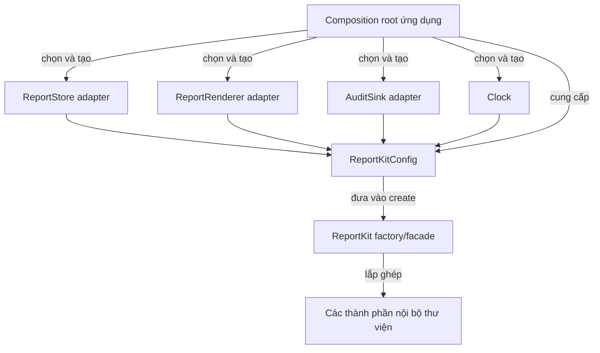

# Lắp ghép thư viện dùng lại thông qua API cấu hình tường minh

Một **thư viện dùng lại** (*reusable library*) thường được nhiều ứng dụng, môi trường và bài kiểm thử sử dụng. Thư viện có thể triển khai thuật toán hoặc điều phối một quy trình, nhưng không thể mặc nhiên biết ứng dụng sử dụng cơ sở dữ liệu nào, gửi dữ liệu đi đâu, lấy thời gian từ đồng hồ nào hoặc quản lý tài nguyên trong bao lâu.

Nếu thư viện tự đọc biến môi trường, tự tạo HTTP client và tự kết nối hệ thống ngoài, mã dùng thư viện khó thay đổi cấu hình, khó kiểm thử và có thể gặp xung đột khi hai ứng dụng muốn cấu hình khác nhau. **Dependency Injection (DI)** cung cấp một hướng giải quyết: thư viện công khai các phụ thuộc cần thiết qua **API cấu hình tường minh**, còn ứng dụng quyết định triển khai cụ thể và lắp ghép ở **composition root**.

Bài học thuộc chương **Điểm lắp ghép** của module **Dependency Injection**. Ta sẽ thiết kế API của một thư viện Java thuần, phân chia quyền quyết định giữa ứng dụng và thư viện, thực hành constructor injection, kiểm thử không cần DI container, rồi xét các yêu cầu về scope, vòng đời và khả năng tương thích của API.

## 1. Vấn đề: thư viện tự quyết định hạ tầng của ứng dụng

Giả sử một thư viện tạo báo cáo tên `ReportKit`. Nhiều ứng dụng muốn sử dụng cùng quy tắc xuất báo cáo, nhưng mỗi ứng dụng có thể lưu báo cáo ở nơi khác nhau và muốn định dạng đầu ra khác nhau.

Cách làm gắn chặt thư viện với môi trường:

```java
// Minh họa cách thiết kế gây khó dùng lại. Các adapter chỉ là giả định.
public final class ReportKit {
    private final ReportStore store = new JdbcReportStore(
            System.getenv("REPORT_DB_URL"));
    private final ReportRenderer renderer = new HtmlReportRenderer();

    public String export(String reportId) {
        return renderer.render(store.load(reportId));
    }
}
```

Ở đây thư viện quyết định địa chỉ lấy cấu hình, loại nguồn dữ liệu và định dạng báo cáo. Những vấn đề xuất hiện ngay khi có yêu cầu mới:

- Một ứng dụng cần báo cáo dạng văn bản, ứng dụng khác cần HTML: phải sửa hoặc rẽ nhánh trong thư viện.
- Unit test muốn dùng báo cáo giả trong bộ nhớ: thư viện lại cố mở kết nối database khi được tạo.
- Một tiến trình cần hai instance `ReportKit` với cấu hình khác nhau: việc phụ thuộc trực tiếp vào biến môi trường dùng chung gây khó kiểm soát.
- Khi thư viện tạo tài nguyên như connection pool hoặc HTTP client, ai chịu trách nhiệm đóng chúng trở nên mơ hồ.

Việc ẩn lệnh `new JdbcReportStore(...)` vào một factory tĩnh bên trong thư viện không tự giải quyết vấn đề nếu factory vẫn tự chọn cấu hình theo môi trường. Vấn đề nằm ở **quyền quyết định phụ thuộc cụ thể** và **vị trí lắp ghép**, chứ không chỉ ở cú pháp `new`.

## 2. Ranh giới composition root giữa ứng dụng và thư viện

**Composition root** là nơi tạo và nối các đối tượng của một ứng dụng. Với ứng dụng Java thuần, đó thường là `main()` hoặc mã bootstrap. Nó biết môi trường chạy và có quyền quyết định những triển khai hạ tầng nào cần được sử dụng.

Một thư viện vẫn có thể có **factory nội bộ** để lắp ghép các thành phần của chính nó, nhưng thư viện nên nhận những **quyết định thuộc ứng dụng** từ bên ngoài. Như vậy có hai cấp trách nhiệm:

| Thành phần | Nên quyết định điều gì? | Ví dụ |
| --- | --- | --- |
| Composition root của ứng dụng | Cấu hình môi trường, adapter kết nối hệ thống ngoài, số lượng instance, scope và vòng đời | Dùng `DatabaseReportStore`, renderer HTML và `Clock.systemUTC()` |
| API công khai của thư viện | Những hợp đồng thư viện cần và cách caller cung cấp chúng | `ReportKit.create(ReportKitConfig)` |
| Factory nội bộ của thư viện | Cách ghép các lớp nội bộ, thứ tự khởi tạo và kiểm tra cấu hình | Tạo `ReportLoader`, `ReportPublisher`, `ReportService` |
| Dịch vụ nội bộ của thư viện | Cách thực hiện quy trình báo cáo trên các hợp đồng đã nhận | Tải báo cáo, định dạng và ghi sự kiện |



Trong sơ đồ, `ReportKit.create(...)` là **điểm vào cấu hình** do thư viện cung cấp. Nó không phải một composition root độc lập với ứng dụng theo nghĩa quyết định luôn hạ tầng bên ngoài. Ứng dụng vẫn giữ quyền chọn những adapter và chính sách vận hành; thư viện chỉ đóng gói cách tạo các đối tượng nội bộ mà caller không cần biết.

## 3. Thiết kế API cấu hình tường minh

Ta xây dựng thư viện báo cáo với ba **port** (hợp đồng cho cộng tác viên bên ngoài) và một giá trị thời gian:

1. `ReportStore`: tải dữ liệu báo cáo từ nguồn do ứng dụng lựa chọn.
2. `ReportRenderer`: chuyển báo cáo thành chuỗi kết quả theo định dạng được cấu hình.
3. `AuditSink`: ghi nhận sự kiện xuất báo cáo. Trong ví dụ này, hợp đồng yêu cầu caller phải cung cấp một implementation rõ ràng; không tự bỏ qua audit.
4. `Clock`: tạo thời điểm sự kiện, có thể là đồng hồ thật hoặc đồng hồ cố định khi test.

Các thành phần trên được nhóm vào `ReportKitConfig`. Cấu hình chứa **đúng những thứ thư viện cần**, không chứa địa chỉ database hay thông tin triển khai không liên quan tới hợp đồng của thư viện:

```java
record ReportKitConfig(
        ReportStore store,
        ReportRenderer renderer,
        AuditSink audit,
        java.time.Clock clock) {

    ReportKitConfig {
        java.util.Objects.requireNonNull(store, "store");
        java.util.Objects.requireNonNull(renderer, "renderer");
        java.util.Objects.requireNonNull(audit, "audit");
        java.util.Objects.requireNonNull(clock, "clock");
    }
}
```

Đoạn mã minh họa cấu trúc của một kiểu cấu hình; ví dụ độc lập đầy đủ sẽ có ở phần tiếp theo. `requireNonNull` giúp **phát hiện lỗi wiring ngay khi tạo cấu hình**. Một API cấu hình tốt nên trả lời được:

- Những dependency nào bắt buộc để thư viện hoạt động?
- Ai cung cấp instance? Có được phép chia sẻ instance với thành phần khác không?
- Thư viện chỉ sử dụng hay có quyền đóng tài nguyên do caller đưa vào?
- Những lỗi nào được báo ngay khi khởi tạo, những lỗi nào chỉ xuất hiện lúc thực hiện thao tác?
- Có thể tạo nhiều `ReportKit` với cấu hình độc lập trong một tiến trình không?

**Tường minh không có nghĩa API phải phơi bày mọi lớp nội bộ.** Caller chỉ cần thấy `ReportKit`, `ReportKitConfig`, những port có thể cấu hình và kiểu dữ liệu trao đổi. Các lớp nội bộ có thể thay đổi mà không buộc caller sửa cách sử dụng thư viện.

## 4. Ví dụ Java 17 hoàn chỉnh: ứng dụng cấu hình, thư viện lắp ghép nội bộ

Ví dụ dưới đây là **một tệp `Main.java` chạy độc lập**. Để tiện biên dịch một tệp, các loại trừ `Main` được khai báo ở mức package-private. Khi tách thành thư viện thực tế, những kiểu được người dùng thư viện sử dụng (`ReportKit`, `ReportKitConfig`, các interface port và kiểu dữ liệu công khai) sẽ nằm trong các tệp thích hợp với mức truy cập `public`; các lớp nội bộ vẫn có thể ẩn trong package/module.

```java
import java.time.Clock;
import java.time.Instant;
import java.time.ZoneOffset;
import java.util.ArrayList;
import java.util.List;
import java.util.Objects;

record Report(String id, String title, String body) {
    Report {
        Objects.requireNonNull(id, "id");
        Objects.requireNonNull(title, "title");
        Objects.requireNonNull(body, "body");
    }
}

record ExportRequest(String reportId, String actor) {
    ExportRequest {
        Objects.requireNonNull(reportId, "reportId");
        Objects.requireNonNull(actor, "actor");
        if (reportId.isBlank() || actor.isBlank()) {
            throw new IllegalArgumentException("Blank export request field");
        }
    }
}

@FunctionalInterface
interface ReportStore {
    Report load(String id);
}

@FunctionalInterface
interface ReportRenderer {
    String render(Report report);
}

@FunctionalInterface
interface AuditSink {
    void record(String event);
}

// Cấu hình công khai về ý tưởng: bên ngoài cung cấp mọi port bắt buộc.
record ReportKitConfig(
        ReportStore store,
        ReportRenderer renderer,
        AuditSink audit,
        Clock clock) {

    ReportKitConfig {
        Objects.requireNonNull(store, "store");
        Objects.requireNonNull(renderer, "renderer");
        Objects.requireNonNull(audit, "audit");
        Objects.requireNonNull(clock, "clock");
    }
}

// Facade: API thao tác nhỏ, không tiết lộ object graph nội bộ.
final class ReportKit {
    private final ReportService service;

    private ReportKit(ReportService service) {
        this.service = service;
    }

    static ReportKit create(ReportKitConfig config) {
        Objects.requireNonNull(config, "config");

        // Factory thư viện chỉ tạo và nối các thành phần nội bộ.
        ReportLoader loader = new ReportLoader(config.store());
        ReportPublisher publisher = new ReportPublisher(
                config.renderer(), config.audit(), config.clock());
        return new ReportKit(new ReportService(loader, publisher));
    }

    String export(ExportRequest request) {
        return service.export(request);
    }
}

// Các lớp nội bộ không cần xuất hiện trong API công khai.
final class ReportLoader {
    private final ReportStore store;

    ReportLoader(ReportStore store) {
        this.store = store;
    }

    Report load(String id) {
        return store.load(id);
    }
}

final class ReportPublisher {
    private final ReportRenderer renderer;
    private final AuditSink audit;
    private final Clock clock;

    ReportPublisher(ReportRenderer renderer, AuditSink audit, Clock clock) {
        this.renderer = renderer;
        this.audit = audit;
        this.clock = clock;
    }

    String publish(Report report, String actor) {
        String output = renderer.render(report);
        String event = "export:" + report.id()
                + ":by:" + actor
                + ":at:" + Instant.now(clock);
        audit.record(event);
        return output;
    }
}

final class ReportService {
    private final ReportLoader loader;
    private final ReportPublisher publisher;

    ReportService(ReportLoader loader, ReportPublisher publisher) {
        this.loader = loader;
        this.publisher = publisher;
    }

    String export(ExportRequest request) {
        Objects.requireNonNull(request, "request");
        return publisher.publish(loader.load(request.reportId()), request.actor());
    }
}

public class Main {
    public static void main(String[] args) {
        // Composition root của ứng dụng: chọn adapter và cấu hình rõ ràng.
        List<String> events = new ArrayList<>();
        ReportStore store = id -> new Report(id, "Doanh thu", "Tháng 6");
        ReportRenderer textRenderer = report ->
                report.title() + ": " + report.body();
        AuditSink audit = events::add;
        Clock fixedClock = Clock.fixed(
                Instant.parse("2026-06-01T00:00:00Z"), ZoneOffset.UTC);

        ReportKitConfig config = new ReportKitConfig(
                store, textRenderer, audit, fixedClock);
        ReportKit kit = ReportKit.create(config);

        String result = kit.export(new ExportRequest("R-01", "lan"));
        check(result.equals("Doanh thu: Tháng 6"), "Sai nội dung xuất");
        check(events.equals(List.of(
                "export:R-01:by:lan:at:2026-06-01T00:00:00Z")),
                "Sai sự kiện audit");

        // Một instance khác của cùng thư viện, cấu hình định dạng khác.
        ReportRenderer htmlRenderer = report ->
                "<h1>" + report.title() + "</h1>";
        ReportKit htmlKit = ReportKit.create(new ReportKitConfig(
                store, htmlRenderer, event -> { }, fixedClock));
        check(htmlKit.export(new ExportRequest("R-02", "minh"))
                        .equals("<h1>Doanh thu</h1>"),
                "Cấu hình của kit thứ hai phải độc lập");
        check(events.size() == 1,
                "Kit thứ hai không được thay đổi adapter audit của kit đầu");

        // Thiếu port bắt buộc được phát hiện ngay khi tạo cấu hình.
        boolean rejected = false;
        try {
            new ReportKitConfig(null, textRenderer, audit, fixedClock);
        } catch (NullPointerException expected) {
            rejected = true;
        }
        check(rejected, "Phải từ chối cấu hình thiếu ReportStore");

        // Lỗi load không được khiến thư viện ghi nhận thành công giả.
        List<String> failureEvents = new ArrayList<>();
        ReportStore failingStore = id -> {
            throw new IllegalStateException("Store unavailable");
        };
        ReportKit failingKit = ReportKit.create(new ReportKitConfig(
                failingStore, textRenderer, failureEvents::add, fixedClock));
        boolean failed = false;
        try {
            failingKit.export(new ExportRequest("R-03", "hoa"));
        } catch (IllegalStateException expected) {
            failed = true;
        }
        check(failed, "Phải truyền lỗi từ store ra ngoài");
        check(failureEvents.isEmpty(),
                "Không được ghi audit khi chưa tải được báo cáo");

        System.out.println("PASS");
    }

    private static void check(boolean condition, String message) {
        if (!condition) {
            throw new AssertionError(message);
        }
    }
}
```

Chạy bằng JDK 17 trở lên:

```bash
javac -encoding UTF-8 Main.java
java Main
```

Kết quả mong đợi:

```text
PASS
```

Ví dụ làm rõ bốn tính chất của API cấu hình tường minh:

1. **Thư viện không tự chọn adapter ngoài.** `ReportStore`, `ReportRenderer`, `AuditSink` và `Clock` đều do ứng dụng cung cấp.
2. **Thư viện giữ chi tiết lắp ghép nội bộ.** Caller không cần biết `ReportLoader`, `ReportPublisher` hay `ReportService` tồn tại.
3. **Có thể tạo nhiều instance cấu hình độc lập.** `kit` và `htmlKit` cùng kiểu thư viện nhưng dùng renderer và audit khác nhau mà không thay đổi thiết lập toàn cục. Trong ví dụ chúng cố ý chia sẻ `store` và `fixedClock`; tính độc lập ở đây là **cấu hình và object graph của mỗi kit**, không nhất thiết mọi dependency đều là instance riêng.
4. **Kiểm thử dễ kiểm soát.** Đồng hồ được cố định, dữ liệu giả được cung cấp qua lambda, lỗi tải được tái hiện chính xác mà không cần mạng hoặc database.

### Audit trong ví dụ là một hợp đồng có hệ quả nghiệp vụ

Đoạn ví dụ ghi sự kiện **sau** khi renderer thành công. Nếu `AuditSink.record(...)` ném ngoại lệ, `export` sẽ ném lỗi dù dữ liệu đã được tải và định dạng; nó **không** tạo được một giao dịch nguyên tử giữa xuất báo cáo và audit. Việc này chỉ minh họa ranh giới DI, không phải một giải pháp kiểm toán bền vững cho production. Nếu hệ thống yêu cầu audit bắt buộc, cần thiết kế chính sách đảm bảo ghi nhận, retry hoặc lưu sự kiện thích hợp. `event -> { }` ở `htmlKit` chỉ dùng để minh họa một adapter của bài học; **không** nên dùng No-Op audit trong hệ thống cần dấu vết bắt buộc.

## 5. API cấu hình nên bộc lộ gì và nên ẩn gì?

Một thư viện dễ dùng lại nên công khai **ranh giới hợp đồng**, không buộc ứng dụng phụ thuộc vào các lớp nội bộ dễ thay đổi.

| Nên công khai | Nên giữ nội bộ khi có thể |
| --- | --- |
| `ReportKit.create(ReportKitConfig)` hoặc một factory tương đương | Thuật toán nối `ReportLoader` với `ReportPublisher` |
| Port cần caller cung cấp: `ReportStore`, `ReportRenderer`, `AuditSink` | Các lớp triển khai chi tiết không cần caller lựa chọn |
| Kiểu dữ liệu giao tiếp như `ExportRequest` và `Report` | Dữ liệu tạm và các helper chỉ phục vụ thuật toán |
| Quy ước ownership, lỗi, thread safety, scope | Cách tổ chức package nội bộ và tên các helper |

Trong thư viện thực, mỗi kiểu public cần được thiết kế phù hợp module/package và được tài liệu hóa. Đừng biến toàn bộ constructor của các lớp nội bộ thành public chỉ để caller tự lắp ghép mọi chi tiết. Ngược lại, cũng đừng giấu những lựa chọn mà người dùng thư viện **thực sự cần điều khiển** trong biến toàn cục hoặc file cấu hình chỉ thư viện hiểu.

Một cách tổ chức có thể là:

```text
com.example.reportkit.api
  ReportKit.java
  ReportKitConfig.java
  ReportStore.java
  ReportRenderer.java
  AuditSink.java
  Report.java
  ExportRequest.java

com.example.reportkit.internal
  ReportLoader.java
  ReportPublisher.java
  ReportService.java

com.example.app
  Main.java                // Composition root của ứng dụng
  JdbcReportStore.java     // Adapter do ứng dụng chọn
```

Đây là **sơ đồ kiến trúc**, không phải yêu cầu phải sinh thêm tệp trong bài thực hành. Mục tiêu là để API có thể ổn định khi implementation nội bộ được thay đổi.

## 6. Cấu hình tường minh: constructor, factory hay builder?

Không có một hình thức duy nhất phù hợp mọi thư viện. Điều quan trọng hơn cú pháp là **caller thấy rõ những quyết định cần cung cấp** và có cách kiểm tra hợp lệ trước khi sử dụng.

| Phương án | Thích hợp khi | Điểm cần cân nhắc |
| --- | --- | --- |
| `new ReportKit(store, renderer, audit, clock)` | Ít dependency, không cần ẩn logic lắp ghép | Phơi bày constructor và tăng số tham số khi mở rộng |
| `ReportKit.create(new ReportKitConfig(...))` | Có object graph nội bộ, muốn một điểm cấu hình rõ ràng | Cần định nghĩa và duy trì kiểu `Config` |
| `ReportKit.builder().store(...).renderer(...).build()` | Nhiều tùy chọn có tên và giá trị mặc định hợp lệ | `build()` phải kiểm tra đủ phần bắt buộc; builder không tự sửa thiết kế thiếu hợp đồng |
| `ReportKit.create(factoryOrProvider)` | Adapter cần tạo theo yêu cầu hoặc theo scope | Phải ghi rõ số lần factory được gọi và quyền sở hữu instance tạo ra |

Ví dụ, builder có thể giúp lời gọi dễ đọc:

```java
// Sơ đồ API minh họa; builder này không được định nghĩa trong Main.java.
ReportKit kit = ReportKit.builder()
        .store(reportStore)
        .renderer(htmlRenderer)
        .audit(auditSink)
        .clock(clock)
        .build();
```

Builder phải từ chối việc thiếu `store`, `renderer` hoặc những port được tuyên bố bắt buộc. Nếu cung cấp mặc định, hãy **đặt tên và tài liệu hóa hành vi**: chẳng hạn `Clock.systemUTC()` chỉ phù hợp khi việc sử dụng thời gian hệ thống là chủ đích. Mặc định quan trọng không nên thay đổi ngầm khi thư viện nâng phiên bản.

### Tách cấu hình của ứng dụng khỏi cấu hình của thư viện

Các giá trị như URL database, mật khẩu, tên topic hay đường dẫn file thường là **chi tiết của adapter thuộc ứng dụng**:

```java
// Minh họa ranh giới; các adapter giả định đã được cung cấp.
ReportStore store = new JdbcReportStore(databaseDataSource);
AuditSink audit = new QueueAuditSink(messagePublisher);

ReportKit kit = ReportKit.create(new ReportKitConfig(
        store, renderer, audit, Clock.systemUTC()));
```

Thư viện nhận những hợp đồng nó cần, không đọc trực tiếp `REPORT_DB_URL` hoặc yêu cầu mọi ứng dụng có cùng cấu trúc cấu hình. Khi cần một adapter tiện dụng do chính thư viện phân phối, hãy để caller **tự chọn sử dụng** adapter đó qua API; không biến nó thành sự lựa chọn bắt buộc bị giấu đi.

## 7. Kiểm thử cấu hình và khả năng dùng lại

Với API tường minh, có thể kiểm tra ba lớp trách nhiệm khác nhau:

**Thứ nhất: kiểm thử nghiệp vụ của thư viện.** Cung cấp fake `ReportStore`, renderer và audit recorder. Xác minh thư viện gọi đúng collaborator, xử lý đúng dữ liệu và truyền ngoại lệ phù hợp. Ví dụ đầy đủ ở mục 4 đã thực hiện kiểu kiểm thử này mà không cần framework.

**Thứ hai: kiểm thử cấu hình.** Bỏ một port bắt buộc, truyền `null`, hoặc chọn một bộ cấu hình không hợp lệ. Cần thấy lỗi sớm ở `ReportKitConfig` hoặc `ReportKit.create(...)`, thay vì để chương trình chạy rồi mới lỗi khi có request.

**Thứ ba: kiểm thử composition root của ứng dụng.** Tạo thư viện bằng adapter thật và kiểm tra kết nối, định dạng, vòng đời, quản lý lỗi. Unit test dùng fake không thay thế được integration test với database, hàng đợi hoặc dịch vụ ngoài.

Một kiểm thử quan trọng cho thư viện dùng lại là **tính cô lập giữa hai cấu hình**: tạo hai `ReportKit` khác nhau trong cùng tiến trình, dùng store/renderer/audit độc lập, kiểm tra rằng thay đổi hành vi ở kit này không làm kit kia đổi theo. Nếu một singleton tĩnh hoặc mutable global registry nằm bên trong thư viện, loại test này thường phát hiện việc rò rỉ cấu hình.

## 8. Scope, identity và vòng đời tài nguyên

**API cấu hình tường minh không tự quyết định scope của mọi dependency.** Một `ReportStore` có thể là adapter stateless dùng chung; một transaction hoặc request context có thể chỉ hợp lệ trong một thao tác. Việc caller cấp instance cho library không bảo đảm instance ấy an toàn khi nhiều request dùng đồng thời.

| Câu hỏi | Ví dụ cần làm rõ |
| --- | --- |
| Một `ReportKit` được dùng cho toàn ứng dụng hay tạo mỗi request? | Có thể tái sử dụng nếu các dependency được tiêm hỗ trợ truy cập đồng thời |
| `ReportStore` có trạng thái theo transaction không? | Nếu có, không nên vô tình chia sẻ cùng một instance theo mọi request |
| Ai tạo/đóng connection pool hoặc client? | Thường composition root hoặc lifecycle manager sở hữu, library chỉ mượn để sử dụng |
| Thư viện có tự tạo thread hoặc buffer nội bộ không? | Nếu có tài nguyên cần dọn, API phải mô tả cách đóng library |
| Có cho phép dùng một adapter vào hai `ReportKit` không? | Có thể, nếu hợp đồng adapter cho phép chia sẻ và caller quản lý vòng đời phù hợp |

Khi ứng dụng tạo một `AutoCloseable` để tiêm vào thư viện, quy tắc thường an toàn và dễ dự đoán là **bên tạo giữ quyền sở hữu**; thư viện không tự đóng đối tượng do caller cấp nếu hợp đồng không nói rõ việc chuyển quyền sở hữu. Ví dụ cấu trúc, với `SharedClient` và các adapter giả định:

```java
// Sơ đồ lifecycle; các kiểu sau chỉ nhằm minh họa.
try (SharedClient client = new SharedClient(/* cấu hình */)) {
    ReportStore store = new RemoteReportStore(client);
    ReportKit kit = ReportKit.create(new ReportKitConfig(
            store, renderer, auditSink, Clock.systemUTC()));

    // Chỉ dùng kit trong khi client vẫn đang mở.
    kit.export(new ExportRequest("R-01", "lan"));
}
// Composition root đóng client sau khi các consumer đã dùng xong.
```

Nếu thư viện **tự sở hữu** tài nguyên nội bộ, có thể thiết kế facade thực hiện `AutoCloseable` và quy định rõ việc `close()` giải phóng những gì. Không đóng resource do ứng dụng vẫn đang dùng ở nơi khác, trừ khi API đã nêu rõ việc chuyển giao ownership.

Một khác biệt quan trọng: **chia sẻ cùng một instance** không phải lúc nào cũng là mục tiêu. Nếu hai `ReportKit` có cấu hình tách biệt, mỗi kit có thể cần store khác nhau. Nếu cần chia sẻ một connection pool, composition root có thể tạo pool một lần rồi tiêm các adapter sử dụng pool đó. Lựa chọn identity và scope là của kiến trúc ứng dụng.

## 9. Các thiết kế cần tránh

### 9.1. Đọc môi trường trong thư viện và coi đó là API cấu hình

```java
// Thư viện tự đọc System.getenv hoặc file cấu hình cố định:
String databaseUrl = System.getenv("REPORT_DB_URL");
```

Đây là một phụ thuộc ngầm vào môi trường. Caller khó tạo nhiều cấu hình trong cùng tiến trình và khó kiểm thử độc lập. Thay vào đó, nơi khởi động đọc cấu hình, tạo adapter rồi truyền qua API công khai.

### 9.2. Dùng mutable global registry

```java
// Minh họa chống mẫu: cấu hình tiến trình bị dùng chung ngoài ý muốn.
GlobalServices.set(ReportStore.class, storeForTenantA);
ReportKit kitA = ReportKit.create();
GlobalServices.set(ReportStore.class, storeForTenantB);
ReportKit kitB = ReportKit.create();
```

Nếu library tra cứu registry ở thời điểm gọi thay vì chốt dependency tại lúc khởi tạo, `kitA` có thể dùng nhầm store của tenant B. Constructor injection vào object graph giúp xác định rõ mối quan hệ một kit với các dependency đã cấp.

### 9.3. Đưa toàn bộ cấu hình vận hành vào một “túi tham số” lớn

Một `Map<String, Object>` chứa đủ loại URL, timeout, repository, renderer và token khiến sai kiểu và thiếu dependency thường chỉ phát hiện khi chạy. Nên dùng **kiểu cấu hình có tên trường và kiểm tra hợp lệ**. Với nhiều cấu hình liên quan, có thể nhóm chúng thành kiểu con có ý nghĩa.

### 9.4. Tạo mặc định phá vỡ hợp đồng

Nếu ghi audit là bắt buộc, library không nên âm thầm thay `null` bằng `AuditSink` không làm gì. Một mặc định chỉ hợp lệ khi “không thực hiện tác vụ đó” được nghiệp vụ cho phép. Nếu mặc định phụ thuộc deployment, composition root nên quyết định.

### 9.5. Bắt caller lắp ghép toàn bộ lớp nội bộ

Khi API yêu cầu ứng dụng biết `ReportLoader`, `ReportPublisher`, `ReportService` cùng thứ tự nối chúng, mỗi thay đổi nội bộ của thư viện có thể phá vỡ ứng dụng. Factory của thư viện nên đóng gói những quyết định nội bộ ổn định đối với caller.

### 9.6. Không quy định khả năng dùng đồng thời hoặc đóng tài nguyên

Một `ReportKit` dùng chung nhiều request có thể chứa adapter không thread-safe. Nếu facade hoặc adapter có trạng thái, tài liệu API phải nêu rõ phạm vi sử dụng an toàn. Với tài nguyên cần đóng, nêu rõ caller hay library sở hữu và thời điểm đóng.

## 10. Tương thích API khi thư viện phát triển

Khi một thư viện đã có người dùng, thay đổi API cấu hình cần được cân nhắc như thay đổi hợp đồng:

- **Thêm dependency bắt buộc** vào constructor của `record ReportKitConfig` làm các chỗ gọi constructor cũ cần cập nhật, và có thể gây vấn đề tương thích nhị phân. Hãy cân nhắc overload/adapter cấu hình có version hoặc builder nếu API cần tiến hóa thường xuyên.
- **Thêm tùy chọn có default hợp lệ** có thể ít gây gián đoạn hơn, nhưng phải ghi rõ ý nghĩa default và kiểm tra việc đổi hành vi có ảnh hưởng người dùng hiện tại không.
- **Đổi cách thư viện sở hữu resource** có thể ảnh hưởng đến caller đang chia sẻ adapter hoặc đóng nó tại application root.
- **Thay đổi các port public** có thể buộc các adapter do ứng dụng viết phải sửa; thiết kế hợp đồng nhỏ, phù hợp chức năng thực sự cần, sẽ giảm ảnh hưởng.

Không phải cứ nhiều dependency là cần builder; khi API nhỏ và ổn định, `record`/constructor có kiểm tra tham số thường rất dễ hiểu. Builder hữu ích khi thư viện thực sự có nhiều lựa chọn cấu hình cần tên rõ ràng hoặc có kế hoạch tiến hóa API đáng kể.

## 11. Bài tập thực hành

**Bài 1 — Gỡ phụ thuộc ngầm.** Một thư viện `CsvImportKit` hiện tự đọc `System.getenv("CSV_INPUT_DIR")` và tự tạo `FileReader`. Hãy thiết kế một `InputSource` port và `ImportKitConfig` để ứng dụng chọn nguồn file, bộ nhớ hoặc network. Phân biệt việc library xử lý CSV với việc ứng dụng chọn nơi lấy dữ liệu.

**Bài 2 — Hai cấu hình độc lập.** Từ ví dụ `ReportKit`, tạo một kit dùng `ReportStore` chỉ trả báo cáo A và renderer văn bản; một kit khác trả báo cáo B và renderer HTML. Kiểm tra cả hai hoạt động trong cùng tiến trình và không chia sẻ mutable global state.

**Bài 3 — Quy tắc ownership.** Giả sử `ReportStore` dùng connection pool do ứng dụng tạo và `ReportKit` có thể dùng chung pool với một service khác. Ai nên đóng pool? Khi nào đóng? Nếu library muốn sở hữu pool, API cần đổi hợp đồng thế nào?

**Bài 4 — Nâng cấp API.** Thư viện muốn thêm `Clock` để timestamp xác định được trong test. So sánh việc tự gọi `Instant.now()` với việc nhận `Clock` trong config. Nếu `ReportKitConfig` đã được phát hành công khai, đề xuất cách thêm trường mà giảm gián đoạn cho caller.

## 12. Tự kiểm tra hiểu bài

**Câu 1.** Thư viện có được tạo các lớp nội bộ bằng `new` không? **Có.** Nó có thể lắp ghép những implementation nội bộ mà caller không cần lựa chọn; các quyết định hạ tầng thuộc ứng dụng nên được truyền từ bên ngoài.

**Câu 2.** Chỉ cần thay `new JdbcReportStore(...)` bằng `GlobalRegistry.get(ReportStore.class)` có phải API cấu hình tường minh không? **Không.** Phụ thuộc vẫn bị che giấu và thư viện còn chủ động tra cứu một registry chung.

**Câu 3.** Vì sao truyền `Clock` vào thư viện giúp test? **Vì** test có thể tiêm `Clock.fixed(...)` để kết quả không phụ thuộc thời gian hệ thống.

**Câu 4.** Hai `ReportKit` cùng dùng một `ReportStore` có vi phạm nguyên tắc không? **Không nhất thiết.** Ứng dụng có thể chủ động chia sẻ store nếu hợp đồng và thread safety của store cho phép; quyền quyết định thuộc composition root.

**Câu 5.** DI container có bắt buộc để hỗ trợ API `ReportKit.create(config)` không? **Không.** Constructor và factory bằng Java thuần đủ để tách việc dùng dependency khỏi việc lắp ghép. Container có thể hỗ trợ tự động hóa khi ứng dụng lớn hơn.

## Ghi nhớ

- **Composition root của ứng dụng** quyết định adapter và cấu hình theo môi trường; **factory của thư viện** được phép lắp ghép các lớp nội bộ của thư viện.
- **API cấu hình tường minh** công khai các port và dependency bắt buộc, kiểm tra lỗi wiring sớm và cho phép tạo nhiều instance thư viện với cấu hình độc lập.
- **Đóng gói object graph nội bộ** giúp ứng dụng sử dụng thư viện qua facade ổn định mà không phụ thuộc vào mọi lớp triển khai.
- **Scope, thread safety và quyền sở hữu tài nguyên** phải được quy định trong hợp đồng; việc tiêm cùng instance không tự làm nó an toàn hoặc quyết định ai được đóng nó.
- Có thể thực hiện toàn bộ mô hình này bằng **Java thuần với constructor injection và factory**, trước khi mở rộng sang DI container.
