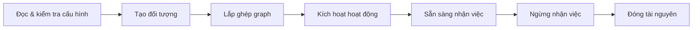
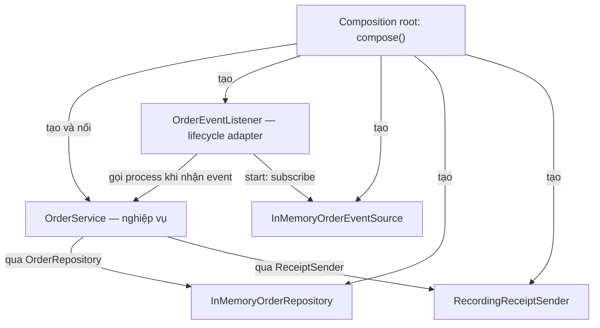

# Phân biệt tạo đối tượng với khởi động các hoạt động có tác dụng phụ

Khi sử dụng **Dependency Injection (DI)**, ta thường nói composition root là nơi tạo các đối tượng rồi nối chúng thành **object graph**. Nhưng một ứng dụng còn có việc khác: **bắt đầu thực hiện hoạt động** như mở cổng HTTP, đăng ký consumer nhận thông điệp, khởi chạy lịch xử lý, đọc dữ liệu từ hệ thống ngoài hoặc gửi thông báo. Nếu các hoạt động ấy diễn ra ngay trong constructor, chỉ một lời gọi `new` cũng có thể khiến hệ thống bắt đầu làm việc khi đồ thị phụ thuộc chưa sẵn sàng.

Bài học thuộc chương **Điểm lắp ghép** của module **DEPENDENCY_INJECTION**. Ta phân biệt hai thời điểm: **tạo/lắp ghép đối tượng** và **kích hoạt những tác dụng phụ**. Trọng tâm là thiết kế constructor injection rõ ràng, để composition root kiểm soát việc khởi động và dừng ứng dụng, quản lý scope/vòng đời, rồi kiểm thử bằng **Java thuần** trước khi sử dụng DI container.

## 1. Kết quả cần đạt

Sau bài học, bạn có thể:

- Phân biệt **construction**, **composition** và **activation/startup** trong vòng đời ứng dụng.
- Nhận diện constructor, static initializer hoặc factory đang âm thầm mở kết nối, đăng ký listener, tạo thread hay gây tác dụng phụ.
- Thiết kế một object graph có thể lắp ghép và kiểm tra trước khi **đăng ký lắng nghe sự kiện** hoặc kích hoạt các hoạt động bên ngoài.
- Dùng một bước `start()` riêng cùng `close()/stop()` để kiểm soát thứ tự khởi động và giải phóng tài nguyên.
- Giải thích ai chịu trách nhiệm khi startup thất bại giữa chừng, khi cần readiness và khi một thành phần có scope dài/ngắn khác nhau.
- Viết kiểm thử Java thuần phân biệt rõ **chỉ tạo object** với **đã bắt đầu tạo tác dụng phụ**.

## 2. Ba giai đoạn không nên đánh đồng

Trong cách tổ chức điển hình, một ứng dụng có thể đi qua ba giai đoạn sau:

| Giai đoạn | Câu hỏi | Ví dụ | Dấu hiệu hoàn thành |
| --- | --- | --- | --- |
| **Construction** — tạo đối tượng | Một đối tượng cần dữ liệu và dependency nào để hợp lệ? | `new OrderService(repository, sender)` | Có một instance hợp lệ, chưa chắc ứng dụng đã hoạt động |
| **Composition** — lắp ghép | Các instance nào được nối với nhau, chia sẻ và sở hữu bởi ai? | Root tạo repository, sender, service, listener rồi nối chúng | Object graph đủ các thành phần cần thiết |
| **Activation** — kích hoạt | Khi nào hệ thống bắt đầu nhận công việc hoặc tạo hiệu ứng bên ngoài? | `listener.start()` đăng ký handler, `server.start()` nhận yêu cầu | Hoạt động đã bắt đầu theo hợp đồng của từng thành phần |

**Construction** và **composition** thường diễn ra gần nhau; cả hai có thể được thực hiện trong cùng một hàm `compose()`. Tuy nhiên, tạo được một đối tượng **không đồng nghĩa** nó đã sẵn sàng nhận công việc. Ngược lại, một ứng dụng có thể khởi động hoạt động quá sớm dù chưa lắp ghép hoặc kiểm tra xong các dependency.

Một vòng đời hữu ích để suy nghĩ:



Đây là **mô hình tư duy**, không phải quy tắc rằng mọi ứng dụng luôn có đúng bảy bước. Ví dụ, một chương trình tính toán thuần có thể lắp ghép rồi gọi trực tiếp ca sử dụng mà không cần một lifecycle `start/stop`. Một client kết nối theo nhu cầu có thể thực hiện I/O ở lần gọi đầu tiên. Những khác biệt ấy cần được **mô tả rõ trong hợp đồng vòng đời**, thay vì bị che trong constructor.

### 2.1. “Tác dụng phụ” là gì trong bối cảnh khởi động?

Ở đây, tác dụng phụ là hành vi làm thay đổi trạng thái quan sát được bên ngoài phép tính/tạo giá trị của đối tượng. Ví dụ:

- Mở socket, bind cổng HTTP, kết nối cơ sở dữ liệu, gửi một yêu cầu mạng.
- Đăng ký listener vào event bus, subscribe topic, bật consumer bắt đầu đọc message.
- Khởi chạy thread, timer, lịch công việc hoặc vòng lặp xử lý background.
- Ghi tệp, thay đổi dữ liệu bền vững, gửi email/thông báo hoặc phát sự kiện.
- Ghi vào một registry dùng chung, thay đổi trạng thái global hoặc mở tài nguyên cần đóng.

Không phải tác dụng phụ nào cũng xấu. **Ứng dụng phải thực hiện tác dụng phụ để có ích**. Câu hỏi thiết kế là tác dụng phụ ấy diễn ra **khi nào, có thể kiểm soát được không, và ai chịu trách nhiệm dừng/khôi phục**.

Việc cấp phát bộ nhớ, gán trường `final` và kiểm tra tham số trong constructor thường là thao tác bình thường. Mục tiêu “constructor nhẹ” cũng không thể bảo đảm **mọi lệnh `new` hoàn toàn không có tác dụng phụ**: một constructor của thư viện ngoài có thể tự mở kết nối. Vì vậy, cần hiểu ngữ nghĩa của factory/constructor đang dùng và chọn ranh giới phù hợp.

## 3. Vấn đề khi constructor tự khởi động hoạt động

Giả sử ứng dụng nhận đơn hàng qua một nguồn sự kiện. Một lớp listener muốn chuyển sự kiện cho `OrderService`:

```java
// Mã khái niệm minh họa anti-pattern; OrderEventSource là API giả định.
final class OrderEventListener {
    private final OrderEventSource source;

    OrderEventListener(OrderEventSource source, OrderService orders) {
        this.source = source;
        // Tạo object là bắt đầu đăng ký nhận sự kiện!
        source.subscribe(orders::process);
    }
}
```

Cách viết này tạo ra một số vấn đề:

1. **Chưa lắp graph xong đã nhận việc.** Nguồn sự kiện có thể gửi callback sớm khi các thành phần khác chưa được khởi tạo hoặc chưa sẵn sàng.
2. **Constructor có thể thất bại vì môi trường.** Lỗi mạng, authentication hoặc đăng ký consumer khiến việc tạo object thất bại, trong khi người gọi khó phân biệt lỗi cấu hình với lỗi kích hoạt.
3. **Kiểm thử khó tách giai đoạn.** Chỉ cần tạo listener trong unit test đã đăng ký handler và có thể nhận event ngoài ý muốn.
4. **Không rõ quyền sở hữu subscription.** Nếu không giữ đối tượng đại diện đăng ký, ai sẽ hủy đăng ký khi dừng ứng dụng?
5. **Khởi động trùng.** Một lần tạo mới đối tượng có thể sinh thêm listener, thread hoặc timer dù hệ thống không muốn.

Một biến thể khác:

```java
// Mã minh họa: trường hợp KHÔNG nên mặc định áp dụng.
final class JobScheduler {
    JobScheduler() {
        new Thread(this::runForever).start();
    }

    private void runForever() {
        // Vòng lặp xử lý công việc (lược bỏ).
    }
}
```

Constructor đã tạo một thread chạy độc lập trước khi bên gọi có cơ hội lưu handle, gắn shutdown policy hoặc xác nhận mọi phụ thuộc sẵn sàng. Mẫu này còn thiếu cơ chế dừng thread. **Đặt lệnh `start()` trong constructor không làm biến mất vấn đề**: tác dụng phụ vẫn xảy ra trong giai đoạn tạo.

## 4. Nguyên tắc: constructor thiết lập trạng thái, lifecycle kích hoạt hoạt động

Một cấu trúc dễ kiểm soát hơn là:

```java
final class OrderEventListener implements AutoCloseable {
    private final OrderEventSource source;
    private final OrderService orders;
    private Subscription subscription;

    OrderEventListener(OrderEventSource source, OrderService orders) {
        this.source = java.util.Objects.requireNonNull(source);
        this.orders = java.util.Objects.requireNonNull(orders);
    }

    void start() {
        if (subscription != null) {
            throw new IllegalStateException("already started");
        }
        subscription = source.subscribe(orders::process);
    }

    @Override
    public void close() {
        if (subscription != null) {
            subscription.close();
            subscription = null;
        }
    }
}
```

Đây là **mã minh họa cấu trúc**; `OrderEventSource` và `Subscription` sẽ được khai báo đầy đủ trong ví dụ chạy được ở phần 5. Điểm khác biệt chính:

- Constructor chỉ nhận hai dependency bắt buộc và lưu trạng thái hợp lệ.
- `start()` biểu thị một **ranh giới kích hoạt rõ ràng**: từ đây mới đăng ký callback.
- `close()` thể hiện **ranh giới hủy hoạt động** và quyền sở hữu subscription.
- Composition root có thể tạo toàn bộ graph, kiểm tra cấu hình rồi mới chọn thời điểm gọi `start()`.

**Lưu ý về thiết kế API:** `start()` có thể được định nghĩa là gọi một lần, gọi lặp không đổi gì (idempotent), hoặc cho phép khởi động lại sau khi dừng. Không có một quy tắc Java mặc định. Ví dụ này chọn **báo lỗi nếu gọi start hai lần khi còn subscription**; khi `close()` thành công thì trạng thái trở lại chưa đăng ký. Nếu cần trạng thái `NEW/RUNNING/STOPPED/FAILED` chặt chẽ hơn, hãy thiết kế state machine và quy tắc chuyển trạng thái rõ ràng.

## 5. Ví dụ Java thuần: lắp xong mới đăng ký nhận sự kiện

Ví dụ sau có một `OrderService` xử lý đơn hàng, kho lưu trong bộ nhớ và sender ghi nhận yêu cầu tạo biên nhận. `InMemoryOrderEventSource` giả lập event bus ngay trong tiến trình để **nhìn thấy thời điểm đăng ký và hủy listener**. Đăng ký/hủy thay đổi danh sách callback và in log ra console; chương trình **không mở network, không chạy thread nền và không gửi email thật**.

Lưu toàn bộ thành **`Main.java`**:

```java
import java.util.ArrayList;
import java.util.LinkedHashSet;
import java.util.List;
import java.util.Objects;
import java.util.Set;
import java.util.function.Consumer;

public class Main {
    // Các hợp đồng cần dùng.
    interface OrderRepository {
        void save(String orderId);
        int count();
    }

    interface ReceiptSender {
        void requestReceipt(String orderId);
    }

    // Hợp đồng quản lý một lượt đăng ký, có thể hủy khi đóng.
    interface Subscription extends AutoCloseable {
        @Override
        void close();
    }

    interface OrderEventSource {
        Subscription subscribe(Consumer<String> handler);
    }

    // Nghiệp vụ: không biết event bus hay quyết định lúc nào đăng ký.
    static final class OrderService {
        private final OrderRepository repository;
        private final ReceiptSender sender;

        OrderService(OrderRepository repository, ReceiptSender sender) {
            this.repository = Objects.requireNonNull(repository, "repository");
            this.sender = Objects.requireNonNull(sender, "sender");
        }

        void process(String orderId) {
            Objects.requireNonNull(orderId, "orderId");
            if (orderId.isBlank()) {
                throw new IllegalArgumentException("blank order id");
            }
            repository.save(orderId);
            sender.requestReceipt(orderId);
        }
    }

    // Adapter minh họa chỉ giữ dữ liệu trong bộ nhớ.
    static final class InMemoryOrderRepository implements OrderRepository {
        private final Set<String> ids = new LinkedHashSet<>();

        @Override
        public void save(String orderId) {
            if (!ids.add(orderId)) {
                throw new IllegalArgumentException("duplicate order id");
            }
        }

        @Override
        public int count() {
            return ids.size();
        }
    }

    static final class RecordingReceiptSender implements ReceiptSender {
        final List<String> requests = new ArrayList<>();

        @Override
        public void requestReceipt(String orderId) {
            requests.add(orderId);
            System.out.println("Receipt requested for " + orderId);
        }
    }

    static final class InMemoryOrderEventSource implements OrderEventSource {
        private final List<Consumer<String>> handlers = new ArrayList<>();

        @Override
        public Subscription subscribe(Consumer<String> handler) {
            Objects.requireNonNull(handler, "handler");
            handlers.add(handler);
            System.out.println("Listener registered");

            return new Subscription() {
                private boolean closed;

                @Override
                public void close() {
                    if (!closed) {
                        closed = true;
                        handlers.remove(handler);
                        System.out.println("Listener unregistered");
                    }
                }
            };
        }

        void emit(String orderId) {
            // Copy để lượt duyệt không bị ảnh hưởng nếu callback thay đổi list.
            for (Consumer<String> handler : List.copyOf(handlers)) {
                handler.accept(orderId);
            }
        }

        int subscriberCount() {
            return handlers.size();
        }
    }

    // Adapter kích hoạt: chỉ đăng ký callback khi start() được gọi.
    static final class OrderEventListener implements AutoCloseable {
        private final OrderEventSource events;
        private final OrderService orders;
        private Subscription subscription;

        OrderEventListener(OrderEventSource events, OrderService orders) {
            this.events = Objects.requireNonNull(events, "events");
            this.orders = Objects.requireNonNull(orders, "orders");
        }

        void start() {
            if (subscription != null) {
                throw new IllegalStateException("listener already started");
            }
            subscription = events.subscribe(orders::process);
        }

        @Override
        public void close() {
            if (subscription != null) {
                subscription.close();
                subscription = null;
            }
        }
    }

    // Gói những thành phần root cần điều khiển vòng đời.
    static final class Application implements AutoCloseable {
        final InMemoryOrderEventSource events;
        final InMemoryOrderRepository repository;
        final RecordingReceiptSender receipts;
        private final OrderEventListener listener;

        Application(
                InMemoryOrderEventSource events,
                InMemoryOrderRepository repository,
                RecordingReceiptSender receipts,
                OrderEventListener listener) {
            this.events = Objects.requireNonNull(events);
            this.repository = Objects.requireNonNull(repository);
            this.receipts = Objects.requireNonNull(receipts);
            this.listener = Objects.requireNonNull(listener);
        }

        void start() {
            listener.start();
        }

        @Override
        public void close() {
            listener.close();
        }
    }

    // COMPOSITION ROOT: tạo graph, chưa đăng ký listener.
    static Application compose() {
        InMemoryOrderRepository repository = new InMemoryOrderRepository();
        RecordingReceiptSender receipts = new RecordingReceiptSender();
        OrderService orders = new OrderService(repository, receipts);
        InMemoryOrderEventSource events = new InMemoryOrderEventSource();
        OrderEventListener listener = new OrderEventListener(events, orders);
        return new Application(events, repository, receipts, listener);
    }

    public static void main(String[] args) {
        Application app = compose();

        // Chỉ tạo và lắp ghép thì chưa có callback nào được đăng ký.
        if (app.events.subscriberCount() != 0) {
            throw new AssertionError("composition activated the listener");
        }
        System.out.println("After compose: listeners=0");

        try (app) {
            app.start(); // Ranh giới kích hoạt rõ ràng.
            if (app.events.subscriberCount() != 1) {
                throw new AssertionError("listener not registered");
            }
            System.out.println("After start: listeners=1");

            app.events.emit("O-001");
            if (app.repository.count() != 1
                    || !app.receipts.requests.equals(List.of("O-001"))) {
                throw new AssertionError("unexpected order processing");
            }
            System.out.println("After event: orders=1, receipts=1");
        } // Tự động gọi Application.close(), hủy đăng ký listener.

        if (app.events.subscriberCount() != 0) {
            throw new AssertionError("listener was not unregistered");
        }
        app.events.emit("O-002");
        if (app.repository.count() != 1) {
            throw new AssertionError("event processed after shutdown");
        }
        System.out.println("After close: listeners=0");
        System.out.println("Plain Java verification: PASS");
    }
}
```

Chạy với **JDK 11 trở lên**:

```bash
javac -encoding UTF-8 Main.java
java Main
```

Kết quả dự kiến:

```text
After compose: listeners=0
Listener registered
After start: listeners=1
Receipt requested for O-001
After event: orders=1, receipts=1
Listener unregistered
After close: listeners=0
Plain Java verification: PASS
```

### 5.1. Đọc trình tự thực thi

1. `compose()` tạo repository, sender, business service, event source và listener; nó **không gọi `subscribe`**.
2. Trước `start()`, `subscriberCount() == 0`; một event giả lập lúc này sẽ không được xử lý.
3. `app.start()` gọi `listener.start()`, nơi adapter đăng ký callback và nhận một `Subscription` để quản lý.
4. `emit("O-001")` kích hoạt callback; `OrderService` thực thi nghiệp vụ, lưu ID và yêu cầu tạo biên nhận.
5. Ra khỏi `try (app)`, `close()` hủy đăng ký. Event tiếp theo `O-002` không được xử lý.

Ở ví dụ này, đăng ký là một **tác dụng phụ quan sát được trong bộ nhớ**, mô phỏng những hoạt động như subscribe message broker hoặc mở endpoint. Trong hệ thống thật, adapter có thể nhận sự kiện ngay khi đăng ký, xử lý song song, mất kết nối hoặc callback thất bại. Danh sách `ArrayList` và `LinkedHashSet` ở đây **không hỗ trợ truy cập đồng thời an toàn**; không mang mô hình demo sang production mà bỏ qua quy tắc thread-safety.

### 5.2. Ai biết ai?



Sơ đồ thể hiện object graph ở **runtime**; ở mã nguồn, `OrderService` chỉ phụ thuộc vào các hợp đồng `OrderRepository` và `ReceiptSender`. `OrderEventListener` biết `OrderService` và hợp đồng `OrderEventSource`, còn root biết triển khai cụ thể để nối chúng. Việc **đăng ký sự kiện** nằm ở ranh giới lifecycle của adapter, không lẫn vào constructor của service nghiệp vụ.

## 6. Phân công trách nhiệm theo ranh giới

| Thành phần | Nên biết / làm | Không nên âm thầm làm |
| --- | --- | --- |
| **Business service** | Áp dụng chính sách, làm việc với dependency qua hợp đồng | Đọc cấu hình hệ thống để chọn adapter, khởi chạy consumer/thread |
| **Constructor** | Kiểm tra dependency bắt buộc, gán trường, thiết lập bất biến | Mở cổng mạng, đăng ký listener, phát sự kiện ngoài ý muốn |
| **Composition root** | Đọc cấu hình, chọn adapter, tạo graph, xác định người sở hữu tài nguyên | Chứa logic nghiệp vụ của từng đơn hàng |
| **Lifecycle adapter** | `start`, `stop/close` hoạt động nó quản lý; báo lỗi kích hoạt rõ ràng | Tự kích hoạt trong lúc được tạo nếu hợp đồng không nêu rõ |
| **Application host** | Quyết định lúc bắt đầu nhận việc, readiness, shutdown | Giả định “tạo object xong” nghĩa là mọi hệ thống bên ngoài đều sẵn sàng |

Trong một ứng dụng nhỏ, root và host có thể cùng nằm trong `main`. Ở ứng dụng web hoặc worker, host có thể do framework cung cấp. **Đó là phân chia trách nhiệm logic**, không bắt buộc mỗi hàng bảng tương ứng với một class.

## 7. Thứ tự khởi động và sẵn sàng phục vụ

Trình tự tổng quát khi ứng dụng phải nhận yêu cầu hoặc sự kiện:

1. **Đọc và kiểm tra cấu hình trước khi tạo graph**: bắt buộc URL, cổng, credential reference, timeout hợp lệ. Không đưa credential vào log.
2. **Tạo object graph**: cấu hình các adapter, constructor injection, kiểm tra graph thiếu thành phần hoặc dependency không hợp lệ.
3. **Khởi tạo tài nguyên có quản lý**: mở kết nối cần thiết, kiểm tra các điều kiện bắt buộc của ứng dụng, sắp xếp cơ chế rollback.
4. **Kích hoạt nguồn nhận việc có kiểm soát**: đăng ký message consumer, mở cổng nhận yêu cầu hoặc bật scheduler khi các dependency cần thiết sẵn sàng.
5. **Đánh dấu readiness** theo tiêu chí có thể nhận và xử lý công việc thật, sau đó duy trì kiểm soát sức khỏe trong thời gian chạy.
6. **Khi shutdown**, ngừng nhận việc mới, hoàn thành/hủy phần đang chạy theo chính sách, rồi giải phóng tài nguyên và đóng graph.

Tùy hệ thống, bước 3 và 4 có thể khác thứ tự hoặc diễn ra từng phần. Chẳng hạn, một HTTP server có thể cần **bind cổng sớm** nhưng chưa chấp nhận traffic cho đến khi readiness đạt; một message consumer có thể phải kết nối trước khi có thể pause/resume. Điều cần giữ là **không đưa hệ thống vào trạng thái nhận việc khi dependency thiết yếu chưa sẵn sàng**, hoặc phải có cơ chế từ chối/đợi rõ ràng trong giai đoạn ấy.

### 7.1. “Đã tạo”, “đã start” và “ready” là ba trạng thái khác nhau

- **Created**: instance đã tồn tại, cấu hình bắt buộc cấp constructor đã hợp lệ.
- **Started**: lời gọi kích hoạt đã thực hiện theo hợp đồng của component. Không phải mọi dependency từ xa đều chắc chắn đang khỏe.
- **Ready**: ứng dụng đạt tiêu chí tự đặt ra để nhận công việc thực tế; có thể bao gồm kiểm tra backend thiết yếu, warmup hoặc kết nối quan trọng.

Ví dụ, `server.start()` có thể mở cổng thành công nhưng cơ sở dữ liệu đang không truy cập được. Không thể suy ra **ready** chỉ từ trạng thái đã start. Ngược lại, một ứng dụng xử lý offline có thể không cần public readiness endpoint.

### 7.2. Lazy initialization không xóa tác dụng phụ

Không phải mọi kết nối đều cần mở ngay khi khởi động. Một adapter có thể **kết nối khi thực hiện request đầu tiên**. Khi đó tác dụng phụ được hoãn từ constructor/start sang lời gọi nghiệp vụ hoặc adapter, nhưng vẫn phải xác định:

- Ai chịu trách nhiệm mở và đóng kết nối?
- Lỗi khởi tạo được thông báo cho caller thế nào?
- Nhiều thread gọi lần đầu đồng thời có tạo trùng kết nối không?
- Health/readiness có xem một kết nối chưa mở là trạng thái sẵn sàng không?

Chỉ nên dùng lazy initialization khi phù hợp với độ trễ, mức sẵn sàng và chính sách lỗi mong muốn.

## 8. Startup thất bại giữa chừng: ai thu dọn?

Khi hệ thống có nhiều thành phần phải start, lỗi thường xảy ra **sau khi một vài thành phần đã kích hoạt**. Ví dụ:

```text
1. Repository client khởi tạo thành công
2. Message consumer bắt đầu subscribe
3. HTTP server bind cổng thất bại
4. Ứng dụng không đạt trạng thái ready
```

Nếu chỉ ném exception ở bước 3 mà không hủy subscription và đóng client, một phần ứng dụng có thể tiếp tục nhận công việc hoặc giữ tài nguyên. Root/host cần định nghĩa **trách nhiệm thu dọn**.

| Trường hợp | Hành động cần tính đến |
| --- | --- |
| Dependency thiếu khi lắp graph | Dừng trước activation; báo lỗi cấu hình dễ chẩn đoán |
| Một component start thất bại hoàn toàn | Giải phóng những tài nguyên đã tạo và các component start trước đó |
| Component start được một phần rồi ném lỗi | Chính component phải có cơ chế hoàn tác hoặc trả về handle đủ sớm để root dọn dẹp |
| Một component đang nhận việc khi thành phần khác fail | Ngừng nhận thêm việc, xác định chiến lược xử lý việc đang chạy |
| Đóng một component thất bại | Tiếp tục cố gắng đóng các tài nguyên còn lại; tổng hợp/ghi nhận lỗi đóng theo chính sách |
| Startup timeout | Hủy/từ bỏ thao tác treo theo API có hỗ trợ; tránh để tài nguyên sống ngoài quyền kiểm soát |

**Quy tắc hữu ích:** bộ phận **tạo hoặc kích hoạt** tài nguyên cần biết cách giải phóng hoặc chuyển quyền sở hữu rõ ràng cho component khác. Thông thường, dừng các component theo **thứ tự ngược** với thứ tự kích hoạt; tuy nhiên, thứ tự cụ thể phụ thuộc vào quan hệ sử dụng thực tế.

### 8.1. `try-with-resources` giúp đóng graph trong phạm vi rõ

Ví dụ chính dùng:

```java
Application app = compose();
try (app) {
    app.start();
    // Chạy ứng dụng cho đến khi kết thúc công việc đã định.
}
```

Với `Application implements AutoCloseable`, Java gọi `close()` khi ra khỏi khối kể cả nếu có exception trong khối. Điều này giúp tập trung ownership tại nơi điều phối vòng đời.

Trong chương trình chạy lâu như web server, host cần **giữ khối chạy tồn tại** cho đến khi có tín hiệu dừng, và phối hợp shutdown hook hoặc cơ chế lifecycle của framework. Ví dụ chính là chương trình console xử lý một event rồi đóng ngay để người học quan sát rõ hai giai đoạn.

**Giới hạn:** `try-with-resources` chỉ gọi `close()` của đối tượng nằm trong phạm vi quản lý; nó không tự biết tất cả listener, thread và client sâu trong graph. `Application.close()` hoặc đối tượng quản lý lifecycle phải thực hiện đúng phần cleanup đó. Nếu một component có thể khởi động một phần rồi thất bại trước khi trao `Subscription`/resource handle, chính component ấy cần quản lý trạng thái khởi động dở dang để dọn dẹp.

### 8.2. Tránh khởi động trùng và shutdown không nhất quán

Hợp đồng lifecycle cần quy định:

- Gọi `start()` lần hai khi đang chạy: bỏ qua hay ném lỗi?
- Sau `close()` có thể gọi `start()` lại không?
- Gọi `close()` hai lần có an toàn không?
- Nếu `start()` ném lỗi giữa chừng, đối tượng chuyển sang trạng thái nào?
- Có callback nào còn đang xử lý khi `close()` trả về không?

Ví dụ Java đã chọn `start()` lần hai khi đang đăng ký sẽ ném `IllegalStateException`; `close()` không làm gì nếu chưa start và được thiết kế có thể gọi lại. Nó không cần trạng thái `FAILED` vì chỉ có một subscription giả lập trong bộ nhớ, nhưng đây là điều cần bổ sung khi làm việc với server hoặc broker thực.

## 9. Kiểm thử riêng construction và activation

Một ưu điểm của việc tách giai đoạn là kiểm thử trở nên chính xác hơn. Với ví dụ ở mục 5:

| Điều muốn chứng minh | Hành động | Quan sát |
| --- | --- | --- |
| Lắp graph không tự kích hoạt | `Application app = compose()` | `subscriberCount() == 0` |
| Chỉ start mới đăng ký | `app.start()` | `subscriberCount() == 1` |
| Nghiệp vụ chạy khi có event | `app.events.emit("O-001")` | Repository và recording sender có dữ liệu |
| Stop hủy listener | `app.close()` | `subscriberCount() == 0` |
| Không tiếp tục nhận event sau stop | `emit("O-002")` | Số đơn đã xử lý không đổi |

Trong unit test cho `OrderService`, hoàn toàn không cần tạo `OrderEventListener` hoặc gọi `app.start()`:

```java
// Mã sử dụng các lớp lồng của Main ở mục 5.
Main.InMemoryOrderRepository repo = new Main.InMemoryOrderRepository();
Main.RecordingReceiptSender sender = new Main.RecordingReceiptSender();
Main.OrderService orders = new Main.OrderService(repo, sender);

orders.process("T-001");

if (repo.count() != 1
        || !sender.requests.equals(java.util.List.of("T-001"))) {
    throw new AssertionError("incorrect business behavior");
}
```

Đoạn kiểm thử này cố ý chỉ xác minh **nghiệp vụ sử dụng dependency**, không xác minh việc đăng ký broker thật. Cần kiểm thử adapter riêng cho các sự kiện như subscribe/unsubscribe, lỗi mạng, callback đồng thời, retry và phục hồi kết nối. Với ứng dụng production, nên có kiểm thử tích hợp chứng minh bootstrap chọn đúng adapter và startup/shutdown thực hoạt động.

## 10. Khi nào constructor có thể tạo tài nguyên?

Nguyên tắc “tránh tác dụng phụ trong constructor” là **hướng dẫn thiết kế**, không phải cấm tuyệt đối. Có thư viện quy định constructor/factory **mở tệp, socket hoặc kết nối** để tạo một đối tượng hợp lệ. Ví dụ `new FileInputStream(path)` mở một tệp; nếu dùng, lời gọi ấy phải ở **ranh giới sở hữu tài nguyên có thể kiểm soát**, và bên gọi cần đóng stream.

Khi tích hợp thư viện ngoài, hãy kiểm tra:

1. Constructor/factory có I/O hoặc tạo thread không?
2. Đối tượng có bắt đầu **nhận công việc** ngay khi được tạo không?
3. Có API `start`, `connect`, `listen` hay `subscribe` riêng không?
4. Tài nguyên trả về có `close`, `shutdown`, `unsubscribe` hoặc cách giải phóng nào?
5. Nếu construction hoặc start thất bại, tài nguyên cấp phát dở dang được thu hồi thế nào?

Nếu thư viện bắt buộc cấp phát tài nguyên trong constructor, composition root vẫn có thể **trực tiếp sở hữu thao tác ấy**, bảo đảm cleanup khi lỗi và chỉ kích hoạt tầng nhận traffic khi tất cả điều kiện sẵn sàng đã đạt. Trong vài trường hợp nên bọc thư viện bằng adapter có lifecycle rõ để giữ code nghiệp vụ không phụ thuộc vào chi tiết khởi tạo.

## 11. Khi chuyển sang DI container

DI container có thể tự thực hiện construction/composition, chọn implementation và quản lý scope, nhưng điều đó **không tự tách tác dụng phụ khỏi thời điểm tạo bean/component**. Một constructor, factory method, callback sau khởi tạo hoặc lifecycle hook vẫn có thể mở kết nối, đăng ký consumer hay khởi chạy thread.

Khi học framework, cần xác định cụ thể:

- Container tạo đối tượng **eager** hay **lazy**, và việc khởi tạo có thể xảy ra trước khi ứng dụng sẵn sàng không?
- Có hook riêng cho **start/stop** hay chỉ có hook “đã khởi tạo”? Hook đó chạy trước hay sau khi mọi dependency và cấu hình thiết yếu đã sẵn sàng?
- Ai quản lý shutdown và thứ tự đóng resource? Có hỗ trợ timeout, graceful shutdown và hủy công việc đang chạy không?
- Một component sống lâu có giữ tham chiếu đến dependency scope ngắn hơn không?
- Việc ứng dụng bắt đầu nhận traffic có liên hệ thế nào đến **readiness** của các adapter thiết yếu?

Một số framework có cơ chế callback sau khởi tạo hoặc component lifecycle. Nhưng **“được inject thành công” không có nghĩa “nên bắt đầu nhận công việc ngay”**. Ranh giới activation cần phù hợp với khả năng và thứ tự khởi động thực tế của framework.

## 12. Những sai lầm thường gặp

| Dấu hiệu | Rủi ro | Hướng xử lý |
| --- | --- | --- |
| Constructor gọi `listen()`, `subscribe()` hoặc `new Thread(...).start()` | Đối tượng bắt đầu hoạt động trước khi graph sẵn sàng | Đưa activation vào bước lifecycle có kiểm soát |
| Factory chỉ được dùng để “tạo” nhưng lại gửi email/log audit nghiệp vụ | Việc khởi tạo gây hiệu ứng khó đoán | Phân biệt tạo adapter và gọi use case có chủ đích |
| `@Inject` có mặt nên coi bean đã “ready” | Dependency đã gán nhưng kết nối hoặc môi trường có thể chưa sẵn sàng | Định nghĩa tiêu chí readiness riêng |
| Startup fail nhưng những listener trước vẫn hoạt động | Rò tài nguyên, xử lý công việc khi ứng dụng lỗi | Theo dõi handle và cleanup lúc fail |
| Gọi `start()` hai lần tạo hai consumer | Xử lý trùng event và khó shutdown | Quy định trạng thái lifecycle, chặn hoặc xử lý gọi lặp |
| `close()` chỉ đóng một client mà quên listener/timer | Rò callback/thread/tài nguyên | Rà soát ownership và thứ tự shutdown |
| Bật nhận traffic trước khi repository thiết yếu ready | Lỗi request đầu tiên, vận hành không nhất quán | Có gating/readiness và chính sách retry/từ chối rõ |
| Dùng global container tra cứu dependency trong callback | Phụ thuộc ẩn, test và vòng đời khó kiểm soát | Dùng constructor injection, truyền dependency khi lắp graph |
| Root chứa logic tính tiền, gửi email cho từng đơn | Trách nhiệm nghiệp vụ bị chuyển nhầm vào bootstrap | Root lắp service; service thực thi quy tắc khi được gọi |

## 13. Quy trình thực hành khi thêm một thành phần có tác dụng phụ

1. **Xác định sự kiện kích hoạt thật.** Thành phần chỉ cần tồn tại, cần kết nối, hay phải bắt đầu nhận công việc? Viết rõ thời điểm mong muốn.
2. **Viết constructor với dependency bắt buộc.** Kiểm tra `null` và các bất biến có thể kiểm tra bằng dữ liệu sẵn có, tránh I/O không cần thiết.
3. **Thiết kế API lifecycle nếu cần.** Chọn `start/stop/close`, mô tả trạng thái, khả năng gọi lặp và cách biểu thị lỗi.
4. **Tạo graph tại composition root.** Tập trung lựa chọn implementation, cấu hình, sharing và owner của resource.
5. **Khởi động theo thứ tự phụ thuộc.** Bảo đảm những dịch vụ thiết yếu sẵn sàng trước khi cho nguồn nhận việc hoạt động.
6. **Giữ handle cần thu dọn.** Lưu subscription, server hoặc closeable tại component/root chịu trách nhiệm; chuẩn bị cho lỗi startup dở dang.
7. **Viết test cho hai ranh giới.** Construction không tự subscribe/start; activation tạo hiệu ứng mong muốn; shutdown thu hồi hiệu ứng.
8. **Đánh giá điều kiện vận hành.** Thêm readiness, timeout, retry, idempotency, xử lý callback đang chạy và graceful shutdown khi nghiệp vụ thực sự yêu cầu.

Nếu ứng dụng chỉ là một hàm tính toán ngắn, nhiều bước ở trên có thể không cần thiết. Ngược lại, với hệ thống server, consumer hoặc scheduler chạy liên tục, tách construction và activation giúp **chẩn đoán lỗi khởi động và kiểm soát tài nguyên** rõ ràng.

## 14. Tự kiểm tra

**Tình huống A.** `NotificationConsumer` gọi `broker.subscribe(...)` trong constructor. Khi integration test tạo instance để kiểm tra cấu hình, consumer bắt đầu đọc message thật. Cần đổi ranh giới nào?

**Gợi ý:** Constructor nên chỉ nhận client/hợp đồng và lưu cấu hình hợp lệ. Đăng ký chuyển sang `start()` hoặc host lifecycle. Root gọi `start` sau khi graph đủ và có kế hoạch hủy subscription.

**Tình huống B.** Root tạo `OrderService`, `OrderEventListener` và `HttpServer` thành công, sau đó gọi `listener.start()` rồi `server.start()`. Server thất bại khi bind cổng; listener vẫn nhận đơn hàng. Trách nhiệm thuộc về ai?

**Gợi ý:** Host/root điều phối startup cần dọn những thành phần đã kích hoạt khi bước sau thất bại. Listener phải cung cấp cơ chế `close` đáng tin cậy; việc bind cổng thất bại không được bỏ lại một graph đang nhận việc ngoài ý muốn.

**Tình huống C.** Một bean có `@Component` và nhận đủ dependency; container khởi tạo bean thành công. Có thể kết luận service đã sẵn sàng xử lý request không?

**Gợi ý:** Chưa. Chỉ biết bean được tạo/inject theo cấu hình. Readiness còn phụ thuộc vào việc hoạt động thiết yếu đã start đúng và các tài nguyên cần thiết đủ điều kiện phục vụ.

**Tình huống D.** Một adapter dùng `new FileInputStream(path)` trong factory; stream được đóng bằng `try-with-resources`. Đây có phải vi phạm tuyệt đối việc “tạo không có side effect” không?

**Gợi ý:** Không phải vi phạm tuyệt đối. Mở tệp là tác dụng phụ gắn với thao tác tạo resource. Điều cần đánh giá là nó xảy ra ở ranh giới có chủ đích, có owner và cleanup rõ ràng, không khiến service nghiệp vụ tự quyết định việc mở tài nguyên.

**Tình huống E.** Sau khi tạo listener, một test kiểm tra `subscriberCount() == 0` nhưng lại không gọi `start()`. Test này chứng minh điều gì và chưa chứng minh điều gì?

**Gợi ý:** Nó chứng minh construction/composition chưa tự đăng ký trong adapter đang thử. Nó chưa chứng minh `start` đăng ký đúng, callback xử lý đúng, `close` hủy thành công hoặc adapter mạng thật hoạt động.

## 15. Ghi nhớ

- **Tạo đối tượng** là xây dựng instance hợp lệ; **lắp ghép** là nối dependency; **kích hoạt** là bắt đầu nhận việc hoặc tạo hiệu ứng bên ngoài.
- **Constructor injection** giúp thể hiện các dependency cần thiết, nhưng không tự bảo đảm constructor không gây I/O. Phải chủ động thiết kế ranh giới lifecycle.
- **Composition root** là nơi hợp lý để lắp graph và điều phối khi nào từng component được start/stop; quy tắc nghiệp vụ vẫn thuộc service nghiệp vụ.
- **Started chưa chắc đã ready**. Đặc biệt với server/consumer, tiêu chí sẵn sàng và cách xử lý startup thất bại cần được xác định riêng.
- **Tài nguyên nào được tạo/kích hoạt phải có chủ sở hữu và cách giải phóng rõ.** Shutdown và khởi động dở dang là một phần của thiết kế, không phải chi tiết phụ.
- **Java thuần đủ để học ranh giới này**. DI container có thể tự động hóa lắp ghép và lifecycle, nhưng không tự quyết định hộ chính sách vận hành đúng.

Khi thêm một thành phần vào composition root, hãy tự hỏi: **“Ta đang chỉ tạo và nối đối tượng, hay đã bật một hoạt động có tác dụng phụ? Nếu bước kế tiếp thất bại, ai sẽ dừng nó?”** Phân biệt rõ hai việc ấy giúp hệ thống dễ kiểm thử, khởi động an toàn hơn và quản lý vòng đời có chủ đích.
