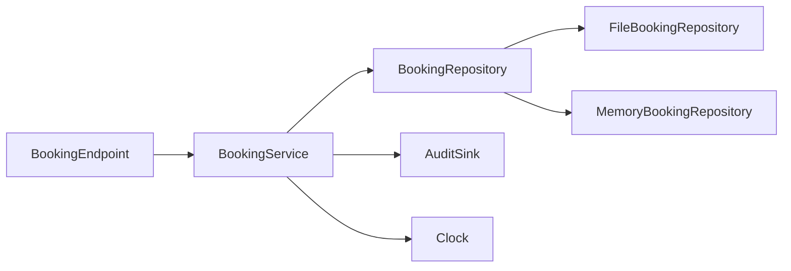
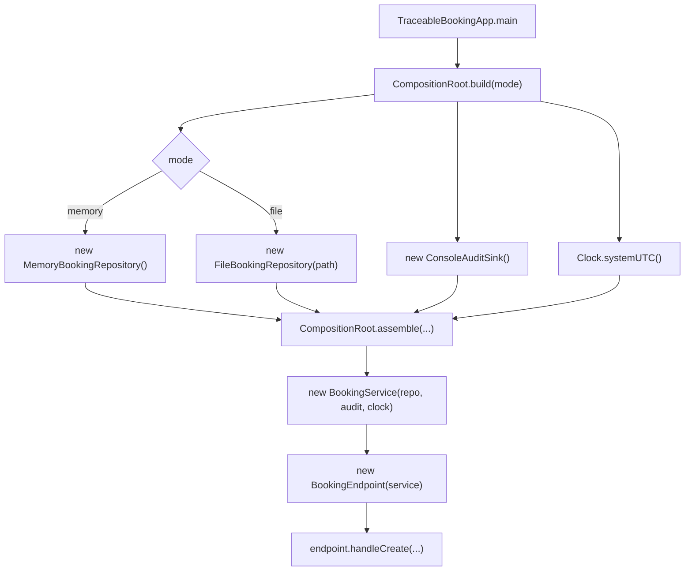

# Giữ đường đi từ điểm vào tới các phụ thuộc có thể truy vết

Trong ứng dụng Java, một yêu cầu có thể bắt đầu ở `main(...)`, một HTTP controller hoặc một consumer nhận thông điệp. Từ điểm vào đó, luồng xử lý đi qua service, repository và các thành phần hạ tầng. Khi có lỗi, người phát triển cần trả lời được: **điểm vào dùng service nào, service nhận implementation nào, implementation được tạo ở đâu và phụ thuộc phía sau nó có vòng đời ra sao?**

**Composition root (điểm lắp ghép)** giúp câu trả lời trở nên rõ ràng. Đây là nơi khởi tạo và nối các cộng tác viên thành một đồ thị đối tượng. Với **Dependency Injection (DI)**, lớp nghiệp vụ khai báo nhu cầu qua constructor; với **Inversion of Control (IoC)**, quyết định tạo và chọn implementation được chuyển ra nơi lắp ghép. Nếu các đường nối được tổ chức hợp lý, ta có thể lần từ **điểm vào ứng dụng** đến **phụ thuộc thật sự đang được sử dụng** mà không phải tìm các lệnh tạo đối tượng rải rác trong nghiệp vụ.

Bài này thuộc chương **Điểm lắp ghép**. Ta sẽ học cách giữ đường phụ thuộc có thể truy vết, lắp ghép thủ công bằng Java thuần, đọc cấu hình và scope đúng chỗ, kiểm thử một đường xử lý qua nhiều tầng, rồi xem điều gì cần giữ lại khi chuyển sang DI container.

## 1. “Có thể truy vết” nghĩa là gì?

Xét ứng dụng đặt chỗ:



Đồ thị trên cho thấy `BookingService` biết **hợp đồng** `BookingRepository`, `AuditSink` và `Clock`. Nó **không nói** tại một lần khởi động cụ thể repository nào được chọn. Muốn truy vết chính xác một ứng dụng đang chạy, ta cần nhìn thêm nơi lắp ghép:



Có **ba đường cần phân biệt**:

| Loại đường | Câu hỏi trả lời | Ví dụ |
| --- | --- | --- |
| **Đường phụ thuộc tĩnh** | Một lớp cần các vai trò hoặc kiểu nào? | `BookingService → BookingRepository` |
| **Đường lắp ghép khi khởi động** | Ai tạo instance, chọn implementation và nối chúng? | `main → CompositionRoot → FileBookingRepository → BookingService` |
| **Đường gọi tại thời điểm xử lý** | Một request cụ thể thực sự chạy qua phương thức nào? | `BookingEndpoint.handleCreate → BookingService.create → repository.save` |

Sơ đồ tĩnh thể hiện *khả năng phụ thuộc*; sơ đồ lắp ghép thể hiện *những đối tượng thực sự được cấu hình*; trace lúc chạy thể hiện *những lời gọi thật sự xảy ra*. Một repository được lắp sẵn không có nghĩa mỗi yêu cầu đều gọi `save`. Ngược lại, khi service gọi `save` qua interface, cần biết đối tượng được inject là instance nào để điều tra lỗi ở lớp triển khai.

**Tính truy vết** không đồng nghĩa một công cụ tự động hiển thị toàn bộ đồ thị. Nó là thuộc tính thiết kế: người đọc có thể đi theo những mối nối có tên, các constructor và nơi chọn implementation để giải thích hệ thống đang dùng gì.

## 2. Giữ một đường rõ ràng từ điểm vào đến cộng tác viên

Giả sử chương trình khởi động qua `TraceableBookingApp.main(...)`. Đường đi dễ theo dõi nên có cấu trúc:

1. **Điểm vào** đọc tham số khởi động và gọi hàm dựng đồ thị.
2. **Composition root** quyết định implementation theo cấu hình, tạo các đối tượng phụ thuộc cấp thấp.
3. **Composition root** truyền các đối tượng vào constructor của service rồi endpoint.
4. **Endpoint** chỉ gọi service; **service** chỉ gọi các hợp đồng phụ thuộc của mình.
5. **Đối tượng hạ tầng** thực hiện thao tác lưu, gửi thông báo hoặc truy cập tài nguyên.

Điểm quan trọng là không để một service phải tự “tìm” repository bằng registry toàn cục hoặc đọc biến môi trường để quyết định adapter. Khi phụ thuộc được truyền qua constructor, mỗi cạnh có một vị trí nhận diện trong mã và một nơi cung cấp ở composition root.

Một sơ đồ phụ thuộc ngắn không luôn là tốt nhất. Ví dụ, `Endpoint → Service → Repository → DatabaseClient` có bốn tầng nhưng dễ hiểu nếu mỗi tầng có trách nhiệm rõ ràng. Ngược lại, `Service → GlobalRegistry.get(...)` có vẻ ngắn, nhưng thực chất che mất nơi cấu hình và nhiều phụ thuộc gián tiếp.

## 3. Ví dụ Java thuần: lắp ghép từ điểm vào

Ta xây dựng ứng dụng nhỏ hỗ trợ hai cách lưu booking: trong bộ nhớ hoặc ghi nối vào tệp. Các thành phần chính:

- `BookingEndpoint` là điểm vào của một thao tác tạo booking.
- `BookingService` xác thực dữ liệu, tạo booking, lưu và ghi sự kiện kiểm toán.
- `BookingRepository`, `AuditSink` là hai hợp đồng của service; `Clock` cung cấp thời điểm.
- `MemoryBookingRepository` và `FileBookingRepository` là hai implementation có thể chọn tại khởi động.
- `CompositionRoot` chọn, tạo và nối phụ thuộc thành một `BookingEndpoint` sẵn sàng sử dụng.

Để tập trung vào DI, ví dụ dùng console cho audit và một tệp văn bản đơn giản cho storage. Nó không cung cấp giao dịch, ghi đồng thời an toàn hay cơ chế tránh trùng bản ghi như một hệ thống sản xuất.

Tạo file `TraceableBookingApp.java`:

```java
import java.io.IOException;
import java.io.UncheckedIOException;
import java.nio.charset.StandardCharsets;
import java.nio.file.Files;
import java.nio.file.Path;
import java.nio.file.Paths;
import java.nio.file.StandardOpenOption;
import java.time.Clock;
import java.time.Instant;
import java.util.HashMap;
import java.util.Map;
import java.util.Objects;

final class Booking {
    private final String id;
    private final Instant createdAt;

    Booking(String id, Instant createdAt) {
        if (id == null || !id.matches("[A-Za-z0-9-]+")) {
            throw new IllegalArgumentException("bookingId khong hop le");
        }
        this.id = id;
        this.createdAt = Objects.requireNonNull(createdAt, "createdAt");
    }

    String id() {
        return id;
    }

    Instant createdAt() {
        return createdAt;
    }
}

interface BookingRepository {
    void save(Booking booking);
}

interface AuditSink {
    void record(String bookingId, String event);
}

final class MemoryBookingRepository implements BookingRepository {
    private final Map<String, Booking> bookings = new HashMap<>();

    @Override
    public void save(Booking booking) {
        bookings.put(booking.id(), booking);
    }
}

final class FileBookingRepository implements BookingRepository {
    private final Path path;

    FileBookingRepository(Path path) {
        this.path = Objects.requireNonNull(path, "path");
    }

    @Override
    public void save(Booking booking) {
        String line = booking.id() + "," + booking.createdAt()
            + System.lineSeparator();
        try {
            Path parent = path.getParent();
            if (parent != null) {
                Files.createDirectories(parent);
            }
            Files.write(path, line.getBytes(StandardCharsets.UTF_8),
                StandardOpenOption.CREATE, StandardOpenOption.APPEND);
        } catch (IOException exception) {
            throw new UncheckedIOException("Khong ghi duoc booking", exception);
        }
    }
}

final class ConsoleAuditSink implements AuditSink {
    @Override
    public void record(String bookingId, String event) {
        System.out.println("AUDIT " + bookingId + " " + event);
    }
}

final class BookingService {
    private final BookingRepository repository;
    private final AuditSink auditSink;
    private final Clock clock;

    BookingService(BookingRepository repository, AuditSink auditSink,
                   Clock clock) {
        this.repository = Objects.requireNonNull(repository, "repository");
        this.auditSink = Objects.requireNonNull(auditSink, "auditSink");
        this.clock = Objects.requireNonNull(clock, "clock");
    }

    Booking create(String bookingId) {
        Booking booking = new Booking(bookingId, clock.instant());
        repository.save(booking);
        auditSink.record(booking.id(), "CREATED");
        return booking;
    }
}

final class BookingEndpoint {
    private final BookingService service;

    BookingEndpoint(BookingService service) {
        this.service = Objects.requireNonNull(service, "service");
    }

    Booking handleCreate(String bookingId) {
        return service.create(bookingId);
    }
}

final class CompositionRoot {
    private CompositionRoot() {
        // Lop tien ich chi giu cac ham lap ghep.
    }

    static BookingEndpoint build(String mode) {
        BookingRepository repository = repositoryFor(mode);
        AuditSink audit = new ConsoleAuditSink();
        Clock clock = Clock.systemUTC();

        // Cho biet lua chon khi khoi dong, khong in mat khau/cau hinh nhay cam.
        System.out.println("WIRING mode=" + mode
            + " repository=" + repository.getClass().getSimpleName());

        return assemble(repository, audit, clock);
    }

    static BookingRepository repositoryFor(String mode) {
        if ("memory".equalsIgnoreCase(mode)) {
            return new MemoryBookingRepository();
        }
        if ("file".equalsIgnoreCase(mode)) {
            return new FileBookingRepository(
                Paths.get("data", "bookings.csv"));
        }
        throw new IllegalArgumentException(
            "mode phai la 'memory' hoac 'file': " + mode);
    }

    static BookingEndpoint assemble(BookingRepository repository,
                                    AuditSink audit, Clock clock) {
        BookingService service = new BookingService(repository, audit, clock);
        return new BookingEndpoint(service);
    }
}

public class TraceableBookingApp {
    public static void main(String[] args) {
        // Diem vao ung dung.
        String mode = args.length == 0 ? "memory" : args[0];
        BookingEndpoint endpoint = CompositionRoot.build(mode);

        Booking result = endpoint.handleCreate("BK-001");
        System.out.println("DONE " + result.id()
            + " at " + result.createdAt());
    }
}
```

Biên dịch và chạy bằng JDK 8 trở lên:

```bash
javac TraceableBookingApp.java
java TraceableBookingApp memory
```

Ví dụ kết quả (thời gian thực tế thay đổi giữa các lần chạy):

```text
WIRING mode=memory repository=MemoryBookingRepository
AUDIT BK-001 CREATED
DONE BK-001 at 2026-11-18T02:00:00Z
```

Chuyển sang file storage:

```bash
java TraceableBookingApp file
```

Console sẽ cho biết `repository=FileBookingRepository` và chương trình tạo/ghi nối một dòng như `BK-001,2026-11-18T02:00:00Z` vào `data/bookings.csv`, tính từ thư mục làm việc khi chạy. Khi chạy lặp lại, ví dụ này sẽ ghi thêm dòng thay vì cập nhật bản ghi. Không sử dụng cách ghi minh họa này cho dữ liệu cần transaction hoặc truy cập đồng thời mà chưa thiết kế bảo đảm tương ứng.

Điểm cần đọc trong mã không nằm ở số lệnh `new`, mà nằm ở **vị trí** của chúng: hai repository được tạo **chỉ** trong `CompositionRoot.repositoryFor(...)`; service không có điều kiện nào phụ thuộc `mode`. `BookingEndpoint` không biết class repository nào đang chạy.

## 4. Lần theo toàn bộ đường từ một booking

Giả sử chương trình được chạy bằng `java TraceableBookingApp file`. Ta có thể ghi ra đường lắp ghép và đường gọi như sau:

| Bước | Lệnh hoặc vị trí | Điều có thể xác nhận |
| --- | --- | --- |
| 1 | `TraceableBookingApp.main(args)` | `mode = "file"` được đưa vào điểm lắp ghép |
| 2 | `CompositionRoot.build("file")` | Bắt đầu cấu hình đồ thị cho tiến trình |
| 3 | `CompositionRoot.repositoryFor("file")` | Trả về một `FileBookingRepository` với path đã chọn |
| 4 | `new ConsoleAuditSink()`, `Clock.systemUTC()` | Tạo các cộng tác viên khác của service |
| 5 | `CompositionRoot.assemble(...)` | Truyền repo, audit, clock vào constructor của `BookingService` |
| 6 | `new BookingEndpoint(service)` | Nối điểm vào thao tác với service vừa tạo |
| 7 | `endpoint.handleCreate("BK-001")` | Điểm vào gọi service, không tự chọn storage |
| 8 | `service.create(...)` | Tạo `Booking`, gọi `repository.save(...)` và `auditSink.record(...)` |
| 9 | `FileBookingRepository.save(...)` | Ghi file; đây là implementation chạy thật cho nhánh `file` |

Khi bắt đầu từ câu hỏi “Tại sao lần chạy này ghi vào file?”, chỉ cần đi từ `main` đến `repositoryFor` để biết lựa chọn, rồi lần theo constructor đến lời gọi `save`. **Không cần đoán** implementation bằng tên biến kiểu interface ở service.

Khi bắt đầu từ câu hỏi “Thành phần nào sử dụng `FileBookingRepository`?”, ta lần **ngược** từ nơi tạo instance tới vị trí truyền nó vào `BookingService`; sau đó đến `BookingEndpoint` và điểm vào. Cách đi ngược này đặc biệt hữu ích khi sửa một adapter và cần xác định các đường sử dụng bị ảnh hưởng.

Mỗi cạnh nên trả lời được hai câu hỏi:

- **Ai cần?** Chữ ký constructor hoặc phương thức thể hiện nhu cầu.
- **Ai cung cấp?** Composition root hoặc factory được composition root gọi thể hiện instance cụ thể.

Với nhánh có nhiều implementation, phải kiểm tra **điều kiện cấu hình** để chọn đúng cạnh được dùng trong lần chạy hiện tại.

## 5. Phân biệt đường lắp ghép với đường gọi thực tế

Đồ thị đối tượng tồn tại sau khi khởi động không bảo đảm mỗi thao tác sẽ sử dụng tất cả nhánh. Ví dụ, giả sử `BookingService.create` có nhánh kiểm tra booking trùng và trả kết quả sớm. Lúc đó repository đọc có thể được gọi, nhưng `save` và `auditSink.record` có thể không được gọi. Đường gọi lúc chạy chỉ chứa những phương thức thực sự thực thi.

Một ví dụ dễ gây nhầm:

```java
// Gia su BookingService da duoc inject repo va auditSink.
Booking createIfValid(String id) {
    if (id == null || id.isEmpty()) {
        throw new IllegalArgumentException("id trong");
    }
    // Cac loi goi xuong repository va audit chi nam sau buoc kiem tra.
    // ...
}
```

Với input không hợp lệ, đồ thị lắp ghép vẫn có repository và audit sink, nhưng request bị chặn trước khi chạm hai cộng tác viên đó. Vì thế, khi điều tra lỗi hoặc thiết kế test, cần chỉ rõ đang chứng minh **đồ thị đã nối đúng** hay **một nhánh thực thi đã được gọi**.

Một bảng phân biệt hữu ích:

| Hoạt động | Thông tin chính | Công cụ/cách quan sát |
| --- | --- | --- |
| Đọc constructor | Phụ thuộc trực tiếp cần để tạo lớp | IDE, chữ ký constructor |
| Đọc composition root | Instance và implementation được cung cấp | Mã bootstrap, cấu hình triển khai |
| Theo dõi request | Nhánh xử lý thực sự được gọi, lỗi và thời gian | Debugger, log có correlation ID, tracing |
| Kiểm thử với fake | Service gọi đúng hợp đồng và đúng tham số | Fake/spy ghi nhận lời gọi |
| Kiểm thử tích hợp | Adapter hoạt động đúng với tài nguyên thực | Test repository + file/DB thử nghiệm |

DI làm đường phụ thuộc **rõ ở mức thiết kế**, nhưng không tự động sinh distributed trace. Với dịch vụ nhiều tiến trình, muốn theo dõi một request qua HTTP, queue và database, cần thêm cơ chế quan sát phù hợp như correlation ID, log có cấu trúc hoặc tracing phân tán.

## 6. Giữ các quyết định cấu hình ở nơi truy vết được

Trong ví dụ, việc chọn `memory` hay `file` được đặt trong một phương thức của composition root và có nhánh lỗi cho cấu hình không hợp lệ. Đây là **fail-fast**: thay vì âm thầm dùng memory khi người vận hành gõ `flie`, chương trình từ chối khởi động.

Nếu muốn đọc chế độ từ biến môi trường, có thể chỉ thay phần tại `main`:

```java
String mode = System.getenv("BOOKING_STORAGE");
if (mode == null || mode.trim().isEmpty()) {
    throw new IllegalStateException("Thieu BOOKING_STORAGE");
}
BookingEndpoint endpoint = CompositionRoot.build(mode);
```

Trong bài học, mặc định `memory` khi không truyền đối số giúp chạy thử tiện lợi. Với chương trình cần lưu bền vững, **đừng tự động dùng memory** nếu thiếu cấu hình có thể khiến dữ liệu mất khi tiến trình dừng. Hãy chọn chính sách bắt buộc cấu hình rõ ràng.

Khi cấu hình phức tạp hơn, nên gom và xác thực dữ liệu cấu hình **trước khi dựng đồ thị**. Chỉ truyền thông tin cần thiết cho adapter: đường dẫn vào file repository, URL vào database client, timeout vào client tương ứng. Không cần truyền một đối tượng `GlobalConfig` chứa mọi bí mật vào tất cả service chỉ để mỗi service tự quyết định implementation.

Việc ghi nhận lựa chọn tại startup cũng hữu ích. Ví dụ `WIRING mode=file repository=FileBookingRepository` cho phép đối chiếu cấu hình với đồ thị. Với môi trường sản xuất, log nên ghi **tên vai trò, implementation hoặc cấu hình an toàn**, tuyệt đối tránh mật khẩu, token, connection string có credential và dữ liệu người dùng nhạy cảm.

## 7. Khi đồ thị lớn: giữ ranh giới lắp ghép rõ

Ứng dụng lớn có thể có hàng chục hoặc hàng trăm đối tượng. Composition root không nhất thiết phải là một phương thức `main` rất dài; ta có thể chia thành các **hàm lắp ghép có trách nhiệm rõ**:

```java
// Phac thao; cac kieu AppConfig, DatabaseClient, ... chua dinh nghia.
DatabaseClient buildDatabaseClient(AppConfig config) { ... }
BookingRepository buildRepository(DatabaseClient client) { ... }
BookingEndpoint buildBookingEndpoint(
        BookingRepository repository, AuditSink audit, Clock clock) { ... }
```

Các hàm này vẫn được gọi từ **một luồng dựng đồ thị do composition root điều phối**. Mỗi hàm thể hiện input, output và phụ thuộc tạo ra. Nhờ vậy, muốn biết `DatabaseBookingRepository` nhận `DatabaseClient` nào, ta có thể truy từ `buildRepository(client)` ngược về `buildDatabaseClient(config)`.

Lưu ý: một factory chuyên dụng **được inject để tạo object theo nhu cầu nghiệp vụ** có thể là thiết kế hợp lệ. Vấn đề xuất hiện khi mọi lớp đều lén truy cập một service locator toàn cục hoặc tự chọn adapter bằng cấu hình môi trường, khiến đường lắp ghép bị phân tán.

**Không biến composition root thành nơi xử lý nghiệp vụ.** Nó nên tập trung vào chọn implementation, tạo object, cấu hình vòng đời và chuyển điều khiển cho điểm vào. Logic như tính giá, duyệt booking, xác thực quy tắc nghiệp vụ vẫn thuộc service hoặc domain.

## 8. Scope và vòng đời cũng là một phần của đường truy vết

Hai instance cùng class không nhất thiết có cùng trạng thái. Điều này quan trọng với repository bộ nhớ:

```java
BookingRepository first = new MemoryBookingRepository();
BookingRepository second = new MemoryBookingRepository();
// Hai instance MemoryBookingRepository co hai Map doc lap.
```

Nếu hai điểm vào cần chia sẻ dữ liệu, composition root phải cấp **cùng instance** cho các service thích hợp; nếu cần cô lập trạng thái, nó có thể tạo hai instance riêng. Quyết định đó không nằm trong chữ ký interface.

Khi theo một đường phụ thuộc, ngoài class và implementation, hãy ghi lại:

- **Scope:** instance sống suốt ứng dụng, theo request hay theo mỗi lần tạo?
- **Identity:** nhiều service đang dùng cùng object hay những object khác nhau?
- **Ownership:** nơi nào sở hữu tài nguyên và có trách nhiệm giải phóng?
- **Concurrency:** object được chia sẻ có an toàn với nhiều luồng không?

Ví dụ `MemoryBookingRepository` dùng `HashMap` ở trên chỉ để chạy minh họa tuần tự; nếu nhiều luồng đồng thời ghi, cần thiết kế đồng bộ hoặc dùng cấu trúc dữ liệu và quy tắc nhất quán phù hợp. Constructor injection không làm một instance tự động trở thành thread-safe.

Một rủi ro khác là service sống suốt ứng dụng nhưng giữ trong trường một `RequestContext` chỉ hợp lệ cho một yêu cầu. Nếu theo đường `main → singleton service → request context`, ta sẽ phát hiện chênh lệch vòng đời. Thường nên truyền dữ liệu request theo phương thức hoặc dùng cơ chế cung cấp dependency đúng scope, thay vì giữ instance có thể hết hạn.

Với client có socket, file handle hoặc thread pool, composition root cũng cần xác định **ai đóng tài nguyên khi ứng dụng dừng**. Ví dụ:

```java
// Mau minh hoa, khong la mot phan cua vi du co the bien dich o muc 3.
try (DatabaseClient client = new DatabaseClient(config)) {
    BookingRepository repository = new DatabaseBookingRepository(client);
    BookingService service = new BookingService(repository, audit, clock);
    runApplication(service);
} // client.close() khi thoat khoi scope try.
```

`DatabaseClient` ở mẫu này được giả định implement `AutoCloseable`. Trong ứng dụng web chạy dài hạn, composition root hoặc cơ chế shutdown của framework có thể giữ tài nguyên đến khi dừng máy chủ. Service dùng chung client không nên tự đóng client sau một request, vì các service khác vẫn có thể cần nó.

## 9. Kiểm thử để chứng minh đường phụ thuộc

Ta muốn xác nhận hai điều riêng biệt:

1. `CompositionRoot` thực sự chọn implementation mong đợi khi có cấu hình.
2. Đường `BookingEndpoint → BookingService → BookingRepository/AuditSink` truyền đúng dữ liệu và gọi đúng nhánh.

Tạo file `TraceableBookingAppTest.java` trong cùng thư mục:

```java
import java.time.Clock;
import java.time.Instant;
import java.time.ZoneOffset;

public class TraceableBookingAppTest {
    static final class RecordingRepository implements BookingRepository {
        Booking saved;
        int saveCount;

        @Override
        public void save(Booking booking) {
            saved = booking;
            saveCount++;
        }
    }

    static final class RecordingAuditSink implements AuditSink {
        String bookingId;
        String event;
        int recordCount;

        @Override
        public void record(String bookingId, String event) {
            this.bookingId = bookingId;
            this.event = event;
            recordCount++;
        }
    }

    public static void main(String[] args) {
        RecordingRepository repository = new RecordingRepository();
        RecordingAuditSink audit = new RecordingAuditSink();
        Instant instant = Instant.parse("2026-01-01T00:00:00Z");
        Clock clock = Clock.fixed(instant, ZoneOffset.UTC);

        // Lap ghep cong khai cac fake qua dung duong service -> endpoint.
        BookingEndpoint endpoint = CompositionRoot.assemble(
            repository, audit, clock);

        Booking booking = endpoint.handleCreate("BK-TEST");
        check(booking.createdAt().equals(instant), "Sai thoi diem");
        check(repository.saved == booking, "Sai booking dua vao repository");
        check(repository.saveCount == 1, "Phai luu dung mot lan");
        check("BK-TEST".equals(audit.bookingId), "Sai ID audit");
        check("CREATED".equals(audit.event), "Sai event audit");
        check(audit.recordCount == 1, "Phai ghi audit dung mot lan");

        // Chon implementation: chi tao adapter, chua ghi file.
        check(CompositionRoot.repositoryFor("memory")
                instanceof MemoryBookingRepository,
            "Sai repository cho mode memory");
        check(CompositionRoot.repositoryFor("file")
                instanceof FileBookingRepository,
            "Sai repository cho mode file");

        boolean rejected = false;
        try {
            CompositionRoot.repositoryFor("unknown");
        } catch (IllegalArgumentException expected) {
            rejected = true;
        }
        check(rejected, "Phai tu choi mode khong hop le");

        // Khi repository loi, audit o phia sau save khong duoc goi.
        RecordingAuditSink secondAudit = new RecordingAuditSink();
        BookingRepository failingRepository = new BookingRepository() {
            @Override
            public void save(Booking item) {
                throw new IllegalStateException("storage failed");
            }
        };
        BookingEndpoint failingEndpoint = CompositionRoot.assemble(
            failingRepository, secondAudit, clock);
        boolean failed = false;
        try {
            failingEndpoint.handleCreate("BK-FAIL");
        } catch (IllegalStateException expected) {
            failed = true;
        }
        check(failed, "Loi repository phai duoc truyen len");
        check(secondAudit.recordCount == 0,
            "Khong ghi audit khi save that bai");

        System.out.println("TraceableBookingAppTest PASSED");
    }

    static void check(boolean condition, String message) {
        if (!condition) {
            throw new AssertionError(message);
        }
    }
}
```

Biên dịch và chạy:

```bash
javac TraceableBookingApp.java TraceableBookingAppTest.java
java TraceableBookingAppTest
```

Kết quả mong đợi:

```text
TraceableBookingAppTest PASSED
```

Ở test này, `CompositionRoot.assemble(...)` là một seam lắp ghép được dùng lại để truyền fake cho service. Ta kiểm tra được đường gọi từ endpoint đến repository/audit mà không phải tạo tài nguyên thật. Ngoài ra, kiểm tra `repositoryFor("file")` chỉ xác nhận **đường chọn implementation**, chưa chứng minh việc ghi file đúng. Cần một **integration test** riêng dùng tệp tạm, gọi `save(...)`, đọc và xác nhận nội dung rồi dọn tệp.

Test lỗi repository cũng cho thấy một giới hạn: thao tác `save` xong rồi `auditSink.record` sau đó có thể để lại trạng thái lưu thành công nhưng audit thất bại. Khi hệ thống có yêu cầu đảm bảo tính nguyên tử, cần thiết kế giao dịch hoặc outbox phù hợp; trace rõ đường gọi chỉ giúp phát hiện ranh giới này, không tự giải quyết nhất quán dữ liệu.

## 10. Gắn log và correlation ID vào đúng luồng

Đối với ứng dụng thực tế, đường lắp ghép giải thích **thành phần nào** đang chạy, còn log/tracing giải thích **request nào** đã đi qua các thành phần đó. Một kiểu log đơn giản có thể gồm:

```text
startup: storage=file repository=FileBookingRepository
requestId=req-123 endpoint=createBooking start
requestId=req-123 service=createBooking bookingId=BK-001
requestId=req-123 repository=FileBookingRepository action=save success
requestId=req-123 endpoint=createBooking success
```

Đây là ví dụ về **định dạng log dự kiến**, không phải output tự động của chương trình phần 3. Để có các dòng này, cần chủ động thêm log tại các ranh giới phù hợp. Trong hệ thống nhiều request đồng thời, dùng một correlation/request ID riêng (không phụ thuộc booking ID), truyền nó qua ngữ cảnh request hoặc API thích hợp. Tránh ghi dữ liệu bí mật hay thông tin cá nhân vào log.

Nhờ log khởi động và request cùng có các trường cần thiết, khi thấy lỗi ở repository, ta có thể kết nối thông tin **request đi qua đâu** với **implementation đã được lắp ghép nào**. Đừng xem việc dùng DI như một thay thế cho observability: đây là hai khả năng bổ trợ nhau.

## 11. Các anti-pattern khiến đường phụ thuộc khó truy vết

| Cách viết gây khó theo dõi | Vì sao khó truy vết | Hướng sửa |
| --- | --- | --- |
| Service tự gọi `new FileBookingRepository(...)` | Chọn implementation nằm trong nghiệp vụ | Truyền `BookingRepository` qua constructor, chọn ở composition root |
| Dùng `GlobalRegistry.get(...)` trong nhiều lớp | Phụ thuộc bị giấu, khó xác định ai cấp instance | Khai báo cộng tác viên trực tiếp qua constructor |
| Mỗi method đọc lại biến môi trường | Một ứng dụng có thể chọn đường chạy khác nhau một cách khó dự đoán | Đọc và xác thực cấu hình ở rìa ứng dụng |
| Tạo nhiều object trạng thái mà tưởng là một | Các đường xử lý thấy trạng thái không nhất quán | Chỉ rõ identity và scope trong mã lắp ghép |
| Factory tùy ý nằm khắp codebase | Không còn một luồng dựng đồ thị rõ | Gom việc chọn adapter vào các factory được composition root điều phối |
| Container tự động chọn trong số nhiều implementation không rõ cấu hình | Khó biết instance nào thực sự được inject | Khai báo binding/qualifier rõ, kiểm tra cấu hình khởi động |
| Ghi log nhưng không có request ID | Không ghép được các lời gọi của một request khi chạy đồng thời | Truyền correlation ID qua ranh giới xử lý |

Một **circular dependency** cũng làm việc dựng và truy vết khó hơn: `A → B → C → A` không có nút lá để khởi tạo theo constructor thông thường. Thay vì che chu trình bằng tra cứu toàn cục hoặc tạo trễ tùy tiện, hãy xem lại trách nhiệm các lớp và cân nhắc tách một vai trò độc lập.

## 12. Khi chuyển từ manual DI sang DI container

DI container có thể tự tạo và nối đồ thị theo các binding đã cấu hình. Khi đó, đường từ điểm vào đến phụ thuộc vẫn phải trả lời được: **tại sao container chọn implementation này, nó thuộc scope nào và nguồn cấu hình ở đâu?**

Hãy giữ các nguyên tắc đã thực hành:

- Constructor của service khai báo đúng các phụ thuộc trực tiếp; nghiệp vụ không phụ thuộc vào API của container nếu không có lý do rõ.
- Binding interface → implementation và cấu hình scope được đặt ở lớp cấu hình/khởi động có thể tìm được.
- Lỗi thiếu hoặc mơ hồ binding nên được phát hiện sớm khi dựng ứng dụng.
- Các phụ thuộc có tài nguyên phải có vòng đời và quyền sở hữu rõ ràng.
- Test service vẫn có thể dùng Java thuần và fake; test wiring/container kiểm tra việc chọn bean/binding và scope.

Các container có quy tắc lựa chọn constructor, xử lý nhiều implementation và phạm vi sống khác nhau. Không nên mặc định một quy tắc của framework áp dụng cho mọi container. Điều cốt lõi không thay đổi: **khả năng truy vết cần được giữ từ nơi cấu hình tới instance đã inject và từ điểm vào tới hành vi thực thi**.

## 13. Bài tập thực hành

**Bài 1 — Đổi implementation nhưng không sửa nghiệp vụ.** Thêm một `RejectingBookingRepository` ném `IllegalStateException` ở `save(...)`. Cho `CompositionRoot.repositoryFor("reject")` chọn implementation đó. Chạy chương trình, xác định điểm phát sinh lỗi và đường đi của exception từ repository qua service, endpoint tới `main`. Không thêm điều kiện `mode` vào `BookingService`.

**Bài 2 — Tách cấu hình khởi động.** Viết `AppConfig` nhận giá trị `memory` hoặc `file`, kiểm tra nó trước khi gọi `CompositionRoot.build(...)`. Với mode sai, chương trình phải thất bại trước khi gọi nghiệp vụ. Giải thích vì sao cách này dễ điều tra hơn khi service tự đọc biến môi trường.

**Bài 3 — Truy vết vòng đời.** Cho hai endpoint khác nhau sử dụng cùng một instance `MemoryBookingRepository`. Sau đó đổi để mỗi endpoint nhận instance riêng. Mô tả khác biệt về dữ liệu quan sát được và chỉ ra dòng nào trong composition root quyết định việc chia sẻ đó.

**Bài 4 — Phân biệt wiring và invocation.** Thêm kiểm tra input để `BookingService.create(...)` từ chối ID không hợp lệ trước khi gọi `repository.save(...)`. Viết fake ghi lại số lượt gọi và chứng minh input sai không đi đến repository, dù repository vẫn đã được tạo khi khởi động.

**Bài 5 — Vẽ đường phụ thuộc.** Với `Main → Controller → Service → Repository → DatabaseClient`, hãy đánh dấu tại lớp nào có constructor nhận cộng tác viên, nơi nào chọn implementation cụ thể và nơi nào phải quản lý việc đóng client. Nếu `DatabaseClient` được chia sẻ cho hai repository, hãy giải thích ai chịu trách nhiệm đóng nó.

Muốn đường phụ thuộc từ điểm vào đến lớp hạ tầng có thể truy vết, hãy để mỗi thành phần **nói rõ nó cần gì**, để composition root **chọn, tạo và nối các instance**, đồng thời quản lý cấu hình, scope và vòng đời tại nơi thích hợp. Khi cần điều tra, kết hợp đồ thị lắp ghép với đường gọi thực tế và log theo request; lúc đó việc mở rộng hệ thống hoặc chuyển sang DI container vẫn giữ được khả năng giải thích từng phụ thuộc đến từ đâu.
