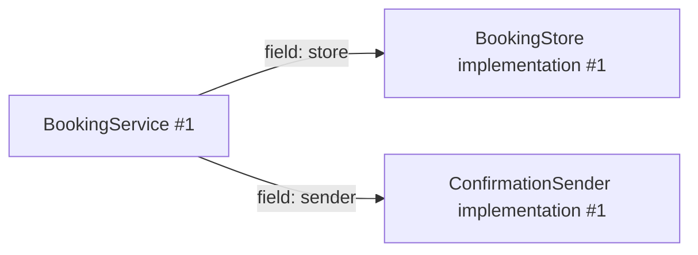
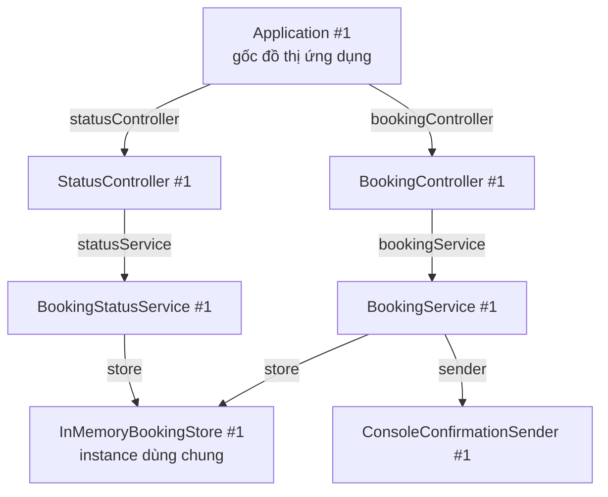
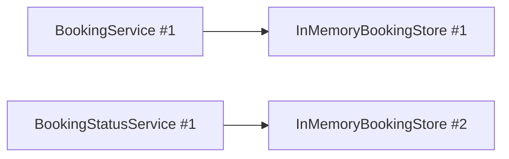
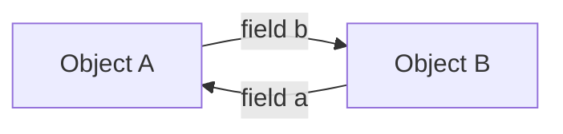

# Nút, cạnh, điểm gốc và danh tính instance trong đồ thị đối tượng

## 1. Vì sao học đồ thị đối tượng trước khi dùng DI container?

Trong **Dependency Injection (DI)**, một đối tượng cần cộng tác viên để hoạt động. Các cộng tác viên này có thể lại cần đối tượng khác. Khi lắp ghép chúng, ứng dụng tạo ra một **đồ thị đối tượng** (*object graph*): tập hợp các **instance** đang tồn tại cùng các **tham chiếu** nối chúng lại với nhau.

Ví dụ, một bộ điều khiển gọi service xác nhận đặt chỗ; service dùng kho lưu trữ và bộ gửi thông báo. Một service khác đọc trạng thái đặt chỗ từ **chính kho lưu trữ đó**. Muốn giải thích vì sao hai service cùng quan sát được một trạng thái, ta cần nhìn **danh tính instance** và **đường đi tham chiếu**, chứ chỉ xem tên lớp là chưa đủ.

Trong module **DEPENDENCY_INJECTION**, ta học **Dependency Injection** và **Inversion of Control (IoC)** để tách quá trình *sử dụng phụ thuộc* khỏi *tạo và lắp ghép đối tượng*. Đồ thị đối tượng là mô hình để hiểu những gì **constructor injection** và **composition root** đang thực hiện, cách các **scope/vòng đời** ảnh hưởng đến việc dùng chung dữ liệu, và cách tạo đồ thị nhỏ bằng Java thuần khi kiểm thử trước khi dùng DI container.

Ba khái niệm chính:

| Khái niệm | Trong đồ thị đối tượng | Cách nhận biết bằng Java |
| --- | --- | --- |
| **Nút** (*node*) | Một instance cụ thể được tạo trong lúc chạy, ví dụ đối tượng `BookingService`. | Một kết quả tạo đối tượng bằng `new` (hoặc từ factory/container), xét theo danh tính đối tượng. |
| **Cạnh** (*edge*) | Một tham chiếu từ instance này đến instance khác. | Trường `store`, `sender` hoặc một cấu trúc dữ liệu giữ tham chiếu. |
| **Điểm gốc** (*root*) | Đối tượng đầu mối mà từ đó ta lần theo các cạnh để quan sát phần đồ thị ứng dụng. | Ví dụ instance `Application` giữ hai controller. |

Bên cạnh ba khái niệm này, phải phân biệt **danh tính instance**: hai biến cùng có kiểu `BookingStore` có thể trỏ **cùng một** đối tượng hoặc **hai đối tượng khác nhau**. Sự khác biệt này ảnh hưởng trực tiếp đến trạng thái chia sẻ, kiểm thử và quản lý vòng đời.

## 2. Một instance là một nút, không phải một class

**Class** là bản thiết kế ở mức mã nguồn; **instance** là đối tượng cụ thể được tạo trong lúc thực thi. Các lần khởi tạo độc lập thường cho các instance độc lập, dù cùng một class.

```java
Object a = new Object();
Object b = new Object();
Object sameAsA = a;

System.out.println(a == b);        // false: hai instance.
System.out.println(a == sameAsA);  // true: cùng một instance.
```

Trong đồ thị:

- `a` và `sameAsA` là **hai biến tham chiếu tới cùng một nút**.
- `b` trỏ tới **một nút khác** dù cũng có kiểu `Object`.
- Không nên đếm số biến, số class hoặc số constructor làm số nút của đồ thị.

### Kiểu dữ liệu và danh tính trả lời hai câu hỏi khác nhau

| Câu hỏi | Cách trả lời |
| --- | --- |
| “Đây là loại đối tượng nào?” | Kiểu khai báo hoặc class thực tế, ví dụ `BookingStore` và `InMemoryBookingStore`. |
| “Đây có chính là đối tượng kia không?” | So sánh tham chiếu bằng `==` hoặc `!=` đối với object. |
| “Hai đối tượng có nội dung được coi là bằng nhau không?” | `equals(...)` theo hợp đồng của class. |
| “Đối tượng có cùng mã định danh nghiệp vụ không?” | Kiểm tra một thuộc tính nghiệp vụ, ví dụ `bookingId`; điều đó không chứng minh cùng instance. |

Ví dụ có hai chuỗi mang cùng nội dung:

```java
String first = new String("B-101");
String second = new String("B-101");

System.out.println(first.equals(second)); // true: cùng nội dung.
System.out.println(first == second);       // false: hai String được tạo riêng.
```

`equals(...)` có thể được ghi đè theo quy tắc của lớp; nó **không** phải phép đo danh tính. Ngược lại, `==` trên hai tham chiếu đối tượng kiểm tra chúng có cùng trỏ đến một instance không. Khi phân tích đồ thị phụ thuộc, **cùng tham chiếu** là thông tin cần thiết hơn việc hai đối tượng “có dữ liệu giống nhau”.

**Lưu ý về phạm vi mô hình:** một đồ thị heap đầy đủ còn bao gồm `String`, collection, object nội bộ và các đối tượng thư viện. Trong tài liệu DI, ta thường **đơn giản hóa** để chỉ vẽ những instance cộng tác viên quan trọng; không phải mọi giá trị nguyên thủy hay chuỗi đều cần một nút trong sơ đồ.

## 3. Cạnh biểu diễn tham chiếu và có chiều

Xem constructor injection:

```java
final class BookingService {
    private final BookingStore store;
    private final ConfirmationSender sender;

    BookingService(BookingStore store, ConfirmationSender sender) {
        this.store = java.util.Objects.requireNonNull(store, "store");
        this.sender = java.util.Objects.requireNonNull(sender, "sender");
    }
}
```

Đây là **đoạn minh họa**, còn các interface và chương trình chạy đầy đủ nằm ở mục 6.

Khi constructor lưu các tham số vào trường, object `BookingService` có **hai cạnh đi ra**:



Cạnh được vẽ theo **chiều tham chiếu**: service giữ tham chiếu tới store/sender. Nó **không** nói store cũng giữ tham chiếu về service. Cũng không nhất thiết có cạnh từ service tới mọi object mà nó từng gọi qua tham số tạm thời.

Ba điểm cần phân biệt:

1. **Cạnh tham chiếu** là quan hệ giữa các object ở thời điểm được xét, thường thông qua các field. Nó có thể thay đổi nếu field hoặc collection cho phép thay đổi tham chiếu.
2. **Cạnh lời gọi** (*call edge*) biểu diễn một method gọi method khác. Đây là thông tin của *call graph*, không đồng nhất với object graph.
3. **Cạnh phụ thuộc mã nguồn** biểu diễn một lớp tham chiếu kiểu/interface của lớp khác để biên dịch. Một interface trong code chưa chắc tương ứng với một object riêng ở runtime.

Ví dụ, `BookingService` có trường kiểu `BookingStore` nhưng field đó trỏ tới instance `InMemoryBookingStore` cụ thể. **Interface là hợp đồng kiểu**, không tự là một object được tạo thêm chỉ vì có lời khai báo `implements`.

## 4. Điểm gốc của đồ thị và composition root là hai khái niệm

Hai thuật ngữ có chữ *root* nhưng diễn đạt hai vai trò khác nhau:

- **Đối tượng gốc trong sơ đồ ứng dụng:** một instance đầu mối như `Application`, `Server` hoặc `BookingController`. Từ nó có thể lần theo các tham chiếu để thấy phần đồ thị liên quan.
- **Composition root:** *vị trí mã* chịu trách nhiệm tạo, chọn implementation và kết nối các đối tượng, thường ở `Main.main()` hoặc bootstrap. Nó không bắt buộc là một object cụ thể trong đồ thị.

Ví dụ:

```java
BookingStore store = new InMemoryBookingStore();
ConfirmationSender sender = new ConsoleConfirmationSender();
BookingService service = new BookingService(store, sender);
BookingController controller = new BookingController(service);
Application app = new Application(controller);
```

Ở đây `main()` là **điểm lắp ghép**, còn `app` trỏ tới **instance gốc** mà chương trình muốn giữ để chạy. Những biến cục bộ `store`, `sender`, `service` vẫn là tham chiếu trong phạm vi `main`. Khi các biến còn hiệu lực, chúng cũng có thể tạo đường tham chiếu từ stack tới những đối tượng đó.

**Đừng đồng nhất gốc sơ đồ DI với GC root của JVM.** Trong cơ chế quản lý bộ nhớ, **GC root** là một khái niệm của JVM để xác định đối tượng có thể truy cập được, ví dụ qua một số tham chiếu trên stack hoặc trường static. `Application` chỉ là “gốc” **theo cách ta chọn vẽ kiến trúc**; nó không tự trở thành một GC root đặc biệt chỉ vì tên class.

Một ứng dụng còn có thể có **nhiều đối tượng đầu mối** và nhiều đồ thị con. “Điểm gốc” trong sơ đồ là công cụ giúp giải thích đường đi, không phải ràng buộc rằng mọi đối tượng trên JVM phải có đúng một gốc.

## 5. Một sơ đồ có chia sẻ instance

Giả sử ứng dụng có hai luồng:

- `BookingController` gọi `BookingService` để xác nhận đặt chỗ.
- `StatusController` gọi `BookingStatusService` để đọc trạng thái xác nhận.

Cả hai service dùng **cùng một instance** `InMemoryBookingStore`, được tạo một lần và truyền vào hai constructor.



Quan sát quan trọng nhất là **hai cạnh trỏ vào cùng nút `InMemoryBookingStore #1`**. Sơ đồ có dạng nhánh hợp lại, không phải hai đường độc lập:

- `BookingService` ghi trạng thái vào `Store #1`.
- `BookingStatusService` đọc trạng thái từ **chính `Store #1`**, nên có thể quan sát giá trị vừa ghi.
- Nếu mỗi service nhận **hai instance store độc lập**, trạng thái trong bộ nhớ của hai store không tự động đồng bộ.

Số nút và số cạnh trong sơ đồ cần dựa trên **instance đang tồn tại và tham chiếu thực tế**. Hai service cùng phụ thuộc kiểu `BookingStore` **không đảm bảo** cùng sử dụng một object. Composition root quyết định chuyện đó bằng cách dùng lại tham chiếu hay tạo object mới.

## 6. Ví dụ Java thuần hoàn chỉnh: vẽ được đồ thị từ code

Lưu toàn bộ ví dụ sau vào **`Main.java`**. Chương trình dùng JDK 11 trở lên, không yêu cầu framework hoặc DI container.

```java
import java.util.HashSet;
import java.util.Objects;
import java.util.Set;

public class Main {
    // Hợp đồng dùng bởi service, không áp đặt công nghệ lưu trữ.
    interface BookingStore {
        void markConfirmed(String bookingId);
        boolean isConfirmed(String bookingId);
    }

    interface ConfirmationSender {
        void send(String bookingId, String email);
    }

    static final class InMemoryBookingStore implements BookingStore {
        private final Set<String> confirmed = new HashSet<>();

        @Override
        public void markConfirmed(String bookingId) {
            confirmed.add(bookingId);
        }

        @Override
        public boolean isConfirmed(String bookingId) {
            return confirmed.contains(bookingId);
        }
    }

    static final class ConsoleConfirmationSender
            implements ConfirmationSender {
        @Override
        public void send(String bookingId, String email) {
            System.out.println("Gửi xác nhận " + bookingId + " tới " + email);
        }
    }

    static final class BookingService {
        private final BookingStore store;
        private final ConfirmationSender sender;

        BookingService(BookingStore store, ConfirmationSender sender) {
            this.store = Objects.requireNonNull(store, "store");
            this.sender = Objects.requireNonNull(sender, "sender");
        }

        void confirm(String bookingId, String email) {
            if (bookingId == null || bookingId.isBlank()) {
                throw new IllegalArgumentException("bookingId không hợp lệ");
            }
            if (email == null || email.isBlank()) {
                throw new IllegalArgumentException("email không hợp lệ");
            }

            store.markConfirmed(bookingId);
            sender.send(bookingId, email);
        }
    }

    static final class BookingStatusService {
        private final BookingStore store;

        BookingStatusService(BookingStore store) {
            this.store = Objects.requireNonNull(store, "store");
        }

        boolean isConfirmed(String bookingId) {
            return store.isConfirmed(bookingId);
        }
    }

    static final class BookingController {
        private final BookingService service;

        BookingController(BookingService service) {
            this.service = Objects.requireNonNull(service, "service");
        }

        void confirm(String bookingId, String email) {
            service.confirm(bookingId, email);
        }
    }

    static final class StatusController {
        private final BookingStatusService service;

        StatusController(BookingStatusService service) {
            this.service = Objects.requireNonNull(service, "service");
        }

        boolean isConfirmed(String bookingId) {
            return service.isConfirmed(bookingId);
        }
    }

    // Đối tượng gốc (top-level object) của đồ thị trong ví dụ.
    static final class Application {
        private final BookingController bookingController;
        private final StatusController statusController;

        Application(BookingController bookingController,
                    StatusController statusController) {
            this.bookingController =
                    Objects.requireNonNull(bookingController, "bookingController");
            this.statusController =
                    Objects.requireNonNull(statusController, "statusController");
        }

        void runDemo() {
            bookingController.confirm("B-101", "khach@example.com");
            System.out.println("Đã xác nhận? "
                    + statusController.isConfirmed("B-101"));
        }
    }

    public static void main(String[] args) {
        // COMPOSITION ROOT: tạo các nút và nối bằng constructor injection.
        BookingStore sharedStore = new InMemoryBookingStore();
        ConfirmationSender sender = new ConsoleConfirmationSender();

        BookingService bookingService =
                new BookingService(sharedStore, sender);
        BookingStatusService statusService =
                new BookingStatusService(sharedStore);

        BookingController bookingController =
                new BookingController(bookingService);
        StatusController statusController =
                new StatusController(statusService);

        Application app = new Application(
                bookingController, statusController);

        app.runDemo();

        // Hai biến kiểu giống nhau có thể trỏ cùng một object.
        BookingStore firstReference = sharedStore;
        BookingStore secondReference = sharedStore;
        BookingStore anotherStore = new InMemoryBookingStore();

        System.out.println("Cùng instance? "
                + (firstReference == secondReference));
        System.out.println("Instance khác? "
                + (firstReference != anotherStore));
    }
}
```

Biên dịch và chạy:

```bash
javac -encoding UTF-8 Main.java
java Main
```

Kết quả dự kiến:

```text
Gửi xác nhận B-101 tới khach@example.com
Đã xác nhận? true
Cùng instance? true
Instance khác? true
```

### Đọc lại các nút và cạnh tương ứng

| Biểu thức trong `main()` | Vai trò trong đồ thị |
| --- | --- |
| `new InMemoryBookingStore()` đầu tiên | Tạo nút `Store #1`; biến `sharedStore` trỏ tới nút này. |
| `new ConsoleConfirmationSender()` | Tạo nút `Sender #1`. |
| `new BookingService(sharedStore, sender)` | Tạo `BookingService #1` với cạnh tới `Store #1` và `Sender #1`. |
| `new BookingStatusService(sharedStore)` | Tạo `StatusService #1` với cạnh tới **cùng `Store #1`**. |
| `new BookingController(bookingService)` | Tạo controller có cạnh tới `BookingService #1`. |
| `new StatusController(statusService)` | Tạo controller có cạnh tới `StatusService #1`. |
| `new Application(...)` | Tạo nút gốc của sơ đồ với hai cạnh tới hai controller. |
| `new InMemoryBookingStore()` cuối cùng | Tạo **`Store #2`** độc lập; không tham gia xử lý trong `app.runDemo()`. |

**Lưu ý:** câu lệnh tạo `Store #2` chỉ phục vụ so sánh identity. Nó không có cạnh từ `Application` và không tham gia vào luồng nghiệp vụ; vẫn có tham chiếu qua biến cục bộ `anotherStore` khi được dùng.

Không cần class tên `ObjectGraph` hoặc container để có đồ thị đối tượng. **Mọi constructor nhận và lưu cộng tác viên đều đang góp phần hình thành đồ thị.**

## 7. Aliasing: nhiều đường đến cùng một instance

**Aliasing** xảy ra khi nhiều tham chiếu cùng chỉ đến một object. Trong ví dụ, `BookingService.store`, `BookingStatusService.store` và biến `sharedStore` đều tham chiếu tới cùng `Store #1`.

Aliasing có lợi khi:

- Hai luồng nghiệp vụ **cần cùng nguồn trạng thái**;
- Một client đắt tiền hoặc đối tượng không trạng thái có thể được **dùng chung có kiểm soát**;
- Hai consumer cần phối hợp qua cùng một cộng tác viên được composition root quản lý.

Nhưng aliasing cũng tiềm ẩn rủi ro:

- Một consumer thay đổi trạng thái trong store, consumer khác quan sát thay đổi ấy theo cách chưa dự tính;
- Đối tượng chia sẻ không an toàn luồng gây lỗi khi nhiều request truy cập đồng thời;
- Consumer này đóng một resource mà consumer kia vẫn đang dùng;
- Một object có trạng thái theo request bị đưa nhầm vào vùng dùng chung.

### Phân biệt dùng chung *tham chiếu* và dùng chung *dữ liệu*

Hai repository adapter khác nhau vẫn có thể chia sẻ **cùng database** hoặc cùng backend dữ liệu; khi đó `repositoryA != repositoryB` không có nghĩa chúng đọc các tập dữ liệu độc lập. Ngược lại, hai `InMemoryBookingStore` trong ví dụ có hai `HashSet` riêng, nên không chia sẻ dữ liệu đặt chỗ.

Vì vậy cần hỏi **hai câu**:

1. **Identity:** “Hai consumer có đang nhận cùng *instance repository* không?”
2. **Storage:** “Hai instance repository có đang truy cập cùng *nguồn dữ liệu* không?”

Phép so sánh `==` chỉ trả lời câu thứ nhất. Sự nhất quán dữ liệu ở database, cache hoặc hệ phân tán đòi hỏi thêm phân tích ở câu thứ hai.

## 8. Khi tạo sai nút: hai service nhận hai repository riêng

Đây là lỗi lắp ghép rất dễ mắc khi dùng DI thủ công:

```java
// Mô tả lỗi wiring; các class đều đã có trong Main.java ở mục 6.
Main.BookingService writer = new Main.BookingService(
        new Main.InMemoryBookingStore(),
        new Main.ConsoleConfirmationSender());

Main.BookingStatusService reader = new Main.BookingStatusService(
        new Main.InMemoryBookingStore());
```

Mỗi `new InMemoryBookingStore()` tạo một nút khác. `writer` ghi vào một `HashSet`, `reader` đọc từ `HashSet` còn lại. Sơ đồ lúc này:



Không có nhánh hợp lại ở store. Dù kiểu của hai tham số constructor đều là `BookingStore` và dù cả hai class giống hệt, **object identity không giống nhau**.

Cách sửa trong composition root là **tạo một lần, lưu tham chiếu, rồi truyền cùng tham chiếu cho các consumer cần chia sẻ**:

```java
Main.InMemoryBookingStore shared = new Main.InMemoryBookingStore();

Main.BookingService writer = new Main.BookingService(
        shared, new Main.ConsoleConfirmationSender());

Main.BookingStatusService reader =
        new Main.BookingStatusService(shared);
```

Không phải *mọi* dependency đều nên dùng chung. Lựa chọn dùng chung hay tạo mới phải dựa trên trạng thái, phạm vi nghiệp vụ, đặc tính đồng thời và vòng đời của từng loại đối tượng.

## 9. Kiểm thử đồ thị: chứng minh có và không có chia sẻ instance

Một bài kiểm thử đơn vị có thể xác minh kết quả của wiring qua **hành vi quan sát được**, thay vì phải dùng reflection hoặc đọc trường private.

Thêm lớp sau **bên ngoài class `Main`** nhưng trong cùng file `Main.java` của mục 6:

```java
class ObjectGraphTest {
    static final class RecordingSender implements Main.ConfirmationSender {
        int calls;
        String lastId;

        @Override
        public void send(String bookingId, String email) {
            calls++;
            lastId = bookingId;
        }
    }

    public static void main(String[] args) {
        Main.InMemoryBookingStore shared = new Main.InMemoryBookingStore();
        RecordingSender sender = new RecordingSender();

        Main.BookingService writer = new Main.BookingService(shared, sender);
        Main.BookingStatusService reader =
                new Main.BookingStatusService(shared);

        writer.confirm("B-202", "test@example.com");

        if (!reader.isConfirmed("B-202")) {
            throw new AssertionError(
                    "Reader không quan sát thấy dữ liệu của shared store");
        }
        if (sender.calls != 1 || !"B-202".equals(sender.lastId)) {
            throw new AssertionError("Sender không nhận đúng dữ liệu");
        }

        // Thay riêng một dependency của reader: trạng thái không tự đồng bộ.
        Main.InMemoryBookingStore separate =
                new Main.InMemoryBookingStore();
        Main.BookingStatusService isolatedReader =
                new Main.BookingStatusService(separate);

        if (isolatedReader.isConfirmed("B-202")) {
            throw new AssertionError("Hai store độc lập lại chia sẻ dữ liệu");
        }
        if (shared == separate) {
            throw new AssertionError("new phải tạo instance store khác");
        }

        System.out.println("PASS: shared và separate graph đúng kỳ vọng");
    }
}
```

Biên dịch rồi chạy test bằng Java thuần:

```bash
javac -encoding UTF-8 Main.java
java ObjectGraphTest
```

Kết quả mong đợi:

```text
PASS: shared và separate graph đúng kỳ vọng
```

**Điều test chứng minh:** trong ví dụ lưu dữ liệu nội bộ, hai service nhận cùng repository có thể phối hợp qua trạng thái; một repository khác không tự nhìn thấy trạng thái đó. Test cũng chứng minh mỗi lời gọi `new` riêng tạo instance khác.

**Điều test chưa chứng minh:** chương trình chạy đa luồng an toàn, cơ sở dữ liệu thật nhất quán hay thông báo ngoài hệ thống luôn thành công. Đây là các yêu cầu riêng cần thiết kế và kiểm thử bổ sung.

## 10. Đồ thị theo thời gian: scope và vòng đời

Một sơ đồ object graph thường là **ảnh chụp tại một thời điểm**, không phải cấu trúc bất biến suốt đời ứng dụng. Instance có thể được tạo mới, thay thế, đưa vào collection hoặc hết đường tham chiếu khi request kết thúc.

Các scope thường gặp:

| Cách lắp ghép | Tác động tới nút/cạnh | Ví dụ và lưu ý |
| --- | --- | --- |
| **Dùng chung ở mức ứng dụng** | Tạo một instance và nối nhiều cạnh tới nó. | Một `BookingStore` dùng chung; phải xét an toàn luồng và quyền đóng tài nguyên. |
| **Theo request** | Mỗi request có bộ instance riêng, có thể tham chiếu tới các phụ thuộc dùng chung hợp lệ. | Đối tượng chứa dữ liệu phiên xử lý; tránh để singleton lưu tham chiếu lâu dài tới request-scoped object. |
| **Mỗi lần yêu cầu tạo** (*transient*) | Tạo các nút mới mỗi lần lắp dependency. | Phù hợp object nhẹ hoặc cần trạng thái độc lập; tránh tạo lại tài nguyên đắt tiền không cần thiết. |

Trong **DI thủ công**, lập trình viên quyết định scope bằng cách đặt `new` ở đâu và truyền lại tham chiếu nào. **DI container** có thể tự quản lý nhiều scope, nhưng thuật ngữ `singleton` của container thường có nghĩa “một instance trong phạm vi container tương ứng”, không nhất thiết là một object duy nhất trên toàn JVM.

### Vì sao `final` không đảm bảo chia sẻ an toàn?

`BookingService` lưu `store` bằng `private final`. Điều đó ngăn gán lại **tham chiếu** sau khi khởi tạo, nhưng `InMemoryBookingStore` trong ví dụ vẫn chứa `HashSet` thay đổi được. Nếu nhiều thread gọi `confirm` hoặc `isConfirmed` đồng thời, `HashSet` không cung cấp bảo đảm thread safety phù hợp.

Để chạy ứng dụng đa luồng, cần dùng cấu trúc dữ liệu hoặc adapter đồng thời an toàn, thiết kế giao dịch, hay giới hạn scope phù hợp. **Tạo đúng một instance** chưa đủ để biến instance đó thành an toàn cho mọi consumer.

### Vòng đời không thể suy ra chỉ từ mũi tên

Một cạnh `BookingService -> BookingStore` cho biết service **đang tham chiếu** tới store; nó **không tự chứng minh** service sở hữu quyền đóng store. Nếu store bao bọc connection pool được chia sẻ, composition root (hoặc thành phần quản lý lifecycle) thường chịu trách nhiệm đóng sau khi toàn bộ consumer không còn sử dụng.

Tương tự, đối tượng không còn được truy cập từ các GC root đủ điều kiện để JVM thu hồi bộ nhớ; **được GC thu hồi không đồng nghĩa với tự động đóng file, socket hay giao dịch**. Các tài nguyên cần `close()` hoặc cơ chế quản lý vòng đời thích hợp như `try-with-resources` tại ranh giới sở hữu.

## 11. Đồ thị có chu trình, object graph và dependency graph

Một **object graph** có thể có chu trình tham chiếu. Ví dụ sau mô tả hai đối tượng giữ tham chiếu về nhau:



Đây là **chu trình tham chiếu runtime**; JVM vẫn có thể thu hồi các đối tượng có chu trình nếu cả cụm không còn truy cập được từ GC roots. Nhưng chu trình **phụ thuộc bắt buộc ở constructor** thường gây vấn đề khi lắp ghép:

```java
// Chỉ minh họa chữ ký, không phải ví dụ có thể khởi tạo trực tiếp.
class A {
    A(B b) { /* ... */ }
}
class B {
    B(A a) { /* ... */ }
}
```

Để tạo `A` cần có `B`; để tạo `B` lại cần có `A`. Với hai constructor bắt buộc này, không thể dựng trực tiếp đồ thị chỉ bằng thứ tự `new` thông thường mà không thay thiết kế hoặc dùng cơ chế khởi tạo đặc biệt. Một số container sẽ báo lỗi circular dependency.

**Đừng mặc định dùng setter hoặc service locator để “lách” vòng.** Trước hết hãy kiểm tra xem hai trách nhiệm có bị trộn, có thể tách một giao diện nhỏ, chuyển hành vi điều phối sang bên thứ ba, hoặc đảo chiều lời gọi bằng sự kiện/callback thích hợp không.

Ba mô hình liên quan nhưng khác nhau:

| Mô hình | Nút | Cạnh |
| --- | --- | --- |
| **Object graph** | Instance tồn tại lúc chạy | Tham chiếu giữa các instance. |
| **Class/module dependency graph** | Class, interface, package hoặc module | Phụ thuộc kiểu/import/biên dịch. |
| **Call graph** | Hàm/phương thức hoặc điểm gọi | Quan hệ gọi trong luồng thực thi hoặc phân tích tĩnh. |

Một class có thể xuất hiện **một lần** trong dependency graph nhưng có **nhiều instance** trong object graph. Một method có thể gọi qua interface tới adapter khác nhau tùy instance được tiêm. Nắm sự khác biệt này giúp đọc sơ đồ DI container và tránh hiểu nhầm khi debug.

## 12. Checklist phân tích đồ thị đối tượng bằng mắt

Khi xem mã bootstrap hoặc một lỗi DI, có thể lần theo các bước:

1. **Chọn điểm bắt đầu:** object nào giữ controller/service đầu mối? Mã nào đóng vai trò **composition root**?
2. **Liệt kê nút:** mỗi `new`, factory hoặc container cung cấp **instance nào**? Chú thích `#1`, `#2` để tránh nhầm các instance cùng class.
3. **Vẽ cạnh:** constructor truyền object nào vào field nào? Có object nào được truyền lại cho nhiều consumer không?
4. **Tìm alias:** những cạnh nào hội tụ vào cùng instance? Việc dùng chung đó có chủ đích hay do cấu hình nhầm?
5. **Kiểm tra đường đi tới dữ liệu:** hai service có cùng instance hay chỉ cùng loại repository? Nếu khác instance, chúng có chia sẻ backend thật không?
6. **Xem scope:** object nào tồn tại theo ứng dụng, theo request hoặc transient? Có tham chiếu từ object sống lâu tới object sống ngắn không?
7. **Xem vòng đời tài nguyên:** ai tạo và ai đóng client, pool, file hoặc thread? Ai còn đang dùng khi tài nguyên bị đóng?
8. **Đánh giá chu trình:** có constructor dependency vòng hay không? Nếu có, xem lại ranh giới trách nhiệm.
9. **Kiểm chứng bằng test:** tạo đồ thị nhỏ với fake, thay riêng một dependency rồi so sánh hành vi quan sát được.

### Bài tập 1 — Đếm instance

Cho:

```java
BookingStore store1 = new InMemoryBookingStore();
BookingStore store2 = store1;
BookingStore store3 = new InMemoryBookingStore();
```

Có bao nhiêu instance `InMemoryBookingStore`? So sánh `store1 == store2`, `store1 == store3` có kết quả gì? Vì sao tên biến không giúp xác định số nút?

### Bài tập 2 — Vẽ lại đồ thị

Trong ví dụ ở mục 6, thay:

```java
BookingStatusService statusService =
        new BookingStatusService(new InMemoryBookingStore());
```

Hãy vẽ hai nút store và hai cạnh từ service tới store. Dự đoán dòng “Đã xác nhận?” in ra giá trị nào sau `app.runDemo()`, rồi giải thích.

### Bài tập 3 — Scope và chia sẻ

Ứng dụng phục vụ nhiều request đồng thời. Một `BookingService` singleton nhận repository dùng chung; một `RequestContext` chứa mã phiên riêng cho từng request. Nên gắn `RequestContext` vào field của singleton hay truyền theo lời gọi/scope phù hợp? Giải thích nguy cơ khi giữ reference request lâu hơn request.

### Bài tập 4 — Cấu trúc hay hành vi?

`BookingService` giữ reference `BookingStore` nhưng gọi `store.markConfirmed(...)` chỉ khi người dùng xác nhận. Có phải cạnh object graph chỉ xuất hiện sau khi gọi `confirm` không? Điều gì thay đổi nếu service không giữ field, chỉ nhận store như tham số method?

### Gợi ý đối chiếu

- **Bài 1:** có **hai** instance: `store1` và `store2` cùng trỏ instance thứ nhất; `store3` trỏ instance thứ hai. `store1 == store2` là `true`; `store1 == store3` là `false`.
- **Bài 2:** `BookingService` ghi vào `Store #1`, `BookingStatusService` đọc `Store #2` nên “Đã xác nhận? false” trong chương trình mô phỏng bộ nhớ; hai store độc lập không chia sẻ `HashSet`.
- **Bài 3:** không giữ `RequestContext` của từng request trong singleton; dùng tham số method hoặc một đối tượng/request scope được quản lý đúng vòng đời. Nếu lưu lại reference, có thể rò rỉ dữ liệu giữa các request hoặc giữ đối tượng lâu ngoài ý muốn.
- **Bài 4:** cạnh từ `BookingService` tới store tồn tại khi constructor gán field, không đợi method được gọi. Nếu chỉ dùng tham số method và không lưu, lời gọi tạm thời tạo quan hệ sử dụng, nhưng không phải cạnh field tồn tại lâu dài trong object graph đơn giản hóa.

**Ghi nhớ:** nút là **instance**, cạnh là **tham chiếu có chiều**, và đối tượng gốc giúp lần theo một phần **đồ thị lúc chạy**; composition root là **mã lắp ghép** các instance ấy. Hiểu danh tính với `==`, aliasing, phạm vi sống và quyền sở hữu tài nguyên giúp bạn chủ động dùng constructor injection bằng Java thuần, kiểm thử đồ thị và nhận ra cấu hình sai trước khi mở rộng sang DI container.
