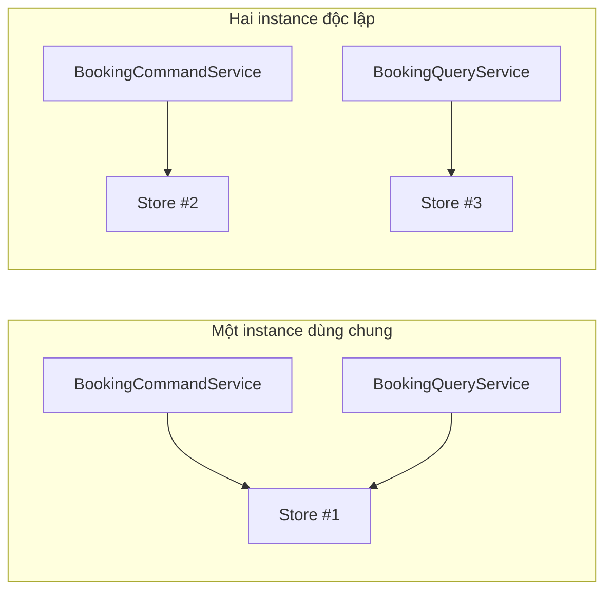
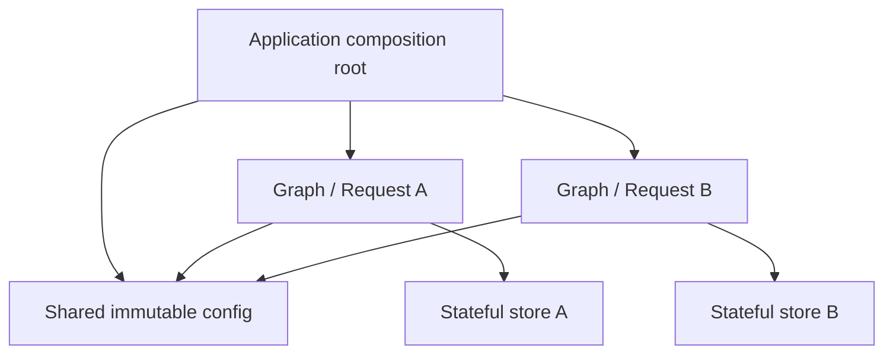

# Một phụ thuộc được dùng chung so với nhiều bản thể độc lập

Khi áp dụng **Dependency Injection (DI)** trong Java, việc khai báo `BookingService(BookingStore store)` mới chỉ trả lời lớp cần **loại phụ thuộc nào**. Còn một quyết định khác quan trọng không kém: nếu hai service đều cần `BookingStore`, ta sẽ truyền **cùng một đối tượng** cho cả hai, hay tạo **hai đối tượng khác nhau**? Hai lựa chọn có thể dùng đúng một lớp Java nhưng tạo ra hành vi, trạng thái và vòng đời rất khác nhau.

Đây là nội dung của chương **Đồ thị đối tượng** trong module **DEPENDENCY_INJECTION**. Bài học đi từ khái niệm danh tính đối tượng, dùng **constructor injection** và **composition root** để lắp ghép thủ công, rồi kiểm tra bằng Java thuần. Sau đó ta liên hệ lựa chọn chia sẻ với **Inversion of Control (IoC)**, scope, vòng đời và các vấn đề cần giải quyết khi mở rộng sang DI container.

## 1. Một kiểu phụ thuộc không đồng nghĩa với một đối tượng

Trong Java, `new InMemoryBookingStore()` tạo ra một đối tượng mới. Nếu gọi `new` hai lần, ta có hai đối tượng riêng, dù chúng cùng class, cùng cấu hình và cùng được sử dụng thông qua interface `BookingStore`.

```java
InMemoryBookingStore first = new InMemoryBookingStore();
InMemoryBookingStore alias = first;
InMemoryBookingStore second = new InMemoryBookingStore();

System.out.println(first == alias);  // true: cùng một đối tượng
System.out.println(first == second); // false: hai đối tượng khác nhau
```

`InMemoryBookingStore` trong đoạn này là tên lớp minh họa, sẽ được định nghĩa đầy đủ ở phần 3. Toán tử `==` trên các tham chiếu đối tượng hỏi liệu chúng **trỏ tới cùng instance**; `equals(...)` có thể thể hiện bình đẳng theo dữ liệu tùy cách lớp cài đặt nên không thay thế cho kiểm tra danh tính.

Trong **đồ thị đối tượng**, mỗi instance là một nút. Hai cạnh cùng đi tới một nút biểu thị phụ thuộc **được chia sẻ**. Hai cạnh đi tới hai nút riêng biểu thị **những bản thể độc lập**.



Ở mô hình bên trái, hai service thấy trạng thái nằm **trong cùng `Store #1`**, nếu store có trạng thái thay đổi. Ở mô hình bên phải, mỗi store giữ trạng thái riêng. Điều này chưa nói gì về việc các store có truy cập **cùng hệ thống bên ngoài** hay không: hai adapter JDBC khác instance vẫn có thể truy cập cùng một cơ sở dữ liệu và cùng nhìn thấy dữ liệu. Phân biệt **danh tính đối tượng Java** với **danh tính tài nguyên bên ngoài** là điều rất quan trọng.

### Thuật ngữ cần phân biệt

| Thuật ngữ | Ý nghĩa trong bài |
| --- | --- |
| **Kiểu (type)** | Interface/class như `BookingWriter`, `InMemoryBookingStore` |
| **Instance/bản thể** | Một đối tượng cụ thể được tạo ra khi chạy |
| **Tham chiếu (reference)** | Giá trị mà trường hoặc biến dùng để trỏ tới instance |
| **Chia sẻ phụ thuộc** | Hai consumer nhận tham chiếu tới cùng một instance |
| **Bản thể độc lập** | Các consumer nhận những instance riêng, có danh tính khác nhau |
| **Scope** | Phạm vi sử dụng và tái sử dụng một instance theo quy ước của ứng dụng |
| **Vòng đời (lifecycle)** | Từ lúc tạo, sử dụng đến khi kết thúc sở hữu/giải phóng tài nguyên cần thiết |

Việc một class chỉ có một implementation **không** khiến mọi consumer tự động dùng chung một instance. Ngược lại, cùng một instance có thể được truyền qua nhiều interface khác nhau mà nó triển khai.

## 2. Ví dụ nghiệp vụ: ghi và tra cứu xác nhận đặt chỗ

Ta xây dựng một chức năng nhỏ gồm hai consumer:

- `BookingCommandService` ghi nhận thời điểm xác nhận một mã đặt chỗ.
- `BookingQueryService` tra cứu xem mã đó đã được xác nhận chưa.

Mỗi consumer cần một hợp đồng nhỏ, đúng với trách nhiệm của nó:

```java
interface BookingWriter {
    void save(String bookingId, java.time.Instant confirmedAt);
}

interface BookingReader {
    java.util.Optional<java.time.Instant> findConfirmedAt(String bookingId);
}
```

Một `InMemoryBookingStore` triển khai cả hai hợp đồng. Nếu command và query nhận **cùng instance store**, phần query đọc được dữ liệu do command vừa lưu. Nếu chúng nhận hai store bộ nhớ khác nhau, kết quả tra cứu ở store thứ hai sẽ không có dữ liệu do store thứ nhất ghi.

Đó là **đặc tính của ví dụ lưu trong bộ nhớ**, vì mỗi `InMemoryBookingStore` sở hữu một `Map` riêng. Đừng suy rộng thành quy tắc mọi adapter khác instance đều cô lập dữ liệu: ví dụ hai repository dùng cùng database server vẫn có thể chia sẻ dữ liệu qua database.

## 3. Java thuần: so sánh hai cách lắp ghép

Lưu mã sau vào tệp `ObjectGraphExample.java`. Mã sử dụng Java 11 trở lên, không cần framework hoặc thư viện DI.

```java
import java.time.Clock;
import java.time.Instant;
import java.time.ZoneOffset;
import java.util.HashMap;
import java.util.Map;
import java.util.Objects;
import java.util.Optional;

public final class ObjectGraphExample {
    private ObjectGraphExample() {}

    public interface BookingWriter {
        void save(String bookingId, Instant confirmedAt);
    }

    public interface BookingReader {
        Optional<Instant> findConfirmedAt(String bookingId);
    }

    public static final class InMemoryBookingStore
            implements BookingWriter, BookingReader {
        private final Map<String, Instant> confirmations = new HashMap<>();

        @Override
        public void save(String bookingId, Instant confirmedAt) {
            confirmations.put(bookingId, confirmedAt);
        }

        @Override
        public Optional<Instant> findConfirmedAt(String bookingId) {
            return Optional.ofNullable(confirmations.get(bookingId));
        }
    }

    public static final class BookingCommandService {
        private final BookingWriter writer;
        private final Clock clock;

        public BookingCommandService(BookingWriter writer, Clock clock) {
            this.writer = Objects.requireNonNull(writer, "writer");
            this.clock = Objects.requireNonNull(clock, "clock");
        }

        public void confirm(String bookingId) {
            if (bookingId == null || bookingId.trim().isEmpty()) {
                throw new IllegalArgumentException("bookingId must not be blank");
            }
            writer.save(bookingId, clock.instant());
        }
    }

    public static final class BookingQueryService {
        private final BookingReader reader;

        public BookingQueryService(BookingReader reader) {
            this.reader = Objects.requireNonNull(reader, "reader");
        }

        public Optional<Instant> confirmedAt(String bookingId) {
            return reader.findConfirmedAt(bookingId);
        }
    }

    // Chỉ đưa những điểm đầu vào cần thiết ra ngoài composition root.
    public static final class BookingGraph {
        public final BookingCommandService command;
        public final BookingQueryService query;

        private BookingGraph(
                BookingCommandService command, BookingQueryService query) {
            this.command = command;
            this.query = query;
        }
    }

    // Cả command và query nhận CÙNG một instance store.
    public static BookingGraph composeShared(Clock clock) {
        Objects.requireNonNull(clock, "clock");
        InMemoryBookingStore sharedStore = new InMemoryBookingStore();
        return new BookingGraph(
            new BookingCommandService(sharedStore, clock),
            new BookingQueryService(sharedStore)
        );
    }

    // Hai consumer nhận HAI instance store độc lập.
    public static BookingGraph composeSeparate(Clock clock) {
        Objects.requireNonNull(clock, "clock");
        InMemoryBookingStore writeStore = new InMemoryBookingStore();
        InMemoryBookingStore readStore = new InMemoryBookingStore();
        return new BookingGraph(
            new BookingCommandService(writeStore, clock),
            new BookingQueryService(readStore)
        );
    }

    public static void main(String[] args) {
        Clock clock = Clock.fixed(
            Instant.parse("2026-01-10T10:15:30Z"), ZoneOffset.UTC);

        BookingGraph shared = composeShared(clock);
        shared.command.confirm("BK-001");
        System.out.println("Shared query sees BK-001: "
            + shared.query.confirmedAt("BK-001").isPresent());

        BookingGraph separate = composeSeparate(clock);
        separate.command.confirm("BK-002");
        System.out.println("Separate query sees BK-002: "
            + separate.query.confirmedAt("BK-002").isPresent());

        BookingGraph another = composeShared(clock);
        System.out.println("Another graph sees BK-001: "
            + another.query.confirmedAt("BK-001").isPresent());
    }
}
```

Chạy bằng JDK 11 trở lên:

```bash
javac ObjectGraphExample.java
java ObjectGraphExample
```

Kết quả mong đợi:

```text
Shared query sees BK-001: true
Separate query sees BK-002: false
Another graph sees BK-001: false
```

Ba dòng này phản ánh ba khía cạnh khác nhau:

1. `composeShared()` tạo **một `InMemoryBookingStore`**, rồi truyền tham chiếu của nó vào hai constructor. Command ghi và query đọc cùng `Map`.
2. `composeSeparate()` gọi `new InMemoryBookingStore()` hai lần. Command ghi vào `writeStore`; query đọc từ `readStore`, nên không thấy xác nhận của command.
3. Mỗi lần gọi `composeShared()` lại tạo **một graph mới với store mới**. Bên trong mỗi graph, store được chia sẻ giữa hai service; **giữa hai graph** không có store dùng chung.

Đây là một điểm dễ nhầm: *được dùng chung trong một graph* không đồng nghĩa với *chỉ có một instance trong toàn bộ tiến trình*. Độ rộng của phạm vi chia sẻ phụ thuộc vào nơi và số lần gọi hàm tạo graph.

### Điều gì thay đổi trong source code của service?

**Không có gì.** Cả `BookingCommandService` và `BookingQueryService` đều chỉ nhận interface qua constructor. Chúng không biết `composeShared()` hay `composeSeparate()` đã được sử dụng. Quyết định cấp cùng hay khác instance nằm tại **composition root**, đúng với mục tiêu tách việc *sử dụng phụ thuộc* khỏi việc *tạo và lắp ghép đối tượng* của Dependency Injection.

`Clock.fixed(...)` được dùng ở `main()` để kết quả ổn định và dễ giải thích. Trong ứng dụng thật, composition root thường cấp `Clock.systemUTC()` hoặc một đồng hồ phù hợp môi trường. `Clock` được chia sẻ ở cả ba graph nhưng không làm chúng chia sẻ `Map`; các phụ thuộc có thể có **scope khác nhau** trong cùng một ứng dụng.

## 4. Kiểm tra lựa chọn chia sẻ bằng Java thuần

Một bài kiểm tra tốt cần xác minh **hành vi quan sát được** và, khi mục đích là danh tính instance, có thể so sánh tham chiếu ngay ở nơi lắp ghép. Không cần khởi động Spring context, database hay sử dụng reflection để đọc trường riêng của service.

Lưu tệp `ObjectGraphCheck.java` cùng thư mục với ví dụ trên:

```java
import java.time.Clock;
import java.time.Instant;
import java.time.ZoneOffset;
import java.util.Objects;

public final class ObjectGraphCheck {
    private static final Instant FIXED_TIME =
        Instant.parse("2026-01-10T10:15:30Z");
    private static final Clock FIXED_CLOCK =
        Clock.fixed(FIXED_TIME, ZoneOffset.UTC);

    public static void main(String[] args) {
        sharedStoreMakesWriteVisibleToReader();
        separateStoresKeepTheirOwnState();
        twoGraphsRemainIndependent();
        aliasHasSameIdentity();
        clockIsInjected();
        constructorRejectsMissingDependency();
        System.out.println("PASS: 6 object graph checks");
    }

    private static void sharedStoreMakesWriteVisibleToReader() {
        ObjectGraphExample.BookingGraph graph =
            ObjectGraphExample.composeShared(FIXED_CLOCK);

        graph.command.confirm("BK-SHARED");
        check(graph.query.confirmedAt("BK-SHARED").equals(
                java.util.Optional.of(FIXED_TIME)),
              "Shared reader must observe the command's write");
    }

    private static void separateStoresKeepTheirOwnState() {
        ObjectGraphExample.BookingGraph graph =
            ObjectGraphExample.composeSeparate(FIXED_CLOCK);

        graph.command.confirm("BK-SEPARATE");
        check(!graph.query.confirmedAt("BK-SEPARATE").isPresent(),
              "Independent in-memory stores must stay isolated");
    }

    private static void twoGraphsRemainIndependent() {
        ObjectGraphExample.BookingGraph one =
            ObjectGraphExample.composeShared(FIXED_CLOCK);
        ObjectGraphExample.BookingGraph two =
            ObjectGraphExample.composeShared(FIXED_CLOCK);

        one.command.confirm("BK-ONLY-ONE");
        check(one.query.confirmedAt("BK-ONLY-ONE").isPresent(),
              "First graph must see its own booking");
        check(!two.query.confirmedAt("BK-ONLY-ONE").isPresent(),
              "Second graph must not inherit first graph's state");
    }

    private static void aliasHasSameIdentity() {
        ObjectGraphExample.InMemoryBookingStore first =
            new ObjectGraphExample.InMemoryBookingStore();
        ObjectGraphExample.InMemoryBookingStore second =
            new ObjectGraphExample.InMemoryBookingStore();

        ObjectGraphExample.BookingWriter writer = first;
        ObjectGraphExample.BookingReader reader = first;
        Object writerReference = writer;
        Object readerReference = reader;

        check(writerReference == readerReference,
              "Two interface views must point to the same store");
        check(writerReference != second,
              "A second new call must create a distinct store");

        writer.save("BK-ALIAS", FIXED_TIME);
        check(reader.findConfirmedAt("BK-ALIAS").isPresent(),
              "Reader alias must see writer alias's update");
        check(!second.findConfirmedAt("BK-ALIAS").isPresent(),
              "A separate store must not inherit local Map state");
    }

    private static void clockIsInjected() {
        ObjectGraphExample.InMemoryBookingStore store =
            new ObjectGraphExample.InMemoryBookingStore();
        ObjectGraphExample.BookingCommandService command =
            new ObjectGraphExample.BookingCommandService(store, FIXED_CLOCK);

        command.confirm("BK-TIME");
        check(store.findConfirmedAt("BK-TIME").equals(
                java.util.Optional.of(FIXED_TIME)),
              "Command must use injected Clock");
    }

    private static void constructorRejectsMissingDependency() {
        boolean rejected = false;
        try {
            new ObjectGraphExample.BookingQueryService(null);
        } catch (NullPointerException expected) {
            rejected = Objects.equals("reader", expected.getMessage());
        }
        check(rejected, "Missing reader should fail at composition time");
    }

    private static void check(boolean condition, String message) {
        if (!condition) {
            throw new AssertionError(message);
        }
    }
}
```

Biên dịch và chạy:

```bash
javac ObjectGraphExample.java ObjectGraphCheck.java
java ObjectGraphCheck
```

Khi tất cả điều kiện đạt, chương trình in:

```text
PASS: 6 object graph checks
```

Các phép kiểm sử dụng `AssertionError` qua `check(...)` nên không cần bật tùy chọn `-ea`. `Objects.requireNonNull(...)` làm lộ ngay một lỗi lắp ghép thiếu phụ thuộc. Việc kiểm tra hai graph độc lập giúp bắt lỗi **vô tình dùng chung state**, còn kiểm tra alias giúp thấy rõ có thể cấp một instance qua **hai interface khác nhau**.

Mã test chỉ kiểm tra giả định được đặt ra cho `InMemoryBookingStore`. Nó chưa chứng minh adapter thật có transaction, thread safety, độ bền dữ liệu hay khả năng kết nối. Những khía cạnh đó cần kiểm thử tích hợp tương ứng.

## 5. Khi nào nên chia sẻ, khi nào nên tạo riêng?

Quyết định phụ thuộc vào **trách nhiệm, tính thay đổi của trạng thái và thời gian tồn tại**, không chỉ tên class.

| Phụ thuộc | Xu hướng lựa chọn | Lý do và điều kiện |
| --- | --- | --- |
| `Clock.systemUTC()` | Có thể dùng chung | Không lưu trạng thái riêng của một request và có thể tái sử dụng |
| Chính sách tính giá bất biến | Thường có thể dùng chung | Nếu chỉ đọc cấu hình bất biến và an toàn khi gọi đồng thời |
| Bộ nhớ đệm dùng chung | Có thể chia sẻ trong phạm vi thiết kế | Phải xác định khóa, khả năng đồng thời, invalidation và vòng đời |
| Store in-memory dùng để chia sẻ dữ liệu giữa các service | Dùng chung **nếu mục tiêu là cùng trạng thái** | Như `composeShared()`, đồng thời phải xử lý an toàn luồng khi cần |
| Dữ liệu tạm theo đơn hàng/request | Tạo riêng theo yêu cầu | Không muốn dữ liệu đơn hàng này tràn sang đơn hàng khác |
| Transaction hoặc unit of work | Thường giới hạn trong một thao tác/ngữ cảnh | Không giữ transaction đã kết thúc trong service sống lâu |
| Connection DB | Theo quy tắc của driver/pool, thường mượn/trả theo đơn vị công việc | Không mặc định chia sẻ cùng một connection cho nhiều luồng |
| HTTP client hoặc `DataSource` được thiết kế cho chia sẻ | Thường có thể dùng chung | Dựa trên tài liệu thread safety và lifecycle của implementation cụ thể |
| Thông tin phiên đăng nhập/request | Theo session/request hoặc truyền như dữ liệu đầu vào | Tránh gắn ngữ cảnh của một người dùng vào singleton dùng chung |

Không có quy tắc “cái gì có state thì bắt buộc tạo riêng” hoặc “cái gì không có state thì bắt buộc dùng chung”. Một bộ đệm có state có thể cần chia sẻ theo chủ đích, còn một đối tượng không có state đôi khi được tạo riêng để cô lập cấu hình hoặc vòng đời. Tiêu chí quan trọng là **ai cần thấy cùng trạng thái và ai được phép thấy nó**.

### 5.1. Dùng chung tiết kiệm tài nguyên nhưng tạo liên kết vận hành

Nếu hai service cùng dùng một adapter, chúng có thể tái sử dụng cache, pool hoặc thông tin cấu hình và giảm chi phí tạo đối tượng. Đổi lại, trạng thái thay đổi hoặc một lỗi trong adapter có thể ảnh hưởng đến cả hai. Ví dụ, nếu store dùng chung bị đóng sớm, mọi consumer giữ tham chiếu đến nó đều có nguy cơ lỗi.

Chia sẻ còn làm bài kiểm thử dễ nhiễm trạng thái: hai test tạo service khác nhau nhưng dùng lại cùng một fake mutable có thể ảnh hưởng kết quả của nhau. Trong unit test, thường nên tạo fixture/store mới cho từng test nếu không chủ đích kiểm tra hành vi chia sẻ.

### 5.2. Tạo riêng giúp cô lập nhưng không tự động an toàn

Hai instance khác nhau không có nghĩa tài nguyên bên ngoài cũng khác. Hai `JdbcBookingRepository` riêng có thể cùng kết nối một DB; hai `HttpClient` khác nhau có thể cùng gọi một API; hai adapter khác nhau có thể tham chiếu một `static Map`. Vì vậy, **độc lập về instance** chỉ là điều kiện cho một số kiểu cô lập, chưa đủ chứng minh cô lập dữ liệu, giao dịch hoặc tài nguyên.

Nếu thật sự cần cô lập giữa tenant/request, phải xác định rõ khóa dữ liệu, nơi lưu, transaction, cache và các đối tượng có trạng thái được phép đi qua ranh giới nào. Một instance mới không thay thế cho các bảo đảm này.

## 6. Scope và vòng đời: phạm vi chia sẻ bắt đầu và kết thúc ở đâu?

Trong DI thủ công, scope chính là quy tắc được thể hiện trong code lắp ghép. Tạo một đối tượng ở `main()` rồi truyền cho nhiều service có thể khiến nó sống cùng ứng dụng; tạo đối tượng trong một factory gọi theo request khiến mỗi request nhận một instance mới; gọi factory hai lần tạo hai graph nếu factory luôn gọi `new` cho những thành phần đó.



Trong hình, config có thể dùng chung vì nó không chứa dữ liệu riêng của request. Store của A và B tạo riêng vì yêu cầu đang là cô lập. Nếu hai request cần truy cập cùng dữ liệu bền vững, chúng có thể dùng một hạ tầng lưu trữ chung thông qua các adapter thích hợp, nhưng không nhất thiết dùng cùng instance transaction hoặc connection.

Một số phạm vi thường gặp khi chuyển sang DI container:

- **Singleton trong container:** một instance được container tái sử dụng trong phạm vi quản lý của container, không mặc định là một instance cho mọi JVM hoặc mọi container khác nhau.
- **Prototype/transient:** mỗi lần yêu cầu tạo có thể nhận một instance mới; nếu được tiêm cố định một lần vào singleton, nó không tự tạo lại ở mỗi lời gọi nghiệp vụ.
- **Request/session scope:** các instance được ràng buộc vào một request hoặc session theo cơ chế của framework; dùng chúng bên ngoài scope đó cần một chiến lược phù hợp.
- **Phạm vi tùy chỉnh:** chẳng hạn một batch job, giao dịch hay tenant, nếu hệ thống thật sự cần chính sách lắp ghép và thu hồi riêng.

Các tên scope cụ thể thay đổi giữa các container. **Constructor injection không tự tạo scope**: nó chỉ cho biết object nhận tham chiếu nào khi được khởi tạo. Composition root hoặc container phải quyết định tạo mới, cache lại, cấp proxy/provider khi cần, và giải phóng tài nguyên theo vòng đời.

### Vòng đời tài nguyên được chia sẻ

Với một phụ thuộc `AutoCloseable`, nơi sở hữu việc tạo thường cần rõ trách nhiệm đóng. Không nên để một service tùy ý đóng adapter dùng chung khi các service khác vẫn đang dùng. Trong ứng dụng server, composition root hoặc container có thể đóng những client/pool thuộc vòng đời ứng dụng ở giai đoạn shutdown. Ngược lại, resource gắn với giao dịch nên kết thúc cùng giao dịch.

`InMemoryBookingStore` trong ví dụ không giữ socket hoặc kết nối cần `close()`. Tuy nhiên, nếu chạy `composeShared()` với store `HashMap` trong nhiều luồng, ví dụ này **chưa an toàn luồng**. Chỉ thay bằng `ConcurrentHashMap` có thể giúp thao tác Map đơn lẻ an toàn hơn, nhưng những quy tắc gồm nhiều bước (kiểm tra rồi ghi, đảm bảo không ghi trùng) vẫn cần thiết kế tính nguyên tử thích hợp.

## 7. Những lỗi thường gặp khi đọc và lắp ghép đồ thị

### 7.1. Tưởng hai biến cùng kiểu là cùng instance

```java
InMemoryBookingStore commandStore = new InMemoryBookingStore();
InMemoryBookingStore queryStore = new InMemoryBookingStore();
```

Hai dòng trên tạo hai store, dù cùng tên class. Nếu mục tiêu là chia sẻ, hãy tạo **một** store rồi truyền tham chiếu đó cho cả hai service. Constructor `BookingCommandService(BookingWriter, Clock)` không tự quyết định reuse hay tạo mới.

### 7.2. Tưởng `@Singleton` hoặc từ khóa “singleton” đồng nghĩa toàn tiến trình

Một container có thể giữ một instance theo **mỗi container**; khởi tạo hai context khác nhau có thể tạo hai singleton riêng. Với DI thủ công, một object dùng chung trong một graph chỉ sống trong phạm vi graph đó. Phải xem **composition root, context và scope thực tế** thay vì chỉ nhìn tên annotation.

### 7.3. Singleton giữ đối tượng ngắn hạn

Nếu `ReportService` tồn tại suốt ứng dụng nhưng giữ trực tiếp `RequestContext` của request đầu tiên, các request sau có nguy cơ thấy dữ liệu sai người dùng. Cần truyền dữ liệu request theo từng lời gọi hoặc dùng provider/proxy có ngữ nghĩa scope phù hợp. Hạn chế sử dụng `static` mutable state để “đơn giản hóa” vì nó có thể mở rộng phạm vi chia sẻ ngoài ý muốn.

### 7.4. Tạo lại phụ thuộc trong lúc nghiệp vụ chạy

```java
final class IncorrectBookingQueryService {
    private final ObjectGraphExample.BookingReader reader =
        new ObjectGraphExample.InMemoryBookingStore();
}
```

Nếu command được cấp một store khác, query không nhìn thấy những gì command ghi. Hơn nữa, cách tự `new` bên trong consumer giấu quyết định tạo đối tượng và khiến kiểm thử khó thay phụ thuộc. Thay vào đó, khai báo constructor nhận `BookingReader`, còn composition root chọn instance phù hợp.

### 7.5. Dùng chung instance nhưng không kiểm tra thread safety

Hai service được dùng tuần tự và hai service được gọi đồng thời là hai bối cảnh khác nhau. `HashMap` thông thường chưa an toàn khi có ghi đồng thời. Việc cùng tham chiếu một object không làm nó an toàn; phải xem implementation, bảo đảm đồng bộ và bất biến nghiệp vụ.

### 7.6. Nhầm state trong bộ nhớ với dữ liệu bền vững

Ví dụ này dùng store trong bộ nhớ để hành vi phụ thuộc instance được quan sát trực tiếp. Nếu thay sang DB, dữ liệu có thể được chia sẻ thông qua hệ thống lưu trữ ngay cả khi mỗi service có adapter riêng. Khi đó, sự khác biệt về instance chủ yếu liên quan tới cache, kết nối, transaction, metrics hoặc cấu hình và không thể suy ra dữ liệu đọc sẽ trống chỉ từ số lần `new`.

## 8. Quy trình lựa chọn và kiểm tra trong dự án

1. **Vẽ đồ thị bằng các instance thực tế.** Đừng chỉ ghi `Service → Repository`; hãy xác định hai service có trỏ tới đúng cùng đối tượng repository không.
2. **Xác định phần trạng thái nào cần chia sẻ.** Với mỗi dependency, hỏi liệu các consumer có phải thấy cùng dữ liệu/cache/trạng thái hay cần cô lập.
3. **Chọn nơi tạo và vòng đời.** Quyết định instance thuộc ứng dụng, request, job, transaction hay một graph thử nghiệm; đặt lệnh tạo tại composition root/factory phù hợp.
4. **Cấp phụ thuộc bằng constructor.** Để class nghiệp vụ khai báo hợp đồng nó cần, không tự tạo hoặc lén lấy instance toàn cục.
5. **Kiểm tra danh tính ở nơi lắp ghép khi cần.** `first == second` giúp kiểm tra chính xác hai tham chiếu có cùng instance; không dùng `equals` thay thế.
6. **Kiểm tra hành vi qua ranh giới.** Ghi bằng consumer A rồi đọc qua consumer B, hoặc dùng fake ghi nhận lời gọi; lưu ý tác động của database hoặc hệ thống ngoài nếu có.
7. **Kiểm tra cô lập giữa các scope.** Tạo hai graph/request/test fixture để phát hiện rò rỉ state và kiểm tra chính sách chia sẻ.
8. **Xác minh an toàn đồng thời và đóng tài nguyên.** Chỉ chia sẻ adapter mutable khi có bảo đảm phù hợp; xác định ai đóng và khi nào.

Quy trình này giữ nguyên khi dùng Spring, Guice hoặc DI container khác. Container có thể tự động tạo và tái sử dụng object theo scope khai báo, nhưng người thiết kế vẫn phải biết **bên nào được phép dùng chung state, bên nào cần instance riêng và ai sở hữu vòng đời**.

## 9. Tình huống tự kiểm tra

**Tình huống A — chia sẻ trong graph:** `InvoiceWriter` và `InvoiceReader` nhận đúng một `InMemoryInvoiceStore`. Writer lưu `INV-1`. Reader có thể thấy dữ liệu ấy không? Có, nếu store triển khai đọc/ghi cùng dữ liệu trong một instance, và không có điều kiện khác ngăn truy cập.

**Tình huống B — hai lần tạo:** `first = makeGraph()` và `second = makeGraph()`, trong đó `makeGraph()` luôn tạo store mới. Tất cả service trong mỗi graph có thể chia sẻ store nội bộ, nhưng hai graph có dùng chung store không? Không, trừ khi factory tham chiếu một nguồn instance dùng chung bên ngoài.

**Tình huống C — cùng database:** Hai repository khác instance cùng kết nối một cơ sở dữ liệu. Có thể suy ra chúng cô lập dữ liệu vì `repoA != repoB` không? Không. Danh tính Java khác nhau không chứng minh rằng nguồn dữ liệu hoặc transaction bên ngoài tách biệt.

**Tình huống D — request scope:** Một service sống suốt tiến trình giữ trạng thái giỏ hàng của một người dùng trong trường mutable. Nên chia sẻ service như vậy cho mọi request không? Không nếu chưa thiết kế cô lập state; có thể chuyển dữ liệu giỏ hàng thành tham số, tách kho trạng thái theo người dùng hoặc điều chỉnh scope.

**Tình huống E — kiểm thử:** Hai test cùng dùng `static InMemoryBookingStore`. Test đầu lưu `BK-001`, test sau kỳ vọng store rỗng. Vấn đề nào có thể xảy ra? State rò giữa các test làm kết quả phụ thuộc thứ tự chạy. Mỗi test nên tạo fixture độc lập trừ khi đang chủ đích kiểm tra việc chia sẻ.

**Ghi nhớ:** Trong đồ thị đối tượng, **cùng kiểu không có nghĩa cùng instance**, còn **cùng instance không có nghĩa toàn ứng dụng chỉ có một bản thể**. Constructor injection cho phép consumer không quan tâm tới quyết định này; composition root chọn chia sẻ hay tạo riêng theo state, scope và vòng đời. Kiểm thử bằng Java thuần giúp quan sát các lựa chọn ấy trước khi DI container tham gia tự động hóa lắp ghép.
