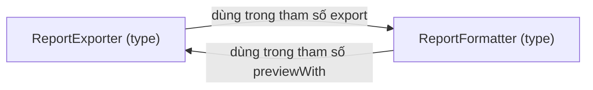
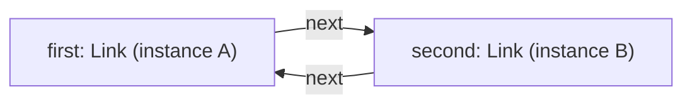
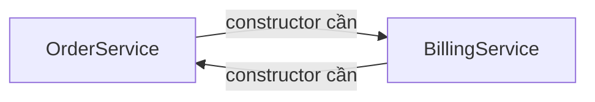
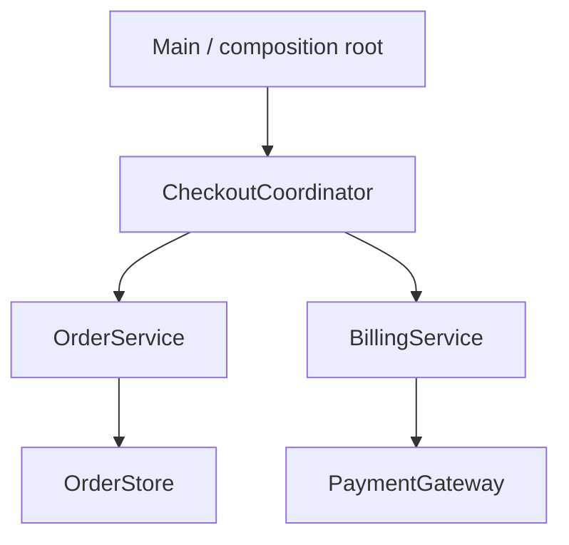

# Phụ thuộc vòng ở cấp kiểu và ở cấp instance

> **Chương:** Đồ thị đối tượng (Object Graph)  
> **Bối cảnh:** Trong Dependency Injection (DI) và Inversion of Control (IoC), cần hiểu cả quan hệ phụ thuộc được khai báo trong mã Java lẫn những tham chiếu thực sự được tạo khi ứng dụng chạy. Bài sử dụng Java thuần, constructor injection và composition root trước khi mở rộng sang DI container.

## 1. Mục tiêu học tập

Sau bài này, bạn có thể:

1. Phân biệt **vòng phụ thuộc giữa các kiểu (type-level cycle)** và **vòng tham chiếu giữa các instance (instance-level cycle)**.
2. Giải thích vì sao có vòng ở cấp kiểu nhưng không có vòng giữa các đối tượng đang tồn tại, và ngược lại vì sao cần quan sát object graph thực tế.
3. Xác định trường hợp hai dependency **bắt buộc trong constructor** khiến quá trình lắp ghép không có điểm bắt đầu hợp lệ.
4. Nhận biết tác động của cycle lên khởi tạo, gọi phương thức, serialization, scope, vòng đời và kiểm thử, mà không nhầm lẫn với cơ chế garbage collection của Java.
5. Phá vòng phụ thuộc trong thiết kế bằng cách điều chỉnh trách nhiệm, tách điều phối hoặc thay quan hệ gọi trực tiếp bằng hợp đồng thích hợp.
6. Dùng **constructor injection**, **composition root** và fake để lắp ghép, kiểm thử một object graph không có vòng bằng Java thuần.

## 2. Ba đồ thị liên quan nhưng không giống nhau

Khi học DI, từ “phụ thuộc” có thể chỉ các quan hệ khác nhau. Cần thống nhất đang xét loại đồ thị nào.

| Góc nhìn | Đỉnh của đồ thị | Ý nghĩa một cạnh có hướng `A → B` | Xác định khi nào? |
| --- | --- | --- | --- |
| **Đồ thị phụ thuộc cấp kiểu** (*type-dependency graph*) | Các lớp, interface hoặc kiểu được chọn để phân tích | Mã của kiểu `A` nhắc đến, dùng hoặc khai báo một quan hệ phụ thuộc vào kiểu `B` (ví dụ trường, tham số phương thức, tham số constructor) | Chủ yếu khi đọc/phân tích mã nguồn |
| **Đồ thị phụ thuộc để khởi tạo** (*construction dependency graph*) | Các loại thành phần cần lắp ghép | Muốn tạo một `A` hoàn chỉnh theo hợp đồng constructor thì phải có một `B` trước | Khi thiết kế hoặc lắp ghép ứng dụng |
| **Đồ thị tham chiếu cấp instance** (*runtime object-reference graph*) | Các đối tượng cụ thể đang tồn tại: `a1`, `b1`, `b2`… | Instance `a1` thực sự giữ tham chiếu đến instance `b1` (qua field hoặc phần tử cấu trúc dữ liệu mà nó sở hữu) | Khi ứng dụng chạy, thay đổi theo thời gian |

Trong bài này, **vòng phụ thuộc cấp kiểu** là một đường đi có hướng quay về cùng kiểu. **Vòng ở cấp instance** là một chuỗi tham chiếu của các đối tượng cụ thể dẫn trở lại cùng một instance.

Đồ thị khởi tạo là cách nhìn **hẹp hơn** đồ thị sử dụng kiểu: việc một phương thức của `A` nhận tham số kiểu `B` chưa có nghĩa constructor của `A` cần một instance `B`. Ngược lại, nếu constructor `A(B b)` và constructor `B(A a)` đều bắt buộc, đồ thị khởi tạo có một vòng thực sự cản trở cách lắp ghép trực tiếp.

> **Quy ước quan trọng:** Ở đồ thị instance, ta chủ yếu quan tâm đến **tham chiếu được lưu giữ** trong trạng thái đối tượng. Tham số tạm thời trên call stack của một lời gọi không tự động được tính là một liên kết lưu giữ lâu dài giữa hai instance.

## 3. Vòng ở cấp kiểu chưa chắc tạo vòng ở cấp instance

Xét hai lớp có phương thức nhắc đến nhau:

```java
final class ReportExporter {
    String export(ReportFormatter formatter) {
        return formatter.format("Báo cáo");
    }
}

final class ReportFormatter {
    String format(String content) {
        return "[" + content + "]";
    }

    String previewWith(ReportExporter exporter) {
        return exporter.export(this);
    }
}
```

Theo cách phân tích quan hệ sử dụng kiểu, có các cạnh:

- `ReportExporter → ReportFormatter`: phương thức `export` nhận một `ReportFormatter`.
- `ReportFormatter → ReportExporter`: phương thức `previewWith` nhận một `ReportExporter`.



Đây là **vòng phụ thuộc cấp kiểu** theo định nghĩa trên. Nhưng cả hai lớp **không lưu giữ trường tham chiếu** đến lớp kia. Khi chạy:

```java
ReportExporter exporter = new ReportExporter();
ReportFormatter formatter = new ReportFormatter();
System.out.println(formatter.previewWith(exporter)); // [Báo cáo]
```

hai instance được tạo độc lập. Chúng sử dụng nhau trong những lời gọi tạm thời, nhưng không hình thành vòng tham chiếu trong các field.

Do đó:

1. Java vẫn có thể biên dịch các khai báo lớp tham chiếu qua lại này khi các kiểu cần thiết đều có mặt.
2. Không có vòng **constructor bắt buộc** ở đây; mỗi instance được tạo bằng constructor không tham số.
3. Không có vòng **tham chiếu được lưu giữ** giữa `exporter` và `formatter`.
4. Sự liên kết qua lại ở mức API vẫn đáng đánh giá: hai phần có thực sự cần biết nhau hay ranh giới trách nhiệm đang thiếu rõ ràng?

**Kết luận cho trường hợp này:** phát hiện một type cycle chưa đủ để khẳng định ứng dụng sẽ gặp lỗi “circular dependency” khi khởi tạo.

## 4. Vòng ở cấp instance là quan hệ giữa những đối tượng cụ thể

Ví dụ đơn giản nhất là danh sách liên kết có thể nối vòng:

```java
final class Link {
    final String name;
    Link next;

    Link(String name) {
        this.name = name;
    }
}

Link first = new Link("A");
Link second = new Link("B");

first.next = second;
second.next = first;

System.out.println(first.next.next == first); // true
```



Hai đối tượng `first` và `second` thực sự **giữ tham chiếu đến nhau**. Đây là vòng ở **instance graph**. Ở cấp kiểu, mối quan hệ `Link → Link` chỉ cho biết một `Link` *có thể* trỏ tới `Link` khác; nó không chứng minh mọi lần tạo hai `Link` đều có vòng.

Ví dụ dưới đây dùng **cùng một kiểu `Link`** nhưng không tạo vòng:

```java
Link first = new Link("A");
Link second = new Link("B");
first.next = second;
// second.next vẫn là null: object graph là một chuỗi, không có cycle.
```

Vì vậy, sơ đồ kiểu nói về những quan hệ *có thể tồn tại*, còn đồ thị instance nói về các tham chiếu *đang tồn tại*. Tại runtime, hai instance cùng kiểu có thể có quan hệ rất khác nhau.

### 4.1. Vòng instance không đồng nghĩa với rò rỉ bộ nhớ

Java dùng garbage collector dựa trên khả năng **reachability** từ các GC root. Nếu toàn bộ một nhóm đối tượng liên kết vòng **không còn được tham chiếu từ bất kỳ GC root nào**, nhóm đó vẫn có thể được thu gom. Chỉ có vòng `first → second → first` không đủ để khẳng định memory leak.

Rò rỉ bộ nhớ xuất hiện khi những instance không còn cần thiết **vẫn còn reachable** qua tham chiếu được giữ lâu, chẳng hạn cache không giới hạn, registry toàn cục, listener chưa hủy đăng ký hoặc collection không xóa phần tử.

Điều đáng chú ý ở vòng instance thường là:

- Một phương thức `toString()`, `equals()` hoặc serializer đi theo các tham chiếu qua lại mà không theo dõi đối tượng đã thăm, có thể lặp vô hạn hoặc gây `StackOverflowError`.
- Một object chứa dữ liệu request có thể bị giữ lại bởi object sống lâu hơn, khiến scope và vòng đời bị kéo dài ngoài mong muốn.
- Hai đối tượng có thể cố đóng hoặc điều khiển vòng đời lẫn nhau, khiến thứ tự shutdown và quyền sở hữu tài nguyên khó xác định.
- Một mô hình miền có liên kết hai chiều có thể là hợp lý; cần giới hạn phương thức duyệt và nêu rõ bên nào chịu trách nhiệm quản lý vòng đời.

**Không phải mọi vòng instance đều là lỗi thiết kế.** Cây có con giữ tham chiếu ngược về cha, đồ thị mạng xã hội hoặc cấu trúc graph đều có thể cần vòng. Vấn đề là phải biết vòng đó tồn tại vì sao và code thao tác với nó có hỗ trợ hay không.

## 5. Vòng phụ thuộc constructor: vấn đề đặc biệt khi lắp ghép DI

Trong DI, vòng nghiêm trọng hơn thường xuất hiện khi các thành phần cần **nhau ngay lúc khởi tạo**.

Giả sử thiết kế ban đầu là:

```java
import java.util.Objects;

final class OrderService {
    private final BillingService billing;

    OrderService(BillingService billing) {
        this.billing = Objects.requireNonNull(billing);
    }
}

final class BillingService {
    private final OrderService orders;

    BillingService(OrderService orders) {
        this.orders = Objects.requireNonNull(orders);
    }
}
```

Các khai báo **có thể biên dịch**, vì kiểu phương thức/constructor hoàn toàn hợp lệ. Vấn đề nằm ở bước tạo hai đối tượng bằng constructor injection:

```text
Muốn tạo OrderService:
    cần BillingService trước.
Muốn tạo BillingService:
    cần OrderService trước.

OrderService → BillingService → OrderService → ...
```



Không có **thứ tự khởi tạo tuyến tính** nào tạo ra cả hai instance hợp lệ chỉ bằng các constructor trên, vì mỗi constructor đòi instance kia đã có. Nếu bắt đầu bằng `new OrderService(...)`, cần có `BillingService`; nhưng để tạo `BillingService`, lại cần một `OrderService`.

Lưu ý phân biệt ba kết luận:

1. **Compiler Java không tự báo lỗi** chỉ vì hai kiểu có tham số constructor trỏ đến nhau.
2. **Thao tác lắp ghép trực tiếp không hoàn tất** nếu ta giữ nguyên các yêu cầu bắt buộc của hai constructor, không dùng giá trị thiếu hợp lệ.
3. Một **DI container** có thể phát hiện vòng khi dựng object graph và báo lỗi khởi tạo; thông báo và cách xử lý cụ thể tùy container, scope và cơ chế tạo bean.

### 5.1. Vì sao tiêm qua setter không phải lời giải tự động?

Có thể sửa một phía thành constructor rỗng rồi gọi setter sau:

```java
// Mã minh họa một thiết kế hai giai đoạn, không phải giải pháp khuyến nghị.
final class MutableOrderService {
    private BillingService billing;

    void setBilling(BillingService billing) {
        this.billing = billing;
    }
}
```

Điều này cho phép tạo đối tượng **chưa hoàn chỉnh** rồi gắn tham chiếu sau. Nhưng nó kéo theo câu hỏi: chuyện gì xảy ra nếu một thread hoặc callback dùng đối tượng trước khi `setBilling(...)` được gọi? Điều gì xảy ra nếu setter bị quên hoặc một dependency gọi lại trong quá trình khởi tạo?

Setter injection thích hợp cho **dependency thật sự tùy chọn và có mặc định an toàn**. Dùng setter để che một vòng phụ thuộc bắt buộc dễ tạo ra *temporal coupling* (tính đúng phụ thuộc vào thứ tự gọi). Khi nguyên nhân là hai service biết quá nhiều về nhau, nên xem lại thiết kế thay vì chỉ thay cách injection.

### 5.2. Lazy, provider và proxy làm thay đổi thời điểm, chưa chắc phá sự phụ thuộc

Một số framework hoặc ứng dụng Java thuần dùng `Supplier<BillingService>`, provider, lazy initialization hoặc proxy để **trì hoãn** việc lấy một dependency. Nhờ đó, quá trình xây dựng ban đầu có thể đi qua một vòng constructor trong vài trường hợp.

Tuy nhiên:

- Quan hệ logic `OrderService → BillingService → OrderService` có thể vẫn còn.
- Nếu gọi `get()` hoặc phương thức của proxy quá sớm trong constructor, vòng khởi tạo có thể tái xuất hiện.
- Nếu hai service gọi nhau không có điều kiện dừng, chương trình vẫn có thể bị đệ quy vô hạn dù container khởi động thành công.
- Proxy/provider có thêm ngữ nghĩa về scope và thời điểm resolve; dùng sai có thể gây lỗi khó quan sát hơn.

Đây là những kỹ thuật hợp lệ khi có lý do vòng đời rõ ràng, nhưng **không nên coi chúng là phương án mặc định để sửa một thiết kế phụ thuộc vòng**.

## 6. Cách phá vòng: phân tách trách nhiệm và điều phối từ bên ngoài

Hỏi hai câu:

1. `OrderService` cần biết **chính `BillingService`** hay chỉ cần kết quả “đã thanh toán”?
2. `BillingService` thật sự phải gọi ngược vào `OrderService` hay chỉ đang cố làm hộ một bước điều phối quy trình?

Một cách tổ chức tốt hơn là:

- `OrderService` quản lý trạng thái đơn hàng qua một `OrderStore`.
- `BillingService` thực hiện việc thu tiền qua `PaymentGateway`.
- `CheckoutCoordinator` **điều phối**: gọi billing; chỉ khi thành công mới yêu cầu order service đánh dấu đã thanh toán.

Hai service không cần tham chiếu lẫn nhau. Coordinator phụ thuộc vào chúng theo **một chiều**.



Ở cấp kiểu lẫn cấp instance, cấu trúc **các dependency được lưu giữ** ở ví dụ này có hướng từ coordinator đến service và từ service đến adapter; không có đường quay về một nút trước đó.

### 6.1. Ví dụ Java thuần, chạy được

Tạo file `Main.java` với toàn bộ nội dung sau:

```java
import java.util.HashSet;
import java.util.Objects;
import java.util.Set;

interface OrderStore {
    void markPaid(String orderId);
    boolean isPaid(String orderId);
}

interface PaymentGateway {
    boolean charge(String orderId, int amountInCents);
}

final class InMemoryOrderStore implements OrderStore {
    private final Set<String> paidOrders = new HashSet<>();

    @Override
    public void markPaid(String orderId) {
        paidOrders.add(orderId);
    }

    @Override
    public boolean isPaid(String orderId) {
        return paidOrders.contains(orderId);
    }
}

// Adapter mô phỏng, không trừ tiền thật.
final class DemoPaymentGateway implements PaymentGateway {
    @Override
    public boolean charge(String orderId, int amountInCents) {
        System.out.println("CHARGE " + orderId + ": " + amountInCents);
        return true;
    }
}

final class OrderService {
    private final OrderStore store;

    OrderService(OrderStore store) {
        this.store = Objects.requireNonNull(store, "store");
    }

    void markPaid(String orderId) {
        store.markPaid(orderId);
    }
}

final class BillingService {
    private final PaymentGateway gateway;

    BillingService(PaymentGateway gateway) {
        this.gateway = Objects.requireNonNull(gateway, "gateway");
    }

    boolean charge(String orderId, int amountInCents) {
        return gateway.charge(orderId, amountInCents);
    }
}

final class CheckoutCoordinator {
    private final OrderService orders;
    private final BillingService billing;

    CheckoutCoordinator(OrderService orders, BillingService billing) {
        this.orders = Objects.requireNonNull(orders, "orders");
        this.billing = Objects.requireNonNull(billing, "billing");
    }

    boolean checkout(String orderId, int amountInCents) {
        if (orderId == null || orderId.trim().isEmpty()) {
            throw new IllegalArgumentException("orderId must not be blank");
        }
        if (amountInCents <= 0) {
            throw new IllegalArgumentException("amountInCents must be positive");
        }

        if (!billing.charge(orderId, amountInCents)) {
            return false;
        }

        orders.markPaid(orderId);
        return true;
    }
}

public class Main {
    public static void main(String[] args) {
        // Composition root: chọn implementation và xây object graph.
        OrderStore orderStore = new InMemoryOrderStore();
        PaymentGateway gateway = new DemoPaymentGateway();

        OrderService orders = new OrderService(orderStore);
        BillingService billing = new BillingService(gateway);
        CheckoutCoordinator checkout = new CheckoutCoordinator(orders, billing);

        boolean confirmed = checkout.checkout("ORD-001", 125_000);
        System.out.println("confirmed=" + confirmed
                + ", paid=" + orderStore.isPaid("ORD-001"));
    }
}
```

Biên dịch và chạy bằng JDK, không cần DI container:

```bash
javac -encoding UTF-8 Main.java
java Main
```

Kết quả mong đợi:

```text
CHARGE ORD-001: 125000
confirmed=true, paid=true
```

**Điểm cần thấy:** Các câu lệnh `new` tạo adapter và service nằm ở `Main.main`, tức **composition root**. Từng service nhận dependency bắt buộc bằng **constructor injection**. `OrderService` không cần `BillingService` và ngược lại. Cả hai chỉ cung cấp thao tác đúng với trách nhiệm của mình; `CheckoutCoordinator` nắm luồng điều phối.

**Giới hạn ví dụ:** Quy trình charge rồi đánh dấu đã thanh toán chỉ minh họa cấu trúc phụ thuộc. Hệ thống thanh toán thật cần xử lý idempotency, trường hợp đã thu tiền nhưng cập nhật đơn hàng thất bại, retry, tính nhất quán giữa các hệ thống và cơ chế đối soát/bù trừ phù hợp. Việc loại bỏ vòng DI không tự giải quyết các bài toán phân tán này.

## 7. Kiểm thử object graph đã tháo vòng bằng Java thuần

Thiết kế một chiều cho phép kiểm thử điều phối bằng cách thay adapter qua constructor mà không dựng database hoặc hệ thống thanh toán thật.

Giữ `Main.java` và tạo thêm file `CheckoutCoordinatorTest.java` trong cùng thư mục:

```java
final class RecordingOrderStore implements OrderStore {
    int marks;
    String lastPaidOrderId;

    @Override
    public void markPaid(String orderId) {
        marks++;
        lastPaidOrderId = orderId;
    }

    @Override
    public boolean isPaid(String orderId) {
        return orderId != null && orderId.equals(lastPaidOrderId);
    }
}

final class StubPaymentGateway implements PaymentGateway {
    boolean approved;
    int calls;

    StubPaymentGateway(boolean approved) {
        this.approved = approved;
    }

    @Override
    public boolean charge(String orderId, int amountInCents) {
        calls++;
        return approved;
    }
}

public class CheckoutCoordinatorTest {
    public static void main(String[] args) {
        // Thanh toán thất bại: không đánh dấu đơn đã thanh toán.
        RecordingOrderStore rejectedStore = new RecordingOrderStore();
        StubPaymentGateway reject = new StubPaymentGateway(false);
        CheckoutCoordinator failedCheckout = new CheckoutCoordinator(
                new OrderService(rejectedStore),
                new BillingService(reject));

        check(!failedCheckout.checkout("ORD-A", 200),
                "Payment rejected must return false");
        check(reject.calls == 1, "Gateway must be called once");
        check(rejectedStore.marks == 0, "Rejected order must not be marked");

        // Thanh toán thành công: cập nhật đơn đúng một lần.
        RecordingOrderStore acceptedStore = new RecordingOrderStore();
        StubPaymentGateway accept = new StubPaymentGateway(true);
        CheckoutCoordinator successCheckout = new CheckoutCoordinator(
                new OrderService(acceptedStore),
                new BillingService(accept));

        check(successCheckout.checkout("ORD-B", 500),
                "Approved payment must return true");
        check(acceptedStore.marks == 1, "Order must be marked once");
        check(acceptedStore.isPaid("ORD-B"), "Wrong order updated");

        // Dữ liệu không hợp lệ phải bị từ chối trước khi gọi gateway.
        boolean invalidRejected = false;
        try {
            successCheckout.checkout(" ", 500);
        } catch (IllegalArgumentException expected) {
            invalidRejected = true;
        }
        check(invalidRejected, "Blank orderId must be rejected");
        check(accept.calls == 1, "Invalid call must not charge");

        System.out.println("PASS");
    }

    private static void check(boolean condition, String message) {
        if (!condition) {
            throw new AssertionError(message);
        }
    }
}
```

```bash
javac -encoding UTF-8 Main.java CheckoutCoordinatorTest.java
java CheckoutCoordinatorTest
```

Kết quả mong đợi: `PASS`.

Ở đây fake `StubPaymentGateway` và `RecordingOrderStore` được truyền từ test (đóng vai composition root thu nhỏ). Test xác minh **luồng điều phối** và thứ tự quyết định logic bằng các kết quả quan sát được; không cần khởi tạo một service rồi cung cấp thêm service còn thiếu qua setter.

## 8. Khi nào không nên “phá vòng” bằng mọi giá?

Không phải quan hệ hai chiều nào cũng nên biến thành quan hệ một chiều bằng mọi giá. Cần phân biệt:

| Tình huống | Ví dụ | Hướng xử lý |
| --- | --- | --- |
| **Vòng giữa các service bắt buộc cần nhau trong constructor** | `OrderService ↔ BillingService` | Xem lại trách nhiệm; thường tách coordinator, policy hoặc cổng giao tiếp độc lập. |
| **Quan hệ miền hai chiều hợp lệ** | `TreeNode.parent` và `TreeNode.children` | Có thể giữ; kiểm soát duyệt graph, serialization và quyền quản lý vòng đời. |
| **Loại A và B sử dụng nhau qua tham số phương thức** | `ReportExporter ↔ ReportFormatter` | Đánh giá coupling ở API; không tự suy luận có lỗi khởi tạo. |
| **Hai service gọi nhau khi chạy** | `A.execute() → B.execute() → A.execute()` | Kiểm tra điều kiện kết thúc hoặc giao thức xử lý; thay wiring không tự chặn đệ quy vô hạn. |
| **Provider/lazy giải quyết được khởi tạo nhưng vẫn có cycle logic** | `A → Supplier<B>` và `B → A` | Chỉ dùng khi vòng đời đòi hỏi; phân tích thời điểm resolve và rủi ro gọi lại. |

### 8.1. Tách interface không tự động xóa vòng

Đổi `BillingService` thành `BillingPort` trong constructor của `OrderService` vẫn không tháo được vòng nếu implementation của `BillingPort` cần `OrderService` để tạo:

```text
OrderService → BillingPort
                  ↑ implements
           BillingAdapter → OrderService
```

Abstraction giúp tách hạ tầng khỏi nghiệp vụ, nhưng **đồ thị instance cụ thể vẫn có thể vòng**. Muốn giải quyết phải thay quan hệ hợp tác hoặc luồng điều phối, không chỉ đổi tên hoặc thêm interface.

### 8.2. Sự kiện, callback và message queue cũng có điều kiện

Một số hệ thống dùng domain event hoặc message broker để thay việc gọi ngược trực tiếp. Ví dụ, `BillingService` phát `PaymentCompleted` và một handler cập nhật trạng thái đơn hàng. Cách này có thể giảm sự phụ thuộc trực tiếp giữa hai service.

Tuy vậy, nó cũng tạo ra những vấn đề cần thiết kế: xử lý trùng thông điệp, độ trễ, lỗi phân phối, thứ tự sự kiện, retry và tính nhất quán. Nếu hai handler cứ phát sự kiện gây kích hoạt lẫn nhau, **vòng hành vi** vẫn còn dù đồ thị constructor trông không có vòng.

## 9. Scope và vòng đời trong đồ thị có vòng

Đồ thị DI không chỉ là ai trỏ đến ai; mỗi cạnh còn liên quan đến việc **instance sống bao lâu** và **ai sở hữu tài nguyên**.

### 9.1. Object sống lâu giữ object sống ngắn

Ví dụ một singleton giữ trực tiếp tham chiếu đến `RequestContext` được tạo riêng cho mỗi request. Ngay cả khi không có vòng, đây đã là nguy cơ **sai scope**: singleton có thể nhìn thấy dữ liệu của request cũ hoặc giữ tài nguyên quá thời gian hợp lệ.

Vòng tham chiếu càng khiến việc lần theo đối tượng nào đang giữ ngữ cảnh cũ trở nên khó hơn. Hãy inject abstraction/factory phù hợp hoặc truyền dữ liệu theo lời gọi, thay vì giữ trực tiếp object request-scoped trong singleton.

### 9.2. Đóng tài nguyên theo quyền sở hữu

Một object graph có vòng giữa hai adapter có tài nguyên `AutoCloseable` dễ khiến cả hai cùng muốn đóng tài nguyên của nhau hoặc giải phóng sai thứ tự. Composition root hoặc lifecycle manager cần định nghĩa **ai tạo, ai đóng** đối tượng được chia sẻ. Chỉ vì `A` có tham chiếu tới `B` không có nghĩa `A` sở hữu quyền đóng `B`.

### 9.3. Thread safety không được suy ra từ loại đồ thị

Ví dụ `InMemoryOrderStore` sử dụng `HashSet`, nên không có cam kết an toàn đa luồng nếu một instance được chia sẻ giữa các request. Việc tháo vòng không biến các phụ thuộc thành thread-safe. Nếu ứng dụng chạy đồng thời, chọn implementation an toàn, đồng bộ hóa phù hợp hoặc scope riêng. Ngược lại, một object graph có vòng vẫn có thể hoạt động đúng nếu nó được thiết kế, truy cập và quản lý vòng đời cẩn thận.

## 10. Cách chẩn đoán phụ thuộc vòng trong một dự án

Khi thấy lỗi khởi tạo hoặc nghi ngờ coupling:

1. **Vẽ đồ thị constructor trước:** mỗi service cần những dependency nào **ngay lúc được tạo**? Nếu `A → B → C → A`, không thể lắp ghép trực tiếp chỉ bằng constructor bắt buộc mà không thay thiết kế hoặc cơ chế tạo.
2. **Tách các cạnh do tham số phương thức:** một kiểu dùng kiểu khác trong method không nhất thiết giữ tham chiếu hoặc cần nó để khởi tạo.
3. **Xem object graph thực tế:** kiểm tra field, collection, listener và callback đang lưu giữ những **instance cụ thể** nào, vào thời điểm nào.
4. **Tìm quan hệ gọi ngược không cần thiết:** service này có đang làm việc điều phối thay cho use case/coordinator không?
5. **Xác minh phạm vi sống:** singleton có giữ dữ liệu request không, adapter nào cần đóng, có phụ thuộc bị resolve quá sớm qua provider không?
6. **Đề xuất graph một chiều:** chuyển trách nhiệm điều phối, tách contract phù hợp và lắp ghép lại tại composition root.
7. **Kiểm thử bằng Java thuần:** dùng fake qua constructor để xác minh các service tách biệt; thêm integration test nếu có container hoặc hạ tầng thật.

Một số DI container có thể báo chuỗi bean liên quan tới circular dependency. Hãy xem đó là **manh mối về đồ thị khởi tạo**, rồi kiểm tra mã để tìm nguyên nhân. Đừng mặc định sửa bằng cách thêm `@Lazy`, provider hoặc bật tùy chọn cho phép circular reference; những cách này có thể trì hoãn lỗi thay vì làm rõ quan hệ trách nhiệm.

## 11. Bài tập tự luyện

**Bài 1 — Phân loại vòng.** Hai lớp có các phương thức nhận tham số kiểu của nhau, nhưng không lưu field liên quan. Có type-level cycle không? Có nhất thiết instance-level cycle không? Có nhất thiết lỗi constructor injection không?

**Bài 2 — Xét object graph.** Có `Node a, b, c` cùng kiểu. `a.next = b`, `b.next = c`, `c.next = null`. Sau đó đổi `c.next = a`. Nêu đồ thị cấp kiểu, đồ thị cấp instance trước/sau và liệu Java GC có chắc chắn giữ ba đối tượng mãi mãi không.

**Bài 3 — Phá vòng nghiệp vụ.** `InventoryService` cần `ShippingService` để tạo shipment, còn `ShippingService` cần `InventoryService` để trừ tồn kho. Hãy đề xuất một coordinator, các hợp đồng cần inject và thứ tự trách nhiệm sao cho không có service nào bắt buộc giữ service kia.

**Bài 4 — Đánh giá giải pháp.** Một nhóm đổi constructor cycle sang setter, rồi gọi các setter sau khi tạo object. Nhóm khác inject `Supplier<ServiceB>`. Hai phương án có chắc giải quyết coupling và vòng gọi runtime không? Nêu hai rủi ro khác nhau.

**Bài 5 — Mở rộng kiểm thử.** Từ `CheckoutCoordinatorTest`, hãy thêm case payment gateway trả `false` hai lần liên tiếp; bảo đảm không đánh dấu đơn đã thanh toán. Trường hợp này kiểm thử điều gì về hành vi điều phối mà kiểm tra kiểu Java không thể khẳng định?

**Gợi ý đáp án:**

1. Có type cycle theo quan hệ tham số phương thức; không suy ra vòng field giữa instance và cũng không suy ra constructor cycle.
2. `Node → Node` là quan hệ ở cấp kiểu trong cả hai tình huống. Trước `c.next = a`, đồ thị instance là chuỗi; sau đó là vòng `a → b → c → a`. Nếu cả ba không còn reachable từ GC root, Java vẫn có thể thu gom.
3. `ShippingCoordinator` hoặc một use case điều phối, nhận `InventoryPort` và `ShippingPort`; adapter triển khai các port, còn hai service thực hiện trách nhiệm riêng. Cần thiết kế lại thứ tự, rollback hoặc cơ chế bù trừ cho tác vụ thực tế.
4. Setter có thể lộ đối tượng chưa hoàn chỉnh; provider trì hoãn resolve nhưng vẫn có thể tạo vòng logic hoặc lỗi lúc dùng. Cả hai không mặc nhiên phá quan hệ phụ thuộc hai chiều.
5. Test kiểm rằng **không thực hiện bước cập nhật trạng thái** sau khi charge bị từ chối, kể cả khi lặp lại lời gọi; compiler chỉ biết kiểu trả về `boolean`, không biết quy tắc sử dụng giá trị đó.

## 12. Ghi nhớ

**Vòng ở cấp kiểu** mô tả việc các kiểu biết và sử dụng nhau; **vòng ở cấp instance** mô tả những đối tượng thực sự giữ tham chiếu quay lại nhau. Cả hai đều cần được phân biệt với **vòng phụ thuộc constructor** khiến việc tạo object graph bằng constructor injection không có thứ tự khả thi. Java không mặc nhiên coi mọi vòng kiểu là lỗi biên dịch, và garbage collector có thể thu gom các nhóm instance chỉ trỏ vòng vào nhau khi không còn reachable.

Trong Dependency Injection, cách xử lý bền vững nhất với một vòng **service bắt buộc** thường là xem lại trách nhiệm: chuyển việc điều phối ra một thành phần rõ ràng, duy trì hướng phụ thuộc một chiều, rồi tạo và nối các đối tượng tại **composition root**. Java thuần và các fake nhỏ giúp kiểm tra thiết kế này trước khi sử dụng DI container.
